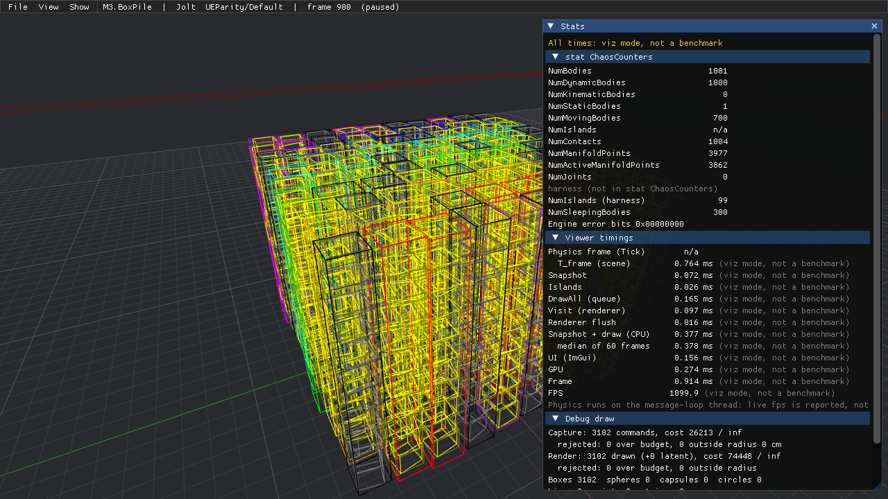
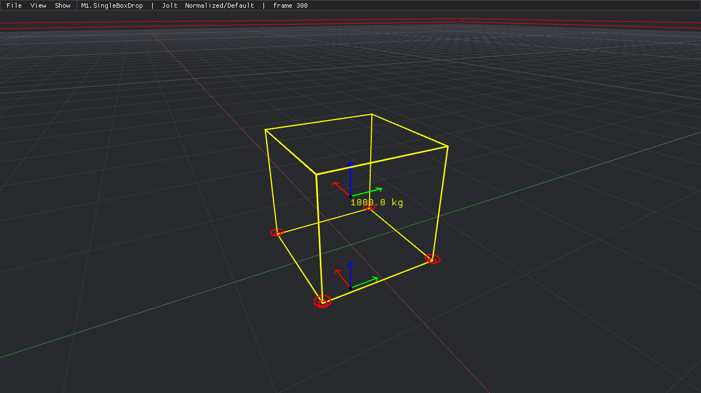

# PhysicsTest

Unreal Engine의 **Chaos**가 **Bullet**, **PhysX**, **Jolt**보다 실제로 느린지, 그리고 같은 입력에서 시뮬레이션 **결과가 어떻게 다른지**를 측정하는 Windows용 테스트 환경입니다.

- **빌드:** CMake + Ninja + MSVC (Windows 전용)
- **시각화:** Chaos Debug Draw 스타일의 단순한 와이어프레임 뷰어 (Win32 + Direct3D 11 + Dear ImGui)
- **구조:** Unreal 방식(UE 이름과 기본값, `FPhysScene` / `FBodyInstance` / `FPhysicalMaterial` …)을 따르되 Actor/Component는 없앴습니다. 렌더 씬과 물리 씬도 나누지 않고 하나로 둡니다.
- **백엔드:**

| 백엔드 | 버전 | 상태 |
|---|---|---|
| Bullet | 3.25 (`2c204c49`) | 1단계 |
| PhysX | 5.11.0 (`da950a35`), UE4 방식 설정 (`UE4Compat`) + SDK 기본값 (`SdkDefault`) | 1단계 |
| Jolt | 5.6.0 (`e77f1755`) | 1단계 |
| Chaos | UE 5.8.3, UBT Program DLL + C ABI | 나중에 직접 구현 |

> **현재 상태 (2026-10-21):** M4(뷰어 1단계)까지 마쳤습니다. UE 이름·기본값의 데이터 모델(M1)과 C ABI v0.9 + Kit + Null 백엔드(M2) 위에 첫 실제 엔진 Jolt 5.6.0이 같은 ABI로 붙었고(M3), 씬 세 개(`S00.FreeFall`, `M1.SingleBoxDrop`, `M3.BoxPile`)와 `PhysicsTestBench.exe`가 결과 파일을 씁니다. M4는 Chaos Debug Draw와 같은 색·테셀레이션·그리기 순서의 `PhysicsTestViewer.exe`(엔진 전환, 일시정지/한 스텝, Stats)입니다. 타이밍은 모두 **비공식**이고 뷰어의 시간은 "viz mode, not a benchmark"입니다 (측정 프로토콜은 M7). 결과와 완료 기준 표는 [docs/Progress.md](docs/Progress.md)에 있습니다. 다음 단계는 [작업 계획](docs/03_WorkPlan.md)의 M5(Bullet + PhysX)입니다.



## 문서

| 문서 | 내용 |
|---|---|
| [01_Feasibility.md](docs/01_Feasibility.md) | 타당성 검토: SDK 빌드 실험, hello 테스트, 렌더러 프로토타입, Chaos 단독 실행 경로, 공정성 리스크 |
| [02_Architecture.md](docs/02_Architecture.md) | 아키텍처: 디렉터리, CMake 타깃, 핵심 타입(UE 대응표), 단일 씬, C ABI 경계, 백엔드 내부(UE4 방식 PhysX), 스텝/타이밍 계약, 프로필, 뷰어, 벤치 러너 |
| [03_WorkPlan.md](docs/03_WorkPlan.md) | 마일스톤 M0~M15, 완료 기준, 공수, 크리티컬 패스 |
| [04_DecisionLog.md](docs/04_DecisionLog.md) | 고정 결정, 설계 결정 로그, 사용자 확인이 필요한 질문 |
| [appendix/A_HeaderSketches.md](docs/appendix/A_HeaderSketches.md) | 핵심 헤더 선언 초안 (C ABI, 씬 타입, 백엔드 Kit) |
| [Progress.md](docs/Progress.md) | 마일스톤별 진행 기록: 만든 것, 완료 기준 결과, 설계와 다르게 한 점, 후속 작업 |
| [Abi.md](docs/Abi.md) | C ABI 규칙과 함수 표, Kit, 게이트 A0~A10 |
| [Scenes.md](docs/Scenes.md) | 씬 카탈로그: 씬 ID별 정의(바디, 배치, 프레임, 윈도, 판정, 측정값) |
| [THIRD_PARTY_NOTICES.md](THIRD_PARTY_NOTICES.md) | 빌드 때 받아 오는 의존성 9개와 라이선스·고지 의무 |

## 빌드 환경

### 요구 사항 (2026-10-21 이 PC에서 확인)

| 항목 | 버전 | 비고 |
|---|---|---|
| OS | Windows 10/11 x64 | 확인: Windows 11 Pro 10.0.26200 |
| 컴파일러 | VS 2022 BuildTools, MSVC 14.44.35207 (cl 19.44.35229) | VS IDE는 필요 없습니다 |
| Windows SDK | 10.0.26100 | |
| CMake / Ninja | 4.1.2 / 1.13.2 | `%USERPROFILE%\.cmake-deps` 아래. PATH에 없어도 `Tools\cmake.cmd`가 찾아 줍니다 (BuildTools에 딸린 CMake/Ninja보다 앞에 둡니다) |
| Git | 2.53 | SDK clone용 |
| Python | 3.11.9 | 분석 도구(M8 이후)용. 패키지는 저장소 루트의 `.venv`에만 설치합니다 |
| 디스크 | D: 여유 약 373 GB | 빌드 트리 크기: test 1.13 GB, dev 1.22 GB, dbg 1.42 GB |

`LongPathsEnabled=0`인 PC를 기준으로 하므로 빌드 루트는 `out/<preset>`처럼 짧게 둡니다 (가장 긴 오브젝트 경로 170자, 한도 240자).

### 빠른 시작

```bat
rem (선택) 로컬 읽기 전용 미러에서 SDK를 clone합니다. 없으면 GitHub에서 받습니다.
set PT_SDK_MIRROR=D:/PhysicsRefs

Tools\cmake.cmd --preset dev
Tools\cmake.cmd --build --preset dev
Tools\ctest.cmd --preset dev
```

- `Tools\cmake.cmd`, `Tools\ctest.cmd`는 `Tools\vcenv.cmd`로 vcvars64(vswhere로 찾음, 기본은 VS 2022 BuildTools 경로)와 CMake/Ninja 경로를 설정한 뒤 `cmake`/`ctest`에 인자를 그대로 넘깁니다. "x64 Native Tools Command Prompt"에서는 `cmake`, `ctest`를 바로 써도 됩니다.
- 경로를 바꾸려면 `PT_VCVARS`(vcvars64.bat 전체 경로), `PT_CMAKE_BIN`, `PT_NINJA_BIN`을 설정합니다.

### 프리셋

| 프리셋 | 구성 | UE 대응 | check | 뷰어 라이브러리 | 용도 |
|---|---|---|---|---|---|
| `dbg` | Debug, `/MDd` | DebugGame | 켬 | 빌드 | 디버깅 |
| `dev` | Release, `/MD` | Development | 켬 | 빌드 | 뷰어, 일상 확인 (헤드라인 아님) |
| `test` | Release, `/MD` | Test | 끔 | 빌드 안 함 | 헤드라인 측정 (M7부터) |

- 모든 프리셋은 Ninja 단일 구성이고 빌드 트리는 `out/<preset>`입니다. `RelWithDebInfo`/`MinSizeRel`은 configure에서 거부합니다.
- 공통 플래그: 전 타깃 `/fp:fast`, `/MD`(dbg는 `/MDd`), `/Zi`, LTO 없음. `/arch:AVX2`는 Jolt와 Jolt를 쓰는 TU에만 붙습니다 (Shipped 프로필). 하네스 타깃은 C++20, `/W4 /WX /permissive- /utf-8 /Zc:__cplusplus /Zc:preprocessor`입니다 (하네스 TU의 경고는 빌드 실패). 전역 `CMAKE_CXX_STANDARD`는 쓰지 않습니다 (PhysX `/std:c++14 /WX`가 깨짐).
- `test-avx2`는 M7, `prof`·`test-<engine>`은 M10에서 추가합니다.

### SDK 소스

| SDK | 고정 커밋 | 기본 URL (`PT_SDK_MIRROR` 미설정) |
|---|---|---|
| Jolt 5.6.0 | `e77f175595e64cb44218cc9d9d56fc365ad0e36a` | https://github.com/jrouwe/JoltPhysics.git |
| PhysX 5.11.0 | `da950a3537927784951853c66618036f332ca0ce` | https://github.com/NVIDIA-Omniverse/PhysX.git |
| Bullet 3.25 | `2c204c49e56ed15ec5fcfa71d199ab6d6570b3f5` | https://github.com/bulletphysics/bullet3.git |

- SDK는 항상 빌드 트리(`out/<preset>/_deps/<name>-src`)로 clone하고, 그 안에서만 빌드합니다. `PT_SDK_MIRROR`를 설정하면 URL 기본값이 `file:///<mirror>/<repo>`가 됩니다. 캐시 변수 `PT_JOLT_GIT`, `PT_PHYSX_GIT`, `PT_BULLET_GIT`으로 직접 바꿀 수도 있습니다. 같은 일을 하는 사용자 프리셋 예시는 [CMakeUserPresets.json.example](CMakeUserPresets.json.example)입니다 (`dbg-local` 등, 복사해서 `CMakeUserPresets.json`으로 씁니다).
- 고정 SHA와 다른 `PT_<SDK>_GIT_TAG`, 빌드 트리의 `_deps` 밖(미러, 다른 체크아웃)을 가리키는 `FETCHCONTENT_SOURCE_DIR_<NAME>`(경로는 대소문자 무시로 비교), 고정 SHA가 아닌 HEAD는 모두 configure를 FATAL로 멈춥니다 (CTest `PhysicsTest.Probe.PinGuard`). SDK를 고쳐 보려면 `out/<preset>/_deps/<name>-src`의 clone을 직접 고칩니다.
- PhysX 경로는 기본이 FetchContent + `add_subdirectory`입니다. VS 생성기에서는 자동으로, 또는 `-DPT_PHYSX_USE_BOOTSTRAP=ON`으로 configure 시점 별도 빌드(`PhysXBootstrap.cmake`)를 씁니다.

작은 의존성(Dear ImGui v1.92.9b-docking, ImPlot v1.0, stb a7d4c217, nlohmann/json v3.12.0, doctest v2.5.3)은 URL + SHA-256으로 받습니다. 네트워크 없이 빌드하려면 같은 아카이브를 한 디렉터리에 두고 `PT_DEPS_CACHE`로 가리킵니다 (파일 이름은 `cmake/ThirdParty/ImGui.cmake`, `SmallDeps.cmake`의 `CACHE_FILE`).

### 테스트 (CTest)

| 테스트 | 확인하는 것 |
|---|---|
| `PhysicsTest.Automation` | `PhysicsTestAutomation.exe`(doctest)의 모든 단위 테스트를 한 프로세스에서 실행 |
| `PhysicsTest.Unit.<Area>` | 같은 exe를 `-tc=PhysicsTest.<Area>.*`로 영역별 실행: `Core`(UE 회전·합성 순서, SHA-256/FNV, FParse, `FRandomStream` 골든 값, UTF-8), `Config`(ini 문법, CVar 우선순위), `Types`(UE 필드·기본값, 32채널 충돌 필터, 조인트 프리셋), `BodyUtils`(질량 규칙), `StepPlanner`(tick mode 고정값), `Analytic`(`dt_engine`, S00 기준값), `Profile`(ini 계층, Origin, 변형 키 제한, `-ini:`/`-ExecCmds`), `PhysScene`(프레임 상태기계, 두 frame driver, 자유낙하 픽스처, 명령, 타이밍 버킷, 하네스 CVar 가드), `Abi`(ABI 게이트 A0~A7·A10을 static Null과 `PtBackend_Null.dll` 두 경로로, A0~A7을 SDK 백엔드(Jolt)로, Kit 상태 분리·가드, ABI 호출 비용 기록), `BackendCommon`(단위 계수, 캡슐 축, Bullet damping 변환, 결합 규칙, 접촉 규약, FNV-1a), `Backend`(레지스트리, 마샬링, effective 설정 파서), `Scenario`(씬 레지스트리, 파라미터, `scene_sha256`, BoxPile 배치, `desc_sha256`이 엔진·엔진 키와 무관함), `SdkBackend`(Jolt: S00 자유낙하, 네이티브 프리미티브, 정지 접촉 스냅샷, kinematic 원점 속도, 용량 힌트, Null과 같은 명령 결과). 걸러진 테스트가 0개이면 실패로 칩니다 |
| `PhysicsTest.Unit.DebugDraw` | (M4, 세 프리셋) 디버그 드로 파이프라인: 단위 와이어 메시 선분 수(box 12, sphere 128, capsule 68, circle 8), Chaos 상태·bounds·섬 색, 9단계 그리기 순서(`PostTickDebugDraw`), 캡슐 HalfHeight = HalfLength + R와 박스 half extent, 접촉 원 6/3·normal 30·비활성 ×0.75, COM 축 30·화살표 10, `FIslandBuilder`, 큐 예산·영역, Null 호스트 스냅샷, 합성 스냅샷의 조인트, Jolt의 점별 Phi·잠든 섬 접촉·요소 인덱스 |
| `PhysicsTest.Unit.Viewer` | (M4, dbg·dev) `PhysicsTestViewerTests.exe`: 카메라(비행, 가속·감쇠, E/Q, 시점, 휠, FOV, F), `FSceneView`(hFOV 90 major 축, reversed-Z), 세션(일시정지, 한 스텝 = FrameCount +1, Null ↔ Jolt 전환), 재시작 규칙, 오프스크린 D3D11 픽셀 색 |
| `PhysicsTest.Viewer.Headless{Null,Jolt}` | (M4, dbg·dev) `PhysicsTestViewer.exe -Headless`가 씬을 그려 PNG와 `mode = viz` manifest를 쓰고 0으로 끝남 |
| `PhysicsTest.Unit.CommandLineUtf8` | 한글 인자(`-PtUtf8Probe=한글 경로`)가 `wmain`을 거쳐 UTF-8로 `FCommandLine`에 들어감 |
| `PhysicsTest.Bench.List` | `PhysicsTestBench.exe -List`가 성공하고 `M3.BoxPile`을 보여 줌 (시나리오 레지스트리가 `/WHOLEARCHIVE`로 들어옴) |
| `PhysicsTest.Bench.M3Matrix` | Null과 Jolt × UEParity/Normalized × `M1.SingleBoxDrop` a/b, `M3.BoxPile` 1k/5k (30 프레임, 16 run): 결과 파일 세 개, 행 수, `status ok`, 비공식 표시, `shape.wrapping` = 0, Null과 Jolt의 `desc_sha256`이 같음 |
| `PhysicsTest.Bench.Exit{BackendUnavailable,BadCommandLine,UnknownScenario,UnknownParam,BadSeed,BadEngineOption,PreflightMissingKey,HashEvery,EngineError,Capacity,EngineErrorOverCapacity}` | 벤치 종료 코드 6, 2, 2, 2, 2, 2, 2, 2, 3, 5, 3. BadEngineOption(변형에 없는 Jolt 키)과 PreflightMissingKey(`-RequireEffectiveKey=no.such.key`)는 `manifest.json`의 `status = preflight_failed`도 확인한다 (PreflightMissingKey는 `frames_run` 0). HashEvery: `HashEvery=1`은 M7 recorder 몫이라 거부. EngineError: 시험용 `-InjectEngineErrorBits=0x200`(Null). Capacity: temp allocator를 1 MiB로 줄인 Jolt BoxPile 1k (manifest의 용량 bit 묶음 확인). EngineErrorOverCapacity: 둘 다 있으면 엔진 오류(3)가 이기고 manifest에 두 묶음이 남음 |
| `PhysicsTest.Smoke.{Jolt,Bullet,PhysX}` | SDK 스모크: SI, Z-up, g = 9.80, damping 0, sleep 끔. z(60) = 5.0183328 m ± 2e-5. Jolt는 설정 문자열(AVX2, Profile/Debug Renderer/FP Exceptions 없음)도 검사. `RunSmoke.cmake`가 `PT_SMOKE_JSON` 줄이 유효한 JSON인지도 확인 |
| `PhysicsTest.Probe.ThirdPartyIncludes` | Core를 먼저 include한 TU가 래퍼 쌍을 거쳐 doctest·ImGui·ImPlot·nlohmann/json을 include하고 컴파일됨 |
| `PhysicsTest.Probe.NegativeScaleFatal` | 음수 스케일 `FTransform` 합성이 모든 프리셋(`PT_DO_CHECK=0`인 test 포함)에서 Fatal로 끝남 (종료 코드 3) |
| `PhysicsTest.Probe.HarnessCVars` | 프로필 리졸버만 쓰는 프로그램(링크 맵에 `BodyUtils`·`BodyInstance`·`PhysScene` 오브젝트 없음)에도 하네스 물리 CVar가 등록되고 변형 금지·값 검증이 그대로이며, `physics_sha256`이 `PhysicsTestAutomation`과 같음 |
| `PhysicsTest.Probe.FlagLeak` | Jolt를 PRIVATE로 링크한 정적 lib의 소비자 TU에 `__AVX2__`와 `JPH_*`가 없음 |
| `PhysicsTest.Probe.BuildFlags` | `BuildFlags.json`에 플래그 프로필 위반이 0개 (모든 TU의 `_ITERATOR_DEBUG_LEVEL`이 같은지, Bullet TU와 Bullet을 쓰는 하네스 TU의 `BT_*` 정의가 같은지 포함) |
| `PhysicsTest.Probe.RefsClean` | `D:\PhysicsRefs` 세 저장소의 `git status --porcelain`(`--ignored` 포함)이 비어 있고 PxConfig.h/.dxil/.spv가 없음. 프로브 자신도 `--no-optional-locks`로 읽기만 함 |
| `PhysicsTest.Probe.LongestObjectPath` | 가장 긴 컴파일러 오브젝트 경로 < 240자 |
| `PhysicsTest.Probe.PinGuard` | 잘못된 SDK 태그, 미러(대소문자 바꾼 경로 포함)·빌드 트리 밖 소스 디렉터리, 다른 HEAD(임시 저장소)에서 configure가 FATAL |
| `PhysicsTest.Probe.CheckModules` | 게이트 A9: `PtBackend_Null.dll`의 export가 `PT_GetBackendApi` 하나이고 import가 VC 런타임, UCRT, KERNEL32뿐 (`Tools/check_modules.py --strict-crt`: C++ 라이브러리 DLL `msvcp140*` 금지. MSVC `dumpbin`, `.venv` Python `-I`) |
| `PhysicsTest.Probe.KitNamespaces` | `PhysicsTestAutomation.map`에서 Kit 심볼이 백엔드별 inline namespace(`Null`, `AbiTwin`, `Jolt`, `AutomationTest`)로 나뉘고 `PhysicsTest::Abi` 바로 아래에는 없음 |
| `PhysicsTest.Probe.BackendIsolation` | 백엔드 TU의 include 경로에 하네스 Core·PhysicsCore가 없고 `PT_BACKEND_NS`가 정의됨 |
| `PhysicsTest.Probe.KitNeedsBackendNs` | `PT_BACKEND_NS` 없이 Kit를 include한 TU가 `#error`로 컴파일되지 않음 (`compile_commands.json`의 그 TU 컴파일 줄을 스크립트가 직접 실행한다. 빌드 트리를 다시 부르지 않는다) |
| `PhysicsTest.Probe.HarnessSdkIsolation` | 하네스 TU(백엔드, SDK 스모크, JoltSeam 밖의 모든 `Source/` TU와 생성된 레지스트리)에 SDK include 경로와 `JPH_*`/`BT_*`/`PX_*` 정의가 없고, Shipped 프로필에서 `/arch`가 없음 |
| `PhysicsTest.Probe.BenchNoRenderer` | `PhysicsTestBench.exe`가 d3d11.dll과 dxgi.dll을 import하지 않음 (`dumpbin /dependents`) |
| `PhysicsTest.Probe.AutomationNoRenderer` | (M4) 디버그 드로를 링크한 `PhysicsTestAutomation.exe`도 d3d11·dxgi·d3dcompiler를 import하지 않음 |
| `PhysicsTest.Bench.Headline{IneligibleViz,EligibleDefault}` | (M4) FixedStep·`RunMode=Bench`·계측 없음이 아닌 run은 manifest `run.headline_eligible = false`와 사유, 기본 run은 true |
| `PhysicsTest.Probe.AdapterComdats` | Automation·Bench 링커 맵에서 `/arch:AVX2` 어댑터(`PtBackendJolt`) 오브젝트가 내놓은 함수가 모두 백엔드 소유이고, Jolt lib 자신의 namespace 밖 함수는 알려진 목록뿐 (하네스가 어댑터의 AVX2 COMDAT을 실행하지 않음, Abi.md §5.13). Debug 프리셋은 보고만 한다 |
| `PhysicsTest.Probe.AdapterComdatsNegative` | 같은 스크립트가 어댑터 `vector<uint32>::push_back` 줄을 넣은 고정 맵(`Source/Tests/Probes/Fixtures/AdapterComdatsNegative.map`)에서 실패함 |

### 물리 프로필 (M1)

설정은 UE처럼 ini 계층으로 정합니다: 코드 기본값 → `Config/BasePhysicsTest.ini`(UE 기본값, 모든 UE 키는 `[/Script/Engine.PhysicsSettings]`) → `Config/Profiles/<UEParity|Normalized>.ini` → 백엔드 변형 ini(M5) → 씬 고정값(M3) → 커맨드라인. 값마다 출처(Origin: 파일과 줄)가 남습니다. 변형 ini는 자기 엔진 키와 프로필이 `EngineDefaultKeys`로 연 키만 바꿀 수 있고, 그 밖의 키를 건드리면 로드 오류입니다. 하네스 물리 CVar는 `p.ComNudgeAffectsInertia`와 `p.SensitiveSleepThresholdMultiplier` 두 개이고 (`Physics/PhysicsConsoleVariables.h`), 그 밖의 CVar 이름은 엔진(Chaos 등)으로 넘어갑니다. 섹션 이름은 UE처럼 대소문자를 무시하고, 숫자 값은 유한수만 받습니다. 커맨드라인 문법은 UE와 같습니다. 예외 하나: `-ExecCmds` 안의 `name=value`도 받습니다. UE 콘솔은 공백으로만 나누므로(`name value`) 같은 줄을 UE에 넣으면 `name=value` 항목은 조용히 무시됩니다. UE로 옮길 줄은 아래처럼 공백 형식으로 씁니다 (의도한 차이, docs/02 §5.2 #32).

```
-ini:PhysicsTest:[/Script/Engine.PhysicsSettings]:DefaultGravityZ=-490,[/Script/PhysicsTest.PhysicsTestSettings]:TickMode=Sync
-ini:Engine:[/Script/Engine.PhysicsSettings]:MaxSubsteps=4
-ExecCmds="p.ComNudgeAffectsInertia 0, p.Chaos.Solver.Sleep.Enabled 0"
```

하네스 물리 CVar는 프로세스 전역이지만 `FPhysScene`은 생성될 때 자기 설정의 값(설정이 없으면 기본값)으로 맞추고, 바디를 만들 때 바뀌지 않았는지 확인합니다 (M2). 같은 시간에 살아 있는 씬들은 이 값이 같아야 합니다.

### 백엔드 경계 (M2)

모든 엔진은 순수 C ABI `Source/Runtime/PhysicsTestAbi/Public/PhysicsTestAbi/PtBackendAbi.h`(v0.9, major 0)를 거칩니다. 백엔드는 header-only Kit(`PtBackendKit.h`)로 썽크·스레드 가드·phase 상태기계·입력 검증을 얻고, 백엔드 타깃마다 `PT_BACKEND_NS`를 다르게 정의합니다. 규칙과 함수 표는 [docs/Abi.md](docs/Abi.md)에 있습니다.

- `Null`: SDK 없는 기준 백엔드(semi-implicit Euler, UE damping, 충돌 없음, `PT_CAP_NATIVE_FRAME_MODEL`). static으로 링크되고, 같은 소스가 `out/<preset>/bin/PtBackend_Null.dll`(export `PT_GetBackendApi` 하나)로도 빌드됩니다. 레지스트리 이름은 `Null`(static)과 `NullDll`(DLL)입니다.
- 백엔드 목록은 configure 때 생성되는 `PT::BackendRegistry`(`out/<preset>/Generated/PTBackendRegistry.gen.cpp`)가 정적 진입점을 직접 참조합니다. `Jolt`(M3)가 들어 있고 Bullet·PhysX는 M5에 더해집니다.
- `Jolt`: Jolt 5.6.0을 m 단위로 감싼 static 백엔드입니다 (`Source/Backends/JoltBackend`, Jolt의 `/arch:AVX2`와 `JPH_*` 정의는 이 lib의 TU에만). 변형 ini는 `Config/Profiles/Backend/Jolt.Default.ini`(Jolt 기본 솔버 설정)이고, Normalized에서는 바디마다 sleep을 끄고 Jolt 기본 damping 0.05와 선속도 한계 500 m/s를 쓰지 않습니다.
- `FPhysScene::Tick`은 `NATIVE_FRAME_MODEL` 백엔드에 UE의 `SetUpForFrame` 인자를 프레임당 한 번 넘기고(Native driver, `NumStepsTaken`이 하네스 계획과 같아야 함), 그 밖의 백엔드에는 계획한 스텝마다 한 번씩 넘깁니다(Harness driver).

`[/Script/PhysicsCore.PhysicsSettingsCore]` 섹션은 쓰지 않습니다 (UE 게임처럼 모든 물리 키가 Engine 섹션에 있습니다, docs/04 DL44). 하네스 프로그램은 `wmain`으로 들어오므로 한글 경로 같은 비 ASCII 인자도 UTF-8로 그대로 전달됩니다.

### 벤치 exe (M3, 최소판)

`out/<preset>/bin/PhysicsTestBench.exe`는 씬 하나를 백엔드 하나로 돌리고 결과 파일을 씁니다 (렌더러 없음, 1 run = 1 process).

```
PhysicsTestBench.exe -List
PhysicsTestBench.exe -Backend=Jolt -Profile=Normalized -Scenario=M3.BoxPile -Param:N=5000 [-Frames=600] [-Threads=1]
                     [-BackendProfile=Default] [-Session=<이름>] [-Out=<run 디렉터리>]
PhysicsTestBench.exe -Describe -Backend=Jolt -Scenario=M1.SingleBoxDrop -Param:Case=b
```

- **출력** (`Saved/Results/<session>/<ULID>/`, `-Out`으로 바꿀 수 있음): `timings.csv`(프레임마다 T_push/T_step/T_pull/T_frame와 QPC tick), `manifest.json`(빌드·백엔드·프로필·씬 해시·플랫폼·윈도별 통계·마지막 프레임 `h_native`), `effective_settings.jsonl`(Prepare 전), `effective_settings_after.jsonl`(마지막 프레임 뒤), `scene.json`.
- **종료 코드:** 0 ok, 2 잘못된 명령줄·프로필·씬·파라미터, `HashEvery`/`CountersEvery` > 0(M7), 백엔드가 거부한 엔진 키 또는 필수 effective 키 누락, 3 엔진 오류, 5 용량 초과(백엔드가 effective 키 `errors.capacity_bits`로 알린 bit만 있을 때. 다른 오류 bit가 함께 있으면 3), 6 백엔드 없음.
- **비공식:** M3의 타이밍은 모두 비공식입니다. 측정 프로토콜(affinity, 우선순위, 타이머 해상도, pre-roll)은 M7, 전원 계획 확인은 M8 러너, 적합성 스탬프는 M10에 생깁니다. manifest에 `"unofficial": true`, `"timing_valid_for_headline": false`로 남고, 전원 계획은 읽어서 기록만 합니다.
- 씬 정의는 [docs/Scenes.md](docs/Scenes.md), 결과 형식은 [docs/02_Architecture.md](docs/02_Architecture.md) §12에 있습니다.

### 뷰어 (M4, 1단계)

`out/dev/bin/PhysicsTestViewer.exe`(dbg, dev 프리셋)는 씬 하나를 Chaos Debug Draw 방식으로 그립니다 (Win32 + D3D11 + Dear ImGui docking). 물리는 메시지 루프 스레드에서 렌더 프레임마다 한 프레임 돕니다.

```
PhysicsTestViewer.exe [-Backend=Jolt] [-BackendProfile=..] [-Profile=Normalized] [-Scenario=M1.SingleBoxDrop] [-Param:N=1000]
                      [-ExecCmds="p.Chaos.Solver.DebugDrawCollisions 1, p.Chaos.DebugDraw.Radius 0"] [-Paused] [-WarmupFrames=N]
                      [-ResX=1600 -ResY=900] [-NoVSync] [-Frames=N -Exit] [-Headless] [-Screenshot=<png>] [-PerfReport=<json>]
                      [-NoUI | -UI=Stats,Engines,Inspector,Console] [-Camera=X,Y,Z,Pitch,Yaw]
```

- **패널:** Engines(레지스트리의 백엔드, 변형, 프로필, 씬과 파라미터, 스레드, Apply, 재생/일시정지/한 스텝/리셋/스크린숏, "재시작 필요" 안내), Inspector(바디 목록 + 선택한 바디의 상세), Stats(`stat ChaosCounters` 이름, 단계별 시간: 모두 "viz mode, not a benchmark"), Console(CVar와 명령: `help`, `stat ChaosCounters`, `pause`, `step`, `reset`, `cvars <filter>`). Show 메뉴가 `p.Chaos.Solver.DebugDraw*` 스위치를 켜고 끕니다.
- **조작 (UE 에디터 규약):** RMB + 마우스 = 시점, RMB + WASD = 이동, E/Q = 월드 위/아래, C/Z = FOV, RMB 중 휠 = 속도 ±10 %, 휠 = 전진/후진, 왼쪽 드래그 = 지면 이동, 가운데 드래그 = 팬, Alt + 왼쪽 드래그 = 궤도, F = 선택(없으면 씬) 맞추기, 클릭 = 선택, P = 일시정지, `.` = 한 스텝, Ctrl+R = 리셋, F9 = 스크린숏(`Saved/Screenshots/`, 옆에 `mode = viz` `.json`).
- **Chaos 예산:** 기본값은 Chaos와 같습니다 (`p.Chaos.DebugDraw.MaxLines 20000`, `p.Chaos.DebugDraw.Radius 3000` cm, 영역 중심은 카메라). UE 5.8.3처럼 캡처와 렌더 두 단계에서 예산과 영역을 보므로(렌더에서 박스 하나가 24), `M3.BoxPile` 1k도 기본값이면 박스 833개만 그려지고 그 뒤의 접촉·bounds는 빠집니다. Stats가 두 단계의 비용과 거부 수를 보여 줍니다. 다 보려면 Show > "Draw everything" 또는 `-ExecCmds="p.Chaos.DebugDraw.MaxLines 0, p.Chaos.DebugDraw.Radius 0"`을 씁니다.
- **헤드리스:** `-Headless`는 창 없이 같은 경로로 오프스크린에 그리고 `-Frames`(기본 1) 뒤에 끝납니다 (자동 검사, 문서 그림). `-PerfReport`는 프레임별 CPU·GPU 시간 요약을 씁니다.
- **시간 읽기:** 창 모드 vsync에서는 스레드가 프레임마다 vsync를 기다리며 쉬어 Stats의 "Snapshot + draw"가 연속 부하 값의 2~3배로 보입니다. 성능을 볼 때는 `-NoVSync`(지원되면 tearing으로 갱신 주기에 묶이지 않음)나 `-Headless`를 씁니다. 기준 4b(스냅샷 + 드로 ≤ 4 ms)는 이 연속 부하 값으로 판정합니다.
- 백엔드에 스냅샷이 없으면(Null) 호스트가 당겨 둔 바디 상태로 그립니다 (접촉·섬 없음).
- **PowerShell:** Windows PowerShell 5.1은 따옴표 없는 `-Scenario=M3.BoxPile`을 점에서 잘라 넘깁니다 (뷰어가 "unknown scenario 'M3'"를 냅니다). PowerShell에서는 `'-Scenario=M3.BoxPile'`처럼 점이 든 인자를 따옴표로 감싸거나 cmd에서 실행합니다.
- **하네스 물리 CVar**(`p.ComNudgeAffectsInertia`, `p.SensitiveSleepThresholdMultiplier`)는 Console에서 값을 보기만 하고 바꾸지 않습니다. 씬의 설정이 정하는 값이라 살아 있는 씬 아래에서 바꾸면 다음 바디 생성에서 Fatal이 되기 때문입니다. 프로필이나 커맨드라인(`-ExecCmds=`, `-ini:`)으로 정하면 Apply / Reset이 다음 씬에 적용합니다.



### 빌드 자기보고

- `out/<preset>/BuildFlags.json`: 빌드 단계에서 `compile_commands.json`으로부터 만듭니다 (SDK 자신의 TU 포함, TU마다 `/arch`, `/fp`, CRT, `/std`, 최적화, 실효 `_ITERATOR_DEBUG_LEVEL`, 주요 정의(`/D "X"` 형태 포함), 정규화한 명령의 SHA-256). PhysX 구성(debug/release)은 PhysX TU의 정의에서 읽습니다. 그 SHA-256은 `Generated/BuildFlagsSha.h`로 exe에 들어갑니다 (`PhysicsTestAutomation.exe -BuildInfo`). 내용이 같으면 두 파일을 다시 쓰지 않으므로, 변경 없이 다시 configure해도 재컴파일·재링크가 없습니다.
- `out/<preset>/Generated/PTBuildInfo.h`: configure 시점 사실(프리셋, 구성, 프로필, SDK SHA).
- `Tools\check_physx_isolation.cmd <preset> [--clean]`: PhysX를 끈 트리(`out/<preset>-nophysx`)를 만들어 하네스·Jolt·Bullet TU의 플래그가 PhysX 유무와 무관한지 비교합니다 (03 M0 완료 기준 4). `--clean`은 끝난 뒤 그 트리(프리셋당 약 0.5 GB)를 지웁니다.

### M0 측정값 (2026-10-21, i5-13600KF, 전원 계획 Balanced)

| 항목 | 값 |
|---|---|
| 빈 `out/`에서 `test` configure + build (file:// 미러) | 13.1 s + 42.7 s = **55.7 s**, 다시 빌드하면 `ninja: no work to do.` (수정 라운드 후 다시 잼: 14.4 s + 41.7 s = 56.1 s, 813 TU) |
| 빈 `out/`에서 `dev` / `dbg` configure + build | 71.3 s / 32.8 s |
| 컴파일 TU / 경고 | 813 TU(.rc 4개 제외), 컴파일러 경고 0 (세 프리셋) |
| `BuildFlags.json` (test) | Jolt 139 TU + Jolt 소비 하네스 TU 2개만 `/arch:AVX2`, PhysX 466·Bullet 180·하네스 16·ImGui 10 TU는 `/arch` 없음. 전부 `/fp:fast` + `-MD`(dbg `-MDd`), `_ITERATOR_DEBUG_LEVEL` 0(dbg 2), PhysX `/std:c++14`, 위반 0 |
| PhysX on/off 비교 (dbg, dev, test) | PhysX 외 346 TU의 정규화 명령이 모두 같음 |
| 스모크 z(60) (세 SDK, 세 프리셋) | 5.0183330 m (기준 5.0183328 m, 차이 1.4e-7 m) |

### Python 환경

```bat
py -3.11 -m venv .venv
.venv\Scripts\python -m pip install -r Tools\ptbench\requirements.lock
.venv\Scripts\python -I -c "import numpy, pandas, pyarrow, scipy, matplotlib, jsonschema"
```

- `Tools/ptbench/requirements.lock`은 `pip freeze` 결과 그대로입니다 (numpy 2.4.6, pandas 3.0.6, pyarrow 26.0.0, scipy 1.17.1, matplotlib 3.11.2, jsonschema 4.26.0과 그 의존성). 직접 의존성 목록은 `requirements.in`입니다.
- 오프라인 재설치: `pip download --only-binary=:all: -d Tools\ptbench\wheelhouse -r Tools\ptbench\requirements.lock`로 받아 두고 `pip install --no-index --find-links Tools\ptbench\wheelhouse -r Tools\ptbench\requirements.lock`. wheelhouse(약 103 MB)와 `.venv`는 git이 무시합니다.

### 디버거

dbg 프리셋 exe(`out/dbg/bin/*.exe`, PDB 포함)를 디버깅합니다. 선택은 사용자 몫입니다 (04 Q7).

- **VS Code + C/C++ 확장 (cppvsdbg, 권장 기본값):** [.vscode/launch.json.example](.vscode/launch.json.example)과 [.vscode/settings.json.example](.vscode/settings.json.example)을 `.vscode/`에 이름을 바꿔 복사합니다. CMake Tools 확장이 `CMakePresets.json`을 읽고, 프리셋의 `architecture`/`toolset`(strategy external) 힌트로 MSVC 환경을 불러옵니다.
- **CLion 2026.1 (설치되어 있음):** 폴더를 열면 `CMakePresets.json`의 dbg/dev/test가 보입니다. Settings > Build, Execution, Deployment > Toolchains에서 "Visual Studio" 툴체인(경로 `C:\Program Files (x86)\Microsoft Visual Studio\2022\BuildTools`, 아키텍처 amd64)을 고르고, CMake는 `%USERPROFILE%\.cmake-deps\cmake\win\x64\bin\cmake.exe`, 빌드 도구는 `%USERPROFILE%\.cmake-deps\ninja\win\x64\ninja.exe`로 지정합니다. 환경 변수 `PT_SDK_MIRROR=D:/PhysicsRefs`는 CMake 프로필의 Environment에 넣습니다. 디버거는 기본값 "Bundled LLDB"(MSVC PDB 지원)를 씁니다.
  - M0에서 CLion에 딸린 LLDB(`bin\lldb\win\x64\bin\lldb.exe`)를 배치 모드로 실행해 `out/dbg/bin/PtSmokeBullet.exe`의 `BulletSmoke.cpp:81`에 중단점을 걸고 멈춤, 지역 변수 읽기(`Box.m_worldTransform.m_origin.m_floats[2] = 5.01833296`), 호출 스택을 확인했습니다. IDE 안에서의 확인은 사용자가 합니다.
- VS 2022 IDE를 설치해 "폴더 열기"로 써도 됩니다 (VS 생성기 프리셋은 두지 않습니다).

### UE 5.8.3 소스 점검 (읽기 전용 확인만)

| 항목 | 결과 |
|---|---|
| `D:\UnrealEngine\Engine\Build\Build.version` | 5.8.3, Changelist 0, CompatibleChangelist 55116800, BranchName UE5 |
| `Engine\Binaries\DotNET\UnrealBuildTool\UnrealBuildTool.dll` | 있음 (3,203,584 bytes, 2026-09-26) |
| `Engine\Build\BatchFiles\Build.bat`, `.uedependencies` | 있음 |
| 번들 .NET SDK | `Engine\Binaries\ThirdParty\DotNet\10.0` 있음 |
| `Build.bat -help`로 UBT 실행 확인 | **사용자 확인 대기.** UBT는 엔진 트리에 파일을 쓰므로 하네스 작업에서는 실행하지 않았습니다. M2.5 전에 사용자가 실행하고 결과를 여기에 적습니다 |

## 디렉터리

```
CMakeLists.txt  CMakePresets.json  CMakeUserPresets.json.example  THIRD_PARTY_NOTICES.md
cmake/            PTOptions, PTToolchain, PTFlagProfiles, PTModules, DumpBuildFlags, PTBuildInfo.h.in
cmake/ThirdParty/ Jolt, PtBullet, PhysX, PhysXBootstrap, ImGui, SmallDeps, PtFetch (.cmake)
Config/           BasePhysicsTest.ini, Profiles/UEParity.ini, Profiles/Normalized.ini (프로필 ini 계층, M1 초안),
                  Profiles/Backend/Jolt.Default.ini (백엔드 변형, M3)
Source/Runtime/   Core (UE 관용구 최소 구현, ini, CVar), PhysicsTestAbi (C ABI, Kit), BackendCommon (단위·결합·접촉 규약,
                  셰이프 래핑 규칙, 빌드 자기보고), PhysicsCore (UE 데이터 모델, BodyUtils, FStepPlanner, 프로필 리졸버,
                  FPhysScene), PhysicsTestConformance (ABI 게이트), PhysicsTestScenarios (씬과 레지스트리),
                  PhysicsTestBenchCore (클럭 버킷, 통계, 호스트 사실), PhysicsTestBenchmark (벤치 실행, 결과 파일)
Source/Backends/  NullBackend (static + DLL), JoltBackend (M3)
Source/Programs/  PhysicsTestAutomation (doctest 단위 테스트), PhysicsTestBench (벤치 exe, M3)
Source/Tests/     SdkSmoke (스모크 3종), Probes (CTest 프로브), AbiTwin (Kit 분리 시험 백엔드)
Tools/            cmake.cmd, ctest.cmd, vcenv.cmd, check_physx_isolation.cmd, CompareBuildFlags.cmake, ptbench/
docs/             설계 문서와 Progress.md
prototypes/       타당성 검토 때의 일회성 코드 (기록용, 빌드하지 않음)
```

## 라이선스 메모

- 이 저장소에는 Unreal Engine 소스와 UE 소스를 옮긴 코드를 넣지 않습니다. Chaos 연결 코드는 로컬 UE 설치본으로만 컴파일하며, 빌드 결과물(DLL/PDB, Intermediate 등)은 커밋하지 않습니다. Core의 UE 관용구는 이름과 동작만 맞춘 자체 구현이며, 동작을 따른 곳에는 UE 파일:줄을 주석으로 적었습니다.
- 서드파티 라이선스는 [THIRD_PARTY_NOTICES.md](THIRD_PARTY_NOTICES.md)에 정리했습니다. PhysX SDK(`physx/`)는 Apache-2.0, Jolt는 MIT, Bullet은 zlib, Dear ImGui·ImPlot·nlohmann/json·doctest는 MIT, stb는 MIT 또는 퍼블릭 도메인, Tracy(M10 prof 전용)는 BSD-3입니다.
- 벤치마크 결과는 UE EULA와 각 SDK 라이선스를 확인할 때까지 공개하지 않습니다.
