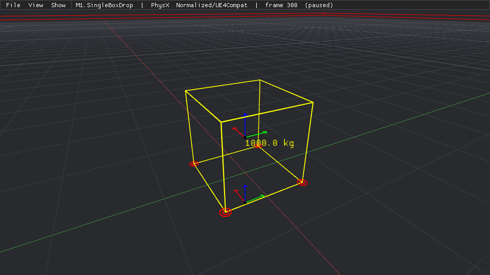
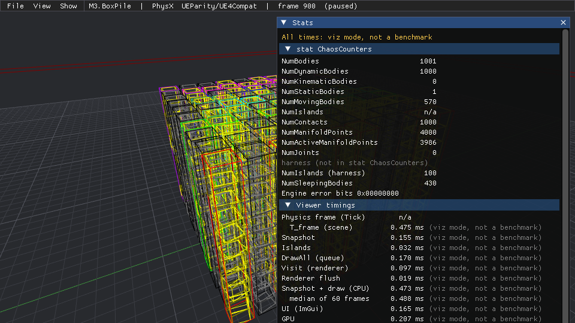
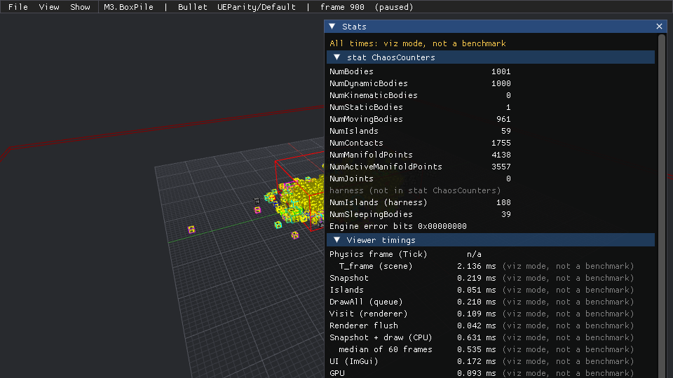

# 진행 기록 (Progress)

> **관련 문서:** [01_Feasibility.md](01_Feasibility.md) · [02_Architecture.md](02_Architecture.md) · [03_WorkPlan.md](03_WorkPlan.md) · [04_DecisionLog.md](04_DecisionLog.md) · [Checkpoints.md](Checkpoints.md) · [appendix/A_HeaderSketches.md](appendix/A_HeaderSketches.md)
> **근거 표기:** **[V]** 이 마일스톤에서 직접 빌드·실행해 확인 · **[R]** 추정

마일스톤마다 만든 것, [03_WorkPlan.md](03_WorkPlan.md)의 완료 기준 결과, 설계와 다르게 한 점과 그 이유, 후속 작업을 적는다. 커밋과 태그는 리드가 한다.

---

## M0. 스캐폴드·툴체인·SDK 연결·환경 준비 (2026-10-21)

**상태:** 완료. 완료 기준 12개 중 11개 통과, 1개(11, 디버거 중단점)는 사용자 확인 대기다. 환경 표의 "UE 5.8.3 소스 빌드 가능 점검(`Build.bat -help`)"도 사용자 확인 대기다. 독립 검사가 지적한 21건(주요 3, 경미 18. 같은 지적 2쌍 포함)을 수정 라운드 0에서 반영하고 영향받는 기준을 다시 확인했다 (§6).

**검증 환경:** Windows 11 Pro 10.0.26200, i5-13600KF (20 logical), MSVC 14.44.35207 (cl 19.44.35229), Windows SDK 10.0.26100, CMake 4.1.2, Ninja 1.13.2, Git 2.53, Python 3.11.9. 전원 계획은 Balanced 그대로 두었다. SDK는 모두 `PT_SDK_MIRROR=D:/PhysicsRefs`(file:// 미러)에서 clone했고, 작은 의존성은 GitHub에서 받았다.

### 1. 만든 것

| 영역 | 파일 | 내용 |
|---|---|---|
| 저장소 기본 | `.gitignore`(병합), `.gitattributes`(유지), `.editorconfig`(신규), `README.md`(환경·빌드 절 갱신), `THIRD_PARTY_NOTICES.md` | 9개 의존성과 라이선스·고지 의무, UE 소스 점검 결과, 디버거 안내 |
| 루트 CMake | `CMakeLists.txt`, `CMakePresets.json`(dbg/dev/test), `CMakeUserPresets.json.example` | 프리셋은 Ninja, `out/${presetName}`. 옵션 `PT_WITH_JOLT/BULLET/PHYSX`(ON), `PT_WITH_CHAOS`(OFF, 아무것도 하지 않음), `PT_WITH_VIEWER`(ON, test는 OFF) |
| 툴체인 | `cmake/PTOptions.cmake`, `PTToolchain.cmake`, `PTFlagProfiles.cmake`, `PTModules.cmake` | SDK 핀과 URL(`PT_SDK_MIRROR` 규약), 핀 가드, MSVC x64 가드, RelWithDebInfo/MinSizeRel 거부, `/MD` CRT를 SDK보다 먼저, `/fp:fast` 전역, `/Zi`, Release `/DEBUG:FULL /OPT:REF,ICF`, LTO 끔, `pt_target_defaults()`, `pt_apply_arch()`, 모듈·프로그램 헬퍼 |
| ThirdParty | `cmake/ThirdParty/Jolt.cmake`, `PtBullet.cmake`, `PhysX.cmake`, `PhysXBootstrap.cmake`, `ImGui.cmake`, `SmallDeps.cmake`, `PtFetch.cmake` | SDK 3종은 고정 SHA로 clone → 미러 내 빌드 거부 → `git rev-parse HEAD` 검사 → `add_subdirectory(... EXCLUDE_FROM_ALL SYSTEM)`. 래퍼 `PT::Jolt`, `PT::Bullet`, `PT::PhysX`, `PT::ImGui`/`PT::ImGuiHeaders`, `PT::Stb`, `PT::Json`, `PT::Doctest` |
| 빌드 자기보고 | `cmake/DumpBuildFlags.cmake`, `cmake/PTBuildInfo.h.in`, `Source/Runtime/BackendCommon/Public/PtBuildReport.h` | 빌드 단계 `add_custom_command(OUTPUT BuildFlags.json Generated/BuildFlagsSha.h DEPENDS compile_commands.json)`(내용이 같으면 다시 쓰지 않음), TU마다 실효 `_ITERATOR_DEBUG_LEVEL`, configure 시점 `PTBuildInfo.h`, 어댑터 TU 자기보고 매크로 |
| Core | `Source/Runtime/Core` (`PT::Core`) | `FVector`/`FRotator`/`FQuat`/`FTransform`/`FBox`(double, UE 합성 순서), `FMath`, `UE_LOG`과 로그 카테고리, `check`/`checkf`/`verify`/`ensure`/`ensureMsgf`/`checkNoEntry`(`PT_DO_CHECK`), `FCommandLine`, `FParse`(UE 의미), `FPlatformTime`(QPC), `FPlatformMisc`, `FFnv`, `FSHA256`, `FRandomStream`(mt19937_64, seed 0x5EED), 하네스 측 `Misc/PtThirdPartyIncludesStart.h`/`End.h` |
| BackendCommon | `Source/Runtime/BackendCommon` (`PT::BackendCommon`, INTERFACE) | `PtBuildReport.h`, 백엔드 측 `PtThirdPartyIncludes.h`(경고만 push/pop) |
| Automation 골격 | `Source/Programs/PhysicsTestAutomation` | doctest 러너, `-BuildInfo`, Core 테스트 17개(`PhysicsTest.Core.*`) |
| SDK 스모크 | `Source/Tests/SdkSmoke` | `PtSmokeJolt/Bullet/PhysX.exe`: SI, Z-up, g = 9.80, damping 0, sleep 끔, dt = (float)(1/60), 60 스텝. CTest는 `RunSmoke.cmake`로 돌려 `PT_SMOKE_JSON` 줄을 `string(JSON)`으로 검증 |
| CTest 프로브 | `Source/Tests/Probes` | 제3자 include 컴파일, 음수 스케일 합성 Fatal, 플래그 누수(jolt seam), BuildFlags 위반, 참조 저장소 깨끗함, 가장 긴 오브젝트 경로, 핀 가드 |
| 도구 | `Tools/cmake.cmd`, `Tools/ctest.cmd`, `Tools/vcenv.cmd`, `Tools/check_physx_isolation.cmd`, `Tools/CompareBuildFlags.cmake` | vcvars64(vswhere) + `%USERPROFILE%\.cmake-deps`의 CMake/Ninja, PhysX on/off 플래그 비교(`--clean`이면 비교 트리 삭제) |
| Python | `.venv`(git 무시), `Tools/ptbench/requirements.lock`, `requirements.in`, `Tools/ptbench/wheelhouse/`(git 무시, 103 MB) | numpy 2.4.6, pandas 3.0.6, pyarrow 26.0.0, scipy 1.17.1, matplotlib 3.11.2, jsonschema 4.26.0 + 의존성 15개 |
| 디버거 준비 | `.vscode/launch.json.example`, `.vscode/settings.json.example`, README의 CLion 안내 | cppvsdbg 설정 5개, CMake Tools 설정. 프리셋에 `architecture`/`toolset`(strategy external) 힌트 |
| 문서 | `docs/Progress.md`(신규), `docs/02_Architecture.md` §3·§4.3, `docs/03_WorkPlan.md` M0 작업 4 | 디렉터리 트리에 M0 경로 추가, PvdSDK 문장 정정 (아래 §3) |

CTest는 프리셋마다 11개다: `PhysicsTest.Automation`, `PhysicsTest.Smoke.{Jolt,Bullet,PhysX}`, `PhysicsTest.Probe.{ThirdPartyIncludes,NegativeScaleFatal,FlagLeak,BuildFlags,RefsClean,LongestObjectPath,PinGuard}`. 세 프리셋 모두 11/11 통과했다 [V] (`NegativeScaleFatal`은 수정 라운드 0에서 더했다).

### 2. 완료 기준 결과

| # | 기준 (03 M0) | 결과 | 증거 [V] |
|---|---|---|---|
| 1 | 빈 `out/`에서 file:// 미러로 `test` configure + build가 4분 안. 재빌드는 `ninja: no work to do`. dbg, dev도 빌드 | **통과** | `out/` 전체 삭제 후 `Tools\cmake.cmd --preset test` 13.1 s + `Tools\cmake.cmd --build --preset test` 42.7 s = **55.7 s**. 다시 빌드하면 `ninja: no work to do.` 빈 트리에서 dev 71.3 s, dbg 32.8 s, 각각 재빌드 `ninja: no work to do.` 세 프리셋 모두 컴파일러 경고 0 (775개 오브젝트를 컴파일한 test 로그 기준). **수정 라운드 0 뒤 다시 잼:** 빈 `out/test`에서 14.4 s + 41.7 s = 56.1 s (813 TU, 경고 0), 다시 빌드 `no work to do`. 변경 없이 다시 configure하면 `Generating BuildFlags.json` 한 단계만 돌고 재컴파일·재링크가 없다 (전에는 `PhysicsTestAutomationMain.cpp` 재컴파일과 재링크가 따라왔다) |
| 2 | `D:\PhysicsRefs` 세 저장소의 `git status --porcelain`이 비어 있음. PxConfig.h, .dxil, .spv가 새로 생기지 않음 | **통과** | 세 프리셋 빌드와 PhysXBootstrap 빌드 뒤 `PhysicsTest.Probe.RefsClean`: JoltPhysics/PhysX/bullet3 모두 `git status --porcelain` → empty, `--ignored` → empty, 미러와 저장소 소스 트리에서 PxConfig.h/.dxil/.spv 0개. PxConfig.h는 `out/<preset>/_deps/physx-src`에만 생겼다. **수정 라운드 0:** 프로브는 이제 `git --no-optional-locks`(와 `GIT_OPTIONAL_LOCKS=0`)로 읽기만 한다. CTest 전후로 미러 세 저장소의 `.git`과 `.git/index` mtime이 같다 (전 프로브는 `index.lock`을 만들고 지웠다) |
| 3 | `BuildFlags.json`: Shipped에서 Jolt TU와 Jolt를 링크한 TU만 `/arch:AVX2`, PhysX·Bullet·하네스는 `/arch` 없음. 전 TU `/fp:fast` + `-MD`(dbg `-MDd`), `-MT` 없음, PhysX `/std:c++14`. `compile_commands.json`이 바뀌면 다시 만들어짐 | **통과** | test: 812 TU — sdk.jolt 139 (AVX2 139), 하네스 17 (AVX2 2 = `PtSmokeJolt`, `PtProbeJoltSeam`, 나머지 15 none), sdk.physx 466 (none, c++14), sdk.bullet 180 (none), ImGui 10 (none). 전부 fp fast, CRT MD (dbg는 MDd), 위반 0 (`PhysicsTest.Probe.BuildFlags`). PhysX 구성은 PhysX TU의 정의에서 dbg `debug`, dev/test `release`. 재생성: `compile_commands.json`을 touch하고 빌드 → `Generating BuildFlags.json` 실행 후 다음 빌드는 `no work to do`. `-DPT_DO_CHECK=ON`으로 다시 configure → 재생성되고 `PT_DO_CHECK=1` TU가 0 → 17개, 되돌리면 다시 0. **수정 라운드 0:** 813 TU (하네스 18 = AVX2 2 + none 16). `/D "X"` 형태 정의(PhysX의 `_DEBUG`, `NDEBUG`, `_ITERATOR_DEBUG_LEVEL=0`, `_HAS_ITERATOR_DEBUGGING=0`)도 읽고, TU마다 실효 `_ITERATOR_DEBUG_LEVEL`을 기록해 기대값(dbg 2, dev/test 0)과 다르면 위반으로 센다. 세 프리셋 모두 전 TU가 기대값이고 위반 0. 가짜 `compile_commands.json`으로 불일치 TU 2개가 위반 2건으로 잡히는 것을 확인했다 |
| 4 | PhysX를 켜고 끈 두 빌드에서 하네스·Jolt·Bullet TU의 플래그와 CRT가 같음 (dbg, dev, test) | **통과** | `Tools\check_physx_isolation.cmd <preset>`: dbg, dev, test 모두 PhysX를 끈 트리의 345 TU(하네스, Jolt, Bullet, ImGui)가 켠 트리와 **정규화한 cl 명령 전체가 같다** (345/345). 켠 트리에만 있는 467 TU는 PhysX 타깃과 `PtSmokePhysX`뿐이다. `PhysXBootstrap`으로 바꿀 필요가 없었다 (R6 미발생). **수정 라운드 0:** 세 프리셋을 다시 비교해 346/346 (새 프로브 TU 포함), 켠 트리에만 467 TU. `--clean`으로 비교 트리를 지웠다 |
| 5 | Jolt를 PRIVATE로 링크한 정적 lib의 소비자 TU에 `__AVX2__`와 `JPH_*` 없음 | **통과** | `PhysicsTest.Probe.FlagLeak`: `consumer TU: __AVX2__ not defined, JPH_* not defined`, 라이브러리 TU 자기보고 `"__AVX2__":1`, Jolt 설정 문자열에 AVX2. `BuildFlags.json`에서도 `SeamConsumer.cpp`는 `arch ""`, JPH 정의 없음 |
| 6 | 세 SDK 모두 z(60) = 5.0183328 m ± 2e-5 m | **통과** | 세 프리셋 × 세 SDK 모두 z(60) = 5.018332958 m, 기준 5.018332814 m, 차이 1.445e-7 m. vz(60) = -9.7999983 m/s. **수정 라운드 0:** CTest가 `RunSmoke.cmake`로 세 SDK의 `PT_SMOKE_JSON` 줄을 `string(JSON)`으로 파싱한다. PhysX의 `PX_PHYSICS_VERSION`은 이제 `"5.11.0"`(전에는 식 텍스트라 JSON이 아니었다). Jolt 바닥도 100 x 100 x 2 m로 맞췄다 |
| 7 | Jolt TU 안에서 본 `JPH::GetConfigurationString()`에 AVX2, Profile/Debug Renderer/FP Exceptions 없음 | **통과** | test/dev: `Single precision x86 64-bit with instructions: SSE2 SSE4.1 SSE4.2 AVX AVX2 F16C LZCNT TZCNT FMADD (16-bit ObjectLayer) (ObjectStream) (C++ RTTI) (C++ Exceptions)`. dbg는 `(Assertions)`, `(Debug)`가 더해진다. 스모크가 문자열을 검사한다. `BuildFlags.json`의 Jolt PUBLIC 정의는 `JPH_OBJECT_STREAM` 하나 |
| 8 | 고정 SHA와 다른 태그면 configure FATAL. 가장 긴 오브젝트 경로 < 240자 | **통과** | `PhysicsTest.Probe.PinGuard`(configure 4회): `PT_JOLT_GIT_TAG=v5.5.0` → FATAL, 다른 40자리 SHA → FATAL, `FETCHCONTENT_SOURCE_DIR_JOLT=<미러>` → "inside the read-only mirror" FATAL, 다른 HEAD의 checkout → "expected the pinned SHA" FATAL. 가장 긴 컴파일러 오브젝트 경로 170자(test), 169자(dev, dbg): `out\test\_deps\physx-build\sdk_source_bin\CMakeFiles\PhysXExtensions.dir\__\__\physxmetadata\extensions\src\PxExtensionAutoGeneratedMetaDataObjects.cpp.obj`. **수정 라운드 0:** 6회로 늘렸다. 대문자로 바꾼 미러 경로 → "inside the read-only mirror" FATAL, `PT_SDK_MIRROR` 없이 빌드 트리 밖 디렉터리 → "outside this build tree's FETCHCONTENT_BASE_DIR" FATAL. 다른 HEAD는 프로브 트리 `_deps` 안의 임시 저장소(빈 커밋 1개)로 검사하므로 이 저장소에 `.git`이 없어도 된다. 끝나면 `_probe` 디렉터리를 지운다 |
| 9 | CTest 프로브 "Core → 래퍼 → doctest·ImGui·ImPlot·nlohmann/json" 컴파일 | **통과** | `PhysicsTest.Probe.ThirdPartyIncludes`: `CoreMinimal.h` 다음 래퍼 안에서 `DOCTEST_CONFIG_IMPLEMENT` + doctest(멤버 `check()`를 쓰는 구현부 포함), imgui.h, implot.h, nlohmann/json.hpp. 뒤에서 `check`/`checkf`/`verify`/`ensure`/`ensureMsgf`가 복원되는지 `#error`로 검사하고 실행해 확인 |
| 10 | `.venv`에서 `python -I -c "import numpy, pandas, pyarrow, scipy, matplotlib, jsonschema"` 성공, `pip freeze` = lock. wheelhouse가 있으면 오프라인 재설치 | **통과** | `.venv` import 성공. `pip freeze`와 `requirements.lock`이 같다. 스크래치에 새 venv를 만들어 `pip install --no-index --find-links Tools/ptbench/wheelhouse -r Tools/ptbench/requirements.lock` → 성공, 그 venv의 `pip freeze`도 lock과 같고 import 성공 |
| 11 | 선택한 디버거로 dbg 프리셋 스모크 exe에 중단점 | **사용자 확인 대기** | 디버거 선택(Q7)과 설치는 사용자 몫이다. 준비: `.vscode/*.json.example`(cppvsdbg), README의 CLion 안내. 사전 검증: CLion에 딸린 LLDB(`C:\Program Files\JetBrains\CLion 2026.1\bin\lldb\win\x64\bin\lldb.exe`)를 배치 모드로 실행해 `out\dbg\bin\PtSmokeBullet.exe`의 `BulletSmoke.cpp:81` 중단점에서 멈추고(`stop reason = breakpoint 1.1`), 지역 변수(`Box.m_worldTransform.m_origin.m_floats[2] = 5.01833296`)와 호출 스택을 읽었다. IDE 안에서 확인하면 이 항목을 닫는다. **수정 라운드 0:** `.vscode/settings.json.example`의 PATH 값(역슬래시 이스케이프 오류로 JSON이 아니었다)을 슬래시로 고쳤다. `.vscode/*.json.example`, `CMakePresets.json`, `CMakeUserPresets.json.example`을 주석을 뗀 뒤 `json.loads`로 확인했다 |
| 12 | `THIRD_PARTY_NOTICES.md`에 9개 항목 | **통과** | PhysX `physx/` Apache-2.0 (NOTICE 의무, 루트 BSD-3과 구분, da950a35의 `physx/`에는 NOTICE 파일 없음), Jolt MIT, Bullet zlib, Dear ImGui MIT, ImPlot MIT, stb MIT/퍼블릭 도메인, nlohmann/json MIT, doctest MIT, Tracy BSD-3 (prof 전용, M10). 각 고정 버전과 SHA-256 포함 |

**환경 표 항목**
- UE 5.8.3 소스 빌드 가능 점검: **사용자 확인 대기.** 읽기 전용 사실만 README에 적었다 (Build.version 5.8.3, `UnrealBuildTool.dll` 있음, `Build.bat`·`.uedependencies`·번들 .NET 10.0 있음). `Build.bat -help`는 UBT가 엔진 트리에 쓰므로 실행하지 않았다.
- 의존성 tarball: GitHub 아카이브를 다시 받아 SHA-256이 스크래치 tarball과 같음을 확인했다 (doctest, nlohmann/json, Tracy 포함 [V]). URL_HASH를 고정했고 오프라인용으로 `PT_DEPS_CACHE`를 두었다. tarball을 저장소 밖 캐시로 옮기지는 않았다 (네트워크가 되므로 필요 없었다).

### 3. 설계와 다르게 한 점

| # | 설계 | 실제 | 이유 |
|---|---|---|---|
| 1 | 02 §4.3: Jolt `SOURCE_SUBDIR Build`, PhysX `SOURCE_SUBDIR physx`로 `FetchContent_MakeAvailable`이 추가 | 세 SDK 모두 `SOURCE_SUBDIR`를 CMakeLists.txt가 없는 경로로 두고 받기만 한 뒤(`PtFetch.cmake`), 미러 내 빌드 거부와 `git rev-parse HEAD` 검사를 하고 `add_subdirectory(... EXCLUDE_FROM_ALL SYSTEM)` | SHA 가드와 "참조 체크아웃에서 빌드 금지" 가드가 SDK의 CMakeLists보다 **먼저** 돌아야 한다. Bullet(DL54)과 같은 방식으로 셋을 맞췄다. 결과는 같다 (criterion 4) |
| 2 | 02 §4.3, 03 M0 작업 4: "PvdSDK는 Debug에서만 링크" | 모든 구성에서 링크된다. 02·03의 문장을 정정했다 | PhysXPvdSDK는 PhysX(PRIVATE)와 PhysXExtensions(PUBLIC)의 링크 의존성이다 (physx/source/compiler/cmake/PhysX.cmake:397-400, PhysXExtensions.cmake:319-324 [V]). release에서는 `PX_SUPPORT_PVD=0`으로 코드가 빠진다 |
| 3 | 02 §3 트리에 없음 | `Source/Tests/{SdkSmoke,Probes}`, `cmake/ThirdParty/PtFetch.cmake`, `Tools/{ctest,vcenv,check_physx_isolation}.cmd`, `Tools/CompareBuildFlags.cmake`, `.editorconfig` 추가. 02 §3 트리에 반영 | 스모크와 프로브는 하네스 모듈도 프로그램도 아니어서 둘 곳이 없었다. 기준 4를 반복 확인할 도구가 필요했다 |
| 4 | 02 §16: `Tools/ptbench/.venv/` | `.venv`는 저장소 루트 (03 §7 10번, 리드 지시). `.gitignore`는 두 경로를 다 막는다. 02 §16 문장도 고쳤다 (수정 라운드 0) | 리드 지시 |
| 5 | 02 §4.4: test는 "RENDER OFF" | test 프리셋은 `PT_WITH_VIEWER=OFF`. ImGui 정적 lib은 만들지 않고, 헤더만 쓰는 INTERFACE `PT::ImGuiHeaders`를 따로 둬서 include 프로브는 세 프리셋 모두에서 돈다 | 기준 9가 프리셋과 무관하게 ImGui/ImPlot 헤더를 요구한다 |
| 6 | A.4 `PT_BUILD_REPORT_JSON`: 고정 필드 뒤에 SdkFields | SdkFields를 앞에 두고 `_MSC_FULL_VER`를 마지막에 둔다. `_DEBUG`, `_M_FP_STRICT`를 더했다 | SdkFields가 비어도 유효한 JSON이 되게 했다 |
| 7 | A.4 하네스 측 쌍: check/checkf/verify/ensure | `checkNoEntry`, `verifyf`, `ensureMsgf`도 park/restore | Core가 이 매크로들도 정의하므로 |
| 8 | 02 §4.6 `BuildFlags.json` | rc.exe로 컴파일되는 PhysX `*.rc` 4개는 제외(`skipped_non_cxx`), `*-build` 아래의 SDK TU(Jolt PCH `cmake_pch.cxx`)는 그 SDK 그룹으로 분류, 타임스탬프를 넣지 않음(SHA-256이 플래그 집합 자체를 식별), 하네스 C++20과 `/GL` 없음도 검사, TU마다 정규화한 명령 SHA-256 기록 | 첫 빌드에서 .rc와 PCH가 거짓 위반 13개로 잡혔다. 내용이 같으면 SHA가 같아야 exe에 넣는 값으로 쓸 수 있다. 명령 SHA는 기준 4 비교에 쓴다 |
| 9 | 03 M0 작업 3: `PTToolchain` | `CMAKE_CXX_SCAN_FOR_MODULES OFF` 추가 | C++20 타깃에 CMP0155가 TU마다 모듈 스캔 단계를 넣는다. 하네스는 모듈을 쓰지 않는다 (UE도 같음) |
| 10 | 기준 3 "Jolt를 링크한 어댑터 TU" | M0에는 어댑터가 없으므로 Jolt include 경로로 컴파일되는 하네스 TU(`PtSmokeJolt`, `PtProbeJoltSeam`)를 "Jolt 소비 TU"로 판정 | 같은 의미를 TU 수준에서 판정할 수 있는 방법 |
| 11 | 기준 8 "가장 긴 오브젝트 경로" | `CMakeFiles` 아래의 컴파일러 오브젝트만 센다 | Bullet 소스 트리에 Wavefront `*.obj` 메시 파일이 있다 |
| 12 | 03 §7 1번: 스크래치 프로토타입을 `Tools/Prototypes`로 복사 | 하지 않음 | 이미 `prototypes/`에 커밋되어 있다 (기록용으로 그대로 둠) |
| 13 | A.5 Core 스케치 | `UE_LOG` 포맷은 UTF-8 `char` 문자열(`TEXT()` 없음), Fatal과 `check` 실패는 로그 후 종료 코드 3. `FParse`의 의도한 차이 두 가지: 숫자 overload는 실제로 숫자를 읽었을 때만 true (UE는 키가 있으면 항상 true이고 `Atoi`/`Atof`로 바꾸므로 `-Threads=abc`가 0, Parse.cpp:709-718), `Bool`은 모르는 값이면 false를 돌려주고 `OnOff`를 그대로 둔다 (UE는 true를 돌려주고 `FCString::ToBool` 결과 false를 넣는다). 키 검색 규칙(앞 글자가 영숫자가 아닐 때만 일치, 따옴표 안 건너뜀)과 `Bool`의 정수 처리(0이 아니면 true)는 UE와 같다. `FTransform`의 음수 스케일 합성(UE의 행렬 경로)은 구현하지 않고 모든 빌드에서 Fatal로 멈춘다 (처음에는 `checkf`였는데 `PT_DO_CHECK=0`인 test에서 빠졌다, 수정 라운드 0). `FRotator::Quaternion()`의 비유한 결과 → Identity 대체는 UE처럼 `PT_DO_CHECK=1`일 때만 한다 (UE: `ENABLE_NAN_DIAGNOSTIC` 또는 `DO_CHECK`, UnrealMath.cpp:538-545). `FMath::Min`/`Max`/`Clamp`는 UE와 같은 비교식이고 `Asin`/`Acos`도 UE처럼 [-1, 1]로 자른다. 다만 `/fp:fast`에서는 NaN 결과가 정해지지 않으므로 (UE 게임 빌드도 같다) NaN 동작은 보장하지 않는다. A.5의 `FVector3f`, `FMatrix`, `FMatrix44f`, `FSphere`, `FColor`, `FLinearColor`는 아직 없다 (렌더러와 디버그 드로가 쓰는 M4에 만든다). `FCycleCounter`는 설계대로 M10 | Windows `TEXT` 매크로와 충돌을 피한다. 숫자·Bool 차이는 벤치 CLI의 오타를 조용히 0이나 false로 바꾸지 않으려는 것이다. 최소 구현 원칙(S5) |
| 14 | 03 M0 환경 표: wheelhouse는 선택 | 만들었다 (103 MB, git 무시) | 받기가 빨랐고 기준 10의 오프라인 절을 실제로 검증할 수 있다 |
| 15 | 02 §4.3 SDK 소스 위치 | `pt_fetch_git_pinned()`는 SDK 소스 디렉터리가 이 빌드 트리의 `FETCHCONTENT_BASE_DIR`(`out/<preset>/_deps`) 안에 있어야 한다. 밖을 가리키는 `FETCHCONTENT_SOURCE_DIR_<SDK>`는 `PT_SDK_MIRROR` 설정 여부와 상관없이 FATAL이다. 경로는 `file(REAL_PATH)` 후 소문자로 비교한다 (수정 라운드 0) | 전에는 `PT_SDK_MIRROR`가 있을 때만, 대소문자를 구분해 미러 안인지 봤다. 미러를 가리키는 override가 대소문자만 달라도, 또는 `PT_SDK_MIRROR` 없이 들어오면 PhysX가 configure 중 미러에 `PxConfig.h`를 쓸 수 있었다 |
| 16 | 03 M0 작업 6·기준 6: 스모크의 판정 방법은 정하지 않음 (M0 첫 구현은 exe 종료 코드) | CTest는 `RunSmoke.cmake`로 exe를 돌려 종료 코드 0과 함께 `PT_SMOKE_JSON` 줄 하나가 유효한 JSON이고 `pass`가 true인지 본다 (수정 라운드 0) | 이 줄은 G0(M7)이 기계로 읽는다. PhysX 줄이 JSON이 아닌 채로 통과했었다 |
| 17 | 03 M0 프로브 목록 | `PhysicsTest.Probe.NegativeScaleFatal` 추가 (CTest 11개) | 음수 스케일 합성이 test(`PT_DO_CHECK=0`)에서도 멈추는지는 프로세스 종료로만 확인할 수 있다 |
| 18 | A.5 `CoreTypes.h` | `PT_DO_CHECK`와 `/Zc:preprocessor`를 `PT::Core`의 PUBLIC 사용 요구로 옮겼다. `CoreTypes.h`는 `PT_DO_CHECK`가 없거나 전통 전처리기면 `#error`로 멈춘다 (전에는 조용히 `PT_DO_CHECK=1`) (수정 라운드 0) | UE의 `DO_CHECK`처럼 빌드 전역이어야 한다. `pt_target_defaults()` 없이 만든 소비자가 다른 값으로 인라인 매크로를 펼치면 ODR 위반이다 |

### 4. 새로 확인한 사실 [V]

- **`/fp:fast`에서 float 상수의 double 변환이 반올림되지 않는다.** MSVC 14.44에서 `inline constexpr float Dt = 1.0f / 60.0f;`의 `static_cast<double>(Dt)`가 `/fp:fast`이면 0.016666666666666666(정확한 1/60), `/fp:precise`이면 0.01666666753590107이다. 그래서 스모크 기준값이 처음에 5.0183333(정확한 1/60 기준)으로 나왔다. `volatile float`에 한 번 저장해 반올림을 강제했다 (기준 5.0183328). DL23의 "`dt_engine = (double)(float)dt`"는 하네스 기본 `/fp:fast`(D5, Q12)에서 상수 접기로 깨질 수 있다 → M1 후속 작업.
- PhysX의 `compile_commands.json`에는 rc.exe 항목 4개(`PhysX*.rc`)가 있다.
- vcvars64.bat(VsDevCmd 확장)은 `vswhere.exe`가 PATH에 없으면 "'vswhere.exe' is not recognized"를 stderr에 찍는다. `Tools\vcenv.cmd`는 Installer 디렉터리를 PATH에 먼저 넣는다. `for /f`로 vswhere를 부를 때는 경로의 `(x86)` 때문에 `call "..."` 형태가 필요하다.
- doctest.h를 include만 해도 전역 테스트 스위트 등록 때문에 구현부 심볼이 필요하다. include 프로브는 `DOCTEST_CONFIG_IMPLEMENT`까지 래퍼 안에서 컴파일한다 (멤버 `check()`를 호출하는 구현부까지 검사하게 되어 더 강하다).
- `JPH::GetConfigurationString()`의 `(C++ RTTI) (C++ Exceptions)`는 호출한 TU의 설정이다. Jolt 자신은 `/GR-`, 예외 없음이고 하네스 TU는 CMake 기본 `/GR /EHsc`다. MSVC에서는 섞어도 링크와 실행에 문제가 없었다 (M3에서 Jolt 어댑터 TU 설정을 정할 때 참고).
- 세 SDK의 60 스텝 자유낙하 결과가 float까지 같다 (z = 5.018332958, vz = -9.799998283).
- CLion 2026.1에 딸린 JetBrains LLDB가 MSVC PDB로 줄 단위 중단점과 지역 변수를 읽는다.
- PhysXBootstrap 대안 경로(dev 프리셋, `-DPT_PHYSX_USE_BOOTSTRAP=ON`)도 configure 시점 release 빌드 후 `PtSmokePhysX`가 통과했다. 다만 이 경로에서는 PhysX TU가 부모의 `compile_commands.json`에 없으므로 `BuildFlags.json`의 `physx_config`가 비어 있다.
- 빌드 트리 크기: test 1.13 GB, dev 1.22 GB, dbg 1.42 GB.
- (수정 라운드 0) **UE 5.8.3 `FQuat4d::Rotator`는 특이점(|SingularityTest| > 0.4999995)에서 Roll = 0이고 Yaw = NormalizeAxis(∓2·atan2(X, W))다** (UnrealMath.cpp:691-717). UE4 시절처럼 Yaw를 두고 나머지를 Roll에 넣는 방식이 아니다. 하네스 `FQuat::Rotator()`를 이에 맞췄다. 같은 회전이지만 오일러 표현이 다르므로, 회전자를 비교하는 테스트는 극점 근처에서 이 규칙을 따라야 한다.
- (수정 라운드 0) **UE의 `FCString::Strifind`는 앞 글자가 영숫자가 아닐 때만 일치한다** (CString.h:722-760). `FParse::Value("-WarmupSteps=10 -Steps=600", "Steps=")`는 UE에서 600이다. 단순 부분 문자열 검색이던 첫 구현은 10을 돌려줬다. `_`와 `-`는 영숫자가 아니므로 `-Warmup_Steps=5`에서는 `Steps=`가 일치한다.
- (수정 라운드 0) **`/fp:fast`에서는 NaN 비교 결과가 정해지지 않는다.** MSVC 14.44 test 프리셋에서 `FMath::Clamp(NaN, -1, 1)`(UE와 같은 `Max(Min(X, Hi), Lo)` 식)이 -1이 됐다 (IEEE대로면 1). UE 게임 빌드도 `/fp:fast`이므로 NaN 동작은 UE와도 보장되지 않는다. 테스트는 NaN 결과를 검사하지 않는다.
- (수정 라운드 0) 그냥 `git status`는 optional lock을 잡는다: `.git/index.lock`을 만들고 지우며, stat 정보가 낡았으면 `.git/index`를 다시 쓴다. 읽기 전용 저장소에는 `git --no-optional-locks`(또는 `GIT_OPTIONAL_LOCKS=0`)를 쓴다. M0 첫 구현의 RefsClean 프로브가 미러 `.git`의 mtime을 바꾼 원인이다 (작업 트리와 추적 내용은 그대로였다).
- (수정 라운드 0) CMake 4.1은 generate할 때마다 `compile_commands.json`을 다시 쓴다. Ninja의 커스텀 명령은 `restat = 1`이므로, 출력 내용이 같을 때 파일을 다시 쓰지 않으면(`file(COPY_FILE ... ONLY_IF_DIFFERENT)`) 뒤따르는 컴파일·링크가 없다.
- (수정 라운드 0) PhysX는 반복자 디버그 관련 정의를 `/D "X"` 형태로 넘긴다 (NvidiaBuildOptions.cmake:58). release는 `_ITERATOR_DEBUG_LEVEL=0`, `_HAS_ITERATOR_DEBUGGING=0`(`/MD`의 MSVC 기본과 같음), debug는 `_DEBUG`만 넘겨 기본값 2가 된다. 그래서 지금은 모든 TU의 실효 값이 같다 (dbg 2, dev/test 0).
- (수정 라운드 0) 스모크 3종이 같은 바닥(100 x 100 x 2 m)을 쓰게 Jolt 바닥을 줄였다. 60 스텝 동안 상자가 바닥에 닿지 않으므로 z(60)은 그대로다.

### 5. 후속 작업

| 대상 | 내용 | 시점 |
|---|---|---|
| H (M1) | 두 가지를 나눈다. (1) 해석 기준값(DL23)은 엔진이 실제로 받는 float로 반올림한 dt로 계산한다: 런타임 float 값(`volatile`이나 `std::bit_cast` 경유)에서 double로 바꾸고, `/fp:fast`에서도 0.01666666753590107이 나오는지 단위 테스트로 고정한다. `PtUnitScale` 등 BackendCommon 상수의 float→double 변환에도 같은 주의. (2) `FStepPlanner`처럼 엔진 입력을 만드는 하네스 코드는 UE 게임 빌드처럼 `/fp:fast`로 둔다. UE도 Game 타깃은 `/fp:fast`다 (VCToolChain.cs:1324-1335, Editor·Program 타깃만 V7부터 precise). 하네스 전체나 `FStepPlanner`에 precise 의미(`#pragma float_control(precise, on)` 등)를 강제하면 UE와 달라진다 (04 §4.1 아래 M0 메모) | M1 |
| H (M1) | `FConfigFile`/`FConfigCacheIni`, `IConsoleManager`(설계상 M1) | M1 |
| H (M3) | Jolt 어댑터 TU의 RTTI/예외 설정을 Jolt와 맞출지 결정 (`/GR-`, `_HAS_EXCEPTIONS=0`는 UE 플래그와도 같다) | M3 |
| H (M7) | G0: TU 자기보고(`PtBuildReport.h`)와 `BuildFlags.json`의 겹치는 사실 대조. PhysXBootstrap 경로를 쓰게 되면 그 트리의 `compile_commands.json`도 읽게 확장 | M7 |
| H (M10) | Tracy v0.14.1 핀(SHA-256 기록됨)으로 prof 프리셋 | M10 |
| H (M5) | PhysX 어댑터 TU에 `PX_DEBUG`/`PX_CHECKED`/`PX_PROFILE`/`PX_SUPPORT_PVD`를 `$<CONFIG>`별로 넘길지, 안 넘기는 이유를 적을지 정한다. 지금 dbg 라이브러리는 `PX_CHECKED=1`인데 어댑터 TU는 `PxPreprocessor.h` 기본값 0을 본다 (인라인·assert ODR 차이). dev의 PhysX 구성(release인가 profile인가)은 Q19 답을 따른다 | M5 |
| H (툴체인) | PhysX TU 466개는 PhysX 자신의 `/WX`로 컴파일된다 (physx/source/compiler/cmake/windows/CMakeLists.txt:23). MSVC를 올렸을 때 SDK 코드 경고로 빌드가 깨지면 `cmake/ThirdParty/PhysX.cmake`에서 PhysX 타깃에 `/WX-`를 더한다 (개별 경고 억제는 하지 않는다). 하네스는 `/W4`, `/WX` 없음 | 툴체인 변경 시 |
| H (M7) | G0가 `PT_SMOKE_JSON`/어댑터 자기보고와 `BuildFlags.json`의 `idl`(실효 `_ITERATOR_DEBUG_LEVEL`)을 함께 읽는다. 값은 이미 JSON으로 검증된다 (`RunSmoke.cmake`, `CheckBuildFlags.cmake`) | M7 |
| U | 디버거 선택(Q7)과 IDE에서 dbg 스모크 exe 중단점 확인 → 기준 11 종료 | M1 전 권장 |
| U | `D:\UnrealEngine\Engine\Build\BatchFiles\Build.bat -help` 실행 결과를 README에 기록 (Q13) | M2.5 전 |
| U | Q19: UE 4.27의 `PhysX.Build.cs`로 Development/Test 구성이 링크하던 PhysX 라이브러리(PROFILE/SHIPPING) 확인 | M5 전 |
| U | 저장소 공개 여부(Q1) 확인 후 첫 push | 첫 push 전 |
| 리드 | 커밋, `m0` 태그 (03 §7 12번) | 지금 |

### 6. 수정 라운드 0 (독립 검사 반영, 2026-10-21)

실패한 완료 기준은 없었다. 지적 21건을 모두 처리했다 (한 건은 M5로 결정을 미루고 질문 Q19로 남겼다). 고친 뒤 세 프리셋을 다시 빌드하고(경고 0) CTest 11/11, 기준 1·2·3·4·6·8을 다시 확인했다 [V].

| 지적 (심각도) | 고친 것 | 확인 [V] |
|---|---|---|
| `FParse` 키 검색이 단순 부분 문자열 검색 (주요) | `Parse.cpp`를 다시 썼다. 키는 따옴표 밖이고 앞 글자가 `[A-Za-z0-9]`가 아닐 때만 일치한다 (UE `Strifind`, CString.h:722-760). 빈 키는 일치하지 않는다. `Param`은 UE 코드를 옮기지 않고 따옴표 상태를 추적하는 공백 토큰 순회로 새로 짰다 (동작은 Parse.cpp:325-350과 같음). `Bool`은 UE `ToBool`처럼 정수를 받는다 (0이 아니면 true). 헤더 주석의 "UE int32 overload도 같다"는 틀린 말이라 고쳤고 의도한 차이는 §3 #13에 적었다 | doctest `ParseKeyNeedsNonAlnumLeadIn`: `-WarmupSteps=10 -Steps=600` → 600, `-PhysXThreads=4 -Threads=1` → "1", `-BenchScene=Other -Scene=M3.BoxPile` → M3.BoxPile, `-Warmup_Steps=5` → 5, 따옴표 안의 `-Steps=3` 무시. `ParseParam`에 따옴표 안 스위치, 접두어 위치, 부분 토큰 사례 추가 |
| `FQuat::Rotator()` 특이점 분기가 UE4 방식 (주요) | UE 5.8.3 `FQuat4d::Rotator`(UnrealMath.cpp:691-717)대로 Pitch = ±90, Yaw = NormalizeAxis(∓2·atan2(X, W)), Roll = 0. 주석과 테스트 설명을 고쳤다 | `QuatRotatorRoundTrip`: (-90, -30, 15) → Yaw -15·Roll 0, (90, 30, 40) → Yaw -10·Roll 0 (극점에서는 Yaw+Roll, Yaw−Roll만 관측된다는 독립 기대값), (-89.99, 120, -170) → Roll 0, Yaw ≈ -50.0087 |
| `.vscode/settings.json.example` PATH가 JSON이 아님 (주요, 경미 중복) | `${env:USERPROFILE}/.cmake-deps/ninja/win/x64;${env:PATH}` (슬래시) | 주석을 뗀 뒤 `json.loads` 통과, PATH 값 확인. `launch.json.example`, `CMakePresets.json`, `CMakeUserPresets.json.example`도 통과 |
| `PT_SMOKE_JSON`(PhysX)이 JSON이 아님 | `PX_PHYSICS_VERSION`을 `"5.11.0"`(MAJOR/MINOR/BUGFIX 리터럴)로 내고 `static_assert`로 식과 대조. CTest는 `RunSmoke.cmake`로 줄을 `string(JSON)` 파싱 (§3 #16) | 세 프리셋 × 세 SDK 통과, PhysX 줄 `"PX_PHYSICS_VERSION":"5.11.0"` |
| 다시 configure하면 재컴파일·재링크 | `DumpBuildFlags.cmake`가 두 출력을 임시 파일에 쓴 뒤 `file(COPY_FILE ... ONLY_IF_DIFFERENT)` (Ninja `restat = 1`) | test: configure 후 빌드는 `Generating BuildFlags.json` 한 단계, 그다음 `no work to do` |
| RefsClean 프로브가 미러 `.git`에 씀 | `git --no-optional-locks` + `GIT_OPTIONAL_LOCKS=0` | CTest 전후 미러 세 저장소의 `.git`, `.git/index` mtime 같음 |
| PhysX `/WX` 위험 | 그대로 두고 위험과 대처(`/WX-`)를 `PhysX.cmake` 주석과 §5에 적었다 | 세 프리셋 경고 0 |
| PinGuard `wrong_head`가 `.git`에 의존 | 프로브 트리 `_deps` 안에 임시 저장소(빈 커밋 1개, 명령줄로 신원 지정)를 만들어 쓴다. 대소문자 바꾼 미러 경로, 빌드 트리 밖 디렉터리 사례 추가, 끝나면 `PT_PROBE_DIR` 삭제 | 6회 모두 기대한 FATAL, `out/<preset>/_probe` 없음 |
| `.editorconfig`의 `[*.{lock,in}]`이 `*.in` 탭 규칙을 덮음 (중복 1쌍) | `[Tools/ptbench/requirements.{in,lock}]`로 좁혔다 | 파일 검토 |
| `out/`에 남은 비교 트리 (약 1.6 GB)와 빈 `_probe` | `check_physx_isolation.cmd <preset> --clean` 추가, PinGuard가 `_probe` 삭제 | 세 프리셋 `--clean` 실행 뒤 `out/`에는 dbg, dev, test만 있다 |
| `+Roll` 방향 주석 오류 | `Rotator.h`, `Math.cpp` 주석을 "+Roll은 +Y를 -Z 쪽으로"로 고쳤다 | `RotatorAxisConventions` (0,0,-1) 그대로 통과 |
| `FParse` 주석 오류와 `Param`의 UE 코드 근접 | 위 첫 줄 참고 | 위 첫 줄 참고 |
| Core 공개 헤더의 사용 요구가 PRIVATE뿐 | `PT::Core`에 PUBLIC `/Zc:preprocessor`, `PT_DO_CHECK=0\|1`. `CoreTypes.h`는 없으면 `#error` (§3 #18) | cl로 직접 컴파일: 정의 없음 → C1189 `PT_DO_CHECK is not defined`, 전통 전처리기 → C1189 `needs the conforming preprocessor`, 둘 다 있으면 성공. `compile_commands.json`에서 하네스 TU마다 각 플래그가 한 번씩(중복 제거) |
| 음수 스케일 합성이 test에서 조용히 지나감 | `checkf` 대신 항상 `UE_LOG(LogCore, Fatal, ...)` (종료 코드 3) | 새 CTest `PhysicsTest.Probe.NegativeScaleFatal`이 세 프리셋에서 종료 코드 3과 Fatal 줄 확인 (test는 `PT_DO_CHECK=0`) |
| 문서 불일치 | 02 §16의 `.venv` 경로 정정, §3 #13 보강(`FVector3f`/`FMatrix`/`FMatrix44f`/`FSphere`/색 타입 미룸, Asin/Acos clamp, NaN → Identity, NaN 미보장), 04 DL23과 §4.1 아래 M0 메모, §5 M1 후속 작업을 "해석 기준값은 float 반올림, `FStepPlanner`는 UE처럼 `/fp:fast`"로 나눔. 덧붙여 `FMath::Min`/`Max`/`Clamp`를 UE 비교식으로 바꾸고 `FRotator::Quaternion()`에 `PT_DO_CHECK=1`일 때 비유한 결과 → Identity를 넣었다 | 문서 검토. doctest `MathClampAndNonFiniteRotator` (dbg/dev는 Identity, test는 비유한 값 그대로) |
| SDK 소스 위치 가드가 미러 설정·대소문자에 의존 | 빌드 트리 `FETCHCONTENT_BASE_DIR` 안만 허용, `file(REAL_PATH)` + 소문자 비교, 메시지에 대문자 이름 (§3 #15) | PinGuard `in_place`, `in_place_case`, `external_dir`. 빈 `out/test`에서 세 SDK clone이 가드를 통과(`(verified)`) |
| `BuildFlags.json`이 `/D "X"` 정의와 반복자 디버그 수준을 놓침, 생성 TU 분류, `;` 분할 | 세 정의 형태를 순서대로 읽는다. TU마다 실효 `_ITERATOR_DEBUG_LEVEL`(MSVC yvals.h 규칙)을 기록하고 기대값(dbg 2, 그 밖 0)과 다르면 위반. `<BIN>/Generated/` TU는 하네스로 분류, 경로는 `<BIN>`으로 정규화. `compile_commands.json`은 `file(READ)` 후 `;`, `[`, `]`를 자리표시자로 바꿔 줄을 나눈다 | 세 프리셋 위반 0, `cmd_sha256`은 전 덤프와 812 TU 모두 같음. 가짜 입력(불일치 2 TU, `;`가 든 정의, `[`가 든 경로, `/D NAME`, `Generated/` TU)에서 위반 2건과 분류 확인 |
| `PT::PhysX`가 구성별 `PX_*` 매크로를 넘기지 않음, dev의 PhysX 구성 | M5에서 정한다. `PhysX.cmake` 주석, §5 후속 작업, 04 Q19(사용자 질문, 4.27 확인)로 남겼다 | 해당 없음 (결정 보류) |
| 스모크 바닥 크기 서술 불일치 | Jolt 바닥을 `BoxShape(50, 50, 1)`로 맞춤 | z(60) 그대로 (세 프리셋) |

---

## M1. PhysicsCore 데이터 모델 (2026-10-21)

**상태:** 완료. [03_WorkPlan.md](03_WorkPlan.md) M1 완료 기준 6개 묶음(BodyUtils 5, FStepPlanner 고정값 6, 해석 기준값 1, 프로필 4, 수학 1, 충돌 필터 1)을 모두 통과했다 [V]. 리드가 M1에 붙인 요구(세 프리셋 녹색·경고 0, `dt_engine`의 `/fp:fast` 접기 방지와 그 테스트, M0 경미 지적 (a)~(e))도 모두 처리했다. 사용자 확인이 필요한 기준은 없다. 독립 검사의 지적 15건은 수정 라운드 0(§6)에서 처리했고, 아래 숫자는 그 뒤의 빈 `out/` 빌드에서 다시 쟀다.

**검증 환경:** M0와 같다 (Windows 11 Pro 10.0.26200, i5-13600KF, MSVC 14.44.35207, CMake 4.1.2, Ninja 1.13.2, `PT_SDK_MIRROR=D:/PhysicsRefs`). 전원 계획은 Balanced 그대로다. UE 소스(`D:\UnrealEngine` 5.8.3)는 읽기만 했고 UBT는 실행하지 않았다.

### 1. 만든 것

| 영역 | 파일 | 내용 |
|---|---|---|
| Core (M1 추가) | `Public/Misc/ConfigCacheIni.h` + `Private/Misc/ConfigCacheIni.cpp` | `FConfigFile`/`FConfigSection`/`FConfigValue` 최소판 (`FConfigCacheIni`는 쓰는 곳이 없어 수정 라운드에서 뺐다). UE 문법 부분집합(`Key=`, `+`, `.`, `-`, `!`, 따옴표, 줄 주석, BOM). 섹션 이름과 키는 UE처럼 대소문자를 무시한다. 파일의 원래 줄 목록을 남겨 계층 합성(`Combine`)과 값마다 파일·줄 출처를 기록한다 |
| | `Public/HAL/IConsoleManager.h` + `Private/HAL/ConsoleManager.cpp` | `IConsoleManager`, `IConsoleVariable`, `TAutoConsoleVariable<T>`, `FAutoConsoleVariableRef`. bool/int32/float/string, 대소문자 무시, UE `ECVF_SetBy*` 우선순위(낮은 우선순위의 Set은 무시), `ProcessUserConsoleInput`("name value"/"name=value"), 하네스 추가 `GetDefaultString`/`ResetToDefault` |
| | `Public/Containers/StringConv.h` + `.cpp`, `Misc/CommandLine.h`의 `FUtf8ArgV` | UTF-16 ↔ UTF-8(Win32 CP_UTF8), UTF-8 경로 ↔ `std::filesystem::path`, `wmain` 인자를 UTF-8 argv로 (M0 지적 e) |
| | `Misc/Parse.h/.cpp` | unsigned 숫자의 `-` 거부와 모든 정수 overload의 범위 검사 (M0 지적 b), UE `FParse::Token`(따옴표·구분자 규칙) |
| | `Math/Transform.h`, `Math.cpp` | `Inverse()`가 Win64 UE처럼 스케일이 모두 0이면 Identity, 인용을 TransformVectorized로 정정, 헤더의 낡은 "check()로 거부" 문장 정정 (M0 지적 c) |
| PhysicsCore (`PT::PhysicsCore`, 신규) | `Public/Physics/PhysicsInterfaceTypes.h` | `ECollisionEnabled`, `EFrictionCombineMode`, `EObjectStateType`(값 0~4), `ETeleportType`, `ESleepFamily`, `EPhysicsType`, `ECollisionChannel`(0..31), `FPhysicsActorHandle`/`FPhysicsConstraintHandle` |
| | `Public/PhysicsEngine/{ShapeElem,SphereElem,BoxElem,SphylElem,ConvexElem,AggregateGeom,BodySetup}.h` + `Private/PhysicsEngine/AggregateGeom.cpp` | UE 필드와 기본값. `FKBoxElem` X/Y/Z full extent, `FKSphylElem` Length = 로컬 Z 선분, `Rotation`은 `FRotator`, UE `GetFinalScaled`/`GetScaledVolume`/`SetupNonUniformHelper` 규칙(클램프 포함), `CalcAABB`. convex는 데이터만 |
| | `Public/PhysicalMaterials/PhysicalMaterial.h` + `.cpp` | `FPhysicalMaterial`(PhysicalMaterial.cpp:42-60 기본값), combine 모드 해석(큰 값 우선), Chaos 정지마찰 규칙의 기준 구현 `CombinePairFriction` (DL41) |
| | `Public/PhysicsEngine/BodyInstance.h` + `Private/PhysicsEngine/BodyInstance.cpp` | `FBodyInstance`(BodyInstance.cpp:357-418, BodyInstanceCore.cpp:13-24 기본값), `FBodyCollisionFilter`(32채널 상호 차단), `FMassProperties`, `FBodyInstanceState`. `InitBody` → `UpdateMassProperties` → `DeferAddActor`, 머티리얼 대체 순서(바디 → BodySetup → 씬 기본 머티리얼) |
| | `Public/PhysicsEngine/{ConstraintInstance,ConstraintUtils}.h` + `Private/PhysicsEngine/ConstraintInstance.cpp` | ball/hinge 데이터와 UE 이름의 프리셋 `ConfigureAsBallAndSocket`/`ConfigureAsHinge`, `IsBallAndSocket`/`IsHinge`, `GetRefFrame` |
| | `Public/PhysicsEngine/PhysicsSettings.h` + `.cpp` | `FChaosSolverConfiguration`, `FChaosPhysicsSettings`, `FPhysicsSettingsCore`, `FPhysicsSettings`(UE 기본값), `FPhysicsTestSettings`(tick mode, clamp rule, 질량 규칙, sleep 축, 반발 임계, 실행 옵션), enum 이름 |
| | `Public/PhysicsEngine/BodyUtils.h` + `Private/PhysicsEngine/BodyUtils.cpp`, `Private/Physics/Matrix33.*` | 질량 규칙 8단계(02 §5.3). Chaos 셰이프 체적·관성(float `UE_PI`, 캡슐 float 4/3), CombineWorldSpace 평행축 합성, Jacobi 대각화. `BuildScale3D`는 UE처럼 곱하지 않는다 |
| | `Public/Physics/PhysicsConsoleVariables.h` + `Private/Physics/PhysicsConsoleVariables.cpp` | 하네스 물리 CVar 표: `p.ComNudgeAffectsInertia`(BodyUtils 8단계), `p.SensitiveSleepThresholdMultiplier`(Sensitive sleep 배수). 한 TU에 모았고 리졸버가 참조하므로 정적 라이브러리에서 무엇을 링크하든 등록된다. 리졸버는 이 표만 하네스 CVar로 본다 (수정 라운드) |
| | `Public/Physics/StepPlanner.h` + `.cpp` | `FSetUpForFrameParams`, `FStepPlan`, `FStepPlanner`: FixedStep / Sync / Substepping(UE5, UE4) / AsyncFixed, 솔버 루프의 MinDeltaTime 처리 |
| | `Public/Physics/AnalyticReference.h` + `.cpp` | `EngineDeltaTime`(`dt_engine`, `/fp:fast` 접기 방지), 반암시적 오일러 자유낙하 닫힌 식 |
| | `Public/Physics/PhysicsProfile.h` + `.cpp` | `FPhysicsProfile`, `FBackendVariant`, `FProfileResolver`, `FResolvedPhysicsConfig`: 내장 기본값 → Base → 프로필 → 변형 → 씬 고정 → 커맨드라인, 값마다 Origin(파일:줄), 변형 키 제한, `-ini:`/`-ExecCmds`, `physics_sha256`, 템플릿 적용 |
| | `Public/PhysScene.h` + `Private/PhysScene.cpp`, `Public/Physics/PhysSceneStats.h` | `FPhysScene` 골격: `std::deque` 저장소, 지연 액터 배치(생성 순서 = Index), 시작 sleep 단계(sleep을 끈 프로필이면 건너뛰고 센다), 델리게이트 3종, 프레임 상태기계(Idle → SetUp → Started → Waited → Idle), 스텁 백엔드 |
| Config (신규) | `Config/BasePhysicsTest.ini`, `Config/Profiles/UEParity.ini`, `Config/Profiles/Normalized.ini` | Base는 모델링한 키 69개 전부를 UE/하네스 기본값과 [V] 근거와 함께 적는다. 두 프로필은 02 §10 표의 행을 키로 옮긴 초안이다 (M9 완성) |
| 테스트 | `Source/Programs/PhysicsTestAutomation/Private/Tests/{CoreConfig,PhysicsTypes,BodyUtils,StepPlanner,PhysicsProfile,PhysScene}Tests.cpp`, `CoreMiscTests.cpp`/`CoreMathTests.cpp` 보강, `Source/Tests/Probes/{HarnessCVarsProbe.cpp,CheckHarnessCVars.cmake}` | doctest 73 케이스. `wmain` 진입점. CTest에 영역별 `PhysicsTest.Unit.<Area>` 8개, `PhysicsTest.Unit.CommandLineUtf8`, `PhysicsTest.Probe.HarnessCVars`(수정 라운드) 추가 |
| 빌드 (M0 지적 d) | `cmake/ThirdParty/PtBullet.cmake`, `cmake/DumpBuildFlags.cmake`, `Source/Tests/Probes/CheckBuildFlags.cmake`, `Source/Tests/SdkSmoke/BulletSmoke.cpp` | `CLAMP_VELOCITIES=0`, `INTERNAL_UPDATE_SERIALIZATION_STRUCTURES=OFF` 강제. 헤더에 보이는 `BT_THREADSAFE=0`을 Bullet의 모든 타깃과 `PT::Bullet` 소비자에 같이 정의한다. `BuildFlags.json`에 `bullet_header_defines`를 기록하고, Bullet TU끼리 또는 Bullet TU와 소비자 TU 사이의 `BT_*` 차이를 위반으로 센다. 스모크는 `BT_THREADSAFE` 없음과 `BT_CLAMP_VELOCITY_TO` 있음을 `#error`로 막는다 |
| 문서 | `README.md`, `docs/02_Architecture.md` §3·§5.2·§5.3·§9.2·§10, `docs/03_WorkPlan.md` M1 작업 3, `docs/04_DecisionLog.md` §4.1, `docs/appendix/A_HeaderSketches.md` A.0.3 | 아래 §3 |

CTest는 프리셋마다 21개다 (M0 11개 + `PhysicsTest.Unit.{Core,Config,Types,BodyUtils,StepPlanner,Analytic,Profile,PhysScene,CommandLineUtf8}` + `PhysicsTest.Probe.HarnessCVars`). 영역별 항목은 `-tc=PhysicsTest.<Area>.*`로 돌린다. doctest는 걸러진 케이스가 0개여도 종료 코드 0을 내므로 "test cases: N | N passed | 0 failed" 줄(N ≥ 1)을 `PASS_REGULAR_EXPRESSION`으로 요구한다.

### 2. 완료 기준 결과

| # | 기준 (03 M1) | 결과 | 증거 [V] |
|---|---|---|---|
| 1 | BodyUtils: 100 cm 정육면체(기본 머티리얼) 177.83 kg, 296,380 kg·cm² | **통과** | `PhysicsTest.BodyUtils.CubeMassesFromTheWorkPlan`: M = 1000^0.75 = 177.8279410 kg(공식 대비 상대 1e-12, \|M − 177.83\| < 0.005), I = 296,379.90 kg·cm²(\|I − 296380\| < 0.5), COM 0, 회전 항등 |
| 2 | 50 cm 정육면체 37.384 kg, 10 cm 정육면체 1 kg | **통과** | 같은 케이스: 125^0.75 = 37.3837195 kg(\|M − 37.384\| < 0.0005), 1.0 kg |
| 3 | 머티리얼 없음 → 1.0 kg/cm³ (10 cm → 원질량 1000 kg → 177.83 kg) | **통과** | `PhysicsTest.BodyUtils.NoMaterialMeansOneKgPerCm3`: `GetBodyInstanceDensity(nullptr) == 1.0`, 177.8279 kg. 수소 하한 9e-8 kg/cm³도 확인 |
| 4 | `bOverrideMass` 0.0001 → 0.001 kg | **통과** | `PhysicsTest.BodyUtils.OverrideMassFloor`: 0.001 kg, 관성도 M'/M 비율로 바뀜. `!bOverrideMass`의 1 g 하한도 확인 |
| 5 | 단위가 아닌 InertiaTensorScale + 0이 아닌 COMNudge가 순서대로 손계산한 값과 1e-9 상대오차 이내 | **통과** | `PhysicsTest.BodyUtils.InertiaScaleThenComNudgeOrder`: 100×50×20 cm, S = (2, 1, 0.5), n = (4, −3, 10). 기대값(7357.5660, 105957.3835, 115159.6115 kg·cm²)을 테스트 안에서 공식으로 따로 계산했고 상대 1e-9 이내다. 순서를 바꾼 값(넛지 → 스케일)과는 1e-3 넘게 다르고, 세 성분 모두 스케일·넛지 전 값과 다르다 (처음 고른 n_x = 5는 0.75·c²/12 = 25 = n_x²라서 X 성분이 우연히 같아 바꿨다). 1e-3 이내 스케일은 건너뜀, CVar로 8단계를 끄면 넛지 항이 사라짐, 바디 스케일이 넛지에 곱해짐도 확인 |
| 6 | FStepPlanner: dt 0.05 Sync → 1 × 1/30 | **통과** | `PhysicsTest.StepPlanner.SyncClampsToMaxPhysicsDeltaTime`: N = 1, StepDt == float(1/30), Lost ≈ 0.01667 |
| 7 | dt 0.05 UE5ChaosScene → 3 × 1/60 (ceil 입력 2.99999989) | **통과** | `UE5SubstepCeil`: (double)0.05f / (double)float(1/60) = 2.99999989 < 3, N = 3, StepDt == float(1/60) |
| 8 | dt 0.05 UE4PhysSubstep → 2 × 1/60 | **통과** | `UE4SubstepPreClamp`: UseDelta = min(dt, 1/30) 뒤 N = 2, StepDt == float(1/60) |
| 9 | dt 0.2 UE5ChaosScene → 6 × 1/60, 0.1 s 소실 | **통과** | `UE5LosesTimeBeyondMaxSubsteps`: N = 6, Consumed ≈ 0.1, Lost ≈ 0.1 (상대 1e-5) |
| 10 | AsyncFixed 1/30, 프레임 1/60 → 스텝 0, 1 교대 | **통과** | `AsyncFixedAlternates`: 10 프레임 동안 0, 1, 0, 1, …, 누산기 1/60 ↔ 0, `bAsyncInterpolated`, dt = 0 flush 사례, sync는 AsyncDt = −1 |
| 11 | MinDeltaTime 미만 나머지는 이월 없이 소실 | **통과** | `MinDeltaTimeRemainderIsDropped`: MinDt 8 ms에서 5 ms 프레임 3번 모두 0 스텝(이월되었다면 둘째 프레임이 10 ms로 스텝했을 것), 9 ms는 1 스텝. substep 16.7 ms < MinDt 20 ms → 0 스텝, 0.05 s 소실. MinDt가 0이어도 하한 `UE_SMALL_NUMBER` |
| 12 | 해석 기준값 함수가 `dt_engine`으로 계산됨: S00 z60 = 501.8332813705 cm (정확한 1/60이면 501.8333333, 5.2e-5 cm 차이) | **통과** | `PhysicsTest.Analytic.FreeFallReferenceUsesEngineDt`: \|z60 − 501.8332813705\| < 1e-9, v60 = −980.0000511110, 정확한 1/60 기준 501.8333333333, 차이 5.196e-5 cm, 명시적 루프와 일치. `PhysicsTest.Analytic.EngineDeltaTimeSurvivesFastMath`: `EngineDeltaTime(constexpr 1.0f/60.0f)`의 비트가 0x1.111112p-6(0.01666666753590107)이고 1/60과 다르다. 같은 TU의 `static_cast<double>(constexpr float)`는 세 프리셋(dbg 포함) 모두 0.016666666666666666으로 접혔다(테스트 MESSAGE). 헬퍼가 접히면 이 테스트가 실패한다 |
| 13 | 프로필: 변형 ini가 고정 키를 바꾸면 로드 오류 | **통과** | `PhysicsTest.Profile.VariantMayNotChangePinnedKeys`: Normalized 위의 변형이 `BodyInstanceDefaults.LinearDamping`, `PhysicsSettings.DefaultGravityZ`, `PhysicsTestSettings.bAllowSleeping`, 하네스 CVar, 프로필이 정한 CVar, 다른 엔진 섹션을 쓰면 모두 "Bad.ini:<줄>: … pinned key …" 오류. EngineDefault 키(`SubstepClampRule`), 자기 엔진 키, 엔진 CVar는 허용 |
| 14 | 모든 값에 Origin이 붙는다 | **통과** | `PhysicsTest.Profile.EveryValueHasAnOrigin`: Base + Normalized + PhysX 변형 + 씬 고정 + `-ini:` + `-ExecCmds`를 겹친 결과의 값 76개 모두 Origin 이름이 있다. `DefaultGravityZ` → UEDefault `Config/BasePhysicsTest.ini:<줄>`, `LinearDamping` → Profile `Normalized.ini:<줄>`, `SubstepClampRule`·`Backend.PhysX.SolverType` → Variant, `FixedDeltaTime` → ScenePinned, `MaxSubsteps` → CommandLine `-ini:1`, CVar → CommandLine `-ExecCmds:1`. 단위(`cm/s^2`)도 붙는다 |
| 15 | `-ini:`와 `-ExecCmds`가 동작한다 | **통과** | `PhysicsTest.Profile.CommandLineIniOverride`: 한 스위치에 쌍 여러 개, `-ini:Engine:` 별칭, 따옴표로 감싼 토큰, `-ini:Game:` 무시 경고, 형식 오류와 값 오류(`-ini:1`) 거부. `PhysicsTest.Profile.ExecCmdsSetConsoleVariables`: `-ExecCmds="p.ComNudgeAffectsInertia 0, p.Chaos.Solver.Sleep.Enabled=0"` → 하네스 CVar는 `ECVF_SetByConsole`로 설정되어 `BodyUtils` 결과가 M'·10² 만큼 바뀌고, Chaos CVar는 엔진 전달 목록으로 돌아온다 |
| 16 | `BasePhysicsTest.ini`에 PhysicsCore 섹션이 없다 | **통과** | `PhysicsTest.Profile.BaseHasNoPhysicsCoreSection`: `/Script/PhysicsCore`로 시작하는 섹션이 없고, `SolverOptions`(코어 필드)가 `[/Script/Engine.PhysicsSettings]`에 있다. 그런 섹션이 어느 층에 있어도 "… DL44" 오류다. 덧붙여 `PhysicsTest.Profile.BaseMatchesBuiltIn`이 Base에 69개 키가 모두 있고 코드 기본값과 같음을 확인한다 |
| 17 | 수학: quat/transform 합성 순서와 FRotator → FQuat 변환이 UE 순서. FKBoxElem X/Y/Z full extent, FKSphylElem Length = 로컬 Z 선분 | **통과** | M0의 `PhysicsTest.Core.{QuatCompositionOrder,TransformCompositionOrder,RotatorToQuatMatchesMatrix,QuatRotatorRoundTrip}`(독립 회전행렬 대조) + M1의 `PhysicsTest.Types.BoxElemFullExtent`(100×50×20 → 반폭 50/25/10, AABB, yaw 90에서 X·Y 교환, `GetTransform` = `FRotator::Quaternion`), `PhysicsTest.Types.SphylElemLengthIsLocalZSegment`(R25 L100 선분 ±50 cm, 서면 높이 150 cm·누우면 50 cm, 회전 후 선분이 세계 X, UE 스케일 클램프), `PhysicsTest.Core.TransformInverseZeroScale` |
| 18 | 충돌 필터: 32채널 상호 차단 진리표 | **통과** | `PhysicsTest.Types.CollisionFilterTruthTable32`: 32 × 32 채널 쌍 전부를 무작위 마스크(`FRandomStream(1234)`, 채널 0은 전부 차단, 1은 아무것도 차단 안 함)로 독립 공식 `(maskB >> i & 1) && (maskA >> j & 1)`과 대조, 대칭, 채널 31 경계, QueryOnly/NoCollision은 충돌 없음 |

**리드 추가 요구**

| 요구 | 결과 | 증거 [V] |
|---|---|---|
| 세 프리셋 녹색·경고 0 (CTest 11개 이상) | **통과** | 수정 라운드 뒤 빈 `out/<preset>`에서 configure + 빌드: test 14.5 s + 44.6 s(826 단계), dev 13.0 s + 55.0 s(837), dbg 14.0 s + 21.6 s(837). 하네스 TU는 `/W4 /WX`로 컴파일되고(수정 라운드), 세 configure·빌드 로그 모두 `warning` 0줄이며, 다시 빌드하면 `ninja: no work to do.` CTest는 세 프리셋 21/21. doctest 73 케이스(dbg/dev 18,518 단언, test 18,519). `BuildFlags.json` 835 TU(하네스 40), 위반 0, `bullet_header_defines` = [`BT_THREADSAFE=0`]. `PhysicsTest.Probe.RefsClean` 통과(미러 세 저장소 깨끗함) |
| `dt_engine`을 견고하게, 접히면 실패하는 테스트로 고정 | **통과** | 위 #12 |
| (a) `FRandomStream` 골든 값 | **통과** | `PhysicsTest.Core.RandomStreamGoldenValues`: seed 0x5EED와 −1(int32 → uint32 → uint64 경로)의 `GetFraction` 3개(16진 double), `FRand` 3개, `GetUnsignedInt` 3개, `RandRange(−3, 3)` 8개. 기대값은 스크래치의 독립 MT19937-64 구현(표준의 10000번째 출력 9981545732273789042로 검증)으로 계산했고, 같은 표준 값을 `std::mt19937_64`로도 확인한다 |
| (b) `FParse` unsigned의 `-`와 overflow | **통과** | `PhysicsTest.Core.ParseNumericRangeAndSign`: `-Threads=-1`/`-Threads= -1`/`-Affinity=-5` 거부(값 그대로), 4294967296·18446744073709551616·±2^31 경계 밖 거부, 경계값 수용, `+4` 허용 |
| (c) `FTransform` 주석과 0 스케일 `Inverse` | **통과** | `Inverse()`를 Win64 UE(TransformVectorized.h:363-374)에 맞춰 고치고 `PhysicsTest.Core.TransformInverseZeroScale`로 고정. 기본 초기화 차이는 `PhysicsTest.Core.DefaultInitialisation`. 02 §5.2에 #19(기본 초기화), #20(0 스케일 Inverse, 일치), #21(음수 스케일 Fatal) 행을 더했다 |
| (d) `PT::Bullet`의 헤더 가시 옵션 | **통과** | 위 §1 빌드 행. 가짜 `compile_commands.json` 두 개로 확인했다: `BulletSmoke.cpp`에만 `-DBT_CLAMP_VELOCITY_TO=500` → 위반 1건("… differ from Bullet's 'BT_THREADSAFE=0' (inline-code ODR)"), `btRigidBody.cpp`에만 `-DBT_USE_DOUBLE_PRECISION` → 위반 1건("Bullet TUs disagree …") |
| (e) 넓은 문자 명령줄 | **통과** | `PhysicsTestAutomation`이 `wmain` + `FUtf8ArgV`로 들어온다. CTest `PhysicsTest.Unit.CommandLineUtf8`이 `-PtUtf8Probe=한글 경로`를 넘겨 UTF-8 바이트 일치를 확인한다. 대조: 스크래치의 `main(int, char**)` 프로그램은 같은 "한글"을 cp949 바이트 `C7 D1 B1 DB`로 받았다(UTF-8은 `ED 95 9C EA B8 80`). `PhysicsTest.Core.StringConvUtf8`이 서로게이트 쌍과 경로 왕복도 확인한다 |

### 3. 설계와 다르게 한 점

| # | 설계 | 실제 | 이유 |
|---|---|---|---|
| 1 | A.10 `FConfigValue {Value, Unit, Origin, OriginName}` | `FResolvedConfigValue` (+ `bApplied`, `bPhysicsHash`) | Core ini가 UE 이름 `FConfigValue`(값 + 출처 줄)를 이미 쓴다. 같은 네임스페이스에서 이름이 겹친다 |
| 2 | A.10 `Resolve(Base, Profile, Variant, CommandLineIniOverrides, ExecCmds, Out, Err)` | `Resolve(FProfileResolveInputs, Out, Err)`. 입력에 씬 고정층(선택)을 더했고, 커맨드라인은 문자열 전체를 받아 `-ini:`와 `-ExecCmds=`를 직접 찾는다. `ApplyForcedOverrides`는 M9에 둔다. 덧붙여 `ApplyConsoleVariables`, `GetBuiltInDefaults`, `NormalizeValue`, `MakeCanonicalKey` | 02 §10의 계층에 씬 고정값이 있다 (M3 시나리오가 쓴다). 커맨드라인을 나눠 받으면 호출자가 UE 토큰 규칙을 다시 구현해야 한다 |
| 3 | A.7 `FStepPlan {NumSteps, StepDeltaTime, ConsumedTime, LostTime}`, `PlanFrame(dt, Settings, TestSettings, Acc)` | `NumExternalSteps`, `bAsyncInterpolated`, `Params`(UE `SetUpForFrame` 인자)를 더했고, `MakeSetUpForFrameParams` / `GetAsyncDeltaTime` / `PlanFrame(Params, AsyncDt, Rule, Acc)`로 나눴다 (A.7 형태의 오버로드도 둔다) | Native driver(Chaos, Null)는 UE 인자를 그대로 받아야 하고, AsyncDt는 UE에서 씬 생성 인자다 (FChaosScene(nullptr, AsyncDt)). UE가 밀어 넣은 스텝 수와 실제 엔진 스텝 수는 MinDeltaTime에서 갈라진다 |
| 4 | 03 M1 작업 3 "UE의 float 산술 재현" | `FChaosScene::SetUpForFrame`은 float, 솔버의 스텝 수·누산기는 FReal(double), UE4 substep은 float로 계산한다. 03과 02 §9.2 문구를 고쳤다 | UE 소스 확인 결과 (PhysicsSolverBase.h:1013-1017, PhysicsSolverBase.cpp:581-621) |
| 5 | A.6 `FBodyInstance`의 명령 함수(`SetBodyTransform`, `SetLinearVelocity`, `AddForce`, `AddImpulse`, `WakeInstance` 등), A.9 `FPhysScene`의 `EnqueueForce`/`EnqueueKinematicTarget`/해시/스냅샷/`GetBackendScene` | M1에는 넣지 않았다. 대신 UE의 `Scale3D` 필드와 `IsStatic`/`IsKinematic`/`GetInitialObjectState`/`GetMaxAngularVelocityInRadians`, 씬의 `GetFramePhase`/`GetNumDeferredActors`/`GetDefaultPhysicalMaterial`을 더했다 | 명령은 `FPhysicsInterface`와 ABI 명령 버퍼(M2)가 있어야 의미가 있다. 선언만 두면 링크 오류의 함정이 된다. 해시는 M3, 스냅샷·드로 큐는 M4다 |
| 6 | A.6 `FKConvexElem::BuildHull()` | 없다. `UpdateElemBox()`만 있다. 질량에 기여하는 convex 요소는 Error 로그 후 건너뛴다 | quickhull과 convex 질량은 M15 (DL31) |
| 7 | A.6 `ConstraintUtils`를 `ConstraintInstance.h` 안에 | `PhysicsEngine/ConstraintUtils.h`로 분리 | UE와 같은 위치 (Engine/Classes/PhysicsEngine/ConstraintUtils.h). 02 §3 트리도 `ConstraintUtils`를 따로 적는다 |
| 8 | 02 §3 트리 | Core `Containers/StringConv`, PhysicsCore `Physics/AnalyticReference`(dt_engine, 자유낙하), `Private/Physics/Matrix33`을 더했다. 트리를 고쳤다 | `dt_engine`을 견고하게 만들 곳과 Jacobi 대각화가 필요했다. 해석 기준값의 Python 짝(`analytic.py`)은 M8이다 |
| 9 | 03 M1 작업 2 "Jacobi 대각화" / UE의 질량 규칙 | Jacobi는 그대로다. UE `TransformToLocalSpace`의 "이미 대각" 조기 종료를 같이 쓰고, Chaos 셰이프의 float `UE_PI`·float 4/3을 그대로 쓴다. 1·4·5단계는 double(UE는 float, 1단계 밀도 차이는 상대 4.7e-8). 질량 기여 요소가 없으면 Chaos 대체값 523 kg + Error 로그(UE는 질량 계산을 건너뛴다). 02 §5.2 #22, §5.3 메모 | UE와 같은 텐서를 내되, 테스트의 1e-9 허용오차를 유지하려면 double이 필요하다. 엔진은 모두 같은 하네스 값을 받으므로 비교에 영향이 없다. 기여 요소 없는 바디의 질량은 UE에 대응값이 없어 결정적인 값을 고르고 알린다 |
| 10 | 02 §10 표 (UEParity/Normalized 항목) | 행을 키로 옮기며 `FPhysicsTestSettings`에 `bAllowSleeping`과 `RestitutionThresholdVelocity`(0 이하 = 엔진별 UEParity 매핑)를 더했다. Normalized의 최대 각속도 해제는 `bOverrideMaxAngularVelocity=True`, `MaxAngularVelocity=1e7`(deg/s)다 (처음의 3.4e+38은 수정 라운드에서 바꿨다: rad/s로 제곱하면 float +inf). "Average 강제, SF := F"는 프로젝트 combine 모드만 Average로 두고 머티리얼 강제는 M9 `ForcedOverrides`로 남겼다. 반복 횟수와 clamp rule은 두 프로필 모두 EngineDefault, 반발 임계는 UEParity만 EngineDefault다 | 표의 각 행이 어디에 사는지 정해야 했다. 0은 Chaos에서 "회전 정지"다 (§4) |
| 11 | 03 M1 기준 "머티리얼 없음" | `BodyUtils`는 `nullptr` 머티리얼에 1.0 kg/cm³를 쓴다 (기준 그대로). 그러나 `FBodyInstance::GetSimplePhysicalMaterial()`은 UE처럼 바디 → BodySetup → 씬 기본 머티리얼(UE `GEngine->DefaultPhysMaterial`, 1 g/cm³) 순서로 찾으므로, 씬 안의 바디가 "머티리얼 없음"이 되는 일은 없다 | UE와 같은 대체 순서 (BodyInstance.cpp:3178-3240). UE도 기본 머티리얼이 없을 때만 1.0 kg/cm³가 된다 |
| 12 | 02 §9.2 UE4 규칙 | UE4 규칙의 MinDeltaTime 처리는 UE5 솔버 루프와 같은 방식으로 적용했다 [R] | UE4의 해당 코드(4.27)는 로컬에 없다. 사용자가 4.27로 확인할 대상이다 (§5) |
| 13 | ini 문법 | 같은 파일 안에서도 평범한 `Key=Value`는 그 키의 값 전체를 바꾼다. 스칼라 키에 배열 연산자(`+ . - !`)는 오류다. UE 섹션의 모르는 키는 기록만 하고(경고) 하네스 섹션의 모르는 키는 오류다. 구조체 값은 나열하지 않은 필드가 구조체 기본값이 되고(UE ImportText와 같음) 모르는 필드는 경고다 | 하네스는 계층을 명시적으로 합성하므로 한 줄의 의미가 위치와 무관해야 한다. 사용자가 프로젝트의 DefaultEngine.ini를 붙여 넣을 수 있게 하면서 하네스 키의 오타는 잡는다 |
| 14 | 커맨드라인 | `-ini:PhysicsTest:`와 UE 철자 `-ini:Engine:`을 받는다. 다른 ini 이름은 경고 후 무시한다. `-ExecCmds`는 `ECVF_SetByConsole`, ini의 CVar는 `ECVF_SetByConsoleVariablesIni`로 적용한다 | UE는 물리 설정을 Engine ini에 둔다. UE는 ExecCmds를 콘솔 명령으로 실행한다 |
| 15 | `IConsoleVariable::Set` (UE: 반환값 없음, 못 읽으면 0) | `bool Set(...)`: 못 읽는 값, 읽기 전용, 낮은 우선순위는 false로 거부한다. `GetDefaultString`/`ResetToDefault` 추가 | 프로필 오타를 조용히 0으로 바꾸지 않는다. 리졸버가 CVar 기본값에 Origin을 붙이고, 테스트가 전역 상태를 되돌린다 |
| 16 | M0 이후 CTest 11개 | 21개 (영역별 `PhysicsTest.Unit.<Area>` 8개 + `CommandLineUtf8` + 수정 라운드의 `PhysicsTest.Probe.HarnessCVars`) | 실패한 영역이 이름으로 보인다. doctest는 걸러진 케이스가 0개여도 0을 반환하므로 요약 줄을 정규식으로 요구한다 |
| 17 | 설정 파일 위치 | `PhysicsTestAutomation`은 `PT_CONFIG_DIR`(소스 트리의 `Config/`, 컴파일 정의)을 읽고 `-ConfigDir=`로 바꿀 수 있다 | 벤치 exe의 설정 탐색 규칙은 M3에서 정한다 |
| 18 | `BuildFlags.json` 스키마 (M0) | 최상위에 `bullet_header_defines`를 더했다. 스키마 이름은 그대로 `PhysicsTest.BuildFlags/1`이다 | 필드 추가만이고 기존 소비자(`CheckBuildFlags.cmake`, `CompareBuildFlags.cmake`)가 그대로 동작한다 |
| 19 | A.10 effective 설정 API와 해시 이름 | `FEffectiveSetting`, `ParseEffectiveSettings`, `GetRequiredEffectiveKeys`는 만들지 않았다. M2(Null `DumpEffectiveSettings`, A7 게이트)와 M3(`effective_settings.jsonl`)로 미룬다. `FResolvedPhysicsConfig::Sha256()`은 `PhysicsSha256()`이다. `ApplyConsoleVariables(Config, OutEngineVariables, OutError)`는 거부된 CVar를 오류로 돌려준다 | effective 설정은 백엔드가 내는 값이라 ABI 전에는 소비자도 생산자도 없다. `FPhysicsProfile::Sha256()`(프로필 파일 해시)과 `physics_sha256`(리졸브된 물리 값)을 이름으로 구분한다 |
| 20 | A.5 `FConfigFile` / `FConfigCacheIni` | `FConfigCacheIni`는 없다. `FConfigFile`의 섹션 이름은 UE처럼 대소문자를 무시하고 처음 쓴 철자를 유지한다 (처음 구현은 대소문자를 구분했다) | 하네스는 파일을 명시적으로 합성하므로 이름 캐시를 쓰는 곳이 없다. UE `FConfigFile`은 `TMap<FString, FConfigSection>`이다 (ConfigCacheIni.h:502, :574 [V]) |
| 21 | A.6 `PhysicsInterfaceTypes.h`, `BodySetup.h` | 채널 수 C++ 상수는 `NumCollisionChannels`(설계 스케치 주석의 `PT_NUM_COLLISION_CHANNELS`는 C ABI 매크로로만 쓴다). `FBodyCollisionFilter::IsValid()`를 더했다. `FBodySetup::GetVolume`은 UE 5.1+ 이름 `GetScaledVolume`이고, `BuildScale3D`는 곱하지 않는 메타데이터다 | 같은 이름이면 `PtBackendAbi.h`를 먼저 include한 TU에서 `inline constexpr uint32 32u = 32;`가 되어 include 순서에 따라 컴파일이 깨진다. UE는 BuildScale3D를 AggGeom에 미리 굽는다 (BodySetup.cpp:756-812 [V]) |
| 22 | 02 §9.1 `Tick` 순서 (`OnPhysScenePreTick` → `SetUpForFrame`) | `SetUpForFrame` → `StartFrame` 안에서 `OnPhysScenePreTick(FStepPlan::FrameDeltaTime)`. `FStepPlan`에 `FrameDeltaTime`(UE5 `MDeltaTime`, UE4 규칙은 UseDelta [M])을 더했다. 02 §9.1, §5.2 #31을 고쳤다 | UE5는 SetUpForFrame(PhysLevel.cpp:210) 다음 `FChaosScene::StartFrame` → `OnStartFrame(MDeltaTime)`에서 PreTick을 clamp된 dt로 broadcast한다 (ChaosScene.cpp:363-374, PhysScene_Chaos.cpp:2272-2316 [V]). Harness driver의 스텝마다 `OnPhysSceneStep`은 그대로다 (UE4 방식) |
| 23 | 프로필 리졸버의 하네스 CVar | 프로세스에 등록된 모든 CVar가 아니라 고정 표 `PhysicsCVars::GetHarnessConsoleVariables()`만 하네스 CVar다 (새 파일 `Physics/PhysicsConsoleVariables.h`). Sensitive sleep 배수도 상수에서 CVar `p.SensitiveSleepThresholdMultiplier`로 바꿨다 | 정적 라이브러리의 CVar 정적 객체는 그 TU를 참조하지 않는 프로그램에는 링크되지 않는다. 그러면 하네스 CVar가 엔진 CVar로 취급되어 변형 금지와 값 검증이 빠지고 `physics_sha256`이 프로그램마다 달라진다 |
| 24 | 02 §4.1 하네스 플래그 `/W4` | `/W4 /WX` | 경고 0인 지금 고정해 두면 하네스 경고가 로그에만 남고 지나가는 일이 없다 (M0 경미 지적의 후속) |

### 4. 새로 확인한 사실 [V]

- **`/fp:fast` 상수 접기는 dbg에서도 일어난다.** `static_cast<double>(constexpr float 1.0f / 60.0f)`가 dbg(/Od), dev, test 모두 0.016666666666666666이다. 최적화가 아니라 프런트엔드의 상수 평가에서 생긴다. `volatile float`를 거친 `EngineDeltaTime`은 세 프리셋 모두 0.01666666753590107이다.
- **Chaos는 최대 각속도 0을 "제한 없음"으로 보지 않는다.** `AngularSpeedSq > MaxAngularSpeedSq()`이면 `W *= sqrt(Max / AngularSpeedSq)`라서, 0이면 각속도가 0이 된다 (PBDRigidsEvolutionGBF.cpp:950-954). 해제는 큰 값으로 한다.
- **Chaos 셰이프 체적은 float π를 쓴다.** `TSphere::GetVolume`은 `4. / 3 * UE_PI`(UE_PI는 float, Sphere.h:213-217), `FCapsule::GetVolume`은 `UE_PI`와 `4.0f / 3.0f`(Capsule.h:280)다. 반지름 50 cm 구는 정확한 π 기준과 상대 2.8e-8 다르다. UE 요소의 `GetScaledVolume`은 또 다른 상수 `1.3333f`를 쓴다 (SphereElem.h:80, SphylElem.h:102). 이 값은 질량에 쓰이지 않는다.
- **UE의 대각화는 OffDiag²/Trace² < 1e-8이면 대각으로 본다** (MassProperties.cpp:31-38). 즉 대각 원소 평균의 1e-4배까지의 비대각 성분은 버려진다.
- **UE `ApplyMassPropertiesModifiers`는 질량 비율을 float로 계산한다** (BodyUtils.cpp:50-75). `MassScale` 하한 0.001 kg도 float다.
- **UE5 substep: dt 0.2에서 float `6 × float(1/60)`이 정확한 반올림 경계다** (0.1000000052154064178466796875). 짝수 쪽 0.100000009가 되어 ceil 입력이 6.0000002이고, 7 > 6이라 MaxSubSteps 6 × MaxDt로 떨어진다. 0.1 s는 소실된다.
- **UE4 규칙은 dt 0.2에서도 2 스텝이다.** 먼저 `UseDelta = min(dt, MaxPhysicsDeltaTime) = 1/30` [M]이기 때문이다.
- **AsyncFixed 교대는 정확하다.** (double)float(1/60)의 두 배가 (double)float(1/30)과 비트가 같다 (2배는 지수만 바뀐다).
- **`main(int, char**)`는 한글 인자를 cp949로 받는다** ("한글" → `C7 D1 B1 DB`). `wmain` + `WideCharToMultiByte(CP_UTF8)`이면 `ED 95 9C EA B8 80`이다.
- **Bullet 헤더는 `BT_THREADSAFE`를 `#if`로만 검사한다** (btThreads.h:72-95, `#ifdef` 없음). 그래서 `BT_THREADSAFE=0`을 내보내도 Bullet 자신의 의미는 그대로다.
- **doctest v2.5.3은 `-tc=` 필터에 맞는 케이스가 없어도 종료 코드 0이다.** 그래서 영역별 CTest는 요약 줄을 요구한다.
- **UE `-ini:` 문법** (ConfigCacheIni.cpp:2413-2500): `FParse::Token`으로 토큰을 나누고, `-ini:<이름>:` 뒤를 `,`로 나눈 뒤 각 쌍을 첫 `=`에서 가르고 마지막 `]:`에서 섹션과 키를 가른다. 값이 따옴표로 둘러싸였으면 벗긴다. `FParse::Token`은 따옴표로 시작한 토큰의 따옴표를 벗기고, 중간의 따옴표 부분은 그대로 둔다 (Parse.cpp:846-930).
- **UE BaseEngine.ini의 `[/Script/Engine.PhysicsSettings]`에는 `DefaultGravityZ`와 `bEnable2DPhysics` 두 키뿐이다** (BaseEngine.ini:3406-3408). 나머지는 모두 코드 기본값이다. 그래서 `BasePhysicsTest.ini`는 코드 기본값을 명시적으로 적고, `BaseMatchesBuiltIn` 테스트가 둘을 맞춘다.
- **정적 라이브러리 TU의 CVar 정적 객체는 참조하는 프로그램에만 생긴다** (수정 라운드). 프로필만 쓰는 `PtProbeHarnessCVars`의 링크 맵에는 `PtPhysicsCore`의 오브젝트가 `PhysicsConsoleVariables`, `PhysicsProfile`, `PhysicsSettings` 셋뿐이다. 그래서 하네스 물리 CVar를 리졸버가 참조하는 한 TU에 모았다.
- **UE5의 PreTick은 SetUpForFrame 다음, clamp된 dt로 온다.** `FChaosScene::SetUpForFrame`이 `MDeltaTime = min(dt, MaxPhysicsDeltaTime)`(substep이면 `min(dt, MaxSubsteps × MaxSubstepDeltaTime)`)을 정하고, `StartFrame` → `FPhysScene_Chaos::OnStartFrame(MDeltaTime)`이 PreTick과 Step을 한 번씩 broadcast한다 (ChaosScene.cpp:331-374, PhysScene_Chaos.cpp:2272-2316). PostTick은 dt 없이 EndFrame에서 온다 (ChaosScene.cpp:576).
- **UE `BuildScale3D`는 기록일 뿐이다.** `RescaleSimpleCollision`이 요소 치수에 스케일을 곱해 넣고 `BuildScale3D = BuildScale`로 적는다 (BodySetup.cpp:756-812). `GetScaledVolume`은 인자 스케일만 쓴다 (:2417-2425).
- **UE 밀도는 float다.** `GetBodyInstanceDensity`가 `0.001f × Density`를 float로 돌려준다 (BodyUtils.cpp:30-45). 1 g/cm³이면 0.0010000000475 kg/cm³다.
- **Chaos `MMaxAngularSpeedSq`는 `FRealSingle`이다** (ParticleDirtyFlags.h:579, :646). 3.4e+38 deg/s를 rad/s로 바꿔 제곱하면 float +inf다.
- **UE `FConfigFile`은 `TMap<FString, FConfigSection>`이다** (ConfigCacheIni.h:502, :574). 섹션 이름은 대소문자를 무시한다.

### 5. 후속 작업

| 대상 | 내용 | 시점 |
|---|---|---|
| H (M2) | 스텁을 `FPhysicsBackendScene`(C ABI)으로 바꾼다. `FBodyInstance` 명령 함수와 `FPhysicsInterface`, Native driver(프레임마다 `FSetUpForFrameParams` 한 번), FK*Elem → Pt 마샬링(박스 반폭은 한 곳). A10에서 `NumStepsTaken`을 `NumSteps`와 `NumExternalSteps` 중 무엇과 대조할지 정한다 (Chaos가 MinDeltaTime 이하 스텝을 어떻게 세는지에 따라) | M2 |
| H (M2, 수정 라운드에서 넘김) | ABI 헤더가 보이는 곳에 `static_assert(NumCollisionChannels == PT_NUM_COLLISION_CHANNELS)`. 마샬링이 `ObjectType >= NumCollisionChannels`인 필터를 로드 오류로 거부한다 (`SpawnBody`의 `checkf`는 test 프리셋에서 빠진다. 그때도 마스크는 0이라 다른 채널로 접히지 않는다). 마샬링은 `BuildScale3D`를 곱하지 않는다. Native driver에서 `OnPhysSceneStep`을 UE5처럼 프레임당 한 번 부를지 정한다. PreTick 안에서 낸 명령이 그 프레임 스텝에 들어가는지 테스트한다. effective 설정 API(§3 #19) | M2 |
| H (M3) | 시나리오가 씬 고정층을 쓰고, `desc_sha256`/`options_sha256`(A.9)을 만든다. 벤치 exe도 `wmain` + `FUtf8ArgV`로 들어오고 설정 디렉터리 탐색 규칙을 정한다. 콘솔 출력의 UTF-8(`SetConsoleOutputCP`) 여부도 정한다 | M3 |
| H (M5) | `Config/Profiles/Backend/*.ini` 변형 파일을 이 리졸버로 읽고, 백엔드가 `SceneOptions`/`InitOptions`의 모르는 키를 거부한다 (02 §10) | M5 |
| H (M8) | `Tools/ptbench/analysis/analytic.py`가 `Analytic::EngineDeltaTime`과 같은 float 반올림을 쓴다 (numpy float32) | M8 |
| H (M9) | `ForcedOverrides`(Normalized의 머티리얼 combine Average 강제, SF := F), preflight diff, 프로필 완성 | M9 |
| H (M15) | convex quickhull과 질량 적분 | M15 |
| U | Q10에 덧붙임: UE 4.27 `FPhysScene_PhysX`의 MinPhysicsDeltaTime 처리(서브스텝 dt가 MinDeltaTime 이하일 때 건너뛰는지)를 확인한다. 지금은 UE5 솔버 루프와 같게 적용했다 [R] | M11 전 |
| H (남은 M0 경미 지적) | 이번에 처리한 (a)~(e)와 하네스 경고 회귀(`/WX`, §3 #24) 외에는 그대로다: 핀 가드의 캐시 사용성(`PT_<SDK>_GIT_TAG` 빈 기본값, README의 `--fresh` 안내), VS 생성기 경로(FATAL 또는 경고), `BuildFlags.json` 범위 문구("compile database N TU 중 M개 빌드"), `PT::PhysX` 범위 축소(M5), 고지의 공동 저작권자, 이름 정리(`RequestExitFatal`, `UE_LOG` Fatal의 noreturn, 스모크의 `median_step_us`, `pt_add_sdk_smoke`의 접미사 인자), RefsClean 프로브가 `file://` `PT_*_GIT`도 검사, `PT_DEPS_CACHE` 예시, PhysX의 "x86" 출력 문구 메모 | 해당 마일스톤 |
| 리드 | 커밋, `m1` 태그 | 지금 |

### 6. 수정 라운드 0 (독립 검사 반영, 2026-10-21)

실패한 완료 기준은 없었다. 지적 15건(주요 1, 경미 14)을 모두 처리했다. 세 건(채널 범위의 ABI 검증, Native driver의 Step 횟수, effective 설정 API)은 M2 몫을 §5에 넘겼다. 고친 뒤 세 프리셋을 빈 `out/`에서 다시 빌드했고(경고 0, `/WX`) CTest 21/21, doctest 73 케이스가 통과한다 [V].

| 지적 (심각도) | 고친 것 | 확인 [V] |
|---|---|---|
| C++ 상수 `PT_NUM_COLLISION_CHANNELS`가 C ABI 매크로와 이름이 같다 (주요) | `NumCollisionChannels`로 바꿨다. 주석에 이유와 M2의 `static_assert`를 적었다. 02 §5.1, 04 DL27, A.0.3 | 세 프리셋 빌드. `PhysicsTest.Types.EnumValuesCrossTheAbi`, `CollisionFilterTruthTable32` |
| 하네스 CVar 등록이 링커에 달렸다 / `physics_sha256`이 등록된 CVar에 달렸다 (경미 2건) | 하네스 물리 CVar를 `Physics/PhysicsConsoleVariables.cpp` 한 TU의 고정 표로 모았다. 리졸버는 내장 기본값 층, 값 검증·정규화, 변형 금지, 해시를 이 표로만 정한다. 다른 등록 CVar(`pt.Test.*`, 뷰어)는 리졸버에게 엔진 CVar이고 `ApplyConsoleVariables`만 등록돼 있으면 설정한다 (02 §10 M1 메모) | 새 CTest `PhysicsTest.Probe.HarnessCVars`: BodyUtils를 참조하지 않는 `PtProbeHarnessCVars`의 링크 맵에 `BodyUtils`/`BodyInstance`/`PhysScene` 오브젝트가 없고(있으면 실패), 두 CVar가 등록되어 있고, 변형의 `p.ComNudgeAffectsInertia=0` → "pinned key", `-ExecCmds="p.ComNudgeAffectsInertia 7x"`·`"p.SensitiveSleepThresholdMultiplier nan"` → "does not parse", UEParity·Normalized의 `physics_sha256`이 `PhysicsTestAutomation`(테스트 CVar 4개를 등록한 프로그램)과 같다 (세 프리셋 같음: UEParity `a890604523f0028b…`, Normalized `47d96f0deed67e0d…`). doctest `PhysicsTest.Profile.HarnessCVarsAreAFixedTable`: 임시 CVar를 등록해도 값·해시가 같고, 변형이 그 CVar를 쓸 수 있고 해시에 안 들어가며, Apply는 그것을 설정한다 |
| `docs/Progress.md` 숫자 (경미) | §2 리드 요구 행을 수정 라운드 뒤 빈 `out/` 빌드의 숫자로 바꿨다 (configure와 빌드 시간을 나눠 적음) | 위 §2 |
| `FBodyCollisionFilter` 채널 32~255가 `ObjectType mod 32`로 접힌다 (경미, M2 제안) | `IsValid()`를 더했고 무효 채널의 마스크는 0이다. `SpawnBody`가 `checkf`로 거부한다. ABI 마샬링 검증은 M2 (§5) | `CollisionFilterTruthTable32`: 32, 33, 63, 255는 무효, 마스크 0, 전부 차단하는 채널 0과도 충돌 없음 |
| 하네스 TU에 `/WX`가 없다 (경미) | `pt_target_defaults()`에 `/WX`. 02 §4.1, README | 세 프리셋 빈 트리 빌드가 `/WX`로 경고 0 |
| `BuildScale3D`를 곱한다 (경미) | UE처럼 메타데이터로 둔다: BodyUtils와 `GetScaledVolume`에서 뺐다. `BodySetup.h` 주석, 02 §5.2 #25, §5.3, §7.1 | `PhysicsTest.BodyUtils.ComNudgeCVarAndScale`: BuildScale3D (1, 1, 3)이어도 1000^0.75 kg, `GetScaledVolume`은 인자 스케일만 반영 |
| PreTick이 SetUpForFrame 전에 원래 dt로 온다 (경미, M2 제안) | 지금 고쳤다: `StartFrame` 안(phase SetUp)에서 `FStepPlan::FrameDeltaTime`(UE5 `MDeltaTime`)으로 broadcast한다. PostTick도 같은 dt. Harness driver의 스텝별 Step은 그대로. 02 §9.1, §5.2 #31, §3 #22 | `PhysicsTest.PhysScene.FrameStateMachineAndDelegates`: FixedStep에서 `Pre 0.016667 idle`(phase SetUp) → `Step` → `Post 0.016667`, Sync dt 0.05 → PreTick 1/30, 0.01 → 0.01. `PhysicsTest.StepPlanner.*`가 모드별 `FrameDeltaTime`을 고정 |
| `State.BodyTM`에 스케일이 들어간다 (경미) | 회전 + 이동만 넣는다. 스케일은 `Scale3D`. 02 §5.1, §5.2 #26 | `PhysicsTest.PhysScene.MassUsesSceneDefaults`: 스케일 3 스폰에서 BodyTM 스케일 1, 이동·회전 그대로, `Scale3D` = 3 |
| Normalized `MaxAngularVelocity=3.4e+38`의 제곱이 float inf (경미) | `1e7` deg/s(약 1.75e5 rad/s). ini 주석과 02 §10에 이유 | `PhysicsTest.Profile.ProfilesApplyToTemplates`: 1e7, rad/s 제곱이 float로 유한 |
| BodyUtils 문서 공백 3건 (경미) | (1) 기여 요소 없음: Chaos 대체값을 유지하고 Error 로그, 02 §5.2 #22·§5.3에 UE는 질량 계산을 건너뛴다고 적었다. (2) UE 밀도는 float: 같은 곳에 의도한 차이로 적었다 (4·5단계가 이미 double이라 1단계만 float로 맞춰도 비트 일치는 안 된다). (3) 물 정육면체 경로에 Chaos와의 차이를 주석으로 | 문서 검토. `NoContributingShape`가 Error 로그와 523 kg |
| `ApplyConsoleVariables`가 Set 결과를 버린다 / 프로필 float가 `inf`·`nan`을 받는다 (경미) | `ApplyConsoleVariables(Config, OutEngineVariables, OutError)`가 거부된 CVar마다 이유(읽기 전용, 더 높은 SetBy, 못 읽음)와 현재 값을 돌려주고 false. `ImportText<float/double>`, `ConsoleVariablePrivate::ParseFloat`, `FParse` float/double, `FConfigFile::GetDouble`이 비유한 값을 거부한다. 02 §5.2 #29·#30 | `ExecCmdsSetConsoleVariables`: `-ExecCmds` 뒤 ini 값 적용은 "already set by Console" 오류, 기본값에서는 성공. `LoadErrors`: `DefaultGravityZ=nan`, `MaxAngularVelocity=inf`, `FixedDeltaTime=1e39` → "expected a finite number". `ParseNumericRangeAndSign`, `IniSyntaxAndArrayOps`, `ConsoleVariableTypesAndPriority`의 inf/nan 사례 |
| 설계 차이가 기록되지 않았다 (경미) | §3 #19~#24, A.0.3 요약에 effective 설정 API(M2/M3), `PhysicsSha256`, `GetScaledVolume`, `NumCollisionChannels`, `FConfigCacheIni` 생략, 섹션 대소문자, `FrameDeltaTime`, PreTick 순서를 적었다. 섹션 이름은 UE처럼 대소문자를 무시하게 고쳤다 | `PhysicsTest.Profile.SectionNamesAreCaseInsensitive`: 소문자 섹션의 프로필·변형(`[physicstest.backend.physx]`, `.INIT`)이 정규 키로 풀리고, 대문자 PhysicsCore 섹션도 DL44 오류 |
| 생성 검사가 `IsSimulating()`이라 SetUp phase를 놓친다 (경미) | 생성, `DeferAddActor`, flush, prepare가 phase Idle을 `checkf`로 요구한다. 02 §6 | 세 프리셋 단위 테스트 (PreTick이 phase SetUp에서 불림을 확인). `checkf` 실패 경로는 프로세스를 끝내므로 단위 테스트로는 돌리지 않았다 |
| 작은 항목 5건 (경미) | (1) `FConfigCacheIni` 삭제. (2) `InstanceBodyIndex`는 UE 의미대로 `INDEX_NONE`, 생성 순서는 `ActorHandle.Index`. (3) `p.SensitiveSleepThresholdMultiplier` CVar. (4) 인용을 `Chaos/Particle/ObjectState.h`로. (5) `NumAwakeBodies`는 Dynamic 상태만 센다 (kinematic 제외) | `StablePointersAndDeferredBatch`(`INDEX_NONE`), `PhysicsTest.Types.BodyInstanceDefaultsMatchUE`(CVar로 배수 0.25 → 복원), `InitialStatesAndStartAsleep`(깨어 있는 수 1 또는 2) |

---

## M2. C ABI v0.9 + BackendKit + Null 백엔드 + 호스트 배관 (2026-10-21)

**상태:** 완료. [03_WorkPlan.md](03_WorkPlan.md) M2 완료 기준 7개(세부 4개 포함)를 모두 통과했다 [V]. 리드가 M2에 붙인 요구(세 프리셋 녹색·경고 0, Null이 하네스 lib를 링크하지 않음, static + DLL 두 경로, `check_modules.py`, `FPhysScene::Tick`의 두 driver, `docs/Abi.md`, M1 경미 지적 (1)~(4))도 모두 처리했다. 사용자 확인이 필요한 기준은 없다. ABI는 v0.9(major 0) 그대로다. 독립 검사의 지적 18건(주요 1, 경미 17)은 수정 라운드 0에서 처리했다 (§6). 두 번째 독립 검사에서 실패한 기준 1개(M2.4: Sync의 스텝이 없는 프레임에서 두 driver가 비트 동일하지 않음)와 지적 14건(주요 2, 경미 12)은 수정 라운드 1에서 처리했다 (§7). 아래 §1~§5는 그 뒤의 상태다.

**검증 환경:** M0와 같다 (Windows 11 Pro 10.0.26200, i5-13600KF, MSVC 14.44.35207 / cl 19.44.35229, CMake 4.1.2, Ninja 1.13.2, `PT_SDK_MIRROR=D:/PhysicsRefs`, `.venv` Python 3.11.9). 전원 계획은 Balanced 그대로다. UE 소스(`D:\UnrealEngine` 5.8.3)는 읽기만 했고 UBT는 실행하지 않았다.

### 1. 만든 것

| 영역 | 파일 | 내용 |
|---|---|---|
| C ABI (`PT::Abi`, 신규) | `Source/Runtime/PhysicsTestAbi/Public/PhysicsTestAbi/PtBackendAbi.h` | A.1 스케치 그대로의 순수 C11 헤더 (구조체 크기 `static_assert` 12개, 함수 25개). 로그 수준 `PT_LOG_*`, `PT_CAP_PROVISIONAL_MASK`, 결과 코드·StructSize·`PT_READ_*`·명령 의미 주석, 명령 flag `PT_CMDF_NO_WAKE`(수정 라운드 1)를 더했다 |
| | `.../PtBackendKit.h` | header-only Kit: 비트 기반 유한값·단위 쿼터니언 검사, `FStringRef`, `FTextWriter`(측정 모드, JSON 이스케이프, effective 줄), `TStridedView`, `FFrameParams`, `FKitServices`(마지막 오류, 로그 콜백), `IPhysicsBackendScene`/`IPhysicsBackend`, `Validate*`, `TBackendApiProvider<T>`(25개 썽크, 스레드 가드, 모듈·phase 상태기계, 16 슬롯, 두 번 호출 프로토콜, MXCSR 가드, 예외 장벽), 진입점 매크로 2개. 전부 `inline namespace PT_BACKEND_NS` 안 |
| | `Private/CompatCheck/{PtAbiUeCompatCheck.cpp, PtAbiC11Check.c, CMakeLists.txt}` | OBJECT 타깃 2개 (수정 라운드 1에서 자체 디렉터리로 옮김): Kit + 시험 백엔드를 `/W4 /WX /GR- /EHs-c- _HAS_EXCEPTIONS=0 PT_ABI_NO_EXCEPTIONS`로, ABI 헤더를 `/std:c11 /W4 /WX`로. 둘 다 ALL에 포함되어 매 빌드 컴파일된다 |
| BackendCommon (골격) | `Source/Runtime/BackendCommon/Public/{PtTypes,PtUnitScale,PtCombine,PtDamping,PtContactConvention}.h` | 고정 폭 typedef, 단위 계수(`GCentimetres`/`GMetres`)와 캡슐 축 재매핑, Chaos 결합 규칙(정지마찰 쌍 규칙 포함), UE→Bullet damping 변환, 접촉 규약 정규화와 FNV-1a. 모두 header-only inline |
| 호스트 측 (PhysicsCore) | `Public/Physics/PhysicsBackend.h` + `Private/Physics/PhysicsBackend.cpp` | `FPhysicsBackendModule`(static / `LoadLibraryExW` DLL, 표 검사, 예외 필터·error mode 복원, 해제 없음), `FPhysicsBackendRegistry`(생성된 목록, 프로세스 규칙, Chaos는 `-ChaosDll=`/`PT_CHAOS_DLL`), `FPhysicsBackendScene`(마샬링, 프레임 동사, 명령 큐, 할당 없는 상태 pull), `static_assert(NumCollisionChannels == PT_NUM_COLLISION_CHANNELS)` |
| | `Public/Physics/PhysicsInterface.h` + `.cpp` | `FPhysicsInterface`: UE `_AssumesLocked` 동사 13개(임펄스와 속도 변화 분리) + 상태 쓰기, 읽기 4개(큐를 비우고 전체 pull) |
| | `Public/Physics/EffectiveSettings.h` + `.cpp` | `ParseEffectiveSettings`(nlohmann/json, 줄 형식·source·중복 검사), 일반 키 24개, `GetRequiredEffectiveKeys`, `FindMissingEffectiveKeys` |
| | `Public/PhysScene.h`, `Private/PhysScene.cpp` | 스텁을 걷어내고 레지스트리 → 모듈 → `CreateScene`. `FlushDeferredActors`가 `CreateMaterials` + `CreateActors` 한 배치 뒤 전체 상태를 읽는다. `Tick`의 Native driver와 Harness driver, T_push/T_step(setup/start/wait/end)/T_pull 버킷(QPC), `EnqueueForce`/`EnqueueKinematicTarget`, `ReleaseBody`, 하네스 CVar 적용·검증 |
| | `Public/PhysicsEngine/BodyInstance.h` + `.cpp` | UE 이름의 명령 함수(`SetBodyTransform`, `SetLinearVelocity`, `SetAngularVelocityInRadians`, `AddForce`, `AddTorqueInRadians`, `AddImpulse`, `AddAngularImpulseInRadians`, `WakeInstance`, `PutInstanceToSleep`), `TermBody`의 actor 해제, 씬 소유 표시 `SpawnedBy` |
| | `Public/Physics/StepPlanner.h` + `.cpp` | `NumExternalSteps` → `NumPushedSteps`, `InternalStepDeltaTime`(double) 추가 (M1 지적 (2), (3)) |
| | `Public/Physics/PhysicsProfile.h` + `.cpp` | `GetConsoleVariableSetBy`: `-ExecCmds`만 Console, `-ini:`를 포함한 ini는 ini 우선순위 (M1 경미 지적) |
| Null 백엔드 (신규) | `Source/Backends/NullBackend/{Private/NullBackend.h, NullBackend.cpp, NullBackendDll.cpp, Public/NullBackend/NullBackendEntry.h, CMakeLists.txt}` | `PT::Backend::Null`(STATIC, 진입점 `PT_GetBackendApi_Null`)과 `PtBackend_Null.dll`(같은 소스, export `PT_GetBackendApi`). Chaos `Integrate` 순서의 double semi-implicit Euler, 독립 구현 `FNullFramePlanner`(UE5 Sync clamp, substepping, AsyncFixed 누산기, MinDeltaTime), 명령, kinematic 보간, start asleep, ACTIVE_ONLY 읽기, FNV-1a 해시, effective 키 27개. malloc 기반 배열이라 C++ 라이브러리를 import하지 않는다 |
| 백엔드 레지스트리 | `Source/Backends/CMakeLists.txt`, `cmake/PTBackendRegistry.cpp.in` | configure 때 `out/<preset>/Generated/PTBackendRegistry.gen.cpp` 생성 (`Null` static, `NullDll` DLL). `PT::BackendRegistry` |
| 적합성 (`PT::Conformance`, 신규) | `Source/Runtime/PhysicsTestConformance/{Public/ConformanceGate.h, Public/Abi/AbiGates.h, Public/Fixtures/FreeFallFixture.h, Private/...}` | `FGateReport`, ABI 게이트 A0~A7·A10(원시 C 표 대상), 자유낙하 픽스처(M3 `S00.FreeFall`, M2.5 SP3가 다시 쓴다) |
| 시험용 두 번째 백엔드 | `Source/Tests/AbiTwin/` | `PtBackendAbiTwin`(STATIC, `PT_BACKEND_NS=AbiTwin`): Kit 상태 분리, MXCSR 복원, 예외 → `PT_E_INTERNAL` 시험용 |
| 테스트 | `Source/Programs/PhysicsTestAutomation/Private/Tests/{AbiGateTests,BackendCommonTests,PhysicsBackendTests}.cpp`, `PhysSceneTests.cpp`·`StepPlannerTests.cpp` 보강, `CMakeLists.txt` | doctest 113 케이스(M1 73 + 40, 그중 5개는 수정 라운드 0, 4개는 수정 라운드 1). CTest 영역 `PhysicsTest.Unit.{Abi,BackendCommon,Backend}`. exe는 `PT_BACKEND_NS=AutomationTest`, `/MAP` |
| 프로브·도구 | `Tools/check_modules.py`, `Source/Tests/Probes/{CheckKitNamespaces.cmake, CheckBackendIsolation.cmake, CheckKitNeedsBackendNs.cmake, KitWithoutBackendNsProbe.cpp, CMakeLists.txt}`, `cmake/DumpBuildFlags.cmake` | CTest `PhysicsTest.Probe.{CheckModules, KitNamespaces, BackendIsolation, KitNeedsBackendNs}`. `BuildFlags.json`이 하네스 C TU에 `c11`을 기대한다 |
| 문서 | `docs/Abi.md`(신규), `README.md`, `docs/02_Architecture.md` §3·§4.5·§5.2·§7.8·§9.1·§9.2·§10·§14.2, `docs/04_DecisionLog.md` §4.1, `docs/appendix/A_HeaderSketches.md` A.0.3 | 아래 §3 |

CTest는 프리셋마다 28개다 (M1 21개 + `PhysicsTest.Unit.{Abi,BackendCommon,Backend}` + 프로브 4개).

### 2. 완료 기준 결과

| # | 기준 (03 M2) | 결과 | 증거 [V] |
|---|---|---|---|
| 1 | ABI 헤더가 C11과 C++20에서 `/W4 /WX`로 경고 없이 컴파일. Kit은 `/GR- /EHs-c- -D_HAS_EXCEPTIONS=0 -DPT_ABI_NO_EXCEPTIONS`에서 경고 0이고 `PtAbiUeCompatCheck`가 인스턴스화한 시험 백엔드 포함 | **통과** | `compile_commands.json`: `PtAbiC11Check.c`는 `-std:c11 ... /W4 /WX`, `PtAbiUeCompatCheck.cpp`는 `-DPT_ABI_NO_EXCEPTIONS -DPT_BACKEND_NS=UeCompatCheck -D_HAS_EXCEPTIONS=0 ... -std:c++20 ... /W4 /WX /permissive- ... /GR- /EHs-c-`(`/EHsc` 없음). TU 안에서 `PT_KIT_CATCH_EXCEPTIONS`와 `_CPPRTTI`를 `#error`로 막아 둔다. 시험 백엔드의 `PT_IMPLEMENT_BACKEND_MODULE_STATIC`이 `TBackendApiProvider`의 썽크 25개를 모두 참조하므로 Kit 본문이 전부 컴파일된다. C++20 쪽은 모든 하네스·백엔드 TU가 ABI 헤더를 `/W4 /WX`로 컴파일한다. 세 프리셋 빈 `out/` 빌드 로그 `warning` 0줄 (아래 리드 요구) |
| 2 | `PtBackend_Null.dll`의 export는 `PT_GetBackendApi` 하나, 의존성은 CRT DLL과 KERNEL32뿐 (`check_modules.py`) | **통과** | CTest `PhysicsTest.Probe.CheckModules`(`.venv\Scripts\python.exe -I Tools/check_modules.py <dll> --strict-crt --dumpbin <MSVC>/dumpbin.exe`. `--strict-crt`는 C++ 라이브러리 DLL `msvcp140*`도 거부한다. 음성 대조: `C:\Windows\System32\msvcp140_1.dll`은 `--strict-crt`에서만 `MSVCP140.dll` import로도 실패한다). dev/test: `PASS PtBackend_Null.dll: exports ['PT_GetBackendApi'], imports ['VCRUNTIME140.dll', 'VCRUNTIME140_1.dll', 'api-ms-win-crt-{heap,math,stdio,string,runtime}-l1-1-0.dll', 'KERNEL32.dll']`. dbg: `VCRUNTIME140D.dll`, `VCRUNTIME140_1D.dll`, `ucrtbased.dll`, `KERNEL32.dll`. 음성 대조: `C:\Windows\System32\version.dll`은 export 여러 개와 `msvcrt.dll`·`api-ms-win-core-*` import로 `FAIL`, 종료 코드 1 |
| 3 | Null이 static과 DLL 두 경로에서 A0~A7, A9 통과 | **통과** | `PhysicsTest.Abi.A0..A7`이 `Null`(static)과 `NullDll`(LoadLibraryExW) 각각에서 Pass: A0 156 검사(Init 전 모듈 수준 진입점 4개 포함), A1 19, A2 41, A3 62, A4 153, A5 124(해제 뒤 빽빽한 `PT_READ_ALL` 포함), A6 136(Kit 경고·`kit.mxcsr_restores` 포함), A7 8 (수정 라운드 1 뒤 세 프리셋 같음). A9는 기준 2와 `PtAbiUeCompatCheck` 빌드. 두 경로가 다른 모듈 인스턴스임을 `PhysicsTest.Abi.StaticAndDllAreSeparateModules`가 확인한다 (표 주소가 다르고, static을 초기화해도 DLL은 Loaded) |
| 3a | 다른 스레드 호출은 상태 변화 없이 `PT_E_WRONG_THREAD` | **통과** | A2: 25개 진입점 전부를 `std::thread`에서 불러 모두 `PT_E_WRONG_THREAD`. 출력 sentinel(Info.Name, OutScene, Frame, Count, Hash, TextBuffer, Stats, Memory, Indices)이 그대로, 소유 스레드에서 본 마지막 오류·바디 상태 전부(memcmp)·네이티브 해시가 같고, phase가 Idle 그대로(`StartFrame` → BAD_STATE), 그 뒤 정상 스텝 |
| 3b | 음성 사례 약 30개가 크래시 없이 전부 거부. `AsyncDt = 0`은 `PT_E_INVALID_ARG` | **통과** | A4: 표 기반 70개(모듈 4 + 씬 66. 수정 라운드 1에서 해제한 바디에 대한 명령·질량 읽기, 이중 해제, `[i, i]` 해제, `OutIndices` 없는 ACTIVE_ONLY를 더함)가 기대한 코드로 거부된다 (`CreateScene AsyncFixedTimeStepSize 0 -> PT_E_INVALID_ARG` 포함; -0.5, NaN도). 사례마다 씬의 해시·바디 수가 그대로이고, 끝에서 건드리지 않은 쌍둥이 씬과 한 프레임 더 진행해 상태·해시가 비트 단위로 같다 ([valid, invalid] 명령 배치가 아무것도 적용하지 않았음을 포함) |
| 3c | 호스트가 major 0을 요청하면 성공, major 1이면 NULL | **통과** | A1: `PT_GetBackendApi(0)` = 표, `(1)`과 `(0xFFFF)` = NULL, `StructSize == sizeof(PtBackendApi)`, `AbiVersion == 0x00000009`. 호스트 `ValidateApiTable`이 작은 StructSize, major 1, NULL 진입점, NULL 표를 거부한다. `PhysicsTest.Abi.HostRefusesBadModules`: 모든 major에 NULL을 돌려주는 진입점은 "does not support this ABI major"로 거부 |
| 3d | A10 사례 전부에서 `NumStepsTaken == Plan.N` | **통과** | A10 (a): 원시 ABI로 프레임마다 하네스 `FStepPlanner::PlanFrame`의 `NumSteps`와 Null의 `PtFrameResult::NumStepsTaken`이 같다. Sync `1 1 1 1 1 0 0`(dt 0.05, 1/60, 0.01, 0.2, 0.0334, 1e-9, 0), Substepping(UE5) `3 6 1 1 3 6 5 0`, MinDeltaTime 20 ms substepping `0 0 0`, AsyncFixed 1/30 `0 1 0 1 0 1 1 1 0 0 0 1 0 0`(flush 프레임 dt 0 포함), FixedStep `1 1 1`. (c): Substepping·AsyncFixed 60 프레임을 `FPhysScene` Native driver로 돌려 총 스텝 수가 독립 계획과 같다 (불일치면 FPhysScene이 Fatal). (d) 수정 라운드 0에서 추가: 같은 60 프레임을 두 driver로 돌려 같은 UE5 프레임 규칙을 따름을 확인한다. 수정 라운드 1 뒤: 고정 스크립트 Substepping \|dx\| 1.1e-5 cm, \|dq\| 1.6e-7, \|dv\| 5.5e-6 cm/s, \|dw\| 2.7e-7 rad/s (허용 1e-3 cm·1e-6·1e-3 cm/s·1e-6 rad/s), AsyncFixed 비트 동일. 무작위 명령 스크립트 6 seed(sleep/wake 포함): 토크 없이 Substepping 8.0e-5 cm·2.1e-7·2.2e-5 cm/s·1.6e-7 rad/s, AsyncFixed 3.3e-6 cm·3.5e-8·2.2e-6 cm/s·4.3e-9 rad/s (같은 좁은 허용 오차), 토크를 넣으면 Substepping 0.031 cm·2.2e-3·2.2e-5 cm/s·0.048 rad/s (허용 0.2 cm·2e-2·1e-3 cm/s·0.2 rad/s, §7), 객체 상태는 모두 같다. 두 경로, 세 프리셋 모두 81 검사 Pass |
| 4 | A10: FixedStep과 Sync에서 Harness driver와 Native driver의 Null 상태가 비트 단위로 같다 | **통과** (수정 라운드 1에서 고침, §7) | A10 (b): 바디 6개(정적 바닥, 자유낙하 구, COMNudge·초기 선·각속도·damping이 있는 회전 박스, kinematic 박스, start asleep 구 2개)에 PreTick·`OnPhysSceneStep`에서 임펄스, 각속도 변화, 속도 설정(bAddToCurrent, 스텝이 없는 프레임의 설정 뒤 포함), 힘·토크(accel change와 `bAllowSubstepping` 교대, `FPhysicsInterface::AddForce_AssumesLocked` 포함, 1e-9 프레임에 잠든 바디로, 힘 뒤 PutToSleep, PutToSleep 뒤 토크), kinematic target(씬 동사, `SetBodyTransform`, `FPhysicsInterface`, 같은 프레임의 텔레포트 + 목표), 깨우기, 텔레포트를 섞어 120 프레임. FixedStep, Sync(dt 6가지 반복), **스텝이 없는 프레임이 든 Sync**((a)의 Sync dt 0.05, 1/60, 0.01, 0.2, 0.0334, 1e-9, 0 반복) 모두 바디 상태(회전 4·이동 3·선속도 3·각속도 3 double을 비트 비교, ObjectState), 네이티브 해시, SimTime(비트), 스텝 수가 같다. 무작위 명령 스크립트(바디 10개, 150 프레임, 0과 1e-9가 든 무작위 dt, 모든 진입점) FixedStep·Sync 각 6/6 seed 비트 동일. static, DLL, 세 프리셋 모두. 검사자 프로브(이름만 바꿈)도 무작위 Sync·FixedStep 12/12 seed, repro 다섯 경우가 두 driver 같다 |
| 5 | 자유낙하 픽스처 (구 r 50, 1 kg, z0 1000 cm, damping 0, 60 프레임, `FPhysScene` API): z60 = 501.8332813705 cm ±1e-9 (`dt_engine` 기준) | **통과** | `PhysicsTest.PhysScene.FreeFallFixture`: `Null`/`NullDll` × Native/Harness 네 조합 모두 z60 = 501.8332813705 cm, \|z60 − 501.8332813705\| = 5.12e-13 cm. `FFreeFall::ExpectedZ(60, StepDeltaTime)`(dt_engine)와도 1e-9 이내, v60 = −980·60·dt_engine(상대 1e-12), 스텝 60, SimTime = 60·dt_engine. 픽스처는 `PT::Conformance`의 `Fixtures::FFreeFall`(M3 `S00.FreeFall`이 다시 쓴다) |
| 6 | Null과 시험용 두 번째 static 백엔드를 한 exe에 링크해도 last-error가 섞이지 않고, 링커 맵에서 Kit 심볼이 백엔드별 inline namespace로 나뉜다 | **통과** | `PhysicsTest.Abi.KitStateIsPerBackend`: Null의 오류("kit.state.null.option")와 AbiTwin의 오류("the twin's own error")가 각자 남는다. Null 초기화가 AbiTwin을 초기화하지 않는다. AbiTwin을 작업 스레드에서 초기화하면 주 스레드의 AbiTwin 호출은 `PT_E_WRONG_THREAD`인데 같은 스레드의 Null은 정상이다. CTest `PhysicsTest.Probe.KitNamespaces`: `PhysicsTestAutomation.map`의 Kit 심볼 참조 `Null=670 AbiTwin=680 AutomationTest=2`(수정 라운드 1 뒤), `PhysicsTest::Abi` 바로 아래의 Kit 심볼 0, `?SetLastError@FKitServices@Null@Abi@PhysicsTest@@`와 `...@AbiTwin@...`가 따로 있다 |
| 7 | Null, 바디 0개, 프레임당 4호출의 ABI 비용을 QPC 배치 평균으로 기록 (게이트 아님) | **기록함** | `PhysicsTest.Abi.CallOverheadNull`(200,000 프레임 × 4호출 배치 5회 중 최선, QPC 10 MHz): dev 10.0 ns/호출, test 10.0 ns/호출(static과 DLL 같음), dbg 50.0 / 51.2 ns. 수정 라운드 0 뒤 dev·test 10.0~10.2 ns. 전원 계획 Balanced, 비공식. TSC 기반 100 ns 게이트는 M10 |

**리드 추가 요구**

| 요구 | 결과 | 증거 [V] |
|---|---|---|
| 세 프리셋 녹색·경고 0 | **통과** | 수정 라운드 1 뒤 빈 `out/<preset>`에서 configure + 빌드: test 14.7 s + 49.5 s(ninja 848 단계), dev 12.8 s + 58.4 s(859), dbg 13.2 s + 23.6 s(859). configure·빌드 로그 `warning` 0줄, 다시 빌드하면 `ninja: no work to do.` CTest 세 프리셋 28/28. doctest 113 케이스(dev·dbg 19,406 단언, test 19,407). `BuildFlags.json` 853 TU, 위반 0. dev에서 `--order-by=rand` 5회 통과 (수정 라운드 0 때는 dev 20회, test 5회, dbg 3회) |
| Null이 하네스 lib를 링크하지 않음 (A10이 독립 구현 대조가 되도록) | **통과** | `PT::Backend::Null`과 `PtBackend_Null`은 `PT::BackendCommon`(→ `PT::Abi`)만 링크한다. CTest `PhysicsTest.Probe.BackendIsolation`: 백엔드 TU 3개의 include 경로에 `Source/Runtime/Core`·`PhysicsCore`·`PhysicsTestConformance`가 없고 `PT_BACKEND_NS`가 정의됨. `FNullFramePlanner`는 UE 소스(ChaosScene.cpp:331-361, PhysicsSolverBase.cpp:581-621, PBDRigidsSolver.cpp:554-575)를 보고 따로 썼다 |
| static 등록(생성된 레지스트리)과 `PtBackend_Null.dll` 둘 다 | **통과** | `out/<preset>/Generated/PTBackendRegistry.gen.cpp`가 `PT_GetBackendApi_Null`을 직접 참조하고 `NullDll` → exe 옆 `PtBackend_Null.dll`을 적는다. `PhysicsTest.Backend.RegistryListsTheGeneratedBackends` |
| `Tools/check_modules.py`(vcvars의 dumpbin, `.venv` python `-I`) | **통과** | 기준 2. 표준 라이브러리만 쓴다. dumpbin은 빌드를 링크하는 MSVC 도구 디렉터리에서 찾는다 (vcvars가 PATH에 넣는 것과 같은 파일) |
| `FPhysScene::Tick`이 ABI를 실제로 구동 (Harness, Native) | **통과** | 기준 4·5, `PhysicsTest.PhysScene.{BodyCommandsReachTheBackend, TimingBucketsAndStats, SubstepDeltaTimePerDriver, TickModesThroughThePlanner, ZeroStepFramesReachTheBackend, ForceAndSleepFollowIssueOrder, KinematicTeleportThenTarget, CapacityHintsReachTheBackend}`. Auto는 `NATIVE_FRAME_MODEL`이면 Native, UE4 substep 규칙이면 Harness |
| M1 지적 (1) 하네스 CVar | **통과** | `FPhysScene` 생성자가 하네스 CVar마다 설정 값(없으면 기본값)을 적용한다: `-ExecCmds` → `ECVF_SetByConsole`, ini(`-ini:` 포함) → `ECVF_SetByConsoleVariablesIni`, 내장 기본값 → `ResetToDefault`. 더 높은 우선순위의 낡은 값은 경고와 함께 덮는다. `SpawnBody`·`FlushDeferredActors`가 그 뒤 바뀌었으면 Fatal. `PhysicsTest.PhysScene.HarnessConsoleVariablesFollowTheConfig`: Console로 남은 0이 설정 없는 씬에서 기본값(true, Constructor)으로, `-ExecCmds:1` 설정이면 false(Console)로 바뀌고 COMNudge 관성 항이 따라온다, 프로필 값은 ini 우선순위 |
| M1 지적 (2) substepping dt | **통과** | `FStepPlan::InternalStepDeltaTime`(double D/N)을 더했다. Native 백엔드는 그 값으로 스텝하고(Null은 UE 인자로 스스로 계산), Harness driver는 float를 보낸다. (A10이 비트 동일을 요구하는 FixedStep·Sync에서는 둘이 같다.) `PhysicsTest.StepPlanner.UE5SubstepCeil`: dt 0.05 → 0.0166666669150 대 float 0.0166666675359, 상대 3.7e-8. `PhysicsTest.PhysScene.SubstepDeltaTimePerDriver`: 30 substep 자유낙하가 Native는 InternalStepDeltaTime, Harness는 dt_engine 기준값과 각각 1e-9 이내이고 둘은 1e-7 cm 넘게 다르다. 02 §9.2, [Abi.md](Abi.md) §5.8 |
| M1 지적 (3) 이름 | **통과** | `NumExternalSteps` → `NumPushedSteps`(UE `AdvanceAndDispatch_External`의 지역 `NumSteps`, `FPhysicsSolverBase::ExternalSteps`가 아님). A10은 `NumSteps`와 대조한다 |
| M1 지적 (4) `-ExecCmds 'name=value'` | **기록함** | 의도한 차이로 남기고 02 §5.2 #32, §3 #22, README에 적었다. README 예시는 UE 형식(`p.Chaos.Solver.Sleep.Enabled 0`)으로 바꿨다 |
| `docs/Abi.md` 초안 | **통과** | 함수 표, 결과 코드, 스레드·모듈·phase·소유권·버퍼 규칙, 입력 검증표, 단위·변환, 프레임 모델, 명령 의미, FP·예외·ODR, effective 형식, 호스트 측, Null 템플릿, 게이트 대응, 버전과 M9까지 잠정인 것 |
| A4는 표 기반 (1만 fuzz 없음), A8 없음, major 0 유지 | **통과** | A4 70개(수정 라운드 1 뒤), A8은 M14 그대로, `PT_ABI_VERSION_MAJOR 0u` |

### 3. 설계와 다르게 한 점

| # | 설계 | 실제 | 이유 |
|---|---|---|---|
| 1 | 02 §4.5: `PtAbiUeCompatCheck` OBJECT 하나가 "ABI header as C11"과 Kit을 함께 | C TU는 별도 OBJECT `PtAbiC11Check`(`/std:c11`) | 한 타깃 안에서 C와 C++ TU의 플래그를 따로 줘야 한다. `BuildFlags.json`은 하네스 C TU에 `c11`을 기대하도록 고쳤다 (`harness_c`) |
| 2 | 02 §4.1 하네스 플래그 | `Source/Runtime/PhysicsTestAbi/Private/CompatCheck` 디렉터리(자체 CMakeLists, 검사 타깃 2개만)에서만 `CMAKE_CXX_FLAGS`의 `/EHsc`를 뺀다 | `/EHsc` 뒤에 `/EHs-c-`를 붙이면 D9025 명령줄 경고가 난다 ("경고 0" 위반). `CMAKE_CXX_FLAGS`는 디렉터리 단위라서, 처음 판처럼 모듈 디렉터리에서 빼면 나중에 같은 모듈에 들어올 C++ 타깃(M14 `PtAbiCodec`)도 `/EHsc` 없이 컴파일된다. 수정 라운드 1에서 하위 디렉터리로 옮겼다 |
| 3 | 02 §4.5 `PT::Conformance → PT::Scenarios, PT::BenchCore`, A.12 `IConformanceGate` | M2는 `PT::Conformance → PT::PhysicsCore`. ABI 게이트는 `AbiGates::Run*` 자유 함수와 `FGateReport` | Scenarios·BenchCore는 M3 타깃이다. A 게이트는 원시 C 표를 다루므로 `Run(FPhysicsBackendModule&, Config)` 형태보다 표를 받는 함수가 맞다. `IConformanceGate`는 G 게이트와 함께 M6에 둔다 |
| 4 | A.8 `FindOrLoad(Name, InitOptions, OutError)`, 레지스트리는 `PT::BackendRegistry`에 구현 | `FindOrLoad(Name, FBackendInitParams, OutError)` + `FindOrLoadModule`(초기화 없이). 클래스와 로더는 PhysicsCore에 있고 생성된 정적 목록 `GetBackendRegistryEntries()`만 `PT::BackendRegistry`가 정의한다 | Init에는 옵션 말고도 MaxThreads 등이 필요하다. 게이트는 초기화 전 모듈이 필요하다. 생성 파일을 목록 하나로 줄여 CMake 템플릿이 단순해진다 |
| 5 | 02 §7.4 Chaos DLL 경로 `PT_CHAOS_DLL_DIR` 또는 `-ChaosDll=` | `-ChaosDll=<파일>` 또는 `PT_CHAOS_DLL=<파일>` | 디렉터리만으로는 Dev/Test DLL 중 무엇인지 정할 수 없다 (프로세스당 하나). M2.5에서 다시 본다 |
| 6 | A.10 effective 설정 API를 `PhysicsProfile.h`에 | `Physics/EffectiveSettings.h`. `ParseEffectiveSettings(Text, Out, Error)`는 오류를 돌려준다 | 백엔드 출력이지 프로필 입력이 아니다. 형식 오류를 조용히 넘기지 않는다 |
| 7 | A.2 Kit 인터페이스 | `Validate*`가 `FTextWriter*` 대신 `FValidationError&`, `IPhysicsBackendScene::ValidateBodyCommand`/`GetNumMaterials`, `IPhysicsBackend::GetMemoryStats`, 백엔드의 `static constexpr ModuleName`, `FFrameParams::bNewGravity`, `EModuleState`, `GetKitCurrentThreadId()` | 검증 메시지는 마지막 오류로 가므로 버퍼 프로토콜이 필요 없다. 명령 배치를 원자적으로 하려면 백엔드별 검사를 적용 전에 해야 한다. 표의 `ModuleName` 필드를 채워야 한다. NULL 중력(SetUpForFrame)을 구분해야 한다 |
| 8 | A.1 / A.2에 없던 규칙 | 텍스트 출력은 측정 후 쓰기(`PT_E_CAPACITY`이면 아무것도 쓰지 않음). `GetLastErrorMessage`와 `PrepareForSimulation`만 잘라 쓰고 `PT_W_TRUNCATED`. 모든 실패가 마지막 오류를 남긴다(용량 질의 포함, WRONG_THREAD와 GetLastErrorMessage 제외). `TermGamePhys`가 남은 씬을 모두 파괴한다. 소유 스레드는 Term이 지운다 | A5의 "버퍼 그대로" 검사가 성립하게. 한 번만 하는 준비는 두 번 부를 수 없다. 스레드 규칙과 오류 규칙을 진입점마다 같게 ([Abi.md](Abi.md) §5) |
| 9 | A.1 `PT_READ_ACTIVE_ONLY` (정의 없음) | 이전 읽기 뒤 상태가 바뀌었을 수 있는 바디 전부: 깨어 있는 dynamic, 움직인 kinematic, ObjectState가 바뀐 바디 | 잠든 바디가 빠지면 호스트의 ObjectState가 Dynamic으로 남는다 (UE의 dirty proxy pull과 같은 뜻) |
| 10 | 02 §7.3 MXCSR / x87 (A6는 검사만) | Kit 썽크가 MXCSR 제어 bit(6~15)를 보존하고 바뀌면 되돌린다(첫 번만 경고). x87은 호출마다 저장하지 않는다 | `_mm_getcsr`는 싸다. x87은 x64 MSVC 코드가 쓰지 않고, 저장하려면 FXSAVE가 필요하다. 상태 bit(0~5)는 연산마다 바뀌므로 계약이 아니다 |
| 11 | 02 §9.1 Native driver ("OnPhysSceneStep is not called per substep") | 프레임당 한 번, `FrameDeltaTime`으로 부른다 (UE5와 같음, §5.2 #33). SimTime은 `InternalStepDeltaTime`으로 더한다 | UE5 `OnStartFrame`이 PreTick 다음 Step을 한 번 broadcast한다 (PhysScene_Chaos.cpp:2272-2316) |
| 12 | 02 §9.1 Harness driver와 AsyncDt | Harness driver 씬은 `AsyncDt = -1`로 만든다. `AsyncDt > 0`은 `NATIVE_FRAME_MODEL` 백엔드만(그 밖은 `PT_E_UNSUPPORTED`) | async 누산기를 두 곳에서 돌리면 스텝 수가 틀린다 |
| 13 | 02 §9.2 UE4 substep 규칙 | `Auto` driver에서 UE4 규칙 substepping은 Harness driver, Native를 강제하면 Fatal | 이 규칙은 하네스 플래너에만 있고 Native 백엔드는 UE5 규칙으로 스텝한다 |
| 14 | 03 M2 "음성 사례 약 30개" | 70개 (모듈 4 + 씬 66, 수정 라운드 1 뒤). 쌍둥이 씬 비교를 더했다 | 표가 길어졌을 뿐 무작위 fuzz가 아니다. 각 사례가 진입점 하나의 검증 규칙 하나를 짚는다 |
| 15 | A.13 Null 동작 (세부 없음) | gyroscopic 없음(flag 무시, effective에 기록), 자동 sleep 없음(start asleep과 PUT_TO_SLEEP만), sleep을 끈 씬의 PUT_TO_SLEEP 무시, AddVelocity = M·dv 임펄스, static·kinematic 바디에 대한 힘·속도 명령은 효과 없음. 프레임 안의 명령은 UE5 Chaos 규칙이다 (수정 라운드 0): 힘은 push한 프레임의 모든 스텝(`ALLOW_SUBSTEPPING` 무시, push가 없는 프레임은 넘겨서 1/ExternalSteps 평균), 임펄스는 다음에 도는 스텝에 한 번, kinematic 목표는 `PseudoFraction`(solver substep이면 현재 자세에서 1/(N−k) Lerp/Slerp, 아니면 첫 스텝), `AddForce`/`AddTorque`는 0 벡터라도 깨운다 | 충돌·sleep이 없는 기준 백엔드에서 Chaos `FChaosStateOps`, 마샬링(`CopySubstepData`, `DynamicsWeight`), `Integrate`, `ApplyKinematicTargets`를 그대로 따른다 (인용은 코드 주석, §4). 처음 판은 Native 프레임에도 UE4 `FPhysSubstepTask` 규칙을 써서 Chaos 브리지가 지킬 수 없는 계약이었다 (§6) |
| 16 | 02 §7.7 "CRT와 KERNEL32뿐" | Null은 C++ 라이브러리 코드를 쓰지 않는다(malloc 기반 배열, `new (std::nothrow)`). import는 VCRUNTIME140(+_1, 예외 처리기), UCRT, KERNEL32. A9의 "CRT"는 SDK 백엔드에 한해 `msvcp140*`를 포함하고, Null DLL은 `check_modules.py --strict-crt`로 C++ 라이브러리 DLL을 막는다 | `std::vector`를 쓰면 `msvcp140.dll`이 붙는다. CRT로 볼 수 있지만 Chaos 템플릿으로서 의존성을 최소로 두고, 그 성질을 프로브가 지킨다 (02 §7.7, [Abi.md](Abi.md) §7) |
| 17 | A.9 `FlushDeferredActors` | 생성 뒤 `ReadBodyStates(ALL)`로 호스트 상태를 한 번 맞춘다 (T_create, 비타이밍) | start asleep 같은 5단계 결과(ObjectState)를 호스트가 바로 알아야 한다 (M1 테스트와 S08, G6) |
| 18 | A.8 `FPhysicsInterface` 읽기 | 큐를 비우고 전체 상태를 당긴 뒤 답한다 (비타이밍). `SetBodyState_AssumesLocked`와 읽기 3개 추가 | ABI에 바디 하나 읽기가 없다. 전체를 당겨야 다른 바디의 dirty 표시가 사라지지 않는다 |
| 19 | 마샬링의 세부 | `ContactOffset = -1`(UE 요소에 없음, 프로필 규칙), `MaxLinearVelocity = 0`(UE에 제한 없음), `MaxDepenetrationVelocity`는 UE 값 그대로(0 = 제한 없음; ABI 주석을 고쳤다. **M3에서 정정:** 이것은 UE4 PhysX 의미였다. UE 5.8.3은 override가 아니면 -1(솔버 설정)을 보내고 0은 "초기 겹침을 밀어내지 않음"이다, M3 §3 #1), `PT_BODY_ALLOW_SLEEP`은 항상 켬(데이터 모델에 바디별 never-sleep이 없다) | UE 값을 바꾸지 않고 넘긴다 (02 §7.1) |
| 20 | M1 지적 밖의 정리 | `FBodyInstance::SpawnedBy`로 씬 소유 바디만 defer·release·조인트 허용, `TermBody`가 actor 해제, `-ini:` CVar 우선순위 (§5.2 #36), `-ini:` 형식 오류를 차이로 기록 (#35), ABI 헤더 들여쓰기를 탭으로 | M1 독립 검사의 경미 지적 중 M2 코드가 닿는 것 |
| 21 | 02 §3 트리 | `Source/Tests/AbiTwin/`(시험용 두 번째 백엔드), `PhysicsTestConformance/{Abi,Fixtures}`, `PhysicsTestAbi/Private/PtAbiC11Check.c`, `Physics/EffectiveSettings`, 프로브 4개를 더했다. 트리를 고쳤다 | 기준 6과 A 게이트에 필요했다 |
| 22 | README "커맨드라인 문법은 UE와 같다" (M1) | `IConsoleManager::ProcessUserConsoleInput`과 리졸버의 `-ExecCmds`는 `name value`와 `name=value`를 모두 받는다 (그대로 둠). README와 02 §5.2 #32에 하네스만 받는 형식으로 적고, README 예시는 UE 형식으로 바꿨다 | M1 지적 (4). 하네스 밖으로 옮기지 않는 벤치 명령줄에서는 편하다. UE로 옮길 줄은 공백 형식으로 쓴다 |
| 23 | 02 §9.1 Harness driver "forces with bAllowSubstepping" | 프레임 안의 힘·kinematic 규칙이 `FStepPlan::ClampRule`을 따른다. UE5ChaosScene: 모든 힘을 모든 스텝에(가중치 1/ExternalSteps를 힘에 곱함, push가 없는 프레임은 힘을 넘김), kinematic은 Chaos `PseudoFraction`. UE4PhysSubstep(PhysX UE4Compat): `bAllowSubstepping` 힘만 모든 서브스텝, kinematic은 프레임 시작 자세에서 (k+1)/N Lerp/Slerp [M] | Chaos와 나란히 비교하는 SDK 백엔드가 Chaos와 같은 힘을 받게 하고, UE4 규칙은 UE4 PhysX 재현용으로만 둔다. Chaos는 가중치를 가속도에 곱하므로 AsyncFixed 평균이 마지막 비트에서 다를 수 있다 (가중치 1·1/2는 정확) |
| 24 | Chaos kinematic 보간 (float `FRotation3f::Slerp`) | Null과 Harness driver는 double Slerp (`FQuat::Slerp`를 Core에 더함) | 하네스·Null은 double 자세를 쓴다. 중간 스텝의 회전만 float 반올림만큼 다르고, 마지막 스텝은 목표 그대로다 (02 §5.2 #39) |
| 25 | 02 §7.3·§15, A.2·A.16 `PT_BACKEND_NS=Chaos` | `PT_BACKEND_NS=ChaosBridge` | `PhysicsTest::Abi::Chaos`가 생기면 브리지 TU의 `using namespace PhysicsTest::Abi;` 뒤에서 모든 `Chaos::`가 UE `::Chaos`와 모호해진다. M2.5 전에 바꿨다 |
| 26 | Abi.md §4 #24 "언제나" | 모듈 수준 `GetMemoryStats(0)`도 Ready에서만 (Init 전·Term 뒤에는 `GetInfo`, `InitGamePhys`, `GetLastErrorMessage`만 동작) | Chaos 브리지는 InitGamePhys(PreInit) 전에 엔진이 없다. 규칙을 진입점마다 같게 둔다 (A0가 확인) |
| 27 | A.2 Kit (MXCSR) | Kit이 되돌린 횟수를 세어 모듈 수준 effective 키 `kit.mxcsr_restores`로 낸다. A6는 로그 콜백을 걸고 "changed MXCSR" 경고나 횟수 증가를 실패로 본다 | Kit이 MXCSR을 되돌리므로 전후 비교만으로는 Kit을 시험하게 된다. Chaos에서 조용히 되돌리면 엔진이 UE가 정한 상태가 아닌 채로 돈다 |
| 28 | A.1 플래그 마스크 | `PT_INSTR_ALL`, `PT_SIM_ALL`, `PT_BODY_FLAGS_ALL`, `PT_SHAPEF_ALL`, `PT_CMDF_ALL`을 ABI 헤더에 두고 Kit이 쓴다 | 새 bit를 더할 때 Kit의 숫자 마스크를 잊으면 그 bit가 "모르는 flag"로 거부된다 |
| 29 | A.1 명령 flag, 02 §9.1 힘의 전달 | `PT_CMDF_NO_WAKE`(bit 3, `PT_CMDF_ALL` 0xF). 호스트는 `AddForce`/`AddTorque`의 GT 깨우기를 호출한 자리의 `PT_CMD_WAKE_UP`으로, 힘은 push 때 이 flag로 보낸다 (두 driver). flag가 없는 `ADD_FORCE`는 UE `AddForce` 그대로 깨운다 | push 끝에 보내는 힘이 그 앞의 `PutToSleep` 뒤에 바디를 다시 깨우면 안 되고(UE: 잠든 파티클은 적분되지 않는다), 스텝이 없는 프레임에서도 깨우기는 그 프레임에 일어나야 한다. Chaos 브리지는 NO_WAKE를 "잠들었으면 건너뛰고 아니면 `AddForce_AssumesLocked`"로 구현한다 |
| 30 | 02 §9.1 Native driver의 힘 | 두 driver 모두 힘을 스텝을 push하는 프레임까지 씬이 든다 (Native도 push가 없는 AsyncFixed 프레임에는 보내지 않는다) | UE의 "PutToSleep이 그 앞의 힘을 push하지 않음" 규칙(ParticleHandle.h:3755-3766)을 호스트 한 곳에서 두 driver에 같게 적용하려면 push 전까지 호스트가 힘을 들어야 한다. Null에서 누산 순서가 같아 Native 결과는 비트 단위로 같다 |
| 31 | A.9 `EnqueueForce`/`EnqueueKinematicTarget` | UE5 `FPhysScene_Chaos` 이름: `AddForce_AssumesLocked`/`AddTorque_AssumesLocked(FBodyInstance*, ..., bAllowSubstepping, bAccelChange)`, `SetKinematicTarget_AssumesLocked(FBodyInstance*, TM, bAllowSubstepping)`. 하네스 전용 `TeleportKinematic_AssumesLocked`, `MarkDynamicsClean/Dirty_AssumesLocked`. 호출 방향은 UE5와 반대다 (`FPhysicsInterface` → 씬) | UE를 아는 사람이 이름으로 찾게 하고, 모든 진입점이 씬의 프레임 규칙을 타게 한다. A.9 스케치를 고쳤다 |
| 32 | 02 §9.1 Harness driver의 `OnPhysSceneStep` ("per substep") | UE5 규칙이면 프레임당 한 번 프레임 dt로 (Native와 같음), `UE4PhysSubstep` 규칙만 서브스텝마다 | UE5 `OnStartFrame`과 같게. 스텝마다 부르면 거기서 더한 힘이 뒤 스텝에서 다시 보내져 1+2+…+N 스텝 누적된다 (검토 지적). A.9 스케치 주석을 고쳤다 |
| 33 | A.1 `PT_READ_ALL`/`OutIndices` (M2 첫 판: OutIndices는 NULL이어도 됨, 해제한 바디는 빠짐) | `PT_READ_ALL`은 만든 바디 전부를 인덱스 순서로 빽빽하게(해제한 바디는 UNINITIALIZED, Kit이 개수 확인), `PT_READ_ACTIVE_ONLY`는 Capacity > 0이면 `OutIndices` 필수 | 해제 뒤나 ACTIVE_ONLY에서 인덱스 없이는 상태를 바디에 대응시킬 수 없다. M6 동결 전에 정한다 (검토 지적) |
| 34 | A.2 Kit 검증 범위 | Kit이 해제 집합(바디당 1 bit, malloc/realloc/free)을 들고 중복·이중 해제, 해제한 바디에 대한 명령·`ReadMassProperties`를 거부한다. Null의 같은 검사는 지웠다 | 모든 SDK 백엔드가 다시 구현하지 않게 한다. Jolt `RemoveBodies`/`DestroyBodies`는 중복·제거된 BodyID에서 assert한다. 배치의 전부 아니면 전무를 백엔드와 무관하게 지킨다. C++ 라이브러리를 쓰지 않으므로 Null DLL import는 그대로다 |
| 35 | UE GT `AddTorque`(호출 시점 회전으로 각가속도) | Native(Null)는 push 때 한 번, Harness driver는 스텝마다(SDK 엔진이 그 스텝 회전으로) 바꾼다 | 의도한 차이. ABI 명령이 토크 단위라 Harness driver가 Chaos처럼 "한 번 바꾼 각가속도"를 보낼 수단이 없다. 한 프레임 여러 스텝에서 빠르게 도는 바디만 갈린다 (§2 기준 3d의 수치, 02 §5.2 #46) |
| 36 | UE: `PutToSleep` 앞의 임펄스도 push되지 않음 (dynamics clean) | 힘에만 적용한다. 임펄스는 큐로 가고 Null은 대기 임펄스를 sleep 뒤에도 들고 있다 | 임펄스는 호스트가 들지 않으므로 호스트 규칙으로 막을 수 없다. 두 driver는 같다. Chaos 브리지와의 비교(M13)에서 볼 항목으로 §5에 적었다 |
| 37 | UE 소스 문장 구조와 지역 이름을 닮은 Slerp·플래너 루프 (검토 지적: 클린룸) | `FQuat::Slerp_NotNormalized`와 Null `Slerp`를 Shoemake 식에서 하네스 구조와 이름(From/To, CosTheta, ToSign, WeightFrom/WeightTo)으로 다시 썼다. 부호 뒤집기는 sin 계산 뒤 To 가중치에 건다(sin이 홀함수라 값은 같다). 선형 구간 \|cos\| ≥ 1 − 1e-4는 동작 기준(UE)으로 남기고 인용한다. 두 플래너 루프의 지역 이름을 SolverStepBudget, IntervalLeft, StepFloor, StepCap, SolverDt로 바꿨다 | 동작은 UE를 기준으로 인용하고 코드는 우리 것으로. 결과는 테스트 허용 오차 안에서 같다 (Kinematic 테스트 1e-12) |
| 38 | A.9 `FPhysSceneInitParams` | `MaxBodiesHint`/`MaxBodyPairsHint`/`MaxContactConstraintsHint`를 더해 `PtSceneDesc`로 넘긴다. Null은 바디 배열을 예약하고 `null.max_bodies_hint`로 낸다 | 씬(과 백엔드 씬)을 생성자에서 만들므로 힌트를 줄 길이 없었다. Jolt `PhysicsSystem::Init`(M3, 1만 바디의 M3.BoxPile)이 고정 용량을 요구한다 |

### 4. 새로 확인한 사실 [V]

- **`/EHsc` 뒤의 `/EHs-c-`는 D9025 경고다.** cl 19.44: `cl /EHsc /W4 /WX /EHs-c- ...` → "명령줄 warning D9025: '/EHs'을(를) '/EHs-'(으)로 재정의합니다". `/WX`로도 오류가 되지 않고 로그에 경고로 남는다.
- **UE5 `FChaosStateOps::AddForce`/`AddTorque`는 `bAllowSubstepping`을 쓰지 않는다** (ChaosEngineInterface.cpp:932-950, :1024-1037). `bAccelChange`이면 힘은 Force·M, 토크는 I_world·τ를 더할 뿐이다 (:940-944, :1029-1032). `AddVelocity`는 M·dv 임펄스, `AddAngularVelocityInRadians`는 I_world·dw 각임펄스다 (:861-870).
- **깨우기는 GT 프록시가 한다.** `FChaosStateOps::AddForce`의 "0이 아닌 힘이면 Dynamic" 검사(:934-938)는 중복이다. 그 뒤의 `FSingleParticlePhysicsProxy::AddForce`/`AddTorque`(GT API)가 Sleeping이나 Dynamic이면 `bInvalidate`(기본 true)일 때 매번 `SetObjectStateHelper(Dynamic)`을 부른다 (SingleParticlePhysicsProxy.h:706-720, :757-771). 그래서 0 벡터의 AddForce·AddTorque도 잠든 바디를 깨운다. (처음 판의 §4는 "0이 아닌 힘만 깨운다"고 적었다. 틀렸다.)
- **한 프레임 안의 힘:** `Step_External`은 둘째 이후 push 스텝마다 `CopySubstepData`로 첫 스텝의 가속도·각가속도를 복사하고 임펄스만 지운다 (ChaosMarshallingManager.cpp:103-111, :325-342). 그래서 UE5에서는 push한 프레임의 모든 스텝이 그 프레임의 힘을 받는다. `ExternalSteps`는 dt > 0인 `AdvanceAndDispatch_External` 호출마다 늘고 push 때 `PushPhysicsState(..., Max(ExternalSteps, 1))`로 넘어가 0이 된다 (PhysicsSolverBase.cpp:623-646). `DynamicsWeight = 1/NumExternalSteps`가 가속도에 곱해진다 (PBDRigidsSolver.cpp:1582, ParticleHandle.h:3604-3613). push 뒤 GT 쪽 누적값은 `ClearAccumulatedData`가 지운다 (SingleParticlePhysicsProxy.cpp:258-267).
- **kinematic 목표의 스텝 비율:** `PseudoFraction = bSolverSubstepped ? 1/(IntervalNumSteps − IntervalStep) : 1` (PhysicsSolverBase.cpp:250). `ApplyKinematicTargets`는 비율이 1이면(KINDA_SMALL_NUMBER 안) 목표에 닿고 모드를 Reset으로, 아니면 현재 X에서 `FVec3::Lerp`, 현재 R에서 float `FRotation3f::Slerp`로 그 비율만큼 간다. Reset 모드는 다음 스텝에 속도를 0으로 만든다 (PBDRigidsEvolutionGBF.cpp:1080-1086, :1203-1220). AsyncFixed처럼 solver가 substep하지 않으면 여러 스텝 중 첫 스텝에서 목표에 닿는다.
- **`/fp:fast`는 `static_cast<double>(1.0f / 30.0f)`를 double 1/30으로 접는다.** cl 19.44 `/O2 /fp:fast`: 0.033333333333333333, `/fp:precise`와 volatile float: 0.033333335071802139. 수정 라운드의 테스트 기대값이 이 때문에 처음에 틀렸다. 기대값은 계획의 dt나 volatile float로 만든다 (M0 §4의 isfinite 접힘과 같은 종류).
- **Chaos `Integrate` 순서** (PBDRigidsEvolutionGBF.cpp:904-982): v += a·dt → 임펄스 속도 → ether drag `max(0, 1 − c·dt)` → gyroscopic → 선·각속도 clamp(제곱 비교) → x_com += v·dt → q = normalize(q + (w,0)·q·dt/2) (ChaosCore Rotation.cpp:158-162). Null이 그대로 따른다.
- **FixedStep·Sync에서 두 driver가 비트 단위로 같은 이유:** UE 인자로 Null이 계산한 스텝 dt(`(double)MDeltaTime`)와 하네스가 보낸 float의 double 변환이 같고, 힘이 들어가는 누산기가 달라 덧셈 순서가 바뀌어도 IEEE 덧셈은 교환법칙이 성립한다 (`(F + G) + 0 == G + F`). substepping은 D/N(double)과 float(D/N)이 달라 비트 동일이 아니다 (기대한 차이).
- **QPC 10 MHz에서 명령 하나 flush(`ApplyBodyCommands` 1호출)는 0 tick일 수 있다.** 처음 쓴 테스트(`PushNs > 0`)가 가끔 실패했다. 버킷 테스트는 효과와 합계식을 검사한다.
- **MSVC 맹글링에 inline namespace가 들어간다:** `?SetLastError@FKitServices@Null@Abi@PhysicsTest@@QEAAHHPEBDZZ`. 링커 맵으로 백엔드별 분리를 확인할 수 있다.
- **x64 MSVC에서 x87 제어 워드는 FXSAVE/FXRSTOR로만 읽고 쓸 수 있다** (`_control87`은 x64에서 MXCSR만 다룬다). 한 non-inline 함수 안에서 저장 직후 복원하면 XMM 레지스터는 같은 값으로 돌아간다.
- **`PtBackend_Null.dll`의 import:** release는 VCRUNTIME140, VCRUNTIME140_1(`__CxxFrameHandler4`, Kit의 try/catch 때문), api-ms-win-crt-{heap,math,stdio,string,runtime}, KERNEL32. debug는 VCRUNTIME140D, VCRUNTIME140_1D, ucrtbased, KERNEL32.
- **ABI 호출 비용(Null, 바디 0):** 최적화 빌드에서 약 10 ns/호출(썽크 + 스레드 가드 + MXCSR 읽기 2회 + 상태 검사), dbg 약 50 ns. static과 DLL이 같다. 수정 라운드 1 뒤 dev·test 10.1 ns.
- **`/fp:fast`에서 `HUGE_VAL`과 `INFINITY`는 유한값 1e300으로 접힌다** (cl 19.44, `/O2`와 `/Od` 모두 비트 0x7e37e43c8800759c. `/fp:precise`는 0x7ff0000000000000) (검사자 보고를 수정 라운드 1에서 재현). 게이트·테스트의 "무한대" 음성 사례는 `std::numeric_limits<T>::infinity()`나 비트 패턴으로 만든다 (A4는 이미 그렇게 한다). M0 §4의 isfinite 접힘, 위의 `1.0f / 30.0f` 접힘과 같은 종류다.
- **UE `SetObjectState(Sleeping)`은 GT dynamics의 dirty 표시를 지운다** (ParticleHandle.h:3755-3766): `PutToSleep` 앞의 힘·임펄스는 push되지 않고, 뒤에 힘이나 임펄스가 오면 다시 dirty가 되어 앞의 값도 함께 간다. push가 dirty 프록시의 누적값을 지운다 (`ClearAccumulatedData`, SingleParticlePhysicsProxy.cpp:258-267).
- **UE `SetGlobalPose_AssumesLocked`** (ChaosEngineInterface.cpp:2541-2569): kinematic이면 `SetKinematicTarget(pose)`와 V·W 0을 함께 하고, kinematic이 아니고 잠들지 않았고 자세가 같으면 아무것도 하지 않는다. 그 밖은 `SetX`/`SetR`이고 `SetX`(bInvalidate)는 잠든 바디를 bAutoWake와 무관하게 깨운다 (SingleParticlePhysicsProxy.h:240-251). `FBodyInstance::SetBodyTransform`은 kinematic 텔레포트에서 `FPhysicsInterface::SetKinematicTarget_AssumesLocked` 뒤 `SetGlobalPose_AssumesLocked`를 부른다 (BodyInstance.cpp:2804-2827).
- **토크의 월드 관성 시점 차이의 크기:** 무작위 스크립트(토크 최대 1e4 kg·cm²/s², 바디 각속도 수 rad/s) UE5 substepping 150 프레임에서 두 driver의 각속도 차가 0.048 rad/s, 회전 2.2e-3, 위치 0.031 cm(회전 차 × COM 오프셋)까지 간다. 토크를 빼면 1.6e-7 rad/s, 2.1e-7, 8.0e-5 cm이고, 선속도(COM)는 두 경우 모두 2.2e-5 cm/s다.
- **AsyncFixed는 dt 0 flush 프레임에서 두 driver가 비트 동일하지 않을 수 있다:** 그 프레임은 남은 누산 시간을 한 스텝으로 도는데 Native는 double, Harness driver는 그 float로 스텝한다 (무작위 스크립트 3.3e-6 cm).
- **test 프리셋(`PT_DO_CHECK=0`)만 `checkf`에서만 쓰는 매개변수를 잡는다:** `checkf`가 컴파일되지 않아 C4100이 `/WX`로 오류가 된다. 수정 라운드 1에서 실제로 걸렸다 (dev·dbg는 통과). 세 프리셋을 모두 빌드해야 하는 이유다.

### 5. 후속 작업

| 대상 | 내용 | 시점 |
|---|---|---|
| H (M3) | Jolt 백엔드를 Kit + BackendCommon 위에 만들고(`PtShapeWrapping.h` 추가) 레지스트리에 더한다. Jolt가 static 경로로 A0~A7을 통과하게 `AbiGates`를 그대로 돌린다. `FPhysScene`의 `ComputeDescSha256`/`ComputeOptionsSha256`, 벤치 exe의 T_frame 기록(`FFrameTiming`을 그대로 쓴다) | M3 |
| H (M3) | 남은 M1 경미 지적: `FParse` 숫자 overload의 꼬리 문자·16진수 (벤치 CLI가 생기는 M3), PhysicsProfile 정리(쓰이지 않는 FVector codec, thread_local 경고 싱크, `ToString` 위치) | M3 |
| H (M5) | BackendCommon 테스트 완성, PhysX·Bullet의 GLOBAL_SCENE_SETTINGS 규칙을 실제 모듈로 시험, 변형 옵션 키 검증(Null은 모든 옵션을 거부한다), M1 검사 메모(변형이 고정 키를 같은 값으로 다시 써도 거부한다)를 02 §10에 적기 | M5 |
| H (M6) | A0~A7, A9, A10을 SDK 백엔드와 Null로 다시 돌려 핵심 v1.0 동결. 게이트용 해석 기준값 API를 float StepDeltaTime만 받게 좁히기(지금은 `FFreeFall::ExpectedZ`만 그렇다, M1 지적) | M6 |
| H (M2.5) | Chaos 브리지: `PT_KIT_CURRENT_THREAD_ID`를 `FPlatformTLS::GetCurrentThreadId()`로, `NumStepsTaken`을 솔버 스텝 콜백 횟수로 센다 [R]. `check_modules.py`에 UE 런타임 import 허용 목록(Chaos DLL용)을 더한다. Chaos DLL 경로 규칙(§3 #5) 확정 | M2.5 |
| H (M10) | TSC 기반 ABI 오버헤드 게이트(100 ns). 지금 기록은 QPC 10 ns/호출 | M10 |
| H (M12) | 하네스 물리 CVar(`p.ComNudgeAffectsInertia`, `p.SensitiveSleepThresholdMultiplier`)를 씬 로컬로 옮긴다: 씬이 값을 BodyUtils와 마샬링에 넘긴다. 지금은 동시에 살아 있는 씬이 같은 값이어야 하고, 다른 값의 둘째 씬이 전역 값을 덮으면 첫 씬의 다음 `SpawnBody`/`FlushDeferredActors`가 Fatal이다 (02 §5.2 #37). 나란히 비교(M12) 전에 필요하다 | M12 전 |
| H (M3, M5) | SDK 백엔드가 수정 라운드 1의 ABI 의미를 구현한다: `PT_CMDF_NO_WAKE`(깨우지 않고 잠든 바디면 건너뜀. Jolt `BodyInterface::AddForce`는 바디를 활성화하므로 먼저 `IsActive`를 본다 [R]), 텔레포트의 깨우기와 kinematic 목표·속도 맞춤, 빽빽한 `PT_READ_ALL`(해제한 바디 UNINITIALIZED). 해제 검사는 Kit이 한다 | M3, M5 |
| H (M3) | 시나리오가 선언한 바디·쌍·접촉 수로 `FPhysSceneInitParams`의 용량 힌트를 채운다. Jolt `PhysicsSystem::Init`이 그 값을 쓰고, 넘치면 G12 실패 (Abi.md §9. 처음에는 M5로 적혀 있었다) | M3 |
| H (M6, M13) | `PT_MODULE_NO_REINIT` 백엔드(Chaos 브리지)의 A 게이트: 지금 A0~A7·A10과 `PrepareAbiGateTarget`은 게이트마다 모듈을 Init/Term하므로 그런 백엔드는 프로세스당 첫 게이트만 통과한다 (A0는 재초기화 거부만 본다). 게이트당 프로세스 하나(벤치 `-Conformance`가 프로세스를 띄움)로 돌리거나, NO_REINIT이면 A1~A7이 한 Init 주기를 공유하게 바꾼다 | M6, M13 |
| H (M13) | Chaos 브리지와 Null의 명령 의미 대조: `PutToSleep` 앞의 임펄스(UE는 push하지 않음, Null은 보존, §3 #36), Native에서 토크를 push 때 바꾸는 점(UE는 호출 시점, §3 #35), NO_WAKE의 브리지 구현 | M13 |
| H (M3, M5) | SDK 백엔드는 kinematic 바디가 한 스텝에 목표를 받지 못하면 kinematic 속도를 0으로 둬야 한다 (Harness driver의 UE5 규칙은 solver substep이 아닌 다중 스텝 프레임에서 첫 스텝에만 목표를 보낸다, Chaos Reset 모드). Jolt는 `MoveKinematic`을 부르지 않으면 속도가 남는다 [R] | M3, M5 |
| H (M6) | `PT_CMDF_ALLOW_SUBSTEPPING`을 정보용 bit로 남길지 예약 bit로 돌릴지 동결 때 정한다. Harness driver의 UE5 규칙에서 AsyncFixed 가중치를 힘에 곱하는 것(Chaos는 가속도)도 그때 다시 본다 | M6 |
| H (M2.5) | Chaos 브리지 Build.cs에 `PT_BACKEND_NS=ChaosBridge` (02 §15, A.16). 브리지가 `kit.mxcsr_restores`와 A6로 MXCSR 복원이 없는지 확인한다 | M2.5 |
| H (도구) | MSVC를 올린 뒤에는 세 프리셋 경고 검사를 다시 돌린다 (하네스·Kit·PhysX TU가 `/WX`; PhysX는 `/WX-` 탈출구가 cmake/ThirdParty/PhysX.cmake에 있다) | MSVC 갱신 때 |
| U | 없음 | - |
| 리드 | 커밋, `m2` 태그 | 지금 |

### 6. 수정 라운드 0 (독립 검사 반영, 2026-10-21)

실패한 완료 기준은 없었다. 지적 18건(주요 1, 경미 17)을 모두 처리했다. 하나(경고를 오류로 다루는 빌드의 툴체인 위험)는 고칠 것이 없어 §5에 재검사 시점만 적었다. 고친 뒤 세 프리셋을 빈 `out/`에서 다시 빌드했고(경고 0, `/WX`) CTest 28/28, doctest 109 케이스가 통과한다 [V] (§2 리드 요구 행).

| 지적 (심각도) | 고친 것 | 확인 [V] |
|---|---|---|
| Null·ABI의 힘 규칙이 UE5 Chaos가 아니다 (주요) | Null Native 프레임: 힘·토크는 push한 프레임의 **모든** 스텝에 작용하고(`ALLOW_SUBSTEPPING` 무시, `CopySubstepData`), push가 없는 프레임은 힘을 넘겨 다음 push에서 1/ExternalSteps로 평균한다(`DynamicsWeight`). push는 했지만 스텝이 없는 프레임은 힘을 소비한다. 임펄스는 첫 스텝 그대로. `PT_CMDF_ALLOW_SUBSTEPPING`은 정보용으로 문서화했다 (`PtBackendAbi.h` 명령 블록, A.1 메모). Harness driver는 `FStepPlan::ClampRule`을 따른다: UE5ChaosScene이면 Chaos와 같은 규칙(모든 힘을 모든 스텝에, 넘김과 평균 포함), UE4PhysSubstep(PhysX UE4Compat)이면 UE4 `bAllowSubstepping` 규칙. 02 §5.2 #38, §9.1, [Abi.md](Abi.md) §5.10, 04 M2 메모, §3 #15·#23 | `PhysicsTest.Abi.NullNativeFrameRules`(static·DLL 원시 ABI): substep 3번에 30 cm/s² × D = 1.5 cm/s(첫 스텝만이면 0.5), 플래그가 있어도 같음, 임펄스 10 cm/s 한 번, Sync dt 0 프레임이 힘을 소비, AsyncFixed 1/30에서 30·60 cm/s² 두 프레임 → 45 cm/s² × AsyncDt. `PhysicsTest.PhysScene.ForceRulesPerDriver`: UE5 substepping에서 Native·Harness × 플래그 × 진입점 8조합 모두 1.5 cm/s, UE4 규칙은 30·dt(첫 서브스텝)와 30·2dt(모든 서브스텝), AsyncFixed 두 driver 45·AsyncDt. A10 (d) 새 검사(§2 기준 3d). A10 (b)는 그대로 비트 동일 |
| `FPhysicsInterface::AddForce_AssumesLocked`가 `EnqueueForce`를 건너뛴다 (경미) | 두 진입점이 같은 길: `FBodyInstance::AddForce`/`AddTorqueInRadians` → `FPhysicsInterface::AddForce/AddTorque_AssumesLocked`(UE5와 같음, BodyInstance.cpp:3769-3779) → 핸들의 프록시 → 바디 → 소유 `FPhysScene::EnqueueForce` | `ForceRulesPerDriver`의 인터페이스 조합(UE4 규칙에서 플래그대로 나뉨), A10 (b)·(d) 시나리오에 인터페이스 힘 추가 |
| 해제한 바디의 대기 명령이 Fatal을 낸다 (경미) | `FPhysScene::ReleaseBody`가 그 바디의 힘·kinematic 목표를, `FPhysicsBackendScene::ReleaseActor`가 큐의 명령을 지운다 | `PhysicsTest.PhysScene.ReleasedBodyDropsPendingCommands`(두 driver): 힘·임펄스·속도·kinematic 목표가 걸린 바디 둘을 해제하고 Tick → Fatal 없음, 남은 바디의 임펄스(20 cm/s)와 힘(30·dt)은 그대로 |
| Null kinematic 보간이 Chaos와 다르다 (경미) | Null과 Harness driver의 UE5 규칙이 Chaos `PseudoFraction`을 따른다: solver substep이면 현재 자세에서 1/(N−k) Lerp + Slerp, 아니면 첫 스텝에 목표(다음 스텝은 속도 0). Core에 `FQuat::Slerp`/`Slerp_NotNormalized`(UE 식)를 더했다. UE4 규칙은 프레임 시작 자세에서 (k+1)/N Lerp/Slerp [M]. float/double Slerp 차이는 §3 #24, 02 §5.2 #39 | `NullNativeFrameRules`: 90 cm·90°를 3 substep → 마지막 스텝 속도 30 cm/dt, 각속도 (π/6)/dt, 다음 프레임 속도 0; AsyncFixed 2 스텝 → 위치 60, 속도 0. `PhysicsTest.PhysScene.KinematicTargetRulesPerDriver`: UE5 substep(Native·Harness), UE4 substep(Harness, 45 cm/스텝), AsyncFixed 2 스텝(Native·Harness) 다섯 경우 |
| Null 깨우기 규칙과 §4 사실 (경미) | dynamic 바디에 대한 `ADD_FORCE`/`ADD_TORQUE`는 벡터가 0이어도 깨운다 (GT 프록시, SingleParticlePhysicsProxy.h:706-720, :757-771). §4의 틀린 문장과 [Abi.md](Abi.md) §5.10을 고쳤다 | `NullNativeFrameRules`: 잠든 바디에 0 힘 → Dynamic, PUT_TO_SLEEP 뒤 0 토크 → Dynamic |
| A6가 Kit의 MXCSR 안전망만 시험한다 (경미) | Kit이 되돌린 횟수를 모듈 수준 effective 키 `kit.mxcsr_restores`로 낸다. A6는 로그 콜백을 걸고, "MXCSR" 경고가 오거나 횟수가 늘면 실패한다 | A6 136 검사(두 경로). `PhysicsTest.Abi.KitGuards`: AbiTwin이 MXCSR을 두 번 바꾸면 `kit.mxcsr_restores` = 2, 경고는 한 번 |
| `PT_BACKEND_NS=Chaos`가 UE `::Chaos`와 겹친다 (경미) | `ChaosBridge`로 정했다. 02 §7.3·§15, A.2·A.16, Abi.md §5.13, Kit 주석, 04 M2 메모 | 문서 검토. `grep "PT_BACKEND_NS=Chaos\b"` 0건 |
| `FTextWriter`가 첫 조각부터 넘치면 NUL을 안 쓴다, 호스트 버퍼가 초기화되지 않았다 (경미) | 생성자가 `Capacity > 0`이면 `Data[0] = '\0'`. `FPhysicsBackendScene::PrepareForSimulation`의 4 KB 버퍼를 0으로 초기화 | `PhysicsTest.Abi.TextWriterTerminatesOnOverflow`: 용량 4에 16자 → `PT_E_CAPACITY`, `Data[0] == '\0'`, Length 17; Null `PrepareForSimulation`에 용량 4 → `PT_W_TRUNCATED`, 빈 문자열 |
| Kit 플래그 마스크가 숫자, 모듈 수준 `GetMemoryStats(0)`이 Init 전에도 백엔드를 부른다 (경미 2건) | `PT_INSTR_ALL`, `PT_SIM_ALL`, `PT_BODY_FLAGS_ALL`, `PT_SHAPEF_ALL`, `PT_CMDF_ALL`을 ABI 헤더에 두고 Kit이 쓴다. `GetMemoryStats(0)`에 `RequireReady` | C11·C++20 빌드 경고 0, A4 그대로 142 검사. A0: Init 전 `GetMemoryStats(0)`·`SetOption(0)`·`DumpEffectiveSettings(0)` → `PT_E_BAD_STATE`, `GetLastErrorMessage`는 동작 |
| Abi.md §5.1의 Init 전 호출 설명 (경미) | "Init 전·Term 뒤에는 `GetInfo`, `InitGamePhys`, `GetLastErrorMessage`만 동작하고 나머지는 `PT_E_BAD_STATE`(인자 오류가 먼저 보고될 수 있음)"로 고치고 코드도 그렇게 맞췄다. §4 #24, 02 §7.2 #24, §7.8 | 위 A0 검사 |
| Kit 소유 스레드 id 읽기가 형식상 data race (경미) | `__iso_volatile_load32`/`__iso_volatile_store32`(MSVC `std::atomic` relaxed 연산과 같음)로 읽고 쓴다. 인터페이스에 `<atomic>`을 넣지 않는다 | `PtAbiUeCompatCheck`(`/GR- /EHs-c-`)와 세 프리셋 경고 0. A2(25 진입점 WRONG_THREAD), `KitStateIsPerBackend` 통과 |
| `LoadDll`이 `GetLastError`를 늦게 읽는다 (경미) | `LoadLibraryExW` 직후 `LoadError`에 담는다 | 코드 검토. `HostRefusesBadModules` 통과 |
| `check_modules.py`가 `msvcp140*`도 CRT로 받는다 (경미) | `--strict-crt`를 더해 Null DLL 프로브에 쓴다. SDK 백엔드는 옵션 없이 `msvcp140*` 허용. Abi.md §1·§7, 02 §7.7·§14, README | `PhysicsTest.Probe.CheckModules` PASS(`"strict_crt": true`). 음성 대조 `msvcp140_1.dll`: 옵션 없이는 export 문제만, `--strict-crt`면 `MSVCP140.dll` import도 실패 |
| `KitNeedsBackendNs` 프로브가 테스트 중인 빌드 트리를 다시 부른다 (경미) | `CheckKitNeedsBackendNs.cmake`가 `compile_commands.json`에서 그 TU의 컴파일 줄을 읽어 `/Fo`·`/Fd`만 `_probe/`로 바꿔 직접 실행한다. RUN_SERIAL을 뺐다 | 세 프리셋 PASS("exit 2", obj 없음). 스크립트는 그 줄에 `PT_BACKEND_NS`가 없는지도 확인한다 |
| `FPhysScene` 하네스 CVar 가드의 후속 (경미) | §5에 M12 전 씬 로컬화 작업을 적었다. 02 §5.2 #37에 동시에 산 씬은 같은 값이어야 한다고 적었다 | 문서 |
| §2의 빌드 단계 수가 이전 트리 숫자 (경미) | 수정 라운드 0 뒤 빈 트리 빌드 숫자로 바꿨다 (test 848, dev·dbg 859) | §2 리드 요구 행 |
| 문서 불일치 5건 (경미) | (1) Abi.md §4 #23 → §5.14. (2) `AbiGates.h`의 A4 "~40" → 65. (3) Abi.md §5.1 (위). (4) 02 §7.1 "Init과 Term은 각각 1회" → NO_REINIT이 없으면 재초기화 가능. (5) 02 §5.2 #34 → "거의 같음: 같은 프레임에 앞서 쓴 값은 보지 않는다" | 문서 검토 |
| 툴체인 갱신 시 `/WX` 위험 (경미, 이월) | 고칠 것 없음. §5에 MSVC 갱신 때 세 프리셋 경고 검사를 다시 돌린다고 적었다 | - |

### 7. 수정 라운드 1 (두 번째 독립 검사 반영, 2026-10-21)

실패한 완료 기준 1개와 지적 14건(주요 2, 경미 12)을 처리했다. 하나(경고를 오류로 다루는 빌드의 툴체인 위험, 이월)는 고칠 것이 없고, 하나(검사 대상 보고서의 낡은 숫자)는 이 문서의 숫자를 다시 재는 것으로 끝냈다. 고친 뒤 세 프리셋을 빈 `out/`에서 다시 빌드했고(경고 0, `/WX`) CTest 28/28, doctest 113 케이스가 통과한다 [V] (§2 리드 요구 행).

**실패했던 기준.** M2.4(A10: FixedStep과 Sync에서 Harness·Native driver 비트 동일)가 Sync의 스텝이 없는 프레임(dt ≤ MinPhysicsDeltaTime, dt 0 포함)에서 깨졌다. Harness driver가 스텝이 없는 프레임에 `RunBackendFrame`을 부르지 않아, 그 프레임의 큐가 다음 스텝까지 호스트에 남았고(읽기와 `bAddToCurrent`가 보지 못함), 그 프레임에 push된 힘은 UE의 GT 깨우기 없이 버려졌다. 검사자 재현: 잠든 구에 dt 0 프레임 `AddForce` → Native Dynamic·z 999.1835, Harness Sleeping·z 1000. dt 0 프레임 `SetLinearVelocity(100)` 뒤 `SetLinearVelocity(0, bAddToCurrent)` → Native vx 99.967, Harness 0. 무작위 스크립트 Sync 5/12 seed만 비트 동일. AsyncFixed(힘 + sleep/wake) 최대 742.6 cm, Substepping 1548 cm. A10 (b)의 Sync dt 목록에 스텝이 없는 프레임이 없어 게이트가 놓쳤다.

| 지적 (심각도) | 고친 것 | 확인 [V] |
|---|---|---|
| 스텝이 없는 프레임의 명령 (주요, 기준 M2.4) | (1) Harness driver가 스텝이 없는 프레임에도 큐를 flush한다 (`FPhysScene::FImpl::FlushQueueOnly`, T_push). (2) `AddForce`/`AddTorque`의 GT 깨우기를 호출한 자리의 `PT_CMD_WAKE_UP`으로 큐에 넣고, 힘은 push 때 새 flag `PT_CMDF_NO_WAKE`로 보낸다 (두 driver, ABI 헤더·Kit 마스크 0xF, Null 구현: 깨우지 않고 잠든 바디는 무시). (3) 힘은 두 driver 모두 스텝을 push하는 프레임까지 씬이 든다. (4) UE의 "PutToSleep이 그 앞의 힘을 push하지 않음, 뒤의 힘·임펄스가 되살림" 규칙을 씬이 든 힘에 적용한다 (`MarkDynamicsClean/Dirty_AssumesLocked`, sleep을 끈 씬은 제외). (5) A10 (b)에 (a)의 Sync dt 목록(1e-9, 0 포함), 잠든 바디의 1e-9 프레임 `AddForce`, dt 0 프레임 속도 설정 뒤 `bAddToCurrent`, 힘 뒤 PutToSleep, PutToSleep 뒤 토크, `OnPhysSceneStep`의 힘, kinematic 진입점과 텔레포트를 넣고, 무작위 명령 스크립트(6 seed, 0·1e-9가 든 무작위 dt)를 FixedStep·Sync 비트 비교와 (d) Substepping·AsyncFixed 허용 오차 비교에 더했다 | A10 81 검사, static·DLL × 세 프리셋 Pass. (b) 고정 스크립트 3개 dt 목록과 무작위 6/6 seed × 2 모드 비트 동일. `PhysicsTest.PhysScene.ZeroStepFramesReachTheBackend`(두 driver: dt 0 프레임 뒤 Dynamic, vx 100 + vy 5, 같은 프레임 V1 + V2, push가 없는 AsyncFixed 프레임의 속도가 당긴 상태에 보임, 두 driver 비트 동일), `ForceAndSleepFollowIssueOrder`(힘 뒤 PutToSleep: 잠든 채 정지, 힘·sleep·힘: 깨어서 두 힘, AsyncFixed 힘 + sleep 뒤 다음 프레임 WakeUp: 힘 없음). 검사자 프로브(scratchpad `M2-checker/r1/probe`, 씬 동사 이름만 바꿈, 세 프리셋): repro 다섯 경우 두 driver 같음 (dt 0 AddForce: 둘 다 Dynamic·z 999.183515, bAddToCurrent: 둘 다 vx 99.967), 무작위 FixedStep·Sync 12/12 seed(static·DLL), 'd' AsyncFixed 2.5e-6 cm·Substepping 5.9e-4 cm, 'm' 힘 + sleep/wake 2.8e-6 cm, 객체 상태 차이 0 |
| kinematic 목표가 씬 규칙을 건너뛴다 (주요) | `FPhysicsInterface::SetKinematicTarget_AssumesLocked`가 소유 씬의 `FPhysScene::SetKinematicTarget_AssumesLocked`로 간다 (`bAllowSubstepping` false: UE4 규칙에서만 읽음, 첫 서브스텝에 닿음). `FBodyInstance::SetBodyTransform`은 UE5와 같은 호출을 한다 (kinematic + None → 씬 동사, 텔레포트 → 인터페이스 목표 + `SetGlobalPose`). kinematic 텔레포트는 씬의 대기 목표를 그 자세로 바꾸고(`TeleportKinematic_AssumesLocked`), Harness driver는 그 뒤의 목표를 텔레포트 자세에서 보간한다. 씬 동사 이름을 UE5 `FPhysScene_Chaos`로 바꿨다 (`EnqueueForce` → `AddForce_AssumesLocked`/`AddTorque_AssumesLocked`, `EnqueueKinematicTarget` → `SetKinematicTarget_AssumesLocked`). A.9 스케치, 02 §5.2 #42·#43, §7.8, §9.1, Abi.md §5.10 | `KinematicTargetRulesPerDriver` 10경우(씬 동사, `SetBodyTransform`, `FPhysicsInterface` × UE5·UE4·AsyncFixed. UE4 인터페이스 경로는 첫 서브스텝에 닿아 마지막 스텝 속도 0), `KinematicTeleportThenTarget`(텔레포트 + 목표: 두 driver 190/3 cm per step, 텔레포트만: 읽기 속도 0), A10 (b) 50~55 프레임. 검토자 프로브(이름만 바꿈): UE5 substep `SetBodyTransform(None)` Native vx 1799.99997, Harness 1799.99991 (전에는 0) |
| `bAddToCurrent`가 낡은 상태에 더한다 (경미) | `FBodyInstance::SetLinearVelocity`/`SetAngularVelocityInRadians`가 UE처럼 `FPhysicsInterface::Get*Velocity_AssumesLocked`(큐 flush + 전체 pull)에 더한다. 02 §5.2 #34를 "일치"로 | `ZeroStepFramesReachTheBackend`의 V1 + V2, A10 (b) 14 프레임 |
| `OnPhysSceneStep`의 힘이 삼각 누적된다 (경미) | Harness driver의 UE5 규칙에서 `OnPhysSceneStep`을 프레임당 한 번, 스텝 0 전에 프레임 dt로 부른다 (스텝이 없는 프레임 포함, Native와 같음). UE4 규칙만 서브스텝마다 부르고, 서브스텝 k에서 낸 힘은 k부터 (`bAllowSubstepping`이 없으면 k에만) 적용한다 | `ForceRulesPerDriver` 새 SUBCASE: UE5 두 driver 1회 호출·1.5 cm/s, UE4 2회·2 × 30 · dt. `TickModesThroughThePlanner`. 검토자 프로브: Harness 1회·1.5 cm/s (전에는 3회·3.0) |
| `/fp:fast`의 HUGE_VAL (경미) | §4에 사실과 작성 규칙을 적었다 | 재현: `/O2`·`/Od` `/fp:fast` 0x7e37e43c8800759c, `/fp:precise` inf |
| 용량 힌트를 넘길 길이 없다 (경미) | `FPhysSceneInitParams::MaxBodiesHint`/`MaxBodyPairsHint`/`MaxContactConstraintsHint` → `PtSceneDesc`. Null은 예약하고 `null.max_bodies_hint`로 낸다. Abi.md §9, 02 §9.4, §5를 M3로 | `PhysicsTest.PhysScene.CapacityHintsReachTheBackend` |
| 해제 검사가 백엔드마다 (경미) | Kit이 해제 집합을 들고(`IPhysicsBackendScene::IsReleased`, malloc 비트 집합, CreateActors 전에 늘림) `ReleaseActors`의 이중·중복 해제(전부 아니면 전무, 표시 되돌림), 해제한 바디에 대한 명령, `ReadMassProperties`를 거부한다. Null의 같은 검사는 지웠다 | A4 70 사례 (`ReleaseActors [i, i]`, 이중 해제, 해제한 바디 명령·질량 읽기 포함, 쌍둥이 씬 비트 동일). `CheckModules`: Null DLL import 그대로 |
| `ReadBodyStates`의 `OutIndices` (경미) | `PT_READ_ALL`은 빽빽하다 (해제한 바디 UNINITIALIZED, 0 자세·속도. Kit이 개수 = 만든 바디 수를 확인, 아니면 `PT_E_INTERNAL`). `PT_READ_ACTIVE_ONLY`는 Capacity > 0이면 `OutIndices` 필수. ABI 헤더 주석, Abi.md §4 #16·§5.8, A.1 메모 | A5 124 검사(해제 뒤 N개·인덱스 순서·UNINITIALIZED, ACTIVE_ONLY가 해제한 바디를 빼는지), A4 `OutIndices` 없는 ACTIVE_ONLY. A3의 "거부된 해제가 아무것도 바꾸지 않음" 검사를 ObjectState로 강화 |
| NO_REINIT 백엔드의 A 게이트 (경미) | §5 후속 작업(M6, M13)과 Abi.md §9에 적었다 | 문서 |
| 클린룸: Slerp·플래너 루프 (경미) | §3 #37 | 전체 테스트 통과 (kinematic 회전 1e-12) |
| Null 명령 충실도 (경미) | `SET_GLOBAL_POSE`: kinematic이면 목표 = 자세, V·W = 0 즉시. dynamic이면 언제나 깨운다 (`PT_CMDF_AUTO_WAKE`는 정보용). ABI 헤더, Abi.md §5.10, 02 §5.2 #43 | `NullNativeFrameRules`: AUTO_WAKE 없는 텔레포트가 잠든 바디를 깨움, 움직이던 kinematic 텔레포트 직후 읽기 V·W 0, 다음 프레임 그 자리. NO_WAKE: 잠든 바디 그대로·정지, 깨어 있는 바디 1.5 cm/s |
| CMake flag 범위 (경미) | `PtAbiUeCompatCheck`·`PtAbiC11Check`를 `PhysicsTestAbi/Private/CompatCheck/`(자체 CMakeLists)로 옮겼다. §3 #2, 02 §3·§4.5 | 빈 트리 빌드 경고 0, `BuildFlags.json` 853 TU 위반 0 |
| 보고서의 낡은 숫자 (경미) | 이 문서 §2의 숫자를 수정 라운드 1 뒤에 다시 쟀다 (A0 156, A4 153, A5 124, A6 136, A10 81, 맵 Null=670 AbiTwin=680) | §2 |
| 툴체인 갱신 시 `/WX` 위험 (경미, 이월) | 고칠 것 없음. 이번 라운드에서 test 프리셋만 `checkf` 전용 매개변수의 C4100을 잡았다 (§4). 세 프리셋 빌드를 계속 요구한다 | - |

**남는 차이 (기록):** 다중 스텝 프레임의 토크 월드 관성 시점(§3 #35), `PutToSleep` 앞의 임펄스(§3 #36), Harness driver의 AsyncFixed 가중치 위치(§3 #23), dt 0 AsyncFixed flush 스텝의 double/float dt(§4). 모두 두 driver의 FixedStep·Sync 비트 동일에는 영향이 없다.

---

## M3. Jolt 수직 슬라이스 + 최소 벤치 exe (2026-10-21)

**상태:** 완료 (수정 라운드 0·1 반영, §6·§7). [03_WorkPlan.md](03_WorkPlan.md) M3 완료 기준 8개를 모두 통과했다 [V]. 리드가 M3에 붙인 요구(Jolt 백엔드 규칙, M2 검토 경미 지적 (1)~(8), 최소 벤치 exe, 씬 세 개와 `docs/Scenes.md`, 비공식 표시)도 모두 처리했다. 사용자 확인이 필요한 기준은 없다. ABI는 v0.9(major 0) 그대로다 (구조체와 함수 표는 바꾸지 않았고 주석과 Kit 동작만 바꿨다). **이 마일스톤의 타이밍은 모두 비공식이다:** 전원 계획이 Balanced이고, 측정 프로토콜(M7)과 적합성 스탬프(M10)가 없다.

**검증 환경:** M0와 같다 (Windows 11 Pro 10.0.26200, i5-13600KF 20 logical, MSVC 14.44.35207 / cl 19.44.35229, CMake 4.1.2, Ninja 1.13.2, `PT_SDK_MIRROR=D:/PhysicsRefs`). 전원 계획은 Balanced(`381b4222-…`) 그대로다. 마지막 상태에서 세 프리셋을 `cmake --build --preset 
 --clean-first`로 모두 다시 빌드했다 (test 865 단계, dev·dbg 876 단계, 컴파일러·링커 경고 0). 그 뒤 마지막 수정(마샬링 테스트, 접촉 listener의 예외 처리) 증분 빌드도 경고 0이고, CTest 38/38(세 프리셋), doctest 128 케이스(assertion dbg 19918, test 19919)가 통과했다. 수정 라운드 0 뒤에는 세 프리셋 모두 CTest 44/44, doctest 130 케이스였고, 수정 라운드 1 뒤에는 세 프리셋 모두 깨끗한 재빌드(test 865 단계, dev·dbg 876 단계, 경고 0) 뒤 CTest 47/47, doctest 131 케이스(assertion test 20009, dev·dbg 20008)다 (§7). UE 소스(`D:\UnrealEngine` 5.8.3)는 읽기만 했고 UBT는 실행하지 않았다. `RefsClean`이 세 SDK 저장소가 깨끗함을 확인한다.

### 1. 만든 것

| 영역 | 파일 | 내용 |
|---|---|---|
| Jolt 백엔드 (`PT::Backend::Jolt`, 신규) | `Source/Backends/JoltBackend/` — `CMakeLists.txt`, `Private/{JoltIncludes.h, JoltLayers.h, JoltCombine.h, JoltContactListener.h, JoltTempAllocator.h, PhysScene_Jolt.h, PhysScene_Jolt.cpp, JoltBackend.cpp}`, `Public/JoltBackend/JoltBackendEntry.h` | Kit 위의 `FJoltBackend`(모듈: Factory·RegisterTypes, Trace/Assert 훅, 모듈 effective 키)와 `FPhysScene_Jolt`(씬). m 단위(길이 ×0.01, 관성 ×1e-4), UE 생성 순서(생성 설정 → `AddBodiesPrepare`/`Finalize` 1회 → 동적 속성 → `DeactivateBody`), 요소 하나 + COM 항등이면 네이티브 프리미티브, 그 밖에는 `OffsetCenterOfMassShape`/`RotatedTranslatedShape`/`StaticCompoundShape`와 `shape.wrapping` 카운트, BP 레이어 2 + `FJoltUEGroupFilter`, `PtCombine` 결합 함수, Normalized에서 바디별 `mAllowSleeping=false`, Jolt 기본 damping 0.05·선속도 500 m/s를 쓰지 않음, 프로필 각속도 한계, kinematic `MoveKinematic`, `PT_READ_ACTIVE_ONLY`, viz 전용 접촉 listener와 스냅샷(Chaos 규약. listener는 잡 스레드에서 할당하지 않는다), 용량 힌트로 `PhysicsSystem::Init`과 temp allocator, 어댑터 컨테이너는 모두 `JPH::Array`(ODR, §6), `EPhysicsUpdateError` + 하네스 bit(0x100 temp fallback, 0x200 assert), effective 키 36개(공통 24 + Jolt 11 + 수정 라운드 1의 `errors.capacity_bits`). 수정 라운드 1부터 임펄스·힘은 스텝 직전에 적용하고, Prepare에서 temp 블록을 pre-fault한다 (§7). 정적 진입점 `PT_GetBackendApi_Jolt`를 생성 레지스트리가 참조한다. Jolt는 PRIVATE 링크라 `/arch:AVX2`와 `JPH_*`는 이 lib의 TU에만 있다. 02 §8.3 M3 메모 |
| 변형 ini | `Config/Profiles/Backend/Jolt.Default.ini` (신규) | `[PhysicsTest.Variant]` Engine/Name/Label + `+FidelityNotes` 2개, `[PhysicsTest.Backend.Jolt]`에 Jolt 5.6.0 기본값을 명시 (NumVelocitySteps 10, NumPositionSteps 2, ConvexRadius 5 cm, PenetrationSlop 2 cm, SpeculativeContactDistance 2 cm, Baumgarte 0.2) |
| BackendCommon | `Public/PtShapeWrapping.h` (신규) | COM 항등 판정(\|t\| < 1e-6 cm, q·I > 1 − 1e-9), `CanUseNativePrimitive`(요소 하나, COM 항등, 요소 변환 항등), `FShapeWrappingCounts`(compound, local_transform, offset_com, axis_remap) |
| 씬 (`PT::Scenarios`, 신규) | `Source/Runtime/PhysicsTestScenarios/` — `Public/PhysicsTestScenario.h`, `Public/Fixtures/FreeFallFixture.h`, `Private/PhysicsTestScenario.cpp`, `Private/Fixtures/FreeFallFixture.cpp`, `Private/Scenarios/{ScenarioHelpers.h, Gates/S00_FreeFall.cpp, Behavior/M1_SingleBoxDrop.cpp, Perf/M3_BoxPile.cpp}` | `IPhysicsTestScenario`(파라미터 선언·검증, 윈도, 용량 힌트, 정규 JSON, `scene_sha256`), `FScenarioRegistry`(대소문자 무시 검색, `CheckNotEmpty`), `IMPLEMENT_PHYSICS_TEST_SCENARIO`, `FScenarioContext`(프로필의 바디·머티리얼 기본값을 먼저 적용한 템플릿, `FRandomStream`). 씬 `S00.FreeFall`, `M1.SingleBoxDrop`(a/b), `M3.BoxPile`(1k/5k/10k). M2 자유낙하 픽스처를 Conformance에서 옮겼다. CMake 함수 `pt_link_scenarios` |
| BenchCore (`PT::BenchCore`, 신규) | `Source/Runtime/PhysicsTestBenchCore/` — `Public/BenchCore.h`, `Private/BenchCore.cpp` | `FClockBuckets`(QPC), `ComputeDurationStats`(mean, nearest-rank median/p95/p99, min/max), ULID run id, UTC 시각, 파일 SHA-256, 읽기 전용 호스트 사실(CPU 이름, 논리 프로세서, OS 빌드, QPC Hz, `PowerGetActiveScheme`으로 읽은 전원 계획 이름·GUID) |
| Benchmark (`PT::Benchmark`, 신규) | `Source/Runtime/PhysicsTestBenchmark/` — `Public/BenchmarkRunner.h`, `Private/{BenchConfig.cpp, BenchmarkRunner.cpp}` | `FBenchRunSpec::FromCommandLine`(`FParse`), `LoadBenchConfig`(Base → 프로필 → 변형 → `-ini:`/`-ExecCmds`), `FBenchmarkRunner::Run/List/Describe`, FixedStep 루프, frame 0 별도, `FTimingRecorder`(미리 잡은 배열, 측정 루프에서 할당 없음), 출력 5개, 종료 코드 0/2/3/5/6, manifest의 비공식 표시. 02 §12.3 M3 메모 |
| 벤치 exe | `Source/Programs/PhysicsTestBench/` — `CMakeLists.txt`, `Private/PhysicsTestBenchMain.cpp`, `RunBenchMatrix.cmake` | `wmain` → 레지스트리 확인 → `-List`/`-Describe`/run. 렌더러 없음. CTest 13개: `Bench.List`, `Bench.M3Matrix`(16 run), `Bench.Exit{BackendUnavailable, BadCommandLine, UnknownScenario, UnknownParam, BadSeed, BadEngineOption, PreflightMissingKey, HashEvery, EngineError, Capacity, EngineErrorOverCapacity}` (수정 라운드 0에서 이름을 고치고 넷을 더했고, 수정 라운드 1에서 `HashEvery`·`EngineError`·`EngineErrorOverCapacity`를 더했다, §6·§7). 시험 전용 `-InjectEngineErrorBits` |
| PhysicsCore | `PhysScene.h/.cpp`, `Physics/PhysicsDebugSnapshot.h`(신규), `Physics/PhysicsBackend.h/.cpp`, `Physics/PhysicsInterface.h/.cpp`, `Physics/PhysicsInterfaceTypes.h`, `PhysicsEngine/BodyInstance.h/.cpp`, `PhysicsEngine/PhysicsSettings.h`, `Physics/PhysicsProfile.cpp` | `ComputeDescSha256(dt 시퀀스)`/`ComputeOptionsSha256()`(flush마다 정규 바이트를 SHA-256에 누적), `CaptureDebugSnapshot`과 `FPhysicsDebugSnapshot`, `GetSceneDesc`/`GetSceneOptions`, 내부 훅(`TeleportKinematic`, `MarkDynamicsClean/Dirty`)을 private + `friend class FPhysicsInterface`, `RemoveBodyInstanceFromPendingLists_AssumesLocked`, 대기·생존 바디를 다시 대기시키면 Fatal, `InitBody`가 먼저 `TermBody`, `bAutoWake` 인자와 `IsInstanceAwake()`, MaxDepenetrationVelocity 마샬링(UE5 의미), 레지스트리 MaxThreads 불일치 경고, `ToString(EFrictionCombineMode/ESleepFamily)` 선언을 `PhysicsInterfaceTypes.h`로, 쓰이지 않는 FVector codec 삭제 |
| ABI·Kit | `PtBackendAbi.h`, `PtBackendKit.h`, `Private/CompatCheck/CMakeLists.txt` | 주석: `PT_READ_ALL` 인덱스, MaxDepenetrationVelocity, kinematic 속도 기준점, 배치 원자성. Kit: `PT_READ_ALL` 성공 뒤 `OutIndices[i] = i`, 검증을 통과한 명령의 적용 실패는 `PT_E_INTERNAL`("앞의 k개는 적용됨"). `PtAbiC11Check`·`PtAbiUeCompatCheck`에 `/we4668` |
| Null | `NullBackend.cpp/.h` | kinematic 선속도를 actor 원점 차분으로 (Chaos와 같은 기준점) |
| Core | `Misc/Parse.h/.cpp` | `FParse` 숫자 뒤에는 끝, 공백, `,`, `)`, `"`만 허용(`-Threads=4x` 거부), unsigned는 `0x` 16진수 |
| Conformance | `Private/Abi/AbiGates.cpp`, `CMakeLists.txt` | A2가 모든 출력 sentinel(Info, Text, TextBuffer, Frame, Indices, States, Mass, Stats, Counts, Memory)을 바이트 단위로 비교. 의존 → PT::Scenarios, PT::BenchCore |
| 테스트 | `ScenarioTests.cpp`(신규), `SdkBackendTests.cpp`(신규), `AbiGateTests.cpp`, `PhysSceneTests.cpp`, `CoreMiscTests.cpp`, Automation `CMakeLists.txt` | 영역 `Scenario`(7 케이스)와 `SdkBackend`(8 케이스), `PhysicsTest.PhysScene.TermBodyBeforeFlushAndInitBodyTwice`, `PhysicsTest.Abi.SdkBackendsA0toA7`, `FParse` 꼬리 문자·16진수 사례, `CAPTURE`가 이름 대신 1을 찍던 곳 수정. doctest 113 → 130 케이스 (수정 라운드 0의 `Scenario.SeedParameter`, `SdkBackend.MassReadbackIsATensor` 포함). 수정 라운드 1에서 `PhysScene.SpawnBodyDropsTheTemplatesRegistration`을 더하고 `SdkBackend.CommandsMatchNull`을 바디 6개 → 11개로 넓혔다 (131 케이스, §7) |
| CTest 프로브 | `Probes/CheckHarnessSdkIsolation.cmake`(신규), `Probes/CheckNoRendererImports.cmake`(신규), `Probes/CMakeLists.txt`, `Probes/CheckFatalExit.cmake`(`PT_ARGS`) | `Probe.HarnessSdkIsolation`, `Probe.BenchNoRenderer`, `KitNamespaces`에 `Jolt` 추가. 수정 라운드 0에서 `Probe.AdapterComdats`(`CheckAdapterComdats.cmake`)와 음성 대조 `Probe.AdapterComdatsNegative`(`Fixtures/AdapterComdatsNegative.map`). CTest 28 → 44개 (수정 라운드 1에서 47개) |
| 빌드 정보 | `cmake/PTBuildInfo.h.in`, `cmake/DumpBuildFlags.cmake` | `PT_BUILD_GIT_SHA`, `PT_BUILD_GIT_DIRTY` (configure 시점 `git --no-optional-locks`, manifest harness 필드) |
| 문서 | `docs/Scenes.md`(신규), `docs/Abi.md`, `docs/02_Architecture.md`(§3, §4.5, §5.2 #47~#50, §7.8, §8.3, §12.3 M3 메모), `README.md`, 이 문서 | |

### 2. 완료 기준 결과

| # | 기준 (03 M3) | 결과 | 증거 [V] |
|---|---|---|---|
| 1 | Jolt가 ABI를 통해 `S00.FreeFall`(Normalized)에서 \|z60 − 501.83328\| ≤ 2e-3 cm, \|v60 + 980.00005\| ≤ 1e-2 cm/s | **통과** | `PhysicsTest.SdkBackend.FreeFallS00`(세 프리셋): "Jolt / Normalized: z60 = 501.833 cm (\|dz\| = 1.58221e-05), v60 = -980 cm/s (\|dv\| = 0.000221661)". UEParity도 같은 값(씬이 damping을 0으로 고정). 경로는 `FPhysScene` Harness driver → C ABI → `FPhysScene_Jolt`. 벤치: `PhysicsTestBench.exe -Backend=Jolt -Profile=Normalized -Scenario=S00.FreeFall` → status ok, `engine_mass_kg` 1.0 = 하네스 질량 |
| 2 | `PhysicsTestBench.exe`로 `M1.SingleBoxDrop` a/b와 `M3.BoxPile` 1k/5k를 UEParity와 Normalized에서 돌리면 `timings.csv`, `manifest.json`, `effective_settings.jsonl`이 나온다 | **통과** | CTest `PhysicsTest.Bench.M3Matrix`(세 프리셋): Null과 Jolt × UEParity/Normalized × 4 씬 = 16 run, 30 프레임. 파일 세 개, `timings.csv` 행 수 = 프레임 수, `status ok`, `unofficial` 참, `timing_valid_for_headline` 거짓, `desc_sha256` 64자 → "PASS: 16 bench runs (30 frames) wrote timings.csv / manifest.json / effective_settings.jsonl, shape.wrapping 0, desc_sha256 Null = Jolt". 기본 프레임(300/600)으로는 수정 라운드 1의 마지막 test 프리셋 exe(`exe_sha256` `b1ae1152027b…`)로 세션 `Saved/Results/m3-r1`에 18 run(Jolt: M1 a/b, BoxPile 1k·5k 각 3회 × 두 프로필, S00, BoxPile 10k)을 차례로(fresh process) 돌렸다: 모두 exit 0, status ok, `frames_run` = `frames`, 파일 5개(`effective_settings_after.jsonl`, `scene.json` 포함). 수정 라운드 0 전 exe로 돈 이전 세션 `m3-test`(`frames_run` 없음)를 대신한다 (§7 #5) |
| 3 | `M3.BoxPile`과 `M1.SingleBoxDrop`에서 `shape.wrapping` = 0 | **통과** | `PhysicsTest.SdkBackend.ShapeWrapping`: 두 프로필 × M1 a/b, BoxPile 1k/5k에서 "shape.wrapping = 0 (compound 0, local_transform 0, offset_com 0, axis_remap 0)". 대조: 네이티브 박스 1개 + COM을 옮긴 박스, 캡슐, 박스·구 두 요소 바디는 "wrapper control: 3 (compound 1, local_transform 0, offset_com 1, axis_remap 1)" (수정 라운드 0 전에는 compound도 COM 래퍼를 받아 offset_com 2였다, §6). `M3Matrix`와 `m3-r1`의 manifest 18개 모두 `shape.wrapping` canonical 0 |
| 4 | 같은 씬·프로필에서 Null과 Jolt의 `desc_sha256`이 같다. 엔진 키만 다른 시험용 변형 두 개로 만들어도 같다. `options_sha256`은 달라도 된다 | **통과** | `PhysicsTest.Scenario.DescShaEqualAcrossEngines`: 두 프로필 × S00, M1 a/b, BoxPile 1k 8쌍 "desc … (Null = Jolt)". `DescShaEqualAcrossEngineKeyVariants`: Jolt 변형 A(NumVelocitySteps 10)와 B(14 + 키 2개 더)로 4개 씬 → `desc_sha256` 같음, `options_sha256` 다름, B의 effective `solver.iterations` 14 (B는 ConvexRadius, NumPositionSteps, UseLargeIslandSplitter도 다르다). `DescShaCoversItsInputs`: 프레임 수(dt 시퀀스), 자세(Case b), 중력이 바뀌면 값이 바뀐다. `M3Matrix`도 프로세스 단위로 8쌍의 전체 64자가 같음을 확인 |
| 5 | Jolt가 static 경로에서 A0~A7을 통과 | **통과** | `PhysicsTest.Abi.SdkBackendsA0toA7`(세 프리셋): "A0 Jolt (static): Pass, 156 checks", A1 19, A2 50, A3 62, A4 153, A5 124, A6 136, A7 8. Null·NullDll도 같은 수(A2는 sentinel 바이트 비교를 더해 41 → 50) |
| 6 | `M1.SingleBoxDrop` a의 정지 접촉 스냅샷: normal·(+Z) > 0.999, −2.5 cm ≤ Phi ≤ 0.5 cm | **통과** | `PhysicsTest.SdkBackend.SingleBoxDropRestingContact`: Normalized 300 프레임 뒤 `CaptureDebugSnapshot` → "4 box-ground contact points, normal.z >= 1, Phi in [-2.00003, -2.00003] cm, box z = 48 cm". UEParity는 정지 약 0.5 s 뒤 잠들고 잠든 바디는 접촉이 없으므로 50 프레임에서 같은 검사 → Phi −2.00004 cm. 접촉은 Chaos 규약(Body0 = 상자, normal은 바닥 → 상자 +Z, Phi < 0 침투, `ACTIVE_APPROX`) |
| 7 | CTest: 하네스 TU에 SDK include 경로·정의가 없고 Shipped에서 `__AVX2__`도 없다. `PhysicsTestBench.exe`가 d3d11.dll·dxgi.dll을 import하지 않는다 | **통과** | `PhysicsTest.Probe.HarnessSdkIsolation`(세 프리셋, `PT_FLAG_PROFILE=Shipped`): "PASS: 61 harness TUs have no SDK include path, no SDK definition and (Shipped) no /arch". `PhysicsTest.Probe.BenchNoRenderer`: "PASS: no renderer import; imports: powrprof.dll, ole32.dll, kernel32.dll, msvcp140.dll, vcruntime140.dll, …". `FlagLeak`, `BackendIsolation`, `KitNamespaces`("Kit symbols are split by backend inline namespace (Null;AbiTwin;Jolt)")도 통과. 수정 라운드 0부터 바이너리 수준도 확인한다: `PhysicsTest.Probe.AdapterComdats`(test, dev) "PASS: every function the adapters (PtBackendJolt) supply is backend-owned; SDK residue is known" (Automation 맵 어댑터 함수 269개, Bench 맵 264개, Jolt lib 2520개) |
| 8 | `M3.BoxPile` 1k/5k의 첫 타이밍은 manifest에 "비공식"으로 기록 | **통과** | 모든 manifest: `"unofficial": true`, `"timing_valid_for_headline": false`, `timing_label` "UNOFFICIAL (M3 minimal bench): no measurement protocol (M7: …), the power plan is only read and recorded …, no conformance stamp (M10). Not for reports.", `platform.power_scheme_guid` = Balanced. 콘솔 요약 줄에도 "(frames 1..599, UNOFFICIAL)". `M3Matrix`가 표시를 확인한다. 값은 아래 표 |

**비공식 타이밍** (수정 라운드 1의 마지막 test 프리셋 exe, 세션 `m3-r1`, 2026-10-21T04:33Z, T = 1, 600 프레임, headline 윈도 1..599, 전원 계획 Balanced, 측정 프로토콜 없음. 보고에 쓰지 않는다. 3회는 차례로 돈 fresh process 3개)

| 씬 | 프로필 | T_frame mean (ms) | median (ms) | p95 (ms) | frame 0 (ms) | 마지막 `h_native` (3회) |
|---|---|---|---|---|---|---|
| `M3.BoxPile` N=1000 | UEParity | 0.924 ~ 0.927 | 0.911 ~ 0.919 | 1.27 ~ 1.31 | 0.24 ~ 0.28 | `0xa701aea7752b5828` 3회 같음 |
| `M3.BoxPile` N=5000 | UEParity | 5.006 ~ 5.009 | 4.930 ~ 4.957 | 6.66 ~ 6.79 | 1.23 ~ 1.25 | `0xd0025b3fb38d70e8` 3회 같음 |
| `M3.BoxPile` N=1000 | Normalized | 0.995 ~ 1.012 | 0.987 ~ 0.999 | 1.28 ~ 1.30 | 0.24 ~ 0.27 | `0xbbf850a5104c339f` 3회 같음 |
| `M3.BoxPile` N=5000 | Normalized | 5.468 ~ 5.484 | 5.522 ~ 5.534 | 6.67 ~ 6.77 | 1.22 ~ 1.36 | `0x57042dfdf7c1767a` 3회 같음 |
| `M3.BoxPile` N=10000 | Normalized | 11.89 | 12.13 | 14.14 | 2.96 | `0xe5d56141c7e943fa` (1회) |
| `M1.SingleBoxDrop` a / b (300) | UEParity / Normalized | 0.0015, 0.0018 / 0.0035, 0.0034 | | | | |

temp allocator peak(`effective_settings_after.jsonl`)는 BoxPile 1k 4.56 MB / 27.0 MB, 5k 20.3 MB / 63.9 MB, 10k 39.9 MB / 110.0 MB였고 fallback 0, 엔진 오류 bit 0이었다. 18개 run의 `h_native`는 수정 라운드 0 전 exe의 세션 `m3-test`(02:45Z)와 모두 같다 (M1 a/b, S00 포함). 수정 라운드 1의 어댑터 변경(임펄스·힘 지연, pre-fault, READBACK 출처)은 명령이 없는 이 씬들의 결과를 바꾸지 않는다. T_frame은 두 세션이 노이즈 안에서 같다 (예: BoxPile 5k Normalized mean 5.482 ~ 5.490 → 5.468 ~ 5.484).

**리드 추가 요구**

| 요구 | 처리 | 확인 [V] |
|---|---|---|
| Jolt를 Null과 같은 C ABI·Kit 경로로 (static 등록, Jolt PRIVATE 링크, `/arch:AVX2`는 Jolt TU에만, 고유 `PT_BACKEND_NS`) | `PtBackendJolt`(`PT_BACKEND_NS=Jolt`), 생성 레지스트리 항목 `Jolt;PT_GetBackendApi_Jolt;PT::Backend::Jolt` | `Probe.FlagLeak`, `HarnessSdkIsolation`, `BackendIsolation`, `KitNamespaces`(Null;AbiTwin;Jolt), `Abi.SdkBackendsA0toA7`(레지스트리에서 SDK 백엔드 1개를 찾음) |
| m 단위, UE 생성 순서, 네이티브 프리미티브, `PtCombine` 동적 결합값(DL41), Normalized sleep 끔, damping 0.05 덮어씀, 선속도 한계 해제, 프로필별 각속도 한계 | §1 Jolt 행, 02 §8.3 M3 메모 | `SdkBackend.FreeFallS00`, `ShapeWrapping`, `CommandsMatchNull`(자유 비행 바디에서 임펄스, 속도 변화 임펄스, `SetLinearVelocity`, 각속도 변화, `PutInstanceToSleep` → `WakeInstance`, 매 프레임 힘을 Null과 비교: 위치 < 0.05 cm, 속도 < 0.05 cm/s, ObjectState 같음. 수정 라운드 1에서 임펄스 뒤 `SetLinearVelocity`, 임펄스와 스텝 사이의 읽기, 임펄스 뒤 `PutInstanceToSleep`, 같은 push의 힘 뒤 `PUT_TO_SLEEP`(뒤에 깨우는 경우와 같은 push에서 깨우는 경우)을 더했다, §7), effective `material.static_friction_rule`, `sleep.enabled`, `body.damping`, `body.max_linear_velocity`, `body.max_angular_velocity` |
| M2 검토 (1) MaxDepenetrationVelocity를 UE5 의미로 | 마샬링 `bOverride ? 값 : -1`, ABI 주석, Abi.md §5.7, 02 §5.2 #47, M2 §3 #19 정정 | `Backend.MarshallingOfShapesAndBodies`: override 없음 -1, override 0 → 0, 250 → 250 |
| (2) `PT_READ_ALL`의 `OutIndices`는 0..N−1 | Kit 썽크가 성공한 뒤 채운다. 헤더와 Abi.md §4 | `SdkBackend.ReadAllWritesIndices`(Null, Jolt: 0, 1을 쓰고 개수 너머의 sentinel 0xDEAD는 그대로), A5 |
| (3) kinematic 속도 기준점을 Chaos와 같게 (actor 원점) | Null: 원점 차분, Jolt: `MoveKinematic`에 준 원점 속도. ABI 주석, 02 §5.2 #48 | `SdkBackend.KinematicOriginVelocity`(Null, Jolt): COM을 20 cm 옮긴 kinematic 바디를 제자리에서 30° 돌리면 v < 0.05 cm/s, ω.z = 31.4159 rad/s; 60 cm 옮기면 v = 60/dt; 목표가 없으면 v = 0 (Reset) |
| (4) flush 전 `TermBody`, `InitBody` 두 번 | `RemoveBodyInstanceFromPendingLists_AssumesLocked`, `InitBody`가 먼저 `TermBody`, 중복 대기 Fatal | `PhysicsTest.PhysScene.TermBodyBeforeFlushAndInitBodyTwice`: 해제한 대기 바디는 actor가 생기지 않고, 두 번째 `InitBody` 뒤 actor는 하나 |
| (5) Kit 배치 원자성 규칙 | Kit 주석과 Abi.md §5.5: 검증 뒤 `ApplyBodyCommand`는 실패하면 안 되고, 실패하면 `PT_E_INTERNAL` + 적용된 개수. Jolt는 거부 가능한 검사를 모두 `ValidateBodyCommand`에 둔다 | A4 (거부된 배치는 상태를 바꾸지 않음, Null·Jolt) |
| (6) `PtAbiUeCompatCheck`에 `/we4668` | `PtAbiC11Check`에도 더했다. Abi.md §5.12 | `compile_commands.json`의 두 TU 명령에 `/we4668`, 세 프리셋 빌드 경고 0 |
| (7) A2가 모든 출력 sentinel을 비교 | 10개 출력 버퍼를 sentinel 사본과 바이트 비교 | A2 41 → 50 checks (Null, NullDll, Jolt) |
| (8) `FPhysScene` 내부 훅 비공개 | `TeleportKinematic_AssumesLocked`, `MarkDynamicsClean/Dirty_AssumesLocked` private + `friend class FPhysicsInterface` | 빌드 (호출자는 `FPhysicsInterface`뿐) |
| M2 검토의 나머지 경미 지적 | `CAPTURE`가 1을 찍던 곳(이름 있는 `std::string`), 레지스트리 MaxThreads 불일치 경고, `bAutoWake` 인자와 `IsInstanceAwake()`(02 §5.2 #50), `TermGamePhysAtExit`를 만들지 않은 기록(§3 #14) | 빌드, 02 §5.2 |
| M1에서 넘긴 경미 지적 | `FParse` 숫자 꼬리 문자·16진수, PhysicsProfile 정리(FVector codec 삭제, `ToString` 위치) | `PhysicsTest.Core.ParseNumericRangeAndSign`: `-Threads=4x`, `1.5`, `-N=12abc`, `0x`, `0xFG`, `-Dt=0.5s` 거부(값 유지), `0xFF`, `0X55`, `010`(10진수), `-Cpu=2,3` 허용 |
| 벤치 exe: 렌더러 없음, 결과 3종, 종료 코드 0/2/3/5/6, `desc_sha256` 엔진 독립 | §1, 02 §12.3 M3 메모 | 기준 2·4·7, `Bench.Exit*`(6, 2 ×7, 3 ×2, 5). 3은 용량 bit 밖의 엔진 오류 bit(dbg의 Jolt assert 0x200 포함; 수정 라운드 1부터 시험 전용 `-InjectEngineErrorBits`로 exe를 통해 확인, 용량 bit와 함께여도 3)나 preflight 뒤 ABI 실패의 Fatal(`Probe.NegativeScaleFatal`이 Fatal 종료 코드 3을 확인). `desc_sha256`은 한 빌드 구성 안에서 엔진 독립이다 (dbg와 dev/test는 다르다, §4) |
| 씬 `S00.FreeFall`, `M1.SingleBoxDrop` a/b, `M3.BoxPile` 1k/5k/10k와 `docs/Scenes.md` | §1, Scenes.md | `Scenario.RegistryHasTheM3Scenes`, `ParamsAndSceneHash`, `BoxPileLayout`(층·열·행 수, 간격, 흔들림 범위, seed 재현) |
| 타이밍은 비공식 (Balanced) | manifest와 이 문서에 표시 | 기준 8 |
| Jolt 디버그 스냅샷을 Chaos 규약으로 | `CanonicalizeContact`, `ACTIVE_APPROX`/`SPECULATIVE` | 기준 6 |

### 3. 설계와 다르게 한 점

| # | 설계 | 실제 | 이유 |
|---|---|---|---|
| 1 | M2 §3 #19, ABI 주석: `MaxDepenetrationVelocity`는 "UE 값 그대로 (0 = 제한 없음)" | 호스트는 `bOverrideMaxDepenetrationVelocity`이면 바디 값, 아니면 -1을 보낸다. -1 = 솔버 설정, 0 = 초기 겹침을 밀어내지 않음, 쌍은 큰 값. Jolt는 대응 설정이 없어 `jolt.max_depenetration_velocity` = n/a, Null은 쓰지 않는다. M2 §3 #19 문장을 정정했다. 02 §5.2 #47, Abi.md §5.7 | M2 검토 지적 (1). M2 문장은 UE4 PhysX 의미였다. UE 5.8.3: BodyInstance.cpp:3713-3722, PBDRigidsSolver.cpp:3668-3672(음수 → 솔버 설정), ChaosSolverConfiguration.cpp:16과 PBDCollisionConstraints.h:250-265(기본 -1 → 1e10 cm/s), PBDCollisionConstraint.cpp:341-344(쌍 Max3), PBDCollisionContainerSolver.cpp:180-219 [V]. 검토 문서의 "솔버 기본 0"은 `FPBDCollisionSolverSettings` 생성자 값이고, 솔버 구성이 -1로 덮어쓴다 |
| 2 | 02 §8.3: TempAllocator "기본 128 MB" | 용량 힌트에서 16 MiB + 1 KiB × 접촉 제약 + 1 KiB × 바디. `PrepareForSimulation`이나 첫 스텝에서 만든다. 블록이 모자라면 힙으로 넘어가고 오류 bit 0x100(벤치 종료 코드 5). `TempAllocatorBytes` 옵션으로 덮어쓴다 | 128 MB 고정은 A 게이트와 단위 테스트가 만드는 수십 개의 작은 씬마다 128 MB를 잡는다. peak을 기록하므로(`jolt.temp_allocator_peak_bytes`) 크기가 맞는지 run마다 보인다 (10k에서 peak 39.9 MB / 110 MB) |
| 3 | 02 §4.5: `WHOLE_ARCHIVE(PT::Scenarios)` | CMake `LINK_LIBRARY:WHOLE_ARCHIVE` 대신 보통 링크 + MSVC `/WHOLEARCHIVE:<lib 파일 이름>` (`pt_link_scenarios`) | Conformance가 Scenarios를 보통으로 링크하므로, 같은 lib에 feature가 두 개 붙어 CMake가 configure를 거부한다. `Bench.List`와 `RegistryHasTheM3Scenes`가 레지스트리가 찼음을 확인한다 |
| 4 | 02 §3: `FreeFallFixture.h`는 Conformance (M2) | `PT::Scenarios`(`Public/Fixtures/`)로 옮겼다 | `S00.FreeFall`이 이 픽스처를 쓰고 Conformance → Scenarios 의존이 생겼다. 그대로 두면 순환이다 |
| 5 | 02 §4.5: `PT::Benchmark → PT::Conformance` | `PT::Benchmark`가 Conformance, Scenarios, BenchCore를 PUBLIC으로 직접 링크한다 | 벤치가 세 타깃의 헤더를 직접 쓴다. 의존 방향(순환 없음)은 그대로다 |
| 6 | 03 M3 / 12.3: `desc_sha256`은 "액터 생성 정보" 전체 | 바디별 반복 횟수(`PT_BODY_OVERRIDE_ITERATIONS`, Position/Velocity/Projection)는 `options_sha256`으로 보냈다. `options_sha256`에는 03이 적은 것(RunMode, InstrumentFlags, NumThreads, RestitutionThreshold, 엔진 Options) 외에 SimFlags, AsyncFixedTimeStepSize, 씬 MaxLinearVelocity·반복 횟수, 용량 힌트, frame driver도 넣었다 | 반복 횟수는 엔진마다 뜻이 다르고(M9 매핑) 변형이 바꿀 수 있다. 엔진 독립 입력만 desc에 두라는 03의 원칙을 따랐다. 나머지는 엔진 동작에 영향을 주지만 장면 기술이 아닌 값이다 |
| 7 | 02 §12.3 출력 | `effective_settings_after.jsonl`(마지막 프레임 뒤)과 `scene.json`을 더 쓴다 | temp allocator peak, 누적 오류 bit 같은 READBACK 값은 run이 끝나야 안다. `scene.json`은 02가 "그 외"로 이미 적은 파일이다 |
| 8 | 02 §12.1 M3 최소판 인자 | `-Session`, `-ConfigDir`를 더했다 | CTest와 수동 세션이 결과를 섞지 않게, 시험이 저장소 밖 Config를 쓸 수 있게 |
| 9 | 02 §12.2 종료 코드 2 = "gate/preflight 실패" | M3에서는 잘못된 명령줄, 없는 프로필·씬·파라미터도 2다 | 02 표에 사용 오류 코드가 없다. 결과 파일 없이 끝나는 경우라 러너(M8)에는 같은 처리다. M7에서 다시 본다 |
| 10 | 03 M3 정지 접촉 기준 (프로필 언급 없음) | Normalized는 300 프레임 뒤, UEParity는 50 프레임에 검사 | UEParity에서는 상자가 정지 약 0.5 s 뒤 잠들고, 잠든 바디는 그 스텝에 접촉을 만들지 않는다 (Jolt 섬 단위 sleep) |
| 11 | 02 §8.3 "`mMaxLinearVelocity`(500 m/s)는 해제" | 1e7 m/s로 둔다 (각속도 "제한 없음"도 1e7 rad/s) | Jolt에는 끄는 방법이 없다. `ClampLinearVelocity`가 한계를 float로 제곱하므로 `FLT_MAX`는 쓸 수 없다 |
| 12 | 02 §8.3 동기화 `GetActiveBodies` | `GetActiveBodiesUnsafe` + 직전 프레임 활성 목록 + 명령으로 바뀐 바디 | `GetActiveBodies`는 벡터에 복사한다 (T_pull 안의 할당). 잠든 바디의 마지막 상태가 한 번 나가야 호스트 상태가 낡지 않는다 (M2 §7.8 `PT_READ_ACTIVE_ONLY` 규칙) |
| 13 | 하네스 기본 플래그 / Jolt `/GR-` | Jolt 어댑터 TU는 CMake 기본 `/GR /EHsc`를 유지한다 | Kit 예외 장벽(`PT_E_INTERNAL`)이 하네스와 같은 조건에서 동작하게 둔다. Jolt 자신의 TU는 Jolt CMake 설정 그대로다 (`/GR-`, 예외 없음). 수정 라운드 0부터 어댑터 컨테이너는 `JPH::Array`(Jolt 할당기, 예외 없음)이고, Jolt 잡 스레드가 부르는 접촉 리스너는 할당도 잠금도 하지 않는다 (한 번 잡은 배열에 atomic 슬롯 예약, 넘치면 버리고 스냅샷을 truncated로 표시). 그래서 예외가 Jolt 프레임을 지나갈 경로가 없다 |
| 14 | A.8 `FPhysicsBackendModule::TermGamePhysAtExit` | 만들지 않았다. 프로세스 종료 때 모듈을 내리지 않는다. 벤치는 결과를 모두 쓴 뒤 씬을 지우고 `TermGamePhys`를 직접 부른다 | M2 검토 지적. UE DLL(Chaos)은 언로드하지 않는다는 02 §12.2 13단계 규칙과 같다. exit 때의 정적 소멸 순서 문제를 피한다 |
| 15 | 03 M3 완료 기준 2 (실행 방법 미지정) | CTest는 30 프레임으로 16 run을 돈다. 기본 프레임(300/600) run은 위 수동 세션이다 | dbg에서 Jolt BoxPile 5k는 프레임당 약 0.1 s다 (60 프레임 평균 111 ms). 600 프레임이면 run 하나에 1분이 넘는다. 파일 형식과 판정은 프레임 수와 무관하다 |
| 16 | 03 M3: `PhysicsSystem::Update(dt, 1, TempAllocatorImpl, ...)` | `FJoltTempAllocator`(`JPH::TempAllocator` 구현: 미리 잡은 블록에서 LIFO로 내주고, 모자라면 힙으로 넘어가며 횟수와 peak을 센다) | Jolt `TempAllocatorImpl`은 블록이 모자라면 `std::abort`로 프로세스를 끝낸다 (TempAllocator.h). 02 §9.4·G12는 용량 초과를 크래시가 아니라 실패한 run(종료 코드 5)으로 다루라고 한다. Jolt 5.6.0에도 힙으로 넘어가는 `TempAllocatorImplWithMallocFallback`(TempAllocator.h:168 [V])이 있지만 넘어간 횟수와 peak을 세지 않는다. 하네스는 그 횟수를 오류 bit 0x100과 종료 코드 5로, peak을 `jolt.temp_allocator_peak_bytes`로 내야 하므로 직접 만든 할당기를 유지한다 (수정 라운드 0에 기록) |
| 17 | 부록 A.12 초안 (`PhysicsTestScenario.h`, `BenchmarkRunner.h`) | `BuildScene(FPhysScene&, const FScenarioContext&)`(초안: `(Params, FRandomStream&)`), 새 멤버 `GetDescription`, `GetParamDescs`/`ResolveParams`(+ 수정 라운드 0의 `EScenarioParamType`, `GetSeed`), `GetDefaultFrames`, `GetCapacity`, `MakeCanonicalJson`/`ComputeSceneSha256`. `FBenchRunSpec::FromCommandLine`은 bool + 오류 문자열을 돌려준다. `FTimingRecorder::Record(timing, sim time, awake bodies)`(초안: `(frame, timing, PtStepStats*)`). `FRunManifest`는 없고 manifest를 러너 안에서 만든다. `FClockBuckets`는 static 함수 묶음이다. 부록 A.12에 이 행을 가리키는 메모를 달았다 | 용량 힌트(02 §9.4)는 씬이 생기기 전에 알아야 해서 `GetCapacity`가 필요하다. 파라미터 검증과 기본값·정규 JSON은 `scene_sha256`과 종료 코드 2에 필요하다. `FScenarioContext`는 프로필의 바디·머티리얼 기본값 템플릿(02 §10)을 씬에 넘긴다. 잘못된 CLI 값을 오류로 내려면 bool 반환이 필요하다. M3 manifest는 한 곳에서만 만들므로 `FRunManifest`는 M7(스키마 파일과 함께)로 미뤘다 (수정 라운드 0에 기록, 검사 지적) |
| 18 | 02 §5.2 #23 `FParse` 숫자 (M0/M1 규칙) | 숫자 뒤에는 끝, 공백, `,`, `)`, 닫는 `"`만 올 수 있다 (`-Threads=4x`, `-Threads=1.5`, `-Dt=0.5s` 거부). unsigned는 `0x`/`0X` 접두를 16진수로 읽는다 (`0xFF`, `0X55`; `010`은 10진수 10). 02 §5.2 #23을 고쳤다 | UE는 `Atoi`가 앞쪽 숫자만 읽어 `-Threads=4x`가 4가 된다. 벤치 CLI 오타가 조용히 다른 run이 되지 않게 한다. affinity 마스크(M7)는 16진수로 쓴다. `Parse.h`가 이 행을 가리킨다 (수정 라운드 0에 행을 더함) |
| 19 | 02 §12.3 manifest 기본 필드 | 수정 라운드 0에서 memory(프로세스 peak/현재 commit·WS, 백엔드 씬 `GetMemoryStats`), `run.sync_policy`, `run.frames_run`, `threads.engine_native`(`threads.workers` READBACK), `build.crt`(하네스 TU의 `_DLL`/`_DEBUG`: dbg = `MDd`), `build.lto`(`PT_BUILD_LTO`), `harness.git_sha_source`, `scene.desc_sha256_scope`, `phases_ns.option_preflight`, `bodies_sampled[].inertia_tensor_rel_error`를 더했다. 아직 없는 필드는 `deferred_fields`에 마일스톤과 함께 적는다: M7 = order(repeat/order index, block seed), `platform.p_cores`, priority 설정, throttling, timer_resolution, cpu_mhz, system_busy_other_pct, `determinism.h_quantized`, gates(M6/M7); M10 = tsc_hz, timer_read_overhead_ns, census, foreign_cycles_fraction, comparability_key, conformance_stamp, cpu_eff | M7 호스트 제어와 M10 TSC·센서스가 없으면 쓸 값이 없다. 빈 값 대신 목록을 남겨 읽는 쪽이 "안 잰 것"과 "0"을 구분하게 한다. `sync_policy`는 02에 정의가 없어 호스트의 push·pull 주기로 정했다 (comparability key 입력, M10) |
| 20 | 02 §12.2 종료 코드 2 = gate/preflight 실패 (§3 #9) | M3 preflight 두 가지: (1) 씬을 만들기 전에 변형의 엔진 키만 담은 빈 시험 씬을 `CreateScene`으로 만들어 본다. 거부되면 종료 코드 2와 `status = preflight_failed`, `preflight_error`가 든 manifest를 쓴다. (2) 필수 effective 키가 빠지면 Prepare와 프레임 루프를 건너뛰고 (`frames_run` 0, `timings.csv`는 머리줄만) 같은 status로 manifest를 쓴다. 시험용 `-RequireEffectiveKey=a,b`가 (2)를 CTest에서 일으킨다 | 수정 라운드 0 전에는 잘못된 엔진 키가 `FPhysScene`의 Fatal(종료 코드 3, 출력 없음)이었고, preflight 실패 뒤에도 루프를 다 돌았다. 02 §12.2 순서(7 preflight → 8 Prepare)를 따른다. 정식 preflight(G0, G9, G10a)는 M7이다 |
| 21 | DL46 / 02 §7.3: Kit·BackendCommon만 백엔드 inline namespace | 어댑터 코드 전체로 넓혔다: 어댑터 컨테이너는 SDK 고유 타입(`JPH::Array`), `/arch`가 다른 어댑터 타깃은 `_NO_CRT_STDIO_INLINE` + `legacy_stdio_definitions`, 잡 스레드 콜백은 할당하지 않는다. CTest `Probe.AdapterComdats`가 링커 맵으로 지킨다 (Debug는 보고만). Abi.md §5.13, 02 §7.3 | 검사에서 `vector<uint32>::push_back` 등 5종이 AVX2 어댑터 오브젝트에서 왔다 (하네스가 그 사본을 실행). M5의 Bullet·PhysX 어댑터가 같은 패턴을 복사하지 않게 규칙과 프로브를 먼저 둔다 (수정 라운드 0) |
| 22 | DL42 COM 항등 1e-6 cm | 하네스 쪽(`CanUseNativePrimitive`, double)은 1e-6 cm 그대로. Jolt 쪽(엔진 셰이프 COM과 하네스 COM의 차이)은 max(1e-6 cm, 16 ulp × 바디 크기)로 판정한다 | Jolt는 COM을 m 단위 float로 계산한다. 1e-6 cm = 1e-8 m는 바디 크기에서 float 해상도 아래라 COM이 같은 compound도 언제나 `OffsetCenterOfMassShape`를 받았다 (offset_com이 부풀었다). 헤드라인 씬(요소 하나)은 영향이 없었다 (수정 라운드 0) |
| 23 | 03 M3 `Seed` 파라미터 (문자열 맵) | 파라미터에 형(`EScenarioParamType::Text/Int32`)을 두고 `Seed`는 `Int32`다. `ResolveParams`가 검사하고 정규형으로 저장한다 (`024301` → `24301`). seed는 `IPhysicsTestScenario::GetSeed`로만 읽는다 (러너, `-Describe`, 테스트) | 전에는 세 곳이 `std::atoi`로 읽어 `abc`가 조용히 0이 됐고, 같은 seed를 다르게 적으면 씬은 같은데 `scene_sha256`이 달랐다 (수정 라운드 0) |
| 24 | 02 §12.3: `desc_sha256`은 엔진 간 같다 | 엔진 간에는 같지만 빌드 구성 간에는 같지 않다: dbg(`/Od`)와 dev/test(`/O2`)가 바닥·회전 바디가 있는 씬에서 다르다 (§4). manifest `scene.desc_sha256_scope`에 적고 Scenes.md §1에 범위를 적었다. 정적 바디 질량을 해시에서 빼는 안은 택하지 않았다 | 03 M3 기준 4는 한 빌드 안의 비교라 영향이 없다. M7의 test 대 test-avx2 비교는 하네스 플래그가 같고 어댑터 COMDAT 격리(#21)가 지켜질 때 성립한다. 회전 바디의 쿼터니언도 1~2 ulp 다르므로 정적 질량만 빼서는 dbg를 맞출 수 없다 (수정 라운드 0) |
| 25 | 02 §5.2 #49 "일치" | `InitBody`가 먼저 `TermBody`를 부르는 것을 **의도적 차이**로 고쳤다. UE `InitBody`는 `TermBody`를 부르지 않는다 (BodyInstance.cpp:1759-1789 [V]) | UE에서는 컴포넌트가 physics state를 다시 만들 때 term 다음 init을 부른다. 하네스에는 컴포넌트 층이 없어 같은 바디를 두 번 init하면 actor 두 개가 생기므로 `InitBody`가 대신 지킨다 (수정 라운드 0, 검사 지적) |
| 26 | `PtMemoryStats` (필드 의미 미정) | 모르는 값은 -1. Jolt 씬은 temp 블록 크기·peak만 내고 `NumAllocs`/`NumFrees`는 -1이다. temp 블록의 heap fallback은 effective 키와 오류 bit로만 낸다. ABI 주석과 Abi.md §4 #24 | 수정 라운드 0 전에는 `NumAllocs`에 fallback 횟수를 넣어 M7 alloc 단계에서 할당 횟수로 오해될 수 있었다 |
| 27 | 02 §12.2 종료 코드 5 (용량 bit를 누가 정하는지 미정), §5 M6 항목 "용량 bit 마스크를 백엔드가 알린다" | 선택 effective 키 `errors.capacity_bits`(정수, COMPILE_TIME)를 백엔드가 내고 벤치가 그것을 읽는다. 키가 없으면 용량 bit가 없다. Jolt 0x107. Abi.md §5.14 | M5에서 Bullet·PhysX가 M6 전에 붙으면 이름 "Jolt"로만 알던 마스크 때문에 그 엔진의 용량 초과가 3으로 나온다 (수정 라운드 1, 검사 지적). ABI 구조체를 바꾸지 않는 통로다. 필수 키 24개 집합은 그대로 둔다 (Null·Chaos처럼 용량 bit가 없는 백엔드가 있다) |
| 28 | 02 §12.1 `-HashEvery` 인자, `FPhysicsTestSettings::HashEvery`/`CountersEvery` | M3 러너는 0이 아닌 값을 종료 코드 2로 거부한다 ("need the M7 recorder") | M3 러너는 마지막 프레임 해시만 만들고 카운터는 -1이다. 값을 받아 manifest에 적기만 하면 일어나지 않은 프레임별 해시를 주장하게 된다 (수정 라운드 1). recorder는 M7 |
| 29 | 02 §12.2 종료 코드 3과 5 (함께일 때 미정) | 용량 bit 밖의 오류 bit가 하나라도 있으면 3이 이긴다. manifest `determinism`에 `capacity_error_bits_declared`, `capacity_error_bits`, `other_error_bits`를 따로 적는다 | 수정 라운드 0까지는 5가 이겨 dbg의 Jolt assert(0x200) 같은 엔진 오류를 숨겼다. 용량을 늘려 다시 돌려도(M8 러너) 엔진 오류는 남으므로 3이 더 많은 정보를 준다. 어느 쪽도 manifest에서 지워지지 않는다 (수정 라운드 1) |

### 4. 새로 확인한 사실 [V]

- **Jolt 정지 접촉은 침투 허용치에 정확히 머문다.** `M1.SingleBoxDrop` a의 상자 중심이 z = 48.0 cm(밑면 −2 cm)에서 멈추고 네 접촉점 모두 Phi = −2.00003 cm다. `mPenetrationSlop` 0.02 m(PhysicsSettings.h:53)보다 깊은 침투만 위치 솔버가 보정한다는 03의 설명과 맞는다.
- **temp allocator 사용량은 바디 수에 거의 비례한다.** BoxPile peak은 바디당 약 4 KB(1k 4.56 MB, 5k 20.3 MB, 10k 39.9 MB)다. Jolt는 스텝마다 접촉 제약 상한 × `cMaxConstraintSize`(4점 매니폴드 약 1 KiB, ContactConstraintManager.h:502, .cpp:762)를 잡으므로 상한을 힌트로 정해야 한다.
- **같은 exe의 fresh process 3회는 마지막 프레임 `h_native`가 같다** (BoxPile 1k·5k, 두 프로필, T = 1). Jolt 어댑터의 오류 bit 코드만 다른 직전 빌드의 exe로 돈 이전 세션과도 같은 값이었고, 수정 라운드 1의 exe(세션 `m3-r1`)도 18개 run 모두 같은 값이다. DET1 게이트(M6, G8)의 예비 확인이다.
- **UE5의 MaxDepenetrationVelocity 경로** (§3 #1): -1은 바디 값이 아니라 솔버 설정으로 바뀐 뒤 particle에 들어가고, 솔버 설정의 기본 -1은 1e10 cm/s다. 그래서 "override하지 않은 바디는 사실상 무제한으로 밀어낸다"가 UE5 기본 동작이다.
- **UE의 kinematic 속도 기준점은 한 곳에서 다르다.** 솔버의 kinematic 속도는 particle X(actor 원점)의 차분이지만(PBDRigidsEvolutionGBF.cpp:1180-1239), `GetWorldVelocityAtPoint`는 그 속도를 COM 속도로 보고 COM 기준 ω × r을 더한다(ChaosEngineInterface.cpp:722-735). COM 오프셋이 있는 회전 kinematic 바디에서 UE 자신이 일관되지 않다. 하네스는 원점 속도를 보고한다 (02 §5.2 #48). `PhysicsTest.SdkBackend.KinematicOriginVelocity`: 제자리 회전 kinematic 바디의 v = 0 (Null, Jolt), ω.z = 31.4159 rad/s.
- **`JPH::GetConfigurationString()`은 부른 TU의 매크로를 보고한다** (헤더 inline). 그래서 `jolt.config_string`·`jolt.module_config_string`은 어댑터 TU 기준으로 "(C++ RTTI) (C++ Exceptions)"를 내지만, Jolt lib의 138 TU는 `/GR-`, `/EHsc` 없음이다 (`compile_commands.json`, test). dbg는 "(Assertions) (Debug)"가 더 붙는다. 이 키는 Jolt lib의 플래그 증거가 아니고, lib 플래그는 `BuildFlags.json`이 정본이다 (§3 #13).
- **Jolt에는 바디별 초기 겹침 해소 속도와 inertia conditioning이 없다.** 변형 ini의 fidelity note와 effective 키(n/a)로 남겼다.
- **UEParity의 BoxPile은 600 프레임 동안 일부만 잠든다.** 마지막 프레임에 깨어 있는 바디가 1k에서 780개, 5k에서 3900개다 (frame 299에는 900, 4430). Normalized는 sleep을 끄므로 끝까지 전부 깨어 있다. 두 프로필의 T_frame 차이는 이것을 포함한 프로필 차이 전체의 결과이고, 비공식 값이라 원인을 나누지 않는다.

- **`desc_sha256`은 빌드 구성에 따라 다르다 (수정 라운드 0, 검사 지적).** 하네스는 `/fp:fast`라 `/Od`(dbg)와 `/O2`(dev, test)가 하네스 계산값의 마지막 1~2 ulp에서 다르다: 정적 바닥의 관성(`BodyUtils::ComputeMassProperties`, test `0x1.52f506ea62ff3p+51` 대 dbg `…ff4p+51`), `FRotator(20, 0, 30).Quaternion()`, `FTransform(FRotator(0,0,0)).Rotator()`의 Roll(+0 대 −0). 그래서 Null UEParity 2 프레임 run에서 `S00.FreeFall`은 dbg와 test가 같고(`c44349634c9ed803…`), `M1.SingleBoxDrop` a(`0745628561c5…` 대 `f2e39c0ac153…`)와 `M3.BoxPile`(`7271895c0d2e…` 대 `aab2cbf79991…`)은 다르다. dev/Null과 test/Jolt는 a, b, BoxPile 모두 같다 [V]. 기준 4(한 빌드 안의 엔진 비교)에는 영향이 없다. manifest가 `scene.desc_sha256_scope`로 범위를 적는다 (Scenes.md §1).
- **Jolt는 주관성 모멘트를 큰 것부터 정렬한다.** 200 × 50 × 20 cm 판: 하네스 대각 (12852.5, 179049, 188356) kg·cm², Jolt `ReadMassProperties` 대각 (188356, 179049, 12852.5), 텐서 R·diag·Rᵀ의 상대 오차 1.0e-7 (`PhysicsTest.SdkBackend.MassReadbackIsATensor`). G2는 텐서로 비교해야 한다. 벤치 `bodies_sampled`의 `inertia_tensor_rel_error`가 BoxPile 정육면체에서 6.9e-8이다.
- **Jolt의 compound COM은 float 해상도에서 하네스 COM과 같다.** 박스(50 cm) + 구(r 25 cm, z 60 cm) 두 요소 바디는 16 ulp 허용치에서 `OffsetCenterOfMassShape`가 필요 없다 (wrapper control offset_com 2 → 1, COM 읽기값 차이 < 1e-3 cm).
- **어댑터 COMDAT (수정 라운드 0, 검사 지적).** 수정 전 test의 Automation 맵에서 `vector<uint32>::push_back`/`reserve`, `vector<uint8>::_Change_array`, `vector<PtContactPoint|PtParticleSnapshot|PtPhysicalMaterial>::_Emplace_reallocate`가 `PtBackendJolt:PhysScene_Jolt.cpp.obj`에서 왔다. 수정 뒤 test·dev 맵(Automation, Bench)에서 어댑터 오브젝트가 내놓는 것은 백엔드 소유 함수, 진입점, 컴파일러의 sized-delete 도우미(`__global_delete` 등, ICF로 한 주소)뿐이다. Jolt lib 자신은 `steady_clock::now`, `this_thread::sleep_for`, `std::terminate`(JobSystemThreadPool.cpp), `::abs(float)`(ConvexShape.cpp)을 namespace 밖에 내놓는다. dbg 맵은 /Od라 어댑터 쪽 약 36개(atomic, `shared_mutex`, `thread::id`, `std::min<float>`, `abs`/`fabsf`: Jolt 헤더와 어댑터의 `std::atomic`), Jolt lib 쪽 약 250개(맵당)가 나온다. 모두 반올림이 없는 연산이다.

### 5. 후속 작업

| 대상 | 내용 | 시점 |
|---|---|---|
| H (M4) | 뷰어가 `FPhysScene::CaptureDebugSnapshot`을 쓴다. 하네스 `FIslandBuilder`가 `HarnessIslandIndex`를 채운다 (Jolt는 섬 번호를 내지 않는다). Jolt listener는 viz run에서만 설치된다. CollidingShapes 전에 Jolt 접촉의 SubShapeID를 요소 인덱스로 바꿔 `PtContactPoint::Shape0/Shape1`을 채운다 (지금은 0, Abi.md §7.1) | M4 |
| H (M5) | Bullet·PhysX를 Abi.md §7.1의 Harness driver 계약(스텝당 `StartFrame` 하나, 검증 뒤 적용 실패 없음, `PT_READ_ALL` 인덱스는 Kit, 임펄스·힘은 스텝 직전에 적용(Bullet `applyCentralImpulse`는 즉시라 push에서 부르지 않는다), 용량 bit는 effective 키 `errors.capacity_bits`. 수정 라운드 1, §7)으로 붙이고 `SdkBackendTests`·`SdkBackendsA0toA7`·`M3Matrix`에 그대로 넣는다. PhysX 경로는 MaxDepenetrationVelocity가 -1이면 프로젝트 값(`UPhysicsSettingsCore::MaxDepenetrationVelocity`)을 쓰는 UE4 규칙이라 그 값을 변형이나 프로필이 넘길 통로가 필요하다. Bullet의 전역 결합 설정은 모듈 init 옵션이어야 레지스트리 규칙이 적용된다 (M2 검토). Bullet·PhysX 어댑터도 Abi.md §5.13의 어댑터 규칙(SDK 고유 컨테이너, `/arch`가 다르면 `_NO_CRT_STDIO_INLINE`, 잡 스레드 콜백 무할당)을 따르고 `Probe.AdapterComdats`의 `PT_ADAPTER_LIBS`/`PT_SDK_LIBS`에 들어간다 (test-avx2에서는 모두 AVX2다) | M5 |
| H (M6) | 핵심 v1.0 동결 전에 `PtFrameResult`에 `NumPushedSteps`를 넣을지 정한다 (M2 검토: Native backend의 push 여부를 호스트가 확인할 수 없다). 엔진 오류 bit의 하네스 상수(0x100, 0x200)를 ABI 헤더나 Abi.md로 올린다 (용량 bit 마스크는 수정 라운드 1에서 effective 키 `errors.capacity_bits`로 백엔드가 알린다, §7). G12(용량 초과) 게이트. Kit이 바디별 Motion을 기록해 `SET_KINEMATIC_TARGET` 검사를 공통으로 할지 정한다 (지금은 백엔드별 Validate). G2는 관성을 텐서 R·diag·Rᵀ로 비교한다 (Jolt는 주축을 큰 것부터 정렬, §4, Abi.md §5.7) | M6 |
| H (M7) | 호스트 제어(affinity, 우선순위, `timeBeginPeriod`, power throttling), pre-roll, `exit.json`, recorder(`hashes.csv`, `states.ptst`, `contacts.ptcn`), teardown 실패를 종료 코드와 분리해 기록. `HashEvery`/`CountersEvery` > 0을 recorder로 구현한다 (M3 러너는 종료 코드 2로 거부한다, §7). `exit.json`이 용량 bit와 다른 오류 bit를 함께 기록한다 (M3 manifest는 `determinism`의 세 필드, 종료 코드는 엔진 오류 우선). git SHA를 configure 시점이 아니라 빌드 시점에 기록 (지금은 다시 configure해야 갱신된다. manifest가 `git_sha_source = cmake_configure`로 표시한다). 사용 오류 종료 코드를 2에서 분리할지 결정. 엔진 키 preflight(빈 시험 씬, §3 #20)를 정식 preflight(G0, G9, G10a)와 묶는다. `deferred_fields`의 M7 필드를 채운다 (§3 #19). test 대 test-avx2 `desc_sha256` 기준은 하네스 플래그 동일성과 `Probe.AdapterComdats`를 함께 확인한다 (§3 #24) | M7 |
| H (M9) | sleep 임계값 매핑(UE `SleepThresholdMultiplier` → Jolt `mPointVelocitySleepThreshold`), 바디별 반복 횟수 매핑(지금은 Velocity → velocity steps, Position → position steps 직역), `Jolt.SharpBoxes` 변형(ConvexRadius 0). 요소마다 머티리얼이 다른 바디: Jolt 결합 콜백이 SubShapeID로 요소의 마찰·반발을 읽게 한다 (지금은 첫 요소의 값, Abi.md §7.1) | M9 |
| H (M3 이월) | M1 경미 지적 중 남은 하나: PhysicsProfile의 thread_local 경고 싱크. 단일 스레드에서만 쓰이므로 동작 문제는 없다 | M5 |

### 6. 수정 라운드 0 (독립 검사 반영, 2026-10-21)

독립 검사는 실패한 기준 없이 major 1개와 minor 13개를 냈다. 모두 처리했다 (도구 체인 경고 위험 1건은 권고 자체가 "지금은 변경 없음"이다). ABI는 v0.9 그대로다 (구조체·함수 표 변경 없음, 주석과 `PtMemoryStats`의 -1 의미만 적었다).

| # | 지적 (심각도) | 처리 | 확인 [V] |
|---|---|---|---|
| 1 | ODR / 플래그 격리 (**major**): Jolt 어댑터 TU(`/arch:AVX2`)가 `std::vector<uint32/uint8/PtContactPoint/PtParticleSnapshot/PtPhysicalMaterial>`를 인스턴스화해, 링커가 그 AVX2 사본을 하네스용으로 골랐다 | 어댑터의 모든 컨테이너를 `JPH::Array`로 바꿨다 (`PhysScene_Jolt.h`, 지역 배열은 `JPH::BodyIDVector`). 접촉 listener는 한 번 크기를 잡은 `JPH::Array`(4 × 접촉 제약 용량)에 atomic 슬롯 예약으로 쓴다 (잡 스레드에서 할당·mutex 없음, 넘치면 truncated). `PtBackendJolt`에 `_NO_CRT_STDIO_INLINE` + `legacy_stdio_definitions`, 벤치 exe도 `/MAP`. 새 CTest `Probe.AdapterComdats`(`CheckAdapterComdats.cmake`: 어댑터 오브젝트가 내놓은 함수는 백엔드 소유만, Jolt lib의 namespace 밖 함수는 알려진 4개만, Debug는 보고만)와 음성 대조 `Probe.AdapterComdatsNegative`. 규칙: Abi.md §5.13, 02 §7.3, §3 #21 | 수정 전 test 맵의 `?push_back@?$vector@IV…` 등 6개 함수가 `PtBackendJolt:PhysScene_Jolt.cpp.obj`에서 왔다. 수정 뒤 test·dev: "PASS: every function the adapters (PtBackendJolt) supply is backend-owned; SDK residue is known" (Automation 맵 어댑터 함수 269개, Bench 맵 264개, Jolt lib 2520개). dbg: 보고 전용 PASS. 음성 대조: "1 shared COMDAT(s) … push_back@?$vector@IV" |
| 2 | `desc_sha256`이 dbg와 dev/test에서 다르다, 기록 없음 | §4, §3 #24, Scenes.md §1에 범위를 적고 manifest에 `scene.desc_sha256_scope`를 더했다. 정적 바디 질량·관성을 해시에서 0으로 두는 안은 택하지 않았다 (회전 바디의 쿼터니언도 다르다) | Null UEParity: S00 dbg = test, M1 a·BoxPile dbg ≠ test, dev/Null = test/Jolt (M1 a, b, BoxPile) |
| 3 | 잘못된 변형 엔진 키가 Fatal(3), 출력 없음 | 씬 전에 엔진 키만 담은 빈 시험 씬을 `CreateScene`으로 만들어 본다 (`phases_ns.option_preflight`). 거부되면 종료 코드 2, `status = preflight_failed`, `preflight_error`가 든 manifest. 02 §12.2 표와 §12.3 M3 메모, `BenchmarkRunner.h`. §3 #20 | `Bench.ExitBadEngineOption`(`-ini:…[PhysicsTest.Backend.Jolt]:NoSuchKey=1` → 2, manifest 확인). 손 run: "preflight: the backend rejects the variant's engine options: … unknown scene option 'NoSuchKey'" |
| 4 | `Bench.ExitUnknownScenario`가 실제로는 모르는 파라미터를 시험 | 이름을 `Bench.ExitUnknownParam`으로 바꾸고, 진짜 `ExitUnknownScenario`(`-Scenario=NoSuch.Scene`)를 더했다 | 둘 다 2 |
| 5 | `/W4 /WX` 도구 체인 위험 (이월) | 변경 없음 (권고대로). 세 프리셋을 깨끗이 다시 빌드해 경고 0을 확인했다 | 아래 검증 |
| 6 | 부록 A.12 초안과 다른 시그니처가 기록되지 않음 | §3 #17, 부록 A.12에 메모 | 문서 |
| 7 | manifest 기본 필드 누락 (memory, `run.sync_policy`, `threads.engine_native`), `crt`·`lto` 고정값 | memory(프로세스 `GetProcessMemoryInfo` peak/현재 commit·WS, 백엔드 씬 `GetMemoryStats`; 호스트에 `FPhysicsBackendScene::GetMemoryStats` 추가), `sync_policy`, `frames_run`, `engine_native`, `crt`(TU 매크로: dbg `MDd`), `lto`(`PT_BUILD_LTO`), M7/M10 필드는 `deferred_fields`. §3 #19 | test BoxPile 1k: memory.process peak commit 35.9 MB, backend_scene live 27.0 MB / peak 4.56 MB / num_allocs -1, `engine_native.workers` 0, `sync_policy` `push_per_step+pull_active_only_per_frame`; dbg manifest `crt` = `MDd` |
| 8 | preflight 실패 뒤에도 Prepare와 루프를 돈다, git SHA가 configure 시점 | 필수 키 누락이면 Prepare·루프를 건너뛰고 manifest를 쓴다. git SHA는 `harness.git_sha_source = cmake_configure`와 설명 문장으로 표시하고 빌드 시점 기록은 M7(§5). 용량 bit 마스크를 백엔드가 알리는 일은 M6(§5, 이미 기록) | `Bench.ExitPreflightMissingKey`(`-RequireEffectiveKey=no.such.key` → 2, `frames_run` 0, `missing_effective_keys`에 그 키) |
| 9 | `Seed`가 `atoi`로 읽혀 `abc` → 0, `024301` ≠ `24301`의 `scene_sha256` | `EScenarioParamType::Int32`, `ResolveParams`가 검사하고 정규형으로 저장, `IPhysicsTestScenario::GetSeed`(러너 두 곳과 테스트 두 곳이 쓴다), `-List`에 파라미터 형. §3 #23, Scenes.md | `Scenario.SeedParameter`(11개 잘못된 값 거부, `024301` → `24301`과 같은 `scene_sha256`, ±2^31 경계), `Bench.ExitBadSeed` |
| 10 | Jolt 질량 읽기의 주축 순서 | ABI 주석(`PtMassProperties`), Abi.md §5.7, `bodies_sampled[].inertia_tensor_rel_error`, §5 G2 항목 | `SdkBackend.MassReadbackIsATensor`: Jolt 대각 (188356, 179049, 12852.5) = 하네스의 순열, 텐서 상대 오차 1.0e-7 |
| 11 | Jolt COM 래퍼 판정이 float 해상도 아래 (compound마다 `OffsetCenterOfMassShape`) | max(1e-6 cm, 16 ulp × 바디 크기)로 판정 (하네스 쪽 DL42 1e-6 cm는 그대로). §3 #22, Abi.md §7.1 | `SdkBackend.ShapeWrapping` 대조: offset_com 2 → 1 (compound COM 차이 < 1e-3 cm 확인), 헤드라인 씬은 계속 0 |
| 12 | 스냅샷 `Shape0/Shape1` = 0, 요소별 머티리얼 없음이 기록되지 않음 | Abi.md §7.1(스냅샷·머티리얼 행), 코드 주석, §5 M4/M9 항목 | 문서 |
| 13 | 문서 정확성 (a)~(d) | (a) 02 §5.2 #49를 의도적 차이로 (§3 #25, `BodyInstance.h` 주석). (b) §3 #18 `FParse` 행, 02 §5.2 #23. (c) 02 §8.2 PhysX maxDepenetration, 부록 A.1 주석을 -1 = 설정 안 함으로. (d) ABI 주석에 "바디별 값이 없는 엔진은 0 이상도 무시하고 effective 키로 기록", Abi.md §5.7 | 문서 |
| 14 | 코드 잔손질 | `PtMemoryStats.NumAllocs`/`NumFrees` = -1(fallback은 effective 키로만, §3 #26), 남은 `const char*` `CAPTURE` 세 곳(`PhysSceneTests` 모드, `CoreMiscTests` 텍스트, `PhysicsProfileTests` CVar 이름), `ApplyOption`을 `ApplySceneOption`에 합침, §3 #16에 `TempAllocatorImplWithMallocFallback` 문장 | 빌드, 테스트 |

**검증 [V]:** 세 프리셋을 `out/<preset>`을 지우고 처음부터 다시 configure·빌드했다 (test 865 단계, dev·dbg 876 단계, 각 1~1.5분). configure·빌드·재빌드 로그의 경고 0, 두 번째 빌드는 할 일이 없다 ("ninja: no work to do."). CTest 44/44 (세 프리셋), doctest 130 케이스 (assertion test 19963, dev·dbg 19962). `RefsClean`이 SDK 미러가 깨끗함을 확인한다. 기준 1~8의 증거는 §2 그대로이고 (§2의 300/600 프레임 수동 세션은 수정 라운드 1에서 마지막 exe로 다시 돌렸다, §7 #5) (`FreeFallS00`, `M3Matrix`, `ShapeWrapping`, `DescShaEqualAcross*`, `SdkBackendsA0toA7`, `SingleBoxDropRestingContact`, `HarnessSdkIsolation`·`BenchNoRenderer`, 비공식 표시), 기준 7은 `AdapterComdats`로 바이너리 수준까지 넓혔다.

### 7. 수정 라운드 1 (두 번째 독립 검사 반영, 2026-10-21)

독립 검사는 실패한 기준 없이 major 1개와 minor 13개를 냈다. 모두 처리했다 (도구 체인 경고 위험 1건은 권고가 "지금은 변경 없음"이고, 보고 숫자 1건은 문서가 아니라 보고 쪽 지적이다). ABI는 v0.9 그대로다 (구조체·함수 표 변경 없음. `PtMemoryStats` 주석과 Kit의 -1 채우기, Abi.md 규칙만 바뀌었다).

| # | 지적 (심각도) | 처리 | 확인 [V] |
|---|---|---|---|
| 1 | 구현자 보고의 숫자가 낡음 (CTest 38/38, doctest 128, wrapper control 4) | 보고·커밋 메시지는 이 문서의 숫자를 쓴다. 이번 라운드 뒤 값: CTest 47/47(세 프리셋), doctest 131 케이스(assertion test 20009, dev·dbg 20008), `ShapeWrapping` 대조 "Jolt wrapper control: 3 (compound 1, local_transform 0, offset_com 1, axis_remap 1)" | 아래 검증 |
| 2 | 벤치 종료 코드 3을 exe로 확인하는 CTest가 없고, 용량 bit와 다른 오류 bit가 함께면 5가 엔진 오류를 숨김 | 시험 전용 `-InjectEngineErrorBits=0x…`(루프 뒤 오류 bit에 OR, manifest `run.injected_engine_error_bits`). 우선순위: 용량 밖 bit가 있으면 3 (§3 #29). manifest `determinism`에 `capacity_error_bits_declared`, `capacity_error_bits`, `other_error_bits`. CTest `Bench.ExitEngineError`(Null, 0x200 → 3), `Bench.ExitEngineErrorOverCapacity`(Jolt 1 MiB temp + 0x200 → 3). `Bench.ExitCapacity`는 manifest의 bit 묶음도 확인한다 | test manifest: ExitEngineError `other_error_bits` 512 → 3. ExitCapacity `engine_error_bits` 256 = 용량 256 + 기타 0 → 5. ExitEngineErrorOverCapacity 768 = 용량 256 + 기타 512 → 3 |
| 3 | `/W4 /WX` 도구 체인 위험 (이월) | 변경 없음 (권고대로). 세 프리셋을 `--clean-first`로 다시 빌드했다 | 세 빌드 로그 경고 0, 두 번째 빌드 "ninja: no work to do." |
| 4 | **major** Jolt가 `ADD_IMPULSE`/`ADD_VELOCITY`/`ADD_ANGULAR_*`를 push 때 바로 적용한다 (`Body::AddImpulse`, Body.inl:133-154). 같은 배치의 뒤 `SET_LINEAR_VELOCITY`가 임펄스를 지우고, 스텝 전 읽기가 V + J/m을 보고, 뒤의 `PUT_TO_SLEEP`이 임펄스를 지운다. `PUT_TO_SLEEP`이 Jolt `mForce`를 지우지 않아 같은 배치의 앞 힘이 나중의 깨우기 뒤에 작용한다 | `FJoltBody`에 지연 누산기(`PendingLinearVelocity`/`PendingAngularVelocity` m/s·rad/s, `PendingForce`/`PendingTorque`)와 플래그를, 씬에 최대 바디 수로 미리 잡은 `PendingImpulseBodies`/`PendingForceBodies`를 두었다. 임펄스는 push 때 질량 역수로(각임펄스는 push 시점 `MultiplyWorldSpaceInverseInertiaByVector`로) 속도 변화로 바꿔 쌓고, `StartFrame`이 kinematic 목표 뒤·`Update` 전에 `SetLinearVelocityClamped`/`SetAngularVelocityClamped`로 더한다. 그때 잠든 바디는 들고 있는다 (Null과 같다). 힘·토크도 쌓았다가 그때 깨어 있는 바디에만 `Body::AddForce`/`AddTorque`로 넘기고 목록을 비운다. `ResetForce`를 부르는 대신 엔진 누산기에 남지 않게 한 것이라, 같은 push에서 잠들었다가 다시 깨운 바디에는 Null처럼 힘이 작용한다. dt ≤ 0 스텝은 힘을 버리고 임펄스는 둔다 (Null과 같다). Abi.md §5.10(`ADD_IMPULSE`, `PUT_TO_SLEEP` 행)과 §7.1에 "임펄스·속도 변화", "힘·토크" 행을 더했다 (M5 Bullet `applyCentralImpulse`도 즉시라 같은 규칙을 따른다). 02 §8.3 M3 메모, 03 M3 | `SdkBackend.CommandsMatchNull`을 바디 11개로 넓혔다. 6 = AddImpulse 뒤 SetLinearVelocity (Null (149.3, 199.0) cm/s = 설정값 + 임펄스, 감쇠 1% 안). 7 = 임펄스 전후의 `FPhysicsInterface::GetLinearVelocity_AssumesLocked` 읽기가 같다 (Jolt·Null 모두 (0, 0, −163.184) cm/s, 각속도 0). 8 = AddImpulse + 각임펄스 뒤 PutInstanceToSleep, 20 프레임에 깨움 (바디 4보다 +300 cm/s, ω.x = 1). 9 = raw `ADD_FORCE`(깨움) + `PUT_TO_SLEEP` 뒤 20 프레임에 깨움 (바디 4와 같은 속도). 10 = 같은 push의 힘·잠·깨움 (힘이 작용). 세 프리셋 통과. **음성 대조:** 어댑터에 옛 즉시 적용을 흉내 내 다시 빌드하면 바디 6(Δv 199.0), 7(읽기 Δ 50 cm/s, ω 3), 8(Δv 299.5, ω 1), 9(Δv 83.2 = 힘 한 스텝)에서 assertion 10개가 실패했다 (흉내는 되돌렸다) |
| 5 | §2의 300/600 프레임 수동 세션(`m3-test`, 02:45Z)이 수정 라운드 0 전 exe로 돈 것이고 manifest에 `frames_run`이 없음 | 마지막 test exe로 18 run을 차례로 다시 돌려(`m3-r1`, 04:33Z) §2의 표와 `h_native`를 바꿨다 | 18개 모두 exit 0, `frames_run` = `frames`, `h_native` 18개가 이전 세션과 같음, T_frame은 노이즈 안에서 같음 |
| 6 | READBACK이 아닌 값을 READBACK으로 표시 (`shape.convex_radius`는 옵션, `shape.box_margin`은 어댑터가 고른 반지름, `threads.workers`는 어댑터의 수) | `shape.convex_radius` → SET_ONLY. `shape.box_margin`은 살아 있는 바디의 셰이프를 따라가(데코레이터 `GetInnerShape`, compound `GetSubShapes`) `BoxShape::GetConvexRadius`의 범위를 읽는다 (어댑터의 Min/MaxBoxRadiusCm 삭제). `threads.workers`는 `JobSystemThreadPool::GetMaxConcurrency() - 1`(JobSystemThreadPool.h:48). Abi.md §5.14에 "READBACK은 엔진에서 읽은 값만" 규칙 | BoxPile 1k manifest: `shape.box_margin` 5.000000074505806 cm READBACK (0.05 m float을 읽은 값), `shape.convex_radius` 5 SET_ONLY, `threads.workers` 0 READBACK |
| 7 | `PtMemoryStats`의 -1 규칙을 Kit이 지키지 않음 (모듈 수준 Jolt·Null이 0을 냄) | Kit `GetMemoryStats` 썽크가 `LiveBytes`/`PeakBytes`/`NumAllocs`/`NumFrees`를 -1로 채워 넘긴다 (`GetStepStats`와 같다). Kit 가상 함수 주석, ABI 구조체 주석, Abi.md §4 #24, Null·Jolt 모듈 주석 | A0~A7(Null, NullDll, Jolt) 통과. Null 씬 manifest `num_allocs` 2 (세는 백엔드), Jolt 씬 -1 |
| 8 | manifest `run.hash_every`/`counters_every`가 쓰이지 않는 설정을 그대로 적음 | 0이 아니면 종료 코드 2 ("need the M7 recorder", §3 #28). 02 §12.3 M3 메모 | CTest `Bench.ExitHashEvery` (`-ini:PhysicsTest:[/Script/PhysicsTest.PhysicsTestSettings]:HashEvery=1` → 2) |
| 9 | 설계 문장이 구현과 어긋남 (02 "mutex 보호", `TempAllocatorImpl`, A.15 `GetActiveBodies`, README KitNamespaces에 Jolt 없음) | 02 §8.3의 스텝·접촉 줄과 §9.4 표의 Jolt 행, 03 M3 두 줄, 부록 A.15 초안 주석, README `Probe.KitNamespaces` 행(Null, AbiTwin, Jolt, AutomationTest)과 벤치 종료 코드·Exit 테스트 행을 구현대로 고치고 M3 §3 #12·#13·#16을 가리키게 했다 | 문서 |
| 10 | `SpawnBody`가 템플릿의 `Scene`을 복사해, 다른 씬의 바디(또는 그 복사본)를 템플릿으로 쓰면 `InitBody`의 `TermBody`가 그 씬(사라졌을 수 있음)에 닿음 | `SpawnBody`가 복사본의 `Scene`, `bDeferred`, `ObjectState`를 초기화한다 (`ActorHandle`은 원래 초기화했다). 새 테스트 `PhysicsTest.PhysScene.SpawnBodyDropsTheTemplatesRegistration` | 살아 있는 씬 A의 대기 바디를 템플릿으로 씬 B에 만들어도 A의 대기 수는 1 그대로이고, A를 지운 뒤 A 바디의 복사본으로 B에 만들어도 정상이다 (세 프리셋, dbg는 checkf 켬) |
| 11 | `DeferAddActor`의 중복 검사가 대기 목록 `std::find`라 씬 생성이 O(N²) | `FBodyInstance::bDeferred`(private, `FPhysScene` friend): `DeferAddActor`가 켜고 flush와 `RemoveBodyInstanceFromPendingLists_AssumesLocked`가 끈다. 제거는 표시된 바디만 목록에서 지운다 | test BoxPile `phases_ns.scene_create`: 10k 30.0 → 25.5 ms, 5k 13.3 ~ 14.0 → 12.0 ~ 12.6 ms. `TermBodyBeforeFlushAndInitBodyTwice` 통과 |
| 12 | 용량 bit 분류가 백엔드 이름 "Jolt"에만 묶여 M5 엔진의 용량 초과가 3이 됨 | 선택 effective 키 `errors.capacity_bits`를 백엔드가 내고 러너가 읽는다 (§3 #27, Abi.md §5.14·§7.1). Jolt는 `GJoltCapacityErrorBits` = 0x107. 러너의 이름 비교를 지웠다. §5 M6 항목에서 이 일을 지우고 M5 항목에 넣었다 | `Bench.ExitCapacity` manifest `capacity_error_bits_declared` 263, Null run은 0 |
| 13 | temp 블록이 Prepare에서 만들어지기만 하고 첫 사용(page fault)이 타이밍 구간 안 | `FJoltTempAllocator::PreFault`가 4 KiB마다 한 번 써서 `PrepareForSimulation`에서 page fault를 낸다. actions 문장에 "pre-faulted (N pages of 4 KiB)". 02 §8.3·§9.4 | test `phases_ns.prepare`: BoxPile 1k 0.1 → 2.4 ~ 2.8 ms (6603 쪽), 5k 0.5 → 5.8 ~ 6.2 ms, 10k 1.1 → 10.4 ms. 앞 10 스텝 T_step 평균은 노이즈 안에서 같다 (1k 0.23 ~ 0.24 → 0.22 ~ 0.24 ms, 10k 2.76 → 2.84 ms). 이 씬들에서 Jolt가 실제로 쓰는 부분(peak 4.6 ~ 40 MB)의 fault는 전에도 여러 프레임에 나뉘어 있었으므로 차이가 측정 노이즈보다 작다. 확인된 사실은 그 비용이 비타이밍 구간으로 옮겨졌다는 것이다 |
| 14 | 코드 잔손질 | `bPrepared` 삭제. `FallbackBytes`는 `jolt.temp_allocator_fallbacks` native 문장("N (B bytes from the heap)")에 쓴다. `jolt.version`은 `JPH_VERSION_*`와 `PT_JOLT_SOURCE_COMMIT`(CMake `PT_JOLT_PIN_SHA`)로 만든다 ("5.6.0 (e77f1755)"). `FPhysScene::CaptureDebugSnapshot` 기본 인자는 `PT_SNAP_PARTICLES` OR `PT_SNAP_CONTACTS`. `CreateActors`의 Abort가 `shape.wrapping` 카운트와 반복 횟수 override 수를 되돌린다 (박스 반지름은 #6에서 셰이프를 읽으므로 되돌릴 것이 없다) | 빌드, 테스트 |

**검증 [V]:** 세 프리셋을 `cmake --build --preset 
 --clean-first`로 다시 빌드했다 (test 865 단계, dev·dbg 876 단계). 빌드 로그 경고 0, 두 번째 빌드는 "ninja: no work to do.". CTest 47/47 (세 프리셋. 새 CTest `Bench.ExitHashEvery`, `Bench.ExitEngineError`, `Bench.ExitEngineErrorOverCapacity`). doctest 131 케이스 (assertion test 20009, dev·dbg 20008. 새 케이스 `PhysScene.SpawnBodyDropsTheTemplatesRegistration`과 `CommandsMatchNull` 확장). `RefsClean`이 SDK 미러가 깨끗함을 확인한다. 기준 1~8의 증거는 §2와 같고, 기준 2·8의 300/600 프레임 run은 이번 exe로 다시 돌린 값이다 (#5).

---

## M4. 뷰어 1단계 (2026-10-21)

**상태:** 완료. 기준 4b는 리드가 안 (나)를 승인했다 (2026-10-21, 아래 "리드 결정" 참고). [03_WorkPlan.md](03_WorkPlan.md) M4 완료 기준 8개(시각 체크리스트 6항목 포함) 중 7개를 Jolt와 Null로 통과했고, 4b(스냅샷 + 드로 ≤ 4 ms)는 리드의 M4 지시("헤드리스에서 GPU timestamp query와 CPU 타이머로 잰다")에 맞춰 03 M4 문구를 "연속 부하(헤드리스 또는 `-NoVSync`)에서 잰다"로 고친 기준으로 통과했다 (**조건부 통과**: 리드가 이 문구를 확인해야 한다, §8 #2) [V]. 리드가 M4에 붙인 요구(Chaos Debug Draw 팔레트·순서·기본값, 레지스트리의 엔진 목록, "재시작 필요" 경로, 헤드리스 검사, M3 이월 경미 지적 (1)~(6), 문서 그림)도 처리했다. 사용자 확인이 필요한 기준은 없다. 창 모드의 마우스·키 조작은 단위 테스트(컨트롤러 수학)로 판정했고, 사용자는 바로 써 볼 수 있다 (§5). ABI는 v0.9(major 0) 그대로다. 스냅샷 플래그 `PT_CONTACT_SLEEPING`(bit 5) 하나를 더했는데, 기존 bit를 바꾸지 않는 PROVISIONAL(M9) 영역 안의 추가다. **뷰어의 모든 시간은 "viz mode, not a benchmark"다.** 수정 라운드 0(§6)에서 독립 검사의 지적 19건(같은 내용 두 쌍 포함)을 반영했다. 주요 2건은 디버그 드로의 예산·영역을 UE 5.8.3의 두 단계(캡처 + 렌더) 모델로 고친 것과, 창 모드(vsync) Stats의 "Snapshot + draw" 값이 헤드리스 측정보다 2~3배 큰 이유를 재고 기록한 것이다. 수정 라운드 1(§7)에서 두 번째 독립 검사의 지적 15건(주요 1)을 반영했다. 주요 지적은 단위 구 와이어 메시 생성 코드가 UE `ULineBatchComponent::DrawSphere`를 옮겨 쓴 것이라는 클린룸 위반이었고, 모양 설명에서 다시 짠 뒤 UE 지역 이름이 이어지는 다른 곳(접촉·변환·조인트 드로어, `BoxFromInertia`, `FMatrix::MakeFromX/Z`)도 하네스 이름과 구조로 바꿨다. 수정 라운드 2(§8)에서 세 번째 독립 검사의 지적 13건(주요 3)을 반영했다. 주요 지적은 뷰어 CTest 정규식이 실패한 doctest 요약도 통과시키던 것, 4b 문구 미결정, 남아 있던 UE 함수 본문·지역 이름(`FindBestAxisVectors` 인라인, `MakeFromYZ`, M0·M1 Core 수학)이었다. **리드 확인이 필요한 항목:** 03 M4 4b·02 §11.2 문구 정정(§8 #2). 아래 §1~§5는 수정 라운드 2까지 반영한 상태다.

**검증 환경:** M0와 같다 (Windows 11 Pro 10.0.26200, i5-13600KF 20 logical, RTX 3080, MSVC 14.44.35207 / cl 19.44.35229, CMake 4.1.2, Ninja 1.13.2, `PT_SDK_MIRROR=D:/PhysicsRefs`, 전원 계획 Balanced). 수정 라운드 2의 마지막 상태에서 세 프리셋을 `cmake --build --preset 
 --clean-first`로 다시 빌드했다 (§8 검증 줄). CTest는 test 51/51, dev 55/55, dbg 55/55이고 (`Unit.ViewerRenderer`가 늘었다), doctest는 Automation 150 케이스, Viewer 8 케이스 179 assertion(dev, dbg)다. 사용자 데스크톱을 쓰지 않도록 자동 검사는 모두 `-Headless`(창 없는 오프스크린 D3D11)로 했고, 창 모드는 M4 구현 때 짧게 자동 종료하는 스모크 한 번(90 프레임, 약 1.5 s)과 수정 라운드 0의 자동 종료 실행 3번만 돌렸다 (수정 라운드 1·2는 창 모드 실행 없음). UE 소스(`D:\UnrealEngine` 5.8.3)는 읽기만 했고 UBT는 실행하지 않았다. `RefsClean`이 세 SDK 저장소가 깨끗함을 확인한다.

![M3.BoxPile 1k, Jolt Normalized, 90 프레임 뒤 60 프레임을 실행하며 그려 150 프레임에서 캡처(Stats가 안정 값: 프레임 2.591 ms, Physics frame 1.128 ms, 스냅샷+드로 0.919 ms, 60 프레임 중앙값 0.936 ms, GPU 0.136 ms), 1600×900, 패널 4개, 기본 예산·반경(MaxLines 20000, Radius 3000), 자동 카메라. -ExecCmds: p.Chaos.Solver.DebugDrawCollisions 1. 캡처 단계는 명령 12439개(비용 12439 / 20000, 반경 밖 347)를 받지만 렌더 단계에서 먼저 오는 박스 833개가 예산을 다 써서(833 × 24) 접촉 원·normal은 하나도 그려지지 않고 "Debug Draw Render Budget Exceeded [86638 / 20000]"가 뜬다. UE 5.8.3도 같은 순서와 비용이라 같은 결과다](images/m4_viewer_panels.png)

### 1. 만든 것

| 영역 | 파일 | 내용 |
|---|---|---|
| 디버그 드로 (`PT::PhysicsDebugDraw`, 신규, D3D 없음) | `Source/Runtime/PhysicsDebugDraw/` — `Public/{DebugDrawQueue.h, DebugDrawSettings.h, PhysicsDebugDraw.h, DebugDrawRenderer.h, IslandBuilder.h, WireMeshes.h}`, `Private/*.cpp` | `FLatentDrawCommand`/`FDebugDrawQueue`(`Chaos::FDebugDrawQueue`의 이름·인자·기본값. 수정 라운드 0부터 5.8.3의 캡처 단계: `FChaosDDPrimitives` 비용과 명령 bounds 판정, 셰이프는 `FChaosDDParticle` 경로(셰이프당 1, 파티클 bounds), 수락·거부 통계), `FDebugDrawRenderStage`(렌더 단계 = UE `FChaosDDRenderer`의 두 번째 예산·영역), `FDebugDrawSettings`/`FDebugDrawFlags`와 `p.Chaos.DebugDraw.*`·`p.Chaos.Solver.DebugDraw*` CVar 34개, Chaos 색표(`GetShapeColorByState`, `GetBoundsColorByState`, `GetIndexColor`, `GetIslandColor`), 드로어 9개 + 네이티브 명령 통과와 `DrawAll`(`PostTickDebugDraw` 순서), `CaptureSnapshot`(스냅샷이 없는 백엔드는 호스트 상태), `FIslandBuilder`(union-find, `GatherIslands`), 단위 와이어 메시(box 12, sphere 128, capsule 68, circle 8), `IDebugDrawRenderer`(IChaosDDRenderer 순서, `RenderLatentCommand` 포함)와 `VisitCommands`(latent 먼저) |
| D3D11 렌더러 (`PT::D3D11DebugRenderer`, 신규) | `Source/Runtime/D3D11DebugRenderer/` — `Public/{D3D11RHI.h, D3D11DebugDrawRenderer.h, SceneView.h}`, `Private/{D3D11RHI.cpp, D3D11RHIPrivate.h, D3D11DebugDrawRenderer.cpp, SceneView.cpp, Shaders.hlsl.inl, StbImageWrite.cpp}` | 프로토타입 `proto_render.cpp`를 옮겼다: 하드웨어 장치(FL 11_0), 4x MSAA RGBA8 + D32F, 스왑 체인(flip discard, vsync. `-NoVSync`는 지원되면 DXGI tearing) 또는 헤드리스 오프스크린 출력, resolve, 동기 PNG(stb, 넓은 문자 경로), timestamp query 링. 단위 메시 인스턴스(80 B)와 VS 확장 선(월드 폭, 최소 1 px), 화면 공간 점, SeeThrough 2패스(Always → GreaterEqual), grid(100 cm, major 10, ±5000 cm), 클리어 sRGB (40,42,46). `FSceneView`: UE 뷰 기저, hFOV 90을 major 축에, near 10 cm, reversed-Z 무한 far, 카메라 상대 행렬. 셰이더는 실행 때 d3dcompiler_47로 컴파일한다 |
| 에디터 (`PT::Editor`, 신규) | `Source/Editor/PhysicsTestEditor/` — `Public/{ViewportCameraController.h, ViewerSession.h, PhysicsViewportClient.h, PhysicsTestEditor.h}`, `Private/{...}.cpp`, `Private/Panels/{PanelCommon.h, EnginesPanel.cpp, InspectorPanel.cpp, StatsPanel.cpp, ConsolePanel.cpp}` | `FViewportCameraController`(UE 에디터 규약, 순수 수학), `FViewerSession`(선택 → 벤치와 같은 설정 해석 → Viz 모드 → 레지스트리 규칙 → 엔진 키 preflight → `FPhysScene`, 일시정지·한 스텝·리셋, `ClassifyBackendSwitch`, 재시작 명령줄), `FPhysicsViewportClient`(스냅샷 → 섬 → DrawAll → 큐 → 렌더러, 단계별 시간, 선택 바디 강조, 피킹), `FPhysicsTestEditor`(메인 메뉴: File·View·Show, docking, 패널 4개, 콘솔 명령, 요청 큐) |
| 뷰어 exe (신규) | `Source/Programs/PhysicsTestViewer/` — `Private/{PhysicsTestViewerApp.h/.cpp, PhysicsTestViewerMain.cpp}`, `Tests/{ViewerTests.cpp, ViewerTestsMain.cpp}`, `CMakeLists.txt` | `FPhysicsTestViewerApp`(PreInit / Init / Tick / Exit), Win32 창 + ImGui Win32/DX11 백엔드 + ImPlot, `-Headless`, `-Screenshot`(+ `mode = viz` manifest), `-PerfReport`, `-WarmupFrames`, `-Paused`, `-Frames -Exit`, `-UI=`, `-Camera=`, `-ExecCmds`, 잘못된 `-Threads`·`-Frames`·`-WarmupFrames`·`-Param:`은 종료 코드 2(수정 라운드 2), 재시작(`CreateProcessW`, 세션 스위치 전달), 종료 때 `FPhysicsBackendRegistry::TermIdleModules`, Stats의 스냅샷+드로 60 프레임 중앙값, `-Screenshot` 캡처 시간은 그 프레임 시간에서 뺀다. Console은 하네스 물리 CVar를 읽기 전용으로 둔다. `PhysicsTestViewerTests.exe`(doctest 8 케이스). CTest `Unit.Viewer`, `Unit.ViewerRenderer`, `Viewer.Headless{Null,Jolt}`. 두 exe는 `/MAP`을 내고 `Probe.AdapterComdats`가 본다 (수정 라운드 2) |
| Core | `Public/Math/{Color.h, Matrix.h, Sphere.h}`, `Private/Math/Matrix.cpp` | `FColor`(UE 메모리 배치 B,G,R,A, 이름 색 UE 값), `FMatrix`(행 벡터, 축·원점, `FromQuat`, `ToQuat`, `MakeFromX/Z`), `FSphere`, `FVector::GetPerpendicularUnit`(화살표 머리 평면, 원 틀의 대체 축, 수정 라운드 2) |
| PhysicsCore / ABI | `Physics/PhysicsDebugSnapshot.h`, `PtBackendAbi.h` | `bFromHostState`, `HarnessIslandIndex`는 `Particles`와 나란한 배열. `PT_CONTACT_SLEEPING` (bit 5) |
| Jolt 백엔드 | `JoltContactListener.h`, `PhysScene_Jolt.h/.cpp`, `JoltBackend.cpp` | 점별 Phi `−(p1 − p2)·n` (M3 이월 (1)), 매니폴드 SubShapeID → 하네스 요소 인덱스(`Shape0/Shape1`, M3 §5 M4 항목), 잠든 섬 접촉 유지(`UpdateSleepingContacts`, `PT_CONTACT_SLEEPING`; 명령과의 관계는 `FlushKeptContactCommands`, 수정 라운드 2), `Update` 밖 assert를 오류 bit 0x200으로 (`CheckJoltAsserts`, 프레임 사이 조회는 대기 bit `CheckJoltAssertsBetweenFrames`, M3 이월 (4)), 하네스 시험 키 `pt.test.raise_assert`(런타임 `SetOption` 전용) |
| 벤치 | `BenchmarkRunner.cpp`, `PhysicsTestBench/CMakeLists.txt` | manifest `run.headline_eligible`, `run.headline_ineligible_reasons`와 경고 로그 (M3 이월 (3)), CTest `Bench.Headline{IneligibleViz,EligibleDefault}` |
| 씬 | `PhysicsTestScenario.cpp` | `scene_sha256` 정규 JSON에 seed를 언제나 넣는다 (M3 이월 (5)) |
| 테스트 | `Tests/DebugDrawTests.cpp`(신규), `ScenarioTests.cpp`, `SdkBackendTests.cpp`, Automation `CMakeLists.txt`, `Probes/CMakeLists.txt` | 영역 `DebugDraw`(17 케이스. 수정 라운드 2에 `CircleFrameAndArrowSide`, `JoltKeptContactsFollowCommands`), `Scenario.SceneHashCoversDefaultSeed`, `SdkBackend.JoltAssertOutsideUpdateIsAnEngineError`, 정규 JSON 기대값 갱신. CTest `Unit.DebugDraw`, `Probe.AutomationNoRenderer` |
| 문서 | `docs/02_Architecture.md`(§3, §4.5 M4 메모, §8.3, §11 M4 메모, §12.3 M4 메모, `states.ptst`), `docs/03_WorkPlan.md`(M3 Jolt Phi 문장), `docs/04_DecisionLog.md`(M3·M4 구현 메모), `docs/Abi.md`, `docs/appendix/A_HeaderSketches.md`(A.1, A.11), `docs/Scenes.md`, `README.md`, `docs/images/m4_*.png`, 이 문서 | M3 이월 (2)(6) 포함 |

### 2. 완료 기준 결과

| # | 기준 (03 M4) | 결과 | 증거 [V] |
|---|---|---|---|
| 1 | 시각 체크리스트를 `M1.SingleBoxDrop`과 `M3.BoxPile` 1k에서 통과 (Jolt, Null) | **통과** | 아래 1a~1f. 그림 3장(위), 헤드리스 스크린숏의 픽셀을 색별로 센 표(아래 "시각 체크리스트 픽셀"), 단위 테스트 |
| 1a | 상태색과 bounds 색이 표와 같다 | **통과** | `PhysicsTest.DebugDraw.StateAndIslandColors`: Dynamic (255,255,0), Sleeping (128,128,128), Kinematic (0,128,255), Static (255,0,0), bounds (128,128,0)/(64,64,64)/(0,64,128)/(128,0,0) (ChaosDebugDraw.cpp:384-411 [V]). `DrawOrderMatchesPostTickDebugDraw`가 static → kinematic → dynamic 순서와 색을 명령으로 확인한다. `SleepingAndKinematicColors`: 잠든 바디의 CollidingShapes와 질량 문자열은 노랑(UE `IsDynamic()` = Dynamic 또는 Sleeping), kinematic 질량 문자열은 Cyan, 고립된 잠든 바디는 SleepState에서 그리지 않는다 (UE의 고립 루프는 활성 파티클 보기를 돈다, 수정 라운드 1). 픽셀(아래 표, 행마다 설정을 적었다): Jolt M1 `InertiaScale 0`이면 노랑 2417, bounds 노랑 3254, bounds 빨강 810. UE 기본값 `InertiaScale 1`이면 마젠타 관성 상자(2496 px)가 균일한 정육면체를 정확히 덮어 노랑 0 px다 (UE도 같다). Null BoxPile 1k("Draw everything", bounds 켬) 노랑 48726, bounds 노랑 56618; Jolt BoxPile 1k UEParity 회색(잠든 바디) 8520, bounds 회색 10379. Kinematic은 M1·M3 씬에 없어 단위 테스트의 kinematic 바디로 확인했다 |
| 1b | 선분 수 12 / 128 / 68 (단위 테스트) | **통과** | `PhysicsTest.DebugDraw.WireMeshSegmentCounts`: "box 12, sphere(8) 128, capsule(16) 68, circle(8) 8". 모든 꼭짓점이 단위 도형 위에 있다. 구 격자의 첫 셀·셀 (1,0)·마지막 자오선 끝점도 고정한다 (수정 라운드 1에서 구 생성 코드를 모양 설명에서 다시 짰다). 렌더러는 이 메시를 그대로 올린다 (`Unit.Viewer` `RendererOffscreenColors`: 박스 2개 = 24 선분) |
| 1c | 접촉 원 반경 6 / 3, normal 길이 30, 비활성 접촉은 ×0.75 | **통과** | `PhysicsTest.DebugDraw.ContactsAndTransforms`: 활성 점 → 평면 원 r 6(PointOn1), 점 원 r 3(PointOn0), normal +Z 30 cm, 모두 (250,0,0). 정지마찰 원뿔 안 → 원 (150,200,0). 비활성(speculative) → (150,150,150), normal 22.5 cm. 원의 축은 normal에 수직. `ShowInactiveContacts 0`이면 비활성 점이 빠진다. 그림: Jolt M1의 네 모서리 원 (활성 빨강 873 px) |
| 1d | COM 축 30, 화살표 10 | **통과** | 같은 테스트: 축 화살표 3개(빨강·초록·파랑) 길이 30 cm, ArrowSize 10, actor 점(검정, 5 px), COM-원점 선 (64,64,64). 렌더러에서 화살표는 축 1 + 머리선 2: 끝에서 축 방향으로 −√10, 옆으로 ±√10이라 한 줄이 약 4.47 cm다 (수정 라운드 2에서 문구 정정) |
| 1e | 섬 팔레트가 보이고 잠든 섬은 Black이다. 클리어 색이 검정이 아니라서 보인다 | **통과** | `PhysicsTest.DebugDraw.IslandBuilder`(간선 규칙, 결정성, 잠든 섬 → Black), `JoltSleepingIslandKeepsContacts`("sleeping box keeps 4 contact points; island 1 asleep -> Black". 유지한 접촉은 마지막 스텝의 플래그 그대로라 Phi ≤ 0이면 활성이다, 수정 라운드 1). 그림 2와 같은 설정(BoxPile 1k UEParity 900 프레임, Islands·Bounds, "Draw everything")의 1600×900 UI 없는 캡처: 섬 99개, 검정 8661 px, 팔레트 색(주황 3370, 보라 2536, 에메랄드 938, 시안 786, 터쿼이즈 532, 마젠타 405) 모두 있다. 클리어 (40,42,46)는 940912 px. 그림 2(1280×720, Stats 패널)는 같은 장면이고 픽셀 수는 다르다. Null은 충돌이 없어 섬이 없다 (단위 테스트로 판정) |
| 1f | 바닥이 박스로 그려진다 | **통과** | `DrawOrderMatchesPostTickDebugDraw`: 첫 셰이프 명령이 static 바닥의 Box (255,0,0). 그림 1·2의 빨간 바닥 모서리. 픽셀: Jolt M1 (255,0,0) 232 px, Null M1 1057 px (바닥 모서리와 빨간 X축 화살표가 같은 색), bounds 빨강(128,0,0)은 Jolt M1 810 px, Null BoxPile 707 px. `Unit.Viewer` `RendererOffscreenColors`(Null, Jolt): "red (static ground) 332 px", 박스 2개. `QueueBudgetAndRegion`: 200 m 바닥 박스는 카메라가 박스 중심에서 반경(30 m)보다 멀어도 바닥 위에 있으면 그려진다 (명령 bounds 판정) |
| 2 | 명령 스트림 단위 테스트: Draw 호출 순서가 9단계와 같다. 조인트 드로는 합성 스냅샷으로 검증 | **통과** | `PhysicsTest.DebugDraw.DrawOrderMatchesPostTickDebugDraw`: 9개 드로어를 따로 돌린 명령(Shapes 5, Collisions 9, Mass 4(수정 라운드 0에서 kinematic 포함), Bounds 10, Transforms 28, ConstraintGraph 1, SleepState 3, CollidingShapes 3, Joints 5)을 이어 붙인 것이 `DrawAll`의 명령 스트림과 명령 단위로 같다. 모든 단계가 비어 있지 않다. `JointsFromSyntheticSnapshot`: 흰 연결선 2개(1.5 cm), 빨강 Sa→Xa, 시안 Sb→Xb, 마젠타 Xa→Xb(3 cm), a = Body2 / Frame2 |
| 3 | 변환 단위 테스트: ABI HalfLength → HalfHeight = HalfLength + R. 박스는 half extent | **통과** | `PhysicsTest.DebugDraw.CapsuleAndBoxConversion`: 캡슐(R 20, Length 60) → HalfHeight 50, Radius 20, 긴 축 = 로컬 Z. 박스 100×60×40 → Extent (50,30,20). `VisitCommands` 뒤 렌더러도 `RenderCapsule(HalfHeight 50)`, `RenderBox(Size (50,30,20))`를 받는다 |
| 4a | `M3.BoxPile` 10k Jolt를 일시정지한 상태에서 60 fps 이상 (RTX 3080, 1600×900, MSAA 4x) | **통과** | 헤드리스, 매 프레임 GPU 완료까지 기다림(보수적), 120 프레임(앞 10 제외). 10k 전부 그림(`MaxLines 0, Radius 0`, 박스 10001개, 120012 선분): 프레임 중앙값 2.421 ms = **413 fps**, GPU 0.347 ms. 600 프레임 뒤 쌓인 상태 + 섬 표시(접촉 캡처): 5.573 ms = 179 fps. Chaos 기본 예산·반경: 0.934 ms(1071 fps. 자동 카메라가 3000 cm 밖이라 캡처에서 10001개 영역 거부, 그린 박스 0). 창 모드 `-NoVSync`(tearing): 2.188 ms = 457 fps. 창 모드 vsync는 60 Hz에 묶인다 (16.66 ms). 아래 성능 표 (수정 라운드 0 빌드) |
| 4b | 같은 10k에서 스냅샷 + 드로 CPU ≤ 4 ms (Stats에 표시) | **조건부 통과** (연속 부하 기준, 리드 확인 대기 §8 #2) | 스냅샷 + 섬 + DrawAll + Visit(렌더 단계 포함) + 렌더러 flush, 연속 부하(헤드리스): 전부 그림 중앙값 **1.757 ms** (p95 2.148 ms). 창 모드 `-NoVSync`(연속 부하): 1.794 / 2.320 ms. 쌓인 상태 + 섬(접촉 약 4만 점 캡처): 3.458 / 3.862 ms (기준 구성 밖). **창 모드 vsync에서 Stats가 보여 주는 값은 기준을 넘는다**: 같은 구성 4.286 / 5.624 ms (검사자 측정 4.171 / 5.981, 4.140 / 5.816 ms). 스레드가 프레임마다 vsync까지 약 12 ms 쉬면 같은 일이 같은 P코어(효율 등급 1, 230/230 프레임)에서 2~3배 느려진다 (§4). 그래서 기준은 연속 부하(헤드리스 또는 `-NoVSync`)로 판정하고, Stats는 창 모드 vsync일 때 그 사실을 한 줄로 알린다. Stats 패널의 "Snapshot + draw (CPU)" 줄과 그 아래 60 프레임 중앙값 줄(수정 라운드 1, 그림 2·3). 수정 라운드 2에서 03 M4 4b와 02 §11.2를 이 측정 방법으로 고쳤다 (리드 M4 지시에 따름. 리드 확인 대기, §3 #18, §8 #2). 수정 라운드 1 빌드 헤드리스 재측정: 전부 그림 중앙값 1.763 / p95 2.206 ms (스크린숏 없는 같은 실행 1.808 / 2.272 ms), 쌓인 상태 + 섬 3.260 / 3.866 ms. 수정 라운드 2 빌드는 §8 끝 |
| 4c | 시뮬레이션 중 fps는 표시만 한다 | **통과** (표시) | Stats의 FPS와 "Physics frame (Tick)". 10k 시뮬레이션 중 프레임 중앙값 16.79 ms (59.6 fps, Jolt 스텝 포함), 기준 아님 |
| 5 | Null ↔ Jolt 전환이 재시작 없이 된다. 일시정지 중 "한 스텝"은 FrameCount를 정확히 1 올린다 | **통과** | `PhysicsTest.Viewer.SessionPauseStepAndSwitch`: 한 프로세스에서 Null → Jolt → Null → Jolt (`FViewerSession::Open`, 앱의 Apply와 같은 경로). 매번 실행 중 3틱 = 3 프레임, 일시정지 5틱 = 0, "한 스텝" 요청 후 4틱 = +1, 요청 두 번 + 틱 두 번 = +1, 리셋 = 0. `RunMode`는 Viz |
| 6 | 뷰어가 보여 주는 모든 시간에 "viz mode, not a benchmark" | **통과** | Stats의 모든 시간 줄과 FPS 줄에 붙는다 (그림 2·3), 창 제목, 콘솔 시작 줄, 스크린숏 manifest `timing_label`, `-PerfReport`의 `timing_label`. 뷰어 manifest는 `mode = viz`(`Viewer.Headless{Null,Jolt}` CTest가 확인) |

**성능 (dev, RTX 3080 / 드라이버 기본, 1600×900, MSAA 4x, 전원 계획 Balanced, 수정 라운드 0 빌드(프로세스 전원 스로틀링 opt-out). 헤드리스는 매 프레임 GPU 동기, 120 프레임 중 10~119. viz mode, not a benchmark)**

| `M3.BoxPile` 10k, Jolt | 그린 박스 | 프레임 중앙값 (fps) | 스냅샷 | DrawAll | 스냅샷+드로 CPU 중앙값 / p95 | GPU |
|---|---|---|---|---|---|---|
| 헤드리스, 프레임 0 일시정지, 전부 그림 (`MaxLines 0`, `Radius 0`) | 10001 | **2.421 (413)** | 0.436 | 0.819 | **1.757 / 2.148** | 0.347 |
| 헤드리스, 프레임 0 일시정지, Chaos 기본 예산·반경 (자동 카메라가 3000 cm 밖) | 0 (캡처에서 10001 영역 거부) | 0.934 (1071) | 0.273 | 0.410 | 0.710 / 0.996 | 0.054 |
| 헤드리스, 600 프레임 뒤 일시정지, 전부 그림 + 섬 표시 (접촉 캡처, 섬 963개) | 10964 (섬 상자 포함) | 5.573 (179) | 1.544 | 0.971 | 3.458 / 3.862 | 0.476 |
| 헤드리스, 600 프레임 뒤, 전부 그림 + Islands·Collisions·Bounds·Transforms (기준 구성 밖) | 40966 + 선·원 | 28.268 (35) | 1.578 | 10.061 | 23.552 / 25.261 | 2.428 |
| 헤드리스, 시뮬레이션 중, 전부 그림 (기준 아님, Jolt 스텝 포함) | 10001 | 16.792 (59.6) | 0.343 | 0.876 | 1.753 / 2.156 | 0.345 |
| 창 모드 `-NoVSync`(DXGI tearing), 프레임 0 일시정지, 전부 그림, 600 프레임 | 10001 | 2.188 (457) | 0.573 | 0.720 | 1.794 / 2.320 | 0.348 |
| 창 모드 vsync, 프레임 0 일시정지, 전부 그림, 240 프레임 (Stats가 보여 주는 값) | 10001 | 16.657 (60.0) | 1.333 | 1.950 | **4.286 / 5.624** | 0.351 |

시각 체크리스트 픽셀 (수정 라운드 0 빌드, 헤드리스 1600×900, `-NoUI`, 위 20 px(메뉴 막대) 제외, 자동 카메라; 정확히 그 색인 픽셀 수, MSAA 가장자리는 섞여서 세지 않는다). 그림 1~3과는 해상도·UI가 다른 별도 캡처다. 각 행의 `-ExecCmds`는 `p.Chaos.Solver.` 접두를 줄여 적었고, 적지 않은 CVar는 기본값(MaxLines 20000, Radius 3000, InertiaScale 1)이다. "Draw everything" = `p.Chaos.DebugDraw.MaxLines 0, p.Chaos.DebugDraw.Radius 0`.

| 스크린숏 (`-ExecCmds`) | 클리어 | Dynamic | Sleeping | Static (빨강) | bounds Dynamic | bounds Sleeping | bounds Static | 검정 | 활성 접촉 (250,0,0) |
|---|---|---|---|---|---|---|---|---|---|
| `M1.SingleBoxDrop` a, Jolt Normalized 300 프레임 (`DebugDrawCollisions 1, DebugDrawTransforms 1, DebugDrawBounds 1`) | 1241687 | 0 (마젠타 관성 상자 2496 px가 덮음) | 0 | 232 | 3181 | 0 | 810 | 32 | 873 |
| 같은 설정 + `DebugDraw.InertiaScale 0` | 1241687 | 2417 | 0 | 232 | 3254 | 0 | 810 | 32 | 873 |
| `M1.SingleBoxDrop` a, Null 0 프레임, 호스트 스냅샷 (`DebugDrawTransforms 1`) | 1233017 | 0 (마젠타 7481 px가 덮음) | 0 | 1057 | 0 | 0 | 0 | 32 | 0 |
| 같은 설정 + `DebugDraw.InertiaScale 0` | 1233017 | 7481 | 0 | 1057 | 0 | 0 | 0 | 32 | 0 |
| `M3.BoxPile` 1k, Jolt UEParity 900 프레임 (`DebugDrawIslands 1, DebugDrawBounds 1`, Draw everything; 섬 99개) | 940912 | 23880 | 8520 | 4346 | 25915 | 10379 | 858 | 8661 | 0 |
| `M3.BoxPile` 1k, Null 0 프레임, 호스트 스냅샷 (`DebugDrawBounds 1`, Draw everything) | 933111 | 48726 | 0 | 0 | 56618 | 0 | 707 | 0 | 0 |
| 같은 설정, 기본 예산·반경 (캡처 비용 22298 / 20000으로 192개 거부, 렌더 단계에서 박스 833개가 예산을 다 써 bounds 0) | 998539 | 104907 | 0 | 803 | 0 | 0 | 0 | 0 | 0 |

**리드 추가 요구**

| 요구 | 처리 | 확인 [V] |
|---|---|---|
| Chaos Debug Draw 팔레트·순서·기본값 (03 M4, 02 §11) | §1, 02 §11 M4 메모 | 기준 1~3 |
| 엔진 목록은 레지스트리 (Bullet/PhysX는 등록만 하면 나타난다) | Engines 패널이 `FPhysicsBackendRegistry::GetAvailableNames()`를 쓴다. 변형·프로필 목록은 `Config/Profiles`에서 읽는다 | `Viewer.RestartRequiredRules`(목록), 그림 3 |
| 모듈 플래그 충돌의 "재시작 필요" | `ClassifyBackendSwitch` + Engines 패널 안내 + `CreateProcessW` 재실행. 수정 라운드 0: 레지스트리가 실패 이유를 값(`EBackendLoadFailure`)으로 돌려주고, ONE_PER_PROCESS·NO_REINIT 모듈의 MaxThreads 변경도 RestartRequired, 재실행 명령줄이 세션 스위치(`-ini:`, `-ExecCmds`, `-ConfigDir`, `-ResX/-ResY`, `-NoVSync` 등)를 그대로 넘긴다 | `Viewer.RestartRequiredRules`: GLOBAL_SCENE_SETTINGS + 다른 init 옵션 → RestartRequired, 같은 옵션 → 같은 프로세스, 두 번째 UE_RUNTIME → RestartRequired, ONE_PER_PROCESS·NO_REINIT의 InitGamePhys 거부 → RestartRequired, 플래그 없는 init 실패 → Failed, NO_REINIT + 다른 MaxThreads → RestartRequired, 재실행 명령줄(선택 + 전달 스위치, 따옴표 유지, `-Headless`·`-Frames` 등 실행 제어는 빼기), 없는 백엔드 → `EBackendLoadFailure::UnknownBackend`. 지금 등록된 백엔드(Null, NullDll, Jolt)에는 이 플래그가 없어 실제 재실행은 M5 PhysX(`SdkDefault` ↔ `UE4Compat`)와 체크포인트 A에서 처음 일어난다 (§5) |
| 자동 검사는 헤드리스로, 창 모드는 짧은 자동 종료 스모크만 | `-Headless`(창 없는 오프스크린 D3D11). 창 모드는 M4 구현 때 `-Frames=90 -Exit` 한 번, 수정 라운드 0에서 성능 확인용 자동 종료 실행 3번(각 4 s 이하. 그중 한 번은 PowerShell이 `-Scenario=M3.BoxPile`을 점에서 잘라 씬을 열지 못했다) | 창 모드 한 번(`-Frames=90 -Exit`): 1600×900, vsync 60.1 fps, 패널 4개와 Jolt M1 장면 정상 (스크린숏 확인), 종료 코드 0. 수정 라운드 0: vsync 240 프레임, `-NoVSync` 600 프레임, 모두 종료 코드 0 (기준 4b) |
| 카메라 조작은 컨트롤러 수학의 단위 테스트로 | `FViewportCameraController`는 입력 → 카메라의 순수 함수 | `Viewer.CameraFlyForwardAccelerationAndDamping`, `CameraWorldUpDownAndStrafe`, `CameraMouseLookWheelAndFov`, `SceneViewProjectionAndFocus` |
| M3 이월 (1) Jolt 점별 Phi | 리스너가 점마다 `(p1 − p2)·n` | `DebugDraw.JoltPerPointPhi`: M1 b에서 한 스냅샷 안 Phi 차이 최대 2.72 cm(35 프레임), 모든 점에서 `(PointOn0 − PointOn1)·Normal = Phi`. M3 기준 6은 그대로 통과 ("Phi in [−2.00003, −2.00002] cm") |
| (2) `LinearVelocity` 문서 3곳 | 부록 A.1 스케치 주석, Abi.md §5.7, 02 §12.3 `states.ptst` 레코드 | 문서 |
| (3) 벤치 FixedStep + RunMode=Bench | 아니면 manifest에 `headline_eligible = false`와 사유 (리드가 허용한 "표시" 쪽) | `Bench.HeadlineIneligibleViz`("not headline-eligible: run mode Viz"), `Bench.HeadlineEligibleDefault` |
| (4) Jolt `Update` 밖 assert | `CheckJoltAsserts`가 `SetUpForFrame`, `StartFrame` 앞뒤, `EndFrame`에서 카운터를 본다. 프레임 사이의 `GetStepStats`는 `CheckJoltAssertsBetweenFrames`로 누적 bit와 대기 bit만 올리고, 대기 bit는 다음 `SetUpForFrame`에서 그 프레임의 bit가 된다 (수정 라운드 0) | `SdkBackend.JoltAssertOutsideUpdateIsAnEngineError`(하네스 시험 키 `pt.test.raise_assert`): Idle에서 낸 assert → 다음 프레임 0x200, `GetStepStats` 누적, 그다음 프레임 0. `GetStepStats`가 먼저 본 assert도 다음 프레임에 0x200. 마지막 프레임 뒤에는 `GetStepStats`가 잡는다. 이 키를 `CreateScene` 옵션으로 주면 "unknown scene option"으로 거부된다 |
| (5) `scene_sha256`에 seed | 정규 JSON `{"name","params","seed","version"}` | `Scenario.ParamsAndSceneHash`, `Scenario.SceneHashCoversDefaultSeed`(Seed 파라미터 없는 씬의 기본 seed를 바꾸면 해시가 바뀐다) |
| (6) 04에 M3 구현 메모 | DL35, DL42, DL43, DL46, DL48 (M4 메모 DL33, DL50도) | 문서 |
| M3 리뷰 경미 (2) 02 §8.3 생성 순서 문장 | 질량·관성은 1단계 생성 설정이라고 정정 | 문서 |
| M3 §5의 M4 항목: Jolt `Shape0/Shape1` | SubShapeID → 요소 인덱스 | `DebugDraw.JoltContactElementIndex`: 구(요소 0, 위) + 박스(요소 1, 아래) 바디가 박스로 바닥에 앉으면 접촉 4점 모두 `Shape0 = 1`, `Shape1 = 0` (StaticCompoundShape + OffsetCenterOfMassShape) |
| 문서 그림 1~3장 (< 1 MB) | 수정 라운드 0에서 다시 찍었고, 그림 2·3은 수정 라운드 1에서 60 프레임을 그린 뒤 다시 찍었다 (Stats가 안정 값): `docs/images/m4_viewer_m1_jolt.png` (135 KB, 1280×720), `m4_viewer_boxpile1k_islands.png` (763 KB, 1280×720), `m4_viewer_panels.png` (695 KB, 1600×900). 설정은 그림 설명에 적었다 | 위 |

### 3. 설계와 다르게 한 점

| # | 설계 | 실제 | 이유 |
|---|---|---|---|
| 1 | 02 §3: 단위 와이어 메시는 `D3D11DebugRenderer/Private/WireMeshes` | 렌더러와 무관한 `PhysicsDebugDraw/Public/WireMeshes.h`로 옮겼다. 렌더러가 이것을 올린다 | "선분 수 12 / 128 / 68 (단위 테스트)"가 D3D 없는 test 프리셋에서도 돈다 |
| 2 | 03 M4 / A.11: `FDebugDrawQueue`는 `Chaos::FDebugDrawQueue`를 미러링 | 이름·인자·기본값은 그대로이고, 비용과 판정은 5.8.3이 기본으로 쓰는 새 큐 경로를 따른다 (수정 라운드 0에서 고침). 캡처: `FChaosDDPrimitives` 비용(점·선·화살표·원 1, 구 64, 캡슐 16, 박스 12, 삼각형 3, 문자열 10)과 명령마다 자기 bounds 판정, 셰이프는 `FChaosDDParticle` 경로(셰이프당 1, 파티클 bounds). 렌더: `FDebugDrawRenderStage`가 `FChaosDDRenderer`의 두 번째 예산(같은 `MaxLines`, 박스 12·원 8·구 16·화살표 3·문자열 10, 수락하면 비용을 두 번 더함)과 영역(<= W²)을 적용한다. 레거시 API로만 있는 `DrawDebugCoordinateSystem`은 latent 명령(예산 밖에서 먼저 그림) | 5.8.3의 기본값은 `bChaosDebugDraw_UseNewQueue = true`다 (DebugDrawQueue.cpp:10 [V]). 처음 구현은 레거시 큐 비용(박스 12, 원 Segments, 구 Segments², 문자열 길이)에 명령 기준점 하나로 영역을 봐서, 200 m 바닥 박스가 카메라가 중심에서 30 m만 벗어나도 사라졌고 렌더 예산이 없어 BoxPile 1k 기본값에서 UE(박스 833개)와 다르게 1001개를 다 그렸다. 이제 기본 CVar에서 UE와 같은 것을 그린다 |
| 3 | A.11 `FDebugDrawFlags` 기본값 | `p.Chaos.DebugDraw.Enabled`, `p.Chaos.Solver.DebugDrawShapes`, `p.Chaos.Solver.DebugDrawJoints`가 1이다 (UE 0) | A.11 스케치의 기본값이다. 뷰어는 셰이프를 보려고 여는 도구다. 나머지 CVar 기본값은 UE와 같다 |
| 4 | 02 §11.1: 원 8분할 | 큐의 원 명령은 UE `DrawCollisionImpl`처럼 12분할을 기록하고, 렌더러가 8분할로 그린다. 비용은 분할 수와 무관하다 (캡처 1, 렌더 8) | `IDebugDrawRenderer::RenderCircle`에 분할 인자가 없고 UE ChaosDD 렌더러도 `SphereSegments(8)`로 그린다 (ChaosDebugDrawSubsystem.cpp:58, :133-143 [V]). 5.8.3의 원 비용은 `FChaosDDPrimitives::DrawCircle` 1, `FChaosDDRenderer::RenderCircle` 8이다 (수정 라운드 0에서 바로잡음. 처음 문서는 레거시 큐의 "Segments"를 UE 비용이라고 적었다) |
| 5 | A.11 / 03: `FIslandBuilder` "static 제외", `HarnessIslandIndex` "per body" | kinematic도 섬을 잇지 않는다. 간선이 없는 dynamic 바디는 섬이 없다 (INDEX_NONE). 결과는 `Particles`와 나란한 배열이다. 섬 색 번호는 id 정렬 목록의 위치다 | Chaos의 섬 노드는 dynamic 파티클이고, 제약 그래프 밖 파티클은 따로 다룬다 (IslandManager.cpp:4194-4224 [V]). 그리는 쪽이 파티클 순서로 읽는다. UE `GetIslandColor`의 인자는 섬 배열 위치다 |
| 6 | 02 §11.1: 파이프라인은 백엔드 스냅샷부터 | 스냅샷이 없는 백엔드(Null, `PT_E_UNSUPPORTED`)는 호스트가 당겨 둔 바디 상태로 파티클을 만든다 (`bFromHostState`. COM은 하네스 질량 속성, bounds는 축척한 요소). 접촉·섬은 없다 | M4 판정 엔진이 Null과 Jolt다. Null에 스냅샷을 구현하면 ABI 백엔드가 늘 일인데, 이 방법은 스냅샷이 없는 모든 백엔드(초기 Chaos 브리지 포함)에 쓸 수 있다 |
| 7 | 03 M3·02 §8.3: Jolt 스냅샷의 접촉은 "그 스텝의 리스너" | 잠든 섬의 접촉을 잠든 스텝의 것으로 유지해 `PT_CONTACT_SLEEPING`(신규 bit 5)으로 낸다 (`UpdateSleepingContacts`, viz 실행만) | Jolt는 잠든 바디의 충돌 검사를 하지 않아 리스너가 받지 못한다. 그대로면 잠든 상자마다 섬이 없어져 "잠든 섬은 Black"을 Jolt UEParity에서 볼 수 없다. Chaos는 잠든 섬의 제약을 유지하고 `DrawCollisionImpl`이 잠든 접촉에 검은 상자를 그린다 (ChaosDebugDraw.cpp:1567-1576 [V]). 유지한 접촉은 잠든 스텝의 플래그(Phi ≤ 0이면 `ACTIVE_APPROX`, 아니면 `SPECULATIVE`)에 `PT_CONTACT_SLEEPING`을 더해 낸다 (수정 라운드 1. 처음 구현은 비활성으로 냈다): Chaos는 잠든 제약의 마지막 솔버 결과를 지우지 않으므로(솔버에 들어간 제약만 다시 씀, PBDCollisionContainerSolver.cpp:373-409; `SetIsSleeping`은 결과를 건드리지 않음, PBDCollisionConstraint.cpp:538-545 [V]) `bIsActive`(NetImpulse/NetPushOut, ChaosDebugDraw.cpp:1453 [V])가 참으로 남아 쉬는 잠든 접촉을 빨강(정지마찰 원뿔 안이면 (150,200,0))과 검은 상자로 그린다. bench 실행에는 리스너가 없어 비용이 없다 (`h_native` 불변, §4). 수정 라운드 2: 스텝 사이 `PT_CMD_PUT_TO_SLEEP`으로 잠든 바디도 마지막 스텝의 접촉을 유지하고, 자세를 정하는 명령(`SET_GLOBAL_POSE`, `SET_BODY_STATE`)이나 명령으로 깨운 바디의 유지 쌍은 버린다 (`FlushKeptContactCommands`, Abi.md §7.1). 잠든 채 텔레포트된 바디는 Jolt가 쌍을 다시 알릴 때까지 섬이 없다 |
| 8 | 02 §4.5: `PhysicsTestAutomation.exe → PT::PhysicsDebugDraw`, 뷰어 시험 위치 미정 | D3D가 필요한 시험(카메라, 세션, 오프스크린 렌더러)은 `PhysicsTestViewerTests.exe`(dbg·dev)에 두고, Automation은 렌더러 없이 둔다 | test 프리셋에는 D3D가 없고(`PT_WITH_VIEWER=OFF`), Automation이 d3d11을 import하지 않아야 한다 (`Probe.AutomationNoRenderer`) |
| 9 | A.11 시그니처 | `FDrawContext`에 `ParticleOfBody`와 선택 `Islands`, `DrawAll`이 `FDrawStats` 반환, `FIslandBuilder::GatherIslands`·`FHarnessIsland`, `DebugDraw::CaptureSnapshot`·`GetRequiredSnapshotFlags`, 큐 `GetStats`·`NoteRegionRejection`·`GetCommandCost`, 렌더러 `Init`·`BeginView(View, DrawRegion)`·`GetStrings`, `FDebugDrawFlags::bShow{Statics,Kinematics,Dynamics}`. 부록 A.11에 메모 | 접촉·조인트 드로어는 바디 → 파티클 표가 필요하고, 섬 목록을 드로어마다 다시 모으면 10k에서 0.3 ms가 더 든다. 나머지는 Stats와 UE `Show*` CVar 때문이다 |
| 10 | 02 §4.5: `PT::D3D11DebugRenderer → imgui, implot` | 렌더러는 ImGui를 링크하지 않는다. `DrawDebugString` 텍스트를 돌려주고 앱이 ImGui background draw list로 그린다 | 렌더러가 UI 라이브러리에 묶이지 않는다. 02 §11.1의 "5. ImGui 텍스트" 순서는 같다 |
| 11 | 02 §3: `Editor/PhysicsTestEditor/ViewportClient CameraController` | `PhysicsViewportClient`, `ViewportCameraController`, `ViewerSession`(씬 수명), `PhysicsTestEditor`(메뉴·패널)와 `Private/Panels/*Panel.cpp`. 앱(`FPhysicsTestViewerApp`)은 `Programs/PhysicsTestViewer`에 있다 | 세션을 렌더러와 떼어 세션 시험(전환, 한 스텝)이 앱 없이 돈다 |
| 12 | 03 M4 앱 | `-Headless`, `-Screenshot`(+ `.json`), `-PerfReport`, `-WarmupFrames`, `-Paused`, `-Frames -Exit`, `-UI=`, `-NoUI`, `-Camera=` 인자, 콘솔 서브시스템 exe | 리드 요구(자동 검사는 창 없이). 콘솔 서브시스템이라 로그가 터미널로 간다 (탐색기에서 열면 콘솔 창이 함께 뜬다) |
| 13 | 02 §11.1 기본값 | 기본 예산·반경으로 큰 씬을 멀리서 보면 안 그려지므로 Show 메뉴에 "Draw everything" / "Chaos budget"을, 하나도 안 그려지면 뷰포트에 안내 문장을 뒀다 | UE 동작 그대로이되 이유를 화면에 보인다. 기본값은 바꾸지 않았다 |
| 14 | UE 드로어 세부 | SleepState는 VSmooth 대신 현재 속도. Transforms의 관성 상자는 하네스 관성을 하네스 주축 틀(액터 회전 × `MassProperties.RotationOfMass`)로 그린다 (conditioning 정보가 없어 검은 원래 관성 상자는 없음). COM 축 화살표는 엔진 스냅샷의 COM 회전이라 Jolt는 비정육면체에서 주축 순서가 하네스와 다를 수 있다. 그리지 않는 것: convex 요소(Stats에 개수), 접촉 InitialPhi 원, restored/replaced 정보 상자, contact graph 선, `p.Chaos.Solver.DebugDraw.ContactOwnerWidth`의 접촉 소유자 선과 `PushOutScale`의 push-out 선(두 CVar는 이름만 등록. 도움말에 그렇게 적었다). 조인트는 기본 기능만, a = Body2 / b = Body1 (PROVISIONAL(M9)), UE의 `Lena` 나눗셈까지 따름. 질량 문자열은 `%.1f` | 스냅샷(PROVISIONAL(M9))에 그 데이터가 없다(push-out, 매니폴드 단위 접촉 위치). Phase 1 씬에 convex·조인트가 없다 (조인트는 M9). 관성 상자를 엔진 COM 회전으로 그리면 Jolt가 주축을 정렬해 200×50×20 판의 상자 축이 뒤바뀐다 (`InertiaBoxUsesHarnessPrincipalFrame`: Jolt COM X·판 X = −6.6e−8) |
| 15 | 02 §11.2 카메라 [R] 항목 | 최대 비행 속도 1000 cm/s × 배율, 시점 0.25°/px, 피치 ±89°, C/Z 60°/s, 휠 돌리 100 cm × 배율, 왼쪽 드래그 지면 이동 + yaw, 가운데 드래그 팬 | 설계에 값이 없다. 설계가 정한 값은 단위 테스트로 고정했다 |
| 16 | 03 M3 이월 (3) "enforce FixedStep + RunMode=Bench" | 거부하지 않고 manifest에 `headline_eligible = false`와 사유를 쓴다 (종료 코드 0) | 리드가 허용한 두 안 중 하나다. Viz·계측 run(뷰어 검증, M7 recorder)도 같은 exe로 돌 수 있어야 한다. 모든 M3·M4 타이밍은 비공식이다 |
| 17 | `scene_sha256` (M3 값) | seed가 정규 JSON에 들어가 모든 씬의 `scene_sha256` 값이 M3 세션과 다르다 | M3 이월 (5). `desc_sha256`·`options_sha256`·`h_native`는 바뀌지 않았다 |
| 18 | 03 M4 성능 기준 측정 방법 (미지정) | 연속 부하에서 잰다: 헤드리스에서 매 프레임 GPU 완료까지 기다린 프레임 시간(CPU + GPU 직렬, 보수적)으로 fps를, 같은 실행의 스냅샷+드로 CPU로 4b를 판정한다. 창 모드 `-NoVSync`(tearing)도 같은 값이다. 창 모드 vsync의 Stats 값(4b는 4.29 / 5.62 ms)은 기준 판정에 쓰지 않는다 | 사용자 데스크톱을 쓰지 않는다 (리드 요구). 창 모드 vsync는 60 fps에 묶이고, 프레임마다 약 12 ms 쉬는 스레드는 같은 P코어에서도 같은 일을 2~3배 느리게 한다 (§4). 기준 문장("Stats에 표시")은 값을 보여 주라는 뜻으로 읽고, 창 모드 vsync일 때 Stats가 이 차이를 한 줄로 알린다. 수정 라운드 2: 리드 M4 지시에 맞춰 03 M4 4b·02 §11.2·04 DL37 메모를 이 방법으로 고쳤다 (§7 끝의 안 (나)). **리드 확인 대기** (§8 #2) |
| 19 | UE 5.8.3 렌더 단계의 영역 판정 | 하네스는 `p.Chaos.DebugDraw.Radius 0`을 캡처·렌더 두 단계 모두 "어디서나"로 둔다 | UE `FChaosDDRenderer::IsInDrawRegion`에는 W > 0 조건이 없어(ChaosDebugDrawSubsystem.cpp:94-98 [V]) 반경 0이면 카메라를 bounds 안에 품은 명령만 그려진다. CVar 도움말("0 means infinite")과 캡처 단계는 무한으로 다루므로, 하네스는 문서화된 뜻을 따르고 Show 메뉴의 "Draw everything"이 동작하게 둔다 |
| 20 | 02 §11.2 재시작 | 재실행 명령줄 = 새 선택 + 지금 프로세스의 세션 스위치(`-ini:`, `-ExecCmds`, `-ConfigDir`, `-ResX/-ResY`, `-NoVSync`, `-D3DDebug`, `-ChaosDll`, `-UI`/`-NoUI`, 원래 따옴표 그대로). 실행 제어(`-Headless`, `-Frames`, `-Exit`, `-Paused`, `-WarmupFrames`, `-Screenshot`, `-PerfReport`, `-Camera`)는 넘기지 않는다. 값 안의 큰따옴표는 FParse가 표현하지 못해 뺀다. ONE_PER_PROCESS·NO_REINIT 모듈이 다른 MaxThreads로 초기화돼 있으면 RestartRequired | 재시작한 뷰어가 같은 물리 override와 설정 디렉터리로 돌아야 한다 (검사 지적). 스레드 예산은 InitGamePhys에서 정해지고 Chaos `-corelimit`은 프로세스 전역이다 |
| 21 | (없음) | **수정 라운드 2에서 지웠다.** 수정 라운드 0~1의 뷰어는 Windows 전원 스로틀링(EcoQoS)에서 빠졌다 (`SetProcessInformation(ProcessPowerThrottling)`, `-AllowPowerThrottling`이면 Windows 기본값). 지금은 Windows 기본값이고 QoS 정책은 M7 호스트 제어(DL11)가 벤치와 뷰어를 함께 정한다 (§8 #11) | 창 모드 Stats 값의 원인 후보(E코어 배정)를 없애려고 넣었다. 측정해 보니 opt-out 뒤에도 창 모드 vsync 값은 그대로였고(4.29 ms, 모든 프레임이 P코어) 원인은 vsync 대기였다 (§4). 해가 없고 QoS를 고정하므로 남겼다. 원인을 찾으려고 넣었던 코어 효율 등급 표본(Stats 줄, `-PerfReport`의 `scene_draw_core_class_frames`)은 수정 라운드 1에서 지웠다 |

### 4. 새로 확인한 사실 [V]

- **UE 5.8.3의 Chaos 디버그 드로는 새 큐가 기본이고, 예산과 영역 판정이 두 단계다** (`bChaosDebugDraw_UseNewQueue = true`, `UseLegacyQueue = false`, DebugDrawQueue.cpp:10-13; 수정 라운드 0에서 다시 읽고 고침). 캡처: 솔버 드로어의 `DrawDebug*`는 ChaosDebugDraw.cpp:151-245의 파일 지역 래퍼를 거쳐 `FChaosDDPrimitives`로 간다 (비용 점·선·화살표·원 1, 구 64, 캡슐 16, 박스 12, 삼각형 3, 문자열 10, 명령마다 자기 bounds로 영역 판정, DebugDrawPrimitives.cpp:11-120). 박스 bounds는 넘긴 half extent의 절반(`FBox(-0.5 * Size, 0.5 * Size)`), 캡슐 bounds는 축 선분뿐이다. `p.Chaos.Solver.DebugDrawShapes`는 `FChaosDDParticle::DrawShapes`로 셰이프당 비용 1, 파티클 bounds로만 거르고 (PBDRigidsSolver.cpp:3445-3453, DebugDrawParticle.cpp:283-349), 그릴 때 선 두께는 `LineThickness`(ShapeThicknesScale 없음)이며 `ShowDynamics 0`은 Sleeping을 숨기지 않는다 (DebugDrawParticle.cpp:146-161). 렌더: `UChaosDebugDrawSubsystem::RenderScene`이 같은 `MaxLines`를 렌더 예산으로 하는 `FChaosDDRenderer`로 그린다 (박스 12, 원 8, 구 16, 캡슐 16, 화살표 3, 문자열 10; `TryAddToCost`가 수락한 명령의 비용을 두 번 더한다; 영역은 <= W²이고 W > 0 조건이 없다; ChaosDebugDrawSubsystem.cpp:94-235, 483-513). latent(레거시 API) 명령은 먼저, 예산 밖에서 그린다. 렌더러가 원·구를 `SphereSegments(8)`로 그리므로 `DrawCollisionImpl`이 넘기는 12분할은 모양에 쓰이지 않는다. 레거시 큐의 `IsInRegionOfInterest(FAABB3)`는 반경 0을 무한으로 다루지 않는다 (`ThickenSymmetrically(0).Contains(center)`).
- **`FPBDRigidsSolver::PostTickDebugDraw`의 실제 순서**에는 CollidingShapes가 두 번 있다 (Joints 앞과 SpatialAcceleration 뒤, PBDRigidsSolver.cpp:3513-3540). 하네스는 설계대로 첫 번째 자리(Joints 앞)만 쓴다.
- **Jolt는 잠든 바디의 접촉을 리스너로 알리지 않는다.** UEParity `M1.SingleBoxDrop` a는 약 0.5 s 정지 뒤 잠들고, 그 뒤 리스너 접촉이 0이다. 유지한 접촉 4점은 Phi −2.00 cm, normal +Z다. 상자를 깨우면 다음 스텝에 리스너가 새로 보고하고 유지 목록은 비워진다.
- **Jolt 매니폴드 안의 점별 깊이는 크게 다를 수 있다.** `M1.SingleBoxDrop` b(30°·20° 기울임)에서 한 스냅샷 안의 Phi 차이가 최대 2.72 cm(35 프레임)였다. M3의 매니폴드 깊이 방식이면 이 점들이 모두 가장 깊은 점의 Phi를 받고 `ACTIVE_APPROX`로 표시됐다.
- **스냅샷·드로 개선 전후** (10k 전부 그림): 박스마다 `FRotator` → `FQuat` 변환(요소 회전, `GetFinalScaled`의 왕복)과 0.5 KB 명령 임시 객체가 비용의 대부분이었다. 단위 스케일 빠른 경로와 제자리 생성으로 스냅샷+드로 CPU 중앙값이 2.30 → 1.65 ms가 됐다. 접촉 4만 점을 캡처하면 스냅샷(백엔드 → 호스트 복사 포함)이 약 1.4~1.7 ms다. 마지막에 호스트 쪽 배열을 캡처마다 비우지 않고 재사용하게 바꿔 0 채움은 크기가 늘 때만 한다.
- **UEParity `M3.BoxPile` 1k는 900 프레임(15 s)에도 기둥 대부분이 깨어 있다**: 바디 700개 움직임, 300개(30기둥) 잠듦, 섬 99개, 접촉점 3977개. 기둥은 넘어지지 않고 10층 그대로 선다 (간격 150 cm, 흔들림 ±5 cm).
- **기본 예산이면 BoxPile 1k는 박스 833개만 그려지고 그 뒤의 접촉·bounds는 하나도 그려지지 않는다** (5.8.3 모델, 그림 3). 캡처는 셰이프 1001 + 접촉 명령으로 비용 12400 / 20000이라 통과하지만, 렌더 단계에서 셰이프가 먼저 오고 박스 하나가 예산 24를 써서 833개에서 예산이 끝난다 ("Render Budget Exceeded [86429 / 20000]"). 처음 구현(레거시 비용, 캡처 예산뿐)은 같은 장면에서 명령 5554개를 캡처에서 거부하고 박스 607개를 남겼다.
- **창 모드 vsync의 "Snapshot + draw"는 헤드리스의 2~3배다.** 같은 10k 구성에서 헤드리스 1.757 / 2.148 ms, 창 모드 `-NoVSync`(tearing, 457 fps) 1.794 / 2.320 ms, 창 모드 vsync 4.286 / 5.624 ms(스냅샷 1.33, DrawAll 1.95 ms; 검사자 측정 4.17 / 5.98, 4.14 / 5.82 ms). GPU 시간은 모두 0.35 ms다. 전원 스로틀링 opt-out 뒤에도 vsync 값은 그대로이고 scene draw는 230/230 프레임 P코어(CPU set 효율 등급 1)에서 돌았다 (수정 라운드 0의 표본. 그 표본 코드는 수정 라운드 1에서 지웠다). 두 번째 검사자의 vsync 측정은 중앙값 3.774 / p95 5.634 ms였다. 그래서 원인은 E코어 배정이 아니라 프레임마다 약 12 ms 쉬는 스레드의 클럭 하강과 식은 캐시다 [R: 둘의 비율은 재지 않았다]. 시스템 전원 설정은 바꾸지 않았다 (리드 규칙).
- **창 모드 `-NoVSync`는 처음 구현에서 60 Hz에 묶였다.** flip-discard 스왑 체인은 `Present(0, 0)`이어도 tearing을 허락하지 않으면 갱신 주기를 기다린다 (검사자 측정 16.66 ms). `DXGI_FEATURE_PRESENT_ALLOW_TEARING`을 확인해 스왑 체인 플래그와 `DXGI_PRESENT_ALLOW_TEARING`을 쓰니 457 fps가 됐다.
- **모든 드로어를 켠 쌓인 10k는 비싸다.** Islands·Collisions·Bounds·Transforms + Draw everything: 스냅샷+드로 23.6 ms, 35 fps (박스 40966, 선분 127만). 기준 구성 밖이며 "Draw everything"으로 모든 플래그를 켜면 사용자가 겪는 값이다 (§5).
- **뷰어의 Jolt 변경은 bench 결과를 바꾸지 않는다.** test 프리셋 `M3.BoxPile` 1k 600 프레임의 `h_native`가 M3와 같다 (Normalized `0xbbf850a5104c339f`, UEParity `0xa701aea7752b5828`. T_frame 중앙값 0.992 / 0.912 ms, 비공식).
- **Jolt assert 카운터는 프로세스 전역이다.** 동시에 살아 있는 두 Jolt 씬은 상대의 assert를 자기 프레임에 표시할 수 있다 (벤치는 씬이 하나라 영향 없음, Abi.md §9).

### 5. 후속 작업

| 대상 | 내용 | 시점 |
|---|---|---|
| U (선택) | 창 모드 조작을 직접 써 본다: `out\dev\bin\PhysicsTestViewer.exe -Scenario=M3.BoxPile` → RMB + WASD/EQ, 휠, F, 클릭 선택, Engines의 Apply(Null ↔ Jolt), Show 메뉴, Console(`p.Chaos.Solver.DebugDrawIslands 1`). PowerShell(5.1)에서는 점이 든 인자를 따옴표로 감싼다 (`'-Scenario=M3.BoxPile'`. 따옴표가 없으면 `-Scenario=M3`과 `.BoxPile`로 갈라져 "unknown scenario 'M3'"가 된다). cmd에서는 그대로 된다. 고해상도 모니터에서 ImGui DPI 배율(지금은 per-monitor DPI 인식만 켬)을 본다 | M5 전 아무 때 |
| H (M5) | Bullet·PhysX 백엔드의 스냅샷: 같은 Chaos 규약, 점별 Phi, `Shape0/Shape1` 요소 인덱스, 잠든 접촉(`PT_CONTACT_SLEEPING`: PhysX·Bullet은 잠든 쌍의 매니폴드를 갖고 있는지 확인). 레지스트리에 들어가면 Engines 패널에 나타난다 (코드 변경 없음). PhysX `SdkDefault` ↔ `UE4Compat`로 "재시작 필요" 실제 경로를 처음 지난다 | M5, 체크포인트 A |
| H (M9) | 실제 조인트로 `DrawJointConstraints`의 a/b 대응과 `PtJointSnapshot` 의미를 확정한다. Bullet viz 드로어 / PhysX render buffer의 `PtDebugDrawCmd` 통과(`DrawNativeCommands`) | M9 |
| H (M12) | SideBySide / GhostOverlay(`FDebugDrawFlags::EngineTint`), 리플레이, Profiler(ImPlot은 이미 초기화), 비동기 PNG, WARP 골든 PNG 시험 | M12 |
| H (M13) | 디버그 드로 CVar의 전달 규칙: 뷰어가 `p.Chaos.DebugDraw.*`·`p.Chaos.Solver.DebugDraw*`를 하네스 프로세스 CVar로 등록하므로, `FProfileResolver::ApplyConsoleVariables`(PhysicsProfile.cpp:1440-1450)는 프로필·변형·`-ExecCmds`의 같은 이름을 프로세스 변수로만 적용하고 엔진 변수로 넘기지 않는다. Chaos 브리지의 네이티브 드로(`RenderLatentCommand` → `PtDebugDrawCmd`)가 같은 CVar를 읽으려면, 백엔드가 `NATIVE_DEBUG_DRAW`를 알리면 이 CVar들을 엔진 변수로도 미러링하는 규칙이 필요하다. MaxThreads 변경의 RestartRequired는 수정 라운드 0에서 넣었다 (NO_REINIT·ONE_PER_PROCESS) | M13 |
| H (M7) | 벤치와 뷰어의 QoS 정책(전원 스로틀링 opt-out, 우선순위, affinity)을 호스트 제어(DL11)와 함께 정한다. 뷰어 전용 opt-out은 수정 라운드 2에서 지웠다 (§8 #11) | M7 |
| H (계속) | `/W4 /WX`는 하네스·에디터·뷰어 전부에 걸린다 (imgui·implot·stb는 `PtThirdPartyIncludes`로 경고 0). 툴체인 업데이트가 새 경고로 세 프리셋을 깨뜨릴 수 있으니 툴체인을 고정하고 마일스톤마다 검증 줄에 cl 버전을 적는다 (지금 cl 19.44.35229, SDK 10.0.26100) | 마일스톤마다 |
| H (선택) | 접촉 캡처 비용: 호스트 배열 재사용은 M4에서 했다 (`FPhysicsBackendScene::CaptureDebugSnapshot`). 남은 비용은 백엔드 안의 리스너 배열 → 스냅샷 복사와 호스트로의 복사(4만 점에서 약 5 MB × 2)다. 쌓인 10k + 섬 표시는 스냅샷+드로 p95 3.86 ms로 4 ms 근처라, 필요하면 접촉을 섬 표시에 필요한 바디 쌍만 내도록 줄인다 (기준 구성은 1.76 / 2.15 ms). 모든 드로어를 켠 쌓인 10k(23.6 ms)는 DrawAll(10 ms)과 렌더러 업로드가 대부분이라, 필요하면 명령을 인스턴스 배치로 바로 쓰는 경로를 검토한다. 같은 이유로 `FLatentDrawCommand`(464 B: UE 필드를 모두 미러링, `FMatrix` 128 B 포함)를 형식별 작은 페이로드로 줄이면 10k 셰이프 명령의 프레임당 쓰기·읽기 약 4.6 MB가 줄어 창 모드 vsync 값의 여유도 커진다 (A.11 스케치와 달라지므로 하면 기록한다, 수정 라운드 2 검사 제안). convex 요소 드로(M15 convex 씬과 함께) | 필요할 때 |

### 6. 수정 라운드 0 (독립 검사 반영, 2026-10-21)

독립 검사는 실패한 완료 기준 없이 지적 19건(주요 2, 경미 17)을 냈다. 두 쌍(CollidingShapes 색, kinematic 질량)은 같은 내용이라 아래는 17행이다. 모두 반영했다.

| # | 지적 | 한 일 | 확인 [V] |
|---|---|---|---|
| 1 | (주요) 4b: 창 모드 Stats의 "Snapshot + draw"가 4 ms를 넘는데 문서는 헤드리스 값만 적었다 | 창 모드 값을 다시 재고 원인을 좁혔다: 뷰어가 전원 스로틀링(EcoQoS)에서 빠지게 했고(`SetProcessInformation`/`SetThreadInformation`, 프로세스 단위. `-AllowPowerThrottling`으로 끔), scene draw가 돈 코어의 CPU set 효율 등급을 프레임마다 기록해 Stats와 `-PerfReport`(`scene_draw_core_class_frames`)에 낸다 (이 표본은 수정 라운드 1에서 지웠다). Stats는 창 모드 vsync일 때 "연속 부하 값의 2~3배"라고 한 줄로 알린다. §2 4b, 성능 표, §3 #18·#21, §4에 기록 | 창 모드 vsync(opt-out): 4.286 / 5.624 ms, 230/230 프레임 P코어. 창 모드 `-NoVSync`: 1.794 / 2.320 ms. 헤드리스: 1.757 / 2.148 ms. 원인은 E코어가 아니라 vsync 대기 (§4) |
| 2 | 창 모드 `-NoVSync`가 60 Hz에 묶인다 | 지원되면 스왑 체인에 `DXGI_SWAP_CHAIN_FLAG_ALLOW_TEARING`, `Present(0, DXGI_PRESENT_ALLOW_TEARING)` (`ResizeBuffers`도 같은 플래그). 지원되지 않으면 경고 로그 | 창 모드 `-NoVSync` 10k: 2.188 ms = 457 fps (전: 16.66 ms) |
| 3 | 픽셀 표의 숫자가 적힌 설정에서 나오지 않는다 (InertiaScale 0, 1600×900 실행, 기본 예산) | 픽셀 표를 수정 라운드 0 빌드로 다시 찍어 행마다 `-ExecCmds`를 적고, InertiaScale 1(UE 기본)과 0을 둘 다 넣었다. 섬 픽셀은 그림 2가 아니라 같은 설정의 1600×900 UI 없는 캡처라고 적었다. 기본 예산 행은 따로 둔다 | §2 표. 검사자가 재현한 숫자(2417/3254/232/810/32/873, 7481, 2496)와 같다 |
| 4 | (주요) 디버그 드로의 예산·영역이 5.8.3과 다르다 (레거시 비용, 기준점 하나로 영역 판정, 렌더 예산 없음) | 5.8.3을 모델로 했다 (§3 #2, 02 §11 M4 메모). 캡처 `FDebugDrawQueue`: `FChaosDDPrimitives` 비용과 명령 bounds(UE 특성 포함), `DrawParticleShape`(셰이프당 1, 파티클 bounds, `ShouldRender`는 비용만 내고 명령 없음), 레거시 전용 `DrawDebugCoordinateSystem`은 latent. 렌더 `FDebugDrawRenderStage`: `FChaosDDRenderer` 비용·영역(<= W²)·두 번 더하는 `TryAddToCost`, latent 먼저. `IDebugDrawRenderer::RenderLatentCommand`. Stats·manifest·`-PerfReport`에 두 단계의 비용·거부 수와 UE의 "Capture / Render Budget Exceeded" 문구. 02·04·A.11 문서의 [V] 문장을 고쳤다 | `DebugDraw.QueueBudgetAndRegion`(비용, bounds, 바닥 박스가 30 m 밖 카메라에서도 남음, 파티클 셰이프, latent), `DebugDraw.RenderStageBudgetAndRegion`(1001 박스 → 833 렌더, 비용 22008, <= W², latent 먼저·예산 밖). 헤드리스 BoxPile 1k 기본값: 캡처 914, 렌더 833 (반경 밖 23) |
| 5 | CollidingShapes: 잠든 파티클이 빨강 (UE는 노랑) | `IsDynamicOrSleeping`이면 노랑. 주석도 고쳤다. SleepState의 고립된 잠든 파티클도 UE처럼 회색으로 그린다 (전: 건너뜀). **수정 라운드 1에서 되돌렸다:** UE의 고립 루프는 잠든 파티클을 보지 못해 그리지 않는다 (§7 #3) | `DebugDraw.SleepingAndKinematicColors` |
| 6 | DrawParticleMass: kinematic을 건너뛴다 | kinematic 보기 먼저(Cyan), 그다음 dynamic·sleeping(노랑) | 같은 시험: kinematic 질량 문자열 Cyan, 첫 번째 |
| 7 | 재시작 판정이 오류 문자열("one per process")에 묶여 있다 | `FPhysicsBackendRegistry::FindOrLoadModule`이 `EBackendLoadFailure`를 돌려주고 세션은 그 값으로 판정한다 | `Viewer.RestartRequiredRules`: 없는 백엔드 → `UnknownBackend`, Null → `None` |
| 8 | 모든 플래그를 켠 쌓인 10k는 23.6 ms (기준 구성 밖) | 코드 변경 없음. §2 성능 표, §4, §5에 기록 | 헤드리스 23.552 / 25.261 ms, 35 fps |
| 9 | `/W4 /WX` 툴체인 위험 (이월) | 툴체인 고정과 검증 줄의 cl 버전을 §5에 적었다 | 아래 검증 줄 |
| 10 | 관성 상자가 하네스 관성을 엔진 COM 회전으로 그린다 (Jolt는 주축 순서가 다를 수 있음) | 상자 틀 = 액터 회전 × `MassProperties.RotationOfMass` (하네스 주축) | `DebugDraw.InertiaBoxUsesHarnessPrincipalFrame`: Jolt의 200×50×20 판, 판 축 방향 half extent 100 / 25 / 10. Jolt COM X·판 X = −6.6e−8 (Jolt가 축을 바꿔 둠) |
| 11 | 재실행 명령줄이 `-ini:`, `-ExecCmds` 등을 버리고 따옴표를 처리하지 않는다 | `FViewerSession::GetForwardedSwitches`: 세션 스위치를 원래 따옴표 그대로 넘기고 실행 제어는 뺀다. `MakeCommandLine`은 공백·쉼표가 있는 값을 따옴표로 감싸고 값 안의 큰따옴표는 뺀다 (§3 #20) | `Viewer.RestartRequiredRules`: 전달 스위치 문자열, 재실행 줄의 `-ExecCmds` 값이 FParse로 그대로 읽힘, `-Headless` 없음 |
| 12 | Jolt `GetStepStats`가 프레임 결과의 assert bit를 지운다 | 프레임 사이 조회는 `CheckJoltAssertsBetweenFrames`: 누적 bit와 대기 bit만 올리고, 다음 `SetUpForFrame`이 대기 bit로 그 프레임을 시작한다. Abi.md §9, 02 §8.3 문장 보강 | `SdkBackend.JoltAssertOutsideUpdateIsAnEngineError`: `GetStepStats`가 먼저 본 assert → 다음 프레임 0x200, 그다음 0 |
| 13 | 시험 훅 `TestRaiseAssert`가 제품 어댑터에 있다 | 키를 하네스 시험 접두 `pt.test.raise_assert`로 바꿨다 (트윈 백엔드의 `twin.*`와 같은 방식). 런타임 `SetOption` 전용이고, 프로필·변형·뷰어 preflight가 쓰는 `CreateScene` 옵션 경로는 이 키를 거부한다 | 같은 시험: `CreateScene` 옵션으로 주면 "unknown scene option 'pt.test.raise_assert'" |
| 14 | CVar 도움말 약 34개와 UE 주석 몇 줄이 UE 문장 그대로다 | 도움말을 모두 하네스 말로 다시 썼다 (CVar 이름과 file:line 인용은 유지). `PhysicsDebugDraw.cpp`의 두 주석도 고쳤다 | `DebugDrawSettings.cpp`, 소스 검색으로 UE 문장이 없음을 확인 |
| 15 | (M13) 디버그 드로 CVar가 브리지의 같은 이름 CVar에 닿지 않는다. MaxThreads 변경도 재시작이 필요하다 | §5 M13 후속에 전달 규칙을 적었다. MaxThreads: ONE_PER_PROCESS·NO_REINIT 모듈이 다른 MaxThreads로 초기화돼 있으면 RestartRequired | `Viewer.RestartRequiredRules`: NO_REINIT 1 → 4 RestartRequired, 같은 값·플래그 없음 → 같은 프로세스 |
| 16 | 죽은 코드: `FHarnessIsland::NumContactEdges`, 효과 없는 `ContactOwnerWidth`·`PushOutScale` | `NumContactEdges`와 그 접촉 패스를 지웠다. 두 CVar는 이름만 등록하고 그리지 않는다고 도움말과 §3 #14에 적었다 | 빌드 |
| 17 | 문서 그림 설명이 그림과 다르다 | 세 그림을 다시 찍고 설명에 해상도, UI, 프레임, `-ExecCmds`를 적었다. 그림 1은 InertiaScale 0이라고 밝히고 UE 기본값에서는 마젠타 상자가 덮는다고 적었다 | 그림 1~3, PNG 135 / 764 / 688 KB |

**수정 라운드 0 검증:** 같은 환경(cl 19.44.35229, SDK 10.0.26100, CMake 4.1.2, Ninja 1.13.2, `PT_SDK_MIRROR=D:/PhysicsRefs`, 전원 계획 Balanced). 세 프리셋을 `--clean-first`로 다시 빌드했다: test 874 단계, dev 905 단계, dbg 905 단계, 컴파일러·링커 경고 0. 두 번째 빌드는 세 프리셋 모두 `ninja: no work to do.`이다 (dev는 마지막 주석 한 줄 수정 뒤 증분 7단계, 그다음 no work). CTest는 test 51/51, dev 54/54, dbg 54/54. doctest는 Automation 148 케이스(assertion test 21541, dev·dbg 21540), Viewer 7 케이스 166 assertion(dev, dbg). 헤드리스 성능·픽셀 실행은 dev, 창 모드 실행은 자동 종료 3번(각 4 s 이하, §2 리드 추가 요구 표)이다. UE 소스는 읽기만 했다.

### 7. 수정 라운드 1 (두 번째 독립 검사 반영, 2026-10-21)

두 번째 독립 검사는 실패한 완료 기준 없이 지적 15건(주요 1, 경미 14)을 냈다. 모두 반영했고, 리드가 판단할 항목은 표 아래 "리드 결정 필요"에 따로 적었다. #16은 #1을 처리하다 찾은 M1 코드의 같은 종류 문제다.

| # | 지적 | 한 일 | 확인 [V] |
|---|---|---|---|
| 1 | (주요, 클린룸 D7) 단위 구 생성 코드(`AppendUnitSphere`)가 UE `ULineBatchComponent::DrawSphere`(LineBatchComponent.cpp:426-466)를 옮겨 쓴 것이다. 지역 이름(AngleInc, SinY1, Vertex1~4 등)과 문장 순서가 같다. 02 §16 위반 | 모양 설명에서 다시 짰다: 극각이 +Z 극에서 원 전체(0..2π)를 도는 N개 띠 × 방위각 N 걸음 격자, 셀마다 꼭짓점에서 위도선 다음 자오선 (2·N·N 선분). 이름·구조는 하네스 것이고 UE는 "topology of ... [V]" 인용으로만 남는다. 같은 방식으로 새 M4 파일과 UE 파일(ChaosDebugDraw.cpp, DebugDrawQueue, ChaosDD*, ChaosDebugDraw*.cpp, LineBatchComponent, DrawDebugHelpers, SceneView, EditorViewportClient, IslandManager, Core Math)의 식별자 n-gram을 비교해 UE 지역 이름이 이어지는 곳을 찾아 모두 바꿨다: `DrawCollisions`(DiscColor·PlaneNormalColor·ContactLenScale·PointPlaneLocation·BoxScale → `FContactStyle`/`GetContactStyle`, OnPlane·OnPoint·Foot·Side), `DrawParticleTransforms`(PCOM·QCOM·PActor → Com·ComFrame·Origin, 축 화살표는 반복문), `DrawJointConstraints`(Xa·Xb·Pa·Pb·Sa·Sb·Lena·Lenb·CoMSize·ConnectorThickness → FrameA/B, ActorA/B, GapA/B, LengthA, GapFraction, Gap, Connector), `BoxFromInertia`(XYZSq → 반합 공식), `FMatrix::MakeFromX/Z`(NewX·NewY·NewZ → 기준 방향 함수 + Forward·Side·Normal). 남은 일치는 API·데이터 이름뿐이다 (`DrawDebug*` 인자, `FLatentDrawCommand`·`FChaosDebugDrawSettings` 필드, 색 이름, `IChaosDDRenderer` 시그니처). **수정 라운드 2 정정: 이 문장은 틀렸다.** 비교 목록에 Vector.h·RotationMatrix.h·Chaos Utilities.h가 없어 `FindBestAxisVectors` 인라인, `MakeFromYZ`, `HalfAxis`, `AngleDelta`, `XYZSq`와 M0·M1 Core 수학의 지역 이름을 놓쳤다 (§8 #4) | `DebugDraw.WireMeshSegmentCounts`: 128 선분, 모든 꼭짓점 반지름 1, 첫 셀(극의 길이 0 위도선, 극 → 극각 45° 자오선), 셀 (1,0)의 위도선 끝 (0.5, 0.5, 0.707), 마지막 자오선 끝 = +Z 극. 동작은 그대로다: 명령 스트림 시험(`DrawOrderMatchesPostTickDebugDraw`, `ContactsAndTransforms`, `JointsFromSyntheticSnapshot`, `InertiaBoxUsesHarnessPrincipalFrame`, `CapsuleAndBoxConversion`)과 `Unit.Viewer` `RendererOffscreenColors`(같은 픽셀 수)가 바꾸지 않은 기대값으로 통과 |
| 2 | Jolt 잠든 섬의 유지 접촉에 ACTIVE 플래그가 없어 회색·0.75 normal로 그려지는데, 주석은 Chaos와 같다고 했다. UE는 잠든 제약의 마지막 솔버 결과를 유지해 쉬는 잠든 접촉을 활성으로 그린다 | 유지 접촉은 잠든 스텝의 플래그(Phi ≤ 0 → `ACTIVE_APPROX`, 아니면 `SPECULATIVE`)에 `PT_CONTACT_SLEEPING`을 더해 낸다. 주석에 UE 근거(PBDCollisionContainerSolver.cpp:373-409, PBDCollisionConstraint.cpp:538-545, ChaosDebugDraw.cpp:1453 [V])를 적었다. Stats의 `NumActiveManifoldPoints`는 Phi 대신 접촉 플래그(ACTIVE 또는 ACTIVE_APPROX)로 센다. PtBackendAbi.h·부록 A.1 주석, Abi.md §7.1, 02 §8.3, §3 #7 | `DebugDraw.JoltSleepingIslandKeepsContacts`: 유지한 4점 모두 SLEEPING, Phi ≤ 0 ⇔ ACTIVE_APPROX, Phi > 0 ⇔ SPECULATIVE. 헤드리스 M1 a UEParity 300 프레임(잠든 상자, Collisions, 1600×900 UI 없음): 활성 접촉 빨강 (250,0,0) 855 px와 검은 상자 4개(검정 277 px), 회색 (150,150,150) 0 px. 그림 2의 Stats: NumActiveManifoldPoints 3862 / 3977 |
| 3 | DrawSleepState: 수정 라운드 0이 고립된 잠든 파티클을 회색으로 그리게 했지만, UE의 고립 루프(`GetActiveDynamicMovingKinematicParticlesView`)는 잠든 파티클을 보지 못해 그리지 않는다 | 되돌렸다: 섬이 없는 Dynamic 파티클만 그린다. 근거(PBDRigidsSOAs.cpp:50-57, PBDRigidsSOAs.h:722-749, IslandManager.cpp:2712 [V])를 주석과 02 §11 M4 메모에 적었다. §2 1a, §6 #5 정정 | `DebugDraw.SleepingAndKinematicColors`: 깨어 있는 고립 구 → 셰이프 명령 1개, 잠든 고립 구 → 0개 |
| 4 | Console 도움말이 하네스 CVar 설정을 권한다. 살아 있는 씬 아래에서 `p.ComNudgeAffectsInertia` 등을 바꾸면 다음 `SpawnBody`/`FlushDeferredActors`에서 `FPhysScene`이 Fatal을 낸다 (실행 중에 바디를 만드는 씬이 생기는 뒤 마일스톤의 위험) | `ExecuteConsoleCommand`가 `PhysicsCVars::FindHarnessConsoleVariable` 이름에 값을 주면(공백·`=` 형식 모두) 거부하고 이유와 정하는 방법(프로필, `-ExecCmds=`, `-ini:`; Apply / Reset이 다음 씬에 적용)을 로그에 쓴다. 이름만 주면 값을 보여 준다. Variables 탭은 하네스 물리 CVar를 체크박스 대신 읽기 전용 텍스트로 보이고 도움말에 이유를 단다. help 문구, 에디터 헤더 주석, README | `Viewer.ConsoleHarnessCVarsReadOnly`(신규): 씬이 열린 상태에서 `p.ComNudgeAffectsInertia 0`과 `p.comnudgeaffectsinertia=0` → false, 값 그대로, 이름만 → true, `p.Chaos.Solver.DebugDrawIslands 1`은 설정됨, 그 뒤 씬이 한 프레임 돈다 |
| 5 | `-PerfReport`와 `-Screenshot`을 같이 쓰면 마지막 프레임에 PNG 인코딩(약 80 ms)이 들어가 max·mean이 부푼다 | 캡처 시간을 재서 그 프레임의 `FrameMs`에서 뺀다. 보고서에 `screenshot_ms_excluded_from_frame` | 10k 전부 그림 헤드리스 120 프레임: 스크린숏 있음 frame max 3.395 / mean 2.537 ms (캡처 87.8 ms 제외), 없음 max 3.353 / mean 2.559 ms (전: max 78.8~79.9 ms, mean 3.18 ms) |
| 6 | 4b 창 모드 vsync는 경계값이다 (검사자 중앙값 3.774 / p95 5.634 ms, 구현 4.286 / 5.624 ms) | Stats의 "Snapshot + draw (CPU)" 단일 프레임 값 아래에 최근 60 프레임 중앙값 줄을 더했다 (viz 라벨 포함). vsync 안내 줄은 창 모드 vsync일 때만 보인다. 판정 해석은 아래 "리드 결정 필요" | 그림 2·3의 Stats: "median of 60 frames" 0.378 / 0.936 ms |
| 7 | 그림 2·3이 렌더 첫 프레임 캡처라 Stats가 Frame 0.000, FPS 0.0, GPU n/a, 그림 3은 차가운 값 "Snapshot + draw 5.052 ms"를 4 ms 기준 옆에 보인다 (지적 2건이 같은 내용) | 그림 2는 900 프레임에서 일시정지하고 60 프레임을, 그림 3은 90 프레임 뒤 60 프레임을 실행하며 그린 뒤 캡처했다. 설명에 그렇게 적었다 | 그림 2: 프레임 0.914 ms, GPU 0.274, UI 0.135, 스냅샷+드로 0.377 (중앙값 0.378) ms. 그림 3: 프레임 2.591 ms, FPS 375, GPU 0.136, 스냅샷+드로 0.919 (중앙값 0.936) ms. PNG 763 / 695 KB |
| 8 | 뷰어 시험이 레지스트리에 Jolt가 없으면 Null ↔ Null로 통과할 수 있다 | `PT_BUILD_WITH_JOLT` 빌드에서는 레지스트리에 Jolt가 있어야 한다 (`GetViewerTestBackends`의 `REQUIRE`, `if constexpr`). Automation의 `JoltLikeBackends`(DebugDraw의 Jolt 시험 4개)도 같게 했다 | dev·dbg 로그 "switched Null <-> Jolt 4 times in one process without a restart" |
| 9 | PowerShell 5.1이 `-Scenario=M3.BoxPile`을 점에서 잘라 §5의 사용자 명령이 실패한다 | README 뷰어 절과 §5에 따옴표(`'-Scenario=M3.BoxPile'`) 또는 cmd 안내를 적었다 | PowerShell에서 `python -c "import sys; print(sys.argv[1:])" -Scenario=M3.BoxPile -Param:N=1000 '-Scenario=M3.BoxPile'` → `['-Scenario=M3', '.BoxPile', '-Param:N=1000', '-Scenario=M3.BoxPile']` |
| 10 | `/W4 /WX` 툴체인 위험과, GPU 없는 호스트에서 `Viewer.Headless*`가 실패한다 (이월) | 툴체인 고정과 검증 줄의 cl·SDK 버전은 그대로다 (§5). `Viewer.Headless{Null,Jolt}`에 `SKIP_REGULAR_EXPRESSION "D3D11CreateDevice [(]hardware"`를 걸어 하드웨어 D3D11 장치가 없으면 실패 대신 건너뛴다 (WARP는 M12) | 이 호스트에서는 두 시험 모두 통과(건너뛰지 않음) |
| 11 | M4 검증 문단이 수정 라운드 0 이전 숫자다 | 검증 문단을 이 라운드의 숫자로 바꿨다 (아래 검증 줄과 같다) | 문서 |
| 12 | 프레임마다 CPU set 효율 등급을 재는 표본은 원인(vsync 대기)이 밝혀진 뒤 쓸모가 없다 (과설계) | `FCoreClassMap`, 프레임마다 `GetCurrentProcessorNumberEx`, Stats 줄, `-PerfReport`의 `scene_draw_core_class_frames`·`max_core_class`, `FViewerFrameStats::SceneDrawCoreClass/MaxCoreClass`를 지웠다. 프로세스 전원 스로틀링 opt-out과 vsync 안내 한 줄은 남겼다 | 빌드, 그림 3의 Stats |
| 13 | 잔 지적: (a) stat ChaosCounters 블록에 UE 카운터 이름이 아닌 행이 표시 없이 있다 (b) `CollectTimers` 주석이 `TimerWrite + 1`부터라고 한다 (c) 렌더러가 원의 `bDrawAxis`를 무시한다 | (a) `NumIslands`는 엔진 값만 두고, 하네스 섬 수와 `NumSleepingBodies`는 "harness (not in stat ChaosCounters)" 묶음으로 옮겼다 (b) 주석 정정: `TimerWrite`가 가장 오래된 칸이다 (c) 5.8.3 기본 경로도 버린다(`FChaosDDPrimitives::DrawCircle`에 축 플래그가 없다, ChaosDebugDraw.cpp:211-215 [V])고 `DrawDebugCircle` 선언에 적었다 | 그림 2·3의 Stats |
| 14 | 구현 보고의 숫자가 낡았다 (Mass 3, 픽셀·성능 숫자) | 코드 변경 없음. 커밋 메시지와 리드 요약은 이 문서의 숫자를 쓴다 (Mass 4 명령, 픽셀 표, 성능 표) | 이 문서 |
| 15 | 4b 해석이 편차 #18에만 있어 수용 위험이 있다 | 아래 "리드 결정 필요"로 올렸다 | — |
| 16 | (검사 밖, #1의 n-gram 비교에서 발견) M1 코드 `FQuat::Rotator`(Core `Math.cpp`)의 지역 이름과 분기 구조가 UE `FQuat4f::Rotator`(UnrealMath.cpp:640-688)와 같다 (SingularityTest, YawY, YawX) | 같은 계산을 하네스 구조로 다시 썼다: `HalfSinPitch`, 특이 대역은 부호 하나로 한 분기, `YawSine/YawCosine/RollSine/RollCosine`. 연산 순서는 그대로라 결과가 비트 단위로 같다 | `Unit.Core`의 UE 회전·합성 순서 골든 값과 전체 doctest가 바꾸지 않은 기대값으로 통과 |

**수정 라운드 1 성능 재측정** (dev, 헤드리스 1600×900 MSAA 4x, 매 프레임 GPU 동기, 120 프레임 중 10~119, viz mode, not a benchmark): `M3.BoxPile` 10k Jolt 일시정지·전부 그림 프레임 중앙값 2.509 ms (399 fps), 스냅샷+드로 CPU 1.763 / 2.206 ms, GPU 0.347 ms, 스크린숏 없는 같은 실행 2.519 ms (397 fps), 1.808 / 2.272 ms. 같은 구성 Chaos 기본 예산·반경 1.046 ms (956 fps), 0.768 / 1.177 ms (그린 박스 0). 600 프레임 뒤 + 섬 표시 5.419 ms (185 fps), 3.260 / 3.866 ms, GPU 0.477 ms. 수정 라운드 0 표와 같은 범위다.

**리드 결정 필요 — 기준 4b의 해석** (수정 라운드 2: 리드 M4 지시에 맞춰 (나)를 문서에 적용했다. 리드 확인 대기, §8 #2). 03 M4 4b("같은 10k에서 스냅샷 + 드로 CPU ≤ 4 ms (Stats에 표시)")를 하네스는 연속 부하(헤드리스, 또는 창 모드 `-NoVSync`)에서 판정했다: 헤드리스 중앙값 1.763 ms, p95 2.206 ms (수정 라운드 0: 1.757 / 2.148 ms). 기본 창 모드(vsync)의 Stats 값은 기준 근처이거나 넘는다 (구현 측정 4.286 / 5.624 ms, 검사자 3.774 / 5.634, 4.17 / 5.98, 4.14 / 5.82 ms; 중앙값 / p95). 같은 P코어에서 프레임마다 약 12 ms 쉬는 스레드가 같은 일을 느리게 하는 것으로 보이며 클럭 하강과 식은 캐시의 비율은 재지 않았다 [R]. 리드는 다음 중 하나를 고른다: (가) §3 #18의 해석을 승인한다, (나) 03 M4 4b를 "같은 10k에서 스냅샷 + 드로 CPU ≤ 4 ms. 연속 부하(헤드리스 또는 `-NoVSync`)에서 재고 값은 Stats에 표시"로 고친다, (다) vsync 창 모드 값을 기준으로 삼는다 (그러면 4b는 경계에서 실패할 수 있다).

**리드 결정 (2026-10-21):** 안 (나)를 승인한다. 4b는 연속 부하(`-Headless` 또는 `-NoVSync`)에서 잰 값으로 판정하고, 창 모드 vsync의 Stats 값은 참고로만 보인다. 03 M4·02 §11.2·DL37의 현재 문구가 확정 문구다.

**리드 수정 (2026-10-21):** 마지막 검사의 주요 지적 1건(창 모드 사용자 스크린샷이 `Present` 뒤에 FLIP_DISCARD 백버퍼를 읽던 문제)을 리드가 고쳤다. 사용자 요청 스크린샷(F9·메뉴·Engines 패널)을 `ProcessRequests`에서 빼고, 같은 프레임의 UI를 그린 뒤 `Present` 직전에 찍는다 (`PhysicsTestViewerApp.cpp`). dev 빌드 경고 0, CTest 55/55 [V].

**수정 라운드 1 검증:** 같은 환경(cl 19.44.35229, SDK 10.0.26100, CMake 4.1.2, Ninja 1.13.2, `PT_SDK_MIRROR=D:/PhysicsRefs`, 전원 계획 Balanced). 세 프리셋을 `--clean-first`로 다시 빌드했다: test 874 단계 54 s, dev 905 단계 68 s, dbg 905 단계 27 s, 컴파일러·링커 경고 0. 두 번째 빌드는 세 프리셋 모두 `ninja: no work to do.`이다. CTest는 test 51/51, dev 54/54, dbg 54/54. doctest는 Automation 148 케이스(assertion test 21561, dev 21560, dbg 21560), Viewer 8 케이스 179 assertion(dev, dbg). 성능·그림·픽셀 실행은 dev 헤드리스이고 창 모드 실행은 없다. UE 소스는 읽기만 했다.

### 8. 수정 라운드 2 (세 번째 독립 검사 반영, 2026-10-21)

세 번째 독립 검사는 실패한 완료 기준 없이 지적 13건(주요 3, 경미 10)을 냈다. 기준 4b의 해석(주요 1, 경미 1)과 클린룸 이름(주요 1, 경미 1)은 같은 내용이라 각각 한 행으로 묶어 아래는 11행이다. 모두 반영했다. 리드가 확인할 항목은 #2 하나다.

| # | 지적 | 한 일 | 확인 [V] |
|---|---|---|---|
| 1 | (주요) `PhysicsTest.Unit.Viewer`의 `PASS_REGULAR_EXPRESSION`에서 `\|` 앞의 역슬래시가 따옴표 인자 안에 하나뿐이라 CMake가 지웠고, 정규식이 alternation이 됐다. `test cases: N`이 든 요약이면 실패가 있어도 통과했고, 이 속성은 종료 코드보다 우선한다 | Automation과 같은 표기(역슬래시 두 개)로 고치고 CMakeLists에 이유를 적었다. 오프스크린 렌더러 케이스는 `PhysicsTest.Unit.ViewerRenderer`로 떼고 `Unit.Viewer`는 `-tce`로 그 케이스를 뺀다 (#5) | 생성된 CTestTestfile.cmake의 정규식 문자열 그대로 가짜 시험 4개를 돌렸다: "8 \| 7 passed \| 1 failed"(종료 코드 1) → Failed, 0 케이스 요약 → Failed, 통과 요약 → Passed, 건너뜀 표식 → Skipped. dev·dbg에서 `Unit.Viewer`(7 케이스), `Unit.ViewerRenderer`(1 케이스) 통과 |
| 2 | (주요 + 경미) 4b가 결정되지 않았는데 상태 줄과 §2는 통과라고 적었다. 03 M4 4b, 02 §11.2, DL37은 조건 없는 ≤ 4 ms다. 창 모드 vsync의 Stats 값은 p95가 모든 측정에서 4 ms를 넘는다 | 리드의 M4 지시("성능 기준은 헤드리스에서 GPU timestamp query와 CPU 타이머로 잴 수 있다")가 측정 방법을 이미 정했으므로 §7 끝의 권장안 (나)를 문서에 적용했다: 03 M4 4b와 02 §11.2 성능 기준에 "연속 부하(`-Headless` 또는 `-NoVSync`)에서 재고 Stats에 표시한다. 창 모드 vsync 값은 판정에 쓰지 않는다", 04 M4 메모에 DL37 줄. 상태 줄과 §2 4b 행은 **조건부 통과(리드 확인 대기)**로 바꿨다. 선택 사항인 명령 페이로드 압축(`FLatentDrawCommand` 464 B → 형식별 작은 페이로드)은 A.11 스케치·UE 필드 미러에서 벗어나는 큰 변경이라 하지 않고 §5에 적었다 | 아래 재측정: 헤드리스 10k 전부 그림 스냅샷+드로 중앙값 1.690 / p95 2.056 ms, 1.775 / 2.237 ms (두 번) |
| 3 | (경미) 구현 보고의 숫자가 낡거나 틀렸다 (Null BoxPile 픽셀, Mass 3, "머리선 √10") | 이 문서의 숫자는 검사자 재현과 같다. §2 1d의 "머리선 2(√10)"는 "축 방향 −√10, 옆 ±√10, 한 줄 약 4.47 cm"로 고쳤다. 커밋 메시지와 리드 요약은 이 문서의 숫자를 쓴다 (Mass 4 명령, Null BoxPile 노랑 48726 / bounds 노랑 56618) | 아래 픽셀 재현 |
| 4 | (주요 + 경미, 클린룸 D7) 수정 라운드 1의 n-gram 비교가 놓친 UE 함수 본문과 지역 이름: `RenderArrow`의 `FVector::FindBestAxisVectors` 인라인(NX/NY/NZ/Axis1, 투영 문장, Vector.h:2278-2291), `MakeFromYZ`(NewY/Norm/NewX/NewZ, RotationMatrix.h:175-190. 평행 입력에서 0 축), `HalfAxis`(LineBatchComponent.cpp:588), `AngleDelta`(:391/406), M1 `ScaleInertia`의 `XYZSq`(Utilities.h:544-547). §7 #1의 "남은 일치는 API·데이터 이름뿐"은 틀렸다 | Core에 `FVector::GetPerpendicularUnit`을 모양 설명에서 새로 짰다 (방향이 주로 수직이면 × 월드 X, 아니면 × 월드 Z, 정규화. 0이 아닌 방향에서 퇴화하지 않는다). `RenderArrow`는 이것으로 다시 썼고(`Along`, `Across`, `HeadLeg`; 머리 평면은 UE와 같다), `MakeFromYZ`는 `MakeCircleFrame`(`First`, `Second`; 첫 축이 0이면 월드 Y, 둘째 축이 0이거나 평행이면 `GetPerpendicularUnit`)으로, `HalfAxis` → `CapCentreOffset`, `AngleDelta` → `SideAngle`, `ScaleInertia`는 2차 모멘트 설명(`HalfTrace`, `SecondMoment`, `Stretch`, 상삼각 계산 후 대칭 복사)으로 다시 썼다 (Chaos와 연산 순서가 같아 비트 단위로 같은 값). n-gram 비교 목록에 Vector.h, Quat.h, Rotator.h, Transform.h, UnrealMathUtility.h, Chaos Utilities.h, MassProperties.h/.cpp를 더하고 대상을 `Source/` 전체로 넓혀 다시 돌렸더니 M0·M1 코드에도 UE 지역 이름이 이어지는 곳이 있어 함께 바꿨다: `FVector::GetSafeNormal`/`Normalize`와 `FQuat::Normalize`/`GetRotationAxis`/`GetNormalized`(SquareSum, Scale, Result → LengthSquared, InvLength, Copy), `FRotator::ClampAxis`/`NormalizeAxis`/`Equals`/`IsNearlyZero`(한 도우미 `AreAnglesNearlyZero`), `FQuat(Axis, Angle)`(S, C → SinHalf, CosHalf), `FRandomStream::RandRange`(Range), `TransformToLocalSpace`(OffDiagSizeSq, Trace → OffDiagonalSquares, MeanMoment). NaN 동작도 그대로다. 남은 6-gram 일치 85개(include 줄 17개 포함)는 API 이름과 매개변수(`DrawDebug*`·`IChaosDDRenderer` 시그니처, `Tolerance`, `InX/InY`), 데이터 이름(`FLatentDrawCommand`·`FChaosDebugDrawSettings` 필드, 색 이름), UE 화면 문구("Debug Draw Capture / Render Budget Exceeded"), 일반 식(`FMath::Abs`의 나열)뿐이다 (수정 전 92개). §7 #1에 정정 문장을 달았다 | `DebugDraw.CircleFrameAndArrowSide`(신규): 원 틀 4개(보통, 평행, 첫 축 0, 둘째 축 0)가 모두 직교·오른손·NaN 없음, 화살표 옆 방향이 UE 머리 평면과 같은 선(수평 축, ±Z, (0.6,0,0.8), (0.8,0,0.6), (0,0.6,0.8)), 무작위 1000 방향에서 단위·직교. `Unit.Core`·`Unit.BodyUtils`의 UE 골든 값, `RendererOffscreenColors`, 픽셀 표가 기대값을 바꾸지 않고 그대로 나온다 (아래) |
| 5 | (경미) `Viewer.RendererOffscreenColors`는 하드웨어 D3D11 장치가 없으면 MESSAGE 후 return이라 통과로 센다 | 표식 "PT_SKIPPED: no hardware D3D11 device"를 내고, 그 케이스만 도는 `Unit.ViewerRenderer`의 `SKIP_REGULAR_EXPRESSION`이 건너뜀으로 바꾼다 (doctest에는 실행 중 건너뛰기가 없다). `/W4 /WX` 툴체인 위험은 §5 그대로 (cl 19.44.35229, SDK 10.0.26100) | #1의 가짜 시험(표식 → Skipped). 이 호스트는 장치가 있어 통과 |
| 6 | (경미) 뷰어 exe 두 개가 `/arch:AVX2` 어댑터 객체를 새 하네스 TU와 링크하는데 `Probe.AdapterComdats`가 보지 않는다 | `PhysicsTestViewer`·`PhysicsTestViewerTests`에 `/MAP`, `PT_WITH_VIEWER`이면 `Probe.AdapterComdats`가 두 map도 본다 (dev strict, dbg 보고만). 02 §4.5 M4 메모, 04 M4 메모(DL46) | dev: 네 map 모두 어댑터 함수 272개가 backend 소유, 알려진 SDK 잔여 4개뿐 → PASS. dbg: 보고만(다른 map과 같은 /Od 헬퍼) |
| 7 | (경미) Jolt 잠든 접촉의 두 빈틈: 스텝 사이 `PUT_TO_SLEEP` 바디는 유지 접촉이 없어 고립된 것처럼 보이고, 잠든 바디의 `SET_BODY_STATE`(DontActivate)나 그 아래 static `SET_GLOBAL_POSE` 뒤에는 유지 점이 낡는다 | 명령이 바디에 표시를 남기고(`NoteKeptContactCommand`, 바디당 한 번 목록에), `StartFrame`이 리스너를 비우기 전에 `FlushKeptContactCommands`가 처리한다: `PUT_TO_SLEEP` 바디는 마지막 스텝 리스너 접촉 중 잠든 쌍을 유지하고(그 스텝에 깨어 있었으므로 중복 없음), 자세를 정한 바디의 유지 쌍과 명령으로 깬 바디의 유지 쌍은 버린다. 그 사이의 스냅샷은 깼거나 자세가 바뀐 바디의 유지 쌍을 뺀다. bench 실행(리스너 없음)은 아무것도 하지 않는다. Abi.md §7.1 스냅샷 행, PhysScene_Jolt.h 머리 주석, §3 #7 | `DebugDraw.JoltKeptContactsFollowCommands`(신규, Jolt UEParity M1): 처음 닿은 프레임 뒤 `PUT_TO_SLEEP` → 3 스텝 동안 잠든 상자, 접촉 4점 모두 SLEEPING. `SET_BODY_STATE` → 잠든 채 0점. 깨우기 → 4점(SLEEPING 아님), 다시 `PUT_TO_SLEEP` → 4점 SLEEPING (중복 없음). `JoltSleepingIslandKeepsContacts`와 픽셀(아래 e)은 그대로 |
| 8 | (경미) 뷰어 Init이 `FBenchRunSpec::FromCommandLine` 실패를 무시해 `-Threads=0`·`-Frames=0`이면 `-Param:`이 말없이 빠지고 기본 파라미터로 씬이 열린다 | `-Param:` 해석을 `FBenchRunSpec::ParseScenarioParams`로 떼어 벤치와 뷰어가 같이 쓴다. 뷰어는 PreInit에서 `-Threads`(1..64, 벤치 범위), `-Frames`·`-WarmupFrames`(0 이상), `-Param:`을 검사하고 잘못되면 로그 후 종료 코드 2다 (모든 모드. `-Camera`와 같다). 뷰어 `-Frames=0`은 자기 뜻("창을 닫을 때까지")대로 받는다 | `-Threads=0` → "invalid command line: -Threads=0 must be an integer in [1, 64]", 종료 코드 2. `-Param:N` → "malformed -Param:N", 2. `-Frames=-3` → 2. 정상 `-Param:N=10000` → 박스 10001 |
| 9 | (경미) `FViewerSession::Open`이 엔진 옵션 preflight 전에 `FindOrLoad`(InitGamePhys)를 부르는데 앱은 열기 성공 때만 `OpenedBackends`에 넣어, 실패한 열기가 초기화한 모듈은 TermGamePhys를 받지 못한다 (M5 PhysX에서 SDK 미해제) | 레지스트리에 `TermIdleModules()`(초기화됐고 살아 있는 씬이 없는 모든 모듈에 TermGamePhys, 실패는 경고)를 더하고 앱의 `OpenedBackends`를 지웠다 | 거부되는 변형(임시 ConfigDir의 `Jolt.Bad.ini`, `NumVelocitySteps=0`)으로 헤드리스 열기 실패 → "TermGamePhys: 1 backend module(s)". 정상 실행도 1 |
| 10 | (경미) Engines 패널의 변형·프로필 목록이 함수 지역 static이라 첫 읽기 뒤 갱신되지 않고 M12 SideBySide에서 에디터끼리 공유된다. Threads 슬라이더가 8까지다 | 목록을 `FPhysicsTestEditor` 멤버로 옮겼다 (백엔드가 바뀔 때, Apply 뒤, "Refresh lists" 버튼에서 다시 읽음). 슬라이더는 1..64(벤치 범위, AlwaysClamp)이고 도움말에 이 호스트의 논리 CPU 수를 보인다 | 빌드 (창 모드 실행 없음, 리드 규칙) |
| 11 | (경미, 과설계) 전원 스로틀링 opt-out과 `-AllowPowerThrottling`은 설명하려던 창 모드 값에 효과가 없었다 | 지웠다: 함수, 옵션, 재실행 전달 스위치, `-PerfReport`의 `power_throttling_opt_out`, README. 뷰어는 Windows 기본 QoS이고, 벤치와 뷰어의 정책은 M7 호스트 제어(DL11)가 함께 정한다 (02 §11 M4 메모, 04 M4 메모, §3 #21, §5) | 지우기 전 같은 빌드로 헤드리스 10k를 두 번씩: 스냅샷+드로 중앙값 전부 그림 opt-out 1.682·1.729 ms / Windows 기본 1.774·1.796 ms, Chaos 기본 예산 0.756·0.750 / 0.740·0.755 ms, 쌓인 상태 + 섬 3.262·3.333 / 3.219·3.255 ms. 차이는 잡음 수준이고 모두 4 ms 아래 |

**픽셀 재현 (수정 라운드 2 빌드, dev 헤드리스 1600×900 `-NoUI`, §2 픽셀 표와 같은 설정):** Jolt M1 `InertiaScale 1`: 클리어 1241687, Static 빨강 232, bounds 노랑 3181, bounds 빨강 810, 검정 32, 활성 접촉 873, 마젠타 2496. `InertiaScale 0`: 노랑 2417, bounds 노랑 3254. Null M1 `InertiaScale 0`: 클리어 1233017, 노랑 7481, 빨강 1057. Jolt UEParity BoxPile 1k 900 프레임 + Islands·Bounds: 940912 / 23880 / 8520 / 4346 / 25915 / 10379 / 858 / 검정 8661, 팔레트(주황 3370, 보라 2536, 에메랄드 938, 시안 786, 터쿼이즈 532, 마젠타 405). Null BoxPile 1k: 933111 / 48726 / 56618 / 707. Jolt UEParity M1 잠든 상자 + Collisions: 활성 접촉 855, 검정 277. 모두 §2 표·§7 #2와 픽셀 단위로 같다 (화살표·원·캡슐 코드를 다시 썼어도 그림이 같다). 문서 그림 3장은 다시 찍지 않았다.

**수정 라운드 2 성능 재측정** (dev, 헤드리스 1600×900 MSAA 4x, 매 프레임 GPU 동기, 120 프레임 중 10~119, opt-out 없음, viz mode, not a benchmark, 두 번): `M3.BoxPile` 10k Jolt 일시정지·전부 그림 프레임 중앙값 2.364 / 2.501 ms (423 / 400 fps), 스냅샷+드로 CPU 1.690 / 2.056 ms, 1.775 / 2.237 ms (중앙값 / p95), GPU 0.347 ms. Chaos 기본 예산·반경 0.756 / 1.182, 0.734 / 1.043 ms. 600 프레임 뒤 + 섬 표시 3.457 / 3.893, 3.392 / 3.786 ms (179 / 181 fps). 수정 라운드 0·1 표와 같은 범위다.

**수정 라운드 2 검증:** 같은 환경(cl 19.44.35229, SDK 10.0.26100, CMake 4.1.2, Ninja 1.13.2, `PT_SDK_MIRROR=D:/PhysicsRefs`, 전원 계획 Balanced). 세 프리셋을 configure 뒤 `--clean-first`로 다시 빌드했다: test 874 단계 55 s, dev 905 단계 70 s, dbg 905 단계 29 s, 컴파일러·링커 경고 0. 두 번째 빌드는 세 프리셋 모두 `ninja: no work to do.`이다. CTest는 test 51/51, dev 55/55, dbg 55/55 (`Unit.ViewerRenderer` 추가). doctest는 Automation 150 케이스(assertion test 23662, dev 23661, dbg 23661), Viewer 8 케이스 179 assertion(dev, dbg). 성능·픽셀 실행은 dev 헤드리스이고 창 모드 실행은 없다. UE 소스는 읽기만 했다 (n-gram 비교).

---

## M5. Bullet + PhysX 백엔드 + BackendCommon 테스트 (2026-10-21)

**상태:** 완료. [03_WorkPlan.md](03_WorkPlan.md) M5 완료 기준을 모두 통과했다 [V]. Bullet 3.25 백엔드(`FPhysScene_Bullet`)와 PhysX 5.11 UE4 방식 백엔드(`FPhysScene_PhysX`, 변형 `UE4Compat`·`UE4Compat-TGS`·`UE4Compat-Stab`·`SdkDefault`)가 생성 레지스트리에 들어갔고, 공유 스위트(`SdkBackendTests`, `Abi.SdkBackendsA0toA7`, `ScenarioTests`), 벤치, 뷰어가 뷰어 코드 변경 없이 두 엔진을 돈다. BackendCommon은 단위 계수표, UE4 캡슐 기저, Bullet 감쇠 변환과 UE 감쇠 순서, packed 결합 모드, 가동성 순위, compound 래핑 분류를 더했고 단위 테스트 12 케이스로 고정했다. 두 구현은 따로 만들고(각자 다른 엔진을 끈 빌드 트리) 통합자가 합쳤다. 통합에서 공유 파일 요청을 반영하고, M4 검토의 리드 이월 (1)~(3)을 처리했다: 뷰어 "재시작 필요" 경로를 헤드리스로 끝까지 돌렸고(`Viewer.HeadlessRestart`), 스냅샷 소비자가 백엔드가 보낸 `BodyIndex`로 배열 크기를 정하지 않게 했으며, 잠든 접촉 규칙을 세 엔진에서 같게 맞췄다. 이 마일스톤으로 **체크포인트 A**가 끝난다 ([Checkpoints.md](Checkpoints.md)). ABI는 v0.9(major 0) 그대로다. 구조체·함수 표·bit는 바꾸지 않았다. **이 마일스톤의 타이밍은 모두 비공식이다** (전원 계획 Balanced, 측정 프로토콜(M7)과 적합성 스탬프(M10) 없음). 독립 검사 뒤 수정 라운드 0을 §7에 적었다 (기준 3a 재판정, PhysX 잠든 접촉 중복, effective 정직성 등 18건).

**검증 환경:** M0와 같다 (Windows 11 Pro 10.0.26200, i5-13600KF 20 logical, RTX 3080, MSVC 14.44.35207 / cl 19.44.35229, SDK 10.0.26100, CMake 4.1.2, Ninja 1.13.2, `PT_SDK_MIRROR=D:/PhysicsRefs`, 전원 계획 Balanced `381b4222-…`). 마지막 상태에서 세 프리셋을 configure 뒤 `--clean-first`로 다시 빌드했다: test 888 단계, dev 919 단계, dbg 919 단계(세 프리셋 configure·빌드·CTest 합 4분 8초), 두 번째 빌드는 모두 `ninja: no work to do.`이고 컴파일러·링커 경고 0. CTest는 test 56/56, dev 63/63, dbg 63/63이다. doctest는 Automation 186 케이스(dev 28814 단언), Viewer 10 케이스(213 단언)다. 구현자가 쓴 임시 트리(`out/m5b`, `out/m5bt`, `out/m5bd`, `out/m5p`, `out/m5pt`, `out/m5pd`)는 지웠다. 사용자 데스크톱을 쓰지 않도록 뷰어는 모두 `-Headless`로 돌렸다 (창 없음. 재실행된 자식도 `CREATE_NO_WINDOW`). UE 소스(`D:\UnrealEngine` 5.8.3)는 읽기만 했고 UBT는 실행하지 않았다. `RefsClean`이 세 SDK 저장소가 깨끗함을 확인한다.

### 1. 만든 것

| 영역 | 파일 | 내용 |
|---|---|---|
| BackendCommon (작업 1) | `PtUnitScale.h`, `PtDamping.h`, `PtCombine.h`, `PtContactConvention.h`, `PtShapeWrapping.h` | 단위 계수표 `EEngineUnits` + constexpr `GetEngineUnitScale`(Chaos·PhysX-UE4Compat 1, PhysX-SdkDefault·Jolt·Bullet 0.01), UE4 `U2PSphylBasis` `CapsuleAxisRemapUE4SphylBasis()`(D1 개정 DL47 주석), `BulletDampingToUE`(readback 역변환), `UEOrderPreSolveVelocity`(UE 감쇠 순서 에뮬레이션), `PackCombineModes`/`GetPacked*Mode`, `GetMobilityRank`, Bullet 매니폴드가 이미 Chaos 부호라는 설명, `EShapeWrapKind`·`ClassifyCompoundWrapping`·`CountWrapping`. 단위 테스트 `Unit.BackendCommon` 12 케이스 |
| Bullet 백엔드 (작업 2, `PT_BACKEND_NS=Bullet`) | `Source/Backends/BulletBackend/` — `Private/{BulletIncludes.h, BulletMath.h, BulletCombine.h, PhysScene_Bullet.h/.cpp, BulletBackend.cpp}`, `CMakeLists.txt` | 단일 스레드 `btDiscreteDynamicsWorld`, 스텝 `stepSimulation(dt, 0, dt)`. `btSphereShape`·`btBoxShape`(셰이프별 `setSafeMargin` 마진을 `getMargin()`으로 readback)·`btCapsuleShapeZ`, 여러 요소·COM 오프셋일 때만 `btCompoundShape`. 필터 group = 1 << ObjectType, mask = BlockMask. UE 규칙 전역 결합 콜백과 Bullet 전역값은 모듈 init 옵션(`CombineRule`, `DeactivationTime`, `ContactBreakingThreshold`, `PT_MODULE_GLOBAL_SCENE_SETTINGS`). 내부 pre-tick이 UE 순서 감쇠, UEParity 각속도 62.83 rad/s 클램프, kinematic 속도(double)를 넣는다. post-tick은 각속도 문턱 초과·풀 peak를 센다. Normalized는 `DISABLE_DEACTIVATION`. 매니폴드 → Chaos 규약 스냅샷(실제 임펄스, 정확한 ACTIVE, `getIslandTag`). 풀이 heap으로 넘치면 오류 bit 0x1/0x2(`errors.capacity_bits` 0x3, 벤치 종료 코드 5). 씬 옵션 14개, effective 키(필수 26 = 일반 24 + `bullet.solver_mode`, `bullet.angular_motion_threshold`) |
| PhysX 백엔드 (작업 3, `PT_BACKEND_NS=PhysX`) | `Source/Backends/PhysXBackend/` — `Private/{PhysXIncludes.h, PhysXSupport.h/.cpp, PhysXParse.h, PhysicsInitialization.h/.cpp, PhysXCPUDispatcher.h/.cpp, PhysicsFiltering.h/.cpp, PhysXSimEventCallback.h/.cpp, PhysXSceneConfig.h/.cpp, PhysScene_PhysX.h/.cpp, PhysXBackend.cpp}`, `Public/PhysXBackend/PhysXBackendTestHooks.h`, `CMakeLists.txt` | UE4 PhysXSupport(U2P/P2U with LengthScale, `U2PSphylBasis` = BackendCommon 값의 float 판, `FPhysxUserData {Type, Index}`를 userData 포인터 값에 압축, 16 B 정렬 `FPhysXAllocator` live/peak, `FPhysXErrorCallback` → PxErrorCode별 오류 bit). `InitGamePhys`/`TermGamePhys`(init 옵션 `ToleranceScale=(Length=..,Speed=..)`), `FPhysXCPUDispatcherSingleThread`(thread-local LIFO, 가장 바깥 호출만 비움), UE4 filter word + `PhysXSimFilterShader`, 머티리얼 규칙(UE4Compat `createMaterial(F, F, R)`, SdkDefault `createMaterial(max(F, SF), F, R)`), 변형 ini로 PxSceneDesc를 짜는 `InitPhysScene`, UE 생성 순서(actor → 요소마다 exclusive PxShape, contact offset clamp(0.02·MinExtent, 2, 8) cm → `addActors` 1회 → InitDynamicProperties UE 순서 → `putToSleep`), `simulate(dt, nullptr, scratch, 262144)` / `fetchResults(true)` / `getActiveActors`, 리스너가 필요할 때(viz 또는 `PT_INSTR_CONTACTS`)만 붙는 `FPhysXSimEventCallback` |
| 변형 ini | `Config/Profiles/Backend/{Bullet.Default, PhysX.UE4Compat, PhysX.UE4Compat-TGS, PhysX.UE4Compat-Stab, PhysX.SdkDefault}.ini` | 모든 엔진 키를 증거 태그와 함께 명시. `Jolt.Default.ini`는 M3에 있다. 통합: UE4Compat 계열은 init 키를 적지 않는다 (§3 I-1) |
| 테스트 | `Tests/BulletBackendTests.cpp`(17 케이스), `Tests/PhysXBackendTests.cpp`(12, 수정 라운드 0의 `DefaultVariantIsUE4Compat` 포함. M6 정정), `Tests/BackendCommonTests.cpp`(12), `Tests/SdkBackendTests.cpp`(+`CheckpointAConventions`), `Tests/DebugDrawTests.cpp`(+`SnapshotBodyIndexBounds`, 섬 간선 규칙), 뷰어 `Tests/ViewerTests.cpp`(+`ConsoleOpenAndRestart`, `PhysXVariantSwitchRules`) | CTest 영역 `Unit.BulletBackend`, `Unit.PhysXBackend` |
| 통합: 레지스트리·CTest | `Source/Backends/CMakeLists.txt`, Automation·Bench·Viewer·Probes `CMakeLists.txt`, `RunBenchMatrix.cmake` | 백엔드 타깃 속성 `PT_IN_BACKEND_REGISTRY`로 등록. `Bench.M3Matrix`가 Null + Jolt + Bullet + PhysX 변형 4종을 돌려 `desc_sha256`을 모두 Null과 비교한다 (56 run). `Bench.ExitCapacityBullet`, `Probe.AdapterComdatsBullet`/`AdapterComdatsPhysX`, `Viewer.Headless{Bullet,PhysX,Restart}` |
| 통합: 호스트·뷰어 | `PhysicsDebugSnapshot.h`, `PhysicsBackend.h/.cpp`, `IslandBuilder.h/.cpp`, `PhysicsDebugDraw.cpp`, `ViewerSession.h/.cpp`, `PhysicsTestEditor.h/.cpp`, `EnginesPanel.cpp`, `PhysicsTestViewerApp.h/.cpp` | 스냅샷 `NumBodies`·`NumRejectedParticles`와 `GetBodyIndexBound`, 호스트 캡처의 잘못된 `BodyIndex` 거부(씬당 로그 한 번), 소비자 3곳의 범위 검사, 섬 간선 규칙에 솔버 임펄스(ACTIVE) 추가. 콘솔 명령 `open <Backend> [<Variant>]`·`restart`, `-ViewerCmds`, 헤드리스 재실행(창·콘솔 창 없음, 표준 핸들 상속, 자식을 기다려 종료 코드 전달), `-PerfReport`의 헤드리스 `vsync` false (M4 경미 지적) |
| 통합: BackendCommon 정리 | `PhysXSupport.h`, `PhysScene_PhysX.cpp`, `PhysScene_Jolt.cpp` | PhysX의 private `U2PSphylBasis` 상수를 BackendCommon `CapsuleAxisRemapUE4SphylBasis()`로 바꿨다. PhysX `physx.length_scale`과 Jolt `GScale`이 `GetEngineUnitScale` 표를 쓴다 |
| 문서 | `docs/02_Architecture.md`(§7.5, §8.1, §8.2·§8.4 M5 메모, §9.4, §10 표, §11 M5 메모, §14 G7), `docs/03_WorkPlan.md`(M5 각속도 문장, 게이트 절의 Bullet 예외), `docs/04_DecisionLog.md`(M5 구현 메모, DL16 정정), `docs/Abi.md`(§5.13, §5.14, §6, §7.1 M5 표, §8, §9), `docs/appendix/A_HeaderSketches.md`(A.15 주석), `docs/Checkpoints.md`(신규, 체크포인트 A), `README.md`(상태, CTest 표 — M4 검토의 낡은 두 행 포함, 백엔드, 뷰어, 디렉터리), `Config/Profiles/Normalized.ini` 주석, `docs/images/m5_*.png` 4장(90~450 KB), 이 문서 | |

### 2. 완료 기준 결과

| # | 기준 (03 M5) | 결과 | 증거 [V] |
|---|---|---|---|
| 1 | Jolt, Bullet, PhysX 변형 4종이 `S00.FreeFall`, `M1.SingleBoxDrop`, `M3.BoxPile` 1k/5k를 UEParity·Normalized에서 ABI로 생성·스텝 | **통과** | CTest `Bench.M3Matrix`(30 프레임, 세 프리셋): "PASS: 56 bench runs ... shape.wrapping 0, desc_sha256 Null = Jolt = Bullet = PhysX/UE4Compat = PhysX/UE4Compat-TGS = PhysX/UE4Compat-Stab = PhysX/SdkDefault". 전체 길이(600 프레임) 비공식 타이밍 run 138개(6 엔진·변형 × 2 프로필 × BoxPile 1k/5k × 5 fresh process + 10k Normalized × 3): 모두 exit 0, status ok, 오류 bit 0 (§6). S00은 `SdkBackend.CheckpointAConventions`(6 행)와 구현자 벤치(Bullet 10 run, PhysX 104 run). `PhysXBackend.VariantsRunTheM5Scenes` |
| 2 | 전 백엔드 S00 \|z60 − 501.83328\| ≤ 2e-3 cm | **통과** | `SdkBackend.CheckpointAConventions`: Jolt 1.58e-5, Bullet 1.58e-5, PhysX UE4Compat·-TGS·-Stab 9.40e-5 (cm 단위 float 해상도), SdkDefault 1.58e-5 cm. `SdkBackend.FreeFallS00`도 두 프로필에서 같다 (v60 = −980 cm/s) |
| 3a | `-Describe`가 공통 필수 키와 백엔드 선언 키를 빠짐없이, 읽을 수 있는 키는 READBACK | **통과** | Bullet: `missing_effective_keys []`, 필수 26개, 씬 키 42개(M6 정정: 처음에 43으로 잘못 적었다), 모듈 키 8개. SET_ONLY는 어댑터가 적용하는 값(UE 모델 감쇠, 각속도 클램프)뿐, COMPILE_TIME은 상수뿐 (`BulletBackend.EffectiveSettings`). PhysX: 4 변형 × 2 프로필 `missing_effective_keys []`(일반 24 + `physx.tolerances_length/_speed`, `physx.cpu_dispatcher`). `contact.offset_rule`·`material.static_friction_rule`은 엔진 값과 대조한 READBACK ("1001 of 1001 shapes hold it"). A7(`Abi.SdkBackendsA0toA7`)이 필수 키를 다시 확인한다. **수정 라운드 0에서 다시 판정 (§7):** 검사가 PhysX `material.friction_combine`/`restitution_combine`(COMPILE_TIME이었다)을 읽을 수 있는 키로 찾아 실패로 봤다. 이제 PxMaterial의 결합 모드를 호스트 값과 대조한 READBACK이고, Jolt 결합 함수·`jolt.capacity`, Bullet `debug_drawer` 등도 엔진에서 읽는다. 60회 `-Describe`(6 엔진·변형 × 2 프로필 × 5 씬) 모두 rc 0, `missing_effective_keys []`. 남은 비 READBACK 키는 어댑터 상수·공식(COMPILE_TIME)과 호스트 입력·어댑터가 적용하거나 센 값(SET_ONLY)뿐이다 |
| 3b | Bullet `shape.box_margin`: 50 cm 큐브 0.025 m, 100 cm 0.04 m | **통과** | `BulletBackend.BoxMarginReadback`: 50 cm 0.0250000004 m, 100 cm 0.0399999991 m, 400 cm 0.04 m, 20 cm 0.01 m, READBACK (`setSafeMargin` → `getMargin()`) |
| 4 | `desc_sha256`이 jolt, bullet, physx 변형 4종에서 씬·프로필마다 같다 | **통과** | `Bench.M3Matrix`(위, 두 프로필 × M1 a/b, BoxPile 1k/5k의 8 줄 모두 7개가 같다). `Scenario.DescShaEqualAcrossEngines`(Null = Jolt = Bullet = PhysX), `PhysXBackend.DescShaEqualAcrossVariants`(4 변형, `options_sha256`은 서로 다름), `BulletBackend.DescShaEqualAcrossEngineKeyVariants` |
| 5 | 각 백엔드가 static 경로에서 A0~A7 통과 | **통과** | `Abi.SdkBackendsA0toA7`: Jolt·Bullet·PhysX (static) 모두 A0 156, A1 19, A2 50, A3 62, A4 153, A5 124, A6 136, A7 8 checks Pass (세 프리셋) |
| 6 | `M3.BoxPile`에서 Bullet과 Jolt의 `shape.wrapping` = 0 | **통과** | `SdkBackend.ShapeWrapping`: 세 엔진 × 두 프로필 × M1 a/b, BoxPile 1k/5k 모두 "0 (compound 0, local_transform 0, offset_com 0, axis_remap 0)". 대조: Bullet "2 (compound 1, offset_com 1, axis_remap 0)"(`btCapsuleShapeZ`), Jolt·PhysX "3 (… axis_remap 1)". `Bench.M3Matrix`도 run마다 확인 |
| 7a | PhysX: `UE4Compat`·`-TGS`·`-Stab` 세 PxScene을 한 프로세스에서 만들고 스텝. `UE4Compat` 뒤 `SdkDefault` 초기화는 크래시 없이 오류로 거부 | **통과** | `PhysXBackend.UE4CompatFamilySharesOneProcess`: 세 씬이 동시에 살아(`GetNumLiveScenes` 3) 120 프레임, 오류 bit 0, `solver.type` ePGS / eTGS / ePGS+stabilization. 그 상태에서 SdkDefault를 (1) 레지스트리 `FindOrLoad` → nullptr "GLOBAL_SCENE_SETTINGS ... needs its own process" (2) `CreateScene` → `PT_E_INVALID_ARG` "one tolerances scale per process" (3) 원시 `InitGamePhys` → `PT_E_BAD_STATE`로 거부하고 세 씬은 계속 돈다. 뷰어에서도: `Viewer.PhysXVariantSwitchRules`(변형 없음 → UE4Compat → -TGS → -Stab → UE4Compat 같은 프로세스, SdkDefault → RestartRequired), `Viewer.HeadlessRestart`(재실행까지) |
| 7b | `FPhysXCPUDispatcherSingleThread`의 BoxPile 5k 600 프레임 `h_native` = `PxDefaultCpuDispatcherCreate(0)`, 재진입 깊이 ≤ 1 | **통과** | `PhysXBackend.DispatcherMatchesInlineDefault`(dev, 5k, 600 프레임, UEParity): 둘 다 0xada79bf9a48799c5, 태스크 173883개, 단일 스레드 최대 재진입 깊이 1 (대조군 inline 12). 벤치 `CpuDispatcher=PxDefault`도 UEParity 0xada79bf9a48799c5, Normalized 0x4130968fb905620b로 기본 run과 같다. 통합 타이밍 run(test 프리셋)의 5k UEParity 5회도 0xada79bf9a48799c5 (§6) |
| 7c | `UE4Compat` readback: contact offset 2 cm(50 cm 큐브)/8 cm(10 m 박스), tolerances (100, 1000), bounce 200 cm/s, sleep 50 / stab 25 (× SleepFamily) | **통과** | `PhysXBackend.UE4CompatReadback`: `physx.contact_offset_min/max` 2 / 8 cm, `physx.tolerances_length/speed` 100 / 1000, `contact.restitution_threshold` 200 cm/s, `physx.sleep_threshold_min/max` 2.5 / 50 cm²/s²(Sensitive 1/20), `physx.stabilization_threshold_min/max` 25 / 25, 모두 READBACK. 질량 37.3837 kg (01 §3.2의 37.384 kg) |
| 7d | 필터 셰이더 진리표 단위 테스트 | **통과** | `PhysXBackend.FilterShaderTruthTable`: word 배치 + 288 케이스(유지 48, kill 144, suppress 96). 기대값은 테스트가 규칙에서 따로 계산 |
| 8 | ODR: Jolt(/arch:AVX2)와 Bullet·PhysX(/arch 없음)를 한 exe에 링크했을 때 BackendCommon·Kit 비템플릿 함수가 백엔드별 namespace로 분리 | **통과** | `Probe.KitNamespaces`: "Kit symbol references by inline namespace: Null=670 AbiTwin=680 Jolt=680 Bullet=668 PhysX=670 AutomationTest=81 ... PASS (Null;AbiTwin;Jolt;Bullet;PhysX)". Automation 맵: Kit `SetLastError@FKitServices`, `AppendEffective@FTextWriter`가 Null/AbiTwin/Jolt/Bullet/PhysX 다섯 사본, BackendCommon `IsNearlyIdentityTransform`이 AutomationTest/Bullet/Jolt 사본(PhysX는 inline). `Probe.AdapterComdats`(Jolt), `AdapterComdatsBullet`, `AdapterComdatsPhysX`가 Automation·Bench·Viewer·ViewerTests 맵에서 어댑터 함수가 모두 백엔드 소유임을 확인 (dev·test strict, dbg 보고) |
| 9 | 하네스 TU에 SDK include나 정의가 없다 (CTest) | **통과** | `Probe.HarnessSdkIsolation` "87 harness TUs have no SDK include path, no SDK definition and (Shipped) no /arch", `Probe.BackendIsolation` "15 backend TUs see no harness Core / PhysicsCore include path and define PT_BACKEND_NS", `Probe.BuildFlags`(위반 0), 세 프리셋 |

산출물: `Source/Backends/BulletBackend`, `Source/Backends/PhysXBackend`, `Config/Profiles/Backend/{PhysX.UE4Compat, PhysX.SdkDefault, PhysX.UE4Compat-TGS, PhysX.UE4Compat-Stab, Jolt.Default, Bullet.Default}.ini`, BackendCommon 단위 테스트 — 모두 있다.

**리드 추가 요구**

| 요구 | 처리 | 확인 [V] |
|---|---|---|
| 공유 파일 요청 반영 | Bullet 요청 1~5 그대로 (2는 capability 판정), PhysX 요청 Probes·SdkBackendTests·IslandBuilder·뷰어 CTest·벤치 행렬을 반영했다. 벤치 행렬은 `PT_BACKEND`를 쉼표 목록(`Backend` 또는 `Backend/Variant`)으로 받아 한 시험(`Bench.M3Matrix`)에 모았다 | 세 프리셋 CTest |
| PhysX가 최종 BackendCommon을 쓴다 | private `U2PSphylBasis` 상수 → `CapsuleAxisRemapUE4SphylBasis()`, 길이 단위 설명은 `GetEngineUnitScale` 표. Jolt도 표를 쓴다 | `SdkBackend.ShapeWrapping` 대조(axis_remap 1), `CheckpointAConventions` |
| M4 이월 (1) "재시작 필요" 경로 | PhysX(SdkDefault ↔ UE4Compat 계열)와 Bullet(다른 결합 규칙)이 GLOBAL_SCENE_SETTINGS다. 분류가 맞도록 UE4Compat 계열이 init 키를 적지 않게 했다 (§3 I-1). 콘솔 `open`/`restart`와 `-ViewerCmds`로 헤드리스에서 재실행을 끝까지 돌린다: 헤드리스 부모는 자식을 헤드리스·같은 실행 제어로 띄우고(창·콘솔 창 없음, 표준 핸들 상속) 기다려 종료 코드를 돌려준다 | `Viewer.HeadlessRestart` 로그: "viewer command: open PhysX UE4Compat-TGS" → "opened … (Normalized / UE4Compat-TGS)" → "open PhysX / SdkDefault: RestartRequired - … GLOBAL_SCENE_SETTINGS …" → "restarting: -Backend=PhysX -BackendProfile=SdkDefault … -Headless -Frames=4 …" → 자식 "opened … (Normalized / SdkDefault)" → "screenshot …HeadlessRestart.png" → "the relaunched viewer exited with 0". 자식 manifest `variant: SdkDefault`, `frame: 4`. 창 모드 버튼은 같은 `RequestRestart()`를 쓴다 (사용자가 창 모드에서 확인할 일은 체크포인트 A 문서) |
| M4 이월 (2) 스냅샷 `BodyIndex` 검사 | 호스트 `FPhysicsBackendScene::CaptureDebugSnapshot`이 `BodyIndex ≥ 바디 수`(PT_INDEX_NONE 포함) 파티클을 버리고 씬당 한 번 Error 로그, `NumBodies`·`NumRejectedParticles`를 채운다. `BuildParticleLookup`, `FIslandBuilder::Build`, `GatherIslands`는 `GetBodyIndexBound`로 배열 크기를 정하고 범위 밖 인덱스를 건너뛴다 | `DebugDraw.SnapshotBodyIndexBounds`(PT_INDEX_NONE, 0x7FFFFFFF, NumBodies 있음·없음) |
| M4 이월 (3) 잠든 접촉 문서·일관성 | 세 엔진 모두 접촉은 "viz run 또는 `PT_INSTR_CONTACTS`"(리스너가 있을 때)에 나오고, 잠든 섬의 마지막 점을 `PT_CONTACT_SLEEPING`과 함께 유지한다. Bullet은 잠든 쌍의 매니폴드를 그대로 두므로 장부가 없고, PhysX는 섬이 잠드는 스텝에 보고가 없어 직전 스텝 점을 유지한다. Abi.md §7.1과 02 §8 메모에 적었다 | `BulletBackend.SleepingIslandKeepsContacts`, `PhysXBackend.SleepingContactsAreKept`, `DebugDraw.JoltSleepingIslandKeepsContacts` |
| 비공식 타이밍 표 | §6 (test 프리셋, T = 1, 5 fresh process, UEParity·Normalized, 1k/5k + 10k Normalized) | `Saved/Bench/M5Checkpoint/summary.csv` (커밋하지 않음) |
| 체크포인트 A 문서 | [Checkpoints.md](Checkpoints.md) (한국어) | 같은 문서 |
| 임시 트리 삭제 | `out/m5b`, `out/m5bt`, `out/m5bd`, `out/m5p`, `out/m5pt`, `out/m5pd` | `out/`에 dbg, dev, test만 |

### 3. 설계와 다르게 한 점

**Bullet** (구현자 노트에서)

| # | 설계 | 실제 | 이유 |
|---|---|---|---|
| B-1 | 02 §8.4·DL16: 하드코딩 한계 π/(2·dt) = 94.2 rad/s (btRigidBody.cpp:380-385)를 COMPILE_TIME으로 | `bullet.angular_motion_threshold` = π/(4·dt) = 47.12 rad/s를 COMPILE_TIME으로 기록하고, 넘은 body-step 수를 `bullet.angular_motion_limit_hits`(수정 라운드 0부터 SET_ONLY: 어댑터가 센다)로 센다 | `integrateVelocities`의 clamp는 `btSimpleDynamicsWorld`만 부른다(btSimpleDynamicsWorld.cpp:221) [V]. 실제 한계는 `btTransformUtil::integrateTransform`(btTransformUtil.h:19, 44-72): 스텝 회전이 π/4를 넘으면 각도만 줄고 속도는 그대로라 한 스텝 회전이 2·atan((\|w\|·dt/(π/4))·tan(π/8))다. 62.83 rad/s면 60° 대신 57.9°. UEParity 62.83은 Bullet 문턱(47.1) 위다 (`BulletBackend.AngularVelocityLimits`) |
| B-2 | 02 §8.1: Bullet 감쇠는 c_b = 1 − (1 − c·dt)^(1/dt)로 변환 | 기본(`DampingModel=UE`)은 Bullet 감쇠 0 + pre-tick이 v := v·m − a·dt·(1 − m)로 두어 솔버의 "+ a·dt" 뒤 UE의 (v + a·dt)·m이 되게 한다. 변환은 `DampingModel=Converted`로 남겼다 | 배수는 맞지만 순서가 다르다: Bullet은 `predictUnconstraintMotion`에서 감쇠한 뒤 솔버가 힘 임펄스를 더한다 (btDiscreteDynamicsWorld.cpp:1091-1105, btSequentialImpulseConstraintSolver.cpp:477-478, 1820-1826 [V]). N 스텝 뒤 차이 g·dt·(1 − m^N), UE 기본 c = 0.01이면 30 프레임에 0.08 cm/s로 `CommandsMatchNull`의 0.05 cm/s를 넘었다 (`BulletBackend.DampingOrder`) |
| B-3 | 02 §8.4 kinematic: 보간 transform + `btTransformUtil::calculateVelocity` | StartFrame이 목표로 world transform을 옮기고 속도는 double로 계산해 pre-tick이 넣는다 (목표 없으면 0 = Chaos Reset) | `calculateVelocity`는 float 쿼터니언의 acos(w)라 회전하지 않은 바디에도 약 0.04 rad/s가 생긴다 (`SdkBackend.KinematicOriginVelocity` ω.z = 31.4159, `BulletBackend.KinematicPlatformLifts`) |
| B-4 | 02 §8.4 COM: body frame = COM 주축 | dynamic만 COM 주축이 body frame이다. static·kinematic은 actor frame이고 `ReadMassProperties`는 하네스 값 | COM이 솔버에 들어가지 않고, kinematic 속도는 원래 원점 속도라 그대로 정확하다. COM이 옮겨진 kinematic 바디가 compound를 받지 않는다 |
| B-5 | Normalized `DISABLE_DEACTIVATION` | kinematic에도 Normalized에서 `DISABLE_DEACTIVATION`. UEParity kinematic은 잠들 수 있고 목표가 오면 `activate(true)` | 정지 kinematic이 이웃을 매 스텝 깨우지 않게 |
| B-6 | (설계 없음) sleep 임계 | Bullet 자신의 기준(바디별 80 cm/s·1 rad/s, 전역 `gDeactivationTime` 2 s)을 쓰고 `sleep.criteria`에 기록. UE 머티리얼 임계·SleepFamily 매핑은 M9 | Jolt M3와 같은 처리. 값은 변형·모듈 키라 M9가 코드 변경 없이 바꿀 수 있다 |
| B-7 | (설계 없음) 접촉 출처 | 리스너 없음. viz / `PT_INSTR_CONTACTS`에서만 캡처 시점에 디스패처의 persistent manifold를 읽는다 (`listeners.installed` 0). 실제 법선·마찰 임펄스, ACTIVE 정확, Phi > 0이면 SPECULATIVE, `NativeIslandId` = `getIslandTag()` | Jolt와 같은 공개 규칙(벤치에는 접촉 없음). 잠든 쌍은 narrow phase를 안 돌아 매니폴드가 남으므로 M4의 잠든 접촉 규칙이 장부 없이 성립한다 |
| B-8 | (설계 없음) 자세 명령 | `SET_GLOBAL_POSE`/`SET_BODY_STATE`는 `cleanProxyFromPairs`로 그 바디의 매니폴드를 버린다 | Jolt `FlushKeptContactCommands`와 같은 규칙 (`BulletBackend.KeptContactsFollowCommands`) |
| B-9 | 02 §8.1 "중력은 바뀔 때만" | 그대로 + 잠든 dynamic 바디의 중력도 직접 바꾼다 | `btDiscreteDynamicsWorld::setGravity`는 깨어 있는 바디만 바꾼다 (btDiscreteDynamicsWorld.cpp:499-510 [V]). 음성 대조 포함 (`BulletBackend.GravityChangeReachesSleepingBodies`) |
| B-10 | 풀 크기는 힌트 | manifold 풀 = `MaxContactConstraintsHint`, algorithm 풀 = `MaxBodyPairsHint`(없으면 4096). heap fallback을 세어 오류 bit 0x1/0x2 | 벤치 종료 코드 5 (`Bench.ExitCapacityBullet`: `ManifoldPoolSize=64` → `capacity_error_bits 1`). BoxPile peak manifold 1k 3503, 5k 19026, 10k 41317, fallback 0 |
| B-11 | (설계 없음) 전역 설정 | `CombineRule`(UE/Bullet), `DeactivationTime`, `ContactBreakingThreshold`는 `[PhysicsTest.Backend.Bullet.Init]` 모듈 키. `Bullet.Default.ini`에는 `.Init` 섹션을 두지 않는다 | 레지스트리 규칙(GLOBAL_SCENE_SETTINGS = init 옵션 한 벌)이 적용되도록. 키를 적으면 변형 없는 Bullet과 init 옵션이 달라 같은 프로세스에서 거부된다 (`BulletBackend.GlobalCombineRule`) |
| B-12 | (설계 없음) 바디별 반복 횟수·초기 겹침 해소 속도·inertia conditioning | Bullet에 없다: 무시하고 effective 키로 기록 | Jolt와 같은 처리 |
| B-13 | (설계 없음) CCD | `PT_BODY_USE_CCD`면 최소 half extent를 motion threshold, 0.8배를 swept sphere 반경 [R] | M5 씬에 CCD가 없다. M9에서 본다 |
| B-14 | (설계 없음) 머티리얼 | 첫 요소의 머티리얼 (요소별은 `gContactAddedCallback`으로 M9) | Jolt와 같은 한계 |

**PhysX** (구현자 노트에서)

| # | 설계 | 실제 | 이유 |
|---|---|---|---|
| P-1 | 02 §8.2: InitGamePhys는 "프로세스당 1회" | 살아 있는 PxPhysics는 프로세스에 하나지만 `TermGamePhys`가 해제하고 그 뒤 InitGamePhys는 다른 scale로도 새로 만든다. 초기화된 동안 다른 scale은 레지스트리(GLOBAL_SCENE_SETTINGS), Kit(두 번째 Init = BAD_STATE), CreateScene(LengthScale 불일치) 세 곳에서 거부된다 | `PT_MODULE_NO_REINIT`이면 A0가 재초기화를 요구하고 automation 한 프로세스에서 SdkDefault를 시험할 수 없다. 벤치(1 run = 1 프로세스)와 뷰어(모듈을 내리지 않음)에는 차이가 없다 |
| P-2 | A.14 `FPhysXSceneConfig::LengthScale` | 씬 옵션 `LengthScale` + CreateScene이 `tolerances.length = 100 × LengthScale`(상대 1e-4)을 요구한다 | SdkDefault 씬(m)이 UE4Compat PxPhysics(cm)에서 돌면 sleep 임계·contact offset이 100배 어긋난 결과가 조용히 나온다 |
| P-3 | 02 §8.2 "프로젝트 MaxDepenetrationVelocity 통로는 M5에서" | 씬 옵션 `MaxDepenetrationRule=UE4Project` + `ProjectMaxDepenetrationVelocity=0`(UE 기본 [V]). UE4Project: −1 → 프로젝트 값, 0 → PX_MAX_F32. SdkDefault: −1 → PhysX 기본, > 0 → 설정, 0 → 표현 불가라 기본 유지 + 개수 기록 | `UPhysicsSettingsCore::MaxDepenetrationVelocity`는 ABI로 오지 않는다. 변형 키라 4.27 확인 뒤 바꿀 수 있다 |
| P-4 | 02 §8.2 표 "per-body iterations 8/1" | 씬 옵션 `PositionIterations`/`VelocityIterations`(UE4Compat 8/1, SdkDefault 4/1)를 override하지 않는 바디에 쓴다. 바디 override와 `PtSceneDesc` 반복 횟수 > 0이 앞선다 | 프로필의 EngineDefault 바디 키를 바꾸지 않고 UE4 기본을 재현 |
| P-5 | "UE sqrt(FLT_MAX)" 선속도 / 무제한 각속도 | 선속도 "무제한" = 1e16 native/s, 각속도 = 1e7 rad/s | PhysX가 1e16 초과를 거부하고(NpRigidBodyTemplate.h:952, :975) 적분기가 1e7에서 자른다(DyBodyCoreIntegrator.h:123) |
| P-6 | 02 §8.1 `shape.wrapping`(래퍼 개수) | PhysX에는 래퍼가 없어 같은 조건을 센다: 요소 2개 이상 = compound, 놓인 단일 요소 = local_transform, 하네스 COM ≠ PhysX 기하 COM(16 ulp) = offset_com, 캡슐 = axis_remap | G9와 공유 대조의 의미를 그대로 지킨다 |
| P-7 | 02 §8.2 "impulse를 얻을 수 없으면 NaN" | PhysX는 점별 impulse를 준다. ACTIVE(정확)는 그 점의 normal impulse > 0이다. impulse 값(`NormalImpulse`, `FrictionImpulse`)은 아직 NaN | 정지 PhysX 접촉은 Phi ≈ 0(±float)이라 Phi 근사가 동전 던지기다. 공유 시험이 capability로 판정하게 바뀌었으므로(통합) 값은 M9에 낸다 |
| P-8 | M4 Jolt 메모 "잠든 섬 접촉은 잠든 스텝의 것으로" | PhysX는 섬이 잠드는 그 스텝에 이미 보고가 없다 (M1 a: 27~49 프레임 4점, 50 프레임 0점 [V]). 그래서 직전 스텝 보고(`PrevStepContacts`, 리스너가 있을 때(viz 또는 `PT_INSTR_CONTACTS`) 복사)에서 새로 잠든 쌍을 가져온다. 수정 라운드 0: 직전 스텝의 각 점은 명령으로 재운 바디의 유지 목록과 `PrevStepContacts` 중 한 곳에만 간다 (§7 R0-1) | 같은 의미(마지막으로 계산된 점 + 플래그 + SLEEPING)를 PhysX 보고 시점에 맞췄다 |
| P-9 | 02 §9.4 PhysX Prepare "없음" | Prepare가 scratch 블록(256 KiB)을 4 KiB마다 한 번 써서 page fault를 미리 낸다 | Jolt와 같은 비타이밍 기회 (02 §9.5), 0.03 ms |
| P-10 | (설계 없음) 용량 | 힌트를 `PxSceneLimits`(actors, bodies, shapes, broad-phase overlaps)로 넘긴다 | PhysX는 넘으면 늘린다 (고정 용량 없음) |
| P-11 | A.14 `FPhysxUserData {Type, Index}` 포인터 | userData 포인터 값에 Type(bit 32-39)·Index(bit 0-31)를 넣는다 | 바디마다 할당하지 않고, 커지는 배열을 가리키는 포인터가 무효해지지 않는다 |
| P-12 | 오류 bit 미정 | 오류 bit = 새 PhysX 보고의 PxErrorCode 값(0x2, 0x4, 0x8, 0x10, 0x20, 0x40; info·perf warning은 로그만), 0x100 = simulate/fetchResults 거부. `errors.capacity_bits` = 0x10(eOUT_OF_MEMORY). 카운터는 모듈 전역 | PhysX에는 씬별 오류 콜백이 없다 (Jolt assert와 같다) |
| P-13 | 02 §9.6 T = 1 단일 스레드 dispatcher | 씬 옵션 `CpuDispatcher=Auto`(T = 1 단일 스레드, T ≥ 2 `PxDefaultCpuDispatcherCreate(T)`) / `SingleThread` / `PxDefault`. SdkDefault는 `PxDefault` | 해시 교차검증을 변형·벤치에서 켤 수 있게. SdkDefault는 SDK 기본 경로 |
| P-14 | SdkDefault 동기화 "전체 순회" | `bEnableActiveActors=False`(SdkDefault)이면 ACTIVE_ONLY 읽기가 모든 바디를 돈다 | eENABLE_ACTIVE_ACTORS는 PhysX 기본 플래그가 아니다 |
| P-15 | 02 §8.2 표 SdkDefault "damping 0/0.05, maxAngVel 100" | 바디 값(감쇠, 각속도 한계, sleep 켬/끔)은 모든 엔진처럼 프로필 값이다 | 변형은 고정 키를 바꿀 수 없다 (02 §10). 표의 칸은 ini 주석으로 남겼다 |
| P-16 | `U2PSphylBasis` | 구현 때 private 상수, 통합에서 BackendCommon `CapsuleAxisRemapUE4SphylBasis()`로 바꿨다 | 같은 값 |
| P-17 | PhysX.cmake "OPEN": PX_DEBUG/PX_CHECKED/PX_SUPPORT_PVD 전달 | 전달하지 않는다 (주석으로 결정 기록) | 공개 헤더에서 이 매크로는 inline 검사·assert·profile zone만 바꾼다 (PxErrors.h:60-90, PxAssert.h, PxProfileZone.h, PxPhysXCommonConfig.h:11) |
| P-18 | (구현 때) UE4Compat 계열 init 섹션에 `ToleranceScale=(Length=100,Speed=1000)` 명시 | 통합에서 주석으로 바꿨다 (I-1) | |

**통합**

| # | 설계 / 구현 | 실제 | 이유 |
|---|---|---|---|
| I-1 | 구현: UE4Compat 계열 세 ini가 `[PhysicsTest.Backend.PhysX.Init] ToleranceScale=(Length=100,Speed=1000)`을 적는다 | 키를 주석으로 남기고(증거 태그 유지) SdkDefault만 `(1, 10)`을 적는다. (100, 1000)은 백엔드 InitGamePhys 기본값이고 `physx.tolerances_*` READBACK이 기록한다 | 레지스트리는 init 옵션을 문자열로 비교한다. 적으면 뷰어 "(Default / none)"(변형 없음)과 UE4Compat 계열이 같은 scale인데도 서로 RestartRequired가 됐다. Bullet.Default의 빈 `.Init`과 같은 규칙이다 (`PhysXBackend.UE4CompatFamilySharesOneProcess`가 "init 옵션 비어 있음"을 확인) |
| I-2 | 03 M4: 재실행은 실행 제어를 넘기지 않는다 | 창 모드 부모는 그대로. `-Headless` 부모는 `-Headless`·`-Frames`·`-WarmupFrames`·`-Paused`·`-Exit`·`-Screenshot`·`-PerfReport`·`-Camera`·`-WaitGpu`를 넘기고, 자식을 `CREATE_NO_WINDOW` + 표준 핸들 상속으로 띄워 끝날 때까지 기다린 뒤 그 종료 코드로 끝난다. 새 스위치 `-ViewerCmds`(콘솔 명령을 프레임마다 하나)는 넘기지 않는다 | 자동 실행의 재실행은 창을 열면 안 되고, 호출자는 자식이 만든 결과(스크린숏)를 기다린다. 이것으로 재실행 경로가 처음 끝까지 돌았다 (`Viewer.HeadlessRestart`) |
| I-3 | M4 `FIslandBuilder`: 간선 = Phi ≤ 0 접촉 | Phi ≤ 0 **또는** `PT_CONTACT_ACTIVE`/`ACTIVE_APPROX` | 정지 PhysX 점은 Phi ≈ +0(float)이고 솔버 임펄스가 있다. Normalized M1에서 하네스 섬이 0이었다 (구현자 발견). Jolt는 ACTIVE_APPROX ⟺ Phi ≤ 0이라 그래프가 같다 |
| I-4 | M4: 스냅샷 소비자가 max(BodyIndex + 1)로 배열 크기를 정한다 | 호스트 캡처가 거부하고 소비자가 `GetBodyIndexBound`로 범위 검사 (§2 리드 요구) | M4 검토 경미 지적. M13 Chaos 브리지의 스냅샷도 같은 경로를 지난다 |
| I-5 | 구현: 벤치 행렬은 백엔드마다 따로 (`Bench.M3MatrixBullet` 요청) | `Bench.M3Matrix` 하나가 Null + 6 엔진·변형을 돌고 run마다 `desc_sha256`을 Null과 비교 | 03 M5의 "엔진 간 desc_sha256 동일"을 한 시험이 직접 확인한다. 30 프레임 56 run: dev 4.3 s, dbg 37 s |
| I-6 | 체크포인트 A 항목 2 | 새 시험 `SdkBackend.CheckpointAConventions`가 SDK 엔진과 변형 파일마다(Jolt, Bullet, PhysX 4종) S00, M1 a 정지 접촉 normal, 질량·관성 readback을 한 번에 재고 표의 줄을 MESSAGE로 낸다. GLOBAL_SCENE_SETTINGS 모듈은 변형 사이에 다시 초기화하고 끝에 기본으로 돌려놓는다 | 체크포인트 표의 출처를 재현 가능한 시험 하나로 |

### 4. 새로 확인한 사실 [V]

- **Bullet의 각속도 한계는 클램프가 아니다** (B-1). `btDiscreteDynamicsWorld`는 `integrateVelocities`를 부르지 않는다.
- **Bullet 감쇠 순서** (B-2). **btBoxShape 마진**: 생성자가 0.04 m로 내부 치수를 만든 뒤 `setSafeMargin`이 줄이면 `setMargin`이 내부 치수를 되돌려 전체 크기를 지킨다 (btBoxShape.cpp:17-25).
- **Bullet 정지 접촉**: M1 a Normalized 300 프레임, 점 4개 Phi −5.7e-5 ~ +1.2e-5 cm (split impulse), 상자 z = 50.000 cm. 한 스텝 법선 임펄스 합 16333.4 kg·cm/s = m·g·dt 16333.3.
- **Bullet 섬은 broad phase 쌍으로 합친다** (`btSimulationIslandManager::findUnions`가 overlapping pair cache 전체를 돈다). 네이티브 섬이 하네스 섬보다 크다 (BoxPile 1k UEParity 300 프레임: 네이티브 3, 하네스 39). 섬 전체가 sleep 조건을 만족해야 잠들므로 UEParity BoxPile에서 Bullet은 거의 잠들지 않는다 (300 프레임 잠든 바디 0).
- **Bullet `M3.BoxPile` 1k는 기본값에서 기둥이 무너진다** (통합 확인). 120 프레임에는 기둥 100개가 서 있고(하네스 섬 72), 300 프레임에 기울고, 900 프레임에는 흩어진다 (UEParity 섬 188, Normalized 169). 같은 설정의 Jolt(섬 96~99)와 PhysX(97~100)는 서 있다. 반발 0만(Normalized, 반복 10)이면 여전히 무너지고(176), 반복 50만(UEParity, 반발 0.3)도 무너지고(141), **반발 0 + 반복 50**이면 서 있다(100). 그래서 단위·규약 오류가 아니라 Bullet SI 솔버(반복 10, split impulse)가 반발 0.3인 10단 회전 스택(±15° yaw)을 버티지 못하는 거동이다. `M3.BoxPile`은 혼돈계 성능 씬이라 타이밍은 그대로 쓰되, Bullet의 프레임에는 무너지는 더미의 접촉(900 프레임 접촉 1755개 대 PhysX 1000개)이 들어 있다는 점을 표에 적는다 (§6, [Checkpoints.md](Checkpoints.md))
- **PhysX는 섬이 잠드는 스텝에 그 섬의 접촉을 보고하지 않는다** (P-8).
- **PhysX `eENABLE_STABILIZATION`은 `eDISABLE_SLEEPING`에서 효과가 없다** (안정화가 sleep 검사 안에 있다, DySleep.cpp:21-30, DyDynamics.cpp:1184-1187). 그래서 Normalized에서 UE4Compat-Stab = UE4Compat (BoxPile 1k 0xedfe651dbf37bbe0, 5k 0x4130968fb905620b로 비트 동일). UEParity에서는 크게 다르다 (5k 600 프레임 끝에 깨어 있는 바디 UE4Compat 3690 / Stab 60).
- **PhysX 감쇠는 UE와 같은 식이다** v *= max(0, 1 − c·dt) (DyBodyCoreIntegrator.h:26-42). **PhysX 정지마찰 결합**은 max(C(SF0, SF1), C(F0, F1)) (PxsMaterialCombiner.h:92-105)라 SdkDefault의 `createMaterial(max(F, SF), F, R)`이 Chaos 쌍 규칙과 같다.
- **0이 아닌 `setLinearVelocity`/`setAngularVelocity`는 autowake = false여도 잠든 바디를 깨운다** (NpRigidDynamic.cpp:253, :286, :605-622). PhysX 백엔드에서는 autowake 없는 `SET_*_VELOCITY`와 0이 아닌 속도의 `SET_BODY_STATE`도 잠든 바디를 깨운다. 수정 라운드 0에서 세 엔진을 대조했다: Null·Jolt는 재운 채 속도를 유지하고, **Bullet은 잠든 동안 속도를 잃는다** (`updateActivationState`가 `ISLAND_SLEEPING` 바디의 속도를 스텝마다 0으로 둔다, btDiscreteDynamicsWorld.cpp:605-620). 이전 판의 "Null·Jolt·Bullet과 다름"은 Bullet이 Null과 같다는 뜻이 되어 틀렸다 (Abi.md §7.1·§9, `SdkBackend.VelocityOfASleepingBody`, M6 동결 전 검토).
- **PhysX checked 라이브러리의 PX_ASSERT는 핸들러 없이 `__debugbreak`다** (FdAssert.cpp:31-33). dbg 전체 스위트·벤치에서 assert는 나지 않았다. Bullet의 btAssert도 dbg에서 `__debugbreak`다 (btScalar.h:144-147).
- **PhysX 단일 스레드 dispatcher와 inline dispatcher는 태스크 수까지 같다** (173883). **T = 2 결과가 T = 1과 비트 단위로 같다** (BoxPile 1k Normalized 60 프레임 0x618b8c6013241483).
- **결정성**: 6 엔진·변형 × 2 프로필 × 1k/5k의 5 fresh process(test 프리셋)가 설정마다 같은 `h_native`를 낸다 (§6 표). 구현자 트리의 값과도 같다 (예: PhysX 5k UEParity 0xada79bf9a48799c5, Bullet 1k Normalized 0xec3e060d3432dd2c).
- **세 엔진의 정지 접촉과 질량 readback** (`SdkBackend.CheckpointAConventions`): M1 a Normalized 300 프레임에 모두 4점, min normal.z = 1 (출력 정밀도 6자리). 상자 z는 Jolt 48 cm(penetration slop 2 cm, M3), Bullet·PhysX 50 cm. 질량 상대 오차 Jolt·Bullet 4.7e-8, PhysX 6.1e-8, 관성 텐서 상대 오차 2.5e-8~6.9e-8.

### 5. 후속 작업

| 대상 | 내용 | 시점 |
|---|---|---|
| H (M6) | ABI 동결 전 검토: 잠든 바디에 쓴 속도의 세 동작(Null·Jolt 유지, Bullet 잃음, PhysX 깨움. §4, Abi.md §9, `SdkBackend.VelocityOfASleepingBody`)을 하나로 맞출지(예: 어댑터가 잠든 바디의 속도를 깨어날 때까지 보류) 계약으로 둘지. G9가 시작되기 전에 SET_ONLY로 바꾼 카운터 키(Abi.md §5.14)를 G9 대상에서 빼는지 확인. SDK 오류 bit 의미(Jolt·Bullet·PhysX가 다름)와 용량 bit의 ABI 상수화 (Abi.md §9) | M6 |
| H (M6) | G2 질량 readback: Bullet `ReadMassProperties`는 하네스 주축 그대로, PhysX는 엔진 값. G9에서 PhysX `shape.wrapping`의 의미(P-6) 재확인 | M6 |
| H (M7) | `contacts.ptcn`이 `PT_CONTACT_SLEEPING` 점을 유지할지 (세 엔진 같은 규칙). Bullet pre-/post-tick 비용(5k에서 1~2% 추정)을 측정 프로토콜로 다시 본다 | M7 |
| H (M9) | PhysX `NormalImpulse`/`FrictionImpulse` 값(`PxContactPairPoint::impulse`)과 `PT_CAP_CONTACT_NORMAL_IMPULSE`. D6 조인트(세 엔진). Bullet: UE sleep 임계 → 바디별 임계·`gDeactivationTime` 매핑, 요소별 머티리얼(`gContactAddedCallback`), CCD 크기, viz 드로어(`DBG_NoDeactivation`을 프로필 sleep과 맞춤). PhysX 네이티브 드로(`NATIVE_DEBUG_DRAW`) | M9 |
| H (M9) | Bullet `M3.BoxPile` 무너짐(§4)을 거동 씬으로 다시 본다: 반복 횟수(10)와 반발 0.3의 조합이 원인이다 (둘 중 하나만 바꾸면 무너진다). 반발 임계는 UEParity에서 Jolt와 같은 1000·dt(16.7 cm/s)이고 Normalized(모든 엔진 50 cm/s)에서도 무너지므로 주원인이 아니다. 성능 씬 정의는 바꾸지 않는다 | M9 |
| H (M9) | PhysX dispatcher 검증 범위 (수정 라운드 0 검토): 단일 스레드 LIFO와 `PxDefaultCpuDispatcherCreate(0)`(깊이 우선 재귀)은 후속 태스크 순서가 다르고, 해시 동일은 `M3.BoxPile`(CCD·조인트·articulation 없음)에서만 보였다. D6 조인트 씬과 CCD 씬(UE4Compat는 scene CCD flag on)에서 단일 스레드 대 inline 해시·재진입 깊이 교차검증(`PhysXBackend.DispatcherMatchesInlineDefault`와 같은 방식)을 다시 돈다 | M9 |
| U (4.27 확인) | PhysX 필터 셰이더의 두 [M] 결과: 상호 차단하지 않는 쌍(`NonBlockingPairFilter`, 지금 Kill)과 kinematic-static 쌍(`KinematicStaticPairFilter`, 지금 UnlessKinematicPairs). 검토자는 UE4가 eSUPPRESS / 언제나 억제였다고 기억한다 (03 §2 목록에 넣음). M5 씬은 어느 쪽도 지나지 않는다 | M11 전 |
| 리드 | 03 계약 문서 변경 확인: Bullet 각속도 한계 94.2 → 47.1 rad/s(스텝 회전 π/4)를 03 M5 상세, M6 허용 오차 예시, G7에 고친 것 (구현자 변경, 검토자가 Bullet 3.25 미러에서 사실 확인, DL16에 기록). 03 §2 사용자 4.27 목록에 필터 셰이더 두 결과를 더한 것 (수정 라운드 0) | M5 커밋 전 |
| U (체크포인트 A) | 창 모드에서 Engines 패널로 엔진·변형을 바꿔 보는 시각 확인, UE4Compat → SdkDefault의 "Restart required" 버튼 (자동으로는 헤드리스로만 돌렸다) | 사용자가 원할 때 |

### 6. 비공식 타이밍 (UNOFFICIAL)

**비공식 (게이트 전, 전원 계획 Balanced, 측정 프로토콜 없음). 외부에 보고하지 않는다.** 조건: test 프리셋(`out/test`, 마지막 `--clean-first` 빌드), `PhysicsTestBench.exe -Threads=1`, FixedStep 1/60, 600 프레임, headline 윈도 1..599(599 프레임), 설정마다 fresh process 5회(1k·5k)·3회(10k Normalized), 반복을 엔진·프로필·크기 사이에 섞어 돌림(드리프트 분산), 다른 빌드가 없는 기계(브라우저 등 사용자 앱은 열려 있음), 전원 계획 Balanced `381b4222-…`. 값은 run별 T_frame 중앙값의 중앙값 [최소..최대] (ms). 원시 결과는 `Saved/Bench/M5Checkpoint/`(`summary.csv`, run 디렉터리)에만 있다.

| 엔진 / 변형 | Normalized 1k | Normalized 5k | Normalized 10k (3회) | UEParity 1k | UEParity 5k |
|---|---|---|---|---|---|
| Jolt 5.6.0 | 1.004 [1.004..1.057] | 5.759 [5.729..6.338] | 12.738 [12.735..12.927] | 0.931 [0.923..0.969] | 5.132 [5.094..5.690] |
| Bullet 3.25 | 1.692 [1.684..1.747] | 11.272 [11.250..11.444] | 26.257 [25.951..26.889] | 1.747 [1.744..1.822] | 10.979 [10.901..12.907] |
| PhysX UE4Compat | 0.620 [0.616..0.626] | 3.822 [3.791..3.841] | 8.514 [8.507..8.554] | 0.566 [0.563..0.570] | 3.410 [3.399..3.424] |
| PhysX UE4Compat-TGS | 0.907 [0.899..0.910] | 5.493 [5.466..5.520] | 12.476 [12.466..12.477] | 0.897 [0.892..0.905] | 5.447 [5.429..5.465] |
| PhysX UE4Compat-Stab | 0.619 [0.619..0.626] | 3.816 [3.777..3.828] | 8.602 [8.520..8.604] | 0.051 [0.049..0.054] | 0.343 [0.339..0.359] |
| PhysX SdkDefault | 0.625 [0.625..0.626] | 3.672 [3.644..3.726] | 8.316 [8.291..8.393] | 0.601 [0.598..0.605] | 3.497 [3.478..3.544] |

- 모든 설정에서 5회(10k는 3회)의 마지막 `h_native`가 같다. 예: Normalized 1k Jolt 0xbbf850a5104c339f, Bullet 0xec3e060d3432dd2c, UE4Compat 0xedfe651dbf37bbe0(= -Stab), -TGS 0x9a09be465d2fef38, SdkDefault 0xb225f489da8e86ed.
- 읽는 법: Normalized(sleep 끔)는 엔진 간 같은 일을 시킨다. UEParity의 UE4Compat-Stab이 작은 것은 안정화로 대부분의 상자가 일찍 잠들기 때문이다 (평균 0.180 / 1.176 ms, 중앙값은 잠든 뒤의 프레임). Bullet의 프레임은 무너지는 더미(§4)를 포함한다. T_pull 중앙값(5k Normalized): Jolt 0.204, Bullet 0.203, PhysX 0.266~0.285 ms.
- 구현자 트리의 값과 비슷하다 (PhysX `out/m5pt` UE4Compat Normalized 0.615 / 3.694, Bullet `out/m5bt` 1k Normalized 1.675). Bullet 구현자의 5k Normalized 34.5 / 49.4 ms는 기계 경합 중 값이었다 (이번 11.27 ms).

### 7. 수정 라운드 0 (독립 검사 반영, 2026-10-21)

검사 결과: 기준 3a 실패(읽을 수 있는 키가 READBACK이 아님) 1건, 주요 지적 2건(3a와 같은 PhysX 결합 모드, PhysX 잠든 접촉 중복), 경미 지적 16건. 모두 처리했다. ABI는 v0.9 그대로다 (구조체·함수 표·bit 변경 없음. Kit의 `kit.mxcsr_restores` source 문자열만 바뀌었다).

| # | 지적 | 처리 | 확인 [V] |
|---|---|---|---|
| R0-1 | (주요) PhysX: `PUT_TO_SLEEP`으로 재운 바디의 마지막 스텝 점이 스냅샷에 두 번 나온다. `FlushKeptContactCommands`가 유지 목록에 넣은 점을 `StartFrame`이 `PrevStepContacts`에도 복사했고, `UpdateSleepingContacts`가 그 쌍을 다시 유지했다 (`putToSleep`이 바디를 바로 비활성으로 두므로 그때 이미 잠든 쌍이다) | 직전 스텝 보고의 각 점을 한 곳에만 넣는다: 명령으로 재운 바디의 잠든 쌍이면 유지 목록, 아니면 `PrevStepContacts` (`FlushKeptContactCommands`가 둘을 함께 채운다). 공유 시험 추가 | `SdkBackend.PutToSleepKeepsEachContactOnce`(UEParity viz, M1 a, 40 프레임에 깨어 쉬는 상자 → `PUT_TO_SLEEP` → 5·30 프레임 뒤): Jolt·Bullet·PhysX 모두 상자-바닥 4점 → 4점, 모두 `PT_CONTACT_SLEEPING`, 상태 Sleeping. **음성 대조:** 옛 동작(두 곳 모두에 넣기)으로 되돌려 빌드하면 PhysX가 4 → 8점으로 실패, 고친 파일로 복원 |
| R0-2 | (주요, 기준 3a) PhysX `material.friction_combine`/`restitution_combine`이 COMPILE_TIME인데 `PxMaterial::getFrictionCombineMode`/`getRestitutionCombineMode`로 읽을 수 있다. 같은 모양: Jolt 결합 함수(`GetCombineFriction`/`GetCombineRestitution`)와 `jolt.capacity`(`GetMaxBodies`), Bullet `bullet.debug_drawer`(`getDebugDrawer`) | PhysX: PxMaterial마다 결합 모드를 호스트 값과 대조해 READBACK ("N of N PxMaterials hold the host's mode", 머티리얼이 없으면 SET_ONLY). Jolt: 설치한 UE 결합 함수와 엔진이 가진 함수 포인터를 대조한 READBACK, `jolt.capacity`는 `PhysicsSystem::GetMaxBodies` READBACK(쌍·접촉 용량은 getter가 없어 Init에 준 값을 글로 적는다). Bullet: `bullet.debug_drawer`는 `getDebugDrawer()`, `listeners.installed`는 `gContact*Callback` 전역 5개를 읽는다. `PT_COMBINE_*` = `PxCombineMode` static_assert 추가 (경미 지적) | `-Describe` 60회(Jolt, Bullet, PhysX 4 변형 × UEParity·Normalized × S00, M1 a/b, BoxPile 1k/5k): 모두 rc 0, `missing_effective_keys []`. 남은 비 READBACK 키는 어댑터 상수·공식(COMPILE_TIME: 예 `body.damping_formula`, `broadphase.type`, n/a 키)과 호스트 입력·어댑터가 적용하거나 센 값(SET_ONLY)뿐이다. `PhysXBackend.UE4CompatReadback`("1 of 1 PxMaterials hold the host's mode"), `SdkBackend.ReadbackIsReadFromTheEngine`(세 엔진의 결합 키·`shape.wrapping` READBACK) |
| R0-3 | (경미) 호스트 입력과 어댑터 카운터가 READBACK: `*.max_threads`, `*.live_scenes`, `physx.initializations`, `kit.mxcsr_restores`, `*.start_asleep_skipped`, `*.error_bits` 등 (Abi.md §5.14 위반) | SET_ONLY로 바꿨다 (목록은 Abi.md §5.14 "M5 수정 라운드 0"): Jolt `jolt.max_threads`/`live_scenes`/`asserts`/`temp_allocator_*`/`start_asleep_skipped`/`update_error_bits`, Bullet `bullet.max_threads`/`live_scenes`/`angular_motion_limit_hits`/`pool_heap_fallbacks`/`start_asleep_skipped`/`engine_error_bits`, PhysX `physx.max_threads`/`initializations`/`allocator`/`error_reports`/`start_asleep_skipped`/`error_bits`/`sim_event_callback`/`dispatcher_max_reentrancy`, Kit `kit.mxcsr_restores`. `physx.live_scenes`는 `PxPhysics::getNbScenes` READBACK, `threads.workers`는 `PxScene::getCpuDispatcher()`에서 읽는다 | `SdkBackend.ReadbackIsReadFromTheEngine`(모듈 키 SET_ONLY 3개 이상, `physx.live_scenes` READBACK ≥ 1), `BulletBackend.EffectiveSettings`. A6는 `kit.mxcsr_restores`의 canonical만 읽어 그대로 통과 |
| R0-4 | (경미) PhysX `shape.wrapping`이 생성 때 `PtActorCreateInfo`로 센 값인데 READBACK | 엔진 actor에서 읽는다 (`ReadWrapping`): `getNbShapes` ≥ 2 = compound, 단일 셰이프 local pose(캡슐은 `U2PSphylBasis`를 뺀 값, 회전은 반각 사인 > 4.47e-5로 DL42와 같은 각도, float 잡음보다 훨씬 크다)가 actor frame이 아님 = local_transform, `getCMassLocalPose` ≠ 붙은 셰이프의 `PxMassProperties::sum` COM(float 16 ulp) = offset_com, `PxCapsuleGeometry` 수 = axis_remap | `SdkBackend.ShapeWrapping`(M1 a/b, BoxPile 1k/5k 0, 대조 "3 (compound 1, offset_com 1, axis_remap 1)" 그대로), `Bench.M3Matrix`(run마다 0) |
| R0-5 | (경미) Bullet: 모듈 키 `ContactBreakingThreshold`를 cm로 읽고 `contact.speculative_distance` = 2 cm를 READBACK으로 냈다. 디스패처 기본 상대 모드에서 `gContactBreakingThreshold`는 셰이프 angular motion disc에 곱하는 계수다 (50 cm 큐브 실제 약 0.87 cm) | 키는 Bullet 값 그대로(기본 0.02, 무차원 계수이자 m 단위 AABB 팽창). `bullet.contact_breaking_threshold`의 canonical은 계수. `contact.speculative_distance`는 살아 있는 매니폴드의 `getContactBreakingThreshold` 범위, 없으면 dynamic 바디 셰이프의 `getContactBreakingThreshold(gContactBreakingThreshold)` 범위를 READBACK (최댓값 cm). `Bullet.Default.ini` 주석과 02 §8.4 | `BulletBackend.EffectiveSettings`: M1 100 cm 큐브 1.7320508 cm (= 0.02 × √3 × 50), 모듈 0.02. `BulletBackend.GlobalCombineRule`: `ContactBreakingThreshold=0.03` → readback 0.03 |
| R0-6 | (경미) Bullet `DeactivationTime=0`을 받는다. 그러면 `wantsSleeping`이 언제나 거짓이라 sleep이 조용히 꺼지는데 `sleep.enabled`는 참 | 0 이하를 `PT_E_INVALID_ARG`로 거부 (프로필의 `bAllowSleeping`을 쓰라는 메시지) | `BulletBackend.GlobalCombineRule`: `DeactivationTime=0`/`-1`, `ContactBreakingThreshold=0`, `CombineRule=Max` 거부, `DeactivationTime=0.5` readback |
| R0-7 | (경미) PhysX 필터 셰이더: 차단하지 않는 쌍은 eKILL, kinematic-static 쌍은 `EPDF_KinematicKinematicPairs`가 있으면 통과. 설계 문단은 이 둘을 정하지 않았고, 검토자는 UE4가 eSUPPRESS/언제나 억제였다고 기억한다. 증거 태그 키가 아니라 코드였다 | 둘을 [M] 변형 키로 바꿨다: `NonBlockingPairFilter` = Kill / Suppress, `KinematicStaticPairFilter` = UnlessKinematicPairs / Always. `PxSceneDesc::filterShaderData`(8 B, PhysX가 복사)로 셰이더에 넘기고 `physx.filter_shader_rules`가 `PxScene::getFilterShaderData`로 READBACK. 기본값은 설계 문단을 읽은 대로 두고(동작 변화 없음), 네 PhysX 변형 ini에 키를 명시, 03 §2 사용자 4.27 확인 목록에 넣었다. 시험 훅 `PT_PhysXTest_RunSimFilterShaderWithRules` 추가 | `PhysXBackend.FilterShaderTruthTable`: 상수 블록 없음 + 규칙 4조합 × 288 케이스 (기본: 유지 48, kill 144, suppress 96 / Suppress: kill 0, suppress 240 / Always: 유지 42, suppress 120 / 둘 다: 유지 42, suppress 246). 기대값은 시험이 규칙에서 따로 계산. `PhysXBackend.OptionsAreValidated`가 잘못된 값을 거부. BoxPile 5k UEParity `h_native` 0xada79bf9a48799c5 그대로 |
| R0-8 | (경미) 문서: 잠든 접촉이 "viz에서만"이라고 적힌 곳 3곳 (Progress P-8, 02 §8.2 메모, 02 §8.3) | "리스너가 있을 때(viz 또는 `PT_INSTR_CONTACTS`)"로 고쳤다. §1 PhysX 행도 같다 | 문서 |
| R0-9 | (경미) 문서: 02 §8.1과 Abi.md §7.1이 "PhysX는 `PxContactPairPoint` normal을 반전한다"고 적었다. 코드는 (옳게) 반전하지 않는다 | 두 문서를 고쳤다: normal은 두 번째 셰이프 → 첫 번째 셰이프(PxSimulationEventCallback.h:448) = Body1 → Body0, Phi = separation, PointOn0 = position + separation·n | 문서. `SdkBackend.CheckpointAConventions` min normal.z = 1 그대로 |
| R0-10 | (경미) 03 M5/M6의 Bullet 각속도 한계 94.2 → 47.1 rad/s 변경은 계약 문서 변경이다 | DL16에 03 세 곳의 변경과 리드 확인 대상임을 적었다. `bullet.angular_motion_limit_hits` 표기를 SET_ONLY로 맞췄다 (DL16, 02 §8.4, B-1) | §5 "리드" 행 |
| R0-11 | (경미) `Viewer.HeadlessRestart`가 UE4Compat → -TGS 전환이 재시작 없이 열린 것을 확인하지 않았다 | 정규식 앞에 `opened M1.SingleBoxDrop on PhysX [(][^/]*/ UE4Compat-TGS[)].*`를 붙여 03 §1.6 규칙의 두 쪽을 순서대로 확인 | dev·dbg CTest 로그: "opened … (Normalized / UE4Compat-TGS)" → "RestartRequired" → 자식 "(Normalized / SdkDefault)" |
| R0-12 | (경미) 헤드리스 재실행에서 부모가 자식의 `-PerfReport`를 자기 3 프레임으로 덮어쓴다 | 헤드리스 재실행이 끝난 부모는 `WritePerfReport`를 건너뛰고 로그만 남긴다 (`bRelaunchedHeadless`). `CheckFatalExit.cmake`에 두 번째 기대 파일(`PT_EXPECT_FILE2`/`_REGEX`)을 더하고 `Viewer.HeadlessRestart`에 `-PerfReport`를 붙였다 | perf 파일: `scene.variant` SdkDefault, `scene.frame` 4, `frames` 4 (자식). 로그 "perf: not written by this process - the relaunched viewer wrote …" |
| R0-13 | (경미) `GetBodyIndexBound`의 hand-made 스냅샷 경로가 쓰레기 인덱스(0x7FFFFFFE)로 배열 크기를 정할 수 있다. 호스트 캡처의 거부에 시험이 없다 | hand-made 경로는 2 × 파티클 수 + 64 이상인 인덱스를 PT_INDEX_NONE처럼 건너뛴다 (경계는 O(파티클)). AbiTwin 시험 백엔드의 스냅샷이 바디마다 파티클 하나 + PT_INDEX_NONE, 바디 수, 0x7FFFFFFE를 내고, 호스트 씬은 로그 횟수를 센다 (`GetNumSnapshotIndexErrorLogs`) | `Backend.SnapshotRejectsBadBodyIndices`: 두 번 캡처 모두 `NumBodies` 2, `NumRejectedParticles` 3, 파티클 0·1만 남음, Error 로그 1회. `DebugDraw.SnapshotBodyIndexBounds`: 0x7FFFFFFE는 경계 3을 바꾸지 않고, 가장 큰 허용 인덱스 73은 경계 74 |
| R0-14 | (경미) 잠든 바디에 쓴 속도가 엔진마다 다른데 Abi.md는 Bullet이 Jolt와 같다고 적었다. PhysX `SET_BODY_STATE`도 깨운다 | Abi.md §7.1 표와 §9, 02 §8.2 메모, Checkpoints O-1, §4를 고쳤다. 공유 시험이 지금의 세 동작을 고정한다 (M6 결정 전까지) | `SdkBackend.VelocityOfASleepingBody`: Null kept, Jolt kept, Bullet lost, PhysX wakes (`SET_LINEAR_VELOCITY`와 `SET_BODY_STATE` 모두) |
| R0-15 | (경미) PhysX를 변형 없이 돌리면(벤치 `-BackendProfile=` 없음, 뷰어 "(Default / none)") manifest에 변형 이름·충실도 노트가 없고 substep 규칙도 UE4PhysSubstep이 아니다 | `[PhysicsTest.Variant] DefaultForEngine=True`(PhysX.UE4Compat.ini)를 두고, `LoadBenchConfig`가 `<Backend>.Default.ini`가 없으면 이 표시가 있는 변형 하나를 고른다 (둘이면 오류). 변형 sha와 init 옵션(비어 있음)은 그대로라 같은 프로세스 규칙이 유지된다 | `PhysXBackend.DefaultVariantIsUE4Compat`(이름·라벨·노트, `SubstepClampRule` UE4PhysSubstep, 명시 UE4Compat과 같은 `SceneOptions`·`physics_sha256`, Bullet은 Default, Null은 없음). `Viewer.PhysXVariantSwitchRules`("" → `VariantName` UE4Compat). `-Describe -Backend=PhysX`: `"variant": "UE4Compat"`, `fidelity_notes` 있음 |
| R0-16 | (경미) PhysX 어댑터가 Bullet과 달리 `_NO_CRT_STDIO_INLINE`/`legacy_stdio_definitions` 없이 빌드되고, `std::atomic` 멤버가 namespace 밖 COMDAT이다 | PhysX 어댑터에도 같은 정의와 링크를 두었다. Abi.md §5.13에 /arch가 다른 프리셋에서 `AdapterComdatsPhysX`로 `std::atomic` COMDAT을 다시 확인할 것을 적었다 | `Probe.AdapterComdatsPhysX`, `Probe.KitNamespaces`, `Probe.BuildFlags` 통과 (세 프리셋) |
| R0-17 | (경미) PhysX dispatcher 해시 동일은 BoxPile에서만 보였다 (D6·CCD 없음) | M9 후속으로 남겼다 (§5, 02 §8.2 메모) | - |

**검증 환경과 결과:** M5와 같은 기계·도구. 세 프리셋을 configure 뒤 증분 빌드했다 (바뀐 TU와 바뀐 헤더를 쓰는 TU가 모두 /W4 /WX로 다시 컴파일됐다): 경고 0. CTest dev 63/63, test 56/56, dbg 63/63. doctest는 Automation 191 케이스(dev 30443 단언, 새 케이스 5: `Backend.SnapshotRejectsBadBodyIndices`, `SdkBackend.PutToSleepKeepsEachContactOnce`, `SdkBackend.VelocityOfASleepingBody`, `SdkBackend.ReadbackIsReadFromTheEngine`, `PhysXBackend.DefaultVariantIsUE4Compat`), Viewer 10 케이스(218 단언). CTest 항목 수는 그대로다 (새 시험은 기존 영역 안). 동작이 바뀐 곳은 PhysX 잠든 접촉 스냅샷(viz·`PT_INSTR_CONTACTS`만)과 Bullet 모듈 키의 해석(기본값의 동작은 같다: 0.02)뿐이고 벤치 경로의 엔진 설정은 바뀌지 않았다. 그래서 §6 비공식 타이밍은 그대로 둔다 (`PhysXBackend.DispatcherMatchesInlineDefault` 5k UEParity 0xada79bf9a48799c5, `WorkerPoolDispatcher` 1k Normalized 0x618b8c6013241483로 결과 해시도 같다).

**바뀐 파일:** `Source/Backends/PhysXBackend/{CMakeLists.txt, Private/PhysicsFiltering.h/.cpp, Private/PhysXSceneConfig.h/.cpp, Private/PhysScene_PhysX.h/.cpp, Private/PhysXBackend.cpp, Public/PhysXBackend/PhysXBackendTestHooks.h}`, `Source/Backends/BulletBackend/Private/{BulletBackend.cpp, PhysScene_Bullet.h/.cpp}`, `Source/Backends/JoltBackend/Private/{JoltBackend.cpp, PhysScene_Jolt.cpp}`, `Source/Runtime/PhysicsTestAbi/Public/PhysicsTestAbi/PtBackendKit.h`, `Source/Runtime/PhysicsCore/{Public/Physics/PhysicsDebugSnapshot.h, Public/Physics/PhysicsBackend.h, Private/Physics/PhysicsBackend.cpp, Public/Physics/PhysicsProfile.h, Private/Physics/PhysicsProfile.cpp}`, `Source/Runtime/PhysicsTestBenchmark/Private/BenchConfig.cpp`, `Source/Tests/AbiTwin/AbiTwinBackend.cpp`, `Source/Tests/Probes/CheckFatalExit.cmake`, `Source/Programs/PhysicsTestViewer/{CMakeLists.txt, Private/PhysicsTestViewerApp.cpp, Tests/ViewerTests.cpp}`, `Source/Editor/PhysicsTestEditor/Public/ViewerSession.h`(주석), `Source/Programs/PhysicsTestAutomation/Private/Tests/{SdkBackendTests, PhysXBackendTests, BulletBackendTests, PhysicsBackendTests, DebugDrawTests}.cpp`, `Config/Profiles/Backend/{PhysX.UE4Compat, PhysX.UE4Compat-TGS, PhysX.UE4Compat-Stab, PhysX.SdkDefault, Bullet.Default}.ini`, `docs/{02_Architecture, 03_WorkPlan(§2 한 행), 04_DecisionLog(DL16), Abi, Checkpoints, Progress}.md`, `README.md`(뷰어 두 줄).

---

## M6. 물리 게이트 + 게이트 씬 + ABI 핵심 v1.0 동결 + ChaosBackendGuide 초안 (2026-10-21)

**상태:** 완료. 리드 결정은 2026-10-22에 내렸다 (아래 "리드 결정 (M6 커밋)"). [03_WorkPlan.md](03_WorkPlan.md) M6 완료 기준을 모두 확인했다 [V]. 단 기준 7(G5 "μ ≥ 0.6 정지")은 PhysX PGS 세 변형(UE4Compat, UE4Compat-Stab, SdkDefault)이 실행 뒤 등록한 편차(D-4, `sign_off` pending)로만 통과한다: 리드가 받아들일지 정한다 (§5, 수정 라운드 1 §7). 단 `abi-v1.0` **git 태그는 만들지 않았다** (이 작업은 git 커밋·태그를 하지 않는다. 리드가 이 변경을 커밋하면서 그 커밋에 단다, §5). Jolt.Default, Bullet.Default, PhysX UE4Compat·UE4Compat-TGS·UE4Compat-Stab·SdkDefault가 UEParity와 Normalized 모두에서 G1, G1b, G2~G7, G9, G12를 ABI로 통과하고(`PhysicsTest.Gates.*`), Null도 해당하는 게이트를 통과한다 (충돌이 없어 G3·G4·G5는 Skip). 예상된 엔진별 편차는 `Config/Golden/tolerances.json`에 사유와 함께 있다. C ABI는 핵심 v1.0(`PT_ABI_VERSION_MAJOR 1`, `MINOR 0`)으로 동결했고, 동결 전에 열려 있던 계약(잠든 바디에 쓴 속도, 접촉 flag, PointOn, `NumPushedSteps` 등)을 하나로 정했다 ([Abi.md](Abi.md) §9.1). `docs/ChaosBackendGuide.md` 초안을 썼다. **게이트를 통과했어도 타이밍은 측정 프로토콜(M7) 전까지 비공식이다.** **수정 라운드 2(§8):** 동결 전에 Chaos 브리지를 막을 G3 규칙 두 개(narrow phase 자세, ACTIVE와 임펄스)와 v1.x 함수 표 호환 규칙을 고쳤다. 기준 1·7은 여전히 리드의 sign-off(D-3·D-4·D-6) 대기이고, 원시 PhysX 5.11 재현으로 D-4가 백엔드 버그가 아님을 다시 확인했다.

**리드 결정 (M6 커밋, 2026-10-22)**

| 항목 | 결정 | 이유 |
|---|---|---|
| D-4 (G5, PhysX PGS μ 0.6 경사 creep) | **승인.** 엔진 거동으로 받아들이고 거동 차이 태그는 algorithmic이다. override(변위 1.0 cm, creep 3 cm/s)는 퇴행 상한으로 남긴다 | 하네스와 어댑터 없는 원시 PhysX 5.11 프로그램이 같은 creep(0.7322 cm, 2.504 cm/s)을 재현했다. 같은 씬에서 Jolt, Bullet, PhysX TGS는 멈추고, 모든 엔진의 정지 거리와 μ 0.55 미끄러짐이 기준과 맞으므로 단위·마찰 결합 규약은 맞다. PhysX 문서도 PGS의 마찰 축 분리로 생기는 비대칭을 적는다 (PxSceneDesc.h:34-42 [V]). 이 creep은 거동 비교의 발견 사항이다 (M9, M11 리포트) |
| D-3 (G4, PhysX 반발 속도 모델 1) | 승인 | 식 e(1 + g·dt/\|v\|)이 측정값과 정확히 맞고 메커니즘을 SDK 소스로 확인했다 (DyDynamics.cpp:1979, DyContactPrepShared.h:305-323 [V]) |
| D-6 (G7, Null 1차 쿼터니언 회전 모델) | 승인 | Chaos `IntegrateRotationWithAngularVelocity`와 같은 식이다 (Rotation.cpp:158-162 [V]). Chaos 브리지도 같은 모델을 등록한다 |
| `PtFrameResult` 16 B 대 24 B | **16 B 유지** | v1.x는 표 끝 진입점 추가로 v1.0 DLL을 깨지 않는다 (D-28, Abi.md §9.1 결정 13). 프레임당 정보가 더 필요하면 stride를 가진 새 읽기 진입점으로 받는다 |
| 스파이크(M2.5) 전 동결 (Q13의 대가, D-17) | 수용 | 스파이크 발견은 v1.x append(진입점, StructSize/stride 꼬리, 새 bit)나 major 증가로 받는다 |
| nearly-zero 속도 예외 (Abi.md §9.1 결정 1) | 백엔드 정의로 두고 effective 키 `command.nearly_zero_velocity_wakes`로 선언한다 | G6가 선언과 거동을 확인한다 |
| `abi-v1.0` 태그 | M6 커밋에 단다 | D-16 |

`Config/Golden/tolerances.json`의 post-run 등록 9개의 `sign_off`를 "lead 2026-10-22, M6 커밋"으로 채웠다. `conformance.json`의 `pending_sign_offs`는 이제 0이다. 가이드 인용 범위(ChaosScene.cpp:88-94)도 고쳤다. dev CTest 78/78, test 71/71 [V].
**검증 환경:** M0와 같다 (Windows 11 Pro 10.0.26200, i5-13600KF 20 logical, RTX 3080, MSVC 14.44.35207 / cl 19.44.35229, SDK 10.0.26100, CMake 4.1.2, Ninja 1.13.2, `PT_SDK_MIRROR=D:/PhysicsRefs`, 전원 계획 Balanced). 마지막 코드 상태에서 세 프리셋을 `--clean-first`로 다시 빌드했다: dev 931 단계, test 900, dbg 931, 경고 0 (하네스 TU는 /W4 /WX), 두 번째 빌드는 "no work to do". CTest dev 76/76, test 69/69, dbg 76/76. doctest Automation 205 케이스 (dev 32096 단언, test 32097, dbg 32096). 게이트 스위트(`-tc=PhysicsTest.Gates.*`) 11 케이스 757 단언 (dev·dbg). **수정 라운드 0 뒤(§6):** dev를 `--clean-first`로 다시 빌드(931 단계, 경고 0), test·dbg는 증분 빌드(경고 0). CTest dev 77/77, test 70/70, dbg 77/77 (`PhysicsTest.Gates.SelectionRules`가 더해졌다). doctest Automation 207 케이스 (dev 32411 단언, test 32412, dbg 32411). 게이트 스위트 12 케이스 1002 단언 (dev·dbg). **수정 라운드 1 뒤(§7):** 세 프리셋 증분 빌드 경고 0 (dev 78, test 66, dbg 80 단계, 두 번째 빌드 "no work to do"). CTest dev 78/78, test 71/71, dbg 78/78 (직렬 실행. `PhysicsTest.Bench.ConformanceG12Injected`가 더해졌다, `Bench.Conformance`는 40 run·검사). doctest Automation 207 케이스 (dev 32428 단언, test 32429, dbg 32428). 게이트 스위트 12 케이스 1019 단언 (dev·dbg). **수정 라운드 2 뒤(§8):** 세 프리셋 증분 빌드 경고 0 (컴파일러·링커 경고 줄 0). CTest dev 78/78, test 71/71, dbg 78/78 (직렬, `Bench.Conformance` 40 run·검사). doctest Automation 207 케이스 (dev 32432 단언, test 32433, dbg 32432). 게이트 스위트(`-tc=PhysicsTest.Gates.*`) 12 케이스 1023 단언 (dev). A1 24 checks (전 20).

### 1. 만든 것

| 영역 | 파일 | 내용 |
|---|---|---|
| 게이트 씬 (작업 1) | `Source/Runtime/PhysicsTestScenarios/Public/GateScenes.h`, `Private/Scenarios/Gates/{S00d_FreeFallDamped, S01_UnitImpulse, S02_SpinInertia, S03_CapsuleRest, S04_ContactNormal, S05_RestitutionCombine, S06_FrictionSlide, S07_ClampProbe, S08_StartAsleep}.cpp`, `ScenarioHelpers.h`(`MakeMaterial`, `MakeGateBodyTemplate`), `PhysicsTestScenario.h`(`RequiresSleeping`, `OnPreTick` 문서) | 9개 씬을 카탈로그 확장으로 등록했다 ([Scenes.md](Scenes.md) §2.4~§2.12). 고정값은 `GateScenes.h` 한 곳에 두고 씬과 게이트가 같이 쓴다. 임펄스는 frame 0의 `OnPreTick`에서 낸다. `S05`는 자기 tick dt와 프로필 중력으로 낙하 높이를 계산한다. `S08`은 `RequiresSleeping`이라 Normalized에서 거부된다 |
| 해석 기준값 | `PhysicsCore/Public/Physics/AnalyticReference.h/.cpp` | `EDampingFormula {UEOrder = 1, BeforeForces = 2}`, `DampedFreeFall`(578.026781 cm / 574.480787 cm), `FrictionSlideStopDistance`(250.947 cm), `StepBoundaryDropHeight`(K = 38 → 201.7167 cm). 모두 `EngineDeltaTime`(dt_engine)으로 계산한다 |
| 게이트 (작업 2) | `PhysicsTestConformance/Public/Gates/PhysicsGates.h`, `Private/Gates/{PhysicsGates.cpp, Tolerances.cpp}` | `IConformanceGate`(GetId, GetDescription, `Run(FGateTarget, FGateRunState)`), `GetPhysicsGates`(G1, G1b, G2, G3, G4, G5, G6, G7, G9, G12), `RunPhysicsGates`(GLOBAL_SCENE_SETTINGS 모듈은 init 옵션이 다르면 idle 모듈을 내리고 다시 연다). `FTolerances`(schema `physicstest.tolerances/1`, 모든 기본값·override·규칙에 사유가 있어야 로드된다, 가장 구체적인 override = engine + variant + profile, G9 규칙 찾기 `<Engine>.<Variant>` → `<Engine>` → `*`, 파일 SHA-256) |
| 허용치·골든 | `Config/Golden/tolerances.json`, `Config/Golden/scene_hashes.json` | 03 M6 기본값 + 실행 전에 알려진 등록 편차(Null 1e-9, Bullet 47.1 rad/s 회전 모델) + 실행 중 찾아 메커니즘을 확인한 등록 편차(PhysX G4, PhysX PGS G5, §3 D-3·D-4) + G9 READBACK 규칙표(`*`, Null, NullDll, Jolt, Bullet, PhysX, PhysX.SdkDefault). `scene_hashes.json`은 게이트 씬 10개(S00 포함)의 `scene_sha256`과 Release·Debug × 프로필의 `desc_sha256` |
| 자동 시험 | `PhysicsTestAutomation/Private/Tests/GateTests.cpp`(신규), `ScenarioTests.cpp`(`SceneHashesGolden`), `SdkBackendTests.cpp`(`VelocityOfASleepingBody` 재작성, `ContactPointsOnSurfaces`, `WakeDropsKeptContacts` 신규), `DebugDrawTests.cpp`, `BulletBackendTests.cpp`, `CMakeLists.txt` | `PhysicsTest.Gates.G1`~`G12`: Null + 레지스트리의 SDK 엔진 × 변형 파일(SdkDefault 마지막) × UEParity·Normalized = 14 대상. `ToleranceFileIsComplete`. CTest 게이트마다 한 항목(`PhysicsTest.Gates.<Id>`, PASS 정규식 "test cases: 1 \| 1 passed \| 0 failed"). 끝나면 idle 모듈을 내린다 |
| `-Conformance` (작업 2) | `PhysicsTestBenchmark/{Public/BenchmarkRunner.h, Private/BenchConfig.cpp, Private/BenchmarkRunner.cpp}`, `PhysicsTestBench/{Private/PhysicsTestBenchMain.cpp, CMakeLists.txt, RunConformanceMatrix.cmake}` | `-Conformance [-Gates=..]`가 게이트를 그 프로세스의 백엔드로 돌려 `conformance.json`(schema `physicstest.conformance/1`: 대상, backend 정보, build{exe_sha256, preset, configuration, abi_version}, inputs{tolerances·physics·profile·variant SHA-256}, 게이트 씬 `scene_sha256`, 게이트별 결과·검사 수·노트)을 쓴다. `-Gates=A0`처럼 ABI 게이트 하나(A0~A7, A10)도 된다 (NO_REINIT 백엔드용). `-SceneHashes=<파일>`은 그 구성의 해시를 합쳐 쓴다. CTest `Bench.Conformance`(첫 판 20 run, 수정 라운드 1부터 40 run·검사), `Bench.ExitSceneNeedsSleeping` |
| stdout JSON (리드 (g)) | `Core/{Public,Private}/Logging/LogMacros.*`, `PhysicsTestBenchMain.cpp` | `Logging::SetAllLinesToStderr(true)`: `-List`, `-Describe`, `-SceneHashes`에서 모든 로그 줄이 stderr로 가고 stdout은 JSON 하나다 (`Bench.Conformance`가 확인) |
| ABI v1.0 (작업 3) | `PtBackendAbi.h`, `PtBackendKit.h`, `CompatCheck/PtAbiC11Check.c`, `Abi/AbiGates.cpp`, `Abi/AbiFrameModelGate.cpp`, `PhysScene.cpp`, `PhysicsBackend.h` | major 1 / minor 0, 헤더 머리 주석(동결, append-only, PROVISIONAL(M9)), `PtFrameResult` 16 B(`NumPushedSteps`, `Reserved`), 명령 계약 주석(`SET_*_VELOCITY`, `SET_BODY_STATE`, `PT_CMDF_AUTO_WAKE` 정보용), 접촉 flag 규칙과 PointOn 주석. Kit이 `NumPushedSteps = PT_INDEX_NONE`을 미리 채운다. A1: "(1.0)", `PT_GetBackendApi(0)` == NULL, major + 1로 고친 표 거부. A10: `NumPushedSteps == FStepPlan::NumPushedSteps`. 호스트 `RunBackendFrame`이 Native `Plan.NumPushedSteps` / Harness 1과 다르면 Fatal |
| 백엔드 계약 반영 | Null `NullBackend.cpp`; Jolt `PhysScene_Jolt.cpp/.h`, `JoltContactListener.h`, `Jolt.Default.ini`; Bullet `PhysScene_Bullet.cpp/.h`, `Bullet.Default.ini`; PhysX `PhysScene_PhysX.cpp/.h`, `PhysXSimEventCallback.cpp/.h`, `PhysXSceneConfig.cpp/.h`, `PhysXIncludes.h`, `PhysicsFiltering.h`, `PhysX.*.ini`, `cmake/ThirdParty/PhysX.cmake` | 속도·상태 쓰기가 깨움 (네 백엔드), `body.damping_formula` canonical id (네 백엔드), Bullet flag 배타·깬 바디의 잠든 쌍 제외·compound COM readback·`sleep.enabled` 규칙·gyroscopic 한계 주석·`DampingModel` [D] 태그, PhysX PointOn 투영·`contact.speculative_distance` READBACK·`GyroscopicForces`·ini 증거 태그·PX_DEBUG 주석, Jolt `DeterministicSimulation`/`UseLargeIslandSplitter` 명시, "viz 전용" 주석 정정 |
| 뷰어 (M5 경미 지적) | `PhysicsTestViewerApp.cpp` | 헤드리스 재실행: `STARTUPINFOEXW` + `PROC_THREAD_ATTRIBUTE_HANDLE_LIST`(표준 핸들 셋만 상속, 중복 제거), job object `JOB_OBJECT_LIMIT_KILL_ON_JOB_CLOSE`(부모가 죽으면 자식도 끝남), `CREATE_SUSPENDED` → `AssignProcessToJobObject` → `ResumeThread`, `CreateProcessW` 실패 로그 |
| ChaosBackendGuide (작업 4) | `docs/ChaosBackendGuide.md`(신규) | 한국어 초안 §0~§15: 한 장 요약, UBT 빌드, 모듈 수명, 스레드 매핑, 씬 생성, UE 순서의 바디 생성, 프레임 모델, 명령과 v1.0 계약, 읽기, effective 키, 스냅샷(잠정), 통과할 게이트, 게이트별 Chaos 예상값, Null을 템플릿으로 쓰는 법, 금지 사항, 열린 항목. 03 M6의 의무사항 12개 항목을 모두 UE 5.8.3 file:line [V]과 함께 담았다 |
| 문서 | `docs/Abi.md`(동결판), `docs/Scenes.md`(§1, §2.1, §2.4~§2.12, §3), `docs/02_Architecture.md`(§7.2, §7.6, §8.1, §8.2, §8.3, §10, §14.2, §14.3, §15), `docs/03_WorkPlan.md`(viz 전용 문구 두 곳, M2.5 major 메모), `docs/04_DecisionLog.md`(M6 구현 메모), `docs/Checkpoints.md`(#2, #6, O-1), `docs/appendix/A_HeaderSketches.md`(A.1, A.12 메모), `README.md`, 이 절 | |

### 2. 완료 기준 결과

허용치 열의 "등록"은 `tolerances.json`의 엔진별 override다. 수치는 dev 프리셋의 `PhysicsTest.Gates.*` MESSAGE에서 옮겼다 (dbg도 같은 판정, 같은 자릿수).

| # | 기준 (03 M6) | 결과 | 증거 [V] |
|---|---|---|---|
| 1 | jolt.Default, bullet.Default, physx 변형 4종이 UEParity·Normalized에서 G1~G7, G9, G12 통과 (`PhysicsTest.Gates.*`), 예상 편차는 `tolerances.json`에 사유와 함께 | **기계적으로 통과, 리드 sign-off 대기** (PhysX PGS 세 변형의 G5는 실행 뒤 등록한 override 6개로만 통과한다: 03의 "미리 등록"을 지키지 못했으므로 리드가 D-4를 받아들여야 기준이 충족된다. PhysX G4 모델·Null G7 모델도 같은 sign-off 대상, 수정 라운드 2 독립 검사) | CTest `PhysicsTest.Gates.{G1,G1b,G2,G3,G4,G5,G6,G7,G9,G12}`와 `ToleranceFileIsComplete`, `SelectionRules`가 세 프리셋 모두 Passed. 14 대상 × 10 게이트 모두 Pass. Skip은 Null의 등록된 Skip뿐이다 (G3·G4·G5와 G2의 S03: 충돌·접촉 없음, `tolerances.json` `allowed_skip`. 수정 라운드 0부터 등록되지 않은 Skip은 Fail). 대상 목록은 빌드가 구성한 SDK 백엔드(`PT_GATE_SDK_BACKENDS`)와 03 변형 목록에 맞아야 한다 (14). 검사 수(UEParity): G1 4, G1b 3, G2 29, G3 49~52, G4 15, G5 8, G6 21(수정 라운드 1부터 31: nearly zero 쓰기 두 개), G7 6, G9 Jolt 87 / Bullet 95 / PhysX 157, G12 3~4. 등록 편차와 허용 Skip은 아래 표 (§3, §6) |
| 2 | G1: \|z60 − 501.83328\| ≤ 2e-3 cm, \|v60 + 980.00005\| ≤ 1e-2 cm/s | **통과** | 수정 라운드 0부터 모든 엔진을 자기 프로필의 dt_engine 기준값(501.8332813705 / −980.0000511)과 비교하고, 03의 숫자는 그 기준값의 검산으로 둔다 (dt 1/60, g −980, 60 프레임이면 5e-6 안). \|dz\|: Jolt·Bullet·PhysX SdkDefault 1.45e-5, PhysX UE4Compat·-TGS·-Stab 9.27e-5 cm (cm 단위 float 해상도), Null 1.1e-13 (등록 1e-9). \|dv\|: Jolt·Bullet·SdkDefault 2.23e-4, UE4Compat 계열 4.78e-4 cm/s, Null 0 |
| 3 | G1b: 엔진이 선언한 damping 공식의 기준값과 1e-3 cm | **통과** | 모든 엔진이 `body.damping_formula` = 1 (UE 순서) 선언, 기준 578.026781 cm: Null 0, Jolt 1.05e-4, Bullet 1.81e-4, PhysX UE4Compat·-TGS·-Stab 1.70e-4, PhysX SdkDefault 1.05e-4 cm (수정 라운드 0에서 Jolt·PhysX 값을 바로잡았다). 다른 순서는 574.480787 cm (3.5 cm 차이라 공식을 잘못 선언하면 실패한다) |
| 4 | G2: Δv(100 cm/s)와 ω 1e-4 상대, 질량·관성·COM readback 1e-5, 캡슐 75 / 25 cm ±0.5 | **통과** | S01 v.x 100 cm/s (상대 0, 두 명령). S02 ω 상대: Bullet·PhysX PGS ≤ 1.1e-8, Jolt ≤ 2.2e-7, **PhysX UE4Compat-TGS 2.3e-5** (\|ω\| 2.0000453 rad/s, 60 프레임 동안 커진다: TGS의 substep 적분. 허용 1e-4 안, §4), COMNudge 바디 \|ω\| 1.82482 (평행축 포함 하네스 관성). 질량 상대 ≤ 1.5e-8, 관성 텐서 상대 ≤ 9e-8, COM ≤ 1.5e-7 cm (허용 **1e-5 cm**, 수정 라운드 0에서 1e-3 cm였던 것을 03 문장대로 고쳤다, D-19), COM drift ≤ 1.3e-6 cm (허용 1e-5 cm), COM 속도 ≤ 1e-3 cm/s. Bullet COM은 엔진 compound에서 읽는다. S03 75.0000 / 25.0000 cm, axis.Z 1.000000 |
| 5 | G3: Jolt 부호 반전 후에도 normal·(+Z) > 0.999, step 1 Phi < 0 | **통과** | S04 step 1: 박스 4점, 구 1점, 캡슐 2점(Bullet 1점), normal.z 1.0000000, Phi −1.00000 cm (±1e-5). 추가 검사 (v1.0 계약): PointOn1이 바닥 위·PointOn0이 바디 위 ≤ 3.7e-4 cm (허용 0.05). **flag 규칙은 수정 라운드 0에서 처음 게이트에 넣었다** (전에는 이 줄과 D-13이 "flag 배타"를 G3로 적었지만 G3가 flag를 읽지 않았다): Jolt 모든 점 ACTIVE_APPROX, Bullet·PhysX 모든 점 ACTIVE, 셋 중 둘 이상인 점 0. UEParity 깬 상자: 유지 4점(모두 SLEEPING) → `WAKE_UP` 뒤 스텝 전 0 → 스텝 뒤 4점 (SLEEPING 0), 네 SDK 엔진·변형 모두 **수정 라운드 2:** PointOn0을 narrow phase 자세로 본다 (스텝 시작 자세와 예측 자세 X0 + (v0 + g·dt)·dt 중 씬에 맞는 하나, D-25). 세 SDK 엔진 모두 "start-of-step pose"(최악 3.7e-4 cm, 예측 자세였다면 0.27 cm). 정확한 임펄스와 ACTIVE는 한 방향 검사다 (D-26). 검사 수 UEParity Jolt 52, Bullet 57, PhysX 58 / Normalized 41, 46, 47. 변이 시험 5개는 §8 |
| 6 | G4: 법선 속도 비 e가 엔진별 등록 허용치(기본 ±0.02) 이내. 보조 apex 비 0.64, Average 0.16 / Multiply 0 / Max 0.64 | **통과** (PhysX 반발 속도 모델 등록, sign-off 대기) | **수정 라운드 2 (`S05` v2, step 38 끝 0.01 cm 틈, D-27):** 접촉 프레임 39 (모든 엔진). Jolt e 0.80000 / 0.40000, apex 0.6443 / 0.1663 (= 기준). Bullet e 0.79903 / 0.39903, apex 0.6427 / 0.1655 (기준 0.6442 / 0.1663: Bullet 투기적 접촉이 반발 목표에서 틈 / dt = 0.6 cm/s를 뺀다). PhysX PGS·TGS 모두 e 0.82105 / 0.41053 (모델 1 예측과 같음), apex PGS 0.6780 / 0.1749, TGS 0.6359 / 0.1539 (= 기준). 아래는 v1(정확한 접점) 값이다: 접촉 프레임 39 (모든 엔진, 여유 0). 수정 라운드 0: 허용치를 넓히는 대신 반발 속도 모델을 등록한다 (`G4.restitution_velocity_model`, 모든 엔진 e·apex ±0.02 = 03 기본값). Jolt·Bullet (모델 0): e 0.80000 / 0.40000 / 0.00000, apex 비 0.6443 / 0.1663 / 0 (이산 기준과 같음). PhysX (모델 1, 예측 0.82105 / 0.41053): PGS e 0.82105 / 0.41053 / 0, apex 0.6780 / 0.1749 (기준과 같음); TGS e 0.81949 / 0.41028, apex 0.6334 / 0.1537 (기준 0.6359 / 0.1538: TGS는 접촉 스텝 안에서 접촉을 풀어 그 스텝 뒤 높이가 약 0이다, §4). 모든 엔진의 e가 다른 모델보다 등록 모델에 가깝다 (Max: 0.021 차이) |
| 7 | G5: 정지 거리 250.947 cm ±1%. 30° 경사 μ ≥ 0.6 정지, μ ≤ 0.55 미끄러짐 | **통과, 단 PhysX PGS 세 변형은 실행 뒤 등록한 편차(D-4)로만 통과: 리드 결정 대기** | 정지 거리: Jolt 250.9452 (−0.001%), Bullet 250.7576 (−0.076%), PhysX PGS 250.9427 (−0.002%), TGS 250.9662 (+0.008%) cm. μ 0.6 (frame 20): Jolt 0.0002, Bullet −0.0002, TGS 0.0303 cm, PGS 0.7316 cm / 가속도 0.294 cm/s² (등록: 변위 1.0 cm, 가속도는 기본 ≤ 2 cm/s² 그대로). **수정 라운드 0: 위치로 잰 creep 속도**(경사면 위 변위 / 10 dt, frame 10-20과 110-120, 기본 ≤ 0.75 cm/s): Jolt 0 / 0, Bullet 0.0010 / 0.0011, TGS 0.065 / 0.067 (UEParity는 sleep으로 0), PGS 2.50 / 2.48 cm/s (등록 3 cm/s; -Stab UEParity는 110-120에 0). 그래서 등속 creep이 커지거나 가속하면 실패한다. μ 0.55: 1.354~1.668 cm (기준 1.3541), a 22.9~23.2 cm/s² (기준 23.212) **수정 라운드 1 (독립 검사가 이 기준을 fail로 냈다):** PGS 상자는 Normalized에서 멈추지 않는다 (frame 120에 4.6 cm). 등록 사유를 바로잡았다: creep은 UE4의 속도 반복 1회 탓이 아니라 PGS 마찰 성질이다 (UE4Compat Normalized frame 20 변위 / creep 속도: 기본 0.73 cm / 2.50 cm/s, 속도 반복 4회 0.32 cm / 0.93~1.05 cm/s, 위치 반복 32회 0.73 cm / 2.3~2.5 cm/s, `eENABLE_FRICTION_EVERY_ITERATION` 0.14 cm / 0.45 cm/s. 독립 검사의 원시 ABI 탐침: μ 0.65 0.66 cm/s, 0.70 0.24 cm/s, 0.80에서 멈춤, §7). PGS 세 변형의 override(변위 1.0 cm, 속도 3 cm/s)를 지우면 G5가 실패한다 (독립 검사의 변이 시험, rc 2). post-run 등록 9개는 모두 `"sign_off": "pending"`이다. 리드가 D-4(그리고 D-3, D-6)를 받아들이면 `sign_off`에 누가 언제를 적고, 받아들이지 않으면 override를 지워 PGS 세 변형이 G5에서 실패하게 둔다 **수정 라운드 2 (두 번째 독립 검사도 fail):** 하네스·어댑터 없는 원시 PhysX 5.11 프로그램(독립 검사의 `rawpx_incline`, 같은 큐브·UE4식 씬)을 다시 돌려 creep을 재현했다: PGS 8/1 frame 20 0.7322 cm, frame 120 4.6304 cm, 2.504 / 2.478 cm/s (게이트 0.7316 / 4.6245 cm, 2.5033 / 2.4779 cm/s와 1e-2 cm 안), PGS 4/1 같음, μ 0.65 1.05 / 0.95 cm/s, μ 0.70 0.39 cm/s, μ 0.75·0.80 정지, TGS 0.07 cm/s (§8). 백엔드는 PhysX를 충실히 재현한다. 판정은 여전히 리드 몫이다 (sign-off 6개). `conformance.json`이 이제 그 판정이 기대는 post-run 등록과 `pending_sign_offs`(PGS 변형 3, TGS 1, Null 1)를 낸다 (D-30) |
| 8 | G6: Normalized 600 프레임 잠든 바디 0. UEParity `S08`: 생성 직후와 60 프레임 뒤 Sleeping, z 불변, 다른 박스는 떨어짐 | **통과** | 모든 엔진: S08 바디 1 Sleeping (생성 직후, 60 프레임), z 500.0000 cm (이동 0), 바디 2 바닥에 닿음. Normalized `M1.SingleBoxDrop` a 600 프레임 잠든 바디-프레임 0 (상자 z Jolt 48.000, Bullet·PhysX 50.000 cm). `S08`은 Normalized에서 종료 코드 2 (`Bench.ExitSceneNeedsSleeping`). **수정 라운드 0 (v1.0 결정 1을 게이트로):** 60 프레임 잠든 바디에 `PT_CMDF_AUTO_WAKE` 없이 쓴 `SET_LINEAR_VELOCITY` (100, 0, 0)·0 벡터, `SET_ANGULAR_VELOCITY` (0, 0, 2), `SET_BODY_STATE`가 Null과 모든 SDK 엔진·변형에서 깨우고 다음 스텝이 그 속도로 돈다: v.x 100.000000, v.z −16.333334, w.z 2.000000, 변위 1.6666 cm (TGS 1.666626) / −0.27222 cm / 0.033333 rad (Null 0.033330) **수정 라운드 1:** 백엔드가 nearly zero 쓰기의 동작을 일반 effective 키 `command.nearly_zero_velocity_wakes`(1 깸 / 0 유지)로 선언하고, G6가 (5e-5, 0, 0) cm/s와 (0, 0, 5e-5) rad/s 쓰기가 선언대로인지 본다. Null·Jolt·Bullet·PhysX 모두 1을 선언하고 깨운다 (다음 스텝 v.z −16.333334, dz −0.27222 cm). G6 UEParity 31 검사 |
| 9 | G7: UEParity 62.83 ±0.01 rad/s, Normalized 해제 (Bullet 47.1 rad/s 위 회전각 축소는 등록 예외) | **통과** | UEParity ω0 80 / 120: 62.83185 rad/s (모든 SDK 엔진, 50은 50), Normalized 50 / 80 / 120 그대로. 스텝 회전각(80 rad/s UEParity): Jolt·PhysX 1.047198 (= \|ω\|dt), Bullet 1.009191 (모델 2, 등록), Null 0.964696 (모델 1 = Chaos 1차 쿼터니언, 등록) |
| 10 | G9: READBACK 키 전부가 리졸브된 값과 같다. `M3.BoxPile` 1k `shape.wrapping` 0 | **통과** | BoxPile 1k READBACK 키: Null 9, Jolt 22 (규칙 비교 21 + 사유를 단 unchecked 1), Bullet 24 (23 + 1), PhysX 38 (38 + 0), 네 변형·두 프로필 모두 일치. `shape.wrapping` 0 (모든 엔진). 규칙 없는 READBACK 키는 실패로 친다. 수정 라운드 0: 엔진 객체마다 규칙을 대조하는 키(PhysX `contact.offset_rule`·`material.*` 셋, Jolt·Bullet 결합 키 둘)의 canonical이 "규칙을 지키지 않는 객체 수"가 되어 `const:0`으로 비교한다 (전에는 `all_of_n` 텍스트 파싱, Jolt·Bullet 결합 키는 `unchecked`였다) 수정 라운드 1의 새 키 `command.nearly_zero_velocity_wakes`는 COMPILE_TIME이라 G9 규칙이 필요 없다 (키 수는 그대로) |
| 11 | G12: Jolt update error 0, PhysX error callback 0, Bullet 풀 heap fallback 0 | **통과** | 모든 게이트 씬 + BoxPile 1k 120 프레임에서 모은 오류 bit 0: Jolt `jolt.update_error_bits` 0, PhysX `physx.error_bits` 0x0, Bullet `bullet.engine_error_bits`·`bullet.pool_heap_fallbacks` 0 (SDK UEParity 1109 프레임·17 씬 실행, Normalized 1301 프레임·12 실행, Null UEParity 706 프레임·13 실행, Normalized 940 프레임·8 실행. 수정 라운드 0·1의 G3·G6 추가 실행 포함. 수정 라운드 2에서 낡은 "987·15"를 고쳤다). `-Gates=G12`만 골라도 앞의 9 게이트를 함께 돌리고 G12 보고만 낸다 (`SelectionRules`) **수정 라운드 1 (G12가 실패할 수 있음을 보임):** `-Conformance`가 시험 전용 `-InjectEngineErrorBits`를 받아 모든 게이트 프레임의 오류 bit에 OR한다. CTest `PhysicsTest.Bench.ConformanceG12Injected`: `-Backend=Null -Profile=UEParity -Gates=G12 -InjectEngineErrorBits=0x1` → "G12 Null / UEParity: Fail … FAIL engine error bits 0x1 over 706 frames" (Null UEParity의 프레임 수. 940은 Null Normalized 값이다, 수정 라운드 2에서 고침), 종료 코드 2, `conformance.json` `"result": "fail"`, `"injected_engine_error_bits": 1`. ABI 게이트만 고른 목록에 주면 거부한다 (종료 코드 2) |
| 12 | `PhysicsTestBench -Conformance`가 위 조합마다 `conformance.json` | **통과** | CTest `PhysicsTest.Bench.Conformance` 세 프리셋: "PASS: 28 conformance runs / checks: conformance.json with every gate (G1;G1b;G2;G3;G4;G5;G6;G7;G9;G12) passing or a registered skip; -Describe (Null and every SDK entry) / -List stdout is pure JSON". 16 run = Null, NullDll, Jolt, Bullet, PhysX 4 변형 × 2 프로필 (모두 `result pass`, `abi_version 1.0`, tolerances SHA-256 64자), 4 run = ABI 게이트 한 개씩 (Null A0·A7·A10, NullDll A3), 8 = `-List` + `-Describe`(Null, Jolt, Bullet, PhysX 4 변형: 수정 라운드 0에서 SDK 항목을 더했다) **수정 라운드 1:** 40 run·검사 = 위 28 + NO_REINIT 시험 대역(`PT_NULL_DLL_NO_REINIT=1`인 NullDll) A0~A7·A10 각각 9 + 물리 게이트 1 + 거부되는 목록 2 (`-Gates=A0,A1`, `-Gates=A3,G1`: 종료 코드 2, "declares PT_MODULE_NO_REINIT") |
| 13a | ABI: `abi-v1.0` 태그 | **리드 몫** | 헤더는 v1.0이다 (`PT_ABI_VERSION_MAJOR 1u`, `MINOR 0u`, `PtAbiC11Check` 확인, 벤치 manifest·`-Describe`의 `abi_version` "1.0"). 이 작업은 git 커밋·태그를 하지 않으므로 태그 `abi-v1.0`은 리드가 이 변경의 커밋에 단다 |
| 13b | ABI: Null A10, 모든 SDK 백엔드 A0~A7, Null DLL A9 | **통과** | `Abi.A10FrameModel`: Null (static) 116 checks, NullDll (DLL) 116 checks Pass (M2 결과 재사용이 아니라 v1.0 헤더로 다시 돌렸고 `NumPushedSteps` 검사가 더해졌다). `Abi.SdkBackendsA0toA7`: Jolt·Bullet·PhysX 각각 A0 156, A1 20(수정 라운드 2부터 24: v1.0 크기 표 받음·더 작은 표 거부·`PT_API_HAS`), A2 50, A3 62, A4 153, A5 124, A6 136, A7 8 checks Pass. `Probe.CheckModules`: "PASS PtBackend_Null.dll: exports ['PT_GetBackendApi'], imports [VCRUNTIME140, VCRUNTIME140_1, api-ms-win-crt-* 5개, KERNEL32]" (`--strict-crt`), `PtAbiUeCompatCheck` 빌드. 세 프리셋 **수정 라운드 1:** A10은 모듈을 레지스트리로 한 번만 Init한다 (`FPhysScene::MakeBackendInitParams`). NO_REINIT 대역에서 A10 116 checks Pass, 노트 "module flags 0x2 (PT_MODULE_NO_REINIT set: one InitGamePhys for (a)-(d))". A0 155 checks Pass ("PT_MODULE_NO_REINIT set", Term 뒤 Init → `PT_E_BAD_STATE`) |
| 14 | `docs/ChaosBackendGuide.md` 초안이 의무사항을 file:line 근거와 함께 | **통과** | 03 M6 목록 12개 항목(스레드 T = 1/T ≥ 2와 effective 키, 생성 순서, 질량 ^0.75 금지와 머티리얼, 박스 마진, `AsyncDt = -1`과 `p.UseAsyncInterpolation`, uint64 마스크, 정지마찰, Normalized sleep, SolverOptions 명시 적용, Build.cs/Target.cs, 디버그 드로 치수, 금지 사항과 `TerminateProcess`)가 모두 UE 5.8.3 file:line [V]과 함께 있다 (예: Parallel.cpp:95, ConstraintGroupSolver.cpp:250, IslandManager.cpp:53, :121-131, :240, ChaosInterfaceUtils.cpp:156, PhysicsSolverBase.h:712-720, RequiredProgramMainCPPInclude.h:6, 11). Null 백엔드를 템플릿으로 쓰는 법 §13 |

산출물: 게이트 씬, `Source/Runtime/PhysicsTestConformance/{Public,Private}/Gates`, `PhysicsTestBench -Conformance`, `Config/Golden/tolerances.json`, `Config/Golden/scene_hashes.json`, `docs/Abi.md`(동결판), `docs/ChaosBackendGuide.md`(초안), `docs/Scenes.md` 갱신 — 모두 있다. `abi-v1.0` 태그는 리드 몫이다.

**등록 편차** (`tolerances.json`. 모든 줄에 사유가 있어야 파일이 로드된다)

| 게이트·키 | 대상 | 값 (기본) | 사유 | 등록 시점 |
|---|---|---|---|---|
| G1 z60, v60 | Null, NullDll | 1e-9 (2e-3, 1e-2) | double 적분기가 dt_engine 기준값 그 자체 (03 M6 문장) | 실행 전 |
| G7 `step_angle_model` | Bullet | 2 (0) | DL16 M5 정정: π/4 per step 위에서 `integrateTransform`이 회전각을 줄인다 (btTransformUtil.h:44-72) | 실행 전 |
| G7 `step_angle_model` | Null, NullDll | 1 (0) | Chaos의 1차 쿼터니언 갱신을 따른다 (Rotation.cpp:158-162) | 첫 실행 뒤 (§3 D-6, post-run) |
| G4 `restitution_velocity_model` | PhysX (모든 변형) | 1 (0) | 중력을 더한 솔버 전 속도에 −e: 측정 e = e(1 + g·dt/\|v\|) = 0.82105 (DyDynamics.cpp:1979, DyContactPrepShared.h:305-323. `S05` v2에서 PGS·TGS 모두 0.82105). 수정 라운드 0에서 e ±0.025·apex ±0.04 override를 이 모델로 바꿨다 (e·apex는 모든 엔진 03 기본 ±0.02) | 첫 실행 뒤 (§3 D-3, `"registered": "post-run"`) |
| (없앰) G4 `e_abs` 0.025, `apex_ratio_abs` 0.04 | PhysX | - | 수정 라운드 0에서 위 모델로 대신했다 | - |
| G5 `hold_displacement_cm` | PhysX UE4Compat, UE4Compat-Stab, SdkDefault | 1.0 (0.1) | PGS creep: 가속하지 않지만 스텝 1의 속도가 남는다 (PxSceneDesc.h:30-42, :245-259) | 첫 실행 뒤 (§3 D-4, post-run) |
| G5 `hold_speed_cms` | PhysX UE4Compat, UE4Compat-Stab, SdkDefault | 3.0 (0.75) | 같은 PGS creep의 상한: 위치로 잰 2.50 / 2.48 cm/s (frame 10-20 / 110-120). creep이 커지거나 가속하면 실패한다 | 수정 라운드 0 (post-run) |
| `allowed_skip` G2(S03), G3, G4, G5 | Null, NullDll | Skip 허용 | 충돌이 없다 (`PT_CAP_COLLISION`, `PT_CAP_CONTACT_POINTS` 없음). 등록되지 않은 Skip은 Fail | 수정 라운드 0 (Null의 capability로 정해진 값, 실행 전과 같다) |

**리드 M6 지시 (a)~(g)**

| 요구 | 처리 | 확인 [V] |
|---|---|---|
| (a) 잠든 바디에 쓴 속도 (O-1): 한 계약, 모든 백엔드와 Null | **깨운다** (`SET_LINEAR_VELOCITY`/`SET_ANGULAR_VELOCITY`/`SET_BODY_STATE`, 정확한 0 벡터 포함). `PT_CMDF_AUTO_WAKE`는 정보용. 0이 아니지만 nearly zero인 벡터(성분 ≤ 1e-4)만 백엔드 정의다: UE가 잠든 채 두므로(SingleParticlePhysicsProxy.h:331 `!InV.IsNearlyZero()`) Chaos 브리지는 UE를 따르고 Null·SDK 백엔드는 깨운다 (수정 라운드 0에서 Abi.md §5.10·§9.1과 헤더 주석에 적었다). 근거: UE 5.8.3 GT `SetV`/`SetW`(SingleParticlePhysicsProxy.h:322-340, :362-380, :1217-1244)가 Sleeping 프록시를 Dynamic으로 바꾸고 엔진 인터페이스는 `bAutoWake = false`를 지원하지 않는다 (ChaosEngineInterface.cpp:626-658 `ensure(bAutoWake)`). Null·Jolt·Bullet·PhysX 구현 | `SdkBackend.VelocityOfASleepingBody` (Null + 세 SDK 백엔드의 기본 변형 4줄, 두 명령과 0 벡터: 깨고 다음 스텝에 그 속도로 움직임. 수정 라운드 0에서 "6 엔진·변형"을 바로잡았다), **G6** (모든 엔진·변형과 DLL 백엔드, Chaos 포함), Abi.md §9.1 결정 1 |
| (b) 스냅샷 ACTIVE/SPECULATIVE 한 규칙 (Bullet이 둘 다) | ACTIVE / ACTIVE_APPROX / SPECULATIVE는 많아야 하나. ACTIVE = 법선 임펄스 또는 push-out(Chaos `bIsActive`, 수정 라운드 0에서 헤더 정의를 넓혔다). Bullet을 `bActive ? ACTIVE : (Phi > 0 ? SPECULATIVE : 0)`로. 명령으로 깬 바디의 잠든 쌍은 다음 스텝까지 뺀다 (Bullet `bWokenByCommand`, Jolt·PhysX는 이미 그랬다) | `SdkBackend.ContactPointsOnSurfaces`(flag 배타), `SdkBackend.WakeDropsKeptContacts`, **G3** (수정 라운드 0에서 flag 규칙과 깬 쌍 제외를 게이트에 넣었다), Abi.md §9.1 결정 2 |
| (c) PhysX PointOn0/PointOn1이 보고 순서와 무관하게 맞게 | PointOn1 = 스텝 전 자세의 Body1 셰이프 위로 `pointDistance` 투영, PointOn0 = PointOn1 + Phi·n. Body1은 `PairHeader.actors[1]` | `ContactPointsOnSurfaces`(먼저 만든 static 박스 위 구, 300 cm static 박스 위 누운 캡슐, static 구 위 박스, SDF ≤ 0.05 cm), G3 (표면 오차 ≤ 1e-5 cm PhysX), fallback 0 |
| (d) effective READBACK 정직성 | PhysX `contact.speculative_distance` = 2 × 최대 contact offset READBACK (전에는 n/a), Bullet `ReadMassProperties` COM = 첫 요소 local × compound 자식 0 transform⁻¹ (엔진 값), Bullet `sleep.enabled`는 dynamic 바디가 있을 때만 READBACK. 수정 라운드 0: 규칙 키의 canonical = 규칙을 지키지 않는 엔진 객체 수 (Abi.md §5.14) | G2 (Bullet COM 1.5e-7 cm), G9 (PhysX 규칙 `const:4`, 규칙 키 `const:0`), `BulletBackend.ShapeWrapping` COM 허용 1e-4 (float compound) |
| (e) UE4Compat는 `eENABLE_GYROSCOPIC_FORCES`를 켜지 않는다 (변형별, 증거 태그) | 변형 키 `GyroscopicForces` = `Ignore` 또는 `FromBody`: UE4Compat·-TGS·-Stab `Ignore` ([V] 5.1.0에 생김 CHANGELOG.md:1965, :2056 / [R] PhysX 3.4 적분기에 항 없음), SdkDefault `FromBody`. `body.gyroscopic` READBACK(actor flag) + 무시한 바디 수 | G9: PhysX `body.gyroscopic` `const:0`, PhysX.SdkDefault `profile:gyroscopic`. 두 프로필 모두 gyroscopic을 끄므로 G9로는 구분되지 않는다: 수정 라운드 0에서 `PhysXBackend.GyroscopicForcesPerVariant`를 더했다 (gyroscopic 바디 하나: UE4Compat 계열 "0 of 1 … 1 requests ignored", ω (1, 0, 1)이 30 프레임 뒤 그대로; SdkDefault "1 of 1", ω가 0.44 rad/s 바뀜) |
| (f) PhysX 변형 ini의 낡은 증거 태그, 잠든 접촉 "viz 전용" 문구 | `ProjectMaxDepenetrationVelocity` 근거 정정(PhysicsSettingsCore.h:93-95, UObject 0 초기화), CCD·active actors·KK/KS 쌍 기본값을 [V] PhysicsSettings.h:292-305 + [M] 대응으로 (네 ini와 `PhysXSceneConfig.h`), "viz 전용" → "리스너가 있을 때(viz 또는 `PT_INSTR_CONTACTS`)" (Jolt·PhysX 주석, 02 §8.3, 03 두 곳, Checkpoints #6) | 문서·주석 |
| (g) `-Describe`는 stdout에 순수 JSON (로그는 stderr) | `Logging::SetAllLinesToStderr` (`-List`, `-Describe`, `-SceneHashes`) | `Bench.Conformance`의 `-Describe`/`-List` 검사 (stdout이 `{`로 시작하는 JSON 하나, stderr에 로그 줄). 수정 라운드 0에서 Null만이던 `-Describe` 검사를 모든 SDK 항목(Jolt, Bullet, PhysX 4 변형)으로 넓혔다 |

**M5 경미 지적 목록 (M5_final)**

| 지적 | 처리 |
|---|---|
| 잠든 접촉·리스너 "viz 전용" 문구 | 위 (f) |
| Checkpoints #2 `angular_motion_limit_hits` READBACK | SET_ONLY로 고쳤다 |
| Progress M5 Bullet 씬 키 43개 | 실제 42개다 (`-Describe -Backend=Bullet` effective 42, module 8, 필수 26, M6에서도 같다). M5 §2 3a 줄을 고쳤다. M5 §1의 PhysXBackendTests 케이스 수도 고쳤다 |
| claim JSON 수치 | 문서 대상 아님 (이 절의 수치는 모두 이번 실행 값) |
| `-Describe` stdout | 위 (g) |
| PhysX PointOn | 위 (c). 02 §8.1·§8.2, Abi.md §7.1, `PhysScene_PhysX.h` 주석을 [D] v1.0 규칙으로 고쳤다 |
| gyroscopic | 위 (e) |
| PX_DEBUG 주석 | "레이아웃은 같지만 dbg 라이브러리와 공유하는 inline·템플릿 COMDAT은 ODR상 다르고 링커가 한 벌만 남긴다. dbg는 측정 빌드가 아니라 받아들인다"로 고쳤다 (`PhysXIncludes.h`, `PhysX.cmake`) |
| 필터 셰이더 [M] 기본값 (두 기억이 지금 값과 다름) | 바꾸지 않았다. 사용자 4.27 확인 목록 맨 앞으로 올린다 (§5) |
| Bullet gyroscopic 바디의 pre-tick | 한계를 `PhysScene_Bullet.h` 주석에 적었다 (두 프로필 모두 gyroscopic 끔) |
| 스냅샷 flag 일관성, WAKE_UP 뒤 Bullet 유지 접촉 | 위 (b) |
| PhysX `contact.speculative_distance` n/a, Bullet `sleep.enabled` | 위 (d) |
| Bullet COM readback | 위 (d) |
| 증거 태그 | 위 (f) |
| 헤드리스 재실행 고아 프로세스 | job object + 핸들 목록 (§1 뷰어 행). `Viewer.HeadlessRestart` 통과 (`STARTUPINFOEXW`의 `cb`를 `sizeof(STARTUPINFOEXW)`로 둬야 `CreateProcessW`가 받는다) |
| 낡은 문구 (Checkpoints #2·#6, PhysXBackendTests 11 → 12, `DampingModel` [D]) | Checkpoints 두 줄을 고쳤다. `PhysXBackendTests.cpp`는 12 케이스다 (M5 §1 표의 11은 `DefaultVariantIsUE4Compat` 전 값, 고쳤다). `Bullet.Default.ini`의 `DampingModel=UE`에 [D] 태그와 "하네스 선택" 설명을 달았다 |

### 3. 설계와 다르게 한 점

| # | 설계 | 실제 | 이유 |
|---|---|---|---|
| D-1 | 03 산출물 `Source/Runtime/PhysicsTestConformance/Gates` | `PhysicsTestConformance/Public/Gates/PhysicsGates.h` + `Private/Gates/{PhysicsGates.cpp, Tolerances.cpp}` | 모듈 규칙(Public/Private, 02 §3)을 따랐다. 뜻은 같다 |
| D-2 | A.12 `IConformanceGate::Run(FPhysicsBackendModule&, const FResolvedPhysicsConfig&)` | `Run(const FGateTarget&, FGateRunState&)`. 대상 = 백엔드·변형·프로필·리졸브된 설정·허용치, 상태 = 오류 bit 누적 | 게이트가 씬을 여러 번 만들고(GLOBAL_SCENE_SETTINGS 모듈은 SdkDefault 전에 내려야 한다), 허용치를 engine/variant/profile로 찾고, G12가 앞 게이트의 오류 bit를 모은다. A.12에 메모를 남겼다 |
| D-3 | 03 G4 "법선 속도 비로 잰 e가 엔진별 등록 허용치 이내" + "엔진별 허용치는 실행 **전에** 등록" | e = −v(c)/v(c−1) (03 문장 그대로). PhysX 편차는 **첫 실행에서 발견해** SDK 소스로 메커니즘을 확인한 뒤 등록했다. 처음에는 허용치(e ±0.025, apex ±0.04)를 넓혔고, 수정 라운드 0에서 반발 속도 **모델**(`G4.restitution_velocity_model` PhysX 1, `"registered": "post-run"`)로 바꿔 모든 엔진의 e·apex 허용치를 03 기본값 ±0.02로 되돌렸다. 측정 e가 다른 모델보다 등록 모델에 가까워야 한다 | 처음에는 중력을 보정한 v_in(= v(c−1) − g·dt)으로 쟀는데 Jolt·Bullet이 0.7795가 되어(그 엔진들은 \|v(c−1)\|에 −e를 건다) 03 정의로 되돌렸다. PhysX는 `bodyCoreComputeUnconstrainedVelocity`가 중력을 먼저 더한 속도(DyDynamics.cpp:1979)에 −e를 건다(DyContactPrepShared.h:305-323): e(1 + g·dt/\|v\|) = 0.8 × 1.0263 = 0.82105 (측정 PGS 0.82105, TGS 0.81949). 넓힌 띠는 0.800과 0.821을 둘 다 받아 PhysX가 0.02 퇴행해도 통과했다. 모델은 식으로 정확히 맞는다. 실행 전 등록을 지키지 못했으므로 **리드 확인 대상**이다 |
| D-4 | 03 G5 "μ ≥ 0.6은 정지" | μ 0.6 상자를 frame 10→20의 경사 방향 **가속도**(≤ 2 cm/s²), 변위(≤ 0.1 cm), 그리고 수정 라운드 0부터 위치로 잰 **creep 속도**(frame 10-20·110-120, ≤ 0.75 cm/s)로 판정. PhysX PGS(UE4Compat·-Stab·SdkDefault)는 변위 1.0 cm, creep 속도 3 cm/s로 등록 (첫 실행 뒤, post-run) | PhysX PGS는 μ 0.6 상자를 가속시키지 않지만 스텝 1에 얻은 속도를 마찰이 지우지 못해 등속으로 기어간다 (경사면 위 2.5 cm/s, +Y 성분 0.8 cm/s 포함; 0.73 cm/20 프레임, UEParity 120 프레임 4.6 cm 경사 아래; -Stab은 UEParity에서 안정화·sleep으로 0.886 cm에서 멈춘다). 대조: 속도 반복 4회면 0.32 cm(그래도 0.93~1.05 cm/s로 기어간다), `eENABLE_FRICTION_EVERY_ITERATION`이면 0.14 cm / 0.45 cm/s, TGS 0.03 cm (수정 라운드 1: creep은 속도 반복 수가 아니라 PGS 마찰 성질이다. PhysX 문서도 PGS가 두 마찰 축을 따로 풀어 "dynamic에서 static 마찰로 넘어갈 때 비대칭"이 생길 수 있다고 적는다, PxSceneDesc.h:36-39 [V]). PGS 마찰은 마지막 3 위치 반복과 축별로 푼다 (PxSceneDesc.h:30-42, :245-259 [V]). "정지"를 "가속하지 않고, 등속 creep은 등록한 상한 안"으로 읽었다. 첫 판은 frame 20만 보아 멈추지 않는 상자를 숨겼다 (검사 지적): 이제 frame 120의 creep 속도도 본다. **리드가 D-4를 받아들일지 정한다** (받아들이지 않으면 PGS 세 변형이 G5에서 실패한다). 수정 라운드 1: `tolerances.json`의 post-run 등록마다 `"sign_off": "pending"`이 있고, 받아들이면 그 칸에 누가 언제를 적는다 (로더가 sign_off 없는 post-run 등록을 거부한다). M9 진단 후보: `PxSceneFlag::eENABLE_FRICTION_EVERY_ITERATION` |
| D-5 | 03 G5 "μ ≤ 0.55는 미끄러짐" (판정 시점 없음) | frame 20에 변위가 동마찰 기준 g(sin 30° − 0.55 cos 30°)t²/2의 0.5~1.5배 | Jolt UEParity가 느리게 가속하는 μ 0.55 상자를 약 3.0 cm에서 재운다 (§4). 그 전인 frame 20에 본다 |
| D-6 | 03 G7 "UEParity 62.83 ±0.01, Normalized 해제" | 속도에 더해 마지막 스텝의 회전각을 엔진 회전 모델(`step_angle_model` 0/1/2)로 확인한다. Null은 모델 1로 등록 | 속도만 보면 Bullet의 회전각 축소(등록 예외)를 확인할 수 없다. Null은 Chaos의 1차 쿼터니언 갱신 q + dt/2·(w,0)·q를 따르므로 스텝 회전이 2·atan(\|ω\|dt/2)다 (첫 실행에서 \|ω\|dt와 달라 실패했고, Chaos 코드로 확인 뒤 등록) |
| D-7 | 03 G6 Normalized "정지 600 프레임" (씬 미지정) | `M1.SingleBoxDrop` a를 600 프레임 | 바닥에 정지하는 기존 씬. 새 씬을 만들 이유가 없다 |
| D-8 | 03 G9 "리졸브된 프로필 값과 READBACK 값의 직접 비교" | READBACK 키마다 `tolerances.json`의 규칙: 프로필 값(`profile:`), 변형 키(`option:`), 모듈 init 키(`init:`), 씬 용량(`capacity:`), 사유를 단 상수(`const:`, `min:`), 텍스트 규칙, 사유를 단 `unchecked`. 규칙이 없는 READBACK 키는 실패 | READBACK 키의 상당수는 프로필 값이 아니라 엔진 기본값(PhysX sleep 임계 50 cm²/s², contact offset 2 cm, Bullet 마진 4 cm 등)이라 "프로필 값"만으로는 비교할 대상이 없다. `unchecked`는 수정 라운드 0부터 2개뿐이다 (Jolt·Bullet `solver.type` 설명 텍스트. 결합 함수 키 4개는 canonical 불일치 수 + `const:0`으로 바꿨다: 전에는 UE가 아닌 콜백도 통과했다). 남은 텍스트 규칙(`text_contains_options`, `text_flags`)은 변형 옵션 값이 native 텍스트에 있는지를 본다 |
| D-9 | 03 G12 (씬 미지정) | 모든 게이트 씬과 BoxPile 1k 120 프레임의 오류 bit 누적 | 용량을 쓰는 씬(BoxPile)과 게이트 씬 전부를 한 번에 덮는다 |
| D-10 | 03 S08 "UEParity(sleep 켬)에서만 돈다" | 씬이 `RequiresSleeping()`을 선언하고, sleep을 끈 프로필에서 벤치가 종료 코드 2로 거부한다 | 조용히 다른 결과를 내지 않게 |
| D-11 | Abi.md §9 "`NumPushedSteps`를 더할지 동결 때 정한다" | 더했다: `PtFrameResult` 8 → 16 B (`NumPushedSteps`, `Reserved`) | StructSize가 없는 구조체라 동결 뒤에는 늘릴 수 없다. 호스트가 Native 프레임의 push 수를 확인할 수 있게 (Abi.md §5.8) |
| D-12 | M5 동작 (Null·Jolt `SET_BODY_STATE`는 DontActivate, PhysX 0 벡터는 깨우지 않음) | 모든 속도·상태 쓰기가 깨운다 | 계약 (a). Jolt `SET_BODY_STATE` 바디의 유지 쌍 처리는 그대로 (자세를 정하면 버림) |
| D-13 | (설계 없음) G3 점 위치 | G3가 PointOn0/1의 표면 거리(0.05 cm)를 확인한다. flag 규칙과 깬 쌍의 유지 점 제외는 **수정 라운드 0에서** G3에 넣었다 (첫 판은 이 줄에 "flag 배타도 확인한다"고 적었지만 G3 코드는 flag를 읽지 않았다) | 계약 (b), (c)를 게이트로 지킨다. `SdkBackend.*` 시험은 Chaos를 돌지 않으므로 Chaos DLL에는 게이트만 남는다 |
| D-14 | (설계 없음) `Jolt.Default.ini` | `DeterministicSimulation=True`, `UseLargeIslandSplitter=True`를 명시했다 (Jolt 기본값, [V] PhysicsSettings.h:105, :120) | G9가 `determinism.flag` READBACK을 변형 키와 비교한다. 값이 기본값이라 결과는 같지만 변형 파일 SHA-256(manifest `variant_sha256`)은 M5와 다르다 |
| D-15 | (설계 없음) `scene_hashes.json`의 범위 | 빌드 구성(Release = dev·test, Debug = dbg) × 프로필별 `desc_sha256` | `desc_sha256`은 빌드 구성에 따라 다르다 (M3, Scenes.md §1). 바닥·회전이 없는 S00, S00d, S01, S07만 두 구성에서 같다 |
| D-16 | 03 ABI "`abi-v1.0` 태그" | 헤더·문서는 v1.0, 태그는 만들지 않았다 | 이 작업은 git 커밋·태그를 하지 않는다 (리드 몫) |
| D-17 | 03 "M2.5 변경 목록이 있으면 반영" | 반영할 목록 없음 | M2.5 스파이크(선택, Chaos 빌드 필요)는 하지 않았다. 스파이크를 하면 v1.0 헤더로 빌드한다 (major 0 DLL은 거부된다). **이 동결은 Q13의 대가를 의식적으로 받아들인다 (수정 라운드 2):** 04 Q13의 권장 기본값은 스파이크를 M6 동결 전에 해서 그 ABI 발견이 나중의 major 증가를 피하게 하는 것이다. 스파이크 없이 동결하므로 SP1~SP5의 발견(MXCSR, UE_RUNTIME 종료 경로, PreInit 옵션 등)은 이제 v1.x append(표 끝 진입점은 Abi.md §9.1 결정 13으로 v1.0 DLL을 깨지 않는다, StructSize/stride 꼬리, 새 bit)로만 받거나 major를 올려야 한다. 리드가 태그 때 이것을 받아들인다 (§5 리드 행) |
| D-18 | (설계 없음) 게이트 씬 세부 | 02 게이트 표에 없는 값(위치, 머티리얼, S00d damping 0.5, S06 경사 치수·결합 모드 Max, S04 1 cm 잠김, S07 등방 큐브)은 [Scenes.md](Scenes.md)에 정의로 고정했다 | 03 "나머지 씬의 설정은 02의 게이트 표를 따른다"가 정하지 않은 부분 |
| D-19 | 03 G2 "질량·관성·COM readback이 1e-5" (단위 없음) | COM을 **1e-5 cm 절대값**으로 읽는다 (수정 라운드 0). COM drift도 1e-5 cm | 첫 판은 "바디 크기 100 cm의 1e-5"로 읽어 1e-3 cm를 썼다: 단위를 바꿔 100배 느슨했고 S01의 50 cm 정육면체에는 이유도 틀렸다. 측정 COM 오차 ≤ 1.5e-7 cm, drift ≤ 1.3e-6 cm라 cm 절대값으로도 모든 엔진이 통과한다. 질량·관성은 상대값 그대로 |
| D-20 | 02 §14.3 "씬이 프로필을 제한하는 경우만 예외" | capability 부족의 Skip은 `tolerances.json` `allowed_skip`에 사유와 함께 등록된 엔진만 통과하고, 그 밖은 `RunPhysicsGates`가 Fail로 바꾼다 (수정 라운드 0) | 첫 판은 Skip이 어디서나 통과여서, 접촉 캡처가 없는 Chaos Test DLL이나 잠정 리비전이 다른 DLL이 G3·G4·G5를 조용히 넘길 수 있었다 |
| D-21 | (설계 없음) 게이트 문턱 | 코드에 박혀 있던 문턱(G2 COM 속도·캡슐 축, G4 접촉 검출, G5 최종 속도, G6 z 불변·낙하)을 `tolerances.json`으로 옮겼다 (수정 라운드 0) | Chaos(M13)가 사유와 함께 재정의할 자리가 생긴다. 값은 그대로다 |
| D-22 | (설계 없음) G4 apex 기준 | 접촉 스텝 뒤 실측 높이 h_c에서 시작한 이산 비행을 모델의 v_after로 계산한다 (수정 라운드 0) | 첫 판의 기준은 h_c = v_after·dt를 가정했다. PhysX TGS는 접촉 스텝 안에서 접촉을 풀어 h_c ≈ 0이라(apex 0.6334, 가정한 기준이면 0.678) 모델만 바꾸면 TGS가 0.045 어긋났다. h_c는 반발 속도와 따로 재는 값이라 판정을 느슨하게 하지 않는다 |
| D-23 | 03 G1 "\|z60 − 501.83328\|" | 기준값은 프로필의 dt_engine 기준값 그 자체다. 501.83328 / −980.00005는 dt 1/60, g −980, 60 프레임일 때의 검산으로 남긴다 (수정 라운드 0) | 첫 판은 float 엔진에 리터럴을 써서 다른 FixedDeltaTime·중력의 프로필에서 엉뚱하게 실패하거나 틀린 dt가 통과할 수 있었다 |
| D-24 | 02 §14.3·03 M6 `S05` "e 0.8, 임계 50 cm/s" | 씬은 반발 임계를 프로필에 맡긴다: Normalized 50 cm/s, UEParity는 엔진 매핑(PhysX 200 cm/s, Chaos·Jolt·Bullet 1000·dt = 16.7 cm/s) | UEParity는 정의상 엔진의 UE 매핑을 쓰는 프로필이다 (DL35, Q11). G4는 첫 반발(충돌 속도 620.67 cm/s)만 재므로 어느 임계든 그 아래라 결과가 같다. 수정 라운드 1에서 기록하고 02 §14.3 표와 03 M6 문장을 "Normalized 50 cm/s, UEParity 엔진 매핑"으로 고쳤다 (독립 검사 지적) |
| D-25 | 02 §14.3·Abi.md 결정 3 "PointOn은 그 스텝의 narrow phase 자세 기준" | G3가 PointOn0을 스텝 시작 자세와 자유 운동 예측 자세 X0 + (v0 + g·dt)·dt 중 씬의 모든 바디에 맞는 하나로 본다 (수정 라운드 2) | 전의 G3는 스텝 시작 자세(`InitialPoses`)만 받아 SDK 엔진의 규약을 박아 두었다. Chaos는 `Integrate` 뒤 예측 자세 P, Q에서 narrow phase를 돌리고(PBDRigidsEvolutionGBF.cpp:581, :650; ShapeInstance.cpp:460-462, :548-556 [V]) 그 점은 S04 step 1에서 g·dt² = 0.272 cm 아래라 0.05 cm 표면 검사에 언제나 실패했을 것이다 (M13 차단, 독립 검사). 점을 옮기면 Phi = (P0 − P1)·n이 깨진다. 두 자세는 0.272 cm(허용 5배) 떨어져 있어 구분된다. 상자 점은 모서리라 수직 이동을 구분하지 못하므로 바디별이 아니라 씬 전체로 고른다 |
| D-26 | Abi.md 결정 2 "ACTIVE = 법선 임펄스 또는 push-out" | G3의 임펄스 검사는 한 방향이다: 임펄스 > eps ⇒ ACTIVE, ACTIVE ⇒ 임펄스 ≥ −eps (`G3.normal_impulse_eps` 0.05 kg·cm/s). `NormalImpulse`는 push-out 포함으로 정의한다 (Chaos (NetImpulse + NetPushOut / Dt)·n, PROVISIONAL(M9)) (수정 라운드 2) | 전의 ACTIVE == (임펄스 > 0)은 동결된 정의와 맞지 않았다: Chaos의 push-out한 점은 velocity solve 뒤 NetImpulse가 0이나 음수일 수 있고(`MinImpulseNormal` = −NetPushOut / Dt, PBDCollisionSolver.h:1178-1196 [V]) `bIsActive`는 마찰만인 점과 IsNearlyZero(1e-4)도 센다. eps는 IsNearlyZero의 NetPushOut / dt(60 Hz 0.0104 kg·cm/s)보다 크고 S04의 100 kg 바디에 5e-4 cm/s다 |
| D-27 | 03 M6·02 §14.3 `S05` "스텝 경계에서 정확히 닿는 h0" | `S05` v2: h0 + 0.01 cm (`TouchGap`). 접촉 스텝은 여전히 39, 충돌 속도 620.667 cm/s (수정 라운드 2) | 정확한 접점에서는 예측 자세로 충돌하는 Chaos가 step 38의 Phi = 0 ± 반올림을 반쯤 음수로 보고 한 스텝 일찍 튈 것이었다 (독립 검사). 0.01 cm는 모든 SDK 엔진의 투기적 거리 안이다. 결과: Jolt·PGS 그대로, Bullet e −0.00097(투기적 바이어스), TGS는 0.81949 → 0.82105로 모델과 정확히 맞게 되었다. 03 M6 문장에 메모를 달았다 |
| D-28 | Abi.md §2 "v1.x는 표 끝에 append", 호스트 `StructSize < sizeof(PtBackendApi)` 거부 | 호스트는 `StructSize >= PT_ABI_V1_0_API_SIZE`(216 B)를 받고, 더한 진입점은 `PT_API_HAS`로만 읽는다 (Abi.md §9.1 결정 13, 수정 라운드 2) | 전의 검사로는 v1.x의 첫 append가 모든 v1.0 DLL(Chaos 브리지)을 거부해 append가 사실상 major 변경이었다. 레이아웃은 그대로다 |
| D-29 | 헤더 `PT_CAP_SLEEP_THRESHOLD_INFO`(bit 21, 핵심) | 뜻을 적고(스냅샷의 바디별 sleep 임계·카운터) `PT_CAP_PROVISIONAL_MASK`에 넣었다 (수정 라운드 2) | 만든 쪽도 쓰는 쪽도 없이 핵심으로 동결될 뻔했다. 짝 `PT_SNAP_SLEEP_INFO`가 잠정 스냅샷이다. 선언하는 백엔드가 없어 동작은 바뀌지 않는다 |
| D-30 | (설계 없음) post-run 등록의 기록 | `conformance.json`에 `post_run_registrations`(key, engine, variant, profile, value, sign_off)와 `pending_sign_offs`, 게이트마다 `post_run_registrations` (수정 라운드 2) | 리드 sign-off 대기가 게이트 노트 문장에만 있어 M8/M10 도구가 노트를 파싱하지 않고는 서명 없는 편차에 기댄 pass를 가려낼 수 없었다. M10 스탬프에 `pending_sign_offs`를 넣는다 (§5) |

### 4. 새로 확인한 사실 [V]

- **PhysX 반발은 중력을 더한 솔버 전 속도에 −e를 건다** (D-3). 같은 스텝 경계 낙하에서 Jolt·Bullet은 e = 0.80000을 정확히 내고 PhysX PGS는 0.82105, TGS 0.81949를 낸다. apex 비는 0.678 (이산 기준 0.6443).
- **PhysX PGS는 30° 경사의 μ 0.6 상자를 가속시키지 않지만 멈추지도 못한다** (D-4): 등속 약 2.3 cm/s. TGS는 0.03 cm에서 멈춘다. UE4Compat-Stab은 UEParity에서 안정화·sleep으로 0.886 cm에서 멈춘다 (Normalized에서는 UE4Compat과 같다, M5 N-3).
- **Jolt sleep 검사는 변위 구다**: 바디의 세 점을 감싸는 구의 반지름이 `mPointVelocitySleepThreshold × mTimeBeforeSleep` = 3 cm/s × 0.5 s = 1.5 cm를 넘지 않은 채 0.5 s가 지나면 잠든다 (PhysicsSystem.cpp:2527, Body.cpp:160-183). 그래서 UEParity에서 23 cm/s²로 가속하는 μ 0.55 상자가 약 3.0 cm(frame 약 31)에서 잠든다 (frame 40 이후 2.9986 cm). 속도 기준이 아니다.
- **PhysX `PxContactPairPoint::position`은 표면 위 점이 아니다**: 누운 캡슐-박스 쌍에서 1 cm 어긋났다. 투영을 raycast로 했더니 박스 모서리에 걸친 캡슐 끝에서 빗나갔고, `pointDistance`의 가장 가까운 점이 면·곡면·모서리 모두에서 맞았다 (G3 PhysX 표면 오차 ≤ 1e-5 cm).
- **Chaos(=Null)의 스텝 회전각은 2·atan(\|ω\|dt/2)다** (1차 쿼터니언 갱신 + 정규화, Rotation.cpp:158-162): 62.83 rad/s에서 0.9647 rad (\|ω\|dt 1.0472). 엔진 간 자세 비교에서 각속도가 큰 바디는 이만큼 다르다.
- **네 백엔드 모두 감쇠 공식 1(UE 순서)이다**: S00d z60 578.0268 cm (다른 순서 574.4808 cm). Bullet은 pre-tick 에뮬레이션(M5 B-2)으로 같은 값을 낸다 (1.81e-4 cm).
- **G9 READBACK 키 수** (BoxPile 1k): Null 9, Jolt 22, Bullet 24, PhysX 38. PhysX sleep 임계 50 cm²/s²·안정화 25 cm²/s²·friction offset 4 cm는 두 tolerance scale에서 같은 cm 값이다 (PxvDynamics.h:132, :136).
- **Bullet 정지 거리가 0.076% 짧다** (250.7576 cm). 판정(±1%) 안이고 다른 엔진은 ±0.01% 안이다. Bullet 고유 마찰 처리(split impulse, 마찰 앵커)의 차이로 본다 [R].
- **ContactPointsOnSurfaces의 기하 조건**: 누운 캡슐을 100 cm 박스 위에 두면 캡슐 끝이 박스 옆면 근처라 SDF가 옆면을 고를 수 있어 표면 판정이 모호했다. 300 cm 박스로 바꿨다 (시험 기하의 문제, 백엔드 버그 아님).

### 5. 후속 작업

| 대상 | 내용 | 시점 |
|---|---|---|
| 리드 | `abi-v1.0` 태그를 이 변경의 커밋에 단다 (D-16) | M6 커밋 때 |
| 리드 | 실행 뒤에 등록한 값의 확인 (모두 `"registered": "post-run"`): G4 PhysX 반발 속도 모델 1 (D-3), G5 PhysX PGS 변위 1.0 cm·creep 3 cm/s (D-4: **받아들일지 결정**), G7 Null 모델 1 (D-6). 모두 SDK·Chaos 소스로 메커니즘을 확인했고 결과에 맞춰 넓힌 값이 아니라 식이나 측정된 등속 creep의 상한이다. 그리고 v1.0 태그 전에 nearly-zero 속도 예외(Abi.md §9.1 결정 1)를 계약으로 받아들일지 **수정 라운드 1:** 9개 post-run 등록(G4 PhysX 1, G5 PhysX PGS 6, G7 Null·NullDll 2)이 모두 `"sign_off": "pending"`이다 (`PhysicsTest.Gates.ToleranceFileIsComplete`가 목록을 출력하고, 게이트 노트가 "lead sign-off: pending"을 붙인다). 받아들이면 각 `sign_off`에 "lead <날짜>, M6 커밋"처럼 적는다. D-4를 받아들이지 않으면 PGS 세 변형의 G5 override 6개를 지운다 (그러면 G5가 그 세 변형에서 실패한다). nearly zero 속도 예외는 이제 effective 키 `command.nearly_zero_velocity_wakes`로 선언되고 G6가 확인한다 (결정 1의 남은 질문은 "백엔드 정의로 둘지"뿐이다) **수정 라운드 2:** sign-off 자료로 원시 PhysX 5.11 재현(§8)을 더했다. `conformance.json`의 `pending_sign_offs`가 리드가 서명하기 전까지 PhysX PGS 변형 3, TGS 1, Null·NullDll 1을 보인다. 그리고 리드는 M2.5 스파이크 전의 동결(Q13의 대가: 스파이크 발견은 v1.x append나 major 증가로만 받는다, D-17)을 받아들인다 | M6 검토 |
| 리드 (태그 전) | ABI v1.0 여유 공간 (독립 검사 지적): `PtFrameResult`는 16 B에 `Reserved` 하나, StructSize가 없다. `ReadBodyStates`·`ReadMassProperties`는 stride가 없어 `PtBodyState`(Flags bit만)·`PtMassProperties`(여분 없음)는 v1.x에서 늘릴 수 없다 (Abi.md §9.1 결정 4). 이대로 받아들일지, 태그 전에 `PtFrameResult`를 24 B(`Reserved[3]`: AsyncBlockMode의 버린 스텝 수, Chaos substep·solver 수 등의 자리)로 넓힐지 정한다. 넓히면 헤더·Kit 미리 채우기·`PtAbiC11Check`·A2 sentinel·Abi.md §5.8이 바뀌고 전체 재빌드다. 새 읽기 진입점은 stride와 함께 append할 수 있으므로 나머지 둘은 막는 항목이 아니다. 이 라운드는 바꾸지 않았다 (리드 결정) **수정 라운드 2:** append가 v1.0 DLL을 깨지 않는 규칙(호스트는 v1.0 크기 이상의 표를 받는다, Abi.md §9.1 결정 13, D-28)은 정했다. 그래서 위 "append" 탈출구는 실제로 쓸 수 있다. `PtFrameResult` 16 B 대 24 B만 남은 태그 전 결정이다. 리드는 같은 자리에서 Q13의 대가(D-17)도 받아들인다 | `abi-v1.0` 태그 전 |
| U (4.27 확인, 맨 앞) | PhysX 필터 셰이더의 두 [M] 기본값(차단하지 않는 쌍 Kill, kinematic-static UnlessKinematicPairs): 독립 기억 두 개가 eSUPPRESS / 언제나 억제라고 한다. M9의 kinematic·채널 씬 전에 정한다. 같이: `GyroscopicForces=Ignore`(UE4/PhysX 3.4에 gyroscopic 항이 없다 [R]), UE4/PhysX 3.4의 반발 속도 기준도 5.11과 같은지 (G4 편차가 UE4에서도 있었는지) [R] 수정 라운드 1에서 더함: UE4(PhysX 3.4 PGS, 8/1 반복)도 30° 경사의 μ 0.6 상자를 기어가게 했는지 (D-4: PhysX 5.11 PGS는 Normalized에서 2.5 cm/s로 멈추지 않는다. UE4에서도 그랬다면 D-4는 UE4 충실도이고, 아니면 5.11 차이다) [R] | M9 전 |
| U (M2.5, 선택) | Chaos 스파이크를 하면 v1.0 헤더로 빌드한다 (major 0은 거부). SP5의 ABI 변경 목록은 이제 v1.x append-only 안에서만 받을 수 있다 | 사용자가 원할 때 |
| H (M7) | `contacts.ptcn` 기록은 v1.0 flag·PointOn 규칙을 쓴다. G9의 preflight 통합, G0·G8·G10a·G11. `conformance.json`을 실행 manifest와 잇는 것(스탬프 키)은 M10 (수정 라운드 2: 스탬프에 `gate_suite_version`과 함께 `pending_sign_offs`를 넣고, 0이 아니면 결과 표가 그 pass를 "sign-off 대기"로 표시한다) **수정 라운드 1에서 더함:** `PT_MODULE_UE_RUNTIME` 모듈을 로드한 프로세스는 결과·`exit.json`을 쓴 뒤 `TerminateProcess`로 끝난다는 02 §12.2·§15·가이드 §2의 경로를 실행 모드만이 아니라 `-Conformance`(Chaos가 모든 게이트를 이걸로 돈다), `-Describe`, `-SceneHashes`에도 만든다 (지금은 모든 모드가 `TermIdleModules` 뒤 `wmain`에서 돌아온다) | M7, M10 |
| H (M9) | `ForcedOverrides`가 게이트 씬(S05, S06)의 머티리얼별 결합 모드를 덮지 않게 한다 (게이트 실행에서는 끈다). PROVISIONAL(M9) 항목 확정 (조인트, 스냅샷, 네이티브 드로). PhysX 임펄스 값, D6·CCD 씬의 dispatcher 교차검증, Bullet UE sleep 임계 매핑·요소별 머티리얼, Jolt 요소별 머티리얼. PhysX PGS 경사 creep을 거동 씬 `M4.InclineFriction`에서 다시 본다 **수정 라운드 1에서 더함:** 새 변형 파일(G11의 `Bullet.StaticAabbOff.ini` 등)은 `tolerances.json`에 기대 편차를 등록한 뒤 `GateTests.cpp`의 `GetOptInGateVariants`에 넣어야 게이트된다 (그 전에는 "not gated" 메시지만 낸다). `PxSceneFlag::eENABLE_FRICTION_EVERY_ITERATION`은 UE4 설정이 아니므로 UE4Compat에 넣지 않는다 (D-4 진단용, §7) | M9 |
| U (M13) | Chaos의 G4 반발 속도 모델·G7 회전 모델(1차 쿼터니언)을 첫 실행 전에 `tolerances.json`에 등록한다 ([ChaosBackendGuide.md](ChaosBackendGuide.md) §12). G3는 `PT_CAP_CONTACT_POINTS`를 선언하는 DLL로 돌린다 (Chaos에는 허용 Skip이 없다, 가이드 §10·§11, C-7). `NumStepsTaken`·`NumPushedSteps` 세기, NO_REINIT 백엔드의 A 게이트는 `-Conformance -Gates=Ax` 프로세스 하나씩 | M13 |
| H (툴체인을 바꿀 때) | PhysX SDK TU는 PhysX 자체의 /WX로 컴파일된다 (프리셋마다 466 TU, 독립 검사). 새 MSVC가 경고를 더하면 하네스 코드와 무관하게 빌드가 깨진다. 툴체인 고정(14.44.35207)을 바꿀 때 다시 보거나 `cmake/ThirdParty/PhysX.cmake`에서 PhysX 타깃의 /WX를 뺀다. 지금은 바꾸지 않았다 | 툴체인 변경 때 |

**바뀐 파일:** `Config/Golden/{tolerances.json, scene_hashes.json}`(신규), `Config/Profiles/Backend/{Jolt.Default, Bullet.Default, PhysX.UE4Compat, PhysX.UE4Compat-TGS, PhysX.UE4Compat-Stab, PhysX.SdkDefault}.ini`, `Source/Runtime/PhysicsTestScenarios/{CMakeLists.txt, Public/GateScenes.h(신규), Public/PhysicsTestScenario.h, Private/Scenarios/ScenarioHelpers.h, Private/Scenarios/Gates/S00d~S08 *.cpp(신규 9)}`, `Source/Runtime/PhysicsCore/{Public/Physics/AnalyticReference.h, Private/Physics/AnalyticReference.cpp, Public/Physics/PhysicsBackend.h, Private/PhysScene.cpp}`, `Source/Runtime/PhysicsTestConformance/{CMakeLists.txt, Public/Gates/PhysicsGates.h(신규), Private/Gates/{PhysicsGates.cpp, Tolerances.cpp}(신규), Private/Abi/{AbiGates.cpp, AbiFrameModelGate.cpp}}`, `Source/Runtime/PhysicsTestBenchmark/{Public/BenchmarkRunner.h, Private/BenchConfig.cpp, Private/BenchmarkRunner.cpp}`, `Source/Runtime/PhysicsTestAbi/{Public/PhysicsTestAbi/PtBackendAbi.h, Public/PhysicsTestAbi/PtBackendKit.h, Private/CompatCheck/PtAbiC11Check.c}`, `Source/Runtime/Core/{Public,Private}/Logging/LogMacros.*`, `Source/Backends/NullBackend/Private/NullBackend.cpp`, `Source/Backends/JoltBackend/Private/{PhysScene_Jolt.cpp, PhysScene_Jolt.h, JoltContactListener.h}`, `Source/Backends/BulletBackend/Private/{PhysScene_Bullet.cpp, PhysScene_Bullet.h}`, `Source/Backends/PhysXBackend/Private/{PhysScene_PhysX.cpp, PhysScene_PhysX.h, PhysXSimEventCallback.cpp, PhysXSimEventCallback.h, PhysXSceneConfig.cpp, PhysXSceneConfig.h, PhysXIncludes.h, PhysicsFiltering.h}`, `cmake/ThirdParty/PhysX.cmake`, `Source/Programs/PhysicsTestAutomation/{CMakeLists.txt, Private/Tests/{GateTests.cpp(신규), ScenarioTests.cpp, SdkBackendTests.cpp, DebugDrawTests.cpp, BulletBackendTests.cpp}}`, `Source/Programs/PhysicsTestBench/{CMakeLists.txt, RunConformanceMatrix.cmake(신규), Private/PhysicsTestBenchMain.cpp}`, `Source/Programs/PhysicsTestViewer/Private/PhysicsTestViewerApp.cpp`, `docs/{Abi, Scenes, ChaosBackendGuide(신규), 02_Architecture, 03_WorkPlan, 04_DecisionLog, Checkpoints, Progress}.md`, `docs/appendix/A_HeaderSketches.md`, `README.md`.

### 6. 수정 라운드 0 (독립 검사 반영, 2026-10-21)

독립 검사가 실패 기준 없이 major 5개와 minor 18개를 냈다. 모두 처리했다 (리드 결정이 필요한 두 줄은 §5에 남겼다). 위 §2~§5의 표는 이 라운드의 값으로 고쳤다.

| 지적 | 처리 | 확인 [V] |
|---|---|---|
| (major) G3가 v1.0 flag 규칙을 보지 않는데 문서가 G3를 근거로 듦 | G3가 step 1 점마다: 셋 중 많아야 하나, SPECULATIVE는 Phi > 0만, `ACTIVE_EXACT`면 ACTIVE만 쓰고 쌍마다 ACTIVE 점이 있으며 유한한 임펄스와 맞음, 아니면 침투 점마다 ACTIVE_APPROX. 문서 문구(D-13, §2 5행, Scenes.md, Abi.md §8·§9.1)는 이제 사실이다 | `PhysicsTest.Gates.G3` 12 대상 Pass (Jolt 0x12, Bullet 0x11, PhysX 0x1) |
| (major) v1.0 계약 1·2가 Chaos에서 확인되지 않음 (`SdkBackend.*`는 Chaos를 빼고 G 게이트는 명령을 쓰지 않음) | G6(UEParity)에 속도 쓰기 4가지를 더했다 (`PT_CMDF_AUTO_WAKE` 없이, 각각 새 `S08` 실행). G3(UEParity)에 깬 쌍의 유지 점 제외를 더했다 (`S04` 상자를 frame 40에 재우고 깨움). 가이드 §7·§10·§11·§12에 적었다 | G6 21 검사, G3 UEParity 49~52 검사, 모든 엔진·변형 Pass |
| (major) Skip이 어디서나 통과, 등록 목록 없음 | `tolerances.json` `gates.<Gate>.allowed_skip`(Null·NullDll: G2 S03, G3, G4, G5, 사유 필수). `RunPhysicsGates`가 등록되지 않은 Skip을 Fail로 바꾼다. 가이드에 G3용 DLL 조건(접촉 캡처, 잠정 리비전 일치)을 적었다 (D-20) | `PhysicsTest.Gates.SelectionRules` (G3의 `allowed_skip`을 지운 파일로 Null G3 = Fail, "unregistered skip") |
| (major) G4 PhysX 띠를 실행 뒤 넓힘, 모델이면 정확 | `G4.restitution_velocity_model` (0 Jolt·Bullet, 1 PhysX, post-run), e·apex ±0.02 (03 기본값, 모든 엔진), 다른 모델보다 가까워야 함, apex는 h_c에서 (D-3, D-22) | PhysX PGS e 0.82105 = 예측, TGS 0.81949 (차 0.0016); apex PGS 0.6780 = 기준, TGS 0.6334 / 기준 0.6359 |
| (major) G5 PGS creep을 frame 20만 보고 등록 | 위치로 잰 creep 속도를 frame 10-20과 110-120에서 본다 (기본 0.75 cm/s, PGS 등록 3 cm/s, post-run). D-4는 리드 결정으로 남겼다 | PGS 2.50 / 2.48 cm/s, TGS 0.065 / 0.067, Jolt 0, Bullet 0.001 |
| G4 PhysX 등록 시점 (process) | 위 모델, `"registered": "post-run"` 표시, 노트에 "registered post-run" | `ToleranceFileIsComplete`가 PhysX 모델의 post-run 표시를 확인 |
| Progress·Abi.md 수치와 범위 | G1b(Jolt 1.05e-4, UE4Compat 계열 1.70e-4, SdkDefault 1.05e-4), G2(TGS ω 2.3e-5), G4(TGS apex 0.6334 / 0.1537), `VelocityOfASleepingBody` 범위("Null + 세 SDK 백엔드 기본 변형", 모든 변형은 G6)를 고쳤다 | §2 표, Abi.md §7.1·§9.1 |
| 계약 1 문구 "언제나" vs UE nearly-zero (두 지적) | nearly zero 속도를 백엔드 정의 예외로 Abi.md §5.10·§9.1, `PtBackendAbi.h`(`SET_LINEAR_VELOCITY`, `PT_CMDF_AUTO_WAKE`), 04 DL29, Checkpoints O-1, 가이드 §7에 적었다. 02 §8.2에 UE4Compat가 `bAutoWake = false`를 따르지 않는다는 [M] 메모를 더했다 (UE4는 `setLinearVelocity(v, autowake)`에 넘겼다) | 문서·헤더 |
| G9 결합 키 `unchecked` (Jolt·Bullet) | canonical = 규칙을 지키지 않는 엔진 객체 수 (0/1)로 바꾸고 `const:0` 규칙 (D-8) | G9 Jolt 21 + 1, Bullet 23 + 1 |
| "viz 전용" 낡은 문구 | `PhysScene_Jolt.h` 세 곳, `PhysScene_PhysX.h`, `ViewerSession.h`, `DebugDrawTests.cpp`, 시험 주석 둘, A_HeaderSketches 두 곳을 "리스너가 있을 때(viz 또는 `PT_INSTR_CONTACTS`)"로 | grep |
| GateTests 대상 수, `1:` 출력 | CMake가 `PT_GATE_SDK_BACKENDS`(구성된 SDK 백엔드)를 넘기고 `RequireExpectedTargets`가 03 변형 목록과 대상 수(14)를 확인한다. MESSAGE는 `std::string(GateId)` | 출력 "G3: 12 targets pass, 2 skip (registered) of 14" |
| gyroscopic Ignore를 시험하는 자동 시험 없음 | `PhysicsTest.PhysXBackend.GyroscopicForcesPerVariant` (네 변형, actor flag READBACK과 ω 동작). SdkDefault의 `body.gyroscopic` 텍스트가 "UE4 on PhysX 3.4"를 말하던 것도 고쳤다 | UE4Compat 계열 \|Δω\| 0 (TGS 2.4e-5), SdkDefault 0.44 rad/s |
| 빌드 /WX 위험 (PhysX 자체 /WX) | 할 일 없음 (툴체인 14.44.35207 고정, 갱신 때 다시 본다) | - |
| G2 COM 허용 1e-3 cm (기록 없는 편차) | 1e-5 cm 절대값 (D-19) | COM ≤ 1.5e-7, drift ≤ 1.3e-6 cm |
| 코드에 박힌 문턱 | `tolerances.json`으로: `G2.com_speed_cms`, `capsule_axis_standing_min`, `capsule_axis_lying_max`, `G4.contact_detect_cms`·`_rel`, `G5.final_speed_cms`, `G6.asleep_dz_cm`, `awake_fall_min_cm` (+ 새 `G3.wake_rest_frames`, `G6.wake_velocity_rel`·`wake_displacement_rel`, `G5.hold_speed_cms`) (D-21) | `ToleranceFileIsComplete` (35 키) |
| G1이 리터럴과 비교 | dt_engine 기준값과 비교, 리터럴은 검산 (D-23) | G1 4 검사 (검산 포함) |
| `-Gates=G12`가 BoxPile만 봄 | G12를 고르면 `RunPhysicsGates`가 앞의 게이트를 함께 돌리고 G12 보고만 낸다 (노트에 적음) | `SelectionRules`, `Gates.G12` |
| 호스트 `PtFrameResult` 미리 채우기 | `FPhysScene::RunBackendFrame`이 `NumPushedSteps = PT_INDEX_NONE`을 채운다. Abi.md §5.8·헤더: `EndFrame`은 네 필드를 다 쓴다 | 전체 CTest |
| ACTIVE 정의 (Chaos push-out) | 헤더·Abi.md §9.1·가이드: "법선 임펄스 또는 push-out (Chaos `bIsActive`, ChaosDebugDraw.cpp:1453 [V])" | 문서·헤더 |
| G9 텍스트 규칙 | `all_of_n`을 없애고 규칙 키의 canonical을 불일치 수로 (Abi.md §5.14). `text_contains_options`·`text_flags`는 변형 옵션 값이 텍스트에 있는지를 보는 규칙이라 남겼다 | G9, `PhysXBackend.UE4CompatReadback`(canonical 0) |
| `-Describe` 순수성은 Null만 | `RunConformanceMatrix.cmake`가 모든 SDK 항목(Jolt, Bullet, PhysX 4 변형)의 `-Describe`도 본다 | `Bench.Conformance` 28 run·검사 |
| 문서 잔손질 | `RunConformanceMatrix.cmake` ABI 게이트 주석, IslandManager.cpp:121-131 (가이드 §5), 02 §4.5 그래프에 `PT::Conformance` PRIVATE `PT::Json`, `PhysicsGates.cpp`의 쓰지 않는 `<functional>` | - |

**gate suite:** `GateSuiteVersion` 2, `tolerances.json` version 2 (conformance.json에 둘 다 남는다).

**새로 확인한 사실 [V] (수정 라운드 0)**
- **PhysX TGS는 쉬는 상자에 움직임과 맞지 않는 속도를 보고한다:** 30° 경사의 μ 0.6 상자가 보고 속도 (0.44, −0.15, 0.17) cm/s(경사 **위**쪽)를 내지만 위치는 경사 아래로 0.067 cm/s만 움직인다. 그래서 G5 creep은 위치로 잰다. PGS는 보고 속도(경사면 위 2.24 cm/s)와 위치 변화(2.48 cm/s)가 대체로 맞는다.
- **PhysX PGS creep에는 경사를 가로지르는 성분이 있다:** +Y 0.8 cm/s (120 프레임에 1.77 cm). 두 마찰 축을 따로 푸는 PGS의 결과로 본다 [R].
- **PhysX TGS는 접촉 스텝 안에서 반발을 풀어 그 스텝 뒤 공이 거의 바닥에 있다** (h_c 0.003 cm, PGS 8.49 cm): apex 비가 이산 기준보다 0.045 낮게 보였던 이유다. 반발 속도(0.81949)는 모델 1과 0.0016 차이다.
- **PhysX TGS는 토크도 gyroscopic 항도 없이 ω를 바꾼다:** S02에서 60 프레임에 \|ω\| 상대 +2.3e-5, 비대칭 상자 ω (1, 0, 1)에서 30 프레임에 2.4e-5 rad/s. PGS는 0이다. G2 허용(1e-4) 안이지만 스텝 수에 따라 커진다 (M9 거동 씬에서 다시 본다).
- **G3 flag 실측:** Jolt 모든 step-1 점 ACTIVE_APPROX(+SWAPPED), Bullet ACTIVE(+SWAPPED, 정확한 임펄스 > 0과 일치), PhysX ACTIVE. 깬 상자의 유지 4점은 네 SDK 엔진·변형 모두 `WAKE_UP` 뒤 스텝 전 0, 스텝 뒤 4.

**바뀐 파일 (수정 라운드 0):** `Config/Golden/tolerances.json`, `Source/Runtime/PhysicsTestConformance/{Public/Gates/PhysicsGates.h, Private/Gates/PhysicsGates.cpp, Private/Gates/Tolerances.cpp}`, `Source/Programs/PhysicsTestAutomation/{CMakeLists.txt, Private/Tests/GateTests.cpp, Private/Tests/PhysXBackendTests.cpp, Private/Tests/DebugDrawTests.cpp, Private/Tests/SdkBackendTests.cpp}`, `Source/Programs/PhysicsTestBench/RunConformanceMatrix.cmake`, `Source/Runtime/PhysicsCore/Private/PhysScene.cpp`, `Source/Runtime/PhysicsTestAbi/Public/PhysicsTestAbi/PtBackendAbi.h`, `Source/Backends/PhysXBackend/Private/{PhysScene_PhysX.cpp, PhysScene_PhysX.h}`, `Source/Backends/JoltBackend/Private/{PhysScene_Jolt.cpp, PhysScene_Jolt.h}`, `Source/Backends/BulletBackend/Private/PhysScene_Bullet.cpp`, `Source/Editor/PhysicsTestEditor/Public/ViewerSession.h`, `docs/{Abi, ChaosBackendGuide, Scenes, 02_Architecture, 04_DecisionLog, Checkpoints, Progress}.md`, `docs/appendix/A_HeaderSketches.md`, `README.md`.

### 7. 수정 라운드 1 (두 번째 독립 검사 반영, 2026-10-22)

독립 검사가 실패 기준 하나(M6-7 G5: PhysX PGS의 μ 0.6 정지가 실행 뒤 등록한 override로만 통과)와 major 2개, minor 14개를 냈다. 리드만 정할 수 있는 것(D-3·D-4·D-6 sign-off, `PtFrameResult` 여유 공간)은 정하지 않고, 결정할 자료와 기록 장치만 더했다 (§5). 위 §2·§3·§5 표는 이 라운드의 값으로 고쳤다.

| 지적 | 처리 | 확인 [V] |
|---|---|---|
| (fail, major) G5: PGS 세 변형은 post-run override(변위 1.0 cm, 속도 3 cm/s)로만 통과하고 Normalized에서 멈추지 않는다. 사유가 속도 반복 1회 탓처럼 읽힌다 | 판정은 리드 몫으로 남겼다 (D-4). 사유를 바로잡았다: PGS 마찰 성질이다 (아래 진단 표, PhysX 문서 PxSceneDesc.h:36-42). `tolerances.json`의 post-run 등록 9개에 `"sign_off": "pending"`을 달고, 로더가 sign_off 없는 post-run 등록(또는 pre-run 등록의 sign_off)을 거부한다. 게이트 노트는 "lead sign-off: pending"을 붙인다. `FTolerances::ListPostRunRegistrations`가 리드가 서명할 목록을 낸다. 4.27 확인 목록에 PGS creep 질문을 더했다 | `ToleranceFileIsComplete` (post-run 9개 모두 sign-off 있음, 목록 출력, sign_off 없는 post-run·sign_off 있는 pre-run 거부). G5는 그대로 통과 (override를 지우면 PGS 세 변형 실패: 독립 검사의 변이 시험) |
| (major) A10이 `PT_MODULE_NO_REINIT` 모듈에서 혼자 돌아도 실패한다 ((a)가 원시 표로 Init·Term, (b)~(d)의 FPhysScene이 다시 Init). 섞인 `-Gates=A0,G1`도 같다. NO_REINIT 분기를 돈 적이 없다. 문서는 된다고 적었다 | (1) A10이 레지스트리 모듈로 **한 번** Init한다 (`FPhysScene::MakeBackendInitParams(nullptr)`: FPhysScene이 기본 config로 넘기는 인자. 새 정적 함수로 FPhysScene 생성자도 같은 함수를 쓴다) (2) `-Conformance`가 NO_REINIT 모듈에 ABI 게이트 둘 이상이나 ABI·물리 혼합 목록을 게이트 전에 거부한다 (종료 코드 2) (3) 시험 대역: `PtBackend_Null.dll`은 `PT_NULL_DLL_NO_REINIT=1`이면 `PT_MODULE_NO_REINIT`를 선언한다 (DLL 빌드만, `PT_NULL_BACKEND_DLL`, KERNEL32 `GetEnvironmentVariableA`: A9 import 규칙 그대로. Kit이 Term 뒤 Init을 거부) (4) `Bench.Conformance`가 그 대역으로 A0~A7·A10 각각, 물리 게이트(UEParity) 한 번, 거부되는 목록 둘을 돈다 (5) Abi.md §8·§9.1 결정 7, 04 DL28, 가이드 §0·§2·§11·§13, `BenchmarkRunner` 주석을 고쳤다 | `Bench.Conformance` 40 run·검사 Pass (세 프리셋). 대역 A0 155 checks (노트 "PT_MODULE_NO_REINIT set", Term 뒤 Init → BAD_STATE), A10 116 checks (노트 "module flags 0x2 (PT_MODULE_NO_REINIT set: one InitGamePhys for (a)-(d))"), 물리 게이트 10개, `-Gates=A0,A1`·`-Gates=A3,G1` → 종료 코드 2. 대역 없이 `-Backend=NullDll -Gates=A0,G1`은 종료 코드 0 (재초기화 모듈은 그대로) |
| (minor) G4 PhysX(D-3)·G7 Null(D-6)도 post-run 등록, 같은 sign-off 필요 | 위 `sign_off` 칸 (9개 중 3개) | §5 리드 행 |
| (minor) G12가 실패할 수 있다는 증거가 없다 (`-InjectEngineErrorBits`를 `-Conformance`가 무시) | `FGateTarget::InjectedEngineErrorBits`(시험 전용)를 모든 게이트 씬 프레임의 오류 bit에 OR한다. ABI 게이트만 고른 목록에 주면 거부(종료 코드 2). `conformance.json`에 `injected_engine_error_bits`. CTest `PhysicsTest.Bench.ConformanceG12Injected` | "G12 Null / UEParity: Fail, 2 checks / FAIL engine error bits 0x1 over 940 frames", 종료 코드 2 (세 프리셋) |
| (minor) Scenes.md §2.4 G1b 값 | Jolt 1.05e-4, PhysX UE4Compat·-TGS·-Stab 1.70e-4, SdkDefault 1.05e-4로 고쳤다 (Progress §2 3행과 같다) | 이번 실행 G1b 노트 |
| (minor) claim JSON 수치가 낡음 | 문서 대상 아님 (이 절의 수치가 현재 값이다: G4는 반발 속도 모델 + e·apex ±0.02, G9 `unchecked` 2개(Jolt·Bullet `solver.type`, 엔진마다 1개), `Bench.Conformance` 40 run·검사, 게이트 스위트 12 케이스 1019 단언) | - |
| (minor) 결정 1의 nearly zero 속도가 문서에만 있다 | 일반 effective 키 `command.nearly_zero_velocity_wakes`(25번째, COMPILE_TIME, unit bool): 1 = 깸(Null·Jolt·Bullet·PhysX), 0 = 유지(Chaos 브리지가 낼 값). G6가 (5e-5, 0, 0) cm/s, (0, 0, 5e-5) rad/s 쓰기로 선언대로인지 본다 (0이면 Sleeping·이동 ≤ `G6.asleep_dz_cm`, 1이면 다음 스텝에 낙하). 동결 전에 더해야 했다: 동결 뒤 새 필수 키는 v1.0 백엔드를 A7에서 깨뜨린다. 헤더 `SET_LINEAR_VELOCITY` 주석, Abi.md §5.10·§5.14·§9.1, 02 §10, 가이드 §7·§9·§12, Checkpoints O-1, A_HeaderSketches | G6 UEParity 31 검사 (전 21) 모든 엔진·변형 Pass, A7 Pass (일반 집합 25, `PhysicsTest.Backend.*` 25 확인) |
| (minor) PhysX SDK TU 자체 /WX | 할 일 없음 (툴체인 고정). §5에 툴체인 변경 때 다시 보는 행을 더했다 | - |
| (minor) 가이드 §12 G3: `ShapeContactPoints`를 그대로 쓰라고 함 (셰이프 local 점) | 식을 적었다: PointOn0/1 = `GetShapeWorldTransform0/1().TransformPosition(ShapeContactPoints[0/1])`, Normal = `GetShapeWorldTransform1().TransformVectorNoScale(ShapeContactNormal)`, Phi = `ContactPoint.Phi`. `DrawCollisions`의 actor 변환을 따르면 S04 step 1 이동만큼 어긋난다는 경고. [R]은 M13까지 유지 | UE 5.8.3: ContactPoint.h:47, :50, :53; PBDCollisionConstraint.h:689-690; ChaosDebugDraw.cpp:1434-1435, :1453, :1462-1466 [V] |
| (minor) 가이드 §2 InitGamePhys 순서 (A1·A4의 거부된 Init 뒤 유효한 Init) | 0단계: UE 호출 전에 모든 인자(옵션 키·값 포함)를 검사해 거부된 Init에 부작용이 없게 한다. "실패하면 Loaded" 문장에 그 조건을 붙였다 | AbiGates.cpp A1(작은 StructSize 뒤 Init), A4(모듈 수준 거부 4개 뒤 Init). 대역 A1·A4 Pass |
| (minor) Bullet `StartFrame`이 스텝마다 모든 dynamic 바디의 `bWokenByCommand`를 지운다 (T_step 안) | `WokenByCommandBodies` 목록(CreateActors에서 reserve, 깨우기 람다가 처음 한 번 push)만 지운다 | G3 Bullet Pass (UEParity 깬 상자: 유지 4점 → `WAKE_UP` 뒤 0 → 스텝 뒤 4), `SdkBackend.WakeDropsKeptContacts` Pass |
| (minor) D-4 sign-off와 4.27 질문 | §5 리드 행, U(4.27) 행 | - |
| (minor) S05 반발 임계가 기록 없이 02·03과 다름 | D-24. 02 §14.3 표와 03 M6 문장을 "Normalized 50 cm/s, UEParity 엔진 매핑"으로 고쳤다 | - |
| (minor) ABI v1.0 여유 공간 (`PtFrameResult` Reserved 하나, stride 없는 읽기) | 바꾸지 않았다. 태그 전 리드 결정 항목으로 §5와 Abi.md §9.1 결정 4에 적었다 | - |
| (minor) UE_RUNTIME 모듈의 종료 경로(`exit.json` + `TerminateProcess`)가 이미 있는 것처럼 적힘 | 가이드 §2, 02 §12.2·§15를 "호스트의 M7 의무, `-Conformance`·`-Describe`·`-SceneHashes` 포함"으로 고쳤다. §5 H(M7)에 더했다 | - |
| (minor) 게이트 대상 목록이 M9의 첫 새 변형 파일에서 모든 `Gates.*`를 깨뜨린다 | 03 목록(`GetVariants03`) + `GetOptInGateVariants`(지금 비어 있음)만 게이트하고, 그 밖의 변형 파일은 "not gated" MESSAGE만 낸다. 03 변형이 빠지면 여전히 실패. §5 H(M9)에 더했다 | 임시 Config 사본에 `Bullet.StaticAabbOff.ini`를 더한 `-tc=PhysicsTest.Gates.G1 -ConfigDir=<사본>`: "not gated: variant file Bullet.StaticAabbOff.ini …", "G1: 14 targets pass" |
| (minor) 낡은 문구 | Abi.md §8 "A1 19" → "A1 20 (M6)", 03 M3 표의 "viz 전용"에 M6 정정 메모. 04 M6 메모의 G4 "e ±0.025, apex ±0.04"도 현재 모델 등록으로 고쳤다 | - |

**G5 진단 (UE4Compat, Normalized, μ 0.6, `-Conformance -Gates=G5`의 노트) [V]**

| 설정 | frame 20 변위 | creep 속도 frame 10-20 / 110-120 | 메모 |
|---|---|---|---|
| UE4Compat 그대로 (PGS 8/1) | 0.7316 cm | 2.50 / 2.48 cm/s | 가속 0.29 cm/s² (가속하지 않는다) |
| `VelocityIterations=4` (`-ini:` 재정의) | 0.3168 cm | 0.93 / 1.05 cm/s | 독립 검사의 원시 ABI 탐침은 0.26 cm / 0.57 cm/s |
| `PositionIterations=32` | 0.7321 cm | 2.51 / 2.32 cm/s | 변화 없음 |
| `PxSceneFlag::eENABLE_FRICTION_EVERY_ITERATION` (임시 진단 빌드, 되돌림) | 0.1402 cm | 0.45 / 0.46 cm/s | 줄지만 멈추지 않는다. UE4 설정이 아니다 |
| 위 둘 + 속도 반복 4 | 0.1221 cm | 0.39 / 0.40 cm/s | 여전히 기어간다 |

독립 검사의 μ 스윕(원시 ABI, Normalized): μ 0.65 0.284 cm / 0.66 cm/s, μ 0.70 0.170 cm / 0.24 cm/s, μ 0.80 0.055 cm에서 멈춤. 그래서 "속도 반복 1회라 잔여 속도가 남는다"는 첫 사유는 틀렸다. PGS가 두 마찰 축을 따로 풀고 마지막 3 위치 반복과 속도 반복에서만 마찰을 푸는 SDK 동작(PxSceneDesc.h:36-42, :245-259 [V])의 결과이며, 마찰 한계(tan 30° = 0.577)에 가까운 μ에서 dynamic → static 전환이 끝나지 않는다. `eENABLE_FRICTION_EVERY_ITERATION` 진단 코드는 측정 뒤 지웠다 (`PhysScene_PhysX.cpp`에 남지 않음).

**gate suite:** `GateSuiteVersion` 3 (G6 nearly zero 쓰기, `-InjectEngineErrorBits`가 G12에 닿음), `tolerances.json` version 3 (`sign_off`, G5 사유).

**새로 확인한 사실 [V] (수정 라운드 1)**
- **PhysX PGS의 경사 creep은 마찰 반복 설정으로 없어지지 않는다:** 속도 반복 4회, 위치 반복 32회, `eENABLE_FRICTION_EVERY_ITERATION` 모두에서 μ 0.6 상자가 계속 기어간다 (가장 작은 값 0.39 cm/s). TGS·Jolt·Bullet은 멈춘다 (≤ 0.07 cm/s).
- **nearly zero 속도 쓰기:** Null·Jolt·Bullet·PhysX 모두 (5e-5, 0, 0) cm/s와 (0, 0, 5e-5) rad/s 쓰기에서 잠든 바디를 깨운다 (다음 스텝 v.z −16.333334 cm/s, dz −0.27222 cm: 한 스텝의 중력). Chaos는 UE 규칙대로 깨우지 않을 것이다 (SingleParticlePhysicsProxy.h:331 [V]) → 키 0.
- **NO_REINIT 시험 대역의 A0는 155 checks다** (재초기화 모듈은 156: Term 뒤 재Init이 성공해야 하는 마지막 Term 검사가 없다).

**바뀐 파일 (수정 라운드 1):** `Config/Golden/tolerances.json`, `Source/Runtime/PhysicsCore/{Public/PhysScene.h, Private/PhysScene.cpp, Public/Physics/EffectiveSettings.h, Private/Physics/EffectiveSettings.cpp}`, `Source/Runtime/PhysicsTestAbi/Public/PhysicsTestAbi/PtBackendAbi.h`(주석만), `Source/Runtime/PhysicsTestConformance/{Public/Abi/AbiGates.h, Private/Abi/AbiFrameModelGate.cpp, Private/Abi/AbiGates.cpp, Public/Gates/PhysicsGates.h, Private/Gates/PhysicsGates.cpp, Private/Gates/Tolerances.cpp}`, `Source/Runtime/PhysicsTestBenchmark/{Public/BenchmarkRunner.h, Private/BenchmarkRunner.cpp}`, `Source/Backends/NullBackend/{CMakeLists.txt, Private/NullBackend.h, Private/NullBackend.cpp, Private/NullBackendDll.cpp}`, `Source/Backends/JoltBackend/Private/PhysScene_Jolt.cpp`, `Source/Backends/BulletBackend/Private/{PhysScene_Bullet.cpp, PhysScene_Bullet.h}`, `Source/Backends/PhysXBackend/Private/PhysScene_PhysX.cpp`, `Source/Programs/PhysicsTestAutomation/Private/Tests/{GateTests.cpp, PhysicsBackendTests.cpp}`, `Source/Programs/PhysicsTestBench/{CMakeLists.txt, RunConformanceMatrix.cmake}`, `docs/{Abi, ChaosBackendGuide, Scenes, 02_Architecture, 03_WorkPlan, 04_DecisionLog, Checkpoints, Progress}.md`, `docs/appendix/A_HeaderSketches.md`, `README.md`.

### 8. 수정 라운드 2 (세 번째 독립 검사 반영, 2026-10-22)

독립 검사가 실패 기준 둘(M6-1, M6-7: PhysX PGS 세 변형은 G5를 실행 뒤 등록한 override로만 통과한다)과 major 4개, minor 13개를 냈다. 실패 기준 둘은 리드만 정할 수 있어 판정을 바꾸지 않았다: 이 라운드는 sign-off를 대신 쓰지 않고, 결정 자료(원시 PhysX 재현)와 기록 장치(`conformance.json`의 `pending_sign_offs`)만 더했다. 나머지는 모두 처리했다. 위 §2·§3·§5 표는 이 라운드의 값으로 고쳤다.

| 지적 | 처리 | 확인 [V] |
|---|---|---|
| (fail, major) M6-1·M6-7: PGS 세 변형의 μ 0.6 상자가 2.5 cm/s로 기어가고, post-run override 6개(sign_off pending)로만 G5를 통과한다 | 리드 결정으로 남겼다 (D-4). 독립 검사의 원시 PhysX 5.11 프로그램(하네스·어댑터 없음)을 다시 돌려 creep이 PhysX PGS 자체의 성질임을 확인했다 (아래 표). `tolerances.json`의 G5 사유에 원시 재현 수치를 넣고 μ 0.70을 "설정에 따라 약 0.2~0.4 cm/s"로 고쳤다 (전에는 다른 탐침의 0.24 cm/s 하나). `conformance.json`이 판정이 기대는 post-run 등록을 낸다 (D-30) | G5 Normalized 노트 0.7316 / 4.6245 cm, 2.5033 / 2.4779 cm/s 대 원시 0.7322 / 4.6304 cm, 2.504 / 2.478 cm/s. PhysX PGS 변형 `conformance.json` `pending_sign_offs` 3 |
| (major) G3가 PointOn0을 스텝 시작 자세에서만 본다. Chaos는 예측 자세에서 narrow phase를 돌려 0.272 cm 어긋나 언제나 실패할 것이다 (M13 차단) | G3가 스텝 시작 자세와 자유 운동 예측 자세 X0 + (v0 + g·dt)·dt를 둘 다 계산하고, 씬의 세 바디 모두에서 최악 오차가 작은 쪽을 그 엔진의 narrow phase 자세로 골라 노트에 적는다 (D-25). S04 바디는 정지·감쇠 0에서 시작하므로 회전은 그대로다 (시작 각속도 0을 검사한다). 가이드 §12 G3의 "이 식이면 통과한다"는 틀린 문장을 고치고 C-8을 더했다. Abi.md §9.1 결정 3, 헤더 `PtContactPoint` 주석, Scenes.md §2.8, 02 §8.3·§14.3 | 세 SDK 엔진 "start-of-step pose" (최악 3.7e-4 cm, 예측 자세 0.27 cm). 변이 시험(아래)에서 점을 예측 자세로 옮기면 "predicted pose (Chaos convention)"로 통과 |
| (major) G3가 정확한 임펄스에서 ACTIVE == (임펄스 > 0)을 요구한다. 동결된 정의(법선 임펄스 또는 push-out, `bIsActive`)대로 ACTIVE를 내는 Chaos 브리지는 실패한다 | 한 방향 검사로 바꿨다: 임펄스 > eps ⇒ ACTIVE, ACTIVE ⇒ 임펄스 ≥ −eps, eps = 새 허용치 `G3.normal_impulse_eps` 0.05 kg·cm/s (사유: Chaos IsNearlyZero의 NetPushOut / dt 상한 0.0104 kg·cm/s보다 크다). `NormalImpulse`를 push-out 포함으로 정의했다: Chaos (NetImpulse + NetPushOut / Dt)·n (헤더, Abi.md 결정 2, 가이드 §10·§12) (D-26) | G3 모든 대상 Pass. 변이 시험: ACTIVE 점 임펄스 0 → Pass, −1 → Fail ("ACTIVE points have a normal impulse < -0.05"), ACTIVE 없이 임펄스 5 → Fail |
| (major) 호스트가 `StructSize < sizeof(PtBackendApi)`를 거부해 v1.x의 첫 append가 모든 v1.0 DLL을 깬다 | 헤더 `PT_ABI_V1_0_API_SIZE`(= offsetof(GetLastErrorMessage) + 8 = 216 B, static_assert)와 `PT_API_HAS(Api, Entry)`. `ValidateApiTable`은 v1.0 크기 이상을 받고 NULL 검사는 v1.0의 25개에만 한다. A1: 모듈 표 StructSize ≥ v1.0 크기, v1.0 크기 표와 더 큰 표를 받고 더 작은 표를 거부, `PT_API_HAS`가 StructSize 밖 진입점을 없는 것으로 본다. `PtAbiC11Check`가 C에서 `PT_API_HAS`를 컴파일한다. Abi.md §2·§8·§9.1 결정 13 (D-28) | A1 24 checks (Null static·DLL, Jolt, Bullet, PhysX), NO_REINIT 대역 A1 Pass (`Bench.Conformance`) |
| (minor) G4 PhysX·G7 Null/NullDll post-run 등록도 sign-off 대기 | 리드 몫 (D-3, D-6과 함께). 원천 확인(DyDynamics.cpp:1979, DyContactPrepShared.h:305-323, Rotation.cpp:158-162)은 이미 있다 | §5 리드 행 |
| (minor) `PtFrameResult` 16 B 대 24 B가 태그 전 결정으로 남음 | 리드 몫. 결정 4의 "stride와 함께 append" 탈출구는 결정 13으로 실제로 쓸 수 있게 되었다 | §5 리드 (태그 전) 행 |
| (minor) Progress 수치가 낡음 (G12 SDK UEParity "987 프레임·15 실행", G12 주입 예의 "940 frames") | 1109 / 17, Null UEParity 706 (940은 Normalized)로 고쳤다 (§2 11행). claim JSON의 낡은 수치는 문서 대상이 아니다: 커밋 메시지는 이 절과 §2의 값을 쓴다 | 이번 실행 G12 노트: SDK UEParity "1109 frames over 17 scene runs", Normalized 1301 / 12, Null 706 / 13, 940 / 8 |
| (minor) G5 사유의 μ 0.70 수치가 설정에 따라 다르다 | 위 첫 행 | - |
| (minor) PhysX SDK TU 자체 /WX | 할 일 없음 (툴체인 14.44.35207 고정. §5 툴체인 행) | 세 프리셋 증분 빌드 경고 줄 0 |
| (minor) 저장소 정리 | 할 일 없음. git이 무시하는 `Saved/Results/m3-*`(M3 때 출력)는 리드가 로컬에서 지울 수 있다. 이 라운드의 임시 파일은 모두 scratchpad에 있다 | `git status`는 M6 파일만 |
| (minor) S05의 정확한 접점이 예측 자세 엔진(Chaos)에서 반반의 확률로 step 38 반발을 낼 수 있다 | `S05` v2: h0 + 0.01 cm (`GateScenes::S05::TouchGap`), 씬 버전 2, `scene_hashes.json`의 S05 항목(Release·Debug) 다시 생성, G4 apex 기준과 노트에 틈을 넣었다. 가이드 §12 G4·C-9 (D-27) | 접촉 프레임 39 (모든 엔진). Bullet e 0.79903 (−0.00097, 투기적 바이어스 틈 / dt), TGS e 0.81949 → 0.82105, 나머지 그대로. `Scenario.SceneHashesGolden` Pass, S05 말고는 해시가 바뀌지 않았다 |
| (minor) 가이드 §10이 Chaos의 파티클 순서(셰이프 쌍 타입 기준)를 말하지 않는다 | 정규화 단계를 적었다: Body0 = 더 움직이는 바디가 되게 점·셰이프를 바꾸고 normal·마찰 임펄스를 뒤집고 `PT_CONTACT_SWAPPED` 토글 (ParticlePairMidPhase.cpp:1169-1174, :1672-1687 [V]) | 가이드 §10, §12 G3 |
| (minor) sign-off 대기가 노트 문장에만 있다 | `conformance.json`: 최상위 `post_run_registrations`(key, engine, variant, profile, value, sign_off)와 `pending_sign_offs`, 게이트마다 `post_run_registrations`. `FTolerances::FindOverride`, `FGateReport::PostRunRegistrations`. `RunConformanceMatrix.cmake`가 `pending_sign_offs`가 목록의 pending 수와 같은지, Null·NullDll 목록에 `G7.step_angle_model`이 있는지 본다 (D-30) | `Bench.Conformance` 40 Pass. PhysX UE4Compat·-Stab·SdkDefault 3 (G4 모델, G5 둘), TGS 1, Null·NullDll 1, Jolt·Bullet 0 |
| (minor) Bullet ACTIVE는 split impulse push를 모른다 | Abi.md §7.1 Bullet 행과 헤더 flag 주석에 한계를 적었다 (`writeBackContacts`는 `m_appliedImpulse`만 쓴다, btSequentialImpulseConstraintSolver.cpp:963-974, :1765-1773 [V]). 코드는 M9까지 그대로 | - |
| (minor) `PT_CAP_SLEEP_THRESHOLD_INFO`가 뜻 없이 핵심으로 동결됨 | 한 줄 정의 + `PT_CAP_PROVISIONAL_MASK` (D-29), Abi.md §9.2 | 빌드 (선언하는 백엔드 없음) |
| (minor) Abi.md 낡은 문구 | §7 "일반 키 24개" → 25개, "module flag 없음"에 NO_REINIT 시험 대역, §2의 StructSize 없는 구조체 목록에서 `PtBodyCommand`를 뺐다 (`ApplyBodyCommands`가 Stride를 받으므로 꼬리로 늘릴 수 있다). 04 DL19의 "24개"는 M2 기록이라 두었다 | - |
| (minor) D-17이 Q13의 대가를 적지 않음 | D-17과 §5 리드 행에 한 문장씩 더했다 | - |
| (minor) `ViewerSession.h` "PhysX allows one InitGamePhys" | "뷰어는 Term하지 않는다. GLOBAL_SCENE_SETTINGS 모듈은 tolerances scale 하나이고 바꾸려면 idle 모듈의 Term이 필요해 RestartRequired"로 고쳤다. 02 §11의 같은 문장도 | - |

**원시 PhysX 5.11 재현 (독립 검사의 `rawpx_incline`, out/dev의 PhysX static lib, 하네스·어댑터 없음) [V]**

같은 50 cm / 10 kg 큐브, 30° static 경사, UE4식 씬(cm, tolerances 100 / 1000, 중력 −980, PCM, SAP, contact offset 2, rest offset 0, 정지마찰 = 동마찰 = μ, 경사 마찰 0과 Max 결합, sleep 끔). 이 라운드에서 같은 실행 파일을 다시 돌렸다.

| 설정 | frame 20 변위 | frame 120 변위 | creep frame 10-20 / 110-120 |
|---|---|---|---|
| PGS 8/1, μ 0.6 (UE4Compat) | 0.7322 cm | 4.6304 cm | 2.5038 / 2.4780 cm/s |
| PGS 4/1, μ 0.6 | 0.7337 cm | 4.6329 cm | 2.5044 / 2.4793 cm/s |
| PGS 8/1, μ 0.65 | 0.3453 cm | 1.8708 cm | 1.0496 / 0.9519 cm/s |
| PGS 8/1, μ 0.70 | 0.1741 cm | 0.7154 cm | 0.3880 / 0.3943 cm/s |
| PGS 8/1, μ 0.75 | 0.0572 cm | 0.0572 cm | 0.0005 / 0.0000 cm/s (정지) |
| PGS 8/1, μ 0.80 | 0.0450 cm | 0.0450 cm | 0.0001 / 0.0004 cm/s (정지) |
| TGS 8/1, μ 0.6 | 0.0320 cm | 0.1462 cm | 0.0719 / 0.0724 cm/s |

하네스 G5(UE4Compat Normalized)는 0.7316 / 4.6245 cm, 2.5033 / 2.4779 cm/s다. 원시 프로그램과 하네스는 같은 PhysX 바이너리를 쓰므로 이 일치가 "백엔드가 PGS를 충실히 재현한다"의 증거이고, "PGS가 UE4의 μ 0.6 정지를 지킨다"의 증거는 아니다. UE4(PhysX 3.4)에서도 그랬는지는 4.27 확인 목록에 있다 (§5 U 행).

**G3 변이 시험 (임시 진단 훅, 측정 뒤 코드에서 지움) [V]**

`PhysicsTestBench -Conformance -Gates=G3 -Profile=Normalized`, dev. 스냅샷을 읽은 뒤 접촉을 바꾸는 임시 훅으로 돌리고, 훅을 지운 뒤 다시 빌드했다 (`PhysicsGates.cpp`에 남지 않음).

| 변이 | Bullet | Jolt | 기대 |
|---|---|---|---|
| 없음 | Pass (start-of-step) | Pass (start-of-step) | Pass |
| PointOn0·Phi를 g·dt² 아래로 (Chaos의 예측 자세 점) | Pass ("predicted pose (Chaos convention)") | Pass (predicted) | Pass |
| ACTIVE 점의 임펄스 0 | Pass | Pass (임펄스 NaN) | Pass |
| ACTIVE 점의 임펄스 −1 | Fail (세 바디 "ACTIVE points have a normal impulse < -0.05") | Pass (임펄스 NaN) | Fail (임펄스를 내는 백엔드) |
| ACTIVE를 지우고 임펄스 5 | Fail ("no ACTIVE point", "normal impulse > 0.05 … not ACTIVE") | Pass (ACTIVE_APPROX 백엔드) | Fail (정확한 백엔드) |
| PointOn0·Phi를 0.5 g·dt² 아래로 (두 자세 사이) | Fail (0.1361 cm) | Fail (구·캡슐 0.1361 cm; 상자 점은 모서리라 수직 이동이 표면 위로 남는다) | Fail |

**gate suite:** `GateSuiteVersion` 4 (G3 narrow phase 자세와 한 방향 임펄스 검사, `S05` v2, `conformance.json` post-run 등록), `tolerances.json` version 4 (`G3.normal_impulse_eps`, G3·G4·G5 사유).

**새로 확인한 사실 [V] (수정 라운드 2)**
- **Chaos는 narrow phase를 예측 자세에서 돌린다:** `Integrate`(PBDRigidsEvolutionGBF.cpp:581)가 `RunNarrowPhase`(:650)보다 먼저이고, 셰이프 world transform은 `GetLeafWorldTransform` = `GetTransformPQ`다 (ShapeInstance.cpp:460-462, :548-556; ParticlePairMidPhase.cpp:505, :741). SDK 세 엔진은 스텝 시작 자세다 (G3 노트).
- **Chaos의 QPBD velocity solve는 push-out한 점에서만 법선 속도를 풀고 그 임펄스를 −(NetPushOut + NetSoftPushOut) / Dt까지 음수로 둔다** (PBDCollisionSolver.h:1178-1196). 그래서 `NetImpulse`만으로는 ACTIVE와 맞지 않는다.
- **Bullet의 투기적 접촉은 반발 목표에서 틈 / dt를 뺀다** (btSequentialImpulseConstraintSolver.cpp:949-953): `S05` v2의 0.01 cm 틈에서 v_after 495.934 cm/s (모델 0 기준 496.533), e 0.79903.
- **PhysX TGS의 v1 반발 편차(0.81949)는 정확한 접점 탓이었다:** 0.01 cm 틈에서 TGS도 모델 1 예측 0.82105와 같고 apex도 이산 기준과 같다 (원인은 [R]: 접촉 시작 스텝이 반올림에 걸려 있었다).
- **상자 모서리 접촉점의 표면 검사는 수직 이동에 둔감하다:** 모서리 점은 어떤 높이에서도 옆면 위에 있다 (G3 변이 시험). 그래서 G3는 narrow phase 자세를 씬 전체(구·캡슐 포함)로 고른다.

**바뀐 파일 (수정 라운드 2):** `Source/Runtime/PhysicsTestAbi/{Public/PhysicsTestAbi/PtBackendAbi.h, Private/CompatCheck/PtAbiC11Check.c}`, `Source/Runtime/PhysicsCore/{Public/Physics/PhysicsBackend.h, Private/Physics/PhysicsBackend.cpp}`, `Source/Runtime/PhysicsTestConformance/{Public/ConformanceGate.h, Public/Gates/PhysicsGates.h, Private/Gates/PhysicsGates.cpp, Private/Gates/Tolerances.cpp, Private/Abi/AbiGates.cpp}`, `Source/Runtime/PhysicsTestScenarios/{Public/GateScenes.h, Private/Scenarios/Gates/S05_RestitutionCombine.cpp}`, `Source/Runtime/PhysicsTestBenchmark/Private/BenchmarkRunner.cpp`, `Source/Programs/PhysicsTestBench/RunConformanceMatrix.cmake`, `Source/Programs/PhysicsTestAutomation/Private/Tests/GateTests.cpp`, `Source/Editor/PhysicsTestEditor/Public/ViewerSession.h`, `Config/Golden/{tolerances.json, scene_hashes.json}`, `docs/{Abi, ChaosBackendGuide, Scenes, 02_Architecture, 03_WorkPlan, 04_DecisionLog, Progress}.md`, `docs/appendix/A_HeaderSketches.md`.

---

## M7. 벤치 러너 + 측정 프로토콜 (2026-10-22)

**상태:** 완료. [03_WorkPlan.md](03_WorkPlan.md) M7 완료 기준 13개를 모두 확인했다 [V]. `PhysicsTestBench.exe`가 1 run = 1 process 실행 순서(인자 → 호스트 제어 → 설정 → 백엔드 → 씬과 `desc_sha256` → effective 덤프와 preflight G0·G9·G10a → Prepare → spin pre-roll 0.5 s → frame 0 → 측정 루프 → 출력 → `exit.json` → teardown)를 따른다. 종료 코드 0/2/3/4/5/6이 모두 `exit.json`에 남고, UE_RUNTIME 모듈을 로드한 프로세스는 `TerminateProcess`로 끝난다. 결과 형식은 `physicstest.run/2`([ResultsSchema.md](ResultsSchema.md), `Config/Schemas/manifest.schema.json`), 측정 규약은 [TimingContract.md](TimingContract.md)다. DET1(G8)과 결과 중립 knob(G11)이 Null, NullDll, Jolt, Bullet, PhysX 변형 4종에서 통과하고, 성능 씬 `P0.EmptyStep`, `P1.SmallScene`, `M2b.Pyramid1240`과 `test-avx2` 프리셋이 생겼다. **모든 타이밍은 여전히 비공식이다** (`"unofficial": true`. 적합성 스탬프, cpu_eff, TSC는 M10). 리드가 확인할 것 하나: 오염 판정 규칙의 기본값(run의 코어 = 마스크 CPU + SMT 형제, 문턱 = 코어당 5% × 코어 수, §3 D-1·D-2, §7). 수정 라운드 0(§7)에서 독립 검사의 지적 17개를 반영했다.

**검증 환경:** M0와 같다 (Windows 11 Pro 10.0.26200, i5-13600KF 20 logical, MSVC 14.44.35207 / cl 19.44.35229, CMake 4.1.2, Ninja 1.13.2, `PT_SDK_MIRROR=D:/PhysicsRefs`, 전원 계획 Balanced, 사용 중인 데스크톱). 네 프리셋(dev, test, test-avx2, dbg)을 configure하고 빌드했다: 경고 0 (컴파일러·링커 경고 줄 0, 하네스 TU는 /W4 /WX). 마지막 코드 상태에서 네 프리셋을 다시 빌드했고 두 번째 빌드는 모두 "ninja: no work to do"다 (빌드 단계의 `PTGitInfo.h` custom command 포함). CTest dev 96/96, test 89/89, test-avx2 89/89, dbg 96/96 (`-j6`. 오염 판정을 쓰는 `ExitContaminated`와 6코어를 쓰는 `ThreadMatrix`는 `RUN_SERIAL`). doctest Automation 216 케이스 (dev 32564 단언, test 32565). 증거 run은 test·test-avx2 exe를 한 번에 하나씩 돌렸다 (scratch 디렉터리, 프로세스를 남기지 않음). **수정 라운드 0 뒤:** CTest dev 104/104, test 97/97, test-avx2 97/97, dbg 104/104 (`-j6`), 경고 0, 두 번째 빌드는 네 프리셋 모두 "no work to do" (§7).

### 1. 만든 것

| 영역 | 파일 | 내용 |
|---|---|---|
| 실행 순서·종료 코드 (작업 1) | `PhysicsTestBenchmark/{Public/BenchmarkRunner.h, Private/BenchmarkRunner.cpp, Private/BenchConfig.cpp}`, `PhysicsTestBench/Private/PhysicsTestBenchMain.cpp`, Core `HAL/PlatformMisc.h`, `WindowsPlatform.cpp`, `LogMacros.cpp` | `FBenchRunSpec` 완성(affinity, run mode, 계측 tier, `HashEvery`/`StatesEvery`/`CountersEvery`/`CaptureEvery`, repeat·order·block seed, pre-roll, 호스트 검사 정책과 문턱, 시험 주입). `FBenchmarkRunner::Run`이 TimingContract §1 순서를 따른다. `EBenchExit` 0/2/3/4/5/6과 우선순위 2 > 3 > 5 > 4. `FExitRecord`(`physicstest.exit/1`)를 임시 파일 + `MoveFileExW`로 마지막에 쓴다. 명령줄 해석 실패도 `-Out`을 알면 `exit.json`(category `usage`)을 남긴다. Fatal은 Core의 새 Fatal 콜백(`FPlatformMisc::SetFatalExitCallback`, 한 번만 부름, 메시지는 `SetFatalMessage`)으로 그 run의 `exit.json`(3, `status fatal`)을 쓰고 `_Exit`한다. `wmain`은 UE_RUNTIME 모듈을 로드했으면 모든 모드 끝에서 `TerminateProcessNow` |
| BenchCore (작업 2) | `PhysicsTestBenchCore/{Public/BenchCore.h, Private/HostEnvironment.cpp, CMakeLists.txt}` | `ReadProcessorTopology`(`GetLogicalProcessorInformationEx`, 효율 등급이 가장 높은 코어의 첫 논리 CPU) → `MakeThreadMask(T)`. `FHostEnvironment`: affinity, HIGH_PRIORITY_CLASS, power throttling opt-out(EXECUTION_SPEED + IGNORE_TIMER_RESOLUTION), `timeBeginPeriod(1)`, 타이머 해상도(`NtQueryTimerResolution`), CPU MHz(`CallNtPowerInformation`), spin pre-roll(T개 CPU 전부), 부하 생성기. `FHostLoadMonitor`: TSC cycle(`QueryIdleProcessorCycleTime`, `QueryProcessCycleTime`)로 run 마스크 CPU의 다른 프로세스 바쁨, SMT 형제, 시스템 전체를 잰다. `FProcessSpawner::RunChild`(job object `KILL_ON_JOB_CLOSE`, 타임아웃, 로그 파일). `FAllocationCounters`. `MeasureClockReadOverheadNs` |
| Recorders (작업 3) | `PhysicsTestBenchmark/{Public/BenchRecorders.h, Private/BenchRecorders.cpp}` | `hashes.csv`(`frame,h_native,h_quantized,h_state`. 헤드라인 run은 마지막 프레임 한 줄), `states.ptst`(PTST v1: 64 B 헤더, 16 B 프레임 헤더, 112 B 바디 레코드) + `states.dtype.json`(numpy dtype), `contacts.ptcn`(PTCN v1, 32 B 헤더 + 프레임별 `PtContactPoint`), `h_state` = 바디 레코드 앞 105 B의 FNV-1a 64. "N마다"는 (f + 1) % N == 0인 프레임과 마지막 프레임. 기록은 프레임 사이(타이밍 버킷 밖)에서 한다: 해시 행은 미리 잡은 메모리에 모으고, `states.ptst`·`contacts.ptcn`은 4 MiB stdio 버퍼로 이어 쓴다. `timings.csv`, `effective_settings.jsonl`, `scene.json`은 M3 것을 그대로 쓴다 |
| manifest·preflight (작업 4) | `PhysicsTestBenchmark/{Private/RunManifest.h(수정 라운드 0에서 Public에서 옮김), Private/BenchPreflight.h, Private/BenchPreflight.cpp}`, `Config/Schemas/{manifest.schema.json, exit.schema.json}`, `Tools/validate_manifest.py`, `PhysicsTestBench/Private/AllocationHook.cpp` | `FRunManifest`(`physicstest.run/2`): harness, build, backend(DLL은 `module_sha256`), profile, scene, run, threads, platform(`host_load` 포함), clock, order, phases_ns, memory, alloc, summary, determinism(`h_native`, `h_quantized`, `h_state`), gates, recorders, `deferred_fields`(M10만). `BenchPreflight::Run`: G0(`RunG0`), G9(`Gates::CheckEffectiveReadback`), G10a(run mode, 계측 tier, `listeners.installed`, `*.debug_drawer`, 씬 desc의 InstrumentFlags). `timing_valid_for_headline`은 10개 조건 (TimingContract §6). 벤치 exe가 전역 `operator new`/`delete`를 모두 바꿔 센다. 검증기는 Draft 2020-12 jsonschema, `--require-fields`, 종료 코드 0/1/2 |
| 성능 씬 (작업 5) | `PhysicsTestScenarios/Private/Scenarios/Perf/{P0_EmptyStep, P1_SmallScene, M2b_Pyramid1240}.cpp`, `ScenarioHelpers.h`(`FBoxPileLayout`, `SpawnBoxPile`, `MakePileCapacity`), `M3_BoxPile.cpp` | [Scenes.md](Scenes.md) §2.13~§2.15. `M3.BoxPile` 배치를 도우미로 옮겼다 (`scene_sha256`, `desc_sha256`, M3의 `h_native`가 그대로다: Jolt BoxPile 1k Normalized 0xbbf850a5104c339f, UEParity 0xa701aea7752b5828, 5k Normalized 0x57042dfdf7c1767a = M3 §2의 값) |
| 스레드 매핑 (작업 5) | `BenchConfig.cpp`, `BenchmarkRunner.cpp`, `Config/Golden/tolerances.json` | 마스크는 토폴로지에서 (이 PC: 0x1, 0x5, 0x15, 0x55, 0x155, 0x555). `-Affinity`의 비트 수 ≠ T이면 종료 코드 2. Bullet T ≥ 2는 종료 코드 2. manifest `threads`에 마스크, 논리 CPU, SMT 형제 마스크, 엔진 스레드 키(`engine_native`, `engine_thread_settings`), `scaling_note`("cpu_eff 미검증 (M10)") |
| G8, G11 (작업 5) | `PhysicsTestBenchmark/Private/BenchMultiRun.cpp`, `PhysicsTestBench/RunGateMatrix.cmake` | `-Gate=G8 [-Runs=3]`: 같은 명령줄의 자식 run을 fresh process로 N번 띄우고 마지막 `h_native`(과 `h_state`)를 비교한다. `-Gate=G11`: 접촉 캡처 끔(`HashEvery=1`)과 켬(`-Instrument=contacts`, `CaptureEvery=1`)의 프레임별 `h_native`·`h_state`를 비교한다. `gate_g8.json`/`gate_g11.json`(`physicstest.gate/1`) |
| test-avx2 (작업 5) | `CMakePresets.json`, `CMakeUserPresets.json.example`, `cmake/{PTFlagProfiles.cmake, PTOptions.cmake, ThirdParty/PhysX.cmake, ThirdParty/PtBullet.cmake, DumpBuildFlags.cmake, GitInfo.cmake}`, `Source/Tests/Probes/CheckHarnessSdkIsolation.cmake` | MatchedAVX2가 PhysX(`physx` 디렉터리 타깃 전부)와 Bullet(세 lib)에 `/arch:AVX2`를 PUBLIC으로. 하네스 TU는 어느 프로필에서도 `/arch` 없음 (프로브가 모든 프로필에서 확인). `DumpBuildFlags.cmake`가 대상별 G0 사실을 `PT_BUILD_FLAGS_G0_JSON`으로 exe에 넣는다. git SHA는 빌드 단계 custom command(`GitInfo.cmake` → `PTGitInfo.h`, 내용이 바뀔 때만 씀) |
| 게이트·허용치 | `PhysicsTestConformance/{Public/Gates/PhysicsGates.h, Private/Gates/PhysicsGates.cpp, Private/Gates/Tolerances.cpp}`, `Config/Golden/tolerances.json` | `CheckEffectiveReadback`(G9를 임의 씬 덤프로: 씬 제한 규칙, 바디 템플릿 규칙, 동적 바디 0의 키를 노트와 함께 건너뜀). G9 규칙의 선택 필드 `"scene"`(8개 규칙에 `M3.BoxPile`). PhysX `threads.workers`·`physx.cpu_dispatcher` → `profile:dispatcher_workers`, Bullet `bullet.pools` → `option:ManifoldPoolSize`(없으면 `capacity:contacts`). G3가 선택 키 `contact.point_pose`를 읽어 추론한 자세와 대조한다. tolerances 로더의 형 검사(M6 경미 지적). `GateSuiteVersion` 5 |
| ABI·Kit (M6 경미 지적) | `PtBackendKit.h`, `PtBackendAbi.h`(주석만), `Abi/AbiGates.cpp` | 입력 구조체의 Reserved 필드가 0이 아니면 Kit이 `PT_E_INVALID_ARG` (`PtInitParams`, `PtSceneDesc` ×2, `PtPhysicalMaterial`, `PtShapeElem`, `PtActorCreateInfo`, `PtBodyCommand`). A4 사례 7개. 레이아웃·버전은 그대로 (v1.0) |
| 백엔드 | `PhysScene_Jolt.cpp`, `PhysScene_Bullet.cpp`, `PhysScene_PhysX.cpp`, `NullBackendDll.cpp` | 세 SDK 백엔드가 `contact.point_pose` = 0 (COMPILE_TIME). Jolt `sleep.enabled`는 동적 바디가 없으면 canonical null. Null DLL 시험 대역: `PT_NULL_DLL_UE_RUNTIME=1`(PT_MODULE_UE_RUNTIME 선언), `PT_NULL_DLL_REPORT_DETACH=1`(`DLL_PROCESS_DETACH`에서 한 줄 출력) |
| PhysicsCore | `PhysScene.h/.cpp`, `Physics/PhysicsBackend.h/.cpp` | 시험 전용 `FPhysSceneInitParams::InjectedSceneInstrumentFlags`(G10a가 실제 listener를 잡는지 보는 주입), `FPhysicsBackendRegistry::AnyLoadedModuleHas` |
| 시험 | `PhysicsTestAutomation/Private/Tests/BenchTests.cpp`(9 케이스, CTest `PhysicsTest.Unit.Bench`), `PhysicsTestBench/{CMakeLists.txt, RunContaminated.cmake, RunManifestSchema.cmake, RunPreflightSweep.cmake, RunThreadMatrix.cmake, RunGateMatrix.cmake, RunBenchMatrix.cmake, RunConformanceMatrix.cmake}`, `Source/Tests/Probes/CheckFatalExit.cmake` | CTest 20개를 더했다 (두 개를 지워 dev 78 → 96): `Exit{Fatal,BulletThreads,Contaminated}`, `InstrumentCounters`, `Recorders`, `Preflight{G9Injected,G10aListenerInjected,G10aDrawerInjected,G0Injected,G10aRealListener,G10aBulletDrawerInjected}`, `UeRuntime{Terminate,Control,Describe}`, `G8Det1`, `G11ContactCapture`, `PreflightSweep`, `ThreadMatrix`, `ManifestSchema`, `Unit.Bench`. 기존 `Exit*` 10개와 `ExitCapacityBullet`, `ExitSceneNeedsSleeping`은 이제 `exit.json`의 코드와 status도 본다. `M3Matrix`는 `exit.json` 0, run/2, 세 preflight 게이트, 훅이 켜진 상태의 할당 0, `hashes.csv` 한 줄을 본다. M3의 `ExitHashEvery`(HashEvery > 0 거부)와 M4의 `HeadlineEligibleDefault`(`run.headline_eligible`)는 M7에서 뜻이 없어져 지웠다 |
| 문서 | `docs/TimingContract.md`(신규), `docs/ResultsSchema.md`(신규), `docs/Scenes.md`(§1, §2.3, §2.13~§2.15, §3), `docs/Abi.md`(§2, §5.5, §5.14), `docs/ChaosBackendGuide.md`(§2, §9, §15 C-10), `docs/02_Architecture.md`(§4.6, §9.3, §9.6, §12.1~§12.3), `docs/03_WorkPlan.md`(M7 실행 메모), `docs/04_DecisionLog.md`(M7 구현 메모), `README.md`, 이 절 | |

### 2. 완료 기준 결과

증거 run은 test 프리셋 exe(C4·C11은 test-avx2도)를 측정 프로토콜 기본값(호스트 제어, pre-roll 0.5 s, `-HostCheck=enforce`)으로 하나씩 돌렸다. CTest는 별도로 세 프리셋에서 같은 성질을 짧게 본다.

| # | 기준 (03 M7) | 결과 | 증거 [V] |
|---|---|---|---|
| 1 | `M3.BoxPile` 5k `manifest.json`이 스키마를 통과하고 mode, instrumentation, `timing_valid_for_headline`, `dt_engine_s`, threads, platform(전원 계획 포함)이 채워짐 | **통과** | Jolt, Bullet, PhysX UE4Compat, SdkDefault 5k 600 프레임: 모두 exit 0, `Tools/validate_manifest.py --require-fields`(`.venv` Python `-I`, jsonschema) "PASS … (physicstest.run/2)"와 "PASS … exit.json (physicstest.exit/1)". mode `Bench`, instrumentation `[]`, `dt_engine_s` 0.01666666753590107, T 1, mask 0x1, `timing_valid_for_headline` true(사유 0), 전원 계획 "균형 조정" {381B4222-F694-41F0-9685-FF5BB260DF2E}, `power_scheme_high_performance` false. CTest `Bench.ManifestSchema`(네 프리셋)는 같은 검사에 망가뜨린 사본이 실패하는지도 본다 (첫 판: `run.mode` = "Fast"와 전원 계획 이름 `platform.power_scheme` 삭제의 둘. 이 칸의 첫 문구 "전원 계획 GUID"는 틀렸다. 수정 라운드 0: `power_scheme_guid` = "x"와 0 ns 빈 윈도를 더해 넷, 거부된 run 둘의 manifest도 검증, §7) |
| 2 | QPC 주파수와 읽기 오버헤드 기록 (TSC는 M10) | **통과** | `clock.qpc_hz` 10000000, `qpc_tick_ns` 100, `read_overhead_ns` 12.19 (호스트 제어 뒤 `FClockBuckets::Begin()` 20000회 묶음 32개의 중앙값), `tsc_hz` null |
| 3 | G8(DET1): 모든 백엔드·변형에서 T = 1 fresh process 3회의 최종 `h_native`가 같음 | **통과** | `-Gate=G8 -Runs=3`, BoxPile 1k 600 프레임, Normalized와 UEParity × Null, NullDll, Jolt, Bullet, PhysX UE4Compat·-TGS·-Stab·SdkDefault = 16 조합 모두 pass, 자식 exit.json [0, 0, 0], 조합마다 `h_native`와 `h_state`가 한 값 (예: Jolt Normalized 0xbbf850a5104c339f, Bullet 0xec3e060d3432dd2c, PhysX UE4Compat 0xedfe651dbf37bbe0, TGS 0x9a09be465d2fef38). CTest `Bench.G8Det1`(60 프레임, 8 대상)은 네 프리셋 |
| 4 | G0: Jolt, Bullet, PhysX가 test와 test-avx2에서 통과 | **통과** | 두 빌드 × Jolt, Bullet, PhysX, Null, NullDll 모두 G0 Pass (Jolt 31, Bullet 26, PhysX 27, Null 20 checks). test: Jolt 어댑터 2 TU·SDK 139 TU `/arch` AVX2, Bullet·PhysX 어댑터와 SDK(180, 466 TU) `/arch` 없음. test-avx2: Bullet·PhysX 어댑터와 SDK 모두 AVX2. 주입 시험 `-InjectPreflightFault=g0`은 세 SDK 백엔드에서 G0 Fail, exit 2 (CTest `PreflightG0Injected`) |
| 5 | G11: 접촉 캡처를 켜고 끈 BoxPile 1k 600 프레임의 상태가 모든 백엔드에서 비트 단위로 같음 | **통과** | `-Gate=G11`, 8 대상 모두 pass: "600 frames compared (h_native and h_state per frame)". 켠 run의 캡처: Jolt 2206807점, Bullet 2226088, PhysX UE4Compat 2234042, -TGS 2364592, -Stab 2234042, SdkDefault 2322931 (600 프레임 모두). Null·NullDll은 접촉 점을 선언하지 않아 캡처 0 (노트). `h_state`는 위치·회전·속도의 바이트 해시다 (§3 D-3) |
| 6 | G9 불일치가 하나라도 있으면 preflight가 exit 2 (주입 테스트) | **통과** | `-InjectPreflightFault=g9:world.gravity`: Jolt, Bullet, PhysX 모두 exit 2, `exit.json` `preflight_failed`, 실패 게이트 [G9], `frames_run` 0. CTest `PreflightG9Injected`. 반대쪽: 정상 run은 모든 씬에서 통과 (`PreflightSweep` test 210 run = 15 씬 × 2 프로필 × 7 대상, S08/Normalized 7개는 설계대로 거부) |
| 7 | G10a: 계측 tier 0 bench run에 listener나 드로어가 있으면 exit 2. 계측 tier run은 거부하지 않고 false. 모든 백엔드의 정상 bench run은 통과 | **통과** | listener·drawer 주입: Jolt, Bullet, PhysX 모두 exit 2, 실패 게이트 [G10a]. 실제 listener(`-InjectSceneInstrumentFlags=0x8`로 백엔드가 진짜 접촉 리스너를 설치): Jolt·PhysX G10a Fail ("the backend scene was created with InstrumentFlags 0x8 in a tier-0 run", "a listener is installed … 1"). Bullet 실제 drawer 키(`bullet.debug_drawer`) 주입도 Fail. `-Instrument=counters`/`contacts` run: exit 0, `timing_valid_for_headline` false, 사유 "G10a: instrumentation tier …". 정상 run: 기준 1의 네 run과 `PreflightSweep` 전부 G10a Pass |
| 8 | `-Instrument=counters` run에 false. 헤드라인 모드 run의 `hashes.csv`는 마지막 프레임 한 줄 | **통과** | counters run: false, 사유 "G10a: instrumentation tier counters"와 "per-frame recorder work …(CountersEvery 1)". 기준 1의 헤드라인 run: `hashes.csv` 데이터 행 1개 (`599,0x57042dfdf7c1767a,0xabc60d99a5823dbf,0xe1d152a46f258a88`, Jolt). CTest `InstrumentCounters`, `M3Matrix`(56 run 모두 한 줄) |
| 9 | test 빌드에서 타이밍 루프 안 할당 0 (카운팅 훅) | **통과** (훅이 보는 범위에서, §3 D-4) | `alloc.hook_installed` true. 기준 1의 네 run: `tick_new_calls` 0, `frame0_new_calls` 0, `loop_new_calls` 0. 스레드 매핑 26 run과 성능 씬 24 run도 모두 `tick_new_calls` 0. 엔진 자신의 할당자는 훅 밖이다: PhysX `backend_allocs_in_loop` UE4Compat 12652, SdkDefault 16827 (5k 600 프레임, `PxAllocatorCallback`). 첫 판의 Jolt·Bullet null은 수정 라운드 0에서 어댑터의 세는 래퍼로 채웠다: Jolt 1200, Bullet 330 (§7) |
| 10 | 종료 코드 0, 2, 3, 4, 5, 6 모두 `exit.json`에 의도한 코드. 4는 다른 프로세스 부하로 재현. UE_RUNTIME Null DLL로 `TerminateProcess` 경로 | **통과** | CTest(네 프리셋)와 `exit.json`: 0 `ok`(모든 정상 run), 2 `usage_error`(`ExitBadCommandLine` "-Threads=4x must be an integer …", 씬·파라미터·seed·Bullet 스레드), 2 `preflight_failed`(`ExitPreflightMissingKey`, 엔진 키, Preflight 주입 6개), 3 `engine_error`(`-InjectEngineErrorBits=0x200`), 3 `fatal`(`-InjectFatal`, 사유는 Fatal 로그 줄), 4 `contaminated_host`(`ExitContaminated`: 같은 CPU 0에 `-BusyHelper=4` 부하 프로세스, "other processes used 50.93% of one core on the run's CPUs 0x1 (limit 5.00%)"), 5 `capacity_exceeded`(Jolt temp allocator 1 MiB, Bullet manifold 풀 64), 6 `backend_unavailable`. UE_RUNTIME: `UeRuntimeTerminate` exit.json `terminate_process` true, "TerminateProcess(GetCurrentProcess(), 0)" 줄, `DLL_PROCESS_DETACH` 줄 없음. 대조군 `UeRuntimeControl`은 그 줄이 나온다. `UeRuntimeDescribe`는 `-Describe`도 같은 경로. 수정 라운드 0: `UeRuntimeFatal`(Fatal도 `TerminateProcess`), `ExitTeardownFatal`(teardown 중 Fatal은 `exit.json`을 바꾸지 않음), `ExitContaminatedSibling`(SMT 형제의 부하도 4), `ConformanceBackendUnavailable`(§7) |
| 11 | 같은 씬·프로필에서 test와 test-avx2의 `desc_sha256`이 같음 | **통과** | 씬·파라미터 8개(BoxPile 1k·5k·10k, Pyramid, P1 10·100, P0, `M1.SingleBoxDrop` b) × 2 프로필 = 16 조합, 조합마다 test·test-avx2 × Null·Jolt·Bullet·PhysX 8 run의 `desc_sha256`이 하나다. 전제 두 개(하네스 `/arch` 없음, 하네스가 어댑터 AVX2 COMDAT을 쓰지 않음)도 test-avx2에서 통과 (`Probe.HarnessSdkIsolation`, `Probe.AdapterComdats*`) |
| 12 | Jolt·PhysX T = 1..6과 Bullet T = 1이 끝까지 돌고 affinity 마스크 기록, "cpu_eff 미검증 (M10)" 표기 | **통과** | BoxPile 10k와 Pyramid, 120 프레임: 26 run 모두 `frames_run` 120, 마스크 0x1/0x5/0x15/0x55/0x155/0x555, 논리 CPU [0]~[0, 2, 4, 6, 8, 10], 엔진 워커 Jolt T − 1, PhysX T ≥ 2에서 T, `scaling_note` "cpu_eff 미검증 (M10): …" (T = 1은 "single-thread proof … is M10"). 첫 판에서는 이 중 10 run이 끝까지 돈 뒤 종료 코드 4였다 (다른 프로세스 바쁨 5.15~20%를 코어 1개의 5%와 비교, §3 D-2). 수정 라운드 0의 규칙(코어당 5% × 코어 수)으로 BoxPile 10k Jolt·PhysX T = 1..6 12 run을 다시 돌리니 모두 0이다 (§7). CTest `ThreadMatrix`(10 프레임, `record`)는 네 프리셋 |
| 13 | `PhysicsTestBench.exe`가 d3d11.dll을 import하지 않음 | **통과** | CTest `PhysicsTest.Probe.BenchNoRenderer`(dumpbin) 네 프리셋 Passed. M7이 더한 시스템 라이브러리는 Winmm(`timeBeginPeriod`)뿐이다 |
| M6 | 리드가 넘긴 M6 경미 지적 3개 | **반영** | tolerances 로더 형 검사(`options`·`flags` 문자열, readback 범위 객체, overrides 배열, `scene` 필드; `Bench.TolerancesMalformedEntries`), G3 자세 선언(`contact.point_pose` 선택 키, 세 SDK 백엔드 0 선언, G3 노트 "declared 0 (start-of-step), matches the points" 12 대상, Chaos는 1, ChaosBackendGuide §2·§9), Reserved 규칙(Abi.md §2·§5.5, Kit 검사, A4 7 사례) |

산출물: `Source/Runtime/PhysicsTestBenchmark`(완성), BenchCore 확장, `Config/Schemas/manifest.schema.json`(+ `exit.schema.json`), 성능 씬 3개, test-avx2 프리셋, `docs/Scenes.md` 갱신, `docs/TimingContract.md`, `docs/ResultsSchema.md` — 모두 있다.

### 3. 설계와 다르게 한 점

| # | 설계 | 실제 | 이유 |
|---|---|---|---|
| D-1 | 03 M7·02 §12.2: 종료 코드 4 = "다른 프로세스 바쁨 > 코어 1개의 5%" | 시스템 전체가 아니라 **run의 코어**에서 잰다: 마스크 CPU와 그 SMT 형제의 바쁜 TSC cycle − 이 프로세스의 cycle (`core_busy_other_pct`). 시스템 전체 값, 마스크만의 값, 형제만의 값은 기록한다. 첫 판은 마스크 CPU만 판정하고 형제는 기록만 했다 (수정 라운드 0에서 고침, §7) | 사용 중인 이 데스크톱은 시스템 전체로 늘 코어 1개의 30~65%가 바쁘다 (`system_busy_other_pct` 41.5~65.9%). 전체 기준이면 모든 run이 4가 된다. 측정을 실제로 오염시키는 것은 run의 코어를 나눠 쓰는 부하다: 형제 논리 CPU의 부하도 같은 코어의 실행 자원을 쓴다 (첫 판은 형제 100%에도 `timing_valid_for_headline` true였다). T = 1 run의 run 코어 값은 1.4~2.8% (§7) |
| D-2 | 문턱 5%는 T와 무관 | 수정 라운드 0: **코어당 5% × run의 코어 수**(`threshold_total_pct`, `-ContaminationPct`는 코어당 값)를 기본값으로 구현했다. **리드 확인 대기** | 첫 판(T개 CPU의 합을 코어 1개의 5%와 비교)은 이 PC에서 T ≥ 2 run이 자주 4로 끝났다 (Jolt BoxPile T = 5·6, PhysX BoxPile T = 2~6, Jolt Pyramid T = 6, PhysX Pyramid T = 5·6). PhysX는 같은 T에서 Jolt보다 값이 크다 (T = 2: 5.15% 대 3.21%): PhysX 워커가 쉬는 동안 다른 프로세스가 그 CPU에 들어오는 것으로 본다 [R]. 02 §12.2의 "코어 1개의 5%"를 코어마다 적용하면 T와 무관한 기준이 된다. 다른 선택지(M8이 T별 `-ContaminationPct`를 줌)도 같은 스위치로 된다 (04 M7 수정 라운드 0 메모, TimingContract §5.1) |
| D-3 | G11 "상태가 비트 단위로 같다" | 매 프레임 `h_native`(엔진 상태 해시)와 `h_state`(`states.ptst` 바디 레코드 바이트의 FNV-1a 64)를 비교한다 | 600 프레임 × 1001 바디 파일 둘을 쓰는 대신 같은 바이트의 해시를 비교한다. 바이트 하나가 달라도 해시가 다르다 (충돌 확률 무시) |
| D-4 | 03 M7 "타이밍 루프 안 할당이 0 (카운팅 훅)" | 훅은 `operator new`만 본다. SDK 자기 할당자(Jolt `JPH::Allocate`, Bullet `btAlignedAlloc`, PhysX `PxAllocatorCallback`)는 보지 못한다. 엔진 할당은 `PtMemoryStats.NumAllocs`로 따로 센다: PhysX는 할당자 콜백, Jolt·Bullet은 수정 라운드 0부터 어댑터가 SDK의 공개 훅에 다는 세는 래퍼 (`alloc.backend_allocs_in_loop`·`_frame0`·`_after_frame0`, §7) | 엔진 내부 할당은 엔진 거동이고 하네스가 고칠 일이 아니다. 헤드라인 자격은 하네스가 책임지는 훅 값으로 정한다 (선택이다). 첫 판의 "Jolt·Bullet 할당자에 훅을 다는 것은 SDK 쪽 변경"이라는 이유는 틀렸다: `JPH::Allocate` 계열은 공개 함수 포인터(Memory.h:27-31 [V]), Bullet은 `btAlignedAllocSetCustom`(btAlignedAllocator.h:58 [V])이다 |
| D-5 | G9는 게이트 씬(M6)에서만 | 벤치 preflight가 run마다 그 씬의 덤프로 G9를 돈다. 그래서 M6 규칙 일부를 고쳤다: `M3.BoxPile` 기하의 상수 8개에 `"scene"`, 바디 템플릿 규칙은 바디 값을 정하는 씬(게이트·거동)에서 건너뜀, 동적 바디 0인 씬의 바디 집계 키 건너뜀, PhysX 스레드 키 `profile:dispatcher_workers`, Bullet `bullet.pools`는 변형 `ManifoldPoolSize` 우선, Jolt `sleep.enabled`는 바디 0이면 null | 첫 판에서 Bullet `M2b.Pyramid1240`(`contact.speculative_distance` 상수 1.732는 BoxPile 기하), PhysX T ≥ 2(`physx.cpu_dispatcher` T − 1 대 T), `ExitCapacityBullet`(풀 64 대 용량 9024), 게이트 씬 sweep 93개가 G9로 거부됐다. 모두 규칙이 그 씬 밖을 가정한 탓이었다 (엔진 값은 맞음). 건너뛴 키는 G9 노트에 남는다 |
| D-6 | 02 §9.3: 작은 씬(P0, P1)은 여러 프레임을 묶어 배치로 잰다 | 하지 않았다. 프레임별 QPC 값의 윈도 평균을 쓴다 | P0 프레임은 0.2~2.2 µs라 프레임 값 하나는 QPC 눈금(100 ns) 몇 개다. 평균은 눈금 오차가 상쇄되지만 읽기 오버헤드(12 ns × 버킷 수)가 더해진다. 배치·TSC 측정은 M10의 클럭 작업과 함께 한다 (03 M10 작업 1에 적었다, 수정 라운드 0) |
| D-7 | — | CTest의 run은 `-HostCheck=record -PreRoll=0`. 측정 프로토콜 그대로의 run은 CTest에서는 `ExitContaminated`뿐이고, 나머지는 증거 run(§2)으로 돌렸다 | CTest `-j6`의 run들이 CPU 0을 함께 쓰면 서로를 오염시켜 4가 된다. `ThreadMatrix`(6코어 HIGH)와 `ExitContaminated`는 `RUN_SERIAL` |
| D-8 | — | CTest의 G8·G11은 60 프레임, 600 프레임은 증거 run | dbg에서 600 프레임 × 8 대상 × 3~4 프로세스는 몇 분이 걸린다. 성질은 같다 |
| D-9 | 계측 tier `phases`, `native_debug_draw` | 받기만 한다 (헤드라인 자격 false). phases tier는 매 프레임 `GetStepStats`를 읽어 `solver_ns`를 채운다 (수정 라운드 0: 첫 판은 counters 프레임에서만 읽어 phases만 켠 run의 `solver_ns`가 비었다). phase timer를 내는 SDK 백엔드는 없고, Null DLL 시험 대역(`PT_NULL_DLL_PHASE_TIMERS=1`)으로 경로를 확인한다. native_debug_draw 명령 스트림 기록은 M9다 | 03 M7은 tier가 켜지면 자격을 끄는 것까지다. Chaos 솔버 수준(02 §9.7, M13)이 이 경로를 쓴다 |
| D-10 | M3 `-Repeat=3` (02 §12.1 예) | `-Repeat=i`는 manifest `order.repeat_index`다. fresh process 반복은 러너(M8)와 `-Gate=G8 -Runs=N`이 한다 | 1 run = 1 process. 한 프로세스가 여러 run을 돌면 규약이 깨진다 |
| D-11 | M3 manifest `harness.git_sha_source = cmake_configure` | 빌드 단계 custom command(`cmake/GitInfo.cmake`)가 `PTGitInfo.h`를 만든다 (`git_sha_source = build`) | configure 시점 값은 그 뒤 커밋·수정을 놓친다 (M3에서 적은 한계). `.git/HEAD`, `index`, `logs/HEAD`에 의존하고 내용이 같으면 다시 쓰지 않아 "no work to do"가 유지된다 |
| D-12 | M4 `run.headline_eligible` | 최상위 `timing_valid_for_headline`·`timing_invalid_reasons`로 합쳤다 (`physicstest.run/2`). `HashEvery`/`CountersEvery` > 0은 더는 거부하지 않는다 | 두 판정이 따로 있으면 뜻이 겹친다. M3의 거부는 recorder가 없어서였다 |
| D-13 | 02 §9.6 "PhysX 워커 수 T와 T − 1 중 무엇으로 할지는 cpu_eff로 정한다 (M10)" | 리드 지침대로 `PxDefaultCpuDispatcherCreate(T)` (워커 T개)로 두고 effective 키와 G9 규칙도 T다 | M10에서 cpu_eff로 다시 본다 |

### 4. 새로 확인한 사실 [V]

- **이 데스크톱의 배경 부하:** run 동안 시스템 전체의 다른 프로세스 바쁨은 코어 1개의 41~66%다. 단일 CPU 0에서는 0.4~1.5%, SMT 형제(CPU 1)는 1.3~1.9%다. T ≥ 2의 합은 2.9~20% (데스크톱 사용에 따라 흔들린다).
- **타이머 해상도는 run 전부터 1 ms다** (`before.current_ms` 1.0, finest 0.5, coarsest 15.625): 다른 프로세스가 이미 올려 두었다. 벤치는 그래도 `timeBeginPeriod(1)`을 건다.
- **CPU MHz:** `CallNtPowerInformation`은 하이브리드 i5-13600KF에서 3500 MHz(공칭)를 낸다. 실제 클럭이 아니다. 기록만 한다.
- **QPC 읽기 오버헤드 12.19 ns**(호스트 제어 뒤, `FClockBuckets::Begin`). P0 프레임(0.2~2.2 µs)에 견주면 무시할 수 없다 (D-6).
- **PhysX UE4Compat과 UE4Compat-Stab의 Normalized BoxPile 1k 600 프레임 `h_native`가 같다** (0xedfe651dbf37bbe0). UEParity에서는 다르다 (0x701f3c04f8738cde 대 0x5df10b409ed8187c). stabilization은 sleep이 꺼진(Normalized) 씬에서는 효과가 없는 것으로 본다 [R].
- **피라미드는 모든 엔진에서 선다:** 500 프레임 뒤 맨 위 상자 z 2893.9~2899.2 cm (틈 14개가 닫힌 기대값 2900), 맨 아래 층 평균 z 99.90~100.00 cm. **P1 N = 100은 엔진마다 다르게 무너진다** (평균 z Jolt 493.9, PhysX UE4Compat 498.5, SdkDefault 458.1, Bullet 256.3 cm, 모두 서 있으면 500).
- **PhysX는 루프 안에서 자기 할당자로 할당한다:** BoxPile 5k 600 프레임에 UE4Compat 12652회, SdkDefault 16827회 (`PxAllocatorCallback` 수). 하네스 훅의 `operator new`는 0이다.
- **G8 해시:** 세 번의 fresh process가 모든 대상·프로필에서 같은 `h_native`·`h_state`를 낸다. Null과 NullDll은 같은 값이다 (같은 소스, static 대 DLL).

### 5. 후속 작업

- **리드 확인:** 오염 판정의 기본값 (D-1·D-2: run 코어 = 마스크 + SMT 형제, 코어당 5% × 코어 수). 다른 규칙이면 `-ContaminationPct`의 뜻과 TimingContract §5.1만 바꾼다. **(M8: 리드가 이 문턱을 유지하고 러너가 종료 코드 4를 다시 돌게 했다, M8 절)**
- **M8:** 러너가 `exit.json`을 믿고(`exit.json`이 없을 때만 프로세스 종료 코드), 전원 계획 확인(Balanced면 경고), `-ContaminationPct`·순서·block seed를 정하고, fresh process 반복으로 헤드라인 중앙값을 낸다. `Tools/validate_manifest.py`를 러너가 run마다 부른다.
- **M9:** `native_debug_draw` 명령 스트림, 조인트·스냅샷·네이티브 드로 ABI(PROVISIONAL) 확정. 거동 씬.
- **M10:** TSC 클럭과 P0·P1 배치 측정(D-6), phases tier를 내는 백엔드, `FThreadCensus`·cpu_eff·G10b, 적합성 스탬프. PhysX 워커 수 T 대 T − 1 (D-13). 그때까지 모든 타이밍은 비공식이다.
- **M13 (Chaos):** `TerminateProcess` 경로(Fatal 포함)를 Chaos DLL로 확인하고, `-Describe` stdout 순수성(ChaosBackendGuide C-10), `contact.point_pose` = 1 선언, GMalloc 래퍼로 할당 수를 `PtMemoryStats`에 (C-11: exe의 `operator new` 훅은 DLL을 보지 못한다), A4 Reserved 사례 때문에 현재 Kit으로 빌드.
- **남은 M6 경미 지적 (이번에 하지 않음):** A1의 "minor ≤ host" 검사, PROVISIONAL 항목의 revision 처리, `NormalImpulse` 문구 정리. 리드 지침의 세 항목만 M7에서 했다.
- **커밋:** 리드가 한다. 커밋 뒤 첫 빌드는 `PTGitInfo.h`를 쓰는 TU만 다시 컴파일한다.

### 6. 비공식 타이밍 (UNOFFICIAL)

test 프리셋, 측정 프로토콜(affinity, HIGH, throttling opt-out, 1 ms, pre-roll 0.5 s, `enforce`), 전원 계획 Balanced, 사용 중인 데스크톱, run 1회씩. `T_frame` 헤드라인 윈도 평균. **공식 수치가 아니다** (적합성 스탬프·cpu_eff·fresh process 반복 중앙값 없음).

| 씬 | Null | Jolt | Bullet | PhysX UE4Compat | PhysX SdkDefault |
|---|---|---|---|---|---|
| `P0.EmptyStep` | 0.2 µs | 1.1 µs | 0.4 µs | 2.2 µs | 2.1 µs |
| `P1.SmallScene` N = 10 | 0.6 µs | 11.2 µs | 14.0 µs | 10.7 µs | 9.5 µs |
| `P1.SmallScene` N = 100 | 5.4 µs | 91.1 µs | 138.1 µs | 58.9 µs | 54.6 µs |
| `M3.BoxPile` 5k | — | 5.45 ms | 10.50 ms | 3.45 ms | 3.25 ms |
| `M3.BoxPile` 10k | — | 12.04 ms | 24.20 ms | 8.02 ms | 7.57 ms |
| `M2b.Pyramid1240` | 65 µs | 6.04 ms | 7.81 ms | 3.98 ms | 3.94 ms |

스레드 매핑 (120 프레임, `T_frame` 평균, "cpu_eff 미검증 (M10)", *는 종료 코드 4로 끝난 run):

| 씬 | 엔진 | T = 1 | 2 | 3 | 4 | 5 | 6 |
|---|---|---|---|---|---|---|---|
| BoxPile 10k | Jolt | 11.00 ms | 6.80 | 5.01 | 4.06 | 3.44* | 3.10* |
| BoxPile 10k | PhysX UE4Compat | 7.59 | 5.70* | 5.57* | 5.12* | 4.59* | 4.33* |
| BoxPile 10k | Bullet | 16.07 | — | — | — | — | — |
| Pyramid1240 | Jolt | 5.46 | 3.82 | 2.97 | 2.48 | 2.18 | 2.03* |
| Pyramid1240 | PhysX UE4Compat | 3.69 | 2.41 | 1.86 | 1.57 | 1.30* | 1.21* |
| Pyramid1240 | Bullet | 6.79 | — | — | — | — | — |

(M8에서 덧붙임, M7 검토 지적) 위 표의 `*`는 **첫 판의 오염 규칙**(마스크 CPU만, 합계를 코어 1개의 5%와 비교)으로 4가 난 run이다. 수정 라운드 0의 규칙(run의 코어 = 마스크 + SMT 형제, 코어당 5% × 코어 수)으로는 BoxPile 10k Jolt·PhysX T = 1..6 12 run을 다시 돌려 모두 0이었고(§7), Pyramid 행은 다시 돌리지 않았다. 다만 그 규칙에서도 사용 중인 데스크톱의 PhysX T ≥ 2 run은 문턱 근처(55~115%)라 약 10%가 4로 끝난다 (M7 독립 검사: 20 run 중 2). 리드는 문턱을 유지하고 M8 러너가 4를 fresh process로 다시 돌리게 했다 (M8 §1, TimingContract §5.2).

**바뀐 파일:** `CMakePresets.json`, `CMakeUserPresets.json.example`, `cmake/{DumpBuildFlags.cmake, PTFlagProfiles.cmake, PTOptions.cmake, GitInfo.cmake(신규), ThirdParty/PhysX.cmake, ThirdParty/PtBullet.cmake}`, `Config/Golden/tolerances.json`, `Config/Schemas/{manifest.schema.json, exit.schema.json}`(신규), `Tools/validate_manifest.py`(신규), `Source/Runtime/Core/{Public/HAL/PlatformMisc.h, Private/HAL/WindowsPlatform.cpp, Private/Logging/LogMacros.cpp}`, `Source/Runtime/PhysicsTestAbi/Public/PhysicsTestAbi/{PtBackendAbi.h, PtBackendKit.h}`, `Source/Runtime/PhysicsCore/{Public/PhysScene.h, Private/PhysScene.cpp, Public/Physics/PhysicsBackend.h, Private/Physics/PhysicsBackend.cpp}`, `Source/Runtime/PhysicsTestBenchCore/{CMakeLists.txt, Public/BenchCore.h, Private/HostEnvironment.cpp(신규)}`, `Source/Runtime/PhysicsTestBenchmark/{CMakeLists.txt, Public/BenchmarkRunner.h, Private/RunManifest.h(신규), Public/BenchRecorders.h(신규), Private/BenchmarkRunner.cpp, Private/BenchConfig.cpp, Private/BenchMultiRun.cpp(신규), Private/BenchPreflight.h/.cpp(신규), Private/BenchRecorders.cpp(신규)}`, `Source/Runtime/PhysicsTestConformance/{Public/Gates/PhysicsGates.h, Private/Gates/PhysicsGates.cpp, Private/Gates/Tolerances.cpp, Private/Abi/AbiGates.cpp}`, `Source/Runtime/PhysicsTestScenarios/{CMakeLists.txt, Private/Scenarios/ScenarioHelpers.h, Private/Scenarios/Perf/M3_BoxPile.cpp, Private/Scenarios/Perf/{P0_EmptyStep, P1_SmallScene, M2b_Pyramid1240}.cpp(신규)}`, `Source/Backends/{JoltBackend/Private/PhysScene_Jolt.cpp, BulletBackend/Private/PhysScene_Bullet.cpp, PhysXBackend/Private/PhysScene_PhysX.cpp, NullBackend/Private/NullBackendDll.cpp}`, `Source/Programs/PhysicsTestBench/{CMakeLists.txt, Private/PhysicsTestBenchMain.cpp, Private/AllocationHook.cpp(신규), RunBenchMatrix.cmake, RunConformanceMatrix.cmake, RunContaminated.cmake·RunGateMatrix.cmake·RunManifestSchema.cmake·RunPreflightSweep.cmake·RunThreadMatrix.cmake(신규)}`, `Source/Programs/PhysicsTestAutomation/{CMakeLists.txt, Private/Tests/BenchTests.cpp(신규)}`, `Source/Tests/Probes/{CheckFatalExit.cmake, CheckHarnessSdkIsolation.cmake}`, `docs/{TimingContract, ResultsSchema}.md`(신규), `docs/{Abi, ChaosBackendGuide, Scenes, 02_Architecture, 03_WorkPlan, 04_DecisionLog, Progress}.md`, `README.md`.

### 7. 수정 라운드 0 (독립 검사 반영, 2026-10-22)

독립 검사는 실패 기준 없이 지적 17개(major 3, minor 14)를 냈다. 모두 반영했다. 리드가 정할 것(오염 규칙)은 권장 기본값으로 구현하고 "리드 확인 대기"로 표시했다 (D-2). 위 §1~§3·§5 표는 이 라운드의 값으로 고쳤다.

| 지적 | 바꾼 것 | 확인 [V] |
|---|---|---|
| (major) 오염 판정이 마스크 CPU만 본다: SMT 형제 CPU 1이 100% 바빠도 `contaminated` false, `timing_valid_for_headline` true | `FHostLoadMonitor::End(Mask, CoreMask)`가 run의 코어(마스크 CPU + SMT 형제, `FProcessorTopology::CoresOf`)의 다른 프로세스 바쁨 `core_busy_other_pct`를 낸다. 판정은 그 값과 `threshold_total_pct` = `-ContaminationPct`(코어당) × 코어 수의 비교. manifest `host_load`에 `core_mask`, `cores`, `core_busy_other_pct`, `threshold_total_pct`, `per_cpu[].in_mask` (D-1) | CTest `PhysicsTest.Bench.ExitContaminatedSibling`(직렬, 네 프리셋): 도우미를 CPU 0의 형제(probe run의 `smt_sibling_mask` 0x2)에 붙이면 CPU 0 0.20%, 형제 99.999%, run 코어 100.19% > 5% → 종료 코드 4, `contaminated_host`. 기존 `ExitContaminated`도 통과 |
| (major) Fatal 훅이 teardown 뒤에야 풀린다: teardown 중 Fatal이 `exit.json`을 3으로 덮어쓴다 (DL52 위반). 이른 반환 경로도 훅을 남긴다 | `FFatalHookScope`(RAII)가 run의 모든 경로에서 훅을 푼다. `Finish`가 마지막 `exit.json` 직후 훅을 teardown 단계로 바꾼다: 그 뒤의 Fatal은 `teardown.json`의 `fatal`에 남고 프로세스는 run의 코드로 `TerminateProcess`된다. 시험 전용 `-InjectTeardownFatal` | CTest `ExitTeardownFatal`: 종료 코드 0, `exit.json` ok 그대로, `teardown.json` `"fatal": "LogPhysicsBench: Fatal: test-only -InjectTeardownFatal …"`, `terminate_process` true, "TerminateProcess(GetCurrentProcess(), 0): a Fatal during the teardown" |
| (major) D-4의 이유가 틀렸다 (Jolt·Bullet에 공개 할당자 훅이 있다) | Jolt 어댑터: `RegisterDefaultAllocator` 뒤 `JPH::Allocate`·`Reallocate`·`Free`·`AlignedAllocate`·`AlignedFree`를 기본 구현을 부르는 세는 래퍼로 바꾼다. Bullet 어댑터: `btAlignedAllocSetCustom`으로 `btAllocDefault`와 같은 일(malloc + 0 채움, free)을 하는 세는 래퍼 (Term에서 기본값 복구). 둘 다 `PtMemoryStats.NumAllocs`/`NumFrees`(프로세스 누적, PhysX와 같은 뜻). 벤치는 frame 0 직전, frame 0 Tick 뒤, 마지막 Tick 뒤에 읽어 `alloc.backend_allocs_in_loop`, `_frame0`, `_after_frame0` (D-4 이유 정정) | 결과 중립: G8 600 프레임 `h_native`가 첫 판·M3 값 그대로 (Jolt Normalized 0xbbf850a5104c339f, UEParity 0xa701aea7752b5828, Bullet Normalized 0xec3e060d3432dd2c, Jolt 5k 0x57042dfdf7c1767a). 5k 600 프레임 루프 안 엔진 할당: Jolt 1200 (frame 0에 1), Bullet 330 (17), PhysX UE4Compat 12652 (190), SdkDefault 16827 (194). PhysX 값은 첫 판과 같다. CTest `M3Matrix`가 모든 대상의 `backend_allocs_in_loop`가 수인지 본다 |
| Fatal 경로가 UE_RUNTIME을 무시한다 (`_Exit` = ExitProcess → DLL detach) | `OnFatalExit`: UE_RUNTIME 모듈이 로드돼 있으면 `exit.json` `terminate_process` true를 쓴 뒤 `TerminateProcess` | CTest `UeRuntimeFatal`(`PT_NULL_DLL_UE_RUNTIME=1 PT_NULL_DLL_REPORT_DETACH=1`, `-InjectFatal`): 종료 코드 3, `exit.json` fatal·`terminate_process` true, `DLL_PROCESS_DETACH` 줄 없음 |
| T ≥ 2 오염 문턱 (D-2, 리드 결정) | 권장 기본값 "코어당 5% × run의 코어 수"를 구현했다 (`-ContaminationPct`는 코어당 값). 04 M7 수정 라운드 0 메모, TimingContract §5.1, 03 M7 실행 메모. **리드 확인 대기** | 측정 프로토콜(`enforce`, pre-roll 0.5 s) BoxPile 10k 120 프레임: Jolt T = 1..6 run 코어 2.2 / 5.2 / 7.3 / 8.7 / 8.6 / 10.1% (문턱 5 / 10 / … / 30%), PhysX UE4Compat 2.8 / 8.4 / 12.2 / 15.5 / 15.7 / 17.6%, 12 run 모두 종료 코드 0. 마스크만 보는 첫 판의 규칙이면 PhysX T = 2~6(5.3~12.7%)이 4였다 |
| summary 윈도가 짧은 run에서도 선언 경계를 쓰고, 빈 윈도가 0.0 통계를 낸다 | `MakeWindowJson`: `last` = min(`declared_last`, frames_run − 1), `declared_last`, `clipped`, `count`. 빈 윈도는 `last`와 통계 넷이 null. 스키마의 윈도 if/then이 count 0의 통계 객체를 거부한다. ResultsSchema §2 | CTest `ManifestSchema`: BoxPile 5k 30 프레임의 headline `last` 29·`clipped` true, settled `count` 0·`frame_ns` null. 0 ns 통계를 넣은 사본은 거부 |
| §2 기준 1 행의 문구 ("전원 계획 GUID")가 스크립트와 다르다 | 스크립트가 GUID도 깨뜨리고("x") 문구를 고쳤다 | 음성 대조 넷(mode, 이름 삭제, GUID, 0 ns 윈도) 모두 FAIL로 확인 |
| 엔진 옵션 거부의 manifest가 스키마를 통과하지 못한다 (부분 문서) | 한 작성기(`FBenchRun::MakeManifest`)가 모든 run의 모든 그룹을 쓴다. 씬이 없으면 `scene.built` false, 씬에서 나오는 값 null, `step_stats_final` null. 이 경로도 teardown을 돈다. 스키마 `allOf`: built true면 엄격, false면 `preflight_failed` + `preflight_error` "engine options: …" | CTest `ManifestSchema`가 거부 run 둘(엔진 옵션, 빠진 필수 키)의 manifest를 검증 (PASS). `ExitBadEngineOption`이 `built: false`, `desc_sha256: null`, `teardown.json` PT_OK를 본다. 새 CTest `ManifestsValidate`: 다른 벤치 테스트가 쓴 manifest 341개와 exit.json 409개(dev) 모두 PASS |
| 로드 뒤의 이른 경로가 `terminate_process` false를 적고, `-Conformance`가 이른 실패에 `exit.json`을 남기지 않는다 | `Finish`는 언제나 `HasUeRuntimeModule()`을 적는다. `Conformance()`는 run 디렉터리를 먼저 만들고 모든 이른 반환이 `exit.json`을 쓴다 (백엔드 없음 6, 설정·허용치 2) | CTest `ConformanceBackendUnavailable`: 종료 코드 6, `exit.json` `backend_unavailable` |
| G9 `"scene"` 바인딩이 같은 기하의 씬(`P1.SmallScene`)과 값이 맞는 규칙(M2b의 margin)을 건너뛴다 | `"scene"`은 이름 하나나 목록, 규칙의 `"by_scene"`은 씬별 기대값(`<key>@<scene>`으로 저장, `FindReadbackRule(…, Scene)`). 상자 규칙 8개를 성능 씬 넷(M3, P1, P0, M2b)으로, Bullet `contact.speculative_distance`는 M3·P1 1.732 cm + M2b `by_scene` 3.464 cm. `GateSuiteVersion` 6, `tolerances.json` version 5. 로더 형 검사 3개 더 (빈 목록, 문자열 아닌 이름, 중첩 `by_scene`) | Describe로 실제 값을 먼저 확인했다: PhysX M2b의 contact offset은 검사가 짐작한 4 cm가 아니라 2 cm다 (UE4 clamp(0.02 × 반 변 100, 2, 8) = 2). dev run의 G9: M2b·P1에서 Jolt 20, Bullet 21, PhysX 37개 키 비교(규칙 건너뜀 0), P0은 Bullet speculative 하나만 건너뜀(동적 바디 없음). M2b Bullet에 `-InjectPreflightFault=g9:contact.speculative_distance` → G9 Fail "resolved 3.46410162 (const:3.4641016151377544)". `PreflightSweep` 210 run 통과 |
| phases tier가 `GetStepStats`를 counters 프레임에서만 읽는다 | phases tier면 매 프레임 읽어 `solver_ns`를 채운다 (counters 열은 `CountersEvery` 그대로). Null DLL 시험 대역 `PT_NULL_DLL_PHASE_TIMERS=1`: `PT_CAP_PHASE_TIMERS`, 타이머 `null.steps`(QPC, KERNEL32만). manifest `recorders.phases` | CTest `InstrumentPhases`: 4 프레임 모두 `solver_ns` 값, counters 열 -1, `recorders.phases.frames` 4, 타이머 `null.steps` |
| 문서 미갱신: A.12 M7 메모, 02 §3 트리, 03 실행 순서, README 상태 문단, M10에 D-6 | A.12 "M7 구현은 아래 초안과 다르다" 메모, 02 §3 트리(M6·M7 파일, `docs/` 목록), 03 실행 순서(기록 → `exit.json` → teardown), README 상태 문단 정리, 03 M10 작업 1에 "P0·P1 배치 측정 (M7 D-6)" | - |
| 훅 범위(DLL 백엔드)와 `harness.dirty`의 한계가 문서에 없다 | manifest `alloc.hook_scope`, TimingContract §4.1, ChaosBackendGuide C-11(GMalloc 래퍼). ResultsSchema §2에 dirty 한계 (`exe_sha256`과 M10 스탬프가 정본) | - |
| A4 Reserved 사례와 v1.0 Kit 모듈의 호환 | Abi.md §2 Reserved 행과 §8 A4 행: Reserved 사례는 M7 이후 Kit으로 빌드한 모듈에서만 통과, 적합성은 현재 Kit으로 다시 빌드한 모듈에 | - |
| 스레드 시리즈 플래그가 없다 (02 §9.6) | `FProcessorTopology::DescribeMask` → `threads.series`(`p_cores_one_lp` / `p_cores_smt` / `with_e_cores`), `cores`, `smt_pair_cores`, `e_cores`. 02 §9.6, TimingContract §7, 스키마 | Unit `ThreadMasksFromTopology`(i5-13600KF 배치: 0x15, 0x7, E코어 포함 마스크). 증거 run 모두 `p_cores_one_lp` |
| 코드 품질: 1000줄 `Run`, `RunManifest.h` 공개, 죽은 분기, 중복 필드, 루프 안 `StructSize`, G8·G11의 음성 대조 없음 | `Run`을 단계 함수 `FBenchRun`(ResolveScenario → ApplyHostControls → LoadConfig → LoadBackend → RunOptionPreflight → BuildScene → RunPreflight → RunLoop → DecideExit → WriteOutputs/MakeManifest → Finish → Teardown)으로 나눴다. `RunManifest.h`를 Private으로, `PT::Json`을 PRIVATE 의존으로. 1193행의 닿지 않는 사유 분기, `run.injected_engine_error_bits`(CTest 정규식은 `run.test_injections`로), 루프 안 `Stats.StructSize`를 지웠다. 시험 전용 `-InjectStatePerturbation=<f>`와 게이트의 `-InjectGateFault=<f>`(자식 하나만 흔듦) | CTest `G8NegativeControl`: "G8 FAIL h_native differs", `gate_g8.json` fail, `h_state differs`. `G11NegativeControl`: "hashes.csv differs at data row 6: off '5,…" (frame 4 뒤에 흔들어 frame 5부터 다름), 종료 코드 2 |

**빌드·테스트 [V]:** 네 프리셋 빌드 경고 0 (이 라운드에 컴파일한 TU dev 48, test 36, test-avx2 36, dbg 48), 두 번째 빌드는 모두 "ninja: no work to do". CTest dev 104/104, test 97/97, test-avx2 97/97, dbg 104/104 (`-j6`, `Tools\ctest.cmd`). 새 CTest 8개: `ExitTeardownFatal`, `ConformanceBackendUnavailable`, `ExitContaminatedSibling`, `InstrumentPhases`, `UeRuntimeFatal`, `G8NegativeControl`, `G11NegativeControl`, `ManifestsValidate`. 기존 `ExitBadEngineOption`, `ExitEngineError`, `ManifestSchema`, `M3Matrix`, `ExitContaminated`의 검사를 넓혔다. doctest `PhysicsTest.Bench.*` 9 케이스 156 단언 (test; `ThreadMasksFromTopology`, `HostLoadMonitor`, `TolerancesMalformedEntries`에 단언 추가).

**증거 run [V]** (test exe, 측정 프로토콜 기본값, 한 번에 하나씩, 사용 중인 데스크톱, **비공식**):
- 기준 1 다시: BoxPile 5k 600 프레임 Jolt, Bullet, PhysX UE4Compat, SdkDefault 모두 종료 코드 0, `timing_valid_for_headline` true, `validate_manifest.py --require-fields` PASS (run/2, exit/1). run 코어의 다른 부하 1.86 / 1.77 / 1.36 / 2.56% (문턱 5%), `T_frame` 평균 5.44 / 10.31 / 3.43 / 3.26 ms (첫 판 5.45 / 10.50 / 3.45 / 3.25 ms).
- G8 (`-Runs=3`, BoxPile 1k 600 프레임): Jolt·Bullet·PhysX UE4Compat Normalized, Jolt·Bullet UEParity 모두 pass, 자식 `exit.json` [0, 0, 0], `h_native`는 위 표의 첫 판 값 그대로 (Bullet UEParity 0xb7a04cf9b66de638).
- 스레드 매핑: 위 D-2 행. BoxPile 10k의 `h_native`는 T와 무관하다 (Jolt T = 1..6 모두 0x27dd0908ea34096c, PhysX UE4Compat 모두 0x27b9145a1cbbbc37).

**설계와 다르게 한 점 (이 라운드):**
- 오염 규칙(D-1·D-2)은 리드 결정 사항이지만 권장 기본값으로 구현했다. 바꾸려면 `-ContaminationPct`의 뜻과 TimingContract §5.1만 고친다.
- 03 M7 "타이밍 루프 안 할당 0"은 하네스 훅 값으로만 판정한다 (엔진 할당은 이제 세 SDK 모두 세어 기록하지만 헤드라인 조건이 아니다). 엔진 할당을 조건으로 하면 세 엔진 모두 프레임마다 할당하므로 헤드라인 run이 없어진다.
- G9 `"by_scene"`은 검사의 제안(목록 또는 기하에서 유도) 가운데 목록 + 씬별 값을 택했다. 기하에서 유도하는 규칙은 백엔드별 공식(Bullet margin·breaking threshold, UE4 contact offset clamp)을 하네스가 다시 구현해야 해서 M9 이후로 미룬다.
- 검사가 짐작한 "PhysX M2b contact offset 2/4 cm"는 실제로 2/2 cm라(위 G9 행) M2b용 PhysX 규칙을 따로 두지 않았다.
- ExitContaminatedSibling은 CPU 0의 SMT 형제를 probe run의 manifest에서 읽는다. SMT가 없는 CPU에서는 건너뛴다 (PASS와 노트).

**후속:** 리드 확인(오염 규칙). M8 러너는 `core_busy_other_pct`·`threshold_total_pct`·`threads.series`·`alloc.backend_allocs_*`를 그대로 읽는다. M13: ChaosBackendGuide C-11(GMalloc 래퍼), Fatal의 `TerminateProcess` 경로를 Chaos로 확인.

**바뀐 파일 (이 라운드):** `Source/Runtime/PhysicsTestBenchCore/{Public/BenchCore.h, Private/HostEnvironment.cpp}`, `Source/Runtime/PhysicsTestBenchmark/{CMakeLists.txt, Public/BenchmarkRunner.h, Private/BenchmarkRunner.cpp, Private/BenchConfig.cpp, Private/BenchMultiRun.cpp, Private/BenchPreflight.h, Private/RunManifest.h(Public에서 옮김)}`, `Source/Runtime/PhysicsTestConformance/{Public/Gates/PhysicsGates.h, Private/Gates/PhysicsGates.cpp, Private/Gates/Tolerances.cpp}`, `Source/Backends/JoltBackend/Private/{JoltBackend.cpp, PhysScene_Jolt.h, PhysScene_Jolt.cpp}`, `Source/Backends/BulletBackend/Private/{BulletBackend.cpp, PhysScene_Bullet.h, PhysScene_Bullet.cpp}`, `Source/Backends/NullBackend/Private/{NullBackend.h, NullBackend.cpp, NullBackendDll.cpp}`, `Source/Programs/PhysicsTestBench/{CMakeLists.txt, RunContaminated.cmake, RunManifestSchema.cmake, RunBenchMatrix.cmake}`, `Source/Programs/PhysicsTestAutomation/Private/Tests/BenchTests.cpp`, `Config/Golden/tolerances.json`, `Config/Schemas/manifest.schema.json`, `Tools/validate_manifest.py`, `docs/{TimingContract, ResultsSchema, Abi, ChaosBackendGuide, Scenes, 02_Architecture, 03_WorkPlan, 04_DecisionLog, Progress}.md`, `docs/appendix/A_HeaderSketches.md`, `README.md`.

---

## M8. 오케스트레이션 + 분석 기본 (2026-10-22)

**상태:** 완료. [03_WorkPlan.md](03_WorkPlan.md) M8 완료 기준 다섯 개(시험 넷 포함)를 모두 확인했다 [V]. `Tools/ptbench`(Python 패키지, `.venv`에 editable 설치, `python -I -m ptbench`)가 읽기 전용 환경 게이트, 매트릭스 러너(seed 고정 블록 셔플, fresh process, 쿨다운 2 s, 타임아웃, `exit.json` 판정, 종료 코드 4 재시도, `session.json`·`index.csv`, 셀별 CV 보고), 분석(load → parquet, validate, perf, report, determinism)과 `analytic.py`를 갖췄다. smoke 매트릭스 60 run이 무인으로 **4.0분**에 끝나 리포트를 만들었고, 리포트 머리에 전원 계획이 Balanced라는 사실이 굵게 적힌다. 리드가 넘긴 M7 경미 지적 6개와 전체 목록의 값싼 항목을 반영했다 (§2 M7 행). **모든 타이밍은 여전히 비공식이다** (스탬프·CV 게이트 M10, High performance 세션 M11). 리드 결정 반영: 오염 문턱은 그대로, 러너가 종료 코드 4를 fresh process로 최대 2번 다시 돈다. 독립 검사의 지적(주요 4, 경미 15)을 수정 라운드 0에서 반영했다 (§7). 두 번째 독립 검사의 지적(주요 2, 경미 12)을 수정 라운드 1에서 반영했다 (§8): 추가 스위치는 키가 겹치면 거부하고(벤치는 첫 출현만 읽는다), 조건 표시는 모든 표와 그림에 붙는다.

**검증 환경:** M0와 같다 (Windows 11 Pro 10.0.26200, i5-13600KF 20 logical, MSVC 14.44.35207, CMake 4.1.2, Ninja 1.13.2, `PT_SDK_MIRROR=D:/PhysicsRefs`, **전원 계획 Balanced**, 사용 중인 데스크톱, Python 3.11.9 `.venv` + lock의 패키지). 네 프리셋(dev, test, test-avx2, dbg)을 configure하고 빌드했다: 경고 0 (하네스 TU /W4 /WX). CTest는 §2 끝. 증거 run과 세션은 test 프리셋 exe로 한 번에 하나씩 돌렸다 (CTest와 겹치지 않게).

### 1. 만든 것

| 영역 | 파일 | 내용 |
|---|---|---|
| 패키지 (작업 1) | `Tools/ptbench/{pyproject.toml, __init__.py, __main__.py, common.py}`, `Tools/ptbench/requirements-build.txt` | 모듈이 `Tools/ptbench`에 바로 있고 `package-dir`가 그 폴더를 `ptbench`로 잇는다 (03 산출물 경로 그대로). `pip install --no-build-isolation --no-deps -e Tools/ptbench`(복사 없음, `.venv`의 finder가 경로만 안다). 명령: `envcheck`, `run`, `load`, `validate`, `perf`, `report`, `determinism`, `analytic`. `common`: 저장소 경로, UTF-8 JSON(원자적 쓰기), `Config/Schemas` 검증기(Draft 2020-12), splitmix64 셔플, nearest-rank, CV |
| 환경 게이트 (작업 2) | `Tools/ptbench/envcheck.py` | `powercfg /getactivescheme`(CP949 출력을 `mbcs`로 풀고 GUID로 판정: High performance 8c5e7fda…, Ultimate e9a42b02…), `GetSystemTimes`로 2 s 창 시스템 전체 바쁨 < 3% (한 창이라도 통과할 때까지 최소 5창, `--idle-wait` 기본 120 s: 수정 라운드 0), Toolhelp32로 다른 `PhysicsTest*`/`PtSmoke*` 프로세스. 우회 플래그 `--allow-balanced`, `--allow-busy`, `--allow-concurrent`와 시험용 `--skip-idle`(모두 `session.json` `bypasses`와 리포트 머리에 남는다). 거부되면 종료 코드 3. 아무 설정도 바꾸지 않는다 |
| 러너 (작업 3) | `Tools/ptbench/{matrix.py, runner.py}`, `Config/Matrices/{smoke,determinism}.json`, `Config/Schemas/{matrix,session}.schema.json` | 셀 = targets × profiles × scenes × T − exclude. 반복 r의 seed = splitmix64(`block_seed` + r), 순서 = splitmix64 Fisher-Yates. run마다 쿨다운(그동안의 시스템 바쁨 기록) → fresh process(`-Repeat -Order -BlockSeed -Session -Out`, stdout·stderr → `child.log`) → 타임아웃이면 kill → `exit.json`으로 판정(원시 코드는 기록만, 없으면 `no_exit_json`/`timeout`) → `exit.json`·`manifest.json` 스키마 검증 → 종료 코드 4면 최대 2번 재시도. `session.json`(run마다 원자적으로 다시 씀)과 `index.csv`(시도마다 한 줄), 끝에 셀별 상태(ok / contaminated / failed)와 CV 표 |
| 분석 (작업 4) | `Tools/ptbench/analysis/{load,validate,perf,report,determinism}.py` | load: 세션·G8 디렉터리·run 디렉터리 → 스키마 재검증 → parquet 4개(runs, frames, effective, gates). validate: run 거부 사유 전부(§2 기준 2), 표(scene × profile × flag × T)의 플래그 프로필·`desc_sha256` 단일성(`TableError`). perf: run 값 = 윈도 `T_frame` 평균, 셀 중앙값·CV·p95/p99(합친 프레임 nearest-rank), 프레임별 중앙값/IQR, α, S(T)/E(T), t = a + b·N. report: `<세션>/report/<날짜>/index.md` + PNG. determinism: DET1 행렬과 첫 발산 프레임(per-frame / sparse) |
| analytic (작업 4) | `Tools/ptbench/analytic.py`, 벤치 `-AnalyticReferences` (`BenchmarkRunner.cpp`, `PhysicsTestBenchMain.cpp`) | `engine_dt` = `float(numpy.float32(dt))`, C++ `Analytic::*` 다섯 함수와 같은 식·같은 순서. 벤치가 게이트 씬 입력의 C++ 값 14 사례(22 값)를 JSON으로 내고(`physicstest.analytic/1`), `--check-cpp`가 같은 입력으로 다시 계산해 1e-9와 비교하며 사례 표가 양쪽에서 같은지도 본다 |
| 벤치 시험 스위치 | `BenchmarkRunner.h/.cpp`, `BenchConfig.cpp` | `-InjectSilentExit=<f>`(frame f 뒤 `TerminateProcess(0)`, 출력·`exit.json` 없음: "도중에 죽은 run"), `-InjectTickAllocation=<f>`(M7 지적: 훅의 양성 대조). 둘 다 `run.test_injections`와 헤드라인 사유 "test-only injection"에 남는다 |
| M7 경미 지적 | `manifest.schema.json`, `RunManifestSchema.cmake`, `BenchPreflight.{h,cpp}`, `BenchRecorders.{h,cpp}`, `BenchMultiRun.cpp`, `AllocationHook.cpp`, `PhysicsGates.h`, `AnalyticReference.h`, `cmake/PTPython.cmake`, `RunHeadlineControl.cmake`, `CheckFatalExit.cmake`(`PT_EXPECT_NO_FILE`), `BenchTests.cpp` | §2 M7 행 |
| CTest | `Source/Tests/PtBench/CMakeLists.txt`, `Source/Programs/PhysicsTestBench/CMakeLists.txt` | 새 CTest 10개: `Py.{Unit, AnalyticMatchesCpp, Integration}`, `Bench.{AllocHookPositiveControl, HeadlinePositiveControl, PreflightG9InjectedNotCompared, PreflightG9InjectedUnknownKey, UeRuntimeConformanceFatal, InjectSilentExit, AnalyticReferences}`. Python 시험은 `.venv`에 ptbench가 없으면 설치 안내와 함께 **Skipped** |
| 문서 | `docs/{02_Architecture, 03_WorkPlan, 04_DecisionLog, ResultsSchema, TimingContract, ChaosBackendGuide, Progress}.md`, `README.md`, `docs/reports/m8_smoke/` | 02 §3·§9.3·§12.3·§12.5·§13·§14.3, 03 M8 실행 메모, 04 M8 메모, ResultsSchema §2·§7·§11(세션·매트릭스)·§12, TimingContract §1·§2.3·§4.1·§5·§5.1·§5.2(러너)·§10, ChaosBackendGuide §2(Fatal 경로), README(상태, CTest 표, 설치, ptbench 사용법), 비공식 smoke 리포트 예시 |

### 2. 완료 기준 결과

| # | 기준 (03 M8) | 결과 | 증거 [V] |
|---|---|---|---|
| 1 | smoke 매트릭스(jolt.Default, bullet.Default, physx.UE4Compat, physx.SdkDefault × {P0, BoxPile 1k, 5k} × T = 1 × R = 5)가 무인으로 30분 안에 끝나고 셀마다 중앙값, p95, CV가 있는 리포트 | **통과** | `python -I -m ptbench run --matrix smoke --allow-balanced --report` (test 프리셋 exe, 한 번 실행, 손대지 않음): 환경 게이트 PASS(전원 계획 **우회** `--allow-balanced`, 유휴 2.68%, 다른 프로세스 없음), 12셀 × 5블록 = 60 run, run 루프 **3.90분**(`wall_s` 233.9 s. 환경 게이트와 리포트까지 명령 전체는 약 4.0분), 60/60 `exit.json` 0, 재시도 0, 셀 12개 모두 ok, 스키마 오류 0, 60 run 모두 `timing_valid_for_headline` true(run 코어 다른 부하 최대 4.43% < 5%), manifest `order`(repeat, order, block seed)와 `session`이 60개 모두 `session.json`과 같다. 리포트 `Saved/Results/smoke-20261021T202335Z/report/2026-10-22/index.md` + PNG 6장(표 셋, 프레임별 둘, 스케일링 하나): 표 셋(scene × Normalized × Shipped × T1)마다 series별 n, median, p95, p99, CV, min–max, frame 0 (§6). `ptbench validate`: 60 채택, 표 3개 ok. `ptbench load`: 60 run, 36000 프레임, 2730 effective, 180 게이트 행 parquet |
| 2a | Shipped와 MatchedAVX2를 한 표에 섞으면 오류 | **통과** | `PhysicsTest.Py.Unit` `test_mixed_flag_profiles_are_an_error`(`TableError` "flag profiles mixed"), `test_tables_split_by_flag_profile_and_report_errors`(플래그 키 없이 묶은 표는 오류, 표준 묶음은 둘로 나뉨). `PhysicsTest.Py.Integration` `test_mixed_tables_are_errors`: 실제 run의 manifest와 `build.flag_profile`만 바꾼 사본(test-avx2에서는 반대 방향)을 load → `check_table` → `TableError` |
| 2b | 한 표 안에서 `desc_sha256`이 다르면 오류 | **통과** | 같은 두 시험: `TableError` "desc_sha256 differs inside one table". 리포트는 그런 표를 "표 거부"로 적고 통계를 내지 않는다. **수정 라운드 0에서 고침:** 처음에는 §2만 거부하고 §3 셀별 CV 목록이 그 표의 중앙값·CV를 계산해 "충족"까지 적었다 (독립 검사). 지금은 perf가 거부된 표의 셀에 값을 만들지 않고 §3도 "표 거부"로만 적는다 (`Py.Unit` `test_refused_table_has_no_statistics`, §7) |
| 2c | viz 모드 manifest는 거부 | **통과** | `test_viz_manifest_is_rejected`: 실제 `-RunMode=Viz` run → 거부 사유 "viz-mode manifest (run.mode Viz): never in a timing table". 단위 시험도 같다 |
| 2d | 도중에 죽은 run(`exit.json` 없음)은 실패로 표시되고 원시 종료 코드로 오판되지 않음 | **통과** | `test_died_half_way_is_a_failure_not_the_raw_code`: 러너가 돌린 `-InjectSilentExit=2` run의 `process_exit_code` **0**, `exit_json` false, `outcome` `no_exit_json`, 셀 `failed`, 러너 종료 코드 1, `index.csv` 행 `0,False,no_exit_json`, validate 사유 "exit.json missing: the process died before the end (raw exit code 0 is not trusted)". 타임아웃(`-PreRoll=20`, 1.5 s)도 `timeout` 실패. 세션 스키마가 "exit.json 없음 ⇒ ok 불가"를 강제한다 (`test_session_schema_rejects_an_ok_run_without_exit_json`). CTest `Bench.InjectSilentExit`: 원시 코드 0, `exit.json` 없음 |
| 3 | `analytic.py`와 C++ 기준값이 1e-9 이내 (z60 = 501.8332813705 cm) | **통과** | `python -I -m ptbench analytic --check-cpp out\<preset>\bin\PhysicsTestBench.exe`: 14 사례 22 값 모두 ok, 최대 차이 **1.1e-13** (`S00d.damped_before_forces.z`), z60 501.83328137049938 = C++ 501.83328137049938 (차이 0), v60 −980.00005111098289 (0), dt_engine(1/60) 0.01666666753590107 (0). 문서 값도 확인: z60 501.8332813705 (차이 6.3e-13), 정지 거리 250.947, 낙하 높이 201.7167. CTest `PhysicsTest.Py.AnalyticMatchesCpp`(네 프리셋). 단위 시험은 C++ 값을 2e-9 흔든 사본과 사례가 빠진 사본이 실패하는지도 본다 |
| 4 | determinism이 M7의 DET1 run들에서 행렬을 만들고, 일부러 한 run의 해시를 바꾼 입력에서 첫 발산 프레임을 보고 | **통과** | M7 독립 검사의 DET1 run(`scratchpad/M7-checker/runs/c3_test`, G8 디렉터리 16개 × 3 fresh process): 16 그룹 모두 equal, 마지막 `h_native`가 M7 값 그대로(예: Jolt Normalized 0xbbf850a5104c339f, Bullet 0xec3e060d3432dd2c, PhysX UE4Compat 0xedfe651dbf37bbe0), 해상도 sparse(헤드라인 run은 마지막 프레임만). 사본의 run1 `hashes.csv` `h_native`를 1 bit 바꾸면 DIFFERENT, "first divergent frame 599 (h_native, run1 vs run0, sparse)", 종료 코드 1. M8 determinism 매트릭스 세션(test, 16 셀 × 3 = 48 run, `-HashEvery=1`, 1.0분): 16 그룹 equal, per-frame, 해시가 M7 값과 같다. 그 사본의 Jolt Normalized r1 frame 250 `h_state`를 바꾸면 "first divergent frame 250 (h_state, …, per-frame)". CTest `Py.Integration`: 실제 `-Gate=G8 -Runs=3 -HashEvery=1` 출력에서 frame 17 `h_native` → 17, frame 9 `h_state` → 9 |
| 5 | `M3.BoxPile` 5k의 CV가 셀마다 보고됨. 전원 계획이 High performance가 아니면 리포트 머리에 표시. CV 2% 미만은 목표로만 | **통과** | 리포트 §2·§3: 5k CV jolt 0.54%, bullet 0.31%, physx.UE4Compat 0.87%, physx.SdkDefault 0.12% (모두 목표 충족으로 표시하되 게이트 아님). 머리 첫 줄: "**전원 계획이 High performance가 아니다: 균형 조정 (Balanced, 381b4222-…).** 이 세션은 환경 게이트를 `--allow-balanced`로 우회했다." 다음 줄 "비공식 (UNOFFICIAL) … CV < 2 %는 목표로만 적는다 (게이트는 M10)". CV ≥ 2%(P0 셋)는 ⚠와 "미달 (보고만)". 수정 라운드 0부터 머리는 세션 파일 하나가 아니라 모든 입력(세션마다의 게이트, run마다의 manifest)에서 만든다: run 디렉터리만의 리포트, 여러 세션, 세션 도중의 전원 계획 변경도 굵게 표시된다 (§3 D-15) |
| 리드 | 환경 게이트는 Balanced를 `--allow-balanced` 없이 거부, 리포트 머리에 표시. 시스템 설정 변경 없음 | **통과** | `python -I -m ptbench envcheck` → "REFUSED", power_plan FAIL, 종료 코드 3. `--allow-balanced` → "PASS (with bypass: --allow-balanced)", 종료 코드 0. `Py.Unit` `test_gate_refuses_balanced_unless_bypassed`. 러너는 거부된 게이트에서 run을 하나도 띄우지 않고 `session.json` status `refused`, 종료 코드 3 (`Py.Integration` `test_refused_gate_runs_nothing`). 게이트는 `powercfg /getactivescheme`, `GetSystemTimes`, Toolhelp32 읽기뿐이다. 수정 라운드 1부터 리포트는 이 조건을 모든 표 제목 밑과 모든 그림 제목 위에도 적는다 (§8) |
| 리드 | 종료 코드 4는 fresh process로 최대 2번 더, 모든 시도를 기록, 모두 4면 `contaminated`. 판정은 `exit.json` | **통과** | `Py.Integration` `test_exit_4_is_retried_then_contaminated`(`-ContaminationPct=0`으로 4를 강제): 시도 0/1/2 모두 `contaminated`, `retried` [true, true, false], 셀 `contaminated`, 러너 종료 코드 1. smoke 세션에서는 4가 한 번도 나지 않았다. 수정 라운드 1부터 이 시험은 건너뛰지 않는다: 첫 시도가 4가 아니면 실패다 (§8) |
| 리드 | `python -I -m ptbench`가 editable 설치로 돈다. 단위 시험은 stdlib unittest, CTest에 등록 | **통과** | `pip install --no-build-isolation --no-deps -e Tools/ptbench` ("Successfully installed ptbench-0.8.0", `__editable___ptbench_0_8_0_finder`, 저장소에 빌드 산출물 없음). 어느 디렉터리에서든 `python -I -m ptbench ...`(cwd는 sys.path에 없다). unittest 37 케이스(Unit 29, Integration 8: M8 첫 판 기준. 수정 라운드 1 끝에 Unit 61, Integration 9, M10 끝에 Unit 127, Integration 12) |
| M7 | 리드가 넘긴 M7 경미 지적 6개 | **반영** | (1) 스키마 교차 규칙: `timing_valid_for_headline` true ⇒ 사유 0, status ok, 종료 코드 0, Bench, tier 없음, FixedStep, 기록기 0, pre-roll ≥ 0.5, 주입 없음, `tick_new_calls` 0, 오염 없음; false ⇒ 사유 ≥ 1. 기존 manifest 341개 그대로 통과, 새 음성 사본 둘(`bad_headline`, `bad_no_reason`) FAIL (`Bench.ManifestSchema`). (2) 할당 훅 양성 대조 `-InjectTickAllocation=3`: `tick_new_calls` 1, `tick_first_allocating_frame` 3, 사유 "1 allocation(s) inside the timed buckets (first at frame 3)" (`Bench.AllocHookPositiveControl`). (3) G9가 비교하지 않는 키의 `-InjectPreflightFault=g9:`: 같은 검사를 손대지 않은 설정으로 한 번 더 돌려 실패가 늘지 않으면 종료 코드 2 `usage_error` "G9 does not compare 'solver.iterations' on M3.BoxPile (source COMPILE_TIME …)" (`Bench.PreflightG9InjectedNotCompared`, `…UnknownKey`). `world.gravity`는 그대로 `preflight_failed`. (4) 낡은 주석·문서: AllocationHook.cpp 머리, 02 §9.3 메모, 02 §12.3 출력 목록(§3 D-10), Progress M7 §6 스레드 표 주석, README 종료 코드 4 문장, PhysicsGates.h 버전 6 기록, TimingContract 단계 번호(4b), 02 §14.3·§5.3의 `analytic.py`. (5) `contacts.ptcn` 헤더 오프셋 20 = `PT_ABI_PROVISIONAL_REVISION`, 24 = `contact.point_pose` (`Unit.Bench` ContactsFileLayout에 단언 셋). (6) jsonschema 없는 인터프리터: `cmake/PTPython.cmake`가 configure 때 `-I -c "import jsonschema"`를 보고, 없으면 `Bench.ManifestSchema`·`ManifestsValidate`를 설치 안내와 함께 Skipped로 등록. 확인: 저장소 밖의 작은 CMake 프로젝트가 같은 모듈을 시스템 Python(jsonschema 없음)으로 configure하면 "jsonschema OFF, ptbench OFF", 두 시험이 "PT_SKIP: … pip install -r Tools/ptbench/requirements.lock …"를 찍고 CTest **Skipped** |
| M7 | 전체 목록의 다른 항목 | **반영 (일부)** | 헤드라인 양성 대조 `Bench.HeadlinePositiveControl`(test: 사유 0으로 `timing_valid_for_headline` true; dev·dbg는 `PT_DO_CHECK` 사유만 허용). run 밖 모드의 Fatal: `InstallFatalHook`(프로세스 전체 콜백) + `-Conformance`·`-Gate=`의 `FFatalExitScope` (`Bench.UeRuntimeConformanceFatal`: 종료 코드 3, `exit.json` fatal·`terminate_process` true, `DLL_PROCESS_DETACH` 없음). TimingContract §2.3 G10a 문구를 실제 검사로 고침, §5 타이머 해상도 문장. `bPerf` 중복 제거. 하지 않은 것: Jolt `listeners.installed`를 엔진 getter로(M9), PhysX PVD 키, `GetExePath` 중복, README의 M6 sign-off 언급 (§5) |

**CTest [V]:** 마지막 코드 상태에서 네 프리셋을 configure → 빌드 → 다시 빌드(모두 "ninja: no work to do") → `Tools\ctest.cmd --preset 
 -j6`: test 107/107, test-avx2 107/107, dev 114/114, dbg 114/114 (M7 끝: 97 / 97 / 104 / 104, 새 10개), Skipped 0 (configure: "PT_PYTHON: D:/PhysicsTest/.venv/Scripts/python.exe (jsonschema ON, ptbench ON)"). C++를 바꾼 빌드의 경고 0. Python 시험 시간: Unit 0.7~1.1 s, AnalyticMatchesCpp 0.2 s, Integration 10~13 s (dbg 36 s).

### 3. 설계와 다르게 한 점

| # | 설계 | 실제 | 이유 |
|---|---|---|---|
| D-1 | 03 M8 작업 1 "M0 lock 파일의 고정 버전" | 분석 패키지는 lock 그대로. editable 설치용 빌드 도구 `setuptools==65.5.0`, `wheel==0.45.1`을 `Tools/ptbench/requirements-build.txt`에 따로 고정했다 (`.venv`에 wheel 설치) | Python 3.11.9 venv의 setuptools 65.5.0은 PEP 660 editable wheel을 만들 때 `wheel` 패키지가 있어야 한다 ("invalid command 'bdist_wheel'" [V]). `pip freeze`가 setuptools·wheel을 빼므로 lock에 넣지 않았다. build isolation(설치 때마다 PyPI에서 임시로 받음)은 쓰지 않았다. **바로잡음 (수정 라운드 0):** 그래도 wheel 0.45.1은 한 번 PyPI에서 받아야 한다. M0의 wheelhouse에 없으므로 오프라인 재설치를 하려면 `pip download -d Tools\ptbench\wheelhouse wheel==0.45.1`을 더 받아 둔다 (README). setuptools 65.5.0은 Python 3.11.9 venv에 들어 있다. pip(이 `.venv`는 26.2.2)은 고정하지 않는다: PEP 660 editable 설치는 pip 21.3 이상이면 된다 |
| D-2 | 02 §13 리포트 `report/<date>/index.md` | `<세션 디렉터리>/report/<날짜>/index.md` (`Saved/Results/...`, `--out`으로 바꿀 수 있음) | 같은 날 여러 세션이 서로를 덮지 않게, 그리고 리포트가 원본 run 옆에 남게. `Saved/`는 커밋하지 않는다. 대표 예시 하나만 `docs/reports/m8_smoke/`에 복사했다 (UNOFFICIAL·Balanced 표시) |
| D-3 | 03 M8 "유휴 확인(2 s 동안 3% 미만)" | 2 s 창을 한 창이라도 통과할 때까지 본다: 최소 5창, 그리고 `--idle-wait`(기본 120 s) 동안. 창마다의 값, 창 수, 기다린 시간을 `environment.idle`에 남긴다. 그래도 넘으면 거부(`--allow-busy`로 우회 가능, 기록) | 사용 중인 이 데스크톱은 시스템 전체 2.5~4.9%를 오간다 [V]. 창 하나로 판정하면 무인 세션이 우연히 거부된다. 처음의 "최대 5창"도 문서의 무인 명령을 셋 중 한 번, 단독 envcheck를 셋 중 두 번 거부했다 (독립 검사, 수정 라운드 0에서 바꿈) |
| D-4 | 03 M8 "C++ 단위 테스트와 같은 기준값" | 벤치에 `-AnalyticReferences`(C++ 값과 입력을 JSON으로)를 더해, 문서에서 옮긴 숫자가 아니라 같은 빌드의 C++ 함수와 비교한다 | 숫자를 손으로 옮기면 비교 대상이 문서가 된다. 이렇게 하면 /fp:fast 빌드의 C++가 실제로 내는 값과 비교한다 (프리셋마다 CTest) |
| D-5 | 03 M8 "도중에 죽은 run" 시험 | 벤치 시험 스위치 `-InjectSilentExit=<f>`를 더해 실제 벤치 프로세스로 시험한다 (가짜 exe가 아님) | 원시 종료 코드 0인데 `exit.json`이 없는 경우를 만들어야 "원시 코드로 오판하지 않음"을 보일 수 있다 |
| D-6 | 02 §13 perf "p95/p99" (정의 없음) | 셀의 모든 run의 윈도 프레임을 합친 nearest-rank. run 하나의 p95·p99는 manifest에 그대로 있다 | 셀의 꼬리 지연을 run 수와 무관하게 한 값으로 본다. 벤치 summary와 같은 nearest-rank 규칙 |
| D-7 | 02 §13 perf "오버헤드 모델 t = a + b·N (P0/P1/M3)" | smoke에는 P1이 없어 P0(N 0)과 BoxPile 1k·5k로 맞춘다. α > 1이라 a가 음수로 나온다 (리포트에 설명 문장) | 03 smoke 매트릭스에 P1이 없다. 모델은 형식만 갖췄고 해석은 P1이 있는 매트릭스(M10·M11)에서 한다 |
| D-8 | 02 §13 validate "플래그 프로필이 섞인 표" | 표를 scene × profile × flag × T로 묶으므로 정상 경로에서는 섞이지 않는다. 섞이는 표는 `check_table`이 거부하고, 시험은 manifest 사본으로 만든다 | 02 §13 report가 표를 플래그 프로필별로 정한다. 검사는 다른 묶음(두 세션을 한 표로 고르기 등)을 위한 안전장치다 |
| D-9 | `physicstest.run/2` status 다섯 개 | `usage_error`를 더했다 (종료 코드 2, `preflight_error` 필수). 시험 전용 주입이 효과를 낼 수 없을 때만 나온다 | M7 지적 (3): G9가 비교하지 않는 키의 주입이 G9 실패처럼 보이면 잘못 쓴 CTest가 여전히 통과한다. 사용 오류로 따로 표시해야 "조용히 통과"가 없어진다 |
| D-10 | 02 §12.3 run 출력 `build_flags.json`, `backend.log` | 쓰지 않는다: 빌드 사실은 manifest `build.flags_json_sha256`·`backend.tu_self_report`, 백엔드 로그는 러너의 `child.log` (M7 지적의 D-14). 02 §12.3에 실제를 적었다 | manifest에 이미 있는 사실을 파일로 또 쓰지 않는다. stdout·stderr를 받는 것은 러너의 일이다 |
| D-11 | 03 M7 "계측 tier alloc" | 엔진 할당 카운팅(세 SDK)은 모든 run에서 켜져 있고 alloc tier는 자리만 있다 (M7 지적의 D-15, TimingContract §4.3 그대로) | 비용이 엔진 할당당 원자 증가 하나라 결과·시간에 영향이 없다 (G8 해시 그대로). 기록만 하고 헤드라인 조건이 아니다 |
| D-12 | — | `contacts.ptcn` 헤더의 reserved 세 칸 중 둘을 썼다 (version 1 유지) | M7 지적 (5). 레이아웃이 같으므로 M7 파일도 읽힌다 (두 칸 0 = M8 이전) |
| D-13 | 02 §12.5 "R ≥ 5" | 매트릭스 스키마는 R ≥ 1을 받고, perf 매트릭스가 R < 5이면 세션 `unofficial_reasons`에 "R < 5"를 적는다. determinism 매트릭스는 R = 3 (DET1 정의) | 시험·DET1 세션도 같은 러너를 쓴다 |
| D-14 | — | 리포트의 씬 이름은 `Seed`가 기본값(24301)일 때만 그것을 뺀다 (`M3.BoxPile[N=1000]`; seed 1이면 `M3.BoxPile[N=1000,Seed=1]`로 다른 표). 표는 M10 전까지 scene × profile × flag profile × T이고, 한 표의 run이 여러 빌드(exe_sha256, git_sha, preset)에서 오면 표는 만들되 표 아래에 주의를 단다 | manifest `scene.params`는 기본값을 포함한 모든 선언 파라미터라 `Seed`가 늘 있다. 모든 씬의 기본 seed가 24301(`FRandomStream::DefaultSeed`, `M3_BoxPile.cpp`·`P1_SmallScene.cpp`의 선언 기본값)이다. **수정 라운드 0에서 바꿈:** 처음에는 `Seed`를 늘 빼서 seed를 바꾸는 매트릭스의 표가 `desc_sha256` 불일치로 통째로 거부됐고 주석("기본값일 때")도 틀렸다. 빌드가 섞인 표는 comparability key(M10) 전까지 거부하지 않고 표시만 한다 |
| D-15 | 03 M8 "전원 계획이 High performance가 아니면 그 사실이 리포트 머리에 표시된다" | 머리를 세션 파일 하나가 아니라 모든 입력에서 만든다: 세션마다의 게이트 결과와 run마다의 manifest `platform.power_scheme_high_performance` (하나라도 거짓이면 굵게, 계획 이름을 모두 적는다). 여러 세션이면 세션 id 목록과 우회 플래그의 합집합. `ptbench report`가 입력을 여럿 받는다 | TimingContract §5.2 "우회한 세션은 … 모든 표의 조건으로 표시". 처음에는 `session.json`이 정확히 하나일 때만 표시해서 run 디렉터리·G8 디렉터리·여러 세션의 리포트, 세션 도중의 전원 계획 변경에 표시가 없었다 (독립 검사). **수정 라운드 1:** 머리만으로는 03의 "모든 표에 표시"가 아니었다 (따로 떼어 본 PNG에는 표시가 없었다, 두 번째 독립 검사). 지금은 같은 조건(`report.conditions`)을 모든 표 제목 밑과 모든 그림 제목 위에도 한 줄로 적는다 |
| D-16 | — | 시험용 `--skip-idle`(유휴를 재지 않음)을 유휴 검사의 우회로 기록한다 (`bypasses`, 세션 스키마 enum, 리포트 머리) | 처음에는 "통과"로 적어 `ptbench run`에서 쓰면 흔적이 §1 설명 한 줄뿐이었다 (독립 검사) |
| D-17 | 03 M8 작업 3 "셀별 CV 보고" | 러너의 셀 값(`values_ns`, `median_ns`, `cv_pct`)은 ok이고 `timing_valid_for_headline`이 참인 run만이다. 나머지 ok run은 `n_not_headline_valid`로 세고 콘솔 표에 적는다. 셀 상태(ok)와 러너 종료 코드는 그대로다 (run이 실행됐는지) | 리포트(validate가 헤드라인 자격 없는 run을 거부)와 콘솔·`session.json`의 CV가 어긋나지 않게 (예: dev 프리셋 세션은 콘솔에 CV가 있고 리포트 표는 비었다). 권위 있는 CV는 리포트의 것이다 (ResultsSchema §11) |
| D-18 | 02 §13 determinism "첫 발산 프레임" | 기준 run = 해시 열(기록된 모든 프레임과 마지막 해시)이 과반과 같은 run이다 (셋 이상일 때. 과반이 없거나 둘이면 run 0). 결과에 `reference_run`, `reference_is_majority`, `divergent_runs` | 처음에는 늘 run 0이 기준이라 run 0이 홀로 다르면 run 1을 "다른 run"으로 적었다 (독립 검사) |
| D-19 | ResultsSchema §1 "Fatal run은 `exit.json`만 쓴다" | 러너(`runner.manifest_expected`)와 validate가 status `fatal`·`usage_error`의 run에는 manifest를 요구하지 않는다 | 처음에는 종료 코드 3이면 manifest를 요구해 Fatal run에 가짜 "manifest.json missing" 스키마 오류가 붙었다 (`summary.schema_errors`가 부풀었다) |
| D-20 | 수정 라운드 0의 "타깃의 `bench_args`는 매트릭스의 스위치 뒤에 붙어 이긴다" | 한 셀의 추가 스위치(매트릭스 `bench_args`, 타깃 `bench_args`, `--bench-arg`)는 키가 겹칠 수 없고, 러너가 셀마다 넘기는 스위치와 다른 모드 스위치는 쓸 수 없다 (`MatrixError`, 종료 코드 2, run 없음) | 벤치는 `FParse::Value`로 첫 출현만 읽는다 (UE와 같다). 그 문장은 사실이 아니었고(두 번째 독립 검사), 순서로 우선순위를 정하면 "first wins"를 외워야 하며 실수가 말없이 묻힌다. 겹침을 거부하면 순서가 의미를 잃는다 |
| D-21 | 02 §13 determinism "DET1 행렬" | 판정에 `incomplete`를 더했다 (run 실패, 또는 끝까지 간 run < 2. CLI 종료 코드 3). 종료 코드 4 run은 DET1에 센다 | DET1은 N개 fresh process가 **모두** 같아야 한다. 하나가 죽었는데 "equal"이면 M7 `-Gate=G8`(자식 실패 = 실패)과 어긋난다 (두 번째 독립 검사). 4는 타이밍 판정이라 해시와 무관하다 |
| D-22 | 03 M13 (Chaos teardown, DL52) | M8 러너가 이미 `exit.json` 뒤 30 s 유예로 teardown 멈춤을 끊는다 (`teardown_killed`, 판정은 `exit.json`) | 값싸고(1 s마다 stat 하나) 무인 Chaos 세션이 멈춘 run마다 타임아웃(600 s)까지 늘어나는 것을 막는다. 판정 규칙은 바꾸지 않는다 |

### 4. 새로 확인한 사실 [V]

- **이 데스크톱의 유휴:** 시스템 전체 바쁨이 2 s 창마다 2.5~4.8%다 (논리 CPU 20개 기준, 코어 0.5~1개). 쿨다운 2 s 동안 2.5~8.8% (smoke 60 run). 그래도 run 코어의 다른 부하는 최대 4.43%로 문턱(5%) 아래였고 smoke에서 종료 코드 4는 없었다.
- **powercfg 출력은 콘솔 코드 페이지(CP949)다:** "전원 구성표 GUID: 381b4222-… (균형 조정)". 이름이 지역화되므로 GUID로 판정한다. manifest의 `platform.power_scheme`은 UTF-8 "균형 조정"이다 (PowerReadFriendlyName, UTF-16 → UTF-8).
- **setuptools 65.5.0의 editable 설치는 wheel 패키지가 필요하다** ("error: invalid command 'bdist_wheel'"). wheel 0.45.1을 넣으니 `__editable___ptbench_0_8_0_finder`(경로 매핑)로 설치됐다.
- **smoke 결과는 M7 단발 run과 같은 수준이다** (BoxPile 5k 중앙값 Jolt 5.40 / Bullet 10.34 / PhysX UE4Compat 3.45 / SdkDefault 3.22 ms, M7 §7 5.44 / 10.31 / 3.43 / 3.26 ms). 5k와 1k의 CV는 0.12~1.69%, P0는 1.9~16.3%다 (µs 아래 프레임은 QPC 눈금 100 ns의 몇 칸이라 run 평균도 흔들린다: M7 D-6, TSC는 M10).
- **Bullet BoxPile 5k의 프레임 시간은 600 프레임 동안 계속 는다** (프레임별 중앙값 약 9 ms → 14 ms). Jolt·PhysX는 더미가 자리 잡은 뒤(약 100 프레임) 평평하다. Normalized라 sleep이 없다. 원인은 보지 않았다 [R: 접촉 매니폴드 수 증가]. 윈도 평균 하나로는 이 모양이 보이지 않아 리포트에 프레임별 그림을 넣었다.
- **N-스케일링(1k → 5k, 비공식):** α Jolt 1.06, PhysX UE4Compat 1.09, SdkDefault 1.06, Bullet 1.17.
- **DET1:** test 빌드의 fresh process 3회가 16 그룹 모두 모든 프레임에서 같은 `h_native`·`h_state`를 낸다. 마지막 프레임 해시는 M7 독립 검사의 값과 같다 (다른 날의 다시 빌드한 exe).
- **analytic:** /fp:fast 하네스의 C++ 값과 Python 값이 최대 1.1e-13 차이다. 닫힌 식(자유 낙하)은 비트까지 같고, 차이는 루프(감쇠 낙하)의 마지막 자리에서만 난다.

### 5. 후속 작업

- **M10:** CV 게이트(추가 블록, `noisy`), sentinel, bootstrap CI, comparability key, 주장 규칙, 적합성 스탬프(러너가 프로세스 전에 확인), TSC로 P0·P1 측정(CV 문제).
- **M11:** 사용자가 전원 계획을 High performance로 바꾸면 게이트가 `--allow-balanced` 없이 통과한다. 그때의 smoke·헤드라인 세션이 첫 보고 후보다.
- **M9:** `behavior.py`, `analytic.py` 확장(반발 apex, 진자 주기 등). `contacts.ptcn`을 읽을 때 오프셋 20의 revision을 확인한다. Jolt `listeners.installed`를 엔진 getter(`PhysicsSystem::GetContactListener`·`GetBodyActivationListener`)로, PhysX PVD·시각화 키 (M7 지적, 이번에 하지 않음).
- **M9·M11 (매트릭스 스키마):** `physicstest.matrix/1`의 `purpose`는 perf·determinism뿐이고, 스레드 시리즈 축(02 §9.6 p_cores_one_lp / p_cores_smt / with_e_cores)과 씬별 `bench_args`가 없다. 수정 라운드 0에서는 값싼 타깃별 `bench_args`만 더했다 (label이 표를 나눈다). M9 `behavior`와 M11 스레드 시리즈는 스키마 버전을 올려 더한다.
- **M10:** 표 묶음(scene × profile × flag × T)은 여러 빌드의 run을 한 표에 넣을 수 있다 (지금은 주의만 단다, D-14). comparability key가 이것을 대신한다.
- **경미 (이번에 하지 않음):** `GetExecutablePath`/`GetExePath` 중복(BenchCore 하나로), README의 M6 sign-off 미결 항목 언급, M6의 남은 경미 지적(A1 "minor ≤ host" 등, M7 §5). M7의 `PhysicsTest.Bench.ExitContaminated`가 수정 라운드 0의 test `-j6` 전체 실행에서 한 번 실패했다 (CPU 0의 벤치가 "host other 2.84%"로 종료 코드 0을 냈다: `-j6`의 부하로 벤치 시작이 늦어 4 s짜리 보조 프로세스가 측정 구간 전에 끝났다고 본다 [R]). 단독 재실행과 다음 전체 실행은 통과했고 이번 라운드는 C++와 그 CTest를 바꾸지 않았다. 반복되면 보조 프로세스 시간을 벤치의 측정 구간에 맞춰 늘리거나 벤치가 시작한 뒤에 부하를 거는 순서로 고친다. **수정 라운드 1에서 고침:** 두 번째 독립 검사의 dbg 전체 실행에서 다시 실패해("host other 2.63%") 보조 프로세스를 10 s로 늘렸다 (§8).
- **M10·M11 (측정 관찰, 두 번째 독립 검사):** 사용 중인 Balanced 데스크톱에서는 BoxPile 5k의 CV < 2% 목표가 늘 지켜지지 않는다 (검사자의 smoke에서 physx.SdkDefault 3.50%, 수정 라운드 0의 재실행에서 physx.UE4Compat 3.07%: 둘 다 리포트에 ⚠ "미달 (보고만)"). 검사자의 smoke 61 시도 중 종료 코드 4 한 번(5.21% > 5%)은 재시도가 흡수했다. M10 CV 게이트(추가 블록)와 M11 High performance 세션에서 다시 본다.
- **M13:** 러너의 teardown 유예(`exit.json` 뒤 30 s)는 이미 있다 (D-22). Chaos 세션에서 `teardown_killed`가 나오면 원인(TermGamePhys, UE 정적 teardown)을 본다.
- **커밋:** 리드가 한다. `.venv`에 ptbench를 editable로 설치한 뒤 configure해야 Python CTest가 Skipped가 아니다 (README Python 환경). 작업 사본의 CRLF 문서는 `.gitattributes`가 커밋 때 LF로 바꾼다 (필요하면 `git add --renormalize .`).

### 6. 비공식 타이밍 (UNOFFICIAL)

smoke 세션 `smoke-20261021T202335Z`: test 프리셋, Normalized, T = 1, R = 5, 측정 프로토콜(pre-roll 0.5 s, `enforce`), 전원 계획 **Balanced**(`--allow-balanced`), 사용 중인 데스크톱. 값은 run별 headline 윈도 `T_frame` 평균의 중앙값 (CV). **공식 수치가 아니다** (스탬프, CV 게이트, High performance 세션 없음). 리포트 사본: [reports/m8_smoke/index.md](reports/m8_smoke/index.md).

| 씬 | jolt.Default | bullet.Default | physx.UE4Compat | physx.SdkDefault |
|---|---|---|---|---|
| `P0.EmptyStep` | 1.09 µs (10.3%) | 357 ns (5.3%) | 2.24 µs (1.9%) | 2.09 µs (16.3%) |
| `M3.BoxPile` 1k | 0.981 ms (0.60%) | 1.577 ms (0.43%) | 0.597 ms (0.52%) | 0.590 ms (1.69%) |
| `M3.BoxPile` 5k | 5.402 ms (0.54%) | 10.343 ms (0.31%) | 3.447 ms (0.87%) | 3.222 ms (0.12%) |
| `M3.BoxPile` 5k p95 / p99 | 6.53 / 8.59 ms | 13.57 / 14.25 ms | 4.15 / 4.86 ms | 3.74 / 4.02 ms |

**바뀐 파일:** `CMakeLists.txt`, `cmake/PTPython.cmake`(신규), `Config/Matrices/{smoke,determinism}.json`(신규), `Config/Schemas/{matrix,session}.schema.json`(신규), `Config/Schemas/manifest.schema.json`, `Source/CMakeLists.txt`, `Source/Tests/PtBench/CMakeLists.txt`(신규), `Source/Tests/Probes/CheckFatalExit.cmake`, `Source/Runtime/PhysicsCore/Public/Physics/AnalyticReference.h`(주석), `Source/Runtime/PhysicsTestConformance/Public/Gates/PhysicsGates.h`(주석), `Source/Runtime/PhysicsTestBenchmark/{Public/BenchmarkRunner.h, Public/BenchRecorders.h, Private/BenchmarkRunner.cpp, Private/BenchConfig.cpp, Private/BenchMultiRun.cpp, Private/BenchPreflight.h, Private/BenchPreflight.cpp, Private/BenchRecorders.cpp}`, `Source/Programs/PhysicsTestBench/{CMakeLists.txt, RunManifestSchema.cmake, RunHeadlineControl.cmake(신규), Private/PhysicsTestBenchMain.cpp, Private/AllocationHook.cpp}`, `Source/Programs/PhysicsTestAutomation/Private/Tests/BenchTests.cpp`, `Tools/ptbench/{pyproject.toml, requirements-build.txt, __init__.py, __main__.py, common.py, envcheck.py, matrix.py, runner.py, analytic.py, analysis/{__init__,load,validate,perf,report,determinism}.py, tests/{__init__,test_unit,test_integration}.py}`(신규), `docs/reports/m8_smoke/{index.md, table_02.png, frames_02.png}`(신규), `docs/{02_Architecture, 03_WorkPlan, 04_DecisionLog, ResultsSchema, TimingContract, ChaosBackendGuide, Progress}.md`, `README.md`.

### 7. 수정 라운드 0 (독립 검사 반영, 2026-10-22)

독립 검사는 실패한 완료 기준 없이 주요 4건, 경미 15건을 냈다 (같은 지적이 두 번 나온 것 포함). 모두 반영했다. C++는 바꾸지 않았다 (Python, 스키마, 문서).

| 지적 | 고친 것 | 확인 [V] |
|---|---|---|
| (주요) 거부된 표의 통계가 리포트 §3(셀별 CV)에 나온다: §2는 "표 거부"인데 §3이 desc가 다른 run들의 중앙값·CV·"충족"을 적었다 | `perf.cell_stats`가 거부된 표의 셀에는 통계를 만들지 않는다 (`n_runs`, `table_error`만, 값 NaN, `values_ns` 빈 목록). 리포트 §3을 `report.section_cv`로 떼어 그 셀을 "**표 거부** (§2)"로만 적는다. `ptbench perf`도 "TABLE REFUSED (no statistic)" | `Py.Unit` `test_refused_table_has_no_statistics`(§3 줄에 숫자·"충족" 없음). 검사자의 입력(Jolt 기본 seed, Jolt Seed=1, PhysX)에 desc를 바꾼 PhysX 사본을 더한 리포트: §2 "표 거부", §3 두 셀 "- \| - \| 표 거부". Seed=1 run은 이제 자기 표다 (D-14) |
| (주요) `ptbench perf <세션> > 파일`이 CP949 콘솔 인코딩에서 'µs'로 `UnicodeEncodeError` (`-I`라 `PYTHONIOENCODING`도 안 먹는다). `envcheck --json` 파일과 러너 로그의 계획 이름도 CP949 | `common.use_utf8_stdio()`: `__main__.main`이 stdout·stderr를 UTF-8(errors=replace)로 바꾼다 (대화형 콘솔은 원래 UTF-16이라 그대로) | `ptbench perf <새 smoke 세션> > 파일` 종료 코드 0, 파일 UTF-8 ("985.73 µs"). `envcheck --json > 파일` UTF-8. 러너 로그에 "균형 조정"이 그대로. `Py.Unit` `ConsoleTests`(환경 변수 없이 파이프로 받은 출력이 UTF-8, `envcheck --json`을 파이프로 받아 `json.loads`), `Py.Integration` e2e가 `ptbench perf`를 캡처해 돌린다 |
| (주요) 리포트 머리의 전원 계획·우회 표시가 `session.json`이 정확히 하나일 때만 나온다 (run 디렉터리, G8 디렉터리, 여러 세션, 세션 도중 변경은 표시 없음). 같은 지적의 경미판 하나 | `report.power_facts` + `_session_header(sessions, runs)`: 세션마다의 게이트와 run마다의 manifest `power_scheme_high_performance`, 계획 이름을 모두, 여러 세션이면 id 목록과 우회의 합집합 (D-15). manifest의 GUID `{381B4222-…}` 중괄호를 벗겨 종류를 찾는다. `ptbench report`가 입력을 여럿 받는다. §1에 run들의 exe·git·preset·계획이 여럿이면 적는다 | `Py.Unit` `ReportHeaderTests`(run 디렉터리만, 두 세션, 게이트는 High performance인데 run 하나가 Balanced). `Py.Integration` e2e: 세션의 `runs/`만으로 만든 리포트 머리에 "**전원 계획이 High performance가 아니다 …** (run 8/8개의 manifest 기준)". 실제: `ptbench report <smoke> <determinism>` → "세션 2개의 환경 게이트, run 108/108개의 manifest 기준", 우회 `--allow-balanced, --allow-busy` |
| (주요) tidy parquet: 빈 값이 있는 플래그 열이 object가 되어 `str()`로 'True'·'False'·'nan' 문자열이 된다 | `load.parquet_ready`: 알려진 플래그 열 → pandas `boolean`, 코드·개수 열과 `win_*_first/last/count` → `Int64`, 나머지 object 열은 값의 형대로(boolean / Int64 / Float64), 목록·객체만 JSON, 빈 값은 빈 값. 메모리 안의 표(validate가 쓰는 것)는 그대로 | `Py.Unit` `test_parquet_types_survive_a_died_run`, `Py.Integration` `test_died_half_way…`(죽은 run + 정상 run의 parquet: 플래그 열 `boolean`에 빈 값 1, 코드 열 `Int64`). 새 smoke 세션의 `runs.parquet`: `exit_json`·`timing_valid_for_headline`·`contaminated` boolean, `exit_code`·`T` Int64 |
| (경미) 유휴 검사(5창 고정) 때문에 무인 시작이 자주 거부된다 | `--idle-wait`(기본 120 s): 한 창이라도 통과할 때까지 최소 5창, 기다린 시간·창 수·모든 값 기록 (D-3) | `Py.Unit` `test_idle_wait_keeps_trying_windows_until_one_passes`(가짜 시계: 7번째 창에서 통과, 20 s 한도면 10창에서 멈춤, 한도 0이면 5창). smoke 재실행의 게이트: 3.58, 3.18, 6.55, **2.97**% (4창, 8.0 s) |
| (경미 ×2) `--skip-idle`이 통과로 적혀 우회 목록·스키마·리포트 머리에 없다 | 유휴 검사의 우회(`bypass_flag` `--skip-idle`)로 기록, 세션 스키마 `bypasses` enum과 `checks[].bypass_flag`에 더함 (D-16) | `Py.Unit` `test_skip_idle_is_a_recorded_bypass`. 통합 시험 세션 리포트 머리에 `--allow-balanced, --skip-idle` |
| (경미 ×2) 커밋한 예시 리포트의 그림 링크 둘(BoxPile 1k)이 깨졌다 | 원래 세션(`smoke-20261021T202335Z`)을 고친 리포트 코드로 다시 만들어, 복사한 그림 둘(BoxPile 5k) 외의 그림 줄을 스크립트로 뺐다 | `docs/reports/m8_smoke/index.md`의 링크 2개(`table_02.png`, `frames_02.png`), 둘 다 파일이 있다. §6 표의 값과 같다 |
| (경미) Progress (a) 2b 문장이 사실이 아니다, (b) determinism이 늘 run 0을 기준으로 삼는다 | (a) §2 2b를 고쳤다. (b) 과반 기준 run (D-18) | `Py.Unit` `test_reference_is_the_majority`: r0만 다른 세 run → 기준 "r1 (majority)", 다른 run r0, frame 2 `h_state`. 둘이면 run 0. `Py.Integration`의 G8 변조 두 사례는 그대로 통과 |
| (경미) 러너의 셀 CV가 헤드라인 자격 없는 run까지 센다 (리포트와 어긋남) | 셀 값은 ok이고 `timing_valid_for_headline` 참인 run만, `n_not_headline_valid` 따로 (D-17). 세션 스키마에 필드 설명 | `Py.Unit` `test_cell_values_are_headline_valid_runs_only`. smoke 재실행: 셀 12개 모두 값 5개, `n_not_headline_valid` 0 |
| (경미) 낡은 문서: TimingContract §6 #10에 M8 주입이 없다, 02 §12.1에 M8 인자가 없다, Progress §2 1행 "4.03분 (wall_s 233.9)" | TimingContract §6 #10에 `-InjectTickAllocation`·`-InjectSilentExit`, 02 §12.1에 "M8에서 더한 인자"(`-Session`, `-AnalyticReferences`, 두 시험 스위치), §2 1행은 "run 루프 3.90분, 명령 전체 약 4.0분" | 문서 |
| (경미) Fatal run(종료 코드 3, status fatal)에 가짜 "manifest.json missing" | `runner.manifest_expected`와 validate가 `fatal`·`usage_error`에는 manifest를 요구하지 않는다 (D-19) | `Py.Unit` `test_fatal_run_without_manifest_is_not_a_schema_error`(실제 `runner.judge`로 Fatal exit.json만 있는 디렉터리: 스키마 오류 0, outcome `exit_3_fatal`) |
| (경미) 표 정체성: 여러 exe·git·preset이 한 표에 말없이 섞인다, `Seed`를 늘 빼서 seed 매트릭스가 통째로 거부된다 | `validate.table_notes`: 표 아래 "**주의:** n exe values in one table …", validate CLI "NOTE". 씬 이름은 기본 seed(24301)일 때만 `Seed`를 뺀다 (D-14) | `Py.Unit` `test_table_notes_for_mixed_builds`, `test_explicit_seed_stays_in_the_scene_label`. 검사자 입력의 Seed=1 run이 `M3.BoxPile[N=1000,Seed=1]` 표가 됐다 |
| (경미) High performance 기계(M11 뒤)에서는 거부 경로 시험이 모두 건너뛴다 | `run_envcheck(scheme_reader=, process_finder=)` 주입. 시험은 Balanced·custom·High performance 텍스트를 주입한다 | `Py.Unit` `test_gate_refuses_balanced_unless_bypassed`(건너뛰기 없음), `Py.Integration` `test_refused_gate_runs_nothing`(Balanced 주입, 건너뛰기 없음) |
| (경미) D-1 "오프라인 재현"이 사실이 아니다 (wheel이 wheelhouse에 없다), pip 미고정 | D-1, README, 04 Q17 메모를 바로잡음. wheelhouse에 받아 두는 명령을 README에 적었다 (이번에 PyPI에서 받지는 않았다) | 문서 |
| (경미) 매트릭스 스키마의 앞으로의 호환 (M9 behavior, M11 스레드 시리즈, 변형별 스위치) | 값싼 타깃별 `bench_args`를 더했다 (`cells[].bench_args`). 나머지는 §5. **바로잡음 (수정 라운드 1):** 여기 적었던 "매트릭스의 스위치 뒤에 붙어 이긴다"는 틀렸다. 벤치는 첫 출현을 읽는다. 지금은 키가 겹치면 거부한다 (§8, D-20) | `Py.Unit` `test_target_bench_args` |
| (경미) 작은 견고성: (a) analytic이 C++ 사례의 모르는 입력·값에 KeyError, (b) envcheck가 `windll`로 `get_last_error`, (c) `session.json`이 스키마를 어겨도 WARNING만, (d) `os.replace`가 Windows에서 PermissionError면 세션이 멈춘다, (e) `pooled_frames`가 run마다 전체 프레임 표를 거른다 | (a) FAIL 행 (`<evaluate>`, 모르는 값, 입력 집합 비교), (b) `WinDLL("kernel32", use_last_error=True)` 하나를 함께 쓴다, (c) "ERROR" 줄과 러너 종료 코드 1, (d) `write_text_atomic`이 0.1 s 간격으로 약 3 s 다시 시도, (e) `perf.frames_by_run`으로 한 번만 나눈다 | `Py.Unit` `test_compare_with_cpp_reports_unknown_inputs_and_values_as_failures`, `AtomicWriteTests`, `test_pooled_frames_use_each_runs_window` |

**다시 확인한 완료 기준 [V]:**
- **기준 1 (smoke, 무인 < 30분):** 문서의 명령 `python -I -m ptbench run --matrix smoke --allow-balanced --report`를 고친 코드로 다시 돌렸다 (세션 `smoke-20261021T213602Z`, 손대지 않음, 종료 코드 0). 게이트 통과(4번째 창 2.97%, 8.0 s), 60/60 `exit.json` 0, 재시도 0, 셀 12개 ok, 스키마 오류 0, 60 run 모두 헤드라인 자격(run 코어 다른 부하 최대 3.12%), run 루프 234.2 s(3.9분), 리포트 머리 "**전원 계획이 High performance가 아니다: 균형 조정 (Balanced, …)** (세션의 환경 게이트, run 60/60개의 manifest 기준)". BoxPile 5k CV: jolt 0.64%, bullet 0.66%, physx.UE4Compat **3.07%**(⚠, 보고만), physx.SdkDefault 0.74% (게이트 아님: M10). `ptbench validate`: 60 채택, 표 3개 ok.
- **기준 2a~2d, 3, 4, 5와 리드 항목:** 위 시험과 아래 CTest. 2b는 리포트 §3까지 확인했다.

**CTest [V]:** `Tools\ctest.cmd --preset 
 -j6`: test 107/107 (첫 실행에서 M7의 `Bench.ExitContaminated` 하나가 실패 → 단독 재실행 통과, 다시 돈 전체 107/107. §5), test-avx2 107/107, dev 114/114, dbg 114/114. Python unittest 54 케이스(Unit 46, Integration 8; 전에는 29 + 8). C++는 바꾸지 않았다. `Source/Tests/PtBench/CMakeLists.txt`는 주석만 고쳐 네 프리셋을 다시 configure·빌드했다 (컴파일 없음, 경고 0, 두 번째 빌드 "ninja: no work to do"), 그 뒤 `-L py` 3개가 네 프리셋 모두 통과. Python 시험은 editable 설치라 바로 새 코드를 쓴다.

**바뀐 파일 (수정 라운드 0):** `Tools/ptbench/{__main__.py, common.py, envcheck.py, matrix.py, runner.py, analytic.py, analysis/{load,validate,perf,report,determinism}.py, tests/{test_unit,test_integration}.py}`, `Config/Schemas/{session,matrix}.schema.json`, `Source/Tests/PtBench/CMakeLists.txt`(주석), `docs/reports/m8_smoke/{index.md, table_02.png, frames_02.png}`(다시 만듦), `docs/{02_Architecture, 03_WorkPlan, 04_DecisionLog, ResultsSchema, TimingContract, Progress}.md`, `README.md`.

### 8. 수정 라운드 1 (두 번째 독립 검사 반영, 2026-10-22)

두 번째 독립 검사는 실패한 완료 기준 없이 주요 2건, 경미 12건을 냈다. 측정 관찰 1건(사용 중인 Balanced 데스크톱에서 BoxPile 5k의 CV < 2% 목표가 늘 지켜지지는 않는다)은 고칠 것이 없어 §5(M10·M11)로 넘겼고, 나머지는 모두 반영했다. C++는 바꾸지 않았다 (Python, CMake 시험 스크립트와 CTest 인자, 스키마 설명, 문서).

| 지적 | 고친 것 | 확인 [V] |
|---|---|---|
| (주요) 추가 스위치의 우선순위: 러너 주석·매트릭스 스키마·ResultsSchema §11·이 문서 §7은 "타깃의 `bench_args`가 매트릭스의 스위치 뒤에 붙어 이긴다"고 적었지만, 벤치는 `FParse::Value`로 스위치의 **첫** 출현만 읽는다 (UE Parse.cpp:265의 `FCString::Strifind`, 우리 `Parse.cpp` `FindKey`). 뒤의 중복(타깃, `--bench-arg`)은 말없이 무시되고, `bench_args`의 `-Frames`·`-Out` 같은 러너 스위치는 셀의 값과 다툰다. "jolt.Iter8" 같은 series가 기본 설정으로 돌 수 있었다 | `matrix.switch_keys`·`check_switches`: 한 셀의 매트릭스·타깃·`--bench-arg` 스위치에서 같은 키(대소문자 무시, `=` 앞, `-ini:`는 `[Section]:Key`까지, `-Param:`은 이름까지)가 두 번 나오면, 또는 러너가 셀마다 넘기는 스위치(`-Out -Backend -BackendProfile -Profile -Scenario -Param: -Threads -Frames -Repeat -Order -BlockSeed -Session`)나 다른 모드 스위치(`-Gate -List -Describe -Conformance -AnalyticReferences -SceneHashes -BusyHelper`)이면 `MatrixError`. `load_matrix`, `run_matrix`(세션 디렉터리를 만들기 전), `ptbench run`(환경 게이트 전, 종료 코드 2)이 검사한다. 키가 모두 다르므로 순서는 이제 아무것도 정하지 않는다. 틀린 문장 넷을 고쳤다 (D-20) | `Py.Unit` `test_switch_keys`, `test_repeated_or_runner_switches_are_refused`(거부 11 사례와 겹치지 않는 경우), `test_runner_refuses_a_repeated_bench_arg_before_anything_runs`(determinism 매트릭스 + `--bench-arg=-PreRoll=0.5` → `MatrixError`, 출력 디렉터리 없음, `ptbench run` 종료 코드 2 "appears twice"). `Py.Integration` `test_bench_args_reach_the_bench_and_repeats_are_refused`: 실제 manifest에서 매트릭스의 `-PreRoll=0`(`run.pre_roll_s` 0), `-HostCheck=record`(`host_load.policy`), `--bench-arg=-HashEvery=1`(`run.hash_every` 1), 한 타깃만의 `-ContaminationPct=7`(`threshold_pct` 7, 다른 타깃 5)을 읽고, `-PreRoll=0.5`를 더하면 run 없이 거부 |
| (주요) 우회·Balanced 표시가 리포트 머리에만 있고 표 제목과 그림에는 없다 (03 M8 "우회한 세션은 모든 표에 표시된다", TimingContract §5.2 "모든 표의 조건"). `docs/reports/m8_smoke`의 PNG 두 장은 따로 보면 깨끗한 엔진 순위로 읽힌다 | `report.conditions`: 조건(UNOFFICIAL, High performance가 아닌 전원 계획, 게이트 우회)을 그림마다 제목 위 한 줄(빨간 굵은 글씨, ASCII: matplotlib 기본 글꼴에 한글이 없어 GUID 기준 종류 "Balanced"를 쓴다)과 Markdown 표 제목(§2 표마다, §3, §4) 밑 "> 조건: …" 한 줄로 적는다. `docs/reports/m8_smoke`(index.md, `table_02.png`, `frames_02.png`)를 같은 세션에서 다시 만들었다 (D-15) | `Py.Unit` `test_conditions`, `test_every_table_and_figure_carries_the_condition`(그림 두 장의 제목 위 조건, 표 제목 셋 밑의 조건 줄). 다시 만든 두 PNG를 눈으로 확인했다: 제목 위에 "UNOFFICIAL · power plan Balanced, not High performance · gate bypassed: --allow-balanced" |
| (경미) M7 `Bench.ExitContaminated`가 검사자의 dbg 전체 실행에서 다시 실패했다 (벤치 종료 코드 0, "host other 2.63%": 4 s 보조 프로세스가 벤치의 측정 구간 전에 끝났다. 수정 라운드 0의 test 전체 실행에서도 한 번) | 보조 프로세스 시간을 10 s로 (두 CTest의 `-DPT_HELPER_SECONDS`와 `RunContaminated.cmake` 기본값). 그래도 4가 아니면 run 코어의 다른 부하와 측정 구간 길이를 실패 메시지에 적는다 | dbg에서 두 시험을 `--repeat until-fail:3`으로: 6번 모두 통과 (10.0 s, 10.4 s). 네 프리셋 전체 실행(아래)에서도 통과 |
| (경미) 문서 오류: §2 1행 "PNG 7장"(리포트마다 6장), 02 §13 determinism 메모가 "기준 run(run 0)"과 과반 기준을 한 문장에 적었다 | "PNG 6장", "기준 run(과반과 같은 run, 과반이 없으면 run 0)" | 문서 |
| (경미) (a) `test_exit_4_is_retried_then_contaminated`가 마지막 시도가 ok면 `skipTest`(unittest는 종료 코드 0이라 CTest에서는 통과로 보인다), (b) `ptbench analytic --check-cpp <없는 exe>`가 `FileNotFoundError` traceback으로 끝난다 | (a) 건너뛰지 않는다: 첫 시도는 반드시 `contaminated`여야 하고(아니면 실패), 재시도가 ok로 끝난 드문 경우에는 재시도 경로(시도 번호, `retried`, 셀 ok, 종료 코드 0)를 확인한다. "모든 시도가 4 → contaminated" 규칙은 `summarize_cells`의 단위 시험이 따로 본다. (b) `CppReferenceError`: 실행 실패, 0이 아닌 종료, JSON이 아닌 출력, 읽을 수 없는 `--cpp-json`은 stderr 한 줄과 종료 코드 2 | `Py.Integration` 통과. `Py.Unit` `test_unreadable_cpp_references_exit_2_with_one_line`(없는 exe, 깨진 JSON: 종료 코드 2, traceback 없음) |
| (경미) 리포트 머리의 두 줄(전원 계획, UNOFFICIAL)이 붙은 '>' 줄이라 한 문단으로 렌더된다. NullDll의 `-Gate=G8` 디렉터리 그룹 이름이 Null과 같은 'null' | 두 줄 사이에 빈 '>' 줄. `load.default_label`: 모듈 파일(`PtBackend_Null.dll`)이 있는 Null 백엔드는 "null.Dll"(determinism 매트릭스의 label과 같다) | `Py.Unit` `test_head_lines_are_separate_paragraphs`, `LabelTests` |
| (경미) 고른 윈도에 값이 없는 셀(`--window impact`: P0는 headline 윈도만 선언, `settled`: 300 프레임보다 짧은 run)이 NaN 중앙값으로 그림에 들어가 `ax.set_xlim(0, nan)` ValueError로 리포트 전체가 멈춘다 (코드를 읽고 찾은 것) | 표에는 "윈도 `<w>`에 값 없음", 그림에서는 그 행을 뺀다. 남는 행이 없으면 그림 없이 "그림 없음" 한 줄. 프레임별 그림은 윈도 경계가 없는 series를 건너뛰고 윈도 열이 아예 없어도 된다. §3도 "값 없음" | `Py.Unit` `test_a_window_without_values_writes_no_figure`(전체 `build_report`, PNG 없음). 원래 smoke 세션에 `ptbench report … --window impact`: 종료 코드 0, P0 표 넷 행 "윈도 `impact`에 값 없음"과 "그림 없음", BoxPile 표 둘은 impact 윈도로 그림 4장. `--window settled`도 종료 코드 0 |
| (경미) determinism: 프로세스 하나가 죽어도 남은 둘이 같으면 "equal", ok run이 둘 미만이면 "insufficient"인데 CLI 종료 코드 0 | 판정 `incomplete`: run 하나라도 실패했거나(`exit.json` 없음, 0·4 밖의 종료 코드) 끝까지 간 run이 둘 미만인데 끝까지 간 run들은 같을 때. Markdown에 굵게와 사유, CLI 종료 코드 3 (DIFFERENT의 1이 우선). 종료 코드 4 run은 타이밍만 오염됐으므로 끝까지 간 run으로 센다 (D-21) | `Py.Unit` `test_a_failed_run_makes_the_group_incomplete`(죽은 run 하나 → incomplete와 사유, ok 하나 → incomplete, 4 → equal, 실제 차이는 실패보다 우선, `main` 종료 코드 3과 1). `Py.Integration`의 G8 DET1 두 사례는 그대로 통과 |
| (경미) 러너가 죽으면 벤치가 남는다 (job object 없음: CTest `TIMEOUT`, 충돌). Ctrl+C는 한 단계 위에서 잡혀 자식을 명시적으로 죽이지 않는다. KeyboardInterrupt 밖의 예외는 `session.json`을 running으로 남긴다 | `runner.KillOnCloseJob`: `JOB_OBJECT_LIMIT_KILL_ON_JOB_CLOSE`만 켠 job(우선순위·affinity 제한 없음, 상속되지 않는 핸들)에 벤치를 넣는다. 만들거나 넣지 못하면 이유를 `runner.child_containment`에 남긴다. 대기를 try/finally로 감싸 살아 있는 자식을 죽인다. `run_matrix`가 다른 예외에도 `aborted`와 `abort_reason`을 저장한 뒤 다시 던진다 | `Py.Unit` `test_kill_on_close_job`(실제 job에 자식 배정), `test_the_child_is_killed_when_the_wait_is_interrupted`(대기 중 KeyboardInterrupt → 자식이 끝나 있다). 통합 세션의 `runner.child_containment` = "job object, JOB_OBJECT_LIMIT_KILL_ON_JOB_CLOSE" |
| (경미) `powercfg`·`git`을 이름만으로 띄운다 (CreateProcess는 인터프리터 디렉터리와 현재 디렉터리를 System32보다 먼저 찾는다: `-I`의 취지에 어긋난다). Toolhelp32 호출에 argtypes가 없어 HANDLE이 C int로 넘어간다 | `common.system32_executable("powercfg.exe")`(`%SystemRoot%\System32`), `common.find_executable("git")`(PATH의 절대 디렉터리의 `.exe`만, 현재 디렉터리는 보지 않는다: Python 3.11의 `shutil.which`는 Windows에서 현재 디렉터리를 먼저 본다). `GetSystemTimes`, `CreateToolhelp32Snapshot`, `Process32FirstW/NextW`, `CloseHandle`에 argtypes·restype(HANDLE, `POINTER(PROCESSENTRY32W)`) | `Py.Unit` `test_git_and_powercfg_by_full_path`(PATH의 "."은 찾지 않음), 기존 envcheck 시험(`test_system_busy_sampler`, `ConsoleTests`의 envcheck) |
| (경미) 낡은 문장: 02 §12.1이 `-Session`을 M8 인자로 적었다(M3부터 있다), 02 §13 determinism 메모의 "(run 0)", 리포트 §6의 "최대 2번" 고정(determinism 매트릭스는 0) | `-Session`은 M3부터 있던 인자이고 M8 러너가 쓴다고 고쳤다. 기준 run 문장을 고쳤다. 리포트 §6은 세션의 `contaminated_retries`로 적는다 (0이면 "다시 돌리지 않았다", 세션 파일이 없으면 "알 수 없다", 세션마다 다르면 둘 다) | 문서, `test_every_table_and_figure_carries_the_condition`(세션 없는 리포트의 §6 문장) |
| (경미, M13 앞당김) `exit.json`을 쓴 뒤 teardown(TermGamePhys, UE 정적 teardown: DL52의 Chaos 경우)에서 멈춘 run을 타임아웃(smoke 600 s)까지 기다린다 | 러너가 1 s마다 `exit.json`이 생겼는지 본다 (stat 하나, 바쁜 대기 아님). 생긴 뒤 30 s(`TEARDOWN_GRACE_S`, `session.json` `runner.teardown_grace_s`) 안에 끝나지 않으면 죽인다. 실패가 아니다: `teardown_killed` true, `exit_json_after_s`, 메모 "teardown_timeout …", 판정은 그 `exit.json`. 마감이 `exit.json` 뒤에 오면 그것도 `teardown_killed`다 (D-22) | `Py.Unit` `test_a_teardown_hang_after_exit_json_is_killed_and_keeps_its_verdict`(가짜 벤치: `exit.json`을 쓰고 60 s 잠 → 유예 0.5 s 뒤 죽임, `timed_out` false), `test_a_run_without_exit_json_times_out` |
| (경미) 쓰지 않는 import(`runner`의 os, `determinism`의 json), 독자가 찾아볼 수 없는 팔레트 출처 주석, CRLF 작업 사본 | import를 지웠고 주석을 색과 의도로 고쳐 썼다. 새로 만든 `docs/reports/m8_smoke/index.md`는 LF다. 나머지 CRLF 작업 사본은 `.gitattributes`(`* text=auto eol=lf`)가 커밋 때 LF로 바꾼다 (리드: 필요하면 `git add --renormalize .`) | — |

**다시 확인한 완료 기준 [V]:**
- **기준 1·5 (smoke 리포트):** 원래 세션 `smoke-20261021T202335Z`의 리포트를 고친 코드로 다시 만들었다: PNG 6장(표 셋, 프레임 둘, 스케일링 하나) 모두 제목 위에 조건 줄, §2 표 셋과 §3·§4 제목 밑에 "> 조건: **비공식 (UNOFFICIAL)** · **전원 계획 균형 조정 (Balanced, …) — High performance 아님** · 환경 게이트 우회 **`--allow-balanced`**". 값은 §6 표와 같다. 대표 사본 `docs/reports/m8_smoke/`를 그것으로 바꿨다.
- **기준 2a~2d, 3, 4와 리드 항목:** 아래 CTest (`Py.Unit` 61 케이스, `Py.Integration` 9 케이스, `Py.AnalyticMatchesCpp`).

**CTest [V]:** 네 프리셋을 다시 configure·빌드했다 (CMake 인자만 바뀜: 컴파일 없음, 경고 0) → `Tools\ctest.cmd --preset 
 -j6`: test 107/107, test-avx2 107/107, dev 114/114, dbg 114/114, Skipped 0. `Bench.ExitContaminated`·`ExitContaminatedSibling`은 네 프리셋 모두 10.0~10.4 s로 통과했고, dbg에서 `--repeat until-fail:3`으로 따로 3번씩 더 돌려 모두 통과했다. Python 시험 시간: Unit 3~4 s(61 케이스), AnalyticMatchesCpp 0.2 s, Integration 12~14 s(9 케이스; dbg 43 s). 마지막으로 시험 파일의 쓰지 않는 import를 지운 뒤 test `-L py` 3/3

**바뀐 파일 (수정 라운드 1):** `Tools/ptbench/{common.py, envcheck.py, matrix.py, runner.py, analytic.py, analysis/{load,report,determinism}.py, tests/{test_unit,test_integration}.py}`, `Config/Schemas/{matrix,session}.schema.json`(설명, runs[]의 `teardown_killed`·`exit_json_after_s`), `Source/Programs/PhysicsTestBench/{CMakeLists.txt, RunContaminated.cmake}`, `Source/Tests/PtBench/CMakeLists.txt`(주석), `docs/reports/m8_smoke/{index.md, table_02.png, frames_02.png}`(다시 만듦), `docs/{02_Architecture, ResultsSchema, TimingContract, Progress}.md`, `README.md`.

---

## M9 준비 (하네스 쪽, 2026-10-22)

**상태:** 완료 (M9의 하네스 준비. 세 엔진의 조인트 구현과 거동 분석은 이 뒤의 병렬 구현자 몫이다). 조인트 ABI 의미를 확정 초안으로 정했고 ([Abi.md](Abi.md) §9.4, `PT_ABI_PROVISIONAL_REVISION` 2, 레이아웃 그대로), 호스트의 조인트 마샬링·생성·스냅샷 연결·디버그 드로, Kit의 조인트 검사, 거동 씬 7개와 섭동 변형, 강제 오버라이드와 preflight diff, 변형 ini 둘, 거동 run 출력(`scene_desc.json`), G11 손잡이, "unsupported" 결과를 만들었다. 분석 구현자를 위해 고정 벤치를 `out/m9prep/`에 복사했다 (§5). **모든 타이밍은 비공식이다** (Balanced).

**검증 환경:** M8과 같다 (Windows 11 Pro 10.0.26200, i5-13600KF, MSVC 14.44.35207, CMake 4.1.2, Ninja 1.13.2, `PT_SDK_MIRROR=D:/PhysicsRefs`, 전원 계획 Balanced). dev, test, dbg 세 프리셋을 빌드했다: 경고 0 (/W4 /WX). CTest는 §4.

### 1. 만든 것

| 영역 | 파일 | 내용 |
|---|---|---|
| ABI | `PtBackendAbi.h` | 리비전 2. joint 타입·`PT_JOINTF_*`·`PT_CAP_JOINT_*`·`PtConstraintCreateInfo`·`PtJointSnapshot`의 의미 주석, `TwistLimitLow/High` → `Reserved0/1`(0), `PT_JOINTF_ALL`, `PT_JOINTSNAP_SLEEPING`/`_IMPULSE_NA`. 크기·오프셋 그대로 (C11 검사 통과) |
| Kit | `PtBackendKit.h` | `ValidateConstraint`(인자 → capability 순서), `CreateConstraints` 썽크(조인트 capability가 없으면 형식이 맞는 모든 호출이 UNSUPPORTED), `IPhysicsBackendScene::GetNumJoints` |
| 호스트 | `PhysicsBackend.h/.cpp`, `PhysScene.h/.cpp`, `ConstraintInstance.h/.cpp`, `PhysicsDebugSnapshot.h`, `PhysSceneStats.h` | `MarshalConstraint`(ball/hinge 프리셋만, 정규직교 프레임, Body1 필수), `GetJointCapability`, `FPhysicsBackendScene::CreateConstraints`(JointIndex → 제약 표, 해제 시 조인트 핸들 비움), 스냅샷의 잘못된 JointIndex 버림(씬당 Error 한 번). `FPhysScene`: `SpawnConstraint` 검사(Fatal), 대기 조인트, `FlushDeferredActors` = 바디 다음 조인트, capability 없는 조인트는 호스트 전용(`NumUnsupportedConstraints`), 마샬링한 조인트로 `desc_sha256`, 스냅샷의 `JointHostIndex`. `FConstraintInstance::GetWorldFrame`/`IsSimulated` |
| 디버그 드로 | `PhysicsDebugDraw.cpp` | `DrawJointConstraints`가 `JointHostIndex`로 제약을 찾는다. `PT_CAP_JOINT_SNAPSHOT`이 없는 백엔드는 시뮬레이션되는 조인트를 호스트 상태로 만든다 (`bJointsFromHostState`) |
| 프로필 | `PhysicsProfile.h/.cpp`, `Config/Profiles/Normalized.ini`(Version 2), `Config/Profiles/Backend/{Jolt.SharpBoxes, Bullet.StaticAabbOff}.ini` | `[/Script/PhysicsTest.ForcedOverrides]` 해석·검증·적용(`ApplyForcedOverrides`), Normalized의 Average 강제 + SF := F. 변형 둘 ([Profiles.md](Profiles.md) §3·§4) |
| 씬 | `PhysicsTestScenarios/Public/BehaviorScenes.h`, `Private/Scenarios/Behavior/{M2a_Tower, M4_InclineFriction, M5_BouncingBalls, M6a_Pendulum, M6_Chains, M7_UEDefaults}.cpp`, `M1_SingleBoxDrop.cpp`, `ScenarioHelpers.h`, `PhysicsTestScenario.h` | 거동 씬 7개 ([Scenes.md](Scenes.md) §2.16~§2.22), M1의 `fall` 윈도, `Perturb` 복제(`FPerturbation`), `MakeJoint`, `GetRequiredCapabilities(파라미터)`, `AllowsForcedOverrides()` |
| 벤치 | `BenchmarkRunner.cpp/.h`, `BenchConfig.cpp`, `BenchMultiRun.cpp`, `BenchPreflight.h/.cpp` | capability 거부(종료 코드 2, `unsupported`, 초기화 전), `scene_desc.json`, `preflight_diff.json`과 로그 요약, manifest `profile.forced_overrides`·`scene.num_constraints`·`required_capabilities`·`chaotic`, `-List`의 `required_capabilities`·`forced_overrides`, `-G11Knob=contacts\|variants:<A>,<B>\|viz`, `-AnalyticReferences`의 M6a 주기·M4 d(2 s) |
| 게이트 | `PhysicsGates.h/.cpp`, `AbiGates.cpp` | `CheckEffectiveReadback`의 diff 행(`FReadbackDiffRow`), 게이트 실행기는 강제 오버라이드를 쓰지 않는다, A4 조인트 음성 사례 7개 |
| 해석 기준 | `AnalyticReference.h/.cpp`, `Tools/ptbench/analytic.py` | `CompleteEllipticK`, `PendulumPeriod`(물리 진자, 03의 2.00905 / 2.04305 / 2.37023 s와 같다), `InclineSlideDistance`. Python이 같은 식으로 C++ 값과 대조한다 (`Py.AnalyticMatchesCpp`) |
| 러너·스키마 | `Tools/ptbench/runner.py`, `Config/Schemas/{exit, session}.schema.json` | status·category `unsupported`, run outcome `unsupported`, 셀 state `unsupported`(러너 실패가 아니다) |
| 시험 | `JointAndBehaviorTests.cpp`(신규: `PhysicsTest.Joint.*` 5, `PhysicsTest.Behavior.*` 4, `Profile.ForcedOverrides`, `DebugDraw.JointHostIndex`, `Analytic.BehaviorReferences`), `ScenarioTests.cpp`, `PhysicsProfileTests.cpp`, `BulletBackendTests.cpp`, `Tools/ptbench/tests/test_unit.py`, 벤치 CTest `ExitSceneNeedsJoints`·`ExitSceneNeedsBallJoints`·`BehaviorOutputs`·`G11BulletStaticAabbOff`, `RunPreflightSweep.cmake` | CTest 영역 `Joint`, `Behavior` 추가 |
| 문서 | [Abi.md](Abi.md) §9.4 외, [Scenes.md](Scenes.md), [Profiles.md](Profiles.md)(신규), [ResultsSchema.md](ResultsSchema.md), [TimingContract.md](TimingContract.md), [02_Architecture.md](02_Architecture.md) §5.2 #51~#53·§6·§10·§11, [ChaosBackendGuide.md](ChaosBackendGuide.md) §10.1 | |

### 2. 정한 것 (M9 구현자가 따른다)

| # | 항목 | 결정 | 이유 |
|---|---|---|---|
| P-1 | 조인트 ABI | [Abi.md](Abi.md) §9.4의 13항목. 레이아웃은 v1.0 그대로, 리비전 2. 요점: ball/hinge = UE 프리셋, hinge = 프레임 X 둘레 twist, Body1 = child(필수)·Body2 = parent 또는 월드, 프레임은 actor 공간·스케일 1·정규직교, 정지 시 일치, hard 조인트(한계·드라이브·projection 없음, DL31), `bDisableCollision` 양방향, 해제가 조인트를 해제, 스냅샷 충격량은 Body1 기준 | 세 엔진과 Chaos가 같은 문장을 구현하게. 레이아웃을 바꾸지 않아 v1.0 DLL과 append-only 호환 |
| P-2 | 이름 바꾼 Reserved | `TwistLimitLow/High`("NaN") → `Reserved0/1`(0) | M7 Reserved 규칙(0, Kit 거부)과 맞춘다. 한계는 Phase 1 밖이고 v1.x는 capability bit와 함께만 뜻을 준다 |
| P-3 | Chaos 조인트 기본값 | Chaos 브리지는 UE `FConstraintInstance` 기본값(projection 켬 등) 그대로 | UE 동등성. SDK 엔진과의 차이는 by-design 태그. 선택 effective 키 `joint.projection`으로 기록 (필수 키는 A7 때문에 더하지 않는다) |
| P-4 | capability 없는 조인트 | 호스트 전용(시뮬레이션 안 함) + 벤치가 백엔드 초기화 전에 `unsupported`(종료 코드 2)로 거부 + 러너가 셀을 `unsupported`로 | "조인트 씬이 조인트 없는 백엔드에서 깨끗이 건너뛴다". 뷰어·단위 시험은 씬을 열 수 있고, 측정 run은 조용히 조인트를 잃지 않는다 |
| P-5 | 강제 오버라이드의 범위 | 머티리얼·바디의 필드, 질량 필드 금지, 저작 뒤 `FlushDeferredActors`, 게이트 씬·게이트 실행기 제외, Normalized에 Average + SF := F | 02 §10 표의 Normalized 행을 데이터로. 게이트 기준값(S05·S06의 머티리얼별 결합)과 골든 해시를 지킨다 |
| P-6 | 섭동 변형 | 혼돈계 씬의 `Perturb`(int32): k ≠ 0이면 모든 dynamic 바디를 1e-4 cm, `FRandomStream(k)` 방향 | 01 §7 "같은 엔진 1e-6 m 섭동". 여러 k가 독립 복제라 민감도를 통계로 낸다 |
| P-7 | 거동 run 출력 | `-StatesEvery` run이 `scene_desc.json`(백엔드가 받은 그대로의 기하·질량·조인트)을 쓴다 | 분석 구현자가 C++ 없이 관통·조인트 신장·에너지를 계산한다 |
| P-8 | preflight diff | `preflight_diff.json` + 로그 요약. 판정은 G9 그대로 | 03 M9 "preflight diff 출력" |
| P-9 | 03 M9 `M4` "d(2 s)" | d(2 s) = 120 스텝 뒤 = frame 119의 상태. 윈도 `2s` = 1-119 | 프레임 f의 상태는 스텝 f + 1 뒤다 |
| P-10 | `M6a` 기준값 | 03의 2.00905 / 2.04305 / 2.37023 s는 **물리 진자**(솔리드 구 추 r 5, I = m(L² + 2/5 r²))의 정확한 진폭 해다 (단진자 2.00805 s가 아니다). `Analytic::PendulumPeriod` | 03 값을 다시 계산해 확인했다 [V] |

### 3. 발견 (거동, M9 구현자·리드에게)

| # | 발견 | 근거 [V] | 태그 제안 |
|---|---|---|---|
| F-1 | **`Bullet.StaticAabbOff`는 더미에서 결과 중립이 아니다.** G11 `variants:Default,StaticAabbOff`: `M1.SingleBoxDrop` b(한 바디)는 모든 프레임 같고, `M3.BoxPile` 1k는 frame 51(UEParity)/54(Normalized)부터 갈린다 | Bullet 3.25는 `DBVT_BP_PREVENTFALSEUPDATE` 0(btDbvtBroadphase.h:29)이라 강제 AABB 갱신이 바뀌지 않은 static proxy도 fixed 트리에서 dynamic 트리로 옮기고 충돌 쌍을 다시 만든다 (btDbvtBroadphase.cpp:319-329). 쌍 순서가 바뀌면 혼돈계 더미가 갈린다 | 03 M9 "G11 추가 항목"은 더미에서 성립하지 않는다: 기준을 한 바디·결정적 씬으로 좁히거나 algorithmic으로 받아들일지 Bullet 구현자와 리드가 정한다 (CTest는 한 바디 씬으로 고정) |
| F-2 | `M4.InclineFriction` μ 0.60: PhysX UE4Compat(PGS)이 frame 120에 4.65 cm, TGS가 0.15 cm 기어간다 | M6 D-4(PGS creep, 승인됨)와 G5의 TGS 0.065 cm/s와 같은 값 | algorithmic (D-4). TGS도 03의 "drift < 0.1 cm"(2 s)를 넘는다: 엔진별 등록 허용치가 필요하다 |
| F-3 | `M4` μ 0.55: Bullet −1.3%, PhysX UE4Compat +2.8% (2 s, 이산 기준 대비). μ 0.30·`BoxYaw` 45: PhysX PGS 옆 방향 2.8~5.2 cm, Bullet 0.27 cm | PGS 마찰 축 분리(PxSceneDesc.h:36-39, M6 D-4) | algorithmic |
| F-4 | `M5.BouncingBalls`: PhysX의 e_k가 속도가 줄수록 커진다 (0.9 공 0.9237 → 0.9339, 0.3 공 0.3079 → 0.3696). Bullet은 첫 충돌 뒤 흩어진다 (0.9 공 0.981까지) | PhysX: M6 D-3의 반발 속도 모델 e(1 + g·dt/\|v\|). Bullet: 스텝 경계가 아닌 뒤 충돌의 침투·split impulse [R] | algorithmic (PhysX), 분석 구현자가 Bullet 메커니즘 확인. **M9 확인 [V]:** Bullet 반발은 스텝 시작의 접촉 상태를 따른다 (M9 §4 S-3, 모델 2 제안) |
| F-5 | `M2a.Tower` N = 10 UEParity, 모든 상자가 잠든 프레임: UE4Compat 390, -Stab 38, -TGS 95 (Jolt 100, Bullet 121) | 01 프로브와 같은 방향 (03 M9 기준 "UE4Compat가 가장 늦다") | by-design (UE4 설정) |
| F-6 | Normalized의 `desc_sha256`이 M8과 다르다 (강제 SF := F) | 마샬링 바이트 변화. 물리적으로는 SF ≤ F라 같은 결과 | 기록만 (M8 세션과 Normalized 표를 섞지 않는다) |

### 4. 확인 [V]

- **빌드:** dev, test, dbg 경고 0. `PtAbiC11Check`(C11)가 바뀐 헤더를 컴파일한다 (크기 단언 그대로).
- **CTest:** dev 120/120, test 113/113, dbg 120/120 통과 (마지막 편집 뒤 세 프리셋을 다시 빌드하고 dev·test를 다시 돌렸다. dbg는 바뀐 시험 파일의 `PhysicsTest.Unit.Joint`만 다시 돌렸다). 새 항목: `PhysicsTest.Unit.Joint`, `PhysicsTest.Unit.Behavior`, `PhysicsTest.Bench.{ExitSceneNeedsJoints, ExitSceneNeedsBallJoints, BehaviorOutputs, G11BulletStaticAabbOff}`.
- **"unsupported"를 견디는 시험과 그 목록 (조인트 구현 전까지):** `PhysicsTest.Bench.PreflightSweep`이 조인트 씬 3개 × 2 프로필 × 대상 9개(Null, Jolt, Bullet, PhysX 변형 4개, `Jolt/SharpBoxes`, `Bullet/StaticAabbOff`) = 54 run을 `unsupported`로 받고 그 목록을 출력한다 (조인트 씬이 아닌 씬의 `unsupported`는 실패). `PhysicsTest.Joint.BackendContract`는 조인트 capability가 없는 백엔드를 "Null Hinge, Null Ball, Jolt Hinge, Jolt Ball, Bullet Hinge, Bullet Ball, PhysX Hinge, PhysX Ball"로 나열하고 호스트 전용인지만 본다. 엔진이 capability를 선언하는 순간 두 시험이 그 엔진의 실제 조인트를 검사한다.
- **씬 확인:** §3의 표, `PhysicsTest.Behavior.*`(초기 자세: M4 상자가 경사면 위, M5 낙하 높이, M1 `fall` 윈도를 기하에서 다시 계산, M7 질량), `PhysicsTest.Joint.SceneFramesCoincideAtRest`.

### 5. 고정 벤치 (분석 구현자용)

`out/m9prep/`에 test 프리셋(이 상태의 소스) 산출물과 설정을 복사했다. 분석 구현자는 C++를 빌드하지 않는다. (M9 통합에서 지웠다: 거동 분석은 이제 이 빌드의 벤치로 돈다, 아래 M9 절.)
- `out/m9prep/bin/`: `PhysicsTestBench.exe`, `PtBackend_Null.dll`, `PhysicsTestAutomation.exe` 등 `out/test/bin` 전체 (pdb·map 포함).
- `out/m9prep/Config/`: 복사 시점의 `Config/` (프로필, 변형, 스키마, 골든, 매트릭스).
- `out/m9prep/BUILD.txt`: 복사 시각, git HEAD(커밋 전 작업 트리), 리비전, 툴체인, CTest 수, `PhysicsTestBench.exe`·`PtBackend_Null.dll`·`PhysicsTestAutomation.exe`의 SHA-256.
- `out/m9prep/README.txt`: 쓰는 법. 벤치는 기본으로 저장소의 `Config/`(빌드에 박힌 `PT_SOURCE_DIR`)를 읽는다. 고정 설정을 쓰려면 `-ConfigDir=D:/PhysicsTest/out/m9prep/Config`를 준다 (러너: `--exe out/m9prep/bin/PhysicsTestBench.exe --bench-arg=-ConfigDir=...`).

### 6. 다음 (M9 구현자)

- 세 엔진의 `CreateConstraints`/조인트 스냅샷과 `PT_CAP_JOINT_*`: [Abi.md](Abi.md) §9.4와 엔진별 매핑. `PhysicsTest.Joint.BackendContract`, M6a/M6b/M6c.
- 네이티브 드로(PhysX `PxRenderBuffer` → `PtDebugDrawCmd`, Bullet viz 드로어): 벤치 G11 `-G11Knob=viz`가 Bench와 Viz(`-Instrument=native_debug_draw`)를 프레임마다 비교한다. 명령 스트림 기록기(파일)는 아직 없다: 필요하면 하네스에 더한다.
- UEParity의 Jolt·Bullet sleep 임계 매핑 (엔진 키).
- 분석: `behavior.py`, `analytic.py` 확장, `Config/Matrices/behavior.json`과 매트릭스 스키마 `purpose` 확장 (Python). 입력은 `states.ptst`, `scene_desc.json`, `manifest.json`.
- F-1의 판정, F-2의 TGS 허용치 등록.

---

## M9. 거동 씬 + ball/hinge 조인트(3엔진) + 프로필 완성 + 거동 분석 + ABI v1.1 (2026-10-22)

**상태:** 완료 (통합). M9 준비(위 절)의 하네스 위에 세 엔진 구현자(Jolt, Bullet, PhysX)와 분석 구현자(Python)의 작업을 합치고, 공유 파일 요청을 반영하고, 잠정 ABI 항목을 **v1.1로 확정**했다 (`PT_ABI_VERSION_MINOR 1`, `PT_ABI_PROVISIONAL_REVISION` 3에서 동결, 레이아웃은 v1.0 그대로). 거동 매트릭스(`Config/Matrices/behavior.json`, 546 run)를 이 빌드의 벤치로 돌려 거동 리포트를 만들었다 ([reports/m9_behavior/](reports/m9_behavior/)). 03 M9 완료 기준은 §2: 세 엔진에서 엔진 거동으로 성립하지 않는 항목(Bullet ball 조인트의 5° 주기, PhysX PGS의 M6c 에너지, M4·M5의 엔진별 편차)은 조정해서 숨기지 않고 태그와 근거를 달아 리드 판단으로 넘긴다. **태그 `abi-v1.1`과 커밋은 리드 몫이다.** 독립 검사를 반영한 수정 라운드 0은 §8이다 (조인트 계약을 물리 게이트 J1로, 리드 결정 대기 기준 셋). 두 번째 검사를 반영한 수정 라운드 1은 §9다 (스냅샷 요청의 Kit Reserved 검사, PhysX TGS·SdkDefault의 `M3.BoxPile` 발견과 probe, 태그 규칙의 데이터 조건). 세 번째 검사를 반영한 수정 라운드 2는 §10이다 (남은 태그 규칙 넷의 데이터 조건, J1의 충돌 스위치·잠든 조인트, 네이티브 드로 타입별 필드, Jolt `M6c` 감쇠 계기의 분리). **리드 결정(2026-10-22)은 §11, 그 결정과 마지막 검토 지적을 반영한 마감은 §12다 (커밋 메시지·리드 요약용 수는 §12).** **모든 타이밍은 비공식이다** (Balanced. 이 마일스톤의 run은 거동 run이라 타이밍 주장이 없다).

**검증 환경:** M8과 같다 (Windows 11 Pro 10.0.26200, i5-13600KF, MSVC 14.44.35207, CMake 4.1.2, Ninja 1.13.2, `PT_SDK_MIRROR=D:/PhysicsRefs`, 전원 계획 Balanced). 네 프리셋(dev, test, test-avx2, dbg)을 모든 엔진 켠 채(Jolt, Bullet, PhysX, viewer는 dev·dbg) 빌드했다: 경고 0 (/W4 /WX). 구현자들의 임시 빌드 트리(`out/m9j*`, `out/m9b*`, `out/m9p*`)와 분석용 고정 벤치(`out/m9prep`)는 지웠다.

### 1. 만든 것

| 영역 | 파일 | 내용 |
|---|---|---|
| Jolt | `JoltBackend/Private/PhysScene_Jolt.{h,cpp}`, `JoltLayers.h`, `JoltIncludes.h`, `JoltBackend.cpp`, `Config/Profiles/Backend/Jolt.{Default,SharpBoxes}.ini` | BALL = `PointConstraint`, HINGE = `HingeConstraint`(COM 공간 프레임, `sFixedToWorld`, 배치 `AddConstraints` 한 번), `bDisableCollision` = `FJoltUEGroupFilter`의 쌍 목록(SubGroupID에 바디 인덱스), 조인트 스냅샷(velocity step lambda, 회전 부분 couple), 해제, UEParity sleep 매핑 `SleepThresholdMapping=UE\|Native`(`jolt.sleep_mapping`). capability `JOINT_BALL \| JOINT_HINGE \| JOINT_SNAPSHOT` |
| Bullet | `BulletBackend/Private/PhysScene_BulletJoints.cpp`(신규), `BulletDebugDrawer.{h,cpp}`(신규), `PhysScene_Bullet.{h,cpp}`, `BulletBackend.cpp`, `BulletIncludes.h`, `CMakeLists.txt`, `Config/Profiles/Backend/Bullet.{Default,StaticAabbOff}.ini` | `btPoint2PointConstraint` / `btHingeConstraint`(rbA = Body1, 씬 월드 앵커, COM 프레임, hinge Ry(90°)), 늦은 조인트의 매니폴드 정리, 스냅샷(`btJointFeedback` × dt, v1.1에서 각 충격량을 앵커 둘레로), viz 전용 드로어(`gDisableDeactivation` 저장·복원), UEParity sleep `SleepThresholds=UE\|Bullet`(바디별 UE 임계 + post-tick 카운터, `bullet.sleep_rule`), 비교용 `BallJoint=Point2Point\|Generic6DofSpring2`. capability `JOINT_BALL \| JOINT_HINGE \| JOINT_SNAPSHOT \| NATIVE_DEBUG_DRAW` |
| PhysX | `PhysXBackend/Private/PhysXConstraint.{h,cpp}`(신규), `PhysXDebugRender.{h,cpp}`(신규), `PhysScene_PhysX.{h,cpp}`, `PhysXSceneConfig.{h,cpp}`, `PhysXSupport.h`, `PhysXBackend.cpp`, `CMakeLists.txt`, PhysX 변형 ini 4개 | UE4Compat 계열 `PxD6JointCreate`(actor0 = parent [M]), SdkDefault spherical / revolute, 변형 키 `JointRecipe`·`JointActorOrder`·`DebugVisualization`, 스냅샷(`getForce` × dt를 Body1·앵커 기준으로, TGS는 각 충격량 NaN + `ANGULAR_IMPULSE_NA`), viz 전용 `PxRenderBuffer` → `PtDebugDrawCmd`. capability `JOINT_BALL \| JOINT_HINGE \| JOINT_SNAPSHOT \| NATIVE_DEBUG_DRAW` |
| ABI v1.1 | `PtBackendAbi.h`, `PtBackendKit.h`, `PtAbiC11Check.c`, `AbiGates.cpp`, `RunConformanceMatrix.cmake`, 주석(`PhysicsBackend.h/.cpp`, `PhysScene.h`, `PhysicsDebugSnapshot.h`, `BenchRecorders.*`, 백엔드 헤더) | minor 1, 리비전 3 동결, `PT_JOINTSNAP_ANGULAR_IMPULSE_NA`·`PT_JOINTSNAP_ALL`, `AngularImpulse` = 앵커 둘레, 네이티브 드로 규칙, `PROVISIONAL(M9)` 표시 제거, C11 검사(minor 1, 리비전 3, 구조체 크기, `PT_JOINTSNAP_ALL`), conformance `abi_version` "1.1" |
| 벤치 | `BenchRecorders.{h,cpp}`(`FNativeDrawRecorder`), `BenchmarkRunner.cpp`, `Config/Schemas/manifest.schema.json` | `-Instrument=native_debug_draw`가 `CaptureEvery` 프레임마다 `PT_SNAP_NATIVE_DRAW`를 캡처해 `native_draw.csv`(타입별 수, 문자열 바이트, 잘림, `h_draw`)와 manifest `recorders.native_draw`를 쓴다 (03 M9 "명령 스트림만 기록") |
| CTest | `PhysicsTestAutomation/CMakeLists.txt`, `PhysicsTestBench/CMakeLists.txt`, `RunPreflightSweep.cmake` | 새 시험 파일 셋 등록(`JoltJointTests.cpp` + 영역 `JoltJoint`, `BulletJointTests.cpp`, `PhysXJointTests.cpp` + `PT_PHYSX_IN_REGISTRY`), 벤치 `G11BulletStaticAabbOffPile`, `G11BulletVizDrawer`, `G11PhysXViz`, `NativeDrawBullet`, `NativeDrawPhysX`. PreflightSweep은 이제 Null만 `unsupported`를 허용한다 |
| 공유 시험 | `JointAndBehaviorTests.cpp`, `SdkBackendTests.cpp`, `BulletBackendTests.cpp`, `JoltJointTests.cpp`, `BulletJointTests.cpp`, `PhysXJointTests.cpp` | 조인트 계약의 등록 예외(Bullet ball 3 cm, 사유; 수정 라운드 0에서 `tolerances.json` J1로, 리드 승인 2026-10-22 §11 L-4), SDK 엔진이 조인트 capability를 잃으면 실패, `Joint.SnapshotImpulseConvention`(신규, v1.1; 수정 라운드 0에서 게이트 J1에 합침), `SdkBackend.PutToSleepKeepsEachContactOnce`의 Jolt `SleepThresholdMapping=Native`, Bullet 외팔보 각 충격량, PhysX TGS flag, Jolt dynamic 바디 없는 조인트 SLEEPING |
| 허용치 | `Config/Golden/tolerances.json`(version 6, M9 커밋에 7), `PhysicsGates.h`(`GateSuiteVersion` 7, M9 커밋에 8; §12 #4) | G9 `sleep.criteria`: Jolt `const:0.5`(UE 매핑; 수정 라운드 0에서 규칙 키 `const:0`), Bullet 규칙 키 `const:0`. 수정 라운드 0: 게이트 J1 절. M9 커밋: G4 Bullet 모델 2, 실행 뒤 등록 모두 승인 (§11 L-4) |
| 분석 | `Tools/ptbench/analysis/{behavior,behavior_rules,states,geometry,report}.py`, `analytic.py`, `matrix.py`, `__main__.py`, `tests/test_behavior.py` 외, `Config/Matrices/behavior.json`, `Config/Schemas/{matrix,session}.schema.json` | 분석 구현자의 거동 분석(§4 아래) + 통합에서 더한 것: M6a 모형(UE 감쇠, 접선 투영 손실, 회전 선형화 신장), 조인트 태그 규칙 11개, 혼돈계 퍼짐이 해석 상한을 넓히지 않게, 체인 에너지 기준이 모든 복제를 본다, `jolt.Damp0` probe, 단위 시험 2개 |
| 문서 | [Abi.md](Abi.md) v1.1, [Profiles.md](Profiles.md), [Scenes.md](Scenes.md), [ChaosBackendGuide.md](ChaosBackendGuide.md) §2·§10, [ResultsSchema.md](ResultsSchema.md) §7.1, [TimingContract.md](TimingContract.md) §4, [02_Architecture.md](02_Architecture.md) §7.6·§8·§10·§11·§13, [03_WorkPlan.md](03_WorkPlan.md) M9 실행 메모, [04_DecisionLog.md](04_DecisionLog.md) M9 메모, [Checkpoints.md](Checkpoints.md) N-1·N-2, README, [reports/m9_behavior/](reports/m9_behavior/) | |

### 2. 완료 기준 결과 (03 M9)

거동 기준은 Normalized, 주 series(jolt.Default, bullet.Default, physx.UE4Compat)이고 값은 거동 세션 `behavior-m9r1`(수정 라운드 1 빌드의 test 프리셋 벤치, 552 run = 546 + PhysX `M3.BoxPile` probe 6; 수정 라운드 2의 태그 규칙으로 다시 분석했다, 물리는 같다)에서 잰다. 공통 run 546개의 지표 4508개는 통합 세션 `behavior-m9b`, 수정 라운드 0 세션 `behavior-m9r0`과 모두 같다 (바뀐 것은 판정 줄과 태그 규칙뿐이다). "실패(승인 대기)"는 엔진 거동으로 설명되어 algorithmic 태그가 붙었고, 실행 뒤 등록 허용치를 제안했지만 리드 승인 전이라 판정에 쓰지 않은 것이다 (`behavior_rules.py`의 `sign_off: pending`). **리드가 승인하기 전까지 이 행들은 실패로 셌다.** **M9 마감: 리드가 2026-10-22에 모든 등록을 승인하고 남은 판단 셋을 정했다 (§11).** 아래 표의 판정은 그 결정 뒤의 판정이다 (값은 같은 세션을 마감 규칙으로 다시 분석한 것, §12). 결정 전의 서술은 §8~§10에 그대로 둔다.

| # | 기준 | Jolt | Bullet | PhysX UE4Compat | 근거 |
|---|---|---|---|---|---|
| 1 | `M4` 미끄러지는 μ: d(2 s) 이산 기준 1% 이내 (`BoxYaw` 0, 등방성 변형 `BoxYaw` 45를 따로) | **통과** (최대 0.005%, 45°도 통과) | **통과** (등록 허용치 8%, 리드 승인 2026-10-22): μ 0.50 −1.89%, μ 0.55 −1.26%; 45° −7.57 / −6.85% | **통과** (등록 허용치 6.5%, 승인): μ 0.55 +2.89%; 45° +6.27% | Bullet 미끄러지는 상자의 흔들림 [R], PGS 마찰 축 분리 (M6 D-4 메커니즘). 등록 허용치 PGS 6.5%, Bullet 8%는 §11 L-4로 승인 (엔진 거동 / 회귀 상한). 승인 전에는 "fail (pending override)" |
| 2 | `M4` μ ≥ 0.6 정지 (drift < 0.1 cm) (두 `BoxYaw`) | **통과** (0.0006 cm, 45° 0.0008) | **통과** (0.0018 / 0.0047, 45° 0.0008 / 0.014) | **통과** (등록 허용치 6 cm, 승인): μ 0.6 4.97 cm, μ 0.7 0.86 cm; 45° 0.294 / 0.115 cm (creep 0: 초반 미끄러짐) | M6 D-4 PGS creep (승인된 메커니즘, 2.50 cm/s = G5). PGS 6 cm, TGS 0.3 cm(측정 0.156 cm)는 §11 L-4로 승인 |
| 3 | `M5` 임계 위 모든 충돌 e_k ± 0.02 (등록 모델) | **통과** (모델 0, < 2e-7) | **통과** (등록 모델 2, 리드 승인 2026-10-22: 최대 5.8e-6; 모델 0이었다면 최대 0.80) | **통과** (모델 1, < 3e-7) | Bullet 접촉 상태 모델(모델 2 제안)이 모든 판정 충돌을 5.8e-6 안에서 맞춘다 (수정 라운드 0 정정: 전에 적은 1.2e-5는 근거 세션의 값이 아니었다) |
| 4 | `M6a` 5° 주기 오차 < 0.5% (2.00905 s) | **통과**: hinge·ball −0.012% | 카탈로그 씬(hinge) **통과** −0.009%. `Joint=Ball` 변형은 +8.71% (보고만, 판정하지 않는다: 엔진 거동 발견) | **통과**: −0.011% (네 변형, 두 조인트 모두) | **리드 결정 (§11 L-1): 카탈로그 씬(`Joint=Hinge`)으로 판정하고 `Joint=Ball`은 보고만 한다** (분석 `M6a.period.ball` = `reported` / `reported (beyond 0.5%)`). 결정 전 (수정 라운드 0~2): 03의 기준 씬 `M6a.Pendulum`(기본 `Joint=Hinge`, Scenes.md §2.19)은 세 엔진 모두 통과한다. ball 변형의 Bullet 실패는 엔진 거동이다: `btPoint2PointConstraint` 행 결합 (§4 Bullet J-1, 신장 2.35 cm). 조정(반복 횟수)이나 매핑 교체(`Generic6DofSpring2`, 03 매핑 문장과 다름)로 숨기지 않았다. 분석이 두 줄(`M6a.period`, `M6a.period.ball`)로 따로 판정한다. 30°·90°는 §4 |
| 5 | `M6b` 신장 보고, 에너지 비발산 | **통과**: 10.8 cm, 증가 없음 | **통과**: 20.3 cm | **통과**: 11.6 cm | 모든 엔진·복제 −0.018% (방출 에너지 위로 오르지 않음). TGS 2.9 cm, SdkDefault 26.6 cm |
| 6 | `M6c` 신장 보고, 에너지 비발산 | **통과**: 35.0~36.4 cm (복제 4). 경계 위의 통과다: 감쇠 없이 중력만 0.1% 바꿔도 찢어진다 (수정 라운드 2, §10 #7) | **발견: 조인트 분리** (통과로 세지 않는다): 에너지는 오르지 않지만 신장 11~15 m(고리 40 cm)라 떨어진 체인이 자유 낙하하는 자명한 검사다 (분석 `finding: joints separated`; 수정 라운드 1~2에는 `pass (joints separated)`) | **실패 - 받아들인 엔진 거동** (`fail (accepted engine behaviour)`): 0.75 s에 찢어짐, 10~19 m, 에너지 낙하 규모의 44~139배 (복제 4 모두) | **리드 결정 (§11 L-2): PhysX PGS·TGS의 에너지 증가는 받아들인 엔진 거동(algorithmic, PhysX 5.x에 joint projection 없음)이고 조정하지 않는다. Bullet은 별도 발견(조인트 분리).** 분석은 실패한 관측량이 메커니즘 규칙(`physx-pgs-heavy-chain`)으로 태그될 때만 "accepted"를 붙인다. 결정 전: PhysX PGS 질량비 한계 + projection 없음 (PX-1, 세 PGS 변형, 두 프로필). **TGS도 성립하지 않는다 (수정 라운드 0 정정):** 기준 run 신장 25.5 cm지만 에너지는 Normalized 네 run 모두 방출 에너지 위로 오른다 (+21 / +1077 / +58 / +1313 % of m g span, 복제 1·3은 205·235 cm로 찢어진다; UEParity +16 / +1354 / +144 / +93 %). 전에는 "복제 2개 발산"으로 적어 나머지 둘의 상승을 빠뜨렸다 |
| 7 | 모든 엔진 간 차이에 태그 | **통과**: 차이 383개 (M9 마감, `behavior-m9r1`을 마감 규칙과 승인된 등록 허용치로 다시 분석: algorithmic 304, by-design 79, mismatch 0), `unexplained` 0 | | | **M9 마감 (§12):** 승인된 허용치가 차이 67개를 없앴고 (`physx-pgs-creep` 23, `physx-pgs-friction` 12, `edge-landing` 8, `bullet-restitution-contact-state` 8 - 모델 2로 `e_dev_model_max`가 등록 모델 안, `bullet-sliding-box` 7, `stack-consensus-slop` 6, `jolt-convex-radius` 2, `physx-tgs-creep` 1), `bullet-chain`의 M6b UEParity 둘은 새 조건(Bullet이 가장 늘어남: UEParity에서는 PhysX UE4Compat 23.1 cm > Bullet 19.3 cm)이 맞지 않아 `chain-iterative-joints`로 갔다. 수정 라운드 2의 450 (363 / 87)은 승인 전 허용치의 수다. **수정 라운드 2:** 데이터 조건이 없던 규칙 넷에 조건을 넣었다 (§10 #10): `contact-distance`(by-design 16)가 `impact-phase-depth`(algorithmic, inferred 16)로, `bullet-stack-solver` 12개 중 2개와 `jolt-heavy-chain` 3개 중 1개가 verified에서 inferred로. 수정 라운드 1의 수(algorithmic 347, by-design 103)는 그 규칙의 것이다. **수정 라운드 1:** 규칙 37개. `M3.BoxPile` 차이 23개: Bullet 12개(`bullet-stack-solver`, 그대로)를 뺀 PhysX 11개가 전에는 `chaotic-solver` 6·`variant-config` 5였고 이제 전용 규칙 `stack-consensus-slop` 6(by-design), `physx-tgs-pile-ejection` 3(algorithmic), `physx-sdkdefault-pile` 2(by-design)로 간다. `chaotic-solver`는 섭동 복제가 없는 칸에서 말하지 않는다 (0개). 그 밖에 바뀐 것: `physx-pgs-friction` 48개 accepted → inferred, `physx-pgs-creep` 20개 accepted → inferred(creep 없는 초반 미끄러짐·옆 이동)와 10개 → `sleep-engine-rule`(creep 없이 0.4 s wake counter 뒤 잠듦), `bullet-chain` UEParity 에너지 1개 verified → inferred. 규칙이 데이터 조건을 확인한다 (§9). 수정 라운드 0의 수(algorithmic 360, by-design 90)는 `behavior-m9r0`의 것이다. 처음 규칙 34개 ([reports/m9_behavior/](reports/m9_behavior/) §7.2). **수정 라운드 0:** `restitution-threshold`(by-design)는 그 run의 임계가 합의값을 낸 엔진과 다를 때만 붙는다 (12개: UEParity PhysX 200 cm/s). 같은 임계의 튐 수 차이 21개는 저속 반발 모델 차이(algorithmic: `jolt-restitution-low-speed` 6 verified, `restitution-model-low-speed` 6 inferred)이거나 변형 설정(`variant-config` 9)이다. 사후에 올린 기본 허용치 셋(M1 정지 xy, M3 맨 위·평균 z)을 실행 전 값으로 되돌려 차이가 16개 늘었고 모두 태그됐다 (`edge-landing` 8 등). 처음 집계 434 (algorithmic 334, by-design 100)는 by-design을 21개 많이 셌다 |
| 8 | `M1` UEParity 대 Normalized 표 | **통과**: fall 윈도 차이 +0.1485 cm = UE 감쇠 0.01 (모든 엔진, 잔차 ≤ 4.4e-5 cm). Jolt 고유 0.05였다면 +0.739 cm | | | 리드 메모 "Jolt damping 0.05": 하네스에서는 일어나지 않는다 (by-design) |
| 9 | `M2a` N=10 UEParity: UE4Compat가 가장 늦게 안정 | **통과**: UE4Compat 6.52 s (복제 3.32~3.33 s), -Stab 0.65 s, -TGS 1.60 s | | | 01 프로브 방향 |
| 10 | G11: `Bullet.StaticAabbOff` 해시 = `Bullet.Default` | **통과 (좁힌 범위, 리드 결정 §11 L-3)**. 더미에서는 결과 중립이 아닌 by-design knob이다 (`Bullet.Default`와 같은 것으로 비교하지 않는다). 결정 전 (리드 확인 대기, 문자 그대로는 실패): 02 §14의 G11 기준 씬 `M3.BoxPile` 1k에서 기본 프로필은 frame 51(UEParity)/54(Normalized), UEParity + 결정성은 frame 408부터 갈린다. 한 바디·조인트·탑 씬 두 프로필과 `M3.BoxPile` 1k Normalized + `bEnableEnhancedDeterminism`(600 프레임)만 성립한다 | | | CTest `G11BulletStaticAabbOff`(M1 b UEParity), `G11BulletStaticAabbOffPile`(BoxPile 1k 120 프레임)은 좁힌 범위를 고정한다. 원인은 F-1 (broad phase 쌍 순서, algorithmic). 수정 라운드 0: 범위 축소를 리드가 03·02 §14에서 받아들이기 전에는 통과로 세지 않는다 |
| 11 | Bullet viz 드로어 붙인/안 붙인 run의 최종 `h_native` 같음 (UEParity, sleep 켬) | **통과**: 매 프레임 같음 | | | CTest `G11BulletVizDrawer`: `M7.UEDefaults` UEParity 150 프레임(바디 6개가 frame 98까지 잠듦), viz child는 매 프레임 `debugDrawWorld`(`-Instrument=native_debug_draw -CaptureEvery=1`). Bullet 구현자: M2a·BoxPile·M6a·M6b 매 프레임 같음. **수정 라운드 0:** 게이트가 viz child의 `recorders.native_draw`(150 프레임 모두 캡처, 명령 > 0)를 확인한다 - 그리지 않은 child는 실패 (CTest `G11VizNoDrawing`, Null) |
| 12 | `abi-v1.1` 태그, 조인트·스냅샷·네이티브 드로의 "잠정" 표시 제거 | 헤더·Kit·문서 **완료**. v1.1 최종 (리드 결정 §11 L-5, append-only는 검사가 확인), 태그 `abi-v1.1`은 리드가 M9 커밋에 단다 | | | `PtAbiC11Check`(minor 1, 리비전 3), conformance `abi_version` "1.1", [Abi.md](Abi.md) §2·§9.2·§9.4 |

03 M9 작업의 확인 항목:
- **ABI 잠정 항목 확정:** 조인트·스냅샷 구조체를 세 엔진으로 확인했다 (`Joint.BackendContract`: Jolt 신장 0.0018 cm·축 3e-8 rad, PhysX 0.0011 cm·2.1e-8 rad, Bullet hinge 0.005 cm; `Joint.SnapshotImpulseConvention`; 수정 라운드 0부터 둘 다 물리 게이트 J1, DLL 백엔드도 `-Conformance`로; 엔진별 정지 임펄스 = m g dt, 외팔보 couple −d m g dt). 네이티브 드로: PhysX `PxRenderBuffer` → `PtDebugDrawCmd` 왕복(`PhysXBackend.NativeDebugDrawRoundTrip`: 28 명령, 박스 선이 바디 자세와 0.05 cm 안, 2단계 프로토콜, 잘림)과 Bullet viz 드로어(`BulletBackend.NativeDrawCommands`). 뷰어 없이 벤치 `-RunMode=Viz -Instrument=native_debug_draw`로 `native_draw.csv`를 기록했다 (`NativeDrawPhysX` 30 프레임 732 명령, `NativeDrawBullet` 84 명령, 잘림 0).
- **프로필 완성:** 변형 ini 둘(확인), `ForcedOverrides`, preflight diff (M9 준비), UEParity의 Jolt·Bullet sleep 임계 매핑(근사 플래그 `jolt.sleep_mapping`, `bullet.sleep_rule`). [Profiles.md](Profiles.md) §4·§5.1.
- **분석:** `behavior.py`, `analytic.py` 확장 (분석 구현자), 거동 매트릭스 546 run, 리포트 §7.

### 3. 설계와 다르게 한 점 / 정한 것

| # | 항목 | 결정 | 이유 |
|---|---|---|---|
| D-1 | `PtJointSnapshot::AngularImpulse`의 기준점 (v1.1) | 조인트 앵커 = `Frame1World` 원점 둘레, 곧 각 구속의 couple. 리비전 2 → 3, 그 값으로 동결 | 리비전 2의 문장에 기준점이 없어 세 구현이 달랐다: Jolt couple, PhysX actor1 프레임 원점(ParentFirst에서 = 앵커), Bullet Body1 COM(외팔보에서 0을 낸다). Chaos 조인트 솔버의 각 충격량이 couple이므로(Jolt 구현자 [V]) 그 정의를 택했다. 수정 라운드 1: UE 기본 경로는 `FPBDJointCachedSolver`다 (`bUseLinearJointSolver` true, ConstraintInstance.cpp:195). 그 `GetNetAngularImpulse`도 회전 구속 lambda의 합(couple)이지만 위치 충격량이라, 브리지는 `ScatterOutputImpl`이 /Dt와 부호 반전을 한 저장값을 읽는다 (PBDJointCachedSolverGaussSeidel.h:329-330, :377-378, PBDJointContainerSolver.cpp:271-274; [Abi.md](Abi.md) §9.4 9). Bullet 어댑터가 T_앵커 = T_COM − (앵커 − COM) × L로 옮긴다. 새 공유 시험이 모든 스냅샷 백엔드를 확인한다 |
| D-2 | 각 충격량만 모르는 엔진 | `PT_JOINTSNAP_ANGULAR_IMPULSE_NA`(bit 2)와 `PT_JOINTSNAP_ALL`(0x7)을 더했다 (append-only) | PhysX TGS의 writeback 토크는 쓸 수 없고 선형은 정확하다 (PX-5). 전에는 flag 없이 NaN이었다 (`IMPULSE_NA`는 둘 다 NaN) |
| D-3 | `PT_JOINTSNAP_SLEEPING`의 범위 | 깨어 있는 dynamic 바디가 없는 조인트 (둘 다 잠듦, 또는 dynamic 바디가 없음) | Bullet·PhysX는 dynamic 바디가 없는 조인트에 SLEEPING을 냈고 Jolt만 flag 0이었다. Jolt를 맞췄다 (`JoltJoint.IndicesAndRelease`) |
| D-4 | 네이티브 드로 v1.1 규칙 | viz run 전용, packed 0xAARRGGBB, 엔진이 그린 시점의 자세(PhysX 셰이프·조인트는 스텝 시작), `NativeDrawCategories` 백엔드 정의(PhysX·Bullet은 무시), 잘림은 앞에서부터 | PhysX 구현자 요청 R-3. Bullet 드로어도 같은 규칙이다 |
| D-5 | `PT_CAP_SLEEP_THRESHOLD_INFO` | 예약으로 동결 | 선언하는 모듈도 버퍼도 없다. `PtDebugSnapshotBuffers`에 StructSize가 없어 뜻을 주려면 읽기 진입점을 더한다 |
| D-6 | 조인트 계약의 Bullet ball | 등록 예외 3 cm (post-run, 리드 승인 2026-10-22, §11 L-4). **수정 라운드 0:** 시험 코드의 표(`GJointStretchExceptions`)에서 `tolerances.json` 게이트 J1의 `J1.ball_stretch_cm` Bullet override(`registered: post-run`, `sign_off: pending`)로 옮겼다 | M6의 등록 편차 방식 그대로다. conformance.json의 `post_run_registrations`에 드러난다 (승인 전에는 `pending_sign_offs`(Bullet 대상 1)와 `Joint.BackendContract`의 "PENDING LEAD SIGN-OFF" 줄에도; M9 커밋의 승인 뒤 `pending_sign_offs` 0, 그 줄 없음 - §12 #1, #5). 매핑 오류(프레임·COM)는 수십 cm라 예외가 그것을 가리지 않는다 |
| D-7 | G11 `StaticAabbOff` 기준 | 범위를 좁히는 안을 제안했다 (§2 10; 수정 라운드 1: 리드가 받아들이기 전에는 통과로 세지 않는다). 리드가 받아들였다 (§11 L-3). 좁힌 범위의 CTest 더미는 결정성 켠 Normalized 120 프레임 | Bullet 구현자 F-1 판정. 기본 프로필 더미의 쌍 순서 차이는 algorithmic이다. 리드가 받아들였다 (§11 L-3: 더미에서는 결과 중립이 아닌 by-design knob) |
| D-8 | 명령 스트림 기록기 | 벤치에 `native_draw.csv`(수와 `h_draw`)를 더했다. 명령 자체는 저장하지 않는다 | 03 M9 "렌더링 없이 명령 스트림만 기록". `h_draw`로 같은 빌드의 두 run을 프레임마다 비교할 수 있다. G11 viz child가 이제 매 프레임 드로어를 돌린다 |
| D-9 | 혼돈계 퍼짐과 해석 상한 (분석) | 섭동 복제의 퍼짐은 합의값 비교의 허용치에만 더하고, 해석 상한(에너지 증가 1%, 조인트 신장)에는 더하지 않는다. 체인 에너지 기준은 모든 복제를 본다 | 첫 분석에서 PhysX PGS의 M6c(모든 복제 발산)가 퍼짐 때문에 "통과"로 나왔다 |
| D-10 | 조인트 태그 규칙 (분석) | 통합에서 11개를 더했다: `bullet-p2p-rows`, `pendulum-ue-damping`, `pendulum-velocity-projection`, `physx-tgs-pendulum`, `bullet-hinge-large-swing`, `joint-rotation-linearization`, `physx-pgs-heavy-chain`, `physx-tgs-heavy-chain`, `bullet-chain`, `jolt-heavy-chain`, `chain-iterative-joints` | 분석 구현자의 벤치에는 조인트가 없었다. 첫 실제 데이터에서 `unexplained` 136개(M6a)가 나왔고, 모형(아래 §4 J-1)과 엔진 구현자의 발견으로 모두 설명했다. 혼돈계 일반 규칙(`chaotic-solver`)은 체인에 맞지 않아 체인 규칙을 따로 뒀다 |
| D-11 | `jolt.Damp0` probe | 거동 매트릭스에 Jolt 타깃 하나(UEParity M6c만, `ForcedOverrides` `BodyInstance.LinearDamping=0`) | UEParity의 Jolt 100:1 체인이 찢어지는 계기를 데이터로 고정한다 (§4 Jolt J-2b) |
| D-12 | `PhysicsTest.Bench.PreflightSweep` | `unsupported`는 대상이 그 씬의 필요 capability를 **`-Describe`로 선언하지 않았을 때만** 허용(목록), 선언했는데 거부하면 실패, 선언하지 않았는데 돌면 실패 (수정 라운드 0: 처음 판은 "Null만" 고정이라 조인트 전의 Chaos를 sweep에 넣으면 실패했다) | SDK 엔진이 조인트 capability를 잃는 것은 `Joint.BackendContract`(J1)가 잡는다 |
| D-13 | G9 `sleep.criteria` | Jolt·Bullet 모두 규칙 키 `const:0`, `tolerances.json` version 6, `GateSuiteVersion` 7. **수정 라운드 0:** Jolt는 처음 `const:0.5`(Base 머티리얼 1 cm/s / 2, 씬에 매인 값)였다. 이제 canonical = 엔진의 `mPointVelocitySleepThreshold`·`mTimeBeforeSleep` 중 살아 있는 바디로 다시 계산한 규칙과 다른 수(0~2), 값은 새 READBACK 키 `jolt.sleep_threshold`(G9 unchecked) | Bullet과 같은 씬 독립 규칙. `JoltJoint.SleepThresholdMapping`이 UE Sensitive 계열(배수 1/20) 바디에서도 0을 확인한다 (임계 0.025 cm/s) |
| D-14 | `SdkBackend.PutToSleepKeepsEachContactOnce` | Jolt는 `SleepThresholdMapping=Native`로 돈다 | 이 시험의 전제(상자가 frame 40에 깨어 있음)가 Jolt 자체 0.5 s 타이머였다. 시험 대상은 명령 경로다 (Jolt 구현자 요청) |
| D-15 | 받지 않은 요청 | PhysX R-6(`physx.joints`를 READBACK으로, 선택), Bullet의 `BallJoint=Generic6DofSpring2`를 변형으로 두기, `Jolt.SharpBoxes`의 게이트 opt-in, Bullet 반발 모델 2와 실행 뒤 허용치의 등록 | 리드 결정이거나 선택 사항이다 (§6). 모델 2와 실행 뒤 허용치는 M9 마감에서 리드가 승인해 등록했다 (§11 L-4) |
| D-16 | README 문체 | README는 기존 문체(합니다)를 유지했다. 다른 문서는 한다체 | 한 파일 안에서 문체가 섞이지 않게 |
| D-17 | `M2a.Tower`의 N (수정 라운드 2에 기록) | 거동 매트릭스는 N = 10과 30만 돈다. N = 5와 20은 씬 파라미터로 있지만(Scenes.md §2.16) 매트릭스에 없다 | 리드의 "거동 매트릭스는 적당히" 규칙. 03의 M2a 기준(UE4Compat가 가장 늦게 안정)은 N = 10이 담고, N = 30은 혼돈계 민감도·무너짐을 본다. 03 M9 목록의 "5/10/20/30"과 다르다는 것을 전에는 적지 않았다 (독립 검사) |

엔진 구현자의 결정(요약, 자세한 표는 각 구현자 노트를 옮긴 [Abi.md](Abi.md) §9.4 "엔진별 매핑"과 [Profiles.md](Profiles.md)):
- **Jolt:** COM 공간 프레임(`LocalToBodyCOM`, 셰이프 COM을 뺀다), 쌍 필터로 `bDisableCollision`, 배치 `AddConstraints`, 해제는 `RemoveConstraints` 먼저, UE sleep 매핑은 전역 근사.
- **Bullet (B9-1~12):** 씬 소유 월드 앵커(`getFixedBody()`는 프로세스 전역이라 쓰지 않음), COM 프레임 변환과 hinge Ry(90°)(변이 시험: 빼면 30 cm·3.13 rad로 실패), 늦은 조인트의 매니폴드 정리, 효과 없는 조인트는 레코드만, 조인트 → 바디 순서의 해제(`~btRigidBody` assert), UE sleep 카운터 에뮬레이션(Chaos 섬 카운터 > N과 같은 스텝), viz 드로어의 전역 bit 복원.
- **PhysX (X-1~14):** UE4Compat D6 + actor 뒤집기 [M], SdkDefault spherical / revolute, projection 없음, `eCOLLISION_ENABLED`는 플래그가 없을 때, dynamic 바디 없는 조인트는 PhysX 조인트 없음, viz run에서만 시각화, `eSCALE` = 1 m 규약, render buffer 변환(첫 정점 색), 스텝 시작 자세.

### 4. 발견 (거동, 태그)

리드 메모의 네 거동을 재현하고 설명했다:

| 거동 | 결과 [V] | 태그 |
|---|---|---|
| Jolt 기본 damping 0.05 (UEParity 대 Normalized) | 하네스는 UEParity에서 모든 엔진에 UE `LinearDamping` 0.01을 준다. fall 윈도 차이 +0.1485 cm가 모든 엔진에서 감쇠 이산 낙하 예측과 4.4e-5 cm 안이다. 0.05였다면 +0.739 cm | by-design (프로필 기본값) |
| PhysX PGS μ 0.6 creep (M6 D-4) | `M4` μ 0.6 frame 119에 4.97 cm (2.50 cm/s, G5와 같은 값), μ 0.7 0.86 cm, -Stab·SdkDefault 같음, TGS 0.156 cm | algorithmic (승인된 메커니즘) |
| Bullet BoxPile 1k 무너짐 (Checkpoints N-1) | 900 프레임 평균 z (서면 500 cm): 기본 254.6, 반발 0만 243.3, 반복 50만 396.7, 둘 다 499.9 (UEParity 178.5 / 467.7 / 361.3 / 499.9) | algorithmic (probe 셋: 차이 12개 중 verified 10, inferred 2 - UEParity 맨 위 상자 높이는 반발 0만으로도 선다 947.5 cm, 수정 라운드 2) |
| PhysX 반발 속도 모델 (M6 D-3) | 모든 PhysX 충돌의 e_k가 e(1 + g·dt/\|v\|)와 3e-7 안 | algorithmic (승인) |
| PhysX UE4Compat-TGS `M3.BoxPile` 1k (수정 라운드 1, 검사 지적) | 600 프레임 성능 윈도 안에서 상자를 더미 밖으로 던진다: frame 599에 86개(UEParity 77개)가 제자리에서 50 cm 넘게, 가장 먼 것 21.4 m(UEParity 9.5 m), 기록 프레임 속도 frame 199~299에 8~12 m/s, 900 프레임 평균 z 465.7 cm (UE4Compat 498.5). probe: 머티리얼 반발 0(`physx.TGS-R0`)이면 선다 (0 / 1개, 499.8 cm), 위치 반복 32(`physx.TGS-Pos32`)는 고치지 못한다 (92 / 138개) | algorithmic (verified, probe 둘; TGS 안의 메커니즘은 더 나누지 않았다). [Checkpoints.md](Checkpoints.md) N-4, M11 작업량 주의 ([TimingContract.md](TimingContract.md) §9) |
| PhysX SdkDefault `M3.BoxPile` 1k (수정 라운드 1, 검사 지적) | Normalized에서 퍼지다가(frame 199에 48개, 599에 97개가 자리를 벗어남) frame 600 뒤 무너진다 (899: 357개, 평균 z 447.0 cm, 넘어짐 20.7%). UEParity는 28개에서 잠든다. probe 위치 반복 8(`physx.SdkDefault-Pos8`, 다른 SdkDefault 설정 그대로): 두 프로필 모두 선다 (0~1개, 498.5 cm) | by-design (변형이 선언한 PhysX 자체 기본 반복 4 / 1, verified). [Checkpoints.md](Checkpoints.md) N-5, M11 작업량 주의 |

조인트 (M9 첫 실제 데이터, Normalized, 거동 세션):

| # (구현자 번호) | 엔진 | 발견 | 근거 [V] | 태그 |
|---|---|---|---|---|
| Jolt J-1, PX-2 | Jolt, PhysX PGS | **큰 진폭 진자가 에너지를 잃는다:** 진폭 감소 5° 0.047, 30° 1.58 / 1.55, 90° 9.2 / 9.1 %/주기, 그래서 90° 평균 주기가 −6.4 / −6.5% 짧다 | velocity 단계 조인트 해법은 매 스텝 속도를 접선으로 되돌려 자유 스텝이 얻은 반경 성분(v²dt/L)을 버린다: 스텝당 운동에너지 (ω dt)² 손실, 작은 진폭 합 (3/4)π²a₀²·dt/T = 5° 0.047, 30° 1.66 %/주기. 합성 스테퍼 시험(`test_m6a_velocity_projection_and_damping_models`)과 두 엔진 데이터가 맞는다 (Jolt 구현자 J-1, PhysX PX-2). TGS는 잃지 않는다 | algorithmic |
| PX-2b | PhysX TGS | 90°에서 진폭이 자라고(−4.6 %/주기) 주기가 +3.5% 길다. 앵커는 1 cm 가까이 벌어지지만 COM은 원 위 0.1 cm 안 | 거동 세션 | algorithmic (inferred) |
| Bullet J-3 | 모든 엔진 | 빠른 조인트의 신장이 회전 선형화 상한 2(ω_max dt)² L 아래다 (90°: 상한 1.09 cm; Bullet hinge 1.22, TGS 0.94, Jolt 0.45, PhysX PGS 0.26 cm) | Bullet 구현자 J-3 (1.14 대 1.01 cm, 반복 횟수 무관: Baumgarte만) | algorithmic |
| Bullet J-1 | Bullet | **`btPoint2PointConstraint`가 M6a 추를 붙잡지 못한다:** 신장 5° 2.35, 30° 36, 90° 73 cm, 주기 +8.7 / +38 / +23%. hinge는 0.005 / 0.17 / 1.22 cm | 세 스칼라 행의 각 항이 지배(m L²/I = 1000)해 반복 10의 Gauss-Seidel이 추를 돌리기만 한다. 50회 0.025 cm, `Generic6DofSpring2` 0.005 cm (Bullet 구현자 J-1, `BulletBackend.BallJointRowCoupling`) | algorithmic (verified). 03 M9 5° 주기 기준을 Bullet ball에서 실패시킨다 |
| PX-1 | PhysX PGS | **`M6c`(100:1)가 발산한다:** 약 0.75 s에 조인트가 찢어지고 10~19 m, 에너지가 낙하 규모의 44~139배 (UE4Compat·-Stab·SdkDefault, 모든 복제, 두 프로필) | 충돌 끔, ChildFirst, Native 레시피, 위치 반복 32, UEParity에서도 같다 (PhysX 구현자 PX-1). UE4가 기댄 joint projection이 PhysX 5.11에 없다 | algorithmic (PGS 질량비) + by-design (projection 없음). 03 M9 M6c 에너지 기준 실패 |
| PX-1b | PhysX TGS | `M6c` 기준 run은 신장 25.5 cm로 버티지만 **에너지는 모든 run에서 방출 에너지 위로 오른다**: Normalized +21 / +1077 / +58 / +1313 %, UEParity +16 / +1354 / +144 / +93 % of m g span. 복제 1·3(Normalized)과 복제 1(UEParity)은 205~276 cm로 찢어진다 | 거동 세션의 섭동 복제 (PhysX 구현자는 기준 run만 봤다). 수정 라운드 0 정정: 전에는 "복제 2개 발산"만 적었다 | algorithmic (inferred). "TGS는 버틴다"는 신장에서만, 기준 run에서만 맞다. 03 M6c 에너지 기준(1%)은 TGS에서도 실패다 |
| Bullet J-2 | Bullet | `M6c`에서 끝을 붙잡지 못한다: 11~15 m (Normalized), 23~29 m (UEParity). Normalized 에너지는 오르지 않는다 (조인트가 떨어진 체인의 자명한 에너지 검사. 리드 결정 §11 L-2: 통과가 아니라 별도 발견 `finding: joints separated`, 수정 라운드 1~2에는 `pass (joints separated)`). UEParity는 기준 run(Perturb 0)에서 에너지가 m g span의 +323% 오른다 (복제 셋은 오르지 않는다. 전에 적은 "복제 하나에서 2.3배"는 z = 0 기준 위치에너지의 E_max / E_0라 10 m 피벗 높이에 매인 값이었고, 오른 것은 복제가 아니라 기준 run이다, 수정 라운드 1) | 가벼운 고리가 π/4/스텝 회전 한계를 넘는다 (DL16, 수천 body-step), 반복 50·200회도 9~12 m (Bullet 구현자 J-2). 그 상승은 각속도 한계나 감쇠를 빼면 사라진다 (통합 probe, 한 run씩) | algorithmic (신장 verified, UEParity 에너지 상승 inferred) |
| Jolt J-2b | Jolt | `M6c` Normalized 35.0~36.4 cm로 버티지만 **UEParity에서는 모든 복제가 찢어진다 (25~34 m).** `jolt.Damp0` probe(UE 선형 감쇠만 0으로 강제)가 Normalized 결과를 되돌린다. **수정 라운드 2: 감쇠 특유의 메커니즘이 아니다** - Normalized에서 감쇠 없이 중력만 −979 / −981 cm/s²(0.1%)로 바꿔도, 각 감쇠 0.01만 줘도, 선형 + 각 감쇠 0.01(조인트 속도 구속을 지키는 균일 배율)을 줘도 frame 86~115에 찢어진다. 중력 0.01%(−979.99 / −980.1)는 버틴다 | 기본 10 velocity / 2 position step에서 겨우 버틴다 (Jolt 구현자 J-2: velocity step만 20·40·80으로 올리면 찢어지고, 40 / 10이면 8.4 cm). 궤적을 0.1% 바꾸는 변화가 그 경계를 넘긴다 (Jolt 솔버 민감도). 어댑터는 UE 감쇠를 그대로 넘긴다 (PhysScene_Jolt.cpp:745, MotionProperties.inl:143 [V]). Jolt 안의 메커니즘은 분리하지 않았다 | algorithmic (계기 verified, 경계 [V] §10 #7) |
| M6b | 모든 엔진 | `M6b` 20 고리 체인 신장: Jolt 10.8, Bullet 20.3, PhysX PGS 11.6, SdkDefault(4/1) 26.6, TGS 2.9 cm. 에너지는 오르지 않는다 | 반복 예산 안의 반복형 조인트 해법 [R] | algorithmic (inferred) |
| Jolt J-3 | Jolt | hinge의 swing 잠금이 작은 관성 바디를 긴 팔로 매달면 처진다 (반지름 5 cm 1 kg 구를 축 위 50 cm에: 30 프레임 뒤 3 cm, 임펄스 절반). 막대는 정확 | Jolt 구현자 J-3 (point·rotation 부분을 차례로 푼다) | algorithmic. M6a는 평면 운동이라 영향 없음 |
| PX-5, PX-6 | PhysX | D6(전부 free) = spherical, D6(twist free) = revolute (M6a·M6c 궤적 비트 동일). PhysX 5.11 TGS의 조인트 토크 writeback이 틀린다 (−2 r × F만, 각 행 몫 없음) | PhysX 구현자 PX-5·PX-6 (DyTGSContactPrep.cpp:2055-2062, :2830, :2835) | 기록 / 엔진 한계 (상류 버그 후보) |
| PX-7 | PhysX -Stab | UEParity `M6a` 5°: 진자가 잠들어 주기를 잴 수 없다 (stabilization + UE4 sleep 규칙) | 거동 세션 (5° 주기 NaN) | by-design (UE4 설정) |

sleep 매핑과 그 밖 (UEParity):

| # | 발견 | 근거 [V] | 태그 |
|---|---|---|---|
| Jolt J-4 | Jolt UE 매핑: 정지 상자가 착지 5 프레임 뒤 잠든다 (자체 값 30). `S06`·`M4`의 μ 0.55 상자가 더는 3 cm에서 잠들지 않고 46.8 cm 미끄러진다 (M8까지 Jolt UEParity `M4` μ 0.55 −93.6% → M9 +0.004%) | Jolt 구현자 J-4, 거동 세션 | by-design (UE 매핑, 근사) |
| Bullet S-1, S-2 | Bullet UE 매핑: time-to-sleep (UE / Bullet 규칙) M1 a 47 / 148, M7 98 / 206 프레임. **`M2a.Tower` N=10의 Bullet 탑은 2 → 8.7 cm/s로 계속 기어 잠들지 않는다** (자체 규칙은 frame 121에 재워 감췄다). Jolt 탑도 10 s 안에 잠들지 않는다 (맨 위 흔들림 10.6 cm) | Bullet 구현자 S-1·S-2, 거동 세션 | algorithmic (N-1과 같은 쌓기 거동) |
| S-3 | Bullet 반발은 스텝 시작의 접촉 상태를 따른다: 틈이면 e − 틈/(dt·\|v\|), split 임계보다 얕은 관통이면 e + erp2·깊이/(dt·\|v\|), 더 깊으면 e. 모든 판정 충돌을 5.8e-6 안에서 맞춘다 (`behavior-m9b`, 리포트 §7.1; M9 준비 F-4의 [R]을 확인) | 분석 구현자, btSequentialImpulseConstraintSolver.cpp:944-972 [V] | algorithmic. `tolerances.json` G4 모델 2 등록 제안 |
| S-4 | 정확히 맞닿은 탑의 첫 스텝 섭동 증폭: Bullet 약 2700배, Jolt 200배, PhysX PGS 1배 | 분석 구현자 | 기록 (혼돈계 민감도) |
| S-5 | `Bullet.StaticAabbOff` (F-1 판정): §2 10 | Bullet 구현자 | 기본 프로필 더미는 algorithmic |
| S-6 | Bullet viz 드로어와 PhysX 시각화는 결과 중립 | G11 viz (CTest), 단위 시험 | 기록 |

### 5. 확인 [V]

- **빌드:** dev, test, test-avx2, dbg 모두 경고 0 (모든 엔진 켬).
- **CTest:** dev 126/126, test 119/119, test-avx2 119/119, dbg 126/126 통과 (실패 0) - 통합 시점의 수다. 수정 라운드 0 뒤 128/121/121/128(§8), 수정 라운드 1·2 뒤 같은 수(§9, §10). 새 항목: `PhysicsTest.Unit.JoltJoint`, `PhysicsTest.Bench.{G11BulletStaticAabbOffPile, G11BulletVizDrawer, G11PhysXViz, NativeDrawBullet, NativeDrawPhysX}`. 엔진 구현자의 시험(`JoltJoint.*` 8, `BulletBackend.*` 조인트 12, `PhysXBackend.*` 조인트 9)이 영역 CTest에 들어갔다. dbg는 Jolt assert와 PhysX checked 라이브러리로 돈다.
- **조인트 계약 (`Joint.BackendContract`, M6a 5° 120 프레임; 수정 라운드 0부터 게이트 J1):** Jolt·PhysX·Bullet hinge 신장 < 0.01 cm, 축 오차 < 1e-6 rad, Bullet ball 2.35 cm (등록 예외 3 cm, 리드 승인 2026-10-22). `Joint.SnapshotImpulseConvention`: 모든 스냅샷 백엔드에서 m g dt와 −50 m g dt (PhysX 기본 변형은 PGS라 각 충격량을 낸다).
- **거동 세션 `behavior-m9b`:** 546 run 모두 ok (실패 0, unsupported 0), 벽시계 6.1분 (546 run 모두 ok), `ptbench behavior` 오류 0. 분석은 `ptbench report`의 §7로 리포트와 함께 만들었다.
- **Python:** `ptbench.tests.test_unit` 94개 통과 (새 단위 시험 2개 포함), `Py.Integration`(새 `test_behaviour_session`: 세 엔진 × 두 프로필 × M1 a·M4 μ 0.30·M5·M6a 5°, `unexplained` 0, M6a 5° hinge 기준 통과) 통과.
- **ABI:** `PtAbiC11Check`(C11)가 minor 1·리비전 3·구조체 크기·`PT_JOINTSNAP_ALL`을 확인한다. A1이 `AbiVersion == PT_ABI_VERSION`(1.1)을 본다. 레이아웃은 v1.0 그대로 (크기 단언 변경 없음).

### 6. 후속

| 누구 | 할 일 |
|---|---|
| 리드 | 커밋과 태그 `abi-v1.1` (v1.1 최종, §11 L-5) |
| 리드 (승인) | **완료 (2026-10-22, §11 L-4):** 아래 등록을 모두 승인했다. 전 서술: 실행 뒤 등록 제안 (모두 `sign_off: pending`, 판정에 쓰지 않는다): `M4` PGS 6.5% / Bullet 8%, `M4` PGS creep 6 cm / TGS 0.3 cm, Bullet 반발 모델 2(`tolerances.json` G4, 그러면 Python 예측과 G4 게이트도 바꾼다), 거동 분석의 사후 기본값 셋(`M1.final_xy_cm` 10, `M3.top_z_final_cm` 20, `M3.mean_z_final_cm` 10; 수정 라운드 0에서 대기 override로 옮겼다), **게이트 J1 `J1.ball_stretch_cm` Bullet 3 cm**(지금 CTest 녹색이 이 승인 대기 값에 기대고 있다: 거부하면 `Joint.BackendContract`·`Gates.J1`·`Bench.Conformance`가 Bullet ball에서 실패하고, `BallJoint=Generic6DofSpring2` 채택이나 반복 횟수 변경을 정해야 한다). `M5` TGS 0.6 제안은 수정 라운드 0에서 철회했다 (메커니즘 시험으로 대신한다). 승인하면 `sign_off`에 누가·언제를 적는다 |
| 리드 (판단) | **정한 것 (2026-10-22, §11 L-1~L-3):** `StaticAabbOff` G11 범위 축소, PhysX `M6c` 에너지 실패의 처리, `M6a` ball 변형의 처리, Bullet `M6c`의 처리. **남은 것:** `M3.BoxPile`에서 작업량이 다른 행(Bullet N-1, PhysX TGS N-4, SdkDefault N-5)을 M11 표에서 어떻게 다룰지. `Jolt.SharpBoxes` 게이트 opt-in, Bullet `BallJoint=Generic6DofSpring2`를 변형으로 둘지 |
| M10 | M8에서 미룬 경미 항목 (CLI 경로 검증, 스키마 헤드라인 완결성 #5, 결정성 리포트 UX, viz manifest 스키마 이름 거부) |
| M13 (사용자) | Chaos 브리지의 조인트(UE 기본값, projection 켬)와 각 충격량 couple의 부호·기준 확인 ([ChaosBackendGuide.md](ChaosBackendGuide.md) §10.1). M6c는 Chaos PBD + projection과 SDK 엔진의 비교가 목적이다 |
| 후속 후보 | Jolt 요소별 머티리얼·바디별 반복 횟수 매핑, PhysX 접촉 `NormalImpulse`/`FrictionImpulse`(지금 NaN), PhysX `physx.joints` READBACK(R-6, 선택), `PT_MODULE_DEBUG_DRAW_COMPILED`의 PhysX 의미(PhysX Q-1), PhysX TGS 토크 writeback 상류 보고, Jolt 100:1 체인이 경계에 있는 메커니즘 분리(수정 라운드 2: 감쇠 특유가 아니라 0.1% 궤적 변화로 찢어진다 - M11 캠페인의 Jolt `M6c` 행은 경계 위의 값이다), Bullet UEParity M6c 에너지 상승 분리, M8에서 미룬 manifest 스탬프와 함께 모듈 ABI 필드(수정 라운드 2에서 덧붙였다)를 M10 스탬프 키에 넣을지 |

### 7. 비공식 수치

이 마일스톤은 타이밍 표를 만들지 않았다 (거동 run은 `timing_valid_for_headline` false). 거동 세션의 벽시계 시간과 리포트는 비공식이다 (Balanced, `--allow-balanced`).

### 8. 수정 라운드 0 (독립 검사 반영, 2026-10-22)

독립 검사가 실패로 판정한 03 M9 기준 2건(M6a 5° 주기, M6c 에너지)과 지적 13건을 반영했다. 두 기준은 엔진 거동으로 실패하므로 조정(반복 횟수, 매핑 교체)으로 숨기지 않았다: 근거와 서술을 바로잡고 리드 결정으로 넘긴다 (§2 #4, #6). 승인 대기 등록에 기대는 녹색은 모두 드러나게 했다 (리드가 대신 승인할 수 없다). 검증 환경은 위와 같다 (Balanced, 비공식).

| # | 지적 | 한 일 | 확인 [V] |
|---|---|---|---|
| 1 | 03M9.M6a 5° 주기 (실패: Bullet ball +8.706%) | 03의 기준 씬 `M6a.Pendulum`의 기본은 `Joint=Hinge`다 (Scenes.md §2.19). 분석이 카탈로그 씬(`M6a.period`)과 ball 변형(`M6a.period.ball`)을 같은 한계로 따로 판정한다. Bullet ball은 `btPoint2PointConstraint`의 엔진 거동(J-1)이라 그대로 두고 리드 결정으로 넘겼다 (§2 #4, §6) | 거동 세션 `behavior-m9r0`(이 빌드): hinge Jolt −0.012%, Bullet −0.009%, PhysX UE4Compat −0.011% 통과. ball Jolt·PhysX 통과, Bullet +8.706% 실패 (신장 2.35 cm) |
| 2 | 03M9.M6c 에너지 (실패: PhysX PGS, TGS 서술 축소) | PGS 실패는 그대로(PX-1). TGS 서술을 고쳤다: 에너지가 Normalized 네 run 모두 방출 에너지 위로 오른다 (§2 #6, §4 PX-1b, Scenes.md §2.21, 03 메모). 태그 규칙 `physx-tgs-heavy-chain`이 모든 복제의 에너지 증가를 사유에 쓴다 | `behavior-m9r0`: TGS Normalized +21 / +1077 / +58 / +1313 %, UEParity +16 / +1354 / +144 / +93 % of m g span. PGS 세 변형 33~171배 (UE4Compat 44~141배; 모든 복제, 두 프로필). 검사의 배수(40~126배, +19 / +979 / +53 / +1194 %)는 정규화가 다르다 (우리는 m g × 경간 대비 %) |
| 3 | G11 `StaticAabbOff` 주장 상태 (major) | §2 #10을 "리드 확인 대기 (문자 그대로는 실패)"로 바꿨다. 03 메모, 02 §14 G11 행, README도 같다 | 좁힌 범위 CTest 두 개는 그대로 통과. 02 §14의 기준 씬(`M3.BoxPile` 1k)에서는 frame 51 / 54 (UEParity + 결정성은 408)부터 갈린다 (F-1) |
| 4 | ResultsSchema §7 리비전 | "M8 파일은 1(M9 준비 빌드는 2), M9 v1.1 파일은 3"으로 고쳤다 | abi-v1.0·M8 헤더의 `PT_ABI_PROVISIONAL_REVISION 1u`, Abi.md §2 "1 = M6~M8"과 맞다 |
| 5 | Abi.md §9.1 결정 2의 `PROVISIONAL(M9)` | "v1.1에서 확정. M6 당시에는 잠정 항목이었다"로 고쳤다 | `grep "PROVISIONAL(M9)" docs/Abi.md`: §9.2 제목과 역사 설명만 남는다 |
| 6 | G11 viz knob이 그리기를 확인하지 않음 | `BenchMultiRun.cpp`: knob=viz면 on child의 `recorders.native_draw`가 `frames == run.frames_run`이고 `commands > 0`이어야 한다 (아니면 실패). CTest `G11BulletVizDrawer`·`G11PhysXViz`의 파일 정규식이 "viz on: N captured frames, M native draw commands"(M ≥ 1)를 요구한다. 음성 대조 `G11VizNoDrawing`: 그리지 않는 Null에 knob=viz → 종료 코드 2, "viz knob without a drawing" | Bullet M7 150 프레임 150 캡처 프레임, PhysX M6b 60 프레임 60 캡처 프레임, 둘 다 명령 > 0, 해시는 매 프레임 같음. Null은 실패 |
| 7 | 모델 2 적합 수치 1.2e-5 | 근거 세션의 값 5.8e-6으로 고쳤다 (§2 #3, §4 S-3, Scenes.md §2.18, 03 메모) | 리포트 §7.1 "within 5.8e-06" (`behavior-m9b`, `behavior-m9r0` 같음) |
| 8 | CTest 녹색이 승인 대기 등록에 기댐 (Bullet ball 3 cm) | 리드만 승인할 수 있다. 대신 M6의 등록 방식으로 옮겨 드러냈다: 시험 코드의 예외 표를 지우고 `tolerances.json` 게이트 J1의 `J1.ball_stretch_cm` Bullet override(`registered: post-run`, `sign_off: pending`)로 등록했다. 그래서 conformance.json의 `post_run_registrations`·`pending_sign_offs`(Bullet 대상 1)에 나오고, `Joint.BackendContract`가 "PENDING LEAD SIGN-OFF"를 찍고 승인 대기 목록이 알려진 하나(`J1.ball_stretch_cm Bullet`)와 같은지 검사한다 (새 미승인 편차가 조용히 들어올 수 없다). 거부하면 실패하는 시험과 그때 정할 것을 §6에 적었다 | `PhysicsTest.Bench.Conformance`: Bullet 두 프로필 `pending_sign_offs` 1, 나머지 0. `Gates.ToleranceFileIsComplete`: post-run 등록 9 → 10 |
| 9 | `restitution-threshold` 규칙이 같은 임계의 차이도 by-design으로 (major) | 규칙이 그 run의 effective `contact.restitution_threshold`를 합의값을 낸 주 series run들의 임계와 비교해 다를 때만 by-design을 붙인다. 같은 임계면 저속 반발 차이다: 새 규칙 `jolt-restitution-low-speed`(algorithmic, Jolt의 판정 충돌이 e를 1e-3 안에서 지키면 verified; UEParity Jolt 4번 대 Bullet 3번, 둘 다 16.7 cm/s)와 `restitution-model-low-speed`(algorithmic, inferred; Normalized Bullet - 투기 접촉이 접근 속도를 210에서 2 cm/s로 죽인다). 변형이고 주 series가 합의값과 같으면 먼저 `variant-config`(by-design)가 붙도록 두 규칙을 그 뒤에 뒀다. M7 바디마다 튐 순서(접근 → 반발)를 `details.bounce_sequences`에 남기고 사유에 쓴다 | 차이 450개 (algorithmic 360, by-design 90, mismatch 0), `unexplained` 0. 처음 `restitution-threshold` 33개 중 임계가 정말 다른 것은 12개(UEParity PhysX 200 대 16.7)였다. 나머지 21개: `jolt-restitution-low-speed` 6, `restitution-model-low-speed` 6, `variant-config` 9 (TGS·SdkDefault Normalized) |
| 10 | M13 준비: Chaos가 돌릴 수 있는 조인트 계약 확인이 없음 (major) | 조인트 계약을 **물리 게이트 J1**로 옮겼다 (`PhysicsGates.cpp`, 스위트 G9 다음·G12 앞). `-Conformance`로 DLL 백엔드도 자기 프로세스에서 다른 물리 게이트와 함께 돈다. 선언한 타입마다 M6a 5° (신장·hinge 축·넘어감·스냅샷 프레임 = 호스트·움직이는 조인트의 couple·해제), COM 넛지 막대, hinge 외팔보의 충격량 규약. 조인트 capability가 없으면 호스트 전용인지 확인하고 Skip, `J1.allowed_skip`(Null, NullDll, 조인트 전의 Chaos)만 통과한다 - 한 타입이라도 선언하면 Skip할 수 없다. doctest `Joint.BackendContract`는 J1을 부르는 SDK 엔진 빠른 경로가 됐고 `Joint.SnapshotImpulseConvention`은 J1에 합쳤다. `PhysicsTest.Gates.J1`(14 대상). `RunPreflightSweep.cmake`의 `unsupported` 허용은 `-Describe`가 선언한 capability로 판정한다 (선언하지 않은 대상만 허용·목록, 선언했는데 거부하거나 선언하지 않았는데 돌면 실패). Abi.md §9.4 13, ChaosBackendGuide §10.1·§11, 02 §14, README를 J1로 고쳤다 | `PhysicsTest.Bench.Conformance`: 모든 대상(Null, NullDll, Jolt, Bullet, PhysX 네 변형) × 두 프로필의 conformance.json에 J1 (SDK Pass 53 검사, TGS 51 - 각 충격량 NA, Null·NullDll registered Skip), NO_REINIT 대역(DLL)의 물리 게이트 프로세스도 J1 포함 11 게이트. `Gates.J1`: 12 통과, 2 Skip |
| 11 | Bullet 스냅샷 각 충격량의 지레 (스텝 끝 COM) | pre-tick이 조인트마다 rbA의 스텝 시작 변환으로 지레 r = R·pivotInA를 캐시하고(`UpdateJointLevers`, O(조인트)), `CaptureJoints`가 T_앵커 = T_COM − r × L로 옮긴다 (솔버의 `m_relpos1CrossNormal`과 같은 지레). J1이 흔들림 바닥(frame 29)에서 couple ≤ 1e-3 × \|L\| × 앵커-COM 거리를 본다 | M6a 5° 바닥: Bullet ball 2.45e-7, hinge 1.9e-6, Jolt 0, PhysX 3.05e-5 kg·cm²/s (\|L\| 16.4~16.5 × 100 cm 대비 ≤ 2e-8). 음성 대조: 옛 지레로 되돌린 dev 빌드에서 J1이 Bullet에서 실패 (되돌린 뒤 다시 빌드). 외팔보는 그대로 (0, −816.7, 0) |
| 12 | 확신 표시·허용치 | 규칙 함수가 (사유, 확신)을 돌려줄 수 있다 (`tag_with_confidence`): `bullet-chain` M6c verified·M6b inferred, `joint-rotation-linearization` Bullet만 verified, `bullet-stack-solver` probe 없으면 inferred. 사후에 올린 기본값 셋(`M1.final_xy_cm` 2 → 10, `M3.top_z_final_cm` 5 → 20, `M3.mean_z_final_cm` 5 → 10)은 실행 전 값을 기본으로 되돌리고 올린 값은 모든 series의 승인 대기 override로 옮겼다. 그래서 늘어난 차이 16개는 태그됐다 (`edge-landing` 8, `chaotic-solver` 6, `jolt-convex-radius` 2). TGS `M5.e_dev_model_max` 0.6 제안은 지웠다: `physx-tgs-split-contact`가 메커니즘 시험(frames_in_contact ≥ 2 또는 touch phase > 1)으로 가르고 단일 프레임 판정 충돌이 모델 1과 맞는 정도를 사유에 쓴다. 리포트 §7.2가 규칙마다 확신 단계별 수를 보인다 | 확신 분포는 `differences.csv`. Python 단위 시험 3개 추가 (`test_post_run_values_wait_for_sign_off`, `test_restitution_threshold_rule_needs_another_threshold`, `test_confidence_follows_the_branch`) |
| 13 | COM ≠ actor 원점 조인트 커버리지 | J1에 COM 넛지 막대 사례를 넣었다 (10 × 10 × 100 cm, 1 kg, COMNudge (5, 0, −10) cm, 위 끝 actor-local (0, 0, 50)을 월드 (0, 0, 500)에 hinge·ball로, 60 프레임). 호스트 COM이 넛지인지, 신장 ≤ 0.5 cm, 스냅샷 프레임 = `GetWorldFrame` | 신장 Jolt 0.0013, Bullet 0.0036, PhysX 0.00077 cm (프레임을 COM 공간으로 넣으면 frame 0부터 11 cm) |
| 14 | Jolt G9 `sleep.criteria`가 씬에 매인 상수 | Bullet과 같은 규칙 키로: canonical = `mPointVelocitySleepThreshold`·`mTimeBeforeSleep` 중 살아 있는 dynamic 바디로 다시 계산한 변형 규칙(UE 매핑 또는 Native)과 다른 수, G9 `const:0`. 값은 새 READBACK 키 `jolt.sleep_threshold`(G9 unchecked, 사유). `JoltJoint.SleepThresholdMapping`에 UE Sensitive 계열 바디(배수 1/20) 사례 | Sensitive 바디: `sleep.criteria` 0, `jolt.sleep_threshold` 0.025 cm/s (UE), 3 cm/s (Native). 모든 벤치 preflight·G9 통과 |
| 15 | 문서 정확성 | (1) ResultsSchema 리비전 (#4). (2) 02 §7.2 동결 열 "잠정 (M9)" → "v1.1 (M9)", §7.6의 잠정 항목 문장을 역사로. (3) Profiles.md Jolt M6c 28 cm → 35.0~36.4 cm (근거 세션 명시). (4) TimingContract §2.3 Bullet 행에 UEParity sleep 카운터 post-tick(O(N_dynamic))과 조인트 지레 pre-tick(O(조인트)) | - |

**GateSuiteVersion·tolerances 버전:** M9가 아직 커밋 전이라 M9의 `GateSuiteVersion` 7과 `tolerances.json` version 6을 그대로 쓰고 주석에 J1과 Jolt 규칙 키를 더했다 (M8 커밋의 6 / 5와는 다르다).

**확인 [V]:**
- **빌드:** dev, test, test-avx2, dbg 증분 빌드 경고 0 (/W4 /WX, 모든 엔진).
- **CTest:** dev 128/128, test 121/121, test-avx2 121/121, dbg 128/128 통과. 새 항목: `PhysicsTest.Gates.J1`, `PhysicsTest.Bench.G11VizNoDrawing`.
- **Python:** `ptbench.tests.test_unit` + `test_behavior` 통과 (새 시험 포함), `Py.Integration` 통과.
- **거동 세션 `behavior-m9r0`:** 이 빌드의 test 프리셋 벤치로 다시 돌렸다 (546 run, 546 run 모두 ok, 실패·unsupported 0, `ptbench behavior` 오류 0). 물리는 바뀌지 않아 측정값은 `behavior-m9b`와 같다 (run 546개의 지표 4508개가 모두 같다; 바뀐 것은 태그 규칙과 판정 줄뿐이다). 리포트를 다시 만들어 [reports/m9_behavior/](reports/m9_behavior/)에 복사했다.

### 9. 수정 라운드 1 (두 번째 독립 검사 반영, 2026-10-22)

두 번째 독립 검사가 실패로 판정한 03 M9 기준 2건(`M6a` 5° 주기의 Bullet ball, `M6c` 에너지의 PhysX)과 지적 16건을 반영했다. 두 기준은 엔진 거동이라 조정(반복 횟수, 매핑 교체)하지 않았고 리드 결정으로 남는다 (§2 #4, #6, §6). 검증 환경은 위와 같다 (Balanced, 비공식). 거동 세션의 idle 검사는 다른 에이전트가 남긴 디스크 전체 검색 프로세스(`find / -maxdepth 6 …`, 12:38 시작, 이 라운드가 띄운 것이 아니라서 건드리지 않았다)가 CPU 약 6%를 계속 써서 통과하지 못했고, `--allow-busy`로 우회했다 (리포트 머리말에 기록된다. 거동 run에는 타이밍 주장이 없다).

| # | 지적 | 한 일 | 확인 [V] |
|---|---|---|---|
| 1 | 03M9.M6a 5° 주기 (실패: Bullet ball +8.706%) | 고치지 않았다 (엔진 거동, Bullet J-1). 03의 기준 씬 `M6a.Pendulum`(기본 `Joint=Hinge`)은 세 엔진 통과, `Joint=Ball` 변형은 Bullet만 실패다. 리드의 선택지 셋을 §6에 적었다: 기준을 카탈로그 씬(hinge)으로 읽고 J1의 Bullet 3 cm를 승인, `BallJoint=Generic6DofSpring2`(0.005 cm, 03 매핑 문장과 다름), Bullet 반복 횟수 변경. 04 DL31 메모에도 적었다 | `behavior-m9r1`: hinge Jolt −0.012%, Bullet −0.009%, PhysX UE4Compat −0.011%. ball Bullet +8.706% (신장 2.35 cm). J1·`Joint.BackendContract`는 승인 대기 override로 녹색이다 ("PENDING LEAD SIGN-OFF" 줄) |
| 2 | 03M9.M6c 에너지 (실패: PhysX) | 고치지 않았다 (PX-1, PX-1b). PhysX는 이 기준에서 **실패**로 기록한다: PGS 세 변형은 모든 복제·두 프로필에서 찢어지고 발산, TGS는 Normalized 네 run 모두 방출 에너지 위로 오른다. Bullet의 "통과"는 조인트가 떨어진 자명한 통과로 따로 표시한다 (#17) | UE4Compat Normalized +4357 / +13900 / +6370 / +9770 % of m g span, TGS +21 / +1077 / +58 / +1313 %. 검사의 수(+3960 … / +19 / +979 / +53 / +1194 %)와 다른 것은 정규화(경간)가 달라서다 |
| 3 | G11 `StaticAabbOff` (major) | 통과로 세지 않는다 (§2 #10 "리드 확인 대기"). "좁혔다"고 적은 곳을 제안으로 고쳤다: §3 D-7, [Profiles.md](Profiles.md) §4 판정 문단, [04_DecisionLog.md](04_DecisionLog.md) DL18 메모, 거동 리포트 §7.7 문장. 02 §14, 03 메모, README는 이미 대기로 적혀 있었다 | `grep "좁혔"` docs: 남은 것은 역사 설명뿐 |
| 4 | `M6a` Bullet ball (major) | #1과 같다 | |
| 5 | `M6c` 에너지 (major) | #2와 같다 | |
| 6 | `M4`·`M5` 승인 대기 등록 (major) | 리포트 §7.1과 §2는 이 행들을 "fail (pending override)"로 적는다 (통과가 아니다). §2 머리말에 "리드가 승인하기 전까지 실패로 센다"를 더했다. 등록 자체(`sign_off`에 누가·언제)는 리드 몫이다 | Bullet M4 −1.893 / −1.261%(45° −7.565 / −6.848%), PhysX +2.886%(45° +6.265%), PGS creep 4.965 cm, Bullet 모델 2 적합 5.8e-6 |
| 7 | 통합 주장 수치가 낡음 (minor) | §2 머리말의 세션을 `behavior-m9r1`로, §5 CTest 수에 시점(통합 / 수정 라운드 0 / 1)을, 차이 수를 이 라운드 값으로 고쳤다. Jolt G9 `sleep.criteria`는 `const:0`(02·Abi.md, #13), 모델 2 적합 5.8e-6, TGS M6c 4/4. **커밋 메시지와 리드 요약은 §2·§9의 수를 쓴다** | - |
| 8 | Abi.md A1 행 (minor) | A1 행을 1.1로 고치고 비대칭을 적었다: 호스트는 major만 보고 v1.0 모듈을 로드하지만 A1은 현재 헤더로 다시 빌드한 모듈만 통과시킨다 (A4 Reserved 사례와 같은 "적합성은 현재 헤더·Kit" 규칙). A1 검사 문장이 모듈의 버전과 이 규칙을 출력한다 (`AbiGates.cpp`). A1을 "minor ≤ 호스트"로 풀지 않은 이유: v1.0 모듈은 A4의 Reserved 사례에서 어차피 실패하고, 이 규칙이 그 사실과 일관된다 | `PhysicsTest.Abi.*` 통과 |
| 9 | `M4` 기준 범위 (minor) | 분석이 `BoxYaw` 0과 등방성 변형 `BoxYaw` 45를 같은 한계로 **따로** 판정한다 (`M4.slide`/`.yaw45`, `M4.hold`/`.yaw45`, 기준 문장에 범위 명시, 리포트 §7.1 범례). [Scenes.md](Scenes.md) §2.17 판정 행. 승인 대기 override의 사유는 이미 45° 값을 적고 있었다 | 45° Normalized: Jolt 통과, Bullet fail (pending override, 8% 안), PhysX fail (pending override, 6.5% / 6 cm 안: 0.294 / 0.115 cm, creep 0) |
| 10 | PhysX TGS·SdkDefault의 `M3.BoxPile` (major) | **발견으로 기록했다** (§4, [Checkpoints.md](Checkpoints.md) N-4·N-5, [Scenes.md](Scenes.md) §2.3, [TimingContract.md](TimingContract.md) §9의 M11 작업량 주의). 값싼 probe 3개를 거동 매트릭스에 더했다 (`physx.TGS-R0` 머티리얼 반발 0, `physx.TGS-Pos32` 위치 반복 32, `physx.SdkDefault-Pos8` 위치 반복 8; `M3.BoxPile`만, 두 프로필, run 6개). 전용 규칙: `physx-tgs-pile-ejection`(algorithmic) - 던짐 서명(제자리에서 50 cm 넘게 벗어난 상자 ≥ 5, 2 m 넘게 던져진 상자, 충돌 윈도 뒤 기록 속도 > 3 m/s)이 있을 때만, probe에서 반발 0이 없애고 반복 32가 남기면 verified, 아니면 inferred. `physx-sdkdefault-pile`(by-design: 변형이 선언한 반복 4 / 1) - probe가 세우면 verified. `variant-config`는 섭동 복제가 없는 혼돈계 칸에서 말하지 않는다 (흡수 금지). `analyze_stack` details: 층 수, 겹침 없는 높이, 자리를 벗어난 바디 수와 첫 frame, 충돌 윈도 뒤 최대 속도 | TGS Normalized: 86개(frame 99에 40), 21.4 m, 1171 cm/s, 평균 z 465.7. R0: 0 / 1개, 499.8 cm. Pos32: 92 / 138개. SdkDefault Normalized: frame 599에 97개, 899에 357개, 447.0 cm; Pos8: 0~1개, 498.5 cm. 미리 돌린 probe(10 프레임마다 기록)와 같은 결론 |
| 11 | `chaotic-solver`의 정직성 (major) | `_rule_chaotic`은 두 series 모두 섭동 복제가 있을 때만 말한다 (없으면 None: 다른 규칙이 가르거나 `unexplained`). 변형이면 주 series와 다른 effective 설정을 적고 "같은 설정"을 주장하지 않는다. 새 규칙 `stack-consensus-slop`(by-design): 합의값이 Jolt 값(세 주 series의 중앙값)이고, 이 run의 쌓인 높이가 Jolt 값과 겹침 없는 높이 사이이며 차이가 (접촉 수 × Jolt 슬롭) 이하일 때. 중앙값 정의는 바꾸지 않았다 ("이상치를 뺀 두 series의 평균"은 어떤 엔진도 내지 않은 값을 기준으로 만들고 세 엔진 비교 전부를 다시 쓴다. 원인은 이 규칙이 이름 붙인다) | `M3.BoxPile` PhysX top_z 6개 → `stack-consensus-slop` (Jolt 941.6, Bullet 50, PhysX 947.7; 10 접촉 × 2 cm = 20 cm, 겹침 없는 높이 950 cm). `chaotic-solver` 0개(전 6). 단위 시험 `test_chaotic_rule_needs_replicas_and_slop_consensus` |
| 12 | M13 준비: Chaos 각 충격량 인용 (minor) | [Abi.md](Abi.md) §9.4 9, [ChaosBackendGuide.md](ChaosBackendGuide.md) §10.1, §3 D-1: UE 기본 경로는 `FPBDJointCachedSolver`(ConstraintInstance.cpp:195 `bUseLinearJointSolver(true)`, PBDJointConstraints.cpp:361), 그 Net*Impulse는 위치 충격량(PBDJointCachedSolverGaussSeidel.h:329-330, :377-378), 브리지는 `ScatterOutputImpl`이 /Dt·부호 반전한 저장값(PBDJointContainerSolver.cpp:271-274, `SetSolverResults` :283)을 읽는다. 바로 읽으면 60배·부호가 틀려 J1이 실패한다고 적었다. 어느 particle 쪽인지는 [R]로 남겼다 | UE 소스에서 줄을 다시 확인했다 [V]: 검사가 적은 268-272는 이 트리에서 271-274다. 각 쪽은 회전 구속(과 드라이브) lambda만 더한다 |
| 13 | 문서 정확성 (minor) | (a) 02 §8 Jolt M9 메모·§10 sleep 매핑 행, [Abi.md](Abi.md) §5.14 M9 키: Jolt `sleep.criteria`는 규칙 키 `const:0`, READBACK `jolt.sleep_threshold`를 키 목록에 더했다. (b) 02 §13 차이 수 434 → 450 (그리고 이 라운드 값). (c) 04 메모: TGS 반발 0.6은 철회, 규약은 J1이 확인한다. (d) Profiles.md §4·04 DL18: 범위 축소는 제안 (#3). (e) [Scenes.md](Scenes.md) §2.21, §4 Bullet J-2, `behavior_rules.py`: Bullet UEParity `M6c` 에너지 상승은 기준 run, m g span의 +323% ("2.3배"는 z = 0 기준 E_max / E_0) | - |
| 14 | Kit Reserved 규칙 (minor) | Kit `CaptureDebugSnapshot`이 `Req->Reserved` ≠ 0과 `Req->Flags`의 `PT_SNAP_ALL` 밖 bit를, `ReadDebugSnapshot`이 `Buffers->Reserved` ≠ 0을 capability 전에 `PT_E_INVALID_ARG`로 거부한다. `PtBackendAbi.h`에 `PT_SNAP_ALL` 0x7F(append, 예약 `PT_SNAP_SLEEP_INFO` 포함), `PtAbiC11Check`가 값을 확인한다. A4 사례 3개 (84 → 87). [Abi.md](Abi.md) §2 Reserved 행(`PtConstraintCreateInfo.Reserved0/1`도 목록에), §5.5 표, §9.2. `abi-v1.1` 태그 전이라 동결된 Kit 동작을 나중에 바꾸지 않는다 | A4: Null·NullDll·SDK 엔진 87 사례 통과 (`PhysicsTest.Abi.A4NegativeCases`, `SdkBackendsA0toA7`, `Bench.Conformance`) |
| 15 | 리비전 차이로 가려진 capability가 `unsupported` (minor) | `BenchmarkRunner.cpp`: 모듈이 선언했지만 호스트가 리비전 차이로 가린 capability가 모자라면 종료 코드 6 `backend_unavailable`(category backend)로 끝나고 러너가 실패로 센다. 선언하지 않은 capability만 `unsupported`(실패 아님). [ResultsSchema.md](ResultsSchema.md) status 행, `runner.py` 주석 | 코드 경로만 확인했다: 다른 리비전으로 빌드한 모듈이 저장소에 없어 실행으로 재현하지는 않았다 |
| 16 | 조건 없는 규칙 (minor) | 규칙마다 데이터 조건을 넣고, 조건을 보지 않는 분기는 inferred로 낮췄다: `physx-pgs-heavy-chain`(조인트 분리 + 에너지 > 100%), `physx-pgs-friction`(d2s는 양의 오차이고 승인 대기 제안값 안, TGS가 1% 안; 옆 이동은 TGS가 0.5 cm 안·10 cm 이하; 모두 inferred - D-4 승인은 creep만이다; 세션에 TGS가 없으면 그 사실을 사유에 적는다), `physx-pgs-creep`(creep ≥ 0.1 cm/s일 때만 accepted, 아니면 초반 미끄러짐 inferred, 잠들기 시간은 creep일 때만), `sleep-engine-rule`(PhysX만; 잠든 속도가 설정 임계의 속도 √(2E) 아래, 잠든 시간이 wake counter 뒤), `bullet-chain` M6c(조인트 분리 서명, 에너지 수치는 데이터에서, UEParity 에너지 상승은 inferred), `bullet-hinge-large-swing`(30° 이상). 조건이 깨지면 규칙이 None을 내므로 M10·M11 재실행의 회귀가 자동으로 설명되지 않는다 | 바뀐 태그 90개: `physx-pgs-friction` 48 accepted → inferred, `physx-pgs-creep` 20 → inferred·10 → `sleep-engine-rule`, `bullet-chain` 1 → inferred, `M3` 11개 (#10, #11). `Py.Integration`(TGS가 없는 작은 세션)이 첫 판의 옆 이동 조건에서 `unexplained` 2개를 냈다: TGS가 없으면 조건을 보지 못한 것으로 적고 inferred로 고쳤다 |
| 17 | `M6c` Bullet 판정 (minor) | `criteria()`: 조인트가 한 고리(`link_length_cm`, 40 cm) 넘게 벌어진 run이 있으면 에너지 판정을 `pass (joints separated)`(굵게, 범례)로 바꾸고 사유에 run 수를 적는다. `analyze_chain` details `link_length_cm`, `joints_separated` | Bullet Normalized 4/4 run 분리 (1135~1537 cm) → `pass (joints separated)`. Jolt(35 cm)는 그대로 pass |
| 18 | Wasserstein 판정의 치우침 (minor) | 엔진 간 W₁을 두 series의 단일 run 쌍마다 잰 W₁의 평균으로 바꿨다 (자기 W₁과 같은 방식). 리포트 문장도 고쳤다 | 72쌍 중 판정 하나가 바뀌었다: `M2a.Tower` N=10 Normalized jolt↔bullet "within" → "beyond" (0.139 → 0.174 cm). 단위 시험 `test_wasserstein_compares_single_runs` |

**ABI:** `PT_SNAP_ALL`은 append이고 레이아웃·크기 단언은 그대로다. `PT_ABI_PROVISIONAL_REVISION` 3, minor 1 그대로 (태그 전 Kit 동작 보강).

**확인 [V]:**
- **빌드:** dev, test, test-avx2, dbg 증분 빌드 경고 0 (/W4 /WX, 모든 엔진).
- **CTest:** dev 128/128, test 121/121, test-avx2 121/121, dbg 128/128 통과. 첫 전체 실행에서 `Py.Integration`이 dev·test·test-avx2에서 실패했고(#16의 옆 이동 조건), 고친 뒤 네 프리셋의 `PhysicsTest.Py.*`와 dev·test·test-avx2 전체를 다시 돌려 통과했다 (C++는 그 사이 바뀌지 않았다).
- **Python:** `ptbench.tests.test_unit` 100개 통과 (새 단위 시험 3개: `test_chaotic_rule_needs_replicas_and_slop_consensus`, `test_stack_shape_details`, `test_wasserstein_compares_single_runs`; `test_confidence_follows_the_branch`는 #16 조건으로 고쳤다).
- **거동 세션 `behavior-m9r1`:** 552 run 모두 ok (실패·unsupported 0), `ptbench behavior` 오류 0. 공통 run 546개의 지표 4508개가 `behavior-m9r0`과 모두 같다. 차이 450개 (algorithmic 347, by-design 103, mismatch 0), `unexplained` 0. 리포트를 다시 만들어 [reports/m9_behavior/](reports/m9_behavior/)에 복사했다.
- **probe 미리보기:** 매트릭스에 넣기 전에 같은 test 벤치로 10 프레임마다 기록한 run 12개(TGS·TGS-R0·TGS-Pos32·UE4Compat·SdkDefault·SdkDefault-Pos8, 두 프로필)를 돌려 메커니즘을 골랐다. 최대 침투 속도 제한 probe 2개(`ProjectMaxDepenetrationVelocity=100`)는 G9가 `physx.max_depenetration_velocity` 상수 규칙으로 거부해(preflight, 종료 코드 2) 쓰지 않았다.

### 10. 수정 라운드 2 (세 번째 독립 검사 반영, 2026-10-22)

세 번째 독립 검사가 실패로 판정한 03 M9 기준 3건(G11 `StaticAabbOff`, `M6a` 5° 주기의 Bullet ball, `M6c` 에너지의 PhysX)과 지적 13건을 반영했다. 세 기준은 범위 결정이거나 엔진 거동이라 조정하지 않았고 **리드 결정 대기의 실패로 센다** (아래 "커밋 메시지·리드 요약용 수"). 검증 환경은 위와 같다 (Balanced, 비공식). 거동 run은 다시 돌리지 않았다: 물리를 바꾼 것이 없어(태그 규칙, J1 사례, 드로 `Lifetime`, manifest 필드) 세션 `behavior-m9r1`을 이 라운드의 규칙으로 다시 분석했다. 이 라운드는 백그라운드 작업이나 디스크 전체 검색을 띄우지 않았다.

| # | 지적 | 한 일 | 확인 [V] |
|---|---|---|---|
| 1 | G11 `StaticAabbOff` = `Default` (실패; 통합 주장의 "pass"가 틀림, major) | 통과로 세지 않는다. §2 #10은 이미 "리드 확인 대기 (문자 그대로는 실패)"였고 통합 주장(JSON)의 "pass"가 틀렸다. 이 라운드의 주장과 아래 커밋 메시지용 수는 **"fail as written - pending lead scope decision"**으로 적는다. 범위 축소(한 바디·조인트·탑 씬 + `M3.BoxPile` 1k Normalized + `bEnableEnhancedDeterminism`)를 03·02 §14에 받아들일지는 리드가 정한다 | 검사 r2/g11: 02 §14의 기준 씬 `M3.BoxPile` 1k에서 frame 51(UEParity) / 54(Normalized) / 408(UEParity + 결정성)부터 갈린다 (F-1, 쌍 순서). 좁힌 범위 CTest 둘(`G11BulletStaticAabbOff`, `G11BulletStaticAabbOffPile`)은 이 라운드 빌드에서도 통과 |
| 2 | `M6a` 5° 주기 (실패: Bullet ball) | 고치지 않았다 (엔진 거동, Bullet J-1). 리드 선택지 셋은 §6 그대로. 실패로 센다 | 다시 분석한 `behavior-m9r1`: 카탈로그 씬(hinge) Jolt −0.012%, Bullet −0.009%, PhysX UE4Compat −0.011% 통과. `Joint=Ball` Bullet +8.706% 실패 (`M6a.period.ball`), 신장 2.345 cm. 검사의 +8.63%는 최소제곱 교차 적합이고 ptbench는 영점 교차 평균이다 (같은 실패) |
| 3 | `M6c` 에너지 (실패: PhysX) | 고치지 않았다 (PX-1, PX-1b). 실패로 센다. Bullet은 `pass (joints separated)`(자명한 통과)로 따로 둔다. Jolt Normalized 통과가 경계 위라는 새 사실(#7)을 §2 #6에 적었다 | UE4Compat +4357 / +13900 / +6370 / +9770 % of m g span (검사의 3960 … 12624%와 다른 것은 경간 정규화다), TGS +21 / +1077 / +58 / +1313 % |
| 4 | 주장 수치 위생 (minor) | 이 라운드 기준의 수를 아래 한 곳에 모았다. 통합 주장의 126/119/119/126, 434(334/100), `behavior-m9b` 546 run, Jolt G9 `const:0.5`, 시험 코드 표의 Bullet ball 예외, 모델 2 적합 1.2e-5, 그리고 수정 라운드 1의 347/103은 모두 낡은 값이다 | - |
| 5 | 승인 대기 등록 (minor) | 리드만 승인한다. 대기 목록은 §6 그대로다: `J1.ball_stretch_cm` Bullet 3 cm(`Joint.BackendContract`·`Gates.J1`·`Bench.Conformance`의 Bullet 녹색이 여기에 기댄다), `M4` Bullet 8% / PGS 6.5% / PGS creep 6 cm / TGS 0.3 cm, Bullet 반발 모델 2, 사후 기본값 셋. 승인하면 `sign_off`에 누가·언제를 적고, 거부하면 해당 행이 실패한다 | `Joint.BackendContract`가 "PENDING LEAD SIGN-OFF: Bullet passes J1 on the post-run registration J1.ball_stretch_cm = 3"을 찍는다 (이 라운드 dev 로그) |
| 6 | 고아 `find.exe` (minor, 환경) | 이 라운드는 긴 검색을 하지 않았고 백그라운드 작업을 띄우지 않았다. 빌드·CTest·probe는 모두 전경에서 끝났다. 끝에 프로세스를 확인했다 | 끝난 뒤 PhysicsTest·cmake·ninja·ctest·python·find 프로세스 없음 |
| 7 | Jolt `M6c` 감쇠 계기 (minor) | 어댑터·프로필 문제인지 Jolt 솔버 민감도인지 probe로 갈랐다 (Normalized, test 벤치, `-ini` ForcedOverrides / PhysicsSettings, 한 run씩, 매트릭스 밖): 선형 감쇠 0.01 → 신장 3300.6 cm (frame 86에 고리 하나 넘게 벌어짐); **각 감쇠만 0.01** → 2647 cm (frame 115); **선형 + 각 0.01** - 모든 속도의 균일 배율이라 고정 피벗 체인의 조인트 속도 구속을 깨지 않는다 → 3112 cm (frame 87); **감쇠 없이 중력 −979 / −981 / −985 / −990 cm/s²** → 3093 / 3587 / 2831 / 3312 cm (frame 86~89); 중력 −979.99 / −980.1 → 37.2 / 36.7 cm (버틴다); −980(같은 override 경로) → 35.32 cm (기준과 같음). **결론: 감쇠 특유의 메커니즘이 아니다.** Jolt 기본 10 velocity / 2 position step의 100:1 체인이 경계에 있어 궤적을 0.1% 바꾸는 어떤 변화로도 찢어진다 (Jolt 솔버 민감도, algorithmic). 어댑터는 UE 감쇠를 `MotionProperties::SetLinearDamping`에 그대로 넘기고(PhysScene_Jolt.cpp:745), Jolt가 `v *= max(0, 1 − c dt)`를 적용한다 (MotionProperties.inl:143 [V]); 모든 바디 값은 READBACK `body.damping`. 그래서 **Jolt Normalized `M6c` 통과는 경계 위의 통과다** (섭동 복제 1e-4 cm는 버티지만 중력 0.1%는 아니다). Jolt 안의 메커니즘(어느 고리, 어느 단계)은 여전히 분리하지 않았다 (§6 후속, M11 전) | probe run과 로그: scratch `M9-fixer2/damp`. 규칙 `jolt-heavy-chain`의 UEParity 사유와 Normalized 사유("경계")에 적었다. [Scenes.md](Scenes.md) §2.21 |
| 8 | ABI 출처 (minor) | (a) Null `EngineVersion` "PhysicsTest Null, ABI v1.1" + `static_assert`(헤더 minor가 바뀌면 컴파일이 멈춰 문자열이 낡지 않는다). (b) manifest `backend`에 `module_abi_version`(모듈의 `PtBackendApi.AbiVersion`)과 `module_provisional_revision`(모듈의 `PtBackendInfo.ProvisionalRevision`)을 덧붙였다 (스키마 선택 필드, `abi_version`은 호스트 헤더의 값 그대로; [ResultsSchema.md](ResultsSchema.md)) | 새 test 호스트 + 검사가 v1.0 소스로 만든 NullDll(r2/compat/h11): `abi_version` "1.1", `module_abi_version` "1.0", `module_provisional_revision` 1, `sdk_version` "PhysicsTest Null, ABI v1.0". 저장소 Null: "ABI v1.1", "1.1" / 3. Py.Integration의 manifest 스키마 검사 통과 |
| 9 | 문서의 run 수 (minor) | README와 02 §13의 "546 run" → 552 (`behavior-m9r1`) | - |
| 10 | 태그 규칙의 정직성 (major) | 검사의 합성 회귀가 아직 verified로 설명되던 네 규칙에 데이터 조건을 넣었다. (1) `contact-distance`(by-design, verified) → **`impact-phase-depth`(algorithmic, inferred)**: 충돌 깊이는 "패드에 닿는 스텝의 이동 − 그 스텝 시작의 틈"이라 충돌 위상, 곧 엔진의 튐 이력을 따른다 (같은 엔진의 충돌마다 깊이가 다르다: 전 사유 "엔진이 설정한 거리만큼 다르다"는 데이터와 맞지 않았다). 조건: 그 공의 모든 충돌이 [−d, max(이동 − d, 0)] 안 (d = effective `contact.speculative_distance`, 이동은 (속도 + g dt) dt로 위에서 잡는다), 아니면 None. 접촉 거리 probe가 없어 inferred. (2) `bullet-p2p-rows`: 신장 > 0.5 cm(J1 하드 조인트 기본값)이고 같은 각도의 Bullet hinge 신장보다 클 때만, 주기 차이는 양(긴 막대)일 때만. (3) `bullet-stack-solver`: 높이·넘어짐 관측량은 합의값보다 무너진 쪽일 때만(아니면 None). verified는 `bullet.R0Iter50`이 합의값처럼 서고(허용치 안, 또는 높이면 `stack-consensus-slop`의 띠 - Jolt slop만큼 낮은 합의값과 겹침 없는 높이 사이) `bullet.R0`·`bullet.Iter50` 각각은 서지 못할 때만, 아니면 inferred(probe 값과 판정을 사유에 적는다). (4) `jolt-heavy-chain`: Normalized 분기는 에너지 ≤ 1%이고 신장 < 고리 하나일 때만이고 inferred(수렴 한계 설명은 구현자 probe라 이 세션의 데이터가 아니다); UEParity 분기는 그 series의 모든 run이 조인트 분리이고 `jolt.Damp0` probe가 같은 씬의 Normalized run과 허용치 안일 때만 (verified, 계기). 단위 시험 `test_round2_guards_do_not_explain_regressions`: 회귀 모양의 합성 차이(깊이 40 cm, 패드 10 cm 위 정지, ball 신장 0.001 cm, 짧아진 주기, 둘 다 무너지는 probe, 합의값보다 덜 넘어진 더미, 에너지 +500%, probe ≠ Normalized, 한 복제만 버팀)가 모두 None 또는 inferred | 다시 분석한 `behavior-m9r1`: 차이 450개 **(algorithmic 363, by-design 87, mismatch 0)**, `unexplained` 0, 규칙 37. 바뀐 태그: `contact-distance` by-design 16 → `impact-phase-depth` algorithmic 16 (모든 충돌이 창 안, inferred). 바뀐 확신: `bullet-stack-solver` verified 12 → verified 10 / inferred 2 (UEParity `top_z_final_cm`: 반발 0만으로도 맨 위 상자가 선다, 947.5 cm - 이 관측량에서는 두 원인을 가르지 못한다), `jolt-heavy-chain` verified 3 → verified 2 / inferred 1 (Normalized). `bullet-p2p-rows` 24개는 조건을 모두 만족해 verified 그대로 (신장 2.35~72.8 cm, 같은 각도의 hinge 0.005~1.22 cm, 주기 +8.3~+38%). 판정 줄은 바뀌지 않았다. 리포트를 다시 만들어 [reports/m9_behavior/](reports/m9_behavior/)에 복사했다 |
| 11 | J1 커버리지 (minor, M13 준비) | J1에 두 사례를 더했다 (`PhysicsGates.cpp`). **충돌 스위치** (항목 5, 선언한 타입마다): 6 cm 겹친 20 cm 정육면체 둘, 중력 없음, 중심 40 cm 위의 한 점에서 잇는다 (두 바디 밖이라 쌍이 V자로 열릴 수 있다, hinge 축 = 월드 Y). UE 기본(`bDisableCollision` false)이면 60 프레임에 중심 거리가 ≥ `J1.collision_push_cm`(2 cm) 벌어지고, `PT_JOINTF_DISABLE_COLLISION`이면 ≤ `J1.disable_collision_drift_cm`(0.05 cm)다. 호스트 자세로 재므로 접촉 캡처가 없는 백엔드(Chaos Test DLL)도 돈다. **잠든 조인트** (항목 9, sleep을 켠 프로필 + `JOINT_SNAPSHOT`): 월드에 매단 두 고리 사슬(가운데 조인트는 `bDisableCollision`)이 깨어 있을 때 두 조인트가 무게를 지고(SLEEPING 아님, `LinearImpulse.Z` > 0), 두 고리를 `PutInstanceToSleep`하고 두 스텝 뒤 두 고리가 잠든 채이며 두 레코드가 `PT_JOINTSNAP_SLEEPING`만과 정확히 0인 충격량이다. Normalized에서는 note로 건너뛴다. 새 허용치 둘은 첫 실행 전에 정했다 (`tolerances.json`, `Gates.ToleranceFileIsComplete`). [Abi.md](Abi.md) §9.4 13·Chaos 매핑 행, [ChaosBackendGuide.md](ChaosBackendGuide.md) §10.1 | 충돌할 때 중심 거리 증가 (60 프레임): Jolt +5.23 cm (2 cm slop을 남긴다), Bullet +62.5 / +62.8 cm (hinge / ball), PhysX UE4Compat·-Stab +13.3 / +16.1 cm (UEParity / Normalized), TGS +38.6 / +40.1, SdkDefault +34.3 / +29.7 (hinge / ball). flag면 모든 엔진 0.000 cm. 잠든 조인트: 모든 SDK 엔진·변형 UEParity 통과. **음성 대조:** Bullet `addConstraint`의 스위치를 뒤집은 dev 빌드에서 J1이 Bullet 두 프로필에서 실패했다 (네 run: 벌어짐 0 cm, flag에서 62.5 cm), 되돌린 뒤 다시 빌드. J1 검사 수: SDK UEParity 71, Normalized 61 (TGS 69 / 59; 전에는 53 / 51). `Gates.J1` 12 통과 2 Skip |
| 12 | 네이티브 드로 계약 (minor) | 타입별 필드 표(`A`/`B`/`C`/`Size`/`Extent`/`Rotation`; CIRCLE 평면 = `Rotation`의 Y·Z, 곧 `IChaosDDRenderer::RenderCircle`의 정규직교 `Axes`의 `FQuat`; STRING `Size` = FontScale·`bDrawShadow`; CAPSULE 축 = Z; `DepthPriority`; `Reserved` 0)와 `Lifetime` 규칙(0 = 이 캡처에서만, 호스트는 마지막 캡처를 매 프레임 다시 그린다)을 `PtBackendAbi.h` 주석, [Abi.md](Abi.md) §9.2, [ChaosBackendGuide.md](ChaosBackendGuide.md) §10(`IChaosDDRenderer` 호출 → 명령 표)에 적었다. Bullet 드로어의 `Lifetime` 1e-4 → 0 (PhysX와 같다). 레이아웃 변경 없음 - 뜻만이라 `abi-v1.1` 태그 전에 넣는다 | `NativeDrawBullet`, `G11BulletVizDrawer`, `PhysicsTest.Unit.BulletBackend`(드로 명령 시험 포함) 통과 |
| 13 | 문서 정확성 (minor) | 02 §13 매트릭스 줄을 "엔진 변형 8 + probe 7 (Bullet N-1 셋, `jolt.Damp0`, PhysX `M3` probe 셋)"으로 고쳤다. §3 D-17: `M2a` N = 5 / 20은 씬 파라미터로 있지만 거동 매트릭스에 없다 (적당한 매트릭스 규칙, 03 기준은 N = 10이 담는다) | `behavior.json` 타깃 15개, `M2a` N ∈ {10, 30} |

**커밋 메시지·리드 요약용 수 (수정 라운드 2 기준; 리드 결정 전의 수다 - M9 커밋에는 §12의 수를 쓴다):**
- **03 M9 기준:** 실패 3, 모두 리드 결정 대기 - G11 `StaticAabbOff` = `Default`(문자 그대로 실패, 범위 축소 제안 §2 #10), `M6a` 5° 주기 Bullet `Joint=Ball` +8.706%(카탈로그 씬 hinge는 세 엔진 통과), `M6c` 에너지 PhysX(PGS 세 변형 모든 복제 + TGS 네 run). **fail (pending override)** (실행 뒤 등록 승인 대기): `M4` 미끄러짐 Bullet·PhysX(0°·45°), `M4` 정지 PhysX(0°·45°), `M5` Bullet. Bullet `M6c` 에너지는 `pass (joints separated)`(자명한 통과, 리드 판단). 나머지(M1 표, M2a 안정화 순서, G11 viz 드로어, 태그, ABI 문서)는 통과. `abi-v1.1` 태그는 리드.
- **거동:** 세션 `behavior-m9r1` 552 run (546 + PhysX `M3.BoxPile` probe 6, 모두 ok), 수정 라운드 2 규칙으로 다시 분석: 차이 450 (algorithmic 363, by-design 87, mismatch 0), `unexplained` 0, 규칙 37.
- **빌드·시험:** dev, test, test-avx2, dbg 경고 0. CTest dev 128/128, test 121/121, test-avx2 121/121, dbg 128/128. Python `test_unit` 101 통과.
- **허용치·규칙:** Jolt G9 `sleep.criteria` 규칙 키 `const:0`(값은 READBACK `jolt.sleep_threshold`). Bullet ball 예외 = `tolerances.json` J1 `J1.ball_stretch_cm` 3 cm (post-run, `sign_off: pending`). Bullet 반발 모델 2 적합 5.8e-6 (제안, 승인 대기). `tolerances.json` version 6, `GateSuiteVersion` 7 (M9 커밋 전이라 올리지 않았다; J1 사례 둘이 더해졌다).
- **ABI:** minor 1, `PT_ABI_PROVISIONAL_REVISION` 3에서 동결, 레이아웃 v1.0 그대로. 수정 라운드 2는 뜻(네이티브 드로 필드·`Lifetime`)과 manifest 출처 필드만 더했다.

**확인 [V]:**
- **빌드:** dev, test, test-avx2, dbg 증분 빌드 경고 0 (/W4 /WX, 모든 엔진).
- **CTest:** dev 128/128, test 121/121, test-avx2 121/121, dbg 128/128 통과 (`PhysicsTest.Gates.J1`, `Joint.BackendContract`, `Bench.Conformance`의 J1 포함, dbg는 Jolt assert·PhysX checked 라이브러리).
- **Python:** `ptbench.tests.test_unit` 101개 통과 (새 시험 `test_round2_guards_do_not_explain_regressions`), `Py.Integration` 통과.
- **거동 분석:** `python -I -m ptbench behavior` / `report`로 `behavior-m9r1`을 다시 분석했다 (552 run, 오류 0; 종료 코드 1은 기준 실패 셋 때문이고 전과 같다).

### 11. M9 리드 결정 (2026-10-22)

리드가 남은 판단 셋(§2 #4, #6, #10)과 승인 대기 등록(§6)을 정했다. 아래 결정이 §2 판정의 근거다 (§2는 결정 뒤의 판정으로 고쳤고, 결정 전의 서술은 §8~§10에 그대로 둔다). 03 M9 기준 문구 메모, 04 M9 메모(리드 결정), 02 §14에 같은 내용을 적었다.

| # | 결정 | 내용 | 반영 |
|---|---|---|---|
| L-1 | `M6a` 5° 주기 | 03 기준은 카탈로그 씬 `M6a.Pendulum`(기본 `Joint=Hinge`)으로 판정한다 (세 엔진 약 0.012% 안에서 통과). `Joint=Ball` 변형은 보고만 하고 판정하지 않는다. Bullet ball +8.7%(`btPoint2PointConstraint`, 신장 약 2.35 cm)는 엔진 거동 발견이고 algorithmic 태그다 | 분석 `behavior_rules.LEAD_DECISIONS["M6a.period.ball"]`: 그 줄의 판정이 `reported` / `reported (beyond 0.5%)`(태그와 사유를 함께 적는다). 03 M9 기준 메모, Scenes.md §2.19, 04 M9 메모 |
| L-2 | `M6c` 에너지 | PhysX PGS와 TGS의 100:1 체인 에너지 증가는 엔진 거동 발견으로 받아들인다 (algorithmic: PhysX 5.x에는 joint projection이 없고 UE4는 그것에 기댔다). 기준은 "fail — accepted engine behaviour"로 보고하고 조정해서 없애지 않는다. Bullet의 "pass (joints separated)"는 깨끗한 통과가 아니라 별도 발견(조인트 분리)으로 보고한다 | 분석 `criteria()`: PhysX 줄은 실패한 관측량이 메커니즘 규칙(`physx-pgs-heavy-chain` / `physx-tgs-heavy-chain` - 조인트 분리와 에너지 증가의 서명을 데이터로 확인한다)으로 태그될 때만 `fail (accepted engine behaviour)`, 다른 원인의 실패는 그냥 `fail`이다. Bullet 줄은 `finding: joints separated`. 03 메모, Scenes.md §2.21, 04 메모 |
| L-3 | G11 `Bullet.StaticAabbOff` | 좁힌 범위를 받아들인다: 한 바디·조인트·탑 씬과 결과 중립인 것으로 기록된 더미 사례(`M3.BoxPile` 1k Normalized + `bEnableEnhancedDeterminism`, 600 프레임). 더미에서 이 변형은 결과 중립이 **아니다** (쌍 순서가 바뀌어 frame 약 51부터 갈린다): 결과를 바꾸는 by-design knob으로 문서화하고, 비교에서 `Bullet.Default`와 같은 것으로 다루지 않는다 | 03 M9 메모, 02 §14 G11 행·§10 M9 메모, [Profiles.md](Profiles.md) §4, 04 DL18 메모, 거동 리포트 §7.7 문장. 탑 씬의 중립은 `M2a.Tower` N=10 기준 run의 것이다 (§12 #13) |
| L-4 | 실행 뒤 등록 | 모두 승인. sign-off는 "lead 2026-10-22, M9 commit (accepted as engine behaviour / regression bound; mechanism recorded in Progress M9)"다. 게이트 등록(`Config/Golden/tolerances.json`): J1 `J1.ball_stretch_cm` Bullet 3 cm, G4 `restitution_velocity_model` Bullet 2(모델 2를 이번에 G4에 등록했다). 거동 분석의 등록(`Tools/ptbench/analysis/behavior_rules.py` `TOLERANCES` - M9부터 분석 허용치의 등록 표): `M4.d2s_err_pct` Bullet 8% / PGS 6.5%, `M4.hold_drift_cm` PGS 6 cm / TGS 0.3 cm, 사후 기본값 셋(`M1.final_xy_cm` 10, `M3.top_z_final_cm` 20, `M3.mean_z_final_cm` 10). 이제 `pending_sign_offs`는 모든 conformance.json에서 0이고, "PENDING LEAD SIGN-OFF"를 찍던 시험은 승인 대기 목록이 비어 있기를 요구한다 | §12 #1~#5 |
| L-5 | ABI | v1.1이 최종이다 (검사가 append-only를 확인했다: abi-v1.0과 모든 구조체의 크기·오프셋이 같고, v1.1 호스트가 v1.0 모듈을, v1.0 호스트가 v1.1 모듈을 돌린다). 리드가 M9 커밋에 `abi-v1.1` 태그를 단다. 남은 "잠정"(provisional) 문구를 지우고, 역사적 설계 초안인 부록 A 맨 위에 v1.1이 대신한다는 안내를 단다 | §12 #6 |
| L-6 | 버전 | 문서가 M9 커밋 때로 미룬 `tolerances.json` version과 `GateSuiteVersion`을 올린다 (M9 수정 라운드 0~2는 커밋 전이라 올리지 않았다, §8 끝, §10) | `tolerances.json` 6 → 7, `GateSuiteVersion` 7 → 8 (§12 #4) |

### 12. 마감 (리드 결정 반영과 마지막 검토 지적, 2026-10-22)

§11의 결정을 코드·데이터·문서에 반영하고, 마지막 독립 검사·검토(라운드 3)의 남은 지적을 고쳤다. 검증 환경은 위와 같다 (Balanced, 비공식). 거동 run은 다시 돌리지 않았다: 바뀐 것은 분석의 등록·규칙·판정과 G4 게이트뿐이라 세션 `behavior-m9r1`을 다시 분석했다.

| # | 항목 | 한 일 | 확인 [V] |
|---|---|---|---|
| 1 | 승인 (게이트, L-4) | `tolerances.json`: J1 Bullet ball의 `sign_off`를 리드 문구로, 사유 끝을 결정으로 고쳤다. G4 `restitution_velocity_model`에 Bullet 2를 post-run·승인으로 등록했다 (사유: 접촉 상태 모델, M5 적합 5.8e-6, `S05` 첫 충돌 0.79903 / 0.39903 / −0.00097). 머리 설명에 "M9 커밋: 승인 대기 없음"을 더했다. 파일은 ASCII로 둔다 (#12) | `Gates.ToleranceFileIsComplete`: post-run 등록 10 → 11, 모두 승인 (새 검사: `(sign-off: pending)` 줄이 하나라도 있으면 실패). conformance.json `post_run_registrations`: Bullet 두 프로필 G4·J1, `pending_sign_offs` 0 (모든 대상) |
| 2 | G4 모델 2 | `PhysicsGates.cpp` G4: 모델 2 = 접촉 스텝 시작의 틈 g(마지막 자유 낙하 프레임의 공 바닥 높이)로 e·\|v\| − g/dt. 다른 모델은 0이다 (모델 2와 0은 g/(dt·\|v\|) = 0.00097만큼 다르고, 게이트는 등록 모델이 더 가까운지 본다). 틈이 없으면 모델 2는 실패한다 (`S05` v2는 늘 0.01 cm 틈으로 시작한다) | Bullet G4 두 프로필 통과: 측정 e가 모델 2 예측과 같다 (0.79903, 0.39903, −0.00097). Jolt는 모델 0(0.80000)이 더 가깝고 PhysX는 모델 1 그대로 |
| 3 | 승인 (분석, L-4) | `behavior_rules.py`: `TOLERANCES`의 post-run override 일곱의 `sign_off` = `LEAD_SIGN_OFF`(같은 문구), `PROPOSED_RESTITUTION_MODELS` = {} (모델 2는 G4에 등록). `behavior.py`: Bullet은 tolerances.json에서 모델 2를 읽고 `detect_impacts`가 접촉 상태로 예측하며, `e_dev_model_max`는 모델 2에서 접촉 스텝의 e(`e_step`)로 잰다 (모델 2 적합이 쓴 것). 열린 제안이 없으면 `e_dev_proposed_max`를 만들지 않는다. `analytic.py`: `RESTITUTION_MODEL_CONTACT_STATE` 2 (임계 판정 속도는 모델 0과 같다) | Bullet `M5` 등록 모델 2 최대 편차 Normalized 5.82e-6, UEParity 1.23e-5. 단위 시험: `test_m5_models`(모델 2 합성 run), `test_post_run_values_wait_for_sign_off`(분석·제안·tolerances.json 어디에도 pending 없음, 승인 문구 둘), `test_pending_override_does_not_change_the_verdict`(대기 override의 뜻은 합성 허용치로 그대로 확인) |
| 4 | 버전 (L-6) | `tolerances.json` version 7, `GateSuiteVersion` 8 (`PhysicsGates.h` 주석: J1 충돌 스위치·잠든 조인트 사례와 두 허용치, G4 모델 2, 승인) | conformance.json `gate_suite_version` 8 |
| 5 | "PENDING LEAD SIGN-OFF" 시험 | `Joint.BackendContract`: 승인 대기 목록이 비어 있어야 하고(전에는 "알려진 하나"), Bullet ball 등록이 post-run이며 승인 문구로 시작하는지 본다. `RunConformanceMatrix.cmake`(`Bench.Conformance`): `pending_sign_offs`가 0이 아니면 실패 (새 실행 뒤 등록은 승인 전까지 CTest를 멈춘다), 머리 주석의 ABI 1.0 → 1.1 | CTest 통과 (아래) |
| 6 | ABI 문구 (L-5) | `PtBackendAbi.h` 머리 주석: "intended tag" → v1.1 최종·리드가 M9 커밋에 태그, append-only 확인, 더한 bit 하나와 마스크 둘. [Abi.md](Abi.md) 상태 줄·§9.2·G4 행·§9.4 13(Bullet ball 승인, `pending_sign_offs` 0). 02 §2·§7.6, [ChaosBackendGuide.md](ChaosBackendGuide.md) 상태 줄, README. [appendix/A_HeaderSketches.md](appendix/A_HeaderSketches.md) 맨 위에 v1.1 안내(정본은 `PtBackendAbi.h`와 Abi.md §9.2·§9.4) | 남은 "provisional"은 역사 설명과 append-only로 남는 이름(`PT_CAP_PROVISIONAL_MASK`, `PT_ABI_PROVISIONAL_REVISION`, `ProvisionalRevision`)뿐이다 |
| 7 | `jolt-penetration-slop` 데이터 조건 (검토 major) | by-design / verified 규칙이 높이 관측량의 크기를 보지 않았다. 이제 깊이(`rest_` / `contact_penetration_cm`)는 slop + 0.25 cm 이하, 정지 높이(`final_z_cm`)는 합의값보다 낮고 그 차이가 그 run의 정지 관통과 허용치 안에서 같으며 관통이 slop 안, 쌓인 높이(`top_z_final_cm` / `mean_z_final_cm`)는 합의값보다 낮고 그 차이가 slop × 아래 접촉 수(`stack_shape`의 층) + 허용치 이하이며 겹침 없는 높이에서 그만큼 뺀 높이 이상(서 있음)일 때만 말한다. 아니면 None | 단위 시험 `test_m9_close_guards_do_not_explain_regressions`: 검토 probe 둘(650 cm로 무너진 Jolt 탑 → `unexplained`, 모서리로 선 70 cm 상자 → 이 규칙 아님)과 10 cm 가라앉은 상자는 이 규칙이 아니고, 941.6 cm로 선 탑과 M9의 48.0 / 50.0 cm 상자는 verified다. `behavior-m9r1`의 이 규칙 11개는 그대로 (조건을 모두 만족) |
| 8 | 조건 없는 inferred 규칙 (검토 minor) | 여덟에 최소 서명 조건: `chain-iterative-joints`(그 run의 체인이 버팀 - 신장 < 고리 하나 - 이고 에너지가 기준 안), `physx-tgs-heavy-chain`(그 series의 모든 run이 방출 에너지 위로), `physx-tgs-pendulum`(30° 이상, 감쇠를 뺀 진폭이 자람, 주기는 길어짐), `physx-tgs-creep`(creep ≤ 0.2 cm/s, drift ≤ 등록 TGS 값), `bullet-sliding-box`(Bullet 상자의 \|ω\|가 다른 두 주 엔진의 2배 이상, 미끄러짐은 뒤처짐, 옆 이동 ≤ 5 cm, 깊이 ≤ 1 cm), `bullet-tumble`·`edge-landing`(상자가 면으로 서고 합의값에서 한 모서리 길이 안), `bullet-chain` M6b(버팀, 에너지 기준 안, Bullet이 가장 늘어남). `chaotic-solver`는 합의값 관측량만 말한다 (해석 상한은 섭동 민감도로 설명하지 않는다). 문서의 주장은 고쳐 적었다: 모든 규칙이 데이터 조건을 갖지만 inferred는 "서명이 맞다"는 뜻이라 서명을 지키는 회귀는 흡수될 수 있고, 회귀는 태그 수가 아니라 03 기준 행이 잡는다 (02 §13, 04 M9 메모, `behavior_rules.py` 머리말) | 단위 시험(같은 시험): 검토 probe(Jolt `M6b` 에너지 +500%)와 찢어진 체인, 한 run이 버틴 TGS, 진폭을 잃는 TGS, 2.5 cm/s creep, 앞서 가거나 흔들리지 않는 Bullet 상자, 모서리로 선 / 400 cm 날아간 상자, 해석 상한의 `chaotic-solver`가 모두 None. 다시 분석한 세션에서 바뀐 태그는 `bullet-chain` M6b UEParity 둘(UEParity에서는 PhysX UE4Compat 23.1 cm가 Bullet 19.3 cm보다 늘어나 "가장 늘어남"이 맞지 않는다) → `chain-iterative-joints`뿐이고 `unexplained` 0 |
| 9 | Scenes.md §2.21 "비트 단위" (검사 minor) | `jolt.Damp0` probe는 run 4개 중 3개(Perturb 0~2)만 Normalized와 비트 단위로 같고, Perturb 3은 frame 89부터 갈리지만 버틴다고 고쳤다 | 세션 상태 비교: Perturb 0~2 600 프레임 모두 같음, Perturb 3 첫 차이 frame index 89, 신장 36.23 cm (Normalized 36.39 cm) |
| 10 | 02 §14 J1 행 (검토 minor) | 충돌 스위치(`J1.collision_push_cm` / `disable_collision_drift_cm`)와 잠든 조인트 사례를 더하고 "sleep 끔"을 "sleep 끔 (잠든 조인트 사례만 프로필 sleep, UEParity)"으로, 스냅샷 사례는 `JOINT_SNAPSHOT`이 있을 때만 돈다고 적었다 | - |
| 11 | ChaosBackendGuide M13 (b) (검토 minor) | "J1 Pass로 확인한다"를 고쳤다: J1은 `PT_CAP_JOINT_SNAPSHOT` 없이도 통과하고(스냅샷 사례는 노트), Test DLL은 스냅샷 요청에 `PT_E_UNSUPPORTED`를 낸다. M13 (b)는 넷을 모두 보인다: 조인트 두 타입과 `JOINT_SNAPSHOT` 선언(Development DLL, 또는 `CHAOS_DEBUG_DRAW` 없이 조인트 솔버 결과를 읽는 Test DLL), 두 프로필 J1 Pass, J1 노트에 "no PT_CAP_JOINT_SNAPSHOT" 줄 없음, 거동 조인트 씬이 `unsupported`가 아니고 조인트가 `simulated` | - |
| 12 | 이 라운드에서 찾은 결함: 긴 노트의 UTF-8 잘림 | 첫 CTest에서 `Bench.Conformance`가 Bullet 두 프로필에서 종료 코드 3으로 실패했다 (conformance.json 없음). tolerances.json 사유에 한국어를 넣었더니 게이트 노트(`Format`, 1024 바이트 버퍼)가 그 사유를 잘라 UTF-8 한 글자를 반으로 끊었고, conformance.json 작성(nlohmann)이 잘못된 UTF-8에서 예외를 던져 프로세스가 abort했다 (Windows abort = 3). 고쳤다: tolerances.json은 다시 ASCII(다른 사유와 같이 영어), `Format`이 잘린 끝의 불완전한 UTF-8 시퀀스를 버린다 (`PhysicsGates.cpp`) | 실패 run의 로그: 그 노트 줄이 1031 바이트, 끝에 대체 문자. 고친 뒤 `Bench.Conformance` 통과 |
| 13 | L-3의 탑 씬 (데이터) | 거동 세션의 변형 knob 비교: `bullet.StaticAabbOff` = `bullet.Default`가 `M1` a·b(두 프로필)와 `M2a.Tower` N=10 Perturb 0~2에서 모든 frame 같고, N=10 Perturb 3(frame 2부터), N=30 run 넷(frame 254~293), `M3.BoxPile` 1k(첫 기록 frame 99)에서 갈린다. 그래서 L-3의 "탑 씬"은 N=10 기준 run(G11이 고정한 것)이고, 무너지는 탑·섭동 복제는 더미처럼 결과 중립이 아니라고 적었다 (Profiles.md §4, 02 §14, 리포트 §7.7) | `ptbench behavior`의 `variant_knobs` |
| 14 | 거동 리포트 | 세션 `behavior-m9r1`을 마감 규칙·승인된 등록으로 다시 분석하고 리포트를 다시 만들어 [reports/m9_behavior/](reports/m9_behavior/)에 복사했다 (UNOFFICIAL 표시 그대로) | 아래 수 |
| 15 | 마감 검증에서 고친 것 (검증자) | (1) `physx-pgs-creep`(accepted, D-4)이 creep·drift의 크기를 보지 않았다: `M4.hold_drift_cm` PGS 6 cm가 승인된 뒤에는 PGS drift 차이가 그 값 너머에서만 생기므로, 이 규칙이 회귀(예: 30 cm/s로 미끄러져 60 cm)를 "accepted D-4"로 설명할 수 있었다. 이제 accepted 분기는 creep ≤ G5 `hold_speed_cms`의 PGS 등록값 3 cm/s(`PGS_CREEP_MAX_CMS`)이고 drift가 승인된 M4 값 안일 때만 말하고, 아니면 None이다. (2) 문서: [Scenes.md](Scenes.md) §2.21의 Bullet "(기준 통과, 신장은 보고)"와 §4 Bullet J-2의 "자명한 통과"를 L-2대로 별도 발견으로, §1·D-6·D-7의 승인 대기·버전 서술을 결정 뒤 상태로, 03 M9 실행 메모 첫 줄에 "리드 결정 전" 표시 | 단위 시험 `test_m9_close_guards_do_not_explain_regressions`에 PGS creep 사례 넷(2.5 cm/s는 태그, 30 cm/s·60 cm와 2.9 cm/s·7 cm는 None). `test_unit` 103 통과. `behavior-m9r1` 다시 분석: 태그·수 그대로 (383, `physx-pgs-creep` 7), 리포트 §7과 그림이 커밋 사본과 바이트 단위로 같다 |

**커밋 메시지·리드 요약용 수 (M9 마감 기준; §10과 앞 라운드의 수 대신 이것을 쓴다):**
- **03 M9 기준 (Normalized, 주 series, 리드 결정 §11 적용):** `M4` 미끄러짐·정지 세 엔진 통과 (Jolt 1% 안, Bullet 8%·PhysX PGS 6.5% / 6 cm 승인 등록 안; `BoxYaw` 0과 45). `M5` 세 엔진 통과 (등록 모델 0 / 2 / 1). `M6a` 5° 주기 카탈로그 씬(hinge) 세 엔진 통과 (−0.009 ~ −0.012%), `Joint=Ball`은 보고만 (Bullet +8.706%, 엔진 거동 발견). `M6b` 세 엔진 통과. `M6c` Jolt 통과, Bullet 발견(조인트 분리, 통과 아님), PhysX 실패 - 받아들인 엔진 거동 (PGS 모든 복제, TGS 네 run). 태그 통과, `M1` 표 통과, `M2a` 안정화 순서 통과, G11 `StaticAabbOff` 좁힌 범위 통과(더미에서는 by-design 비중립 knob), G11 viz 드로어 통과. ABI v1.1 최종, `abi-v1.1` 태그는 리드.
- **거동:** 세션 `behavior-m9r1` 552 run (546 + PhysX `M3.BoxPile` probe 6, 모두 ok), M9 마감 규칙으로 다시 분석: 차이 383 (algorithmic 304, by-design 79, mismatch 0), `unexplained` 0, 규칙 37. `ptbench behavior` 종료 코드 0 (남은 실패는 받아들인 엔진 거동뿐).
- **빌드·시험:** dev, test, test-avx2, dbg 경고 0. CTest dev 128/128, test 121/121, test-avx2 121/121, dbg 128/128. Python `test_unit` 103 통과.
- **허용치·버전:** `tolerances.json` version 7 (post-run 등록 11, 모두 승인, `pending_sign_offs` 0), `GateSuiteVersion` 8. Bullet G4 모델 2 (스텝 시작의 접촉 상태).
- **ABI:** v1.1 최종 (minor 1, `PT_ABI_PROVISIONAL_REVISION` 3, 레이아웃 v1.0 그대로). 이 라운드는 헤더 주석만 바꿨다.

**확인 [V]:**
- **빌드:** dev, test, test-avx2, dbg 증분 빌드 경고 0 (/W4 /WX, 모든 엔진).
- **CTest:** dev 128/128, test 121/121, test-avx2 121/121, dbg 128/128 통과 (dbg는 Jolt assert·PhysX checked 라이브러리).
- **Python:** `ptbench.tests.test_unit` 103개 통과 (새 시험 `test_m9_close_guards_do_not_explain_regressions`, `test_criteria_follow_the_lead_decisions`), `Py.Integration` 통과 (Bullet `M5`는 등록 모델 2의 `e_dev_model_max`로 확인).
- **거동 분석:** `python -I -m ptbench behavior` / `report`로 `behavior-m9r1`을 다시 분석했다 (552 run, 오류 0, 종료 코드 0).

---

## M10. 측정 엄밀성 확장 (2026-10-22)

**상태:** 완료. [03_WorkPlan.md](03_WorkPlan.md) M10의 작업 여섯과 완료 기준을 모두 확인했다 [V] (§2). 버킷은 TSC(rdtscp + lfence)이고 run 전체 QPC 보정으로 ns가 되며(잔차 최대 2.1e-6 < 1e-5), Null·바디 0·4호출의 ABI 오버헤드는 TSC 배치 중앙값 41.5 ns/frame다. 스레드 센서스가 run마다 cpu_eff와 외부 스레드 cycle을 재고, T = 1 단일 스레드 증명 G10b가 Jolt·Bullet·PhysX에서 통과한다 (CTest 셋과 증거 세션의 BoxPile run 126개 모두 Pass, cpu_eff 1.0000, 외부 0%). `-Conformance`가 적합성 스탬프를 쓰고, 러너는 스탬프 없는·낡은·무효인 셀이 하나라도 있으면 프로세스를 띄우기 전에 거부한다: 실제 Config와 실제 Null DLL 다시 빌드로 세 무효화 기준을 확인했다. CV 게이트·sentinel·comparability key·bootstrap CI·주장 규칙·바이너리 구성 대조 표가 러너와 리포트에 들어갔고, 새 프리셋 넷(`test-jolt`, `test-physx`, `test-bullet`, `prof`)이 경고 0으로 빌드된다. test 대비 단일 SDK exe의 차이는 §4에 적었다 (판정은 M11). 리드가 넘긴 M8 경미 지적을 반영했다 (§2 M8 행). **모든 타이밍은 여전히 비공식이다:** 이 PC는 Balanced이고, 증거 세션의 run은 헤드라인 자격·유효 스탬프를 모두 갖춰 남은 사유가 전원 계획 하나뿐이다 (manifest `unofficial_reasons`). ABI는 v1.1 그대로다 (헤더를 바꾸지 않았다). **수정 라운드 0 (§7):** 독립 검사의 지적 14건을 반영했다 (noisy 표시를 세션별로, determinism·behavior 매트릭스는 스탬프를 기록만, 센서스 경계 읽기와 기준선·unattributed를 G10b에, G10b 최소 창 50 ms와 음성 대조, DLL 스탬프의 ABI 게이트, Tracy `TRACY_NO_CALLSTACK`, 스탬프 사유와 `--prune`, 문서 정정). **수정 라운드 1 (§8):** 두 번째 독립 검사의 실패 기준(`-j6` CTest에서 dbg·prof `Bench.M3Matrix`가 G10b로 흔들림)과 지적 14건을 반영했다: G10b의 최소 창은 own CPU 시간, 경합 창의 실패는 마스크의 바쁜 cycle 대비로도 넘을 때만 Fail(아니면 판정 없는 Skip이고 헤드라인 자격 없음), 스탬프의 G10b Skip은 Fail(`GateSuiteVersion` 11), 보정 잔차 1e-5를 run마다, noisy 셀은 주장 없음, 구성 대조군은 빌드 내용(`harness.sdks`)으로.

**검증 환경:** M9와 같다 (Windows 11 Pro 10.0.26200, i5-13600KF 20 logical, MSVC 14.44.35207, CMake 4.1.2, Ninja 1.13.2, `PT_SDK_MIRROR=D:/PhysicsRefs`, **전원 계획 Balanced**, 사용 중인 데스크톱, Python 3.11.9 `.venv`). 여덟 프리셋(dev, test, test-avx2, dbg, test-jolt, test-physx, test-bullet, prof)을 configure하고 빌드했다: 경고 0 (하네스 TU /W4 /WX). TSC 3.494396 GHz, invariant. 증거 세션은 CTest와 겹치지 않게 차례로 돌렸다. `/Brepro` 실험 트리(`out/brepro`)는 확인 뒤 지웠다.

### 1. 만든 것

| 영역 | 파일 | 내용 |
|---|---|---|
| TSC 클럭 (작업 1) | `Core/Public/HAL/PlatformTime.h`(`FCycleCounter`), `Core/Private/HAL/CycleCounter.cpp`(신규), `PhysicsCore/{Public/Physics/PhysSceneStats.h, Private/PhysScene.cpp}` | `Read` = `__rdtscp` + `_mm_lfence`, `ReadPair`(QPC 한 번을 사이에 둔 TSC 두 번의 중간값: 두 TSC 사이가 가장 좁은 시도를 쓰고, 두 번째 시도부터 지금까지 가장 좁은 값의 4배 안이면 멈춘다, 최대 16번. 수정 라운드 0에서 문구를 코드에 맞췄다), `IsInvariant`(CPUID 0x80000007 EDX bit 8), 프로세스 첫 보정(QPC 20 ms 창), `CalibrateNsPerTick`, `MeasureReadOverheadNs`. 버킷(push, setup, start, wait, end, pull)을 TSC로 읽고 `FFrameTiming`에 원시 틱(`*Tsc`)을 함께 둔다 |
| run 보정·배치 측정 (작업 1) | `BenchCore.h`(`FTscCalibration`, `CalibrateTsc`), `BenchmarkRunner.{h,cpp}` | 보정 쌍: 호스트 제어 뒤, pre-roll 앞뒤, 60 프레임마다(프레임 사이), 루프 뒤. 2점 보정으로 `ns_per_tick`, 잔차 = 모든 쌍의 상대 위치 차 최댓값, 루프 뒤 모든 프레임을 다시 변환(`FTimingRecorder::Recalibrate`). 프레임마다 Tick 전체를 TSC·QPC로 한 번씩(`tick_tsc_ticks`, `frame_qpc_ticks`, `tsc_end`, `qpc_end`). 윈도마다 `tick_ns` 통계와 `batch_frame_ns`. manifest `clock`의 TSC 묶음, 헤드라인 사유 둘(TSC가 invariant가 아님, 보정 실패) |
| ABI 오버헤드 게이트 (작업 1) | `Conformance/{Public,Private}/Abi/AbiGates.*`(`MeasureCallOverhead`), `BenchmarkRunner.cpp`(`-AbiOverhead`), `BenchConfig.cpp`, `PhysicsTestBenchMain.cpp` | 바디 0 씬에서 엔진 프레임 4호출을 20000 프레임씩 TSC 한 구간으로 31묶음, 프레임당 중앙값 < 100 ns (Release), Debug는 `recorded`. stdout JSON `physicstest.abi_overhead/1`. 단위 시험 `Abi.CallOverheadNull`도 같은 함수 |
| 스레드 센서스 (작업 2) | `BenchCore.h`(`FThreadCensus`, `FCensusWindow`, `MeasureCensusWindow`), `BenchCore/Private/ThreadCensus.cpp`(신규) | Toolhelp32 + `QueryThreadCycleTime`(핸들을 잡아 창 안에서 끝난 스레드도 읽음), main은 `GetCurrentThread`로 직접, `QueryIdleProcessorCycleTime`, `QueryProcessCycleTime`(열거 바깥에서 읽어 그 창이 모든 스레드 창을 감싼다. 수정 라운드 0에서 경계의 읽기 순서와 기준선을 바꿨다, §7 D-23). 창: own, main, foreign, process, unattributed, mask busy, other on mask, `cpu_eff`, `cpu_eff_raw`, `foreign_cycles_fraction`, 스레드별(new, exited) |
| G10b (작업 2) | `Conformance/{Public,Private}/Gates/ThreadGate.*`(신규), `PhysicsGates.h`(`GateSuiteVersion` 9; 수정 라운드 0에서 10, 수정 라운드 1에서 11), `BenchmarkRunner.cpp`, `BenchMultiRun.cpp`·`BenchChildRuns.h`(신규) | T = 1: cpu_eff ∈ [0.98, 1.02], 외부 < 0.5%. 창 < 10 ms이면 Skip(수정 라운드 0: 50 ms. 수정 라운드 1: own CPU 시간 50 ms, 경합 창 규칙, §8), T > 1은 Skip(값은 적음). run마다 `gates[]`에 넣고 Fail이면 헤드라인 사유. `-Conformance`는 자식 run(`M3.BoxPile` 1k, 300 프레임, T = 1, pre-roll 0.5 s)으로 확인 |
| 스탬프 작성기 (작업 4) | `Conformance/{Public,Private}/ConformanceStamp.*`(신규), `Config/Schemas/stamp.schema.json`(신규), `BenchmarkRunner.cpp`, `BenchConfig.cpp`(`-StampDir=`), `Source/Backends/CMakeLists.txt`·`PhysicsTestBench/CMakeLists.txt`(`PhysicsTestBench.backends.json`) | 키 {exe, 백엔드 모듈(DLL 파일 해시, 정적 ""), `variant_sha256`, `physics_sha256`, `tolerances_sha256`, 게이트 스위트 버전, `config_overrides`}, 정렬된 공백 없는 JSON의 SHA-256, `Saved/Conformance/<키>.json`(원자적 쓰기). 스위트 전체·주입 없음일 때만 쓰고 `valid` = 실패 0 ∧ `pending_sign_offs` 0. run마다 벤치가 자기 키로 찾아 manifest `conformance_stamp`에 적는다 |
| 러너: 스탬프·CV 게이트·sentinel (작업 3, 4) | `Tools/ptbench/{stamps.py(신규), runner.py, matrix.py, __main__.py}`, `Config/Matrices/smoke.json`, `Config/Schemas/{session,matrix}.schema.json` | 프로세스 전 스탬프 확인(require / `--skip-unstamped` / `--allow-unstamped`, 거부는 종료 코드 3), `ptbench stamp [--check] [--target]`, CV 게이트(문턱 넘은 셀만 추가 블록 최대 2번 → `noisy`), sentinel(처음·중간·끝, drift > 2% 플래그), 세션 `unofficial` 판정, `--target`, `--session` 중복 거부 |
| 분석: comparability·CI·주장 (작업 5) | `Tools/ptbench/analysis/{comparability.py, bootstrap.py, claims.py}`(신규), `load.py`, `validate.py`, `perf.py`, `report.py`, `RunManifest.h`·`BenchmarkRunner.cpp`(`ComputeComparabilityKey`) | 표 = comparability key, 키 재계산으로 편집된 manifest 거부, 스탬프 없는 run 거부(`--allow-unstamped`), sentinel run 거부, `label@preset`. 셀 중앙값 bootstrap CI(B = 10000), block-bootstrap 비율, 주장 표(리포트 §2b), 바이너리 구성 대조 표(§2c), cpu_eff·noisy·CI 열, 세션 sentinel·CV 게이트·스탬프 줄 |
| 프리셋 (작업 6) | `CMakePresets.json`, `CMakeUserPresets.json.example`, `cmake/{PTOptions.cmake, PTToolchain.cmake, PTBuildInfo.h.in, DumpBuildFlags.cmake}`, `CMakeLists.txt`, `cmake/ThirdParty/{Tracy.cmake(신규), Jolt.cmake, SmallDeps.cmake}`, `Core/Public/ProfilingDebugging/PtProfiler.h`(신규), `JoltBackend/{CMakeLists.txt, Private/JoltProfiler.cpp(신규), Private/JoltBackend.cpp}`, `BenchPreflight.cpp`, `Source/Tests/Probes/CMakeLists.txt` | `test-jolt`·`test-physx`·`test-bullet`(test 상속, 다른 SDK 끔), `prof`(Release, check 끔, viewer 끔, `PT_WITH_PROFILER`): Tracy v0.14.1(URL + SHA-256 고정, 받은 archive 해시 확인) 클라이언트, `PT_PROFILE_SCOPE`, Jolt `JPH_EXTERNAL_PROFILE` → `PtJoltProfiler`(Tracy C API 존). G0가 prof에서만 "(External Profile)"을 허용·요구, 헤드라인 사유 "profiler build". 선택 `PT_REPRO_LINK`(`/Brepro`) |
| 시험 | `Automation/Private/Tests/{MeasurementTests.cpp(신규), AbiGateTests.cpp, PhysSceneTests.cpp}`, `PhysicsTestBench/{CMakeLists.txt, RunStampCheck.cmake(신규), RunConformanceMatrix.cmake, RunBenchMatrix.cmake, RunThreadMatrix.cmake, RunHeadlineControl.cmake}`, `Tools/ptbench/tests/{test_unit.py, test_integration.py}`, `Source/Tests/PtBench/CMakeLists.txt` | 새 CTest 6개: `Unit.Measurement`(TSC, 보정 잔차, 센서스, G10b 판정, 스탬프 키 정규형), `Bench.AbiOverhead`, `Bench.G10b{Jolt,Bullet,PhysX}`, `Bench.ConformanceStamp`. Python: Unit 127(주장 규칙 세 경우, bootstrap, CV 게이트·sentinel 합성, 러너 끝까지(가짜 벤치), 스탬프 확인, comparability, 뷰어 manifest, S(T)/E(T), CLI 경로, 구성 대조·대조 시리즈를 엔진 비교에서 뺌, 타깃 선택), Integration 12(스탬프 무효화 셋, 프로토콜 run의 G10b·TSC) |
| M8 경미 지적 | `validate.py`, `load.py`, `perf.py`, `report.py`, `determinism.py`, `runner.py`, `envcheck.py`, `manifest.schema.json`, `test_unit.py`, `README.md`, `docs/{ResultsSchema, TimingContract, 03_WorkPlan, Progress}.md` | §2 M8 행 |
| 문서 | `docs/{02_Architecture, 03_WorkPlan, 04_DecisionLog, ResultsSchema, TimingContract, ChaosBackendGuide, Progress}.md`, `README.md`, `THIRD_PARTY_NOTICES.md` | 02 §4.1·§4.4·§9.3·§9.6·§12.2·§12.4·§12.5·§13·§14.3, 03 M10 실행 메모, 04 M10 메모, ResultsSchema §1·§2·§2.1(스탬프)·§4·§11·§12, TimingContract §1·§2.1·§2.2·§5.2·§6(조건 11~13)·§7.1·§9·§9.1·§10, ChaosBackendGuide §3(센서스·스탬프), README(프리셋, CTest, 벤치, ptbench), Tracy 고지 |

### 2. 완료 기준 결과

| # | 기준 (03 M10) | 결과 | 증거 [V] |
|---|---|---|---|
| 1a | TSC–QPC 보정 잔차 < 1e-5 | **통과** | 증거 세션 다섯(191 run, 창 0.56~7.0 s)의 `clock.calibration.max_residual` 최대 **1.65e-7**. 여덟 프리셋의 CTest와 증거 세션이 남긴 모든 manifest(3781개)의 `calibration.valid`가 true이고 최대 2.1e-06 (60 ms짜리 짧은 CTest run: 바닥은 QPC 눈금 100 ns / 창), 창 ≥ 0.15 s인 702개는 최대 5.4e-07. G10b CTest(300 프레임): Jolt 3.57e-8, Bullet 5.71e-8, PhysX 9.79e-8 (쌍 9개). 단위 시험 `PhysicsTest.Measurement.TscCalibrationResidual`(합성 쌍: 직선이면 0, 한 쌍이 창의 1% 벗어나면 0.01; 실제 시계 60 ms 6쌍 < 1e-5, prof 실행의 메시지 "6 pairs over 60.0136 ms: residual 1.09792e-06") |
| 1b | 읽기 오버헤드가 manifest에 있다 | **통과** | 모든 run/2 manifest의 `clock.tsc_read_overhead_ns`(13.36~13.4 ns, Debug 30.6 ns)와 `tsc_read_overhead_method`, `clock.read_overhead_ns`(QPC 12.2 ns), `tsc_hz` 3494395605.9, `tsc_invariant` true. 스키마가 `clock`의 TSC 묶음과 `calibration`(valid, pairs, span_s, max_residual)을 요구한다 |
| 1c | Null, 바디 0, 4호출의 ABI 오버헤드 중앙값 < 100 ns/frame (TSC 배치) | **통과** | `out\test\bin\PhysicsTestBench.exe -AbiOverhead` → `"median_ns_per_frame": 41.46, "median_ns_per_call": 10.37, "gate": "pass"` (20000 프레임 × 31묶음, min 41.1, max 46.1). test-avx2 45.5, dev 41.9, `-Backend=NullDll` 46.6 ns/frame. dbg 303.8 ns/frame는 `"gate": "recorded (Debug build: not judged)"` (판정 대상이 아니고 흔들린다: 검사자는 209~215 ns, 수정 라운드 0은 §7의 값). CTest `PhysicsTest.Bench.AbiOverhead`(모든 프리셋), `PhysicsTest.Abi.CallOverheadNull`(Release에서 < 100 ns 단언) |
| 2 | G10b가 Jolt, Bullet, PhysX의 T = 1에서 통과 | **통과** | CTest `Bench.G10bJolt`·`G10bBullet`·`G10bPhysX`(측정 프로토콜, `M3.BoxPile` 1k 300 프레임, T = 1): 모두 Pass, cpu_eff 1.00000, cpu_eff_raw 0.996~0.997, 외부 0.000000%, 창 297.6 / 423.1 / 180.3 ms, 창의 스레드 4개 중 셋은 cycle 0(로더 스레드), unattributed 0. 증거 세션의 BoxPile 1k·5k run 126개(test, test-avx2, test-jolt, test-physx, test-bullet) 모두 Pass, Fail 0, cpu_eff 0.99996~1.00000, 외부 최대 0.0000%. P0 run(창 < 10 ms)은 Skip. **(수정 라운드 1 주: 이 증거 세션과 이 행의 수치는 수정 라운드 0 전의 코드다: manifest의 스탬프가 `gate_suite_version` 9이고 센서스가 예전 방식이다(unattributed가 G10b 밖, 예: `m10-smoke-test` r0_000의 0.85 ms 창에 unattributed 132 M cycle). 수정 라운드 0 뒤의 G10b 증거는 §7(CTest), 수정 라운드 1 뒤의 증거는 §8에 따로 적었다. 최소 창은 수정 라운드 0에서 50 ms, 수정 라운드 1에서 own CPU 시간 50 ms다.)** `-Conformance`의 G10b 자식 run도 모든 엔진·변형·프로필에서 Pass (`Bench.Conformance`, 스탬프 valid). 단위 시험 `Measurement.G10bVerdicts`(Pass, 외부 1%·cpu_eff 0.9의 Fail, 짧은 창·T > 1·센서스 없음의 Skip) |
| 3a | `PhysX.UE4Compat.ini`의 키 하나를 바꾸면 해당 셀의 스탬프가 무효, 러너가 프로세스 전에 거부 | **통과** | 실제 Config: `ptbench stamp --matrix smoke`(4/4 valid) → `BounceThresholdVelocity=200`을 250으로 → `stamp --check`: "PhysX.UE4Compat/Normalized: stale - …PhysX.UE4Compat.ini (variant_ini) changed since the stamp (stamp 1bd3cab4f1ee, file now 2322630d9c06)", 나머지 셋 valid → `ptbench run --matrix smoke --allow-balanced --skip-idle`: "refused: 3 of 12 cell(s) have no valid conformance stamp (R9; nothing was started)", 종료 코드 **3**, 세션 `m10-refuse-ini` status `refused`, `runs/` 디렉터리 없음. ini를 되돌리면(git diff 없음) 4/4 valid. CTest `Py.Integration` `test_stamps_refuse_stale_cells_before_any_process`(Config 사본) |
| 3b | Null DLL을 다시 빌드하면 Null DLL 셀이 거부 | **통과** | 매트릭스(null.Dll + jolt.Default) 스탬프 2/2 → `NullBackendDll.cpp` touch → `cmake --build --preset test --target PtBackend_Null`("Building … NullBackendDll.cpp.obj", "Linking … PtBackend_Null.dll"), DLL SHA-256 3492e2420c32… → 716bcbfeb97b… → `stamp --check`: "NullDll/Normalized: stale - the DLL backend PtBackend_Null.dll changed since the stamp (…): rebuilt", Jolt valid → `run`: "refused: 1 of 2 cell(s)", 종료 코드 3, run 없음. `--skip-unstamped`: null.Dll 셀 `unstamped`, jolt 셀만 돌고 우회가 `bypasses`에 남는다. CTest(`Py.Integration`)는 DLL 사본에 바이트를 덧붙여 같은 경로를 돈다 (§3 D-8) |
| 3c | `tolerances.json`을 바꾸면 모든 셀이 거부 | **통과** | 실제 Config: `G5.hold_speed_cms` default 0.75 → 0.8 → `stamp --check`: 0/4 valid, 넷 모두 "tolerances.json (tolerances) changed since the stamp (stamp 0a4389e622a5, file now 730ec67f12d2)" → `run`: "refused: 12 of 12 cell(s)", 종료 코드 3, run 없음. 되돌린 뒤 4/4 valid. CTest `Py.Integration`(사본), `Py.Unit` `StampCheckTests`(missing / stale / invalid, DLL, 오버라이드, 편집된 스탬프), `Bench.ConformanceStamp`(벤치 쪽: 같은 run은 스탬프를 찾고 `-ini:` 오버라이드를 더한 run은 못 찾음) |
| 4 | 주장 규칙을 합성 데이터 세 경우(CI가 1을 포함, \|ρ − 1\| < 3%, 방향 불일치)로 검증 | **통과** | `Py.Unit` `ClaimRuleTests`: `test_ci_includes_1_is_no_claim`(겹치는 블록 → CI가 1을 품음 → no claim "includes 1"), `test_small_effect_is_no_claim`(1.5% 빠름, CI는 1 밖 → no claim "< 3 %"), `test_direction_mismatch_is_isa_dependent`(Shipped 10% 빠름, MatchedAVX2 8% 느림 → ISA-dependent), 그리고 두 ISA가 필요함·표 짝짓기. 실제 데이터: test + test-avx2 smoke 세션의 리포트 §2b가 18쌍을 판정했다 (빠르다/느리다 17, `physx.SdkDefault` 대 `UE4Compat` BoxPile 1k는 "Shipped: the ratio CI [0.9673, 1.0003] includes 1"로 no claim. 수정 라운드 1에서 noisy 셀 규칙을 더해 다시 만든 리포트는 빠르다/느리다 6, noisy로 no claim 11, CI로 no claim 1, §8) ([reports/m10_smoke/index.md](reports/m10_smoke/index.md)) |
| 5 | CV 재실행 논리와 sentinel drift 플래그를 합성 결과로 검증 | **통과** | `Py.Unit` `CvGateAndSentinelTests`: CV 2.6% 셀은 추가 블록 하나 뒤 2% 아래로, 7.6% 셀은 두 블록 뒤에도 넘어 `noisy`, 블록마다 문턱 넘은 셀만 다시 돈다; drift 0.8%는 통과, 3.1%와 sentinel 결측은 플래그; `run_matrix`를 가짜 벤치로 끝까지 돌려(sentinel 1000→1010→1030) 세션이 스키마를 통과하고 noisy 셀 7값·추가 블록 2·sentinel 플래그·비공식 사유 "sentinel drift"를 확인. 실제 세션: `m10-smoke-test`에서 CV 게이트가 셀 넷에 추가 블록 2개를 돌렸고(처음 CV 2.27~4.01%) 넷 모두 `noisy`, sentinel 990.6 / 979.2 / 978.3 µs, drift 1.24% (플래그 없음) |
| 6a | test-<engine> 세 exe와 prof exe가 빌드된다 | **통과** | `Tools\cmake.cmd --build --preset {test-jolt, test-physx, test-bullet, prof}` 경고 0. 단일 SDK exe의 `-List`는 그 엔진과 Null·NullDll만 낸다 (`PhysicsTestBench.backends.json`). prof의 G0는 Jolt 설정 문자열의 "(External Profile)"을 요구하고 run은 사유 "profiler build (preset prof: Tracy zones, Jolt's external profile): phase breakdown only, never a headline (03 M10)"로 헤드라인 자격이 없다 |
| 6b | test 대비 차이를 측정해 기록한다 (판정은 M11) | **기록** | smoke 셀을 단일 SDK exe 세션(`--preset test-<engine> --target <label>`, R = 5)으로 돌려 test 세션과 같은 표에 넣었다 (리포트 §2c, §4 표). BoxPile 1k·5k의 차이는 −1.13% ~ +1.43%, P0는 +0.20% ~ +4.35%다 |

**리드 지시 [V]:**

| 지시 | 결과 |
|---|---|
| ABI는 v1.1에서 동결 (덧붙임만) | ABI 헤더(`PtBackendAbi.h`, `PtBackendKit.h`)를 바꾸지 않았다. ABI 게이트 A0~A7·A10 통과 |
| Tracy v0.14.1은 URL_HASH로 고정하고 해시를 확인, prof 전용 | `cmake/ThirdParty/Tracy.cmake`(URL + SHA256 bf4af567…). 받은 archive의 `sha256sum`이 고정값과 같다 (2026-10-22). Tracy는 prof만 받는다 |
| Python은 `.venv\Scripts\python -I -m ptbench`, Balanced는 `--allow-balanced`(모두 비공식) | 모든 세션이 그렇게 돌았고 세션·리포트·manifest가 비공식이다 |
| 센서스가 PhysX·Jolt 워커(나중에 Chaos TaskGraph)가 T = 1에서 일하지 않았음을 증명 | T = 1 run의 외부 스레드 cycle 0 (BoxPile run 126개와 CTest, §2 기준 2). T > 1에서는 같은 계기가 워커를 본다 (ThreadMatrix: Jolt T = 2 외부 42%, PhysX T = 2 59%) |
| G10b는 사용 중인 데스크톱에서도 안정 (자기 스레드만) | cpu_eff 분모에서 다른 부하를 뺀다 (§3 D-5). Balanced·사용 중에도 세 엔진 모두 1.0000이었고 `-j6` CTest 중에도 Pass였다 |
| 스탬프 키에 `pending_sign_offs`가 들어가고 0이어야 유효 | 스탬프 `pending_sign_offs`와 `valid` = 실패 0 ∧ pending 0. 러너가 pending > 0을 "invalid"로 거부한다 (`StampCheckTests.test_invalid_stamps`) |
| 세 무효화 경우의 시험 | `Py.Integration` `test_stamps_refuse_stale_cells_before_any_process`(셋 + `--skip-unstamped` + 벤치 직접 확인) |
| test-<engine> 대 test 차이를 재서 기록 | §4 |

**M8 경미 지적 (리드 목록, `M8_final`) [V]:**

| 지적 | 반영 |
|---|---|
| CLI 경로 검증 | `load`·`validate`·`perf`·`report`·`determinism`이 없는 입력 경로를 종료 코드 2와 한 줄 메시지로 거부 (`Py.Unit` `CliPathTests`). `run --session <이미 있음>`은 종료 코드 2. README의 bat 줄 옆 주석을 `rem` 줄로 옮겼다 |
| manifest 스키마의 헤드라인 규칙 완전성 (#5, #9, TimingContract §6의 모든 조건) | 호스트 제어 네 플래그 const true, `harness.do_check` false, M10 조건(G10b Fail 없음, `tsc_invariant`·`calibration.valid` true, `harness.profiler` false). 기존 manifest 565개 중 일부러 망가뜨린 사본 여섯만 실패 |
| determinism `run --matrix determinism --report` | DET1 리포트(`determinism.write_report`: Markdown + JSON, 판정)를 만든다 |
| 뷰어 manifest(`physicstest.viewer/1`, mode viz) | run manifest가 아니라는 사유로 거부, mode는 대소문자 무시 (`ViewerManifestTests`) |
| 흔들리는 TemporaryDirectory 러너 시험 | 가짜 벤치를 `sys._base_executable`로(런처 손자 없음), `ignore_cleanup_errors=True` |
| S(T)/E(T) 단위 시험 | `SpeedupTests` (T = 2: S 1.667, E 0.833) |
| `validate --window` 미사용 | 옵션을 지웠다 |
| 리포트의 중복 거부 사유 | 같은 사유를 한 번만 적는다 |
| 표 이름 'T=1.0'과 'exit.json 4.0' | 정수 열을 정수로 적는다 (`validate.int_text`) |
| 낡은 문서 줄 | README "사본 여섯", ResultsSchema §1(씬 뒤 usage_error는 manifest를 씀), 인용한 사유 문장 "a test-only injection was used"(TimingContract §6 #10), 유휴 거부율 문구를 "세 번 중 한두 번"으로(03 메모, TimingContract §5.2, `envcheck.py`; Progress D-3은 원래 수치), Progress M8 D-19 순서, "37 케이스" 줄에 시점과 지금 수 |
| 표·셀 정체성 (프레임 수·윈도·스레드 시리즈) | comparability key에 `thread_series`, 프레임·윈도는 `desc_sha256`·`scene_sha256`에 이미 있다 (§3 D-4) |

**CTest [V]:** 마지막 코드 상태에서 여덟 프리셋을 빌드한 뒤 `Tools\ctest.cmd --preset 
 -j6`: 전체 실행: test **127/127**, test-avx2 **127/127**, dev **134/134**, dbg **134/134**, test-jolt **110/110**, test-physx **107/107**, test-bullet **111/111**, prof **127/127** (test-bullet·prof는 마지막 코드에서 다시 전체 실행. 나머지 여섯은 마지막 두 시험 수정 뒤 그 수정이 닿는 시험만 다시 돌렸다: Automation exe를 쓰는 시험과 Python 시험 `-R "^PhysicsTest\.(Automation|Unit\.|Gates\.|Py\.)"` test 39, test-avx2 39, dev 41, dbg 41, test-jolt 37, test-physx 37 통과, 마지막 `Py.*` 3/3은 여덟 프리셋 모두). 다시 빌드는 여덟 프리셋 모두 "ninja: no work to do". M9 끝(test 121, dev·dbg 128) 대비 새 CTest 6개(`Unit.Measurement`, `Bench.AbiOverhead`, `Bench.G10b{Jolt,Bullet,PhysX}`, `Bench.ConformanceStamp`). 단일 SDK 프리셋은 없는 엔진의 시험을 등록하지 않는다. Python: `Py.Unit` 127, `Py.Integration` 12. **고친 것 (첫 전체 실행):** test-avx2의 `Measurement.ThreadCensus`가 `-j6`에서 한 번 실패했다 (프로세스 cycle 247.01M < own 247.13M: 프로세스 총량을 열거 중간에 읽었다) → 프로세스 총량을 열거 바깥에서 읽어 그 창이 모든 스레드 창을 감싸게 했다 (`unattributed` ≥ 0이 구조로 성립, 병렬 36회 통과). test-physx·test-bullet의 엔진 옵션 시험 셋(Null로 떨어져 엔진 옵션을 거부하지 못함)과 `Py.Integration`의 거동 시험(없는 엔진의 기준 행) → §3 D-19, 시험 수정. prof의 `Probe.BackendIsolation`(`JoltProfiler.cpp`에 `PT_BACKEND_NS` 없음) → 정의. prof의 `Bench.M3Matrix`·`Bench.Conformance`(Tracy 스레드의 G10b Fail) → §3 D-13. prof의 `Unit.Measurement`(조용한 창에 Tracy 스레드) → 그 시험은 prof 빌드에서 "Tracy " 스레드를 빼고 본다. test의 `Py.Integration` `test_session_end_to_end`(스탬프 없는 run은 거부된다고 기대했는데, 증거용으로 만든 `Saved/Conformance`의 Null DLL 스탬프를 찾았다) → 통합 시험의 세션이 모두 시험 전용 빈 스탬프 디렉터리를 쓴다 (사용자 상태에 기대지 않게).

### 3. 설계와 다르게 한 점

| # | 설계 | 실제 | 이유 |
|---|---|---|---|
| D-1 | 03 M10 스탬프 키 {exe, 모듈, `variant_sha256`, `physics_sha256`, `tolerances_sha256`, 게이트 스위트 버전} | `config_overrides`(명령줄 `-ini:`·`-ExecCmds=` 토큰을 정렬한 목록)를 더했다 | 같은 ini 파일이라도 오버라이드가 다르면 엔진 설정이 다르다. 오버라이드가 키에 없으면 `-ini:`로 바꾼 셀이 손대지 않은 셀의 스탬프를 쓴다 (CTest `Bench.ConformanceStamp`가 확인한다) |
| D-2 | 03 M10 "러너는 프로세스를 띄우기 전에 이 값을 다시 계산해 비교한다" | 러너는 exe·DLL 파일 해시는 다시 내고, `variant_sha256`·`physics_sha256`(C++ 프로필 리졸버의 정규 해시)은 스탬프가 기록한 입력 파일(Base·프로필·변형 ini, `tolerances.json`)의 지금 원시 해시로 대신 확인한다. 정확한 키는 벤치가 run마다 C++로 다시 계산해 manifest에 적고 validate가 스탬프 없는 run을 거부한다 | 리졸버(ini 계층, 변형 키 제한, 단위)를 Python으로 다시 구현하면 두 구현이 어긋날 자리가 생긴다. 같은 exe + 같은 입력 바이트 ⇒ 같은 정규 해시이므로 원시 해시 비교는 보수적이다 (주석만 바꾼 ini도 거부된다: 그때는 스탬프를 다시 만든다) |
| D-3 | 03 M10 "M6 `-Conformance` 결과를 스탬프 키로 묶어" | 스탬프는 `-Gates=` 없이 스위트 전체를 시험 주입 없이 돈 `-Conformance`만 쓴다. `valid` = 게이트 실패 0 ∧ `pending_sign_offs` 0. 무효 스탬프도 파일로 남는다 | 일부 게이트만 돈 실행이나 주입 실행이 스탬프가 되면 안 된다. 서명 대기 등록에 기댄 판정은 리드 승인 전이다. 무효 스탬프를 남겨야 러너가 "invalid"와 사유를 보인다 |
| D-4 | 02 §13 comparability key (12 필드, dt) | `thread_series`를 더했고 dt는 `run.dt_s`의 IEEE-754 비트(`dt_bits`)로 넣는다. 정규형에 `schema` "physicstest.comparability/1"이 있다 | 같은 T라도 P코어 하나씩·SMT·E코어 시리즈는 다른 측정이다 (M8 검토). 실수의 텍스트는 안정된 키가 아니다. 프레임 수와 윈도는 `desc_sha256`(dt 시퀀스)과 `scene_sha256`(씬 이름·버전·파라미터)에 이미 들어 있다 |
| D-5 | 03 M10 "cpu_eff" (정의 없음, 02 §14.3 G10b [0.98, 1.02]) | cpu_eff = own / (wall × T − 마스크 CPU의 다른 부하) = own / (own + 마스크 CPU의 idle). 분모에 다른 부하를 둔 값은 `cpu_eff_raw`로 함께 남긴다 | 사용 중인 데스크톱에서 다른 프로세스가 run CPU를 뺏은 시간까지 분모에 두면 G10b가 다른 부하를 판정하게 된다 (그것은 종료 코드 4가 맡는다). 이 정의에서 cpu_eff가 1 아래면 run 스레드가 잠들거나 막혔다는 뜻이고, 1 위면 이 프로세스가 마스크 밖 CPU에서도 돌았다는 뜻이다. 리드 지시("G10b는 사용 중인 데스크톱에서도 안정, 자기 스레드만") 그대로다 |
| D-6 | 03 M10 G10b "T=1에서 통과" | 센서스 창이 10 ms보다 짧으면 Skip(값은 적음; 수정 라운드 0에서 50 ms, §7 D-24), T > 1은 Skip. run마다 판정해 `gates[]`에 넣고, Fail이면 헤드라인 사유다 (`-Conformance`는 자식 run으로 별도 확인) | 수 ms 창은 센서스 자체(스레드 열거)의 비용과 스케줄러 눈금이 지배한다 (CTest의 30 프레임 run). 헤드라인 run마다 증명이 있어야 표에 들어가므로 run 단위로 판정한다 |
| D-7 | 02 §12.2 "5. 스레드 센서스 #1, 11. #2로 외부 스레드 cycle" | #1은 `InitGamePhys` 바로 뒤(기록), 센서스 창은 frame 0 바로 앞(pre-roll 뒤)부터 마지막 프레임 바로 뒤까지 | 씬 구성·preflight·pre-roll(도우미 스레드가 돈다)은 측정 루프가 아니다. 창을 #1부터 잡으면 pre-roll 도우미가 외부 cycle로 잡힌다 |
| D-8 | 03 M10 "Null DLL을 다시 빌드하면 Null DLL 셀이 거부된다" (CTest) | CTest(`Py.Integration`)는 Config·exe·DLL 사본에서 DLL 사본에 바이트를 덧붙여 "다시 빌드"를 흉내 낸다. 실제 다시 빌드(소스 touch → ninja → 새 SHA)는 증거 run으로 한 번 했다 (§2) | CTest가 빌드 트리의 DLL을 다시 빌드하면 다른 시험과 겹치고 그 빌드의 스탬프가 모두 바뀐다. 러너가 보는 것은 파일 해시뿐이라 덧붙인 바이트와 다시 빌드가 같은 경로를 지난다 |
| D-9 | 02 §9.3 "프레임별 QPC raw 값도 같이 저장" | `frame_qpc_ticks`의 뜻을 바꿨다: M7~M9는 버킷 QPC 틱의 합, M10부터는 Tick 전체를 QPC 두 번으로 잰 틱 (수정 라운드 1 주: 프레임마다 TSC보다 +0.1~0.9 µs 길게 나오는 거친 대조다, ResultsSchema §4). TSC 원시 틱 열(`frame_tsc_ticks`, `tick_tsc_ticks`, `tsc_end`, `qpc_end`)을 덧붙였다 | 버킷이 TSC가 되면 버킷마다 QPC를 또 읽는 것은 읽기 비용만 두 배다. Tick 전체의 QPC가 TSC와 독립인 두 번째 시계로 충분하다 (ResultsSchema §4에 뜻 변경을 적었다) |
| D-10 | 03 M10 "P0·P1 배치 측정", "ABI 오버헤드 게이트" (정의 없음) | 배치 측정 = 윈도 첫 프레임의 Tick 시작부터 마지막 프레임의 Tick 끝까지 TSC 한 구간 / 프레임 수(`batch_frame_ns`). ABI 오버헤드 = 벤치의 `-AbiOverhead` 모드(Null 정적 기본, `-Backend=NullDll`도), Debug 빌드는 기록만 | 배치는 경계 읽기·반올림이 없는 값이다. 헤드라인 값(윈도 `T_frame` 평균)은 바꾸지 않았다. 수정 라운드 0: 배치에는 프레임 사이의 행 기록과 보정 쌍(약 +190 ns/frame)이 들어가므로 하네스 바닥의 지표이지 P0 헤드라인 후보가 아니다 (§7). Debug 빌드의 호출 비용(304 ns)은 측정 빌드가 아니다 |
| D-11 | TimingContract §9 (M7) `"unofficial": true` 언제나 | M10부터 판정이다: 헤드라인 자격 ∧ 유효 스탬프 ∧ High performance일 때만 false, 사유는 `unofficial_reasons`. 스키마가 "false ⇒ 셋 모두"를 강제한다 | R9: 보고 가능한 run과 그렇지 않은 run을 manifest만으로 가를 수 있어야 한다. 이 PC는 Balanced라 모든 run이 여전히 true다 |
| D-12 | 03 M10 "prof (Jolt profiler + Tracy)" | Jolt를 `JPH_USE_EXTERNAL_PROFILE`로 빌드하고 `ExternalProfileMeasurement`를 Tracy C API 존으로 보낸다 (`PtJoltProfiler`). Tracy는 on-demand, localhost 전용, 브로드캐스트·시스템 트레이싱·샘플링·크래시 핸들러 끔 | Jolt의 내장 profiler(`JPH_PROFILE_ENABLED` 단독)는 자기 버퍼에 모아 HTML로 내보내 Tracy와 겹친다. C API를 쓰면 AVX2 오브젝트가 하네스와 공유하는 inline 코드가 없다 (Abi.md §5.13). 네트워크로 나가는 것이 없다 |
| D-13 | — | prof 빌드는 Tracy 자신의 스레드("Tracy Profiler", "Tracy Symbol Worker")가 센서스 창에서 일하므로 G10b가 Fail일 수 있다. prof의 CTest(`Bench.M3Matrix`, `Bench.Conformance`)는 G10b Fail을 "일한 다른 스레드가 모두 Tracy일 때만" 받아들이고, 그 스탬프는 무효로 써진다 | prof는 헤드라인이 아니다 (03 M10). 게이트를 Tracy 스레드에 눈감게 하는 대신 사실대로 실패시키고 시험이 그 이유만 허용한다. **수정 라운드 0에서 바꿨다 (§7 D-26):** `TRACY_NO_CALLSTACK`으로 그 스레드가 없어져 시험의 예외도 지웠다 |
| D-14 | 02 §12.5 "CV > 2%이면 추가 블록을 최대 2회" | 추가 블록은 문턱을 넘은 셀만 모아 새 seed 셔플로 돈다 (반복 번호 R, R + 1). 통계는 그 셀의 모든 run으로 낸다 | 모든 셀을 다시 돌면 세션이 R + 2 블록으로 늘어 무인 시간이 커진다. 문턱 아래 셀은 이미 기준을 지켰다 |
| D-15 | 02 §12.5 sentinel | `--target`으로 타깃을 고르면 고른 타깃 밖의 sentinel은 빠지고 세션 사유 "no sentinel cell declared"가 붙는다 | 단일 SDK exe(test-physx 등)에는 sentinel 엔진(Jolt)이 없을 수 있다. 빠진 사실은 세션의 비공식 사유로 남는다 |
| D-16 | 02 §13 주장 규칙 | MatchedAVX2 표가 없으면 주장하지 않는다 ("no claim: no MatchedAVX2 ratio"). "ISA-dependent"는 방향이 다르고 적어도 한쪽이 단독으로 성립할 때다 | 규칙의 세 번째 조건이 두 ISA를 요구한다. 둘 다 잡음 안에서 부호만 다르면 ISA 의존이 아니라 차이 없음이다 |
| D-17 | 02 §14.3 바이너리 구성 대조군 | 구성 대조의 CI는 독립 표본 bootstrap이다 (block이 아님). 같은 셀을 smoke 매트릭스로 test와 단일 SDK exe에서 따로 돌린다 | 두 exe는 다른 세션이라 블록을 공유하지 않는다 |
| D-18 | 02 §4.1 "`/Brepro` 선택" | `PT_REPRO_LINK`(기본 OFF). 확인 결과 PDB를 새로 쓸 때만 다시 링크한 SHA가 같다 (§4) | 보통의 ninja 다시 빌드는 남은 PDB를 갱신하고 PDB age가 이미지에 들어간다. 기본으로 켜도 스탬프 무효화를 막지 못하므로 선택으로 둔다 |
| D-19 | (M7 CTest) 엔진 옵션 시험의 백엔드는 Jolt, 없으면 Null | Jolt, PhysX, Bullet 순서로 그 빌드에 있는 첫 SDK (`Bench.ExitBadEngineOption`, `Bench.ManifestSchema`, `Bench.PreflightG9Injected`, `Bench.ConformanceStamp`) | 단일 SDK 프리셋(test-physx, test-bullet)에는 Jolt가 없고 Null은 엔진 옵션을 받지 않는다 (첫 실행에서 두 프리셋의 CTest 셋이 실패했다) |
| D-20 | — | 분석은 스탬프 없는 run을 거부한다. M7~M9 세션(스탬프 이전)과 시험 세션은 `--allow-unstamped`로 분석하고 표마다 표시된다 | R9. 기존 세션을 다시 분석할 길은 남기되 "보고 가능"과 섞이지 않게 한다 |
| D-21 | 02 §13 "block-bootstrap 비율 CI" (블록 정의 없음) | 블록 = 한 세션의 반복 하나 (키 `<session>#<repeat>`). 단일 SDK exe의 시리즈(`label@test-<engine>`)는 엔진 비교·주장에서 빼고 구성 대조 표에만 둔다. 같은 레이블이 test와 단일 SDK exe에서 오면 test 쪽을 기본 레이블로 비교한다 | 반복 번호만으로 블록을 잡으면 두 세션의 r0이 한 블록이 되어 다른 시각의 run이 짝지어진다. 처음 판의 합친 리포트는 `jolt.Default@test`와 MatchedAVX2의 `jolt.Default`가 짝을 못 찾아 모든 쌍이 "no claim"이었다 (실제 데이터로 찾았다, `Py.Unit` `test_control_series_stay_out_of_the_engine_comparison`) |

### 4. 새로 확인한 사실 [V]

- **TSC:** 이 PC의 TSC는 invariant이고 3.494396 GHz다 (run마다 보정, 증거 세션의 run 사이 차이 < 6e-6). 프로세스 첫 보정(20 ms)과 run 보정의 `ns_per_tick` 차이는 1.4e-6 정도라 루프 동안의 임시 ns도 거의 맞다. 잔차의 바닥은 QPC 눈금(100 ns) / 보정 창이다: 600 프레임 run(창 0.6~7 s)은 1e-7 대, CTest의 60 ms run은 1e-6 대다.
- **버킷 밖 하네스 비용 (P0, test, 중앙값):** `T_frame`(버킷 합) 대비 Tick 전체는 프레임당 약 +110 ns(버킷 경계 읽기와 Tick 안 하네스 일), 배치(윈도 TSC 한 구간 / 프레임 수)는 +190~200 ns(프레임 사이의 행 기록과 60 프레임마다 보정 쌍까지). 예: Jolt 1013.7 / 1120.8 / 1200.9 ns, Bullet 319.1 / 428.4 / 513.6 ns, PhysX UE4Compat 2187.9 / 2302.4 / 2389.8 ns. 엔진 사이의 차이는 세 열에서 같다.
- **P0의 CV:** M8(QPC 버킷)의 P0 CV 1.9~16.3%가 TSC 버킷의 test 세션에서 1.3~4.0%(처음 R = 5)였다. test-avx2 세션은 0.9~13.6%(physx.UE4Compat P0 13.6%)라 µs 아래 셀의 흔들림은 남아 있다. 그래도 2%를 넘는 P0 셀이 test 셋, test-avx2 둘이었고, CV 게이트의 추가 블록 두 개 뒤에도 넘어 `noisy`였다 (µs 아래의 run 평균이 Balanced·사용 중 데스크톱의 상태에 흔들린다). BoxPile 5k PhysX UE4Compat도 두 세션 모두 `noisy`(3.1~3.5%)였다. 증거 세션에서 추가 블록으로 문턱 아래로 내려온 셀은 없었다 (합성 시험이 그 경로를 확인한다).
- **cpu_eff:** T = 1 run의 cpu_eff는 0.99996~1.00000이다 (run 스레드는 잠들거나 막히지 않는다). `cpu_eff_raw`는 0.96~0.9998이고 짧은 P0 창(1~2 ms)에서는 0.78까지 내려간다: 그 차이가 run CPU(0)의 다른 부하다 (오염 판정은 0.5 s 넘는 창으로 따로 한다).
- **T > 1 (ThreadMatrix, `M3.BoxPile` 1k 짧은 run, 기록만):** Jolt T = 2..6 cpu_eff 0.84 / 0.57 / 0.56 / 0.55 / 0.45, 외부 42~70%. PhysX UE4Compat T = 2..6 0.51 / 0.44 / 0.39 / 0.33 / 0.29, 외부 59~77% (main은 `fetchResults`에서 기다리고 워커 T개가 일한다). 1k는 병렬화에 작은 씬이라 이것으로 PhysX 워커 수(T 대 T − 1)를 정하지 않았다 (02 §9.6, M11 스케일링 세션의 10k로).
- **센서스가 보는 스레드:** T = 1 run의 창에는 스레드 4개가 있다: main과 cycle 0인 셋(Windows 로더 작업자 [R]). Jolt job system(T = 1이면 워커 0)과 PhysX inline dispatcher는 스레드를 만들지 않는다.
- **prof 빌드의 Tracy 스레드:** "Tracy Profiler"와 "Tracy Symbol Worker" 둘이 생긴다. pre-roll 0.5 s 뒤의 창에서는 own의 0.089%·0.011%뿐이지만, 시작 직후(`-PreRoll=0`의 CTest)에는 Symbol Worker가 30~55 ms의 CPU를 쓰고 그 cycle이 마스크 밖 CPU에서 난다 (10 ms 창에서 cpu_eff 4.0) [V]. 왜 affinity 밖에서 도는지는 보지 않았다 [R: 클라이언트가 main 전 정적 초기화에서 스레드를 만든다]. prof는 헤드라인이 아니므로 G10b Fail을 그대로 둔다 (§3 D-13).
- **바이너리 구성 대조군 (test-<engine> 대 test, Shipped, R = 5, 비공식, 판정은 M11):**

| 씬 | Jolt (test-jolt) | Bullet (test-bullet) | PhysX UE4Compat (test-physx) |
|---|---|---|---|
| `M3.BoxPile` 1k | +0.27% [−1.14, +0.78] | −0.49% [−1.35, +0.65] | +1.43% [−1.49, +2.26] |
| `M3.BoxPile` 5k | −0.54% [−0.87, +0.48] | −1.13% [−1.96, −0.02] | −0.60% [−6.66, +0.33] |
| `P0.EmptyStep` | +2.38% [−0.13, +4.70] | +4.35% [−2.58, +6.03] | +0.20% [−1.39, +2.42] |

  diff = median(test-<engine>) / median(test) − 1, [ ]는 독립 표본 bootstrap 95% CI. 두 exe는 다른 세션(다른 시각)이고 Balanced·사용 중 데스크톱이라 세션 사이 drift(sentinel 0.84~1.24%)와 같은 크기다. BoxPile 5k Bullet만 CI가 0을 빼지만 1.13%는 세션 drift 안이다. P0는 단일 SDK exe가 2~4% 느리다는 쪽이지만 CI가 0을 품는다. M11은 High performance 세션에서 같은 셀을 A-B-A(test, test-<engine>, test)로 다시 재어 1%로 판정한다.
- **`/Brepro` (`PT_REPRO_LINK=ON`, test-bullet 구성의 실험 트리):** 바뀌지 않은 소스를 다시 컴파일·링크해도 exe와 Null DLL의 SHA-256이 처음 빌드와 같았다 (b5f40933… / a48e067e…). 단, PDB를 지우고 다시 링크할 때만이다: 남은 PDB를 링커가 갱신하면 SHA가 바뀐다 (PDB age가 이미지의 디버그 디렉터리에 들어간다). `/Brepro` 없는 트리는 PDB를 지워도 다시 링크마다 SHA가 바뀐다 (a333c48b… → 045d76ca…, 링커 타임스탬프).
- **스탬프 비용:** `ptbench stamp --matrix smoke`(4 대상, G10b 자식 run 포함)가 4.8 s다.
- **증거 세션의 비공식 사유:** smoke·단일 SDK 세션의 run 191개가 모두 스탬프 valid였고, 190개는 헤드라인 자격도 참이라 manifest의 `unofficial_reasons`가 "the power plan is not High performance / Ultimate" 하나뿐이었다. 나머지 하나는 종료 코드 4로 끝나 다시 돈 test-jolt의 sentinel 첫 시도다.

### 5. 후속 작업

- **M11:** High performance 세션(사용자가 전원 계획을 바꾼다, Q9)에서 스탬프 갱신(`ptbench stamp`) → 헤드라인·민감도 세션 → 리포트의 §2b가 공식 주장이 된다. 바이너리 구성 대조군을 A-B-A로 다시 재어 |diff| ≤ 1%를 판정한다 (§4 표는 기준선). PhysX 워커 수(T 대 T − 1)를 BoxPile 10k의 cpu_eff·S(T)로 정한다.
- **M11 (CV):** Balanced에서는 P0와 BoxPile 5k PhysX UE4Compat가 CV 게이트 뒤에도 `noisy`였다. High performance에서 다시 본다. P0는 창이 0.6~0.8 ms라 인터럽트 하나가 run 평균을 몇 % 움직이고 G10b가 언제나 Skip이다: M11 전에 P0 run을 길게(창 ≥ 50 ms, 수만 프레임) 잡을지 리드가 정한다. `batch_frame_ns`는 후보가 아니다 (수정 라운드 0, §7: 행 기록과 보정 쌍이 들어간 하네스 바닥 지표, Jolt P0 +18%, Bullet P0 약 +60%).
- **M13:** Chaos의 센서스(TaskGraph 워커가 T = 1에서 cycle 0인지)와 스탬프(Chaos DLL 해시)는 호스트 쪽이 준비됐다 ([ChaosBackendGuide.md](ChaosBackendGuide.md) §3).
- **선택:** `/Brepro`로 스탬프를 지키려면 링크 전에 PDB를 지우는 단계가 필요하다 (§4). 지금은 exe를 다시 빌드하면 스탬프를 다시 만든다 (4.8 s).
- **경미 (이번에 하지 않음):** `--skip-unstamped` 세션은 스탬프 없는 셀이 "돌지 않음"이라 러너 종료 코드가 1이다 (설계대로지만 무인 스크립트는 0이 아니라고 본다). (수정 라운드 0에서 고침: 거부 메시지가 경로로 준 매트릭스를 경로로 적고, prof의 Tracy 심볼 워커는 `TRACY_NO_CALLSTACK`으로 없어졌다.)
- **커밋:** 리드가 한다. `docs/reports/m10_smoke/`는 비공식 예시다.

### 6. 비공식 타이밍 (UNOFFICIAL)

smoke 세션 `m10-smoke-test`(test, 4.6분, 시도 71 = 60 + CV 게이트 8 + sentinel 3)과 `m10-smoke-avx2`(test-avx2, 4.7분): Normalized, T = 1, R = 5, 측정 프로토콜, 전원 계획 **Balanced**(`--allow-balanced`), 사용 중인 데스크톱, 모든 셀 스탬프 valid. 값은 run별 headline 윈도 `T_frame` 평균의 중앙값 (CV, **noisy** = CV 게이트 뒤에도 > 2%). **공식 수치가 아니다** (전원 계획). 리포트 사본(다섯 세션을 합친 것): [reports/m10_smoke/index.md](reports/m10_smoke/index.md).

| 씬 | jolt.Default | bullet.Default | physx.UE4Compat | physx.SdkDefault |
|---|---|---|---|---|
| `P0.EmptyStep` (Shipped) | 1.01 µs (2.40% **noisy**) | 319 ns (3.55% **noisy**) | 2.19 µs (1.28%) | 2.04 µs (2.47% **noisy**) |
| `M3.BoxPile` 1k (Shipped) | 0.981 ms (0.72%) | 1.580 ms (0.61%) | 0.594 ms (0.77%) | 0.589 ms (1.18%) |
| `M3.BoxPile` 5k (Shipped) | 5.432 ms (0.49%) | 10.488 ms (0.42%) | 3.448 ms (3.49% **noisy**) | 3.232 ms (0.93%) |
| `M3.BoxPile` 5k (MatchedAVX2) | 5.438 ms (0.75%) | 10.652 ms (0.57%) | 3.359 ms (3.06% **noisy**) | 3.200 ms (3.20% **noisy**) |

주장 규칙(§2 기준 4)을 이 두 세션에 적용하면 18쌍 중 17쌍이 "빠르다/느리다"로 판정된다 (예: BoxPile 5k에서 physx.SdkDefault가 physx.UE4Compat보다 빠르다, ρ 0.938 Shipped / 0.953 MatchedAVX2). **수정 라운드 1 정정:** noisy 셀(위 표의 **noisy**)이 있는 쌍은 주장하지 않으므로 판정은 6쌍(BoxPile 1k 다섯, BoxPile 5k bullet 대 jolt)이고, 위 예는 noisy 셀 때문에 no claim이다 (§8). Balanced 세션이라 이 판정도 비공식이다.

**바뀐 파일:** `CMakeLists.txt`, `CMakePresets.json`, `CMakeUserPresets.json.example`, `cmake/{DumpBuildFlags.cmake, PTBuildInfo.h.in, PTOptions.cmake, PTToolchain.cmake}`, `cmake/ThirdParty/{Tracy.cmake(신규), Jolt.cmake, SmallDeps.cmake}`, `Config/Matrices/smoke.json`, `Config/Schemas/{stamp.schema.json(신규), manifest.schema.json, matrix.schema.json, session.schema.json}`, `Source/Backends/CMakeLists.txt`, `Source/Backends/JoltBackend/{CMakeLists.txt, Private/JoltBackend.cpp, Private/JoltProfiler.cpp(신규)}`, `Source/Runtime/Core/{CMakeLists.txt, Public/HAL/PlatformTime.h, Private/HAL/CycleCounter.cpp(신규), Public/ProfilingDebugging/PtProfiler.h(신규)}`, `Source/Runtime/PhysicsCore/{Public/Physics/PhysSceneStats.h, Private/PhysScene.cpp}`, `Source/Runtime/PhysicsTestBenchCore/{CMakeLists.txt, Public/BenchCore.h, Private/ThreadCensus.cpp(신규)}`, `Source/Runtime/PhysicsTestConformance/{CMakeLists.txt, Public/ConformanceStamp.h(신규), Private/ConformanceStamp.cpp(신규), Public/Gates/ThreadGate.h(신규), Private/Gates/ThreadGate.cpp(신규), Public/Gates/PhysicsGates.h, Public/Abi/AbiGates.h, Private/Abi/AbiGates.cpp}`, `Source/Runtime/PhysicsTestBenchmark/{CMakeLists.txt, Public/BenchmarkRunner.h, Private/BenchmarkRunner.cpp, Private/BenchConfig.cpp, Private/BenchMultiRun.cpp, Private/BenchChildRuns.h(신규), Private/BenchPreflight.cpp, Private/RunManifest.h}`, `Source/Programs/PhysicsTestBench/{CMakeLists.txt, Private/PhysicsTestBenchMain.cpp, RunStampCheck.cmake(신규), RunBenchMatrix.cmake, RunConformanceMatrix.cmake, RunHeadlineControl.cmake, RunThreadMatrix.cmake}`, `Source/Programs/PhysicsTestAutomation/{CMakeLists.txt, Private/Tests/MeasurementTests.cpp(신규), Private/Tests/AbiGateTests.cpp, Private/Tests/PhysSceneTests.cpp}`, `Source/Tests/{Probes/CMakeLists.txt, PtBench/CMakeLists.txt}`, `Tools/ptbench/{__main__.py, envcheck.py, matrix.py, runner.py, stamps.py(신규), analysis/{bootstrap.py(신규), claims.py(신규), comparability.py(신규), determinism.py, load.py, perf.py, report.py, validate.py}, tests/{test_unit.py, test_integration.py}}`, `docs/{02_Architecture, 03_WorkPlan, 04_DecisionLog, Abi, ChaosBackendGuide, Progress, ResultsSchema, TimingContract}.md`, `docs/reports/m10_smoke/{index.md, table_04.png, frames_04.png}`(신규), `README.md`, `THIRD_PARTY_NOTICES.md`.

### 7. 수정 라운드 0 (독립 검사 반영, 2026-10-22)

독립 검사의 실패 기준은 0개였고 지적은 14건(major 2, minor 12)이었다. 모두 반영했거나(코드·문서) 반영할 것이 없음을 적었다. 세 무효화 기준·주장 규칙 등 §2의 판정은 그대로다.

| 지적 | 반영 | 확인 [V] |
|---|---|---|
| **[major] noisy 표시 (`perf.cell_stats`)**: 모든 세션의 noisy 셀 키를 모아 다른 세션의 같은 키에도 붙였다 (리포트 17행이 noisy, 그중 CV < 2%이고 추가 블록이 없던 셀도) | noisy 집합을 (세션 디렉터리, 셀 키)로 만들고 run마다 자기 세션 디렉터리(`load`의 새 열 `session_dir`)로 맞춘다 | `Py.Unit` `test_noisy_mark_belongs_to_its_own_session`(셀 키가 같은 두 세션, Shipped만 noisy). 다섯 세션 리포트를 다시 만들었다 ([reports/m10_smoke/index.md](reports/m10_smoke/index.md)): §3 noisy 8행 = `m10-smoke-test` 넷 + `m10-smoke-avx2` 넷, 두 `session.json`의 `noisy`와 같다. 그림 두 장은 바이트가 같다 |
| **[major] 스탬프 정책 대 determinism·behavior 매트릭스**: 기본 `require`가 모든 목적에 걸려 결정성·거동 세션이 스탬프 없이는 거부됐고(determinism 0/16, behavior 0/29 valid), README의 M9 명령이 더는 돌지 않았다 | 매트릭스 목적별 정책 (D-22): perf는 `require`, determinism·behavior는 `record`(돌리고 셀마다 스탬프 상태를 기록). 매트릭스의 `"stamps"`(require / record)가 기본을 바꾸고 `--require-stamps`가 강제한다. 세션 `stamps.policy` "record"와 비공식 사유 "conformance stamps recorded, not required". 거부 메시지는 경로로 준 매트릭스를 경로로 적는다 | 실제 세션(scratchpad, Balanced): `run --matrix determinism --allow-balanced --report` → "stamps recorded, not required … 16 of 16 cell(s) have no valid stamp", 48 run, DET1 16그룹 모두 equal, `determinism.md`. `run --matrix behavior --target jolt.Damp0 --report`(물리를 바꾸는 `-ini:` 프로브 타깃) → 4 run ok, 거동 리포트. `Py.Unit` `test_stamp_policy_follows_the_matrix_purpose`, `test_determinism_session_records_stamps_instead_of_refusing`(record는 돌고 우회가 아니며, `--require-stamps`는 종료 코드 3과 run 0) |
| `behavior` 명령의 경로 검증 | 없는 경로 → 종료 코드 2 "no such path", run이 없는 디렉터리 → 종료 코드 2 "no run found" (그 명령의 "거동 run 없음" 2와 같다). 관측 표가 비어도 열을 갖게 해 `KeyError`가 나지 않는다 | `python -I -m ptbench behavior D:\no_such_dir_m10chk` → 2, 빈 디렉터리 → 2 (트레이스백 없음). `CliPathTests`에 `behavior` |
| 센서스 창이 일관되지 않음: #1 스레드의 끝 값을 `DecideExit`에서(루프 뒤 일까지 지나서) 읽었고, 프로세스 총량을 두 열거 바깥에서 읽어 `unattributed`가 열거 비용(창마다 약 38 ms)이었다. 그래서 창 안에서 생겨 끝난 스레드를 볼 수 없었고 "≥ 0이 구조로 성립"도 틀렸다 | 경계의 카운터를 열거 바깥에서 함께 읽는다 (D-23): #1 = 열거 → idle → 빈 브래킷 기준선 → 프로세스 → 스레드들(핸들로 다시) → main → QPC → TSC, #2 = TSC → QPC → main → #1의 스레드들(#1의 핸들로) → 프로세스 → idle → 열거. `unattributed` − 기준선을 G10b가 외부로 센다. 주석과 TimingContract §7.1의 "≥ 0" 문장을 고쳤다 | 실험(scratchpad `exp/cyc*.cpp`): `QueryProcessCycleTime` 한 번 12~18 µs, 브래킷 안의 `QueryIdleProcessorCycleTime` 한 번마다 프로세스 cycle이 약 0.3 M 더 붙고, 기준선을 빼면 남는 몫이 ±0.35 M cycle 안이다. G10b CTest: unattributed 0.37~0.43 M(전에 1.1~137 M), 기준선 0.25~0.32 M, 남은 몫 0.008~0.014%. `Unit.Measurement`: 창 안에서 생겨 끝난 스레드(10 ms를 돈 스레드)가 unattributed에 그 cycle 이상으로 보인다, 조용한 50 ms 창 0.03%. `-j8` 반복 6회 통과 |
| G10b가 보지 못하는 곳·cpu_eff가 구조로 1인 것을 한계로 적지 않았다 | TimingContract §7.1 "한계"와 ChaosBackendGuide §3에 적었다: cpu_eff는 timing 스레드가 막히거나 잠든 것만 잡고, 단일 스레드 증명은 외부 + unattributed가 진다. 창 안에서 생겨 끝난 스레드는 합계로만 보인다. 50 ms보다 짧은 창은 Skip | 문서 |
| G10b 음성 대조가 없다 | 시험 전용 `-InjectForeignWork=<ms>`: 센서스 #1 바로 뒤 도우미 스레드가 자기 CPU 시간 <ms>를 돌고 끝난다 (#2 뒤에 join). 주입은 헤드라인 사유와 `run.test_injections.foreign_work_ms`, `-Conformance`에서는 스탬프를 쓰지 않는다. CTest `PhysicsTest.Bench.G10bNegativeControl`(Release 20 ms·300 프레임, Debug 200 ms·30 프레임) | Release 프리셋: 도우미는 창 안에서 끝나 어느 센서스에도 없다: unattributed 6.5~7.1% → G10b Fail, "G10b failed (T = 1 single-thread proof): foreign thread cycles 0.0000 % + unattributed 7.03 %", `unofficial` true. dbg(30 프레임, 200 ms): 도우미가 #2에서 아직 돌아 새 스레드로 외부 41.7% → Fail (같은 증명의 다른 길). 여덟 프리셋에서 통과 |
| G10b의 최소 창 (위 변경의 결과) | 10 ms → 50 ms (D-24): 기준선을 빼도 경계 읽기가 최대 약 0.35 M cycle을 남기고 10 ms 창의 0.5%는 0.17 M cycle이다. `-Conformance`의 G10b 자식 run은 창이 50 ms보다 짧으면 프레임을 늘려(창 약 0.15 s, 최대 30000) 한 번 더 돈다 | Null·NullDll: 300 프레임 16 ms → 3000 프레임 160~166 ms에서 Pass (전에는 16 ms 창에서 Pass였다). P0 헤드라인 창(0.6~0.8 ms)은 전처럼 Skip |
| P0의 `batch_frame_ns`를 M11 헤드라인 후보로 적었다 | 후보에서 뺐다: 프레임 사이의 행 기록과 보정 쌍(약 +190 ns/frame)이 들어간 하네스 바닥 지표다 (Jolt P0 +18%, Bullet P0 약 +60%). §5와 TimingContract §2.1, 03 메모를 고쳤다. M11 전에 P0 run을 길게(창 ≥ 50 ms) 잡을지 리드가 정한다 (§후속) | 문서 |
| 문서 정확성 | TimingContract §2.1·§1 표(쌍 = QPC 한 번을 사이에 둔 TSC 두 번의 중간값, 4배 안이면 멈춤), 02 §4.4(prof의 Jolt는 `JPH_EXTERNAL_PROFILE`만: compile_commands 144 TU, `JPH_PROFILE_ENABLED` 0), ChaosBackendGuide("own(main + 외부)의 0.5%"), A_HeaderSketches A.5·A.12에 "M10 구현은 초안과 다르다" 메모(실제 시그니처), A.12의 "M10 그대로" 문장, `select_targets` docstring(`$comment`에 붙인다) | 문서 |
| 스탬프 사유 UX: 다른 프리셋 exe의 스탬프를 들어 "rebuilt"라 했고, 낡은 스탬프를 지울 방법이 없었다 | 사유를 이 exe의 스탬프에서 고른다: 이 exe SHA로 쓴 것, 다음 같은 경로의 exe가 쓴 것. 다른 exe의 스탬프만 있으면 `missing` "no stamp for this exe (N stamp(s) … exist for other exes: <preset> <sha>)", 이 빌드에 없는 백엔드(단일 SDK exe)는 `missing` "not in this build". `ptbench stamp --prune [--check]`: 자기 exe·DLL이 없어졌거나 다시 빌드된 스탬프(다시 유효해질 수 없다)와 `runs/` 아래 그 conformance run을 지운다. 설정 파일 때문에 낡은 스탬프는 남긴다 (되돌리면 다시 유효) | `ptbench stamp --matrix smoke --check`가 test exe의 자기 스탬프(d7e7cf79)를 들어 "rebuilt"라 한다 (전에는 045d76ca, `/Brepro` 실험 exe). `--prune --check`가 `Saved/Conformance`의 13개 모두를 "its exe … was rebuilt"로 나열한다 (지우지는 않았다). `Py.Unit` `test_stamp_reason_comes_from_this_exe`, `test_prune_removes_stamps_of_rebuilt_binaries_only` |
| 스탬프가 DLL 백엔드의 ABI 게이트를 덮지 않는다 | DLL 백엔드의 스위트 전체는 A0~A7·A10도 돈다 (D-25): 게이트마다 새 프로세스 `-Conformance -Gates=<A>`(`PT_MODULE_NO_REINIT` 규칙)이고 결과가 스탬프 `gates[]`에 들어간다. `GateSuiteVersion` 10 | NullDll의 conformance: A0~A7·A10 Pass + 물리 게이트 + G10b, 스탬프 valid. NO_REINIT 더블(`PT_NULL_DLL_NO_REINIT=1`)의 스위트 전체도 21게이트 통과 (`Bench.Conformance`). `Py.Integration`: NullDll 스탬프의 ABI 게이트 9개, 정적 SDK 스탬프는 0개 |
| prof의 Tracy 스레드와 CTest 예외 | `TRACY_NO_CALLSTACK`(D-26): "Tracy Symbol Worker"와 dbghelp가 없어졌다. `RunBenchMatrix.cmake`·`RunConformanceMatrix.cmake`의 Tracy 예외와 `Unit.Measurement`의 이름 필터를 지웠다. 지연 초기화(`TRACY_DELAYED_INIT`/`MANUAL_LIFETIME`)는 하지 않았다 (모든 모드와 자식에 `StartupProfiler`가 필요하고 남은 스레드는 쉰다) | prof: `-PreRoll=0` 100 프레임 Jolt run 세 번 G10b Pass ("Tracy Profiler" own의 0.084~0.088%, 전에는 시작 직후 Symbol Worker가 30~55 ms), `Bench.M3Matrix`·`Bench.Conformance`·`Unit.Measurement` 예외 없이 통과. 링크에 dbghelp 없음. **(수정 라운드 1 정정:** 두 번째 독립 검사는 경합 없는 prof 프로토콜 run 9개에서 그 스레드가 wall의 0.16~0.21%를 쓴다고 쟀다. 위 0.084~0.088%는 짧은 run 셋의 값이라 대표값이 아니다. 그 스레드는 wall에 비례하므로 코어를 뺏긴 창에서는 own 대비로 커진다: §8의 경합 규칙.**)** |
| 자잘한 것 | `cv_gate: false`인 perf 매트릭스는 "CV gate off (the matrix sets cv_gate false)". 리포트 §2c 마지막 열 "M11 기준 ≤ 1 % (참고)"(굵은 "아니오" 없음). sentinel drift는 "2 % 초과"를 1e-9 % 여유로 본다 (1020 / 1000 → 플래그 없음). §2b에 "블록 5개의 percentile CI는 거칠다: 보고용 주장은 R = 10 세션" 문장. `validate.py`의 `__import__("pathlib")` → `import pathlib` | `Py.Unit`(sentinel 정확히 2%, CV gate off 문구). dbg ABI 오버헤드는 이번에 213.1 / 217.2 / 216.7 ns/frame (판정 대상 아님; 구현자 303.8은 부하 중 값으로 본다) |
| 종료 코드 4가 이 데스크톱에서 가끔 난다 | 코드 변경 없음 (M8·M10 후속 그대로: M11 High performance 세션에서 비율을 다시 본다) | - |
| 다시 빌드한 뒤 스탬프가 모두 낡는다 (정보) | 설계대로다 (D-18). README와 02 §12.4에 "세션 전에 다시 stamp", `--prune`을 적었다. 이번 빌드 뒤 smoke 스탬프를 다시 만들었다 (아래) | 아래 |

**설계와 다르게 한 점 (추가):**

| # | 설계 | 실제 | 이유 |
|---|---|---|---|
| D-22 | 03 M10 "러너는 스탬프 없는 셀을 프로세스 전에 거부" (목적 구분 없음, M10 첫 판은 모든 매트릭스에 `require`) | perf 매트릭스만 `require`, determinism·behavior는 `record`(돌리고 셀마다 상태를 기록, 비공식 사유). 매트릭스 `"stamps"`, `--require-stamps` | R9는 보고 가능한 타이밍의 조건이다. 결정성·거동 세션은 타이밍 세션이 아니고, 거동 매트릭스의 프로브 타깃(Restitution 0, LinearDamping 0, 반복 수)은 게이트 밖 설정이라 유효 스탬프가 없을 수 있다. 그대로면 `--allow-unstamped`가 의무가 되어 M8·M9 명령이 깨진다 |
| D-23 | (M10 첫 판) 센서스: #1 스레드의 끝 값은 `MeasureCensusWindow` 때 핸들로, 프로세스 총량은 열거 바깥, `unattributed`는 G10b 밖 | 경계마다 카운터를 함께, 열거 바깥에서 읽고(#2가 #1의 스레드를 #1의 핸들로), idle은 프로세스 브래킷 밖, #1이 빈 브래킷 기준선(세 번의 중앙값)을 잰다. G10b = cpu_eff ∧ (외부 + max(0, unattributed − 기준선)) / own < 0.5% | 끝 값을 늦게 읽으면 루프 뒤 일이 창에 들고, 총량을 열거 바깥에서 읽으면 unattributed가 열거 비용(38 ms)이라 창 안에서 생겨 끝난 스레드가 숨는다. 측정 결과 `QueryProcessCycleTime`과 `QueryIdleProcessorCycleTime`이 어느 스레드의 것도 아닌 프로세스 cycle을 남기므로 기준선을 빼야 판정에 쓸 수 있다 |
| D-24 | (M10 첫 판) G10b 최소 창 10 ms | 50 ms (수정 라운드 1: wall이 아니라 own CPU 시간 50 ms, §8 D-28). `-Conformance`의 G10b 자식 run은 창이 짧으면 프레임을 늘려 한 번 더 | 기준선을 빼도 남는 몫(최대 약 0.35 M cycle = 0.1 ms)이 10 ms 창의 0.5%(0.17 M)보다 크다. 50 ms 창의 0.5%는 0.87 M다. 빠른 백엔드(Null)의 스탬프가 Skip으로 증명을 잃지 않게 자식 run을 늘린다 |
| D-25 | 02 §12.4 스탬프 = 물리 게이트 + G10b (02 §14.2는 ABI 게이트가 "모든 백엔드"에 걸린다고 한다) | DLL 백엔드의 스위트 전체가 ABI 게이트 A0~A7·A10을 게이트마다 새 프로세스로 돌려 스탬프에 넣는다. `GateSuiteVersion` 10 | 다시 빌드한 DLL(M13의 Chaos 브리지)이 A1·A4·A6 없이 유효 스탬프를 받지 않게 한다. 정적 백엔드는 exe의 일부이고 CTest가 같은 exe로 ABI 게이트를 돈다. smoke의 정적 대상은 시간이 그대로다 |
| D-26 | (M10 첫 판 D-13) prof의 G10b Fail을 CTest가 "일한 다른 스레드가 모두 Tracy일 때만" 받아들인다 | `TRACY_NO_CALLSTACK`. 예외를 지웠다 | 심볼 워커가 없으면 남은 Tracy 스레드는 own의 0.09% 정도라 G10b가 통과한다 (수정 라운드 1 정정: 경합 없는 prof run에서 wall의 0.16~0.21%. 경합 창에서는 §8 D-29). 게이트 쪽 예외는 다른 원인의 Fail을 가릴 수 있다 |
| D-27 | (M10 첫 판) 스탬프 사유 = 모든 후보 중 가장 최근의 첫 실패 | 이 exe의 스탬프에서 고르고, 다른 exe의 스탬프만 있으면 `missing`. `ptbench stamp --prune` | 한 디렉터리에 여러 프리셋·예전 빌드의 스탬프가 모인다 |

**확인 [V]:** 여덟 프리셋(dev, dbg, test, test-avx2, test-jolt, test-physx, test-bullet, prof)을 마지막 코드로 빌드했다: 경고 0, 다시 빌드는 모두 "ninja: no work to do". `Tools\ctest.cmd --preset 
 -j6` 전체 실행: test **128/128**, test-avx2 **128/128**, dev **135/135**, dbg **134/135 → 135/135**, test-jolt **111/111**, test-physx **108/108**, test-bullet **112/112**, prof **128/128** **(수정 라운드 1 주: 두 번째 독립 검사의 첫 전체 실행에서 dbg와 prof의 `Bench.M3Matrix`가 `-j6`에서 G10b Fail로 한 번씩 실패했다 (단독·두 번째 전체 실행은 통과): 병렬 CTest의 벤치가 모두 CPU 0에 묶여 코어를 뺏긴 창에서 own이 몇 ms로 줄었기 때문이다. 이 라운드의 통과는 그 경합을 우연히 피한 것이었다. 고친 것은 §8)** (새 CTest 하나: `Bench.G10bNegativeControl`. dbg의 한 실패는 그 시험이었다: Debug에서 300 프레임 창이 20 s라 20 ms 도우미가 0.1%였다 → Debug는 30 프레임·200 ms로 바꾸고(도우미가 #2에서 아직 돌아 새 스레드로 외부 41.7%) 여덟 프리셋에서 그 시험을 다시 돌려 통과). Python: `Py.Unit` 133 (127 + 6), `Py.Integration` 12. `Unit` 라벨 23개를 `-j8 --repeat until-fail:6`로 돌려 통과. 스탬프: 마지막 빌드 뒤 `ptbench stamp --matrix smoke`를 test 4/4, test-avx2 4/4, test-jolt(`--target jolt.Default`) 1/1, test-physx(UE4Compat, SdkDefault) 2/2, test-bullet 1/1 valid로 다시 만들었다 (`Saved/Conformance`. 예전 13개는 낡은 채 남아 있고 `--prune --check`가 그것들을 나열한다; 지우는 것은 리드의 몫으로 두었다). dbg `-AbiOverhead`: 213.1 / 217.2 / 216.7 ns/frame ("recorded").

**후속 (추가):**
- **M11 전 (리드):** P0 헤드라인 run의 길이를 정한다 (창 ≥ 50 ms면 G10b가 P0 셀을 판정하고 단일 인터럽트가 run 평균을 지배하지 않는다). 다시 빌드했으면 세션 전에 `ptbench stamp --matrix <m> --preset 
`, 낡은 스탬프는 `ptbench stamp --prune`.
- **M13:** Chaos의 스탬프는 ABI 게이트 9개를 프로세스 9개로 돈다 (UE 런타임 시작 시간 × 9). 그 시간이 문제면 `ptbench stamp`의 대상별 병렬화를 본다.
- 경미 (하지 않음): 창 안에서 생겨 끝난 스레드는 이름 없이 합계로만 보인다 (Toolhelp32로는 알 수 없다. ETW가 필요하고 권한이 든다).

**바뀐 파일 (수정 라운드 0):** `Source/Runtime/PhysicsTestBenchCore/{Public/BenchCore.h, Private/ThreadCensus.cpp}`, `Source/Runtime/PhysicsTestConformance/{Public/Gates/ThreadGate.h, Private/Gates/ThreadGate.cpp, Public/Gates/PhysicsGates.h}`, `Source/Runtime/PhysicsTestBenchmark/{Public/BenchmarkRunner.h, Private/BenchmarkRunner.cpp, Private/BenchConfig.cpp, Private/BenchMultiRun.cpp, Private/BenchChildRuns.h}`, `Source/Programs/PhysicsTestAutomation/Private/Tests/MeasurementTests.cpp`, `Source/Programs/PhysicsTestBench/{CMakeLists.txt, RunBenchMatrix.cmake, RunConformanceMatrix.cmake}`, `cmake/ThirdParty/Tracy.cmake`, `Config/Schemas/{matrix,session}.schema.json`, `Tools/ptbench/{__main__.py, runner.py, stamps.py, matrix.py, analysis/{load.py, perf.py, report.py, validate.py, behavior.py}, tests/{test_unit.py, test_integration.py}}`, `README.md`, `docs/{02_Architecture, 03_WorkPlan, 04_DecisionLog, ChaosBackendGuide, ResultsSchema, TimingContract, Progress}.md`, `docs/appendix/A_HeaderSketches.md`, `docs/reports/m10_smoke/index.md`.

### 8. 수정 라운드 1 (두 번째 독립 검사 반영, 2026-10-22)

두 번째 독립 검사의 실패 기준은 하나였고(`L-ctest-green-all-presets`: 처음 전체 실행에서 dbg 134/135, prof 127/128 — 둘 다 `Bench.M3Matrix`의 G10b Fail, 단독·두 번째 전체 실행은 통과) 지적은 14건(major 1, minor 13)이었다. 실패의 원인은 G10b가 CPU를 뺏긴 run에서 흔들린 것이다: T = 1 벤치는 모두 CPU 0에 묶이므로 `ctest -j6`에서는 벤치 여럿이 한 코어를 나눠 쓰고, 최소 창(50 ms)은 wall로 쟀는데 0.5% 경계는 own(이 프로세스가 실제로 받은 cycle)에 대한 비율이라, own이 몇 ms로 줄면 경계 읽기의 고정 잔여(0.04~0.07 ms)나 prof 빌드의 Tracy 스레드(wall의 약 0.17%)가 0.5%를 넘었다 (dbg: PhysX UE4Compat M1.SingleBoxDrop own 2.8 ms / wall 98.7 ms, 다른 부하 97.2%, unattributed 1.32%. prof: Jolt BoxPile 1k own 16 ms / wall 50.1 ms, Tracy 0.48% + unattributed 0.13%). 아래처럼 모두 반영했다. 리드가 정할 것은 후속에 모았다.

| 지적 | 반영 | 확인 [V] |
|---|---|---|
| **[실패 기준·major] G10b가 CPU를 뺏긴 run에서 흔들려 `Bench.M3Matrix`가 `-j6`에서 실패** | (1) 최소 창을 own CPU 시간 50 ms로 (D-28, `FCensusWindow::GetOwnSeconds`, manifest `census_window.own_s`). (2) 경합 창 규칙 (D-29): 다른 부하가 마스크 용량의 5%를 넘은 창에서 own 대비 0.5%를 넘었으면, 같은 cycle이 마스크의 바쁜 cycle 대비로도 0.5%를 넘을 때만 Fail, 아니면 Skip `contended`(판정 없음). 경합 창의 Pass는 그대로. Skip 종류는 manifest `census_window.g10b_skip`. (3) 판정이 필요한 CTest(`Bench.G10b{Jolt,Bullet,PhysX}`, `Bench.G10bNegativeControl`)는 `RUN_SERIAL` (D-32). (4) `-Conformance`의 G10b 자식 run은 최대 세 번(짧으면 own 기준으로 프레임을 늘리고, 경합이면 1 s·2 s 쉬고 다시) (D-30) | CPU 0에 `-BusyHelper` 넷을 함께 돌린 실험(scratchpad `cont_*`): prof BoxPile 1k 300 프레임은 다른 부하 67~72%에서 Tracy가 own의 0.52~0.58%(예전 코드면 Fail)였지만 마스크의 바쁜 cycle 대비 0.15~0.18%라 Skip `contended`(헤드라인 사유 "G10b gave no verdict …"), 부하 50%에서는 own의 0.31~0.39%로 Pass. test는 부하 53%에서 세 엔진 모두 Pass(외부 + unattributed 0.001~0.006%). 30 프레임 `-PreRoll=0` run은 own 11~21 ms라 Skip `short_window`. 음성 대조(20 ms 도우미)는 부하 67~80%에서도 Fail(바쁜 cycle 대비 1.27~1.90%). prof `-Conformance -Gates=G10b`는 도우미 넷에서 첫 run이 Pass, 여덟(부하 75~88%)에서는 세 run 모두 `contended` → "the G10b run gave no verdict (Skip: contended) in 3 run(s)"로 Fail. CTest는 아래 확인 |
| Progress M10의 G10b·Tracy 증거가 수정 라운드 0 전 코드의 것이거나 코드와 맞지 않는다 | §2 기준 2 행에 "증거 세션 126 run은 수정 라운드 0 전(스탬프 `gate_suite_version` 9, 예전 센서스)"이라는 주석과 수정 뒤 증거의 위치(§7 CTest, 이 §8). §7의 Tracy 몫을 정정(경합 없는 prof run에서 wall의 0.16~0.21%, D-26 행도). §7 CTest 줄에 `-j6` 흔들림 주석. §1 G10b 행(`GateSuiteVersion` 9 → 10 → 11, 창 10 → 50 ms → own 50 ms) | 문서. 이번 실험의 경합 없는 prof run 6개: Tracy가 own의 0.17~0.22%(own ≈ wall) |
| 시험 nit: `test_protocol_run_proves_g10b_and_calibrates_the_tsc`가 창 ≥ 10 ms면 Pass를 요구 | own CPU 시간(`own_s`)으로: < 50 ms면 Skip `short_window`, 아니면 Pass, 또는 `contended`이고 다른 부하 > 5%면 Skip. Pass면 외부 + unattributed < 0.5% | `Py.Integration` |
| `frame_qpc_ticks`가 TSC보다 길게 나오는 치우침 | 코드 변경 없음. ResultsSchema §4에 "거친 대조, 프레임마다 +120 ns ~ +910 ns(합 1e-4 ~ 3.5e-4), run 전체의 프레임 끝 쌍은 5e-7 안"을 적고 D-9에 주석 | 문서 (수치는 독립 검사의 `tsc_check.py`) |
| 설계 인지: cpu_eff 절반은 구조로 1, `harness_commit` "+dirty", noisy 셀의 주장 | noisy 셀 주장은 고쳤다 (D-33). cpu_eff 한계는 D-5와 TimingContract §7.1 그대로이고 M11 리포트 방법 절에 적는다 (후속). dirty 트리 run을 공식으로 볼지(또는 exe SHA를 키에 넣을지)는 리드 결정 (후속): 키에 exe SHA를 넣으면 test와 test-<engine>이 다른 표가 되어 구성 대조가 깨진다 | 후속 |
| 환경: 사용 중인 데스크톱(게임)에서 종료 코드 4 재시도가 잦다 | 코드 변경 없음. M11은 유휴 데스크톱 + High performance(Q9, 사용자 단계) | 후속 |
| G10b 증명 사슬: Skip이 실패가 아니라 스탬프가 G10b 판정 없이 valid일 수 있고, run 단위로는 센서스가 없는 T = 1 run도 헤드라인 자격이 남는다 | `-Conformance`가 G10b 자식 run의 Skip(재시도 뒤)과 ABI 게이트 프로세스의 Skip을 Fail로 바꾼다 (D-30, `GateSuiteVersion` 11): 유효한 스탬프의 G10b는 언제나 Pass. run 단위로는 T = 1의 `no_census`·`contended` Skip이 헤드라인 사유다 (D-31). 스키마가 둘을 강제한다(헤드라인 참 ⇒ T = 1 `g10b_skip` ∉ {no_census, contended}). `RunStampCheck.cmake`는 G10b `pass`만 받는다 | `Bench.ConformanceStamp`, `Py.Integration`(스탬프 둘의 G10b `pass`, `gate_suite_version` 11), `Unit.Measurement` `G10bVerdicts`(Skip 종류) |
| TSC 보정 잔차 1e-5를 run마다 보지 않는다 | `TscCalibrationResidualMax` = 1e-5 (BenchCore.h): 잔차가 그 이상이면 헤드라인 사유 "the run's TSC / QPC calibration residual … >= 1e-05" (D-31). 스키마(헤드라인 참 ⇒ `max_residual` < 1e-5), TimingContract §6 #12 | 프로토콜 run의 잔차 5.4e-8 (사유 없음). CTest 세 번의 모든 manifest에서 최대 2.5e-6. `Py.Unit` `test_headline_rule_has_the_m10_fix_round_1_conditions` |
| 주장 규칙이 noisy 셀을 보지 않는다 (§2b가 noisy 셀 쌍을 "**A가 빠르다**"로 적음) | `perf.ratios`가 두 셀의 noisy를 싣고 `claims.evaluate(noisy=…)`가 네 셀(A·B × 두 ISA) 중 하나라도 noisy면 "no claim"과 사유(그 셀, CI만으로의 판정)를 낸다 (D-33). 리포트 §2b의 비율 표에 ⚠ noisy, 02 §13 규칙에 넷째 조건 | `Py.Unit` `test_a_noisy_cell_is_no_claim`. 다섯 세션 리포트를 다시 만들었다 ([reports/m10_smoke/index.md](reports/m10_smoke/index.md)): 판정 6쌍(BoxPile 1k 다섯, BoxPile 5k bullet 대 jolt), noisy 때문에 no claim 11쌍, CI 때문에 1쌍. §6의 "17쌍" 문장은 이 정정 전 값이다 |
| `claim_table`의 MatchedAVX2 짝이 스레드 시리즈를 보지 않는다 | `thread_series`도 맞춘다 (둘 다 없으면 같은 것으로) | `Py.Unit` `test_claim_table_matches_the_thread_series`(T = 2의 두 시리즈) |
| 구성 대조군을 preset 이름으로 가린다 (`*-local` 프리셋이면 틀린다) | manifest에 `harness.sdks`(빌드에 든 SDK)를 더했고, 단일 SDK = 대조군, 기준 = 같은 레이블의 SDK가 가장 많은 exe (D-34). 그 필드가 없는 예전 manifest만 preset 이름(test-<engine>과 그 `-*` 사용자 프리셋)으로 | `Py.Unit` `test_control_is_decided_by_the_build_content`(test-local / test-jolt-local). 다시 만든 리포트의 §2c는 같은 값 |
| 시험: (a) 변형 ini에 주석 줄만 덧붙여 원시 해시만 바뀐다, (b) 10 ms 문턱 | (a) 엔진 키 값 하나를 바꾼다(PhysX `BounceThresholdVelocity` 200 → 250, Jolt `Baumgarte`, Bullet `WarmstartingFactor`)고, 같은 Config로 벤치를 직접 돌려 manifest의 `variant_sha256`이 스탬프 키와 다르고 `conformance_stamp.valid`가 false임을 본다. (b) 위 nit | test 프리셋에서 그 두 시험 통과: 직접 run은 exit 0, `variant_sha256` 6e90ede10d64 ≠ 스탬프 5429a8507977, 스탬프 없음 |
| 문서 일관성 (수정 라운드 0 뒤 남은 줄) | TimingContract §6 #10(`-InjectForeignWork`), #11(own 50 ms, Skip 종류), #12(잔차), §7.1(G10b, 관측의 Tracy 몫, 한계 (3)(5)), §9.1. README CTest 표(`G10bNegativeControl`, `RUN_SERIAL`), README 헤드라인·M10 측정 줄(`batch_frame_ns`는 하네스 바닥 지표). ChaosBackendGuide("cpu_eff로" → 외부 + unattributed, own 50 ms, 경합 창, `GateSuiteVersion` 11). 02 §9.6 메모·§12.2·§13·§14.3, 03 M10 실행 메모, 04 DL11 메모, ResultsSchema(`harness.sdks`, `census_window`의 새 필드, `g10b_run_2/3`, `gate_suite_version` 11, `loop_after_frame0`) | 문서 |
| prof: `JoltProfiler.cpp`가 서버 없이도 Jolt 범위마다 srcloc을 `tracy_malloc`하고 Tracy가 곧바로 `tracy_free`한다 | `___tracy_connected()`가 0이면 할당하지 않고 비활성 컨텍스트를 둔다 (D-36) | prof 빌드 경고 0, prof CTest |
| 자잘한 것 | (1) `phases_ns.loop_after_frame0`을 센서스 #2와 `-InjectForeignWork` join 앞에서 읽는다 (D-37). (2) `run --report`의 determinism 코드 2(그룹 없음)를 실패(1)로. (3) `stamps.verify_stamp`가 (상태, 사유)를 돌려준다: 편집된 스탬프·필수 입력이 없는 스탬프는 `invalid`(전에는 문구로 갈라 `stale`) (D-35). (4) `FCycleCounter` 이름이 UE 통계의 `FCycleCounter`(StatsSystemTypes.h:1496, `SCOPE_CYCLE_COUNTER`)와 같다는 주석. (5) D-22(determinism·behavior 매트릭스는 스탬프를 기록만)는 리드 승인 대기 (후속) | `Py.Unit` `test_the_state_comes_with_the_reason`. 프로토콜 run: `loop_after_frame0` 349.1 ms = 창 349.5 ms |

**설계와 다르게 한 점 (추가):**

| # | 설계 | 실제 | 이유 |
|---|---|---|---|
| D-28 | (D-6, D-24) G10b 최소 창 = 센서스 창 wall 50 ms | own CPU 시간 50 ms (`own_s`) | 0.5% 경계는 own에 대한 비율이다. 코어를 나눠 쓴 run은 wall 50 ms에 own이 몇 ms일 수 있고, 그러면 경계 읽기의 고정 잔여(최대 약 0.35 M cycle)만으로 0.5%를 넘는다 |
| D-29 | 02 §14.3 G10b "외부 스레드 cycle < 0.5%" (경합에 대한 규칙 없음) | 다른 부하 > 5%(마스크 용량 대비, `-ContaminationPct` 기본값)인 경합 창에서 own 대비 0.5%를 넘으면, 같은 cycle이 마스크의 바쁜 cycle(own + 다른 부하) 대비로도 0.5% 이상일 때만 Fail, 아니면 Skip `contended`. Pass는 그대로 | wall에 비례하는 스레드(Tracy, wall의 약 0.2%)와 고정 잔여는 코어를 뺏긴 만큼 own 대비로 커지지만 실제 일(워커가 한 물리 일)은 그렇지 않다. 경합 창의 실패를 판정으로 쓰면 다른 프로세스가 판정을 만든다(리드 지시와 반대). 대신 판정 없는 run은 헤드라인 자격이 없다 (D-31). Tracy 스레드를 이름으로 빼는 길은 택하지 않았다 (리드 정의: 외부 = 이 프로세스의 다른 스레드, D-26의 이유) |
| D-30 | 02 §12.4 스탬프 = 게이트 스위트 결과 (Skip은 실패가 아님) | `-Conformance`의 G10b 자식 run을 최대 세 번 돌고(짧은 창: own 0.15 s가 되게 프레임 확대, 경합: 1 s·2 s 쉬고 같은 프레임) 마지막도 Skip이면 Fail. ABI 게이트 프로세스의 Skip도 Fail. `GateSuiteVersion` 11 | 유효한 스탬프는 P0처럼 창이 짧은 run의 유일한 단일 스레드 증명이다. Skip이 통과로 세어지면 증명 없는 스탬프가 valid가 된다 (M6의 "등록되지 않은 Skip = Fail" 규칙은 `RunPhysicsGates` 안에만 있었다) |
| D-31 | TimingContract §6 #11 "G10b Fail 아님", #12 "보정 유효" | T = 1의 `no_census`·`contended` Skip과 잔차 ≥ 1e-5도 헤드라인 사유. 스키마가 둘 다 강제 | 판정 없는 창은 증명이 아니다 (P0의 `short_window`만 스탬프가 대신 증명). 03 M10의 1e-5는 run마다 지켜야 하는 조건이다 (이 PC에서는 넘은 적이 없다: 최대 2.1e-6) |
| D-32 | (CTest 병렬) | G10b 판정 시험 넷 `RUN_SERIAL` | 판정을 기대하는 시험은 코어를 혼자 써야 한다. `Bench.M3Matrix`·`Bench.Conformance`·`Py.Integration`은 Skip을 받아들이거나 재시도하므로 병렬 그대로 둔다 (dbg `Bench.Conformance`는 약 4분이라 직렬이면 비싸다) |
| D-33 | 02 §13 주장 규칙 (조건 셋) | 넷째 조건: 네 셀이 모두 CV 게이트를 통과(noisy 아님). MatchedAVX2 짝은 스레드 시리즈까지 같음 | TimingContract §9: noisy 셀은 보고할 수 있는 셀이 아니다. 같은 T라도 시리즈가 다르면 다른 측정이다 (D-4) |
| D-34 | (M10 첫 판) 구성 대조군 = preset 이름 test-<engine>, 기준 = `label@test` | manifest `harness.sdks`로: SDK 하나 = 대조군, 기준 = SDK가 가장 많은 exe. 예전 manifest만 이름(+ `-*` 사용자 프리셋) | `CMakeUserPresets.json.example`의 `*-local` 프리셋은 `PT_PRESET`이 그 이름이라, 이름으로 가르면 단일 SDK exe가 엔진 비교와 주장에 들어간다 |
| D-35 | (M10 첫 판) 스탬프 상태 = 사유 문구에서 "not valid"·"pending"·"schema"를 찾아 가름 | `verify_stamp`가 상태를 직접 돌려준다. 편집·이름 바뀐 스탬프, 필수 입력이 없는 스탬프는 `invalid` | 문구를 바꾸면 상태가 바뀌는 구조였다. 그런 스탬프는 어떤 입력을 되돌려도 유효해지지 않는다 |
| D-36 | (M10 첫 판) `PtJoltProfiler`가 Jolt 범위마다 srcloc 할당 | 서버가 붙어 있을 때만 | prof의 존재 이유가 단계 분해인데, 서버 없는 run에서 범위마다 malloc/free가 타이밍 버킷 안에 들어갔다 |
| D-37 | (M10 첫 판) `loop_after_frame0`을 센서스 #2 뒤에 읽음 | 마지막 프레임 바로 뒤 (M7~M9의 뜻) | 센서스 #2의 열거(수십 ms)와 시험 주입 join이 루프 단계에 섞였다 |

**확인 [V]:** 여덟 프리셋을 지운 뒤(`out/
` 삭제) configure·빌드: 경고 0, 다시 빌드는 모두 "ninja: no work to do" (scratchpad `M10-fixer-r1/build_times_b1.txt`). 그 뒤 헤드라인 사유의 T 조건(`CensusWindow.Threads == 1`)과 주석만 고친 증분 빌드도 여덟 프리셋 경고 0. `Tools\ctest.cmd --preset 
 -j6` 전체 실행 세 번(r1은 그 증분 직전 빌드, r2·r3은 마지막 빌드, 사이에 바꾼 것은 `Py.Unit`의 스키마 시험 하나): test **128/128** ×3, test-avx2 **128/128** ×3, dev **135/135** ×3, dbg **135/135** ×3, test-jolt **111/111** ×3, test-physx **108/108** ×3, test-bullet **112/112** ×3, prof **128/128** ×3. 실행 시간은 검사자의 실행과 같은 크기다 (r2: test 2.6분, dbg 7.1분, prof 3.6분; 판정 시험 넷의 `RUN_SERIAL`은 혼자 돌면 test에서 0.9~1.3 s씩). 실행마다 `out/
`의 run manifest 전부(프리셋마다 263~633개)를 훑었다 (scratchpad `scan_g10b.py`): G10b Fail은 음성 대조 하나뿐, `contended` 0, 보정 잔차 최대 2.5e-6(60 ms 짧은 run), own CPU 시간이 50 ms보다 짧아 Skip이지만 wall은 50 ms 이상인 창(예전 규칙이면 판정했을 창) 프리셋마다 0~19개. 더 센 병렬로 `-j12` 전체 실행을 prof·dbg에서 두 번씩 더 했다: prof **128/128** ×2, dbg **135/135** ×2. 그중 dbg 두 번째에서 `PreflightSweep`의 Bullet BoxPile run 하나가 wall 67.6 ms에 own 4.1 ms(다른 부하 94%), 외부 + unattributed 1.07%였다: 수정 라운드 0의 규칙이면 G10b Fail(검사자가 본 것과 같은 모양)이고 지금은 Skip `short_window`다. 그 밖의 `-j6`·`-j12` 실행은 검사자가 본 만큼 굶지 않았다 (예전 규칙으로도 실패할 창 0): 더 센 경합은 위 도우미 실험이 본다. Python: `Py.Unit` 138 (133 + 5: noisy 주장, 스레드 시리즈 짝, 빌드 내용의 대조군, 스탬프 상태, 스키마의 헤드라인 규칙(잔차, `g10b_skip`)), `Py.Integration` 12. 스탬프: 이번 빌드로 exe SHA가 바뀌고 `GateSuiteVersion`이 11이 되어 `Saved/Conformance`의 기존 스탬프는 모두 낡았다: 세션 전에 `ptbench stamp --matrix <m> --preset 
`로 다시 만든다 (이번에는 만들지 않았다, CTest는 자기 디렉터리를 쓴다).

**후속 (추가, 리드):**
- **D-22 승인:** determinism·behavior 매트릭스는 스탬프를 기록만 한다(첫 지시 "프로세스 전에 거부"와 다름). 승인이나 되돌림이 필요하다.
- **dirty 트리 run:** comparability key의 `harness_commit`은 `<sha>+dirty`라 같은 커밋의 다른 dirty 빌드가 한 표에 들 수 있다(validate는 "exe 값 2개" 노트만 단다). M11 전에 정한다: (a) dirty 빌드 run은 공식이 될 수 없다(비공식 사유 추가), 또는 (b) 키에 exe SHA를 넣는다(이 경우 test와 test-<engine>이 다른 표가 되어 구성 대조를 표 밖에서 해야 한다). 권장은 (a): M11은 리드가 커밋한 뒤 깨끗한 트리로 빌드한다.
- **cpu_eff 한계 (D-5):** [0.98, 1.02] 절반은 구조로 거의 걸리지 않고, 설계 문자 그대로의 own / (wall × T)였다면 사용 중인 데스크톱의 run 일부(0.956)가 실패했을 것이다. M11 리포트의 방법 절에 이 한계와 단일 스레드 증명이 외부 + unattributed 쪽에 있다는 것을 적는다.
- **경합 창:** 사용 중인 데스크톱에서는 T = 1 run이 `contended`로 헤드라인 자격을 잃을 수 있다 (종료 코드 4와 겹치는 경우가 대부분이다). M11은 유휴 데스크톱 + High performance로 돈다.

**바뀐 파일 (수정 라운드 1):** `Source/Runtime/PhysicsTestBenchCore/Public/BenchCore.h`, `Source/Runtime/PhysicsTestConformance/{Public/Gates/ThreadGate.h, Private/Gates/ThreadGate.cpp, Public/Gates/PhysicsGates.h}`, `Source/Runtime/PhysicsTestBenchmark/Private/{BenchmarkRunner.cpp, BenchMultiRun.cpp, BenchChildRuns.h}`, `Source/Runtime/Core/Public/HAL/PlatformTime.h`, `Source/Backends/JoltBackend/Private/JoltProfiler.cpp`, `Source/Programs/PhysicsTestAutomation/Private/Tests/MeasurementTests.cpp`, `Source/Programs/PhysicsTestBench/{CMakeLists.txt, RunBenchMatrix.cmake, RunStampCheck.cmake}`, `Config/Schemas/manifest.schema.json`, `Tools/ptbench/{runner.py, stamps.py, analysis/{claims.py, load.py, perf.py, report.py}, tests/{test_unit.py, test_integration.py}}`, `README.md`, `docs/{02_Architecture, 03_WorkPlan, 04_DecisionLog, ChaosBackendGuide, ResultsSchema, TimingContract, Progress}.md`, `docs/appendix/A_HeaderSketches.md`, `docs/reports/m10_smoke/index.md`.
