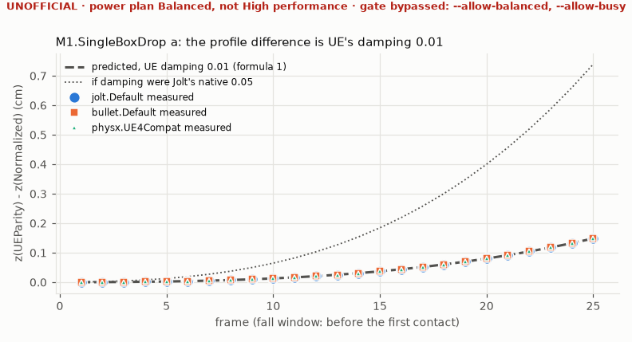
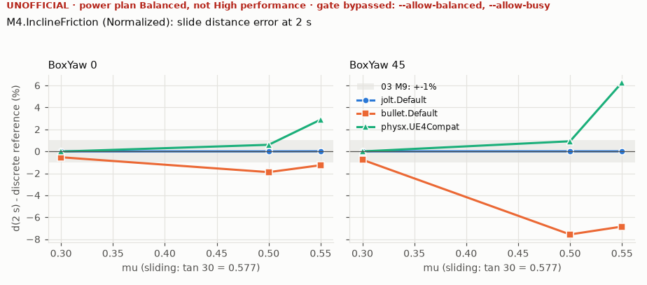
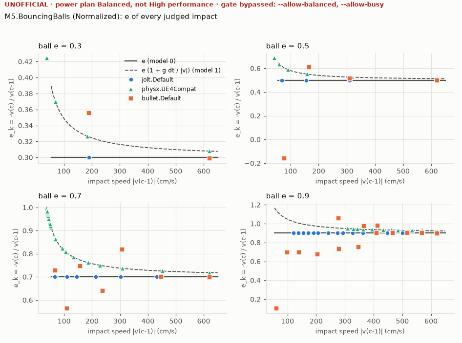
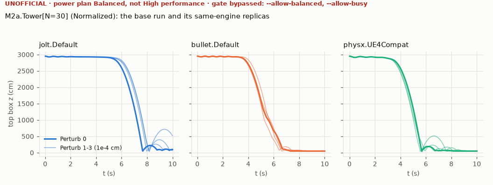

# 벤치 리포트 — behavior-m9r1 (UNOFFICIAL)

> **UNOFFICIAL 예시 (M9 거동 세션, 전원 계획 Balanced).** `python -I -m ptbench run --matrix behavior --preset test --allow-balanced --allow-busy --report`의 세션 `behavior-m9r1`(552 run = 546 + M9 수정 라운드 1의 PhysX `M3.BoxPile` probe 6개, 수정 라운드 1 빌드의 test 프리셋 벤치. 공통 run 546개의 지표 4508개는 M9 세션 `behavior-m9b`·`behavior-m9r0`과 모두 같다. 다른 에이전트가 남긴 디스크 검색 프로세스가 CPU를 써서 idle 검사를 `--allow-busy`로 우회했다 - 거동 run에는 타이밍 주장이 없다)을 **M9 마감(2026-10-22)의 분석으로 다시 분석한** 리포트다 (`python -I -m ptbench report`; run은 다시 돌리지 않았다, 물리는 바뀌지 않았다). 바뀐 것: **리드 결정**(Progress M9 §11)을 따르는 기준 판정 - 실행 뒤 등록 허용치는 모두 승인되어 판정에 쓰이고(Bullet 반발은 `tolerances.json` G4의 등록 모델 2), `M6a` `Joint=Ball`은 보고만(`reported`), PhysX `M6c`는 `fail (accepted engine behaviour)`, Bullet `M6c`는 `finding: joints separated`(통과가 아니다) - 와 데이터 조건을 보강한 태그 규칙(`jolt-penetration-slop`과 inferred 규칙 여덟, Progress M9 §12). 그래서 차이가 450개에서 383개로 줄었다 (승인된 허용치 안으로 들어간 67개). 그림 4장만 함께 두고 `behavior.json`(physicstest.behavior/1, 수 MB)과 `differences.csv`는 세션 쪽에만 있다 (`Saved/`·세션 디렉터리는 커밋하지 않는다). 거동 run에는 타이밍 주장이 없다 (§5는 run 요약뿐) ([../../Progress.md](../../Progress.md) M9 §2, §11, §12).

> **전원 계획이 High performance가 아니다: 균형 조정 (Balanced, 381b4222-f694-41f0-9685-ff5bb260df2e)** (세션의 환경 게이트, run 552/552개의 manifest 기준). 환경 게이트를 **`--allow-balanced, --allow-busy`**로 우회했다. Balanced에서는 run 간 노이즈가 크다 (01 Q9). 아래 모든 표가 이 조건의 값이다.
>
> **비공식 (UNOFFICIAL)** — no conformance stamp (M10); no CV gate / claim rules (M10); power plan is not High performance: 균형 조정 (Balanced). CV < 2 %는 목표로만 적는다 (게이트는 M10). 이 조건은 아래 모든 표의 제목 밑과 모든 그림의 제목 위에도 적는다.

## 1. 세션

| 항목 | 값 |
|---|---|
| 세션 | `behavior-m9r1` (complete, 2026-10-22T04:23:21Z → 2026-10-22T04:29:30Z, 6.1 분) |
| 매트릭스 | `behavior` (behavior, R = 1, block seed 9009, sha256 `cb694a7288e2`) |
| 벤치 exe | `D:\PhysicsTest\out\test\bin\PhysicsTestBench.exe` (preset test, flag profile Shipped, sha256 `019c89b23288`) |
| git | `6883c1285155` (dirty) |
| 호스트 | 13th Gen Intel(R) Core(TM) i5-13600KF, 논리 CPU 20, Windows-10-10.0.26200-SP0 |
| 환경 게이트: power_plan | **우회** --allow-balanced — 균형 조정 (Balanced, 381b4222-f694-41f0-9685-ff5bb260df2e) |
| 환경 게이트: idle | **우회** --allow-busy — system busy 6.17% over 2 s (limit 3%; 60 window(s) in 120.0 s, wait limit 120 s: 6.26, 6.10, 6.23, 6.71, 5.75, 7.80, ..., 6.77, 5.93, 6.33, 8.99, 6.17) |
| 환경 게이트: processes | 통과 — no other PhysicsTest process |
| 러너 | 쿨다운 0.5 s, 타임아웃 300.0 s, 종료 코드 4 재시도 0회, 윈도 `headline`, 판정 = `exit.json` (원시 종료 코드는 기록만) |
| run | 계획 552, 시도 552 (재시도 0), 결과 {"ok": 552}, 셀 상태 {"ok": 552}, exit.json 없음 0, 타임아웃 0 |
| 분석 | run 552개 중 0개 채택, 552개 거부 (§5) |

## 2. 표 (scene × profile × flag profile × T, 윈도 `headline`)

값은 run마다 윈도의 `T_frame` 평균이다. median = run 값의 중앙값, CV = run 값의 표본 표준편차 / 평균, p95·p99 = 셀의 모든 run의 윈도 프레임을 합친 nearest-rank. ⚠는 CV ≥ 2 % (목표 미달, M8은 보고만). 엔진 간 비교는 `T_frame`만 한다 (TimingContract §2).

## 3. 셀별 CV (M3.BoxPile 5k 포함 모든 셀)

> 조건: **비공식 (UNOFFICIAL)** · **전원 계획 균형 조정 (Balanced, 381b4222-f694-41f0-9685-ff5bb260df2e) — High performance 아님** · 환경 게이트 우회 **`--allow-balanced, --allow-busy`**.

| 셀 | n | median | CV | 목표 (< 2 %) |
|---|---|---|---|---|

## 4. 스케일링과 오버헤드 모델 (원시, 비공식)

> 조건: **비공식 (UNOFFICIAL)** · **전원 계획 균형 조정 (Balanced, 381b4222-f694-41f0-9685-ff5bb260df2e) — High performance 아님** · 환경 게이트 우회 **`--allow-balanced, --allow-busy`**.

해당 없음 (N이나 T가 하나뿐).

## 5. 거부된 run과 재시도

- 거동 run 552개 (`run.mode` Behavior): 타이밍 표에 넣지 않는다. 분석은 §7.

그 밖에 거부된 run 없음.

## 6. 방법

- 러너: 셀 = target × profile × scene × T, 반복 r마다 seed 고정 블록 셔플(splitmix64 + Fisher-Yates), run마다 fresh process, 쿨다운, 타임아웃. 판정은 `exit.json`이다: 없으면 프로세스가 끝까지 가지 못한 실패이고 원시 종료 코드로 성공을 판정하지 않는다 (02 §12.2, DL52). 종료 코드 4는 다시 돌리지 않았고 (`contaminated_retries` 0) 그 run의 셀이 `contaminated`다.
- 채택 조건 (validate): `exit.json` 0, 두 스키마 통과, Bench 모드, 계측 tier 0, preflight 게이트 통과, 오염 없음, `timing_valid_for_headline` 참. 한 표에 플래그 프로필이 섞이거나 `desc_sha256`이 다르면 표 자체를 거부하고 통계를 내지 않는다 (§3에도 '표 거부'로만 적는다). 한 표의 run이 여러 빌드(exe, git, preset)에서 왔으면 표 아래에 주의를 적는다 (comparability key는 M10).
- bootstrap CI, comparability key, CV 게이트, sentinel, 주장 규칙은 M10이다. 이 리포트의 비율과 순위는 주장이 아니다.

## 7. 거동 (03 M9, 02 §13 behavior)

> 조건: **비공식 (UNOFFICIAL)** · **전원 계획 균형 조정 (Balanced, 381b4222-f694-41f0-9685-ff5bb260df2e) — High performance 아님** · 환경 게이트 우회 **`--allow-balanced, --allow-busy`**.

분석한 거동 run 552개 (states.ptst + scene_desc.json), 조인트 capability가 없어 벤치가 거부한 run 0개 (`unsupported`, §7.6), 분석하지 못한 run 0개 (§7.10). 모든 수치는 기록된 바디 상태와 `scene_desc.json`의 하네스 기하로 계산했다 (엔진의 접촉 보고는 쓰지 않는다). 해석 기준은 dt_engine 이산해다 (`analytic.py`). 기준이 없는 관측량은 주 series(jolt.Default, bullet.Default, physx.UE4Compat)의 중앙값(합의값)과 비교한다. 등록 허용치를 넘는 차이마다 태그 하나와 사유가 붙는다 (§7.2, 규칙과 허용치는 §7.9). 혼돈계 씬은 같은 엔진 1e-4 cm 섭동 복제의 퍼짐을 허용치에 더한다.

### 7.1 03 M9 완료 기준 (Normalized, 주 series)

> 조건: **비공식 (UNOFFICIAL)** · **전원 계획 균형 조정 (Balanced, 381b4222-f694-41f0-9685-ff5bb260df2e) — High performance 아님** · 환경 게이트 우회 **`--allow-balanced, --allow-busy`**.

| 기준 | series | 판정 | 내용 |
|---|---|---|---|
| M4 sliding mu (0.30, 0.50, 0.55): d(2 s) within 1% of the discrete reference, BoxYaw 0 (box axes along the slope) | jolt.Default | pass | 3 observations within |
| M4 mu >= 0.6 holds: drift < 0.1 cm at 2 s, BoxYaw 0 (box axes along the slope) | jolt.Default | pass | 2 observations within |
| M4 sliding mu (0.30, 0.50, 0.55): d(2 s) within 1% of the discrete reference, isotropy variant BoxYaw 45 (same limit) | jolt.Default | pass | 3 observations within |
| M4 mu >= 0.6 holds: drift < 0.1 cm at 2 s, isotropy variant BoxYaw 45 (same limit) | jolt.Default | pass | 2 observations within |
| M5 every impact above 50 cm/s: e_k within the registered tolerance (+-0.02) of the registered model | jolt.Default | pass | 4 observations within; registered model 0 (tolerances.json G4.restitution_velocity_model) |
| M6a 5 deg period error < 0.5% (2.00905 s), the catalogued scene (Joint=Hinge, Scenes.md 2.19) | jolt.Default | pass | 1 observations within |
| M6a 5 deg period error (2.00905 s), the Joint=Ball variant: reported, not gated (lead 2026-10-22) | jolt.Default | reported | within 0.5%: 1 observations within - 03 M9's 5 deg period criterion is judged on the catalogued scene M6a.Pendulum (Joint=Hinge); the Joint=Ball variant is reported, not gated (Bullet ball +8.7%: btPoint2PointConstraint, Progress M9 Bullet J-1, algorithmic) |
| M6b.Chain: stretch reported, energy does not diverge | jolt.Default | pass | 1 observations within; replicas (Perturb: growth % of m g span) 0: -0.0177, 1: -0.0177, 2: -0.0177, 3: -0.0177 - none grows; max stretch (base) 10.76 cm |
| M6c.HeavyChain: stretch reported, energy does not diverge | jolt.Default | pass | 1 observations within; replicas (Perturb: growth % of m g span) 0: -0.0339, 1: -0.0339, 2: -0.0339, 3: -0.0339 - none grows; max stretch (base) 35.32 cm |
| M4 sliding mu (0.30, 0.50, 0.55): d(2 s) within 1% of the discrete reference, BoxYaw 0 (box axes along the slope) | bullet.Default | pass | 3 observations within |
| M4 mu >= 0.6 holds: drift < 0.1 cm at 2 s, BoxYaw 0 (box axes along the slope) | bullet.Default | pass | 2 observations within |
| M4 sliding mu (0.30, 0.50, 0.55): d(2 s) within 1% of the discrete reference, isotropy variant BoxYaw 45 (same limit) | bullet.Default | pass | 3 observations within |
| M4 mu >= 0.6 holds: drift < 0.1 cm at 2 s, isotropy variant BoxYaw 45 (same limit) | bullet.Default | pass | 2 observations within |
| M5 every impact above 50 cm/s: e_k within the registered tolerance (+-0.02) of the registered model | bullet.Default | pass | 4 observations within; registered model 2 (tolerances.json G4.restitution_velocity_model) |
| M6a 5 deg period error < 0.5% (2.00905 s), the catalogued scene (Joint=Hinge, Scenes.md 2.19) | bullet.Default | pass | 1 observations within |
| M6a 5 deg period error (2.00905 s), the Joint=Ball variant: reported, not gated (lead 2026-10-22) | bullet.Default | **reported (beyond 0.5%)** | beyond 0.5%, not gated: M6a.Pendulum[Angle=5,Joint=Ball] period_err_pct 8.706 (tol 0.5); tagged algorithmic (bullet-p2p-rows, verified) - 03 M9's 5 deg period criterion is judged on the catalogued scene M6a.Pendulum (Joint=Hinge); the Joint=Ball variant is reported, not gated (Bullet ball +8.7%: btPoint2PointConstraint, Progress M9 Bullet J-1, algorithmic) |
| M6b.Chain: stretch reported, energy does not diverge | bullet.Default | pass | 1 observations within; replicas (Perturb: growth % of m g span) 0: -0.0177, 1: -0.0177, 2: -0.0177, 3: -0.0177 - none grows; max stretch (base) 20.31 cm |
| M6c.HeavyChain: stretch reported, energy does not diverge | bullet.Default | **finding: joints separated** | 1 observations within; replicas (Perturb: growth % of m g span) 0: -0.0339, 1: -0.0339, 2: -0.0339, 3: -0.0339 - none grows; max stretch (base) 1135 cm; the joints came apart in 4 of 4 runs (stretch beyond one link, 40 cm): the energy check is trivial there (a separated chain falls freely) - Bullet's joints come apart on the 100:1 chain (stretch beyond one link): its energy check holds trivially (a separated chain falls freely), so it is reported as a separate finding - joint separation (Progress M9 Bullet J-2) - not as a pass |
| M4 sliding mu (0.30, 0.50, 0.55): d(2 s) within 1% of the discrete reference, BoxYaw 0 (box axes along the slope) | physx.UE4Compat | pass | 3 observations within |
| M4 mu >= 0.6 holds: drift < 0.1 cm at 2 s, BoxYaw 0 (box axes along the slope) | physx.UE4Compat | pass | 2 observations within |
| M4 sliding mu (0.30, 0.50, 0.55): d(2 s) within 1% of the discrete reference, isotropy variant BoxYaw 45 (same limit) | physx.UE4Compat | pass | 3 observations within |
| M4 mu >= 0.6 holds: drift < 0.1 cm at 2 s, isotropy variant BoxYaw 45 (same limit) | physx.UE4Compat | pass | 2 observations within |
| M5 every impact above 50 cm/s: e_k within the registered tolerance (+-0.02) of the registered model | physx.UE4Compat | pass | 4 observations within; registered model 1 (tolerances.json G4.restitution_velocity_model) |
| M6a 5 deg period error < 0.5% (2.00905 s), the catalogued scene (Joint=Hinge, Scenes.md 2.19) | physx.UE4Compat | pass | 1 observations within |
| M6a 5 deg period error (2.00905 s), the Joint=Ball variant: reported, not gated (lead 2026-10-22) | physx.UE4Compat | reported | within 0.5%: 1 observations within - 03 M9's 5 deg period criterion is judged on the catalogued scene M6a.Pendulum (Joint=Hinge); the Joint=Ball variant is reported, not gated (Bullet ball +8.7%: btPoint2PointConstraint, Progress M9 Bullet J-1, algorithmic) |
| M6b.Chain: stretch reported, energy does not diverge | physx.UE4Compat | pass | 1 observations within; replicas (Perturb: growth % of m g span) 0: -0.0177, 1: -0.0177, 2: -0.0177, 3: -0.0177 - none grows; max stretch (base) 11.61 cm |
| M6c.HeavyChain: stretch reported, energy does not diverge | physx.UE4Compat | **fail (accepted engine behaviour)** | M6c.HeavyChain[Perturb=0] energy_growth_pct 4357 (tol 1); replicas (Perturb: growth % of m g span) 0: 4.36e+03, 1: 1.39e+04, 2: 6.37e+03, 3: 9.77e+03 - 4 of 4 grow beyond 1; max stretch (base) 989.6 cm; tagged physx-pgs-heavy-chain - PhysX PGS and TGS energy growth on the 100:1 heavy chain is accepted as an engine-behaviour finding (algorithmic: no joint projection in PhysX 5.x, which UE4 relied on; Progress M9 PX-1, PX-1b) - reported as a failure, not tuned away (lead 2026-10-22) |
| every cross-engine difference has a by-design / mismatch / algorithmic tag | all | pass | 383 differences: algorithmic 304, by-design 79; 0 provisional (unexplained) |
| M1 UEParity vs Normalized table shows the default-driven differences | all | pass | 16 rows; fall-window difference = UE damping 0.01 on every engine (largest residual 4.4e-05 cm); Jolt's native 0.05 would give +0.739 cm and is not what the engines receive |
| M2a N=10 UEParity: PhysX UE4Compat stabilises last (or not within 5 s) of UE4Compat / -Stab / -TGS | physx | pass | all sleep (base + replicas): physx.UE4Compat 3.32, 3.33, 3.33, 6.52 s, physx.UE4Compat-Stab 0.65, 0.65, 0.65, 0.65 s, physx.UE4Compat-TGS 1.60, 1.60, 1.60, 1.60 s |

판정은 리드 결정(2026-10-22, `behavior_rules.LEAD_DECISIONS`, Progress M9 리드 결정)을 따른다. `fail (accepted engine behaviour)`: 실패이고, 리드가 엔진 거동으로 받아들인 실패다 (조정해서 숨기지 않았다). 실패한 관측량이 그 메커니즘의 데이터 서명을 확인하는 규칙으로 태그될 때만 이 표시가 붙고, 다른 원인의 실패는 그냥 `fail`이다. `finding: joints separated`: 에너지는 오르지 않지만 조인트가 한 고리 길이 넘게 벌어졌다 - 떨어져 나간 체인은 자유 낙하로 에너지를 지키므로 에너지 검사가 자명하다. 통과가 아니라 별도 발견(조인트 분리)으로 보고한다. `reported` / `reported (beyond 0.5%)`: 판정하지 않고 측정값만 보고하는 줄이다 (`M6a` `Joint=Ball` 변형: 03의 5° 주기 기준은 카탈로그 씬 `Joint=Hinge`로 판정한다). `fail (pending override)`: 실패한 값이 실행 뒤 등록을 제안한 엔진별 허용치 안이다 (리드 승인 전에는 판정에 쓰지 않는다, §7.9; M9 커밋에서 모든 등록이 승인되어 지금은 없다). `M4` 줄은 `BoxYaw` 0(상자 축이 경사 방향)과 등방성 변형 `BoxYaw` 45를 같은 한계로 따로 판정한다. `unsupported`: 이 벤치의 백엔드가 조인트 capability를 선언하지 않았다 (조인트 구현 뒤 같은 매트릭스로 다시 돌린다).

### 7.2 엔진 간 차이와 태그

> 조건: **비공식 (UNOFFICIAL)** · **전원 계획 균형 조정 (Balanced, 381b4222-f694-41f0-9685-ff5bb260df2e) — High performance 아님** · 환경 게이트 우회 **`--allow-balanced, --allow-busy`**.

차이 383개: **by-design** 79, **mismatch** 0, **algorithmic** 304. 규칙 없이 남은 차이(`unexplained`, mismatch 잠정) 0개. 차이 전체는 `differences.csv`에 있다.

| 규칙 | 태그 | 확신 | 차이 수 | 예 (series · profile · scene · metric = 값 / 기준, 허용치) | 사유 (첫 차이) |
|---|---|---|---|---|---|
| `jolt-penetration-slop` | by-design | verified | 11 | jolt.Default · Norm · M1.SingleBoxDrop[Case=a] · final_z_cm = 48 / 50, 0.5; jolt.SharpBoxes · Norm · M1.SingleBoxDrop[Case=a] · final_z_cm = 48 / 50, 0.5; jolt.Default · Norm · M1.SingleBoxDrop[Case=a] · rest_penetration_cm = 2 / 0, 0.25 (+8) | Jolt leaves an overlap up to mPenetrationSlop unresolved (effective jolt.penetration_slop 2 cm, Jolt.Default.ini; PhysicsSettings.h:53): the box rests 2 cm lower than the consensus 50 cm, which is its own rest penetration 2 cm (within the slop; tolerance 0.5 cm) |
| `bullet-tumble` | algorithmic | inferred | 4 | bullet.Default · Norm · M1.SingleBoxDrop[Case=b] · final_xy_cm = 15.94 / 44.6, 10; bullet.StaticAabbOff · Norm · M1.SingleBoxDrop[Case=b] · final_xy_cm = 15.94 / 44.6, 10; bullet.StaticAabbOff · UEPa · M1.SingleBoxDrop[Case=b] · final_xy_cm = 15.59 / 44.58, 10 (+1) | the tilted box lands on an edge and tumbles: where it ends depends on how the solver resolves the edge impact and the pivoting contact (Bullet: sequential impulse, 10 iterations, one friction direction per point, a 4 cm margin-rounded box); the other engines agree among themselves within a few cm, and this box ends on a face within one 100 cm edge of them [R] |
| `jolt-convex-radius` | by-design | verified | 2 | jolt.Default · Norm · M1.SingleBoxDrop[Case=b] · first_contact_frame = 23 / 22, 0.5; jolt.Default · UEPa · M1.SingleBoxDrop[Case=b] · first_contact_frame = 23 / 22, 0.5 | Jolt rounds box edges by the convex radius (effective shape.box_margin 5.0 cm in jolt.Default): the tilted box touches and pivots on a rounded corner; jolt.SharpBoxes (ConvexRadius 0) gives 22 here (Profiles.md 4) |
| `variant-config` | by-design | verified | 23 | physx.SdkDefault · Norm · M2a.Tower[N=10,Perturb=0] · mean_z_final_cm = 496.6 / 499, 1.32; physx.SdkDefault · Norm · M2a.Tower[N=10,Perturb=0] · rest_jitter_cm = 14.3 / 4.286, 9.06; physx.SdkDefault · Norm · M2a.Tower[N=10,Perturb=0] · rest_penetration_cm = 3.025 / 0.6516, 0.817 (+20) | physx.SdkDefault differs from physx.UE4Compat (which agrees with the consensus) only by its variant settings: solver.iterations position [4, 4] / velocity [1, 1] per body (PxRigidDynamic::getSolverI vs position [8, 8] / velocity [1, 1] per body (PxRigidDynamic::getSolverI; physx.length_scale 0.01 native units per cm (m, SdkDefault's D1 scale) vs 1 native units per cm (cm, the UE4Compat family's D1 scale); physx.scene_flags 0x100040 (PCM 1, stabilization 0, CCD 0, enhanced determinism 0, activ vs 0x101043 (PCM 1, stabilization 0, CCD 1, enhanced determinism 0, activ (Profiles.md 4) |
| `sleep-engine-rule` | by-design | verified | 21 | physx.UE4Compat-TGS · UEPa · M2a.Tower[N=10,Perturb=0] · time_to_sleep_s = 1.6 / never, 3.45; physx.UE4Compat-Stab · UEPa · M2a.Tower[N=10,Perturb=0] · time_to_sleep_s = 0.65 / never, 3.45; physx.UE4Compat · UEPa · M2a.Tower[N=10,Perturb=0] · time_to_sleep_s = 6.517 / never, 6.65 (+18) | UE4's sleep rule on PhysX (PhysX threshold x SleepFamily multiplier, wake counter 0.399999976 s; effective sleep.criteria: "mass-normalised kinetic energy below the sleep threshold [49.9999962, 49.9999962] cm^2/s^2 (stabilization [24.9999981, 2") is the UEParity design (Profiles.md 5); the other engines sleep by their UE mappings (Jolt: its own time-before-sleep rule with the mapped UE threshold, Bullet: UE's sleep counter, Profiles.md 5.1). Here asleep at 1.6 s, after the 0.4 s wake counter below the threshold that UE4's PhysX needs |
| `bullet-stack-solver` | algorithmic | verified 10 / inferred 2 | 12 | bullet.StaticAabbOff · Norm · M3.BoxPile[N=1000] · mean_z_final_cm = 278.3 / 493.5, 10; bullet.Default · Norm · M3.BoxPile[N=1000] · mean_z_final_cm = 254.6 / 493.5, 10; bullet.StaticAabbOff · Norm · M3.BoxPile[N=1000] · top_z_final_cm = 50 / 941.6, 20 (+9) | Bullet's sequential impulse with 10 iterations and the default restitution 0.3 does not hold this stack (Checkpoints N-1); probes (mean_z_final_cm, consensus 493.5): bullet.R0 243.3 (does not hold); bullet.Iter50 396.7 (does not hold); bullet.R0Iter50 499.9 (holds). Only both changes together restore the consensus: the probes isolate the mechanism |
| `physx-sdkdefault-pile` | by-design | verified | 2 | physx.SdkDefault · Norm · M3.BoxPile[N=1000] · mean_z_final_cm = 447 / 493.5, 10; physx.SdkDefault · Norm · M3.BoxPile[N=1000] · toppled_fraction = 0.207 / 0, 0.05 | PhysX SdkDefault (PhysX 5.11's own defaults: position [4, 4] / velocity [1, 1] per body) does not hold the 1k pile: 357 bodies end off their slot (first at recorded frame 199), toppled 0.207; probe with UE4's 8 position iterations and every other SdkDefault setting (physx.SdkDefault-Pos8): 0 bodies off their slot, mean z 498.5 cm, toppled 0, largest speed after the impact window 37 cm/s. The variant's declared iteration count (4 position / 1 velocity) is the cause (Profiles.md 4) |
| `physx-tgs-pile-ejection` | algorithmic | verified | 3 | physx.UE4Compat-TGS · Norm · M3.BoxPile[N=1000] · mean_z_final_cm = 465.7 / 493.5, 10; physx.UE4Compat-TGS · Norm · M3.BoxPile[N=1000] · top_z_final_cm = 50 / 941.6, 20; physx.UE4Compat-TGS · UEPa · M3.BoxPile[N=1000] · mean_z_final_cm = 470.7 / 494.4, 10 | PhysX TGS throws boxes out of the pile inside the 600-frame window: 86 of 1000 bodies end more than 50 cm from their slot (first at recorded frame 99), one 2145 cm away, speeds up to 1171 cm/s after the impact window (PGS physx.UE4Compat: 0 bodies off their slot, mean z 498.5 cm, toppled 0, largest speed after the impact window 38 cm/s). Probes of this session: material restitution 0 (physx.TGS-R0): 0 bodies off their slot, mean z 499.8 cm, toppled 0, largest speed after the impact window 87 cm/s; 32 position iterations (physx.TGS-Pos32): 92 bodies off their slot, mean z 461.4 cm, toppled 0.011, largest speed after the impact window 1393 cm/s. The ejection needs the restitution 0.3 of the pile's impacts and is not an iteration budget limit: TGS's handling of restitution in a pile of simultaneous impacts (the mechanism inside the solver is not isolated further). M11: on this scene TGS times another workload than the other rows (Checkpoints N-4) |
| `physx-pgs-friction` | algorithmic | inferred | 36 | physx.UE4Compat-Stab · Norm · M4.InclineFriction[BoxYaw=0,Mu=0.30] · lateral_cm = 5.084 / 0, 0.5; physx.UE4Compat · Norm · M4.InclineFriction[BoxYaw=0,Mu=0.30] · lateral_cm = 5.084 / 0, 0.5; physx.SdkDefault · Norm · M4.InclineFriction[BoxYaw=0,Mu=0.30] · lateral_cm = 5.086 / 0, 0.5 (+33) | PhysX PGS friction is solved per axis in the last position iterations (PxSceneDesc.h:30-42, the mechanism of M6 D-4), not along the sliding direction: the box drifts 5.08 cm sideways while sliding; the same engine with TGS drifts 0.014 cm. Not isolated beyond that solver switch [R] (D-4 accepted the creep, not this drift) |
| `bullet-sliding-box` | algorithmic | inferred | 4 | bullet.Default · UEPa · M4.InclineFriction[BoxYaw=0,Mu=0.30] · contact_penetration_cm = 0.2698 / 0, 0.25; bullet.Default · UEPa · M4.InclineFriction[BoxYaw=0,Mu=0.30] · lateral_cm = 0.5662 / 0, 0.5; bullet.Default · Norm · M4.InclineFriction[BoxYaw=0,Mu=0.50] · lateral_cm = 0.6899 / 0, 0.5 (+1) | Bullet's sliding box rocks on its 4-point manifold (\|w\| up to 0.842 rad/s; the other engines jolt.Default 0.000232, physx.UE4Compat 0.0146): sequential impulse with one friction direction per point (solver mode 0x104, no SOLVER_USE_2_FRICTION_DIRECTIONS), 10 iterations, margin-rounded box (shape.box_margin 4 cm) - the slide lags the reference and wanders sideways [R] |
| `physx-pgs-creep` | algorithmic | inferred 5 / accepted 2 | 7 | physx.SdkDefault · Norm · M4.InclineFriction[BoxYaw=0,Mu=0.60] · lateral_cm = 1.763 / 0, 0.5; physx.UE4Compat · Norm · M4.InclineFriction[BoxYaw=0,Mu=0.60] · lateral_cm = 1.768 / 0, 0.5; physx.UE4Compat-Stab · Norm · M4.InclineFriction[BoxYaw=0,Mu=0.60] · lateral_cm = 1.768 / 0, 0.5 (+4) | PhysX PGS on a holding incline: the per-axis friction rows (PxSceneDesc.h:30-42, the mechanism of M6 D-4) let the box drift 1.76 cm sideways (creep 2.503 cm/s down the slope) - not isolated, D-4 accepted the creep only [R] |
| `physx-restitution-presolve` | algorithmic | accepted | 27 | physx.UE4Compat-TGS · Norm · M5.BouncingBalls · e0.3.e_dev_nominal_max = 0.1149 / 0, 0.02; physx.UE4Compat · Norm · M5.BouncingBalls · e0.3.e_dev_nominal_max = 0.1246 / 0, 0.02; physx.SdkDefault · Norm · M5.BouncingBalls · e0.3.e_dev_nominal_max = 0.1246 / 0, 0.02 (+24) | PhysX applies -e to the pre-solve normal velocity that already holds the contact step's gravity (DyDynamics.cpp:1979, DyContactPrepShared.h:305-323): e_meas = e (1 + g dt / \|v\|), so e grows as the impacts slow (registered model 1, tolerances.json G4; M6 D-3). Every judged impact is within 7.3e-08 of that model |
| `bullet-restitution-contact-state` | algorithmic | verified | 8 | bullet.Default · Norm · M5.BouncingBalls · e0.3.e_dev_nominal_max = 0.05574 / 0, 0.02; bullet.Default · Norm · M5.BouncingBalls · e0.5.e_dev_nominal_max = 0.6579 / 0, 0.02; bullet.Default · Norm · M5.BouncingBalls · e0.7.e_dev_nominal_max = 0.1351 / 0, 0.02 (+5) | Bullet's restitution target follows the contact state at the start of the step (btSequentialImpulseConstraintSolver.cpp): a speculative contact (gap > 0) subtracts gap/dt (:953), a penetration shallower than the split-impulse threshold (-4 cm, effective bullet.split_impulse_penetration_threshold) puts erp2 x depth / dt (0.2) into the velocity (:957, :963), a deeper one goes to the split impulse and keeps e (registered restitution model 2, tolerances.json G4, signed off by the lead with the M9 commit). That model predicts all 2 judged impacts of this ball (worst residual 0.0000; 1 speculative, 1 shallow, 0 deep). Only the first impact touches at a step boundary; later ones start mid-step because Bullet's contact distance is 0.866 cm |
| `impact-phase-depth` | algorithmic | inferred | 16 | bullet.Default · Norm · M5.BouncingBalls · e0.5.depth_max_cm = 1.54 / 1.907e-06, 1; jolt.Default · Norm · M5.BouncingBalls · e0.7.depth_max_cm = 2.98e-06 / 3.039, 1; bullet.Default · Norm · M5.BouncingBalls · e0.7.depth_max_cm = 6.528 / 3.039, 1 (+13) | an impact's depth is the travel of the step that reaches the pad minus the gap at that step's start: no contact exists while that gap is above the engine's contact distance d = 0.866 cm (effective contact.speculative_distance), so the ball goes at most (travel - d) deep before the contact of the next step stops it, and with a gap within d the contact stops it at the pad or at most d above it. The deepest impact of this ball (frame 98) goes 1.54 cm with a step of at most 3.05 cm (window up to 2.18 cm); every impact lies in its window (depth cm by impact: frame 38 -0.01, frame 77 0.38, frame 98 1.54, frame 110 -0.65, frame 112 -0.00). Where in the window an impact lands is its phase, which follows the engine's bounce history (restitution model and rebound heights), so the engines' deepest impacts differ (consensus 1.91e-06 cm). Not isolated by a contact-distance probe [R] |
| `physx-tgs-split-contact` | algorithmic | inferred | 2 | physx.UE4Compat-TGS · Norm · M5.BouncingBalls · e0.9.e_dev_model_max = 0.5981 / 0, 0.02; physx.UE4Compat-TGS · Norm · M5.BouncingBalls · e0.9.e_dev_nominal_max = 0.5121 / 0, 0.02 | TGS resolves an impact that starts as a speculative contact (touch phase > 1: the discrete path reaches the pad only in the next step) over two frames: the first removes approach speed without restitution, the second bounces the rest (frame 512 (2 frames, touch phase 1.04, e 0.388)). Told apart by that mechanism test (frames_in_contact >= 2 or touch phase > 1), not by a wider tolerance: the 13 single-frame judged impacts of this ball follow registered model 1 within 0.0022 |
| `pendulum-velocity-projection` | algorithmic | verified | 48 | physx.UE4Compat · Norm · M6a.Pendulum[Angle=30,Joint=Ball] · amplitude_decay_pct_per_period = 1.553 / 0, 1; physx.SdkDefault · Norm · M6a.Pendulum[Angle=30,Joint=Ball] · amplitude_decay_pct_per_period = 1.553 / 0, 1; physx.UE4Compat-Stab · Norm · M6a.Pendulum[Angle=30,Joint=Ball] · amplitude_decay_pct_per_period = 1.553 / 0, 1 (+45) | a velocity-level joint solve puts the bob's velocity back on the tangent every step and drops the radial part the free step gained (v^2 dt / L): a kinetic energy loss of (w dt)^2 per step, (3/4) pi^2 a0^2 dt / T = 1.66%/period of amplitude for a small swing - measured 1.55%/period without damping (the small-swing formula overestimates a 90 deg swing). Jolt and the PhysX PGS variants agree to within 2%; PhysX TGS (sub-stepped) does not lose it (Progress M9 Jolt J-1, PhysX PX-2) |
| `bullet-p2p-rows` | algorithmic | verified | 24 | bullet.Default · Norm · M6a.Pendulum[Angle=30,Joint=Ball] · amplitude_decay_pct_per_period = 22.42 / 0, 1; bullet.Default · Norm · M6a.Pendulum[Angle=30,Joint=Ball] · period_err_pct = 37.94 / 0, 0.5; bullet.Default · Norm · M6a.Pendulum[Angle=30,Joint=Ball] · rod_length_err_max_cm = 10.24 / 0, 0.1 (+21) | Bullet's btPoint2PointConstraint is three scalar rows along the world axes; for this bob (m L^2 / I = 1000) each row's angular term dominates, so Bullet's 10 sequential-impulse iterations mostly spin the bob about its COM instead of holding the anchor: the joint stretches 36.1 cm here (beyond the hard-joint bound 0.5 cm; Bullet's hinge at this swing 0.172 cm) and the bob swings on a longer rod (a longer period, a faster amplitude loss, the rod length follows). 50 iterations: 0.025 cm at 5 deg; the hinge's frame-offset rows and btGeneric6DofSpring2Constraint keep 0.005 cm (Progress M9 Bullet J-1; PhysicsTest.BulletBackend.BallJointRowCoupling; the joint gate J1 registers 3 cm for it, tolerances.json J1.ball_stretch_cm, post-run, signed off by the lead 2026-10-22; 03 M9 judges the 5 deg period on the hinge scene, this ball variant is reported, not gated) |
| `joint-rotation-linearization` | algorithmic | inferred 36 / verified 8 | 44 | bullet.Default · Norm · M6a.Pendulum[Angle=30,Joint=Hinge] · rod_length_err_max_cm = 0.1711 / 0, 0.1; bullet.Default · Norm · M6a.Pendulum[Angle=30,Joint=Hinge] · stretch_max_cm = 0.1722 / 0, 0.1; bullet.Default · UEPa · M6a.Pendulum[Angle=30,Joint=Hinge] · rod_length_err_max_cm = 0.1703 / 0, 0.1 (+41) | integrating the bob's rotation moves the joint anchor about (w dt)^2 L / 2 per step off the circle; the engine's position correction removes part of it: Baumgarte only (Bullet, ERP 0.2) settles near 2 (w_max dt)^2 L = 0.146 cm (measured 1.14 against 1.01 cm in Progress M9 Bullet J-3, independent of the iteration count), Jolt's 2 position steps and PhysX's position iterations leave less; here 0.171 cm at w_max 1.6197 rad/s |
| `pendulum-ue-damping` | by-design | verified | 8 | bullet.Default · UEPa · M6a.Pendulum[Angle=30,Joint=Hinge] · amplitude_decay_pct_per_period = 1.279 / 0, 1; jolt.Default · UEPa · M6a.Pendulum[Angle=5,Joint=Ball] · amplitude_decay_pct_per_period = 1.043 / 0, 1; physx.UE4Compat · UEPa · M6a.Pendulum[Angle=5,Joint=Ball] · amplitude_decay_pct_per_period = 1.043 / 0, 1 (+5) | UE's linear damping 0.01 /s (UEParity gives every engine UE's body default; effective body.damping) takes 1.02%/period off the amplitude (v x (1 - c dt) per step on the swing's kinetic energy): measured 1.28 = the engine's own 0.267 (Normalized, no damping) + 1.02 predicted |
| `physx-tgs-pendulum` | algorithmic | inferred | 8 | physx.UE4Compat-TGS · Norm · M6a.Pendulum[Angle=90,Joint=Ball] · amplitude_decay_pct_per_period = -4.567 / 0, 1; physx.UE4Compat-TGS · Norm · M6a.Pendulum[Angle=90,Joint=Ball] · period_err_pct = 3.472 / 0, 0.5; physx.UE4Compat-TGS · UEPa · M6a.Pendulum[Angle=90,Joint=Ball] · amplitude_decay_pct_per_period = -2.704 / 0, 1 (+5) | TGS keeps the swing's energy (no velocity-projection loss: -4.57%/period of which 0 is UE damping in UEParity) and at this 90 deg swing gains amplitude, with a longer period; its anchor lags the bob's rotation (stretch up to about 1 cm while the COM stays on its circle within 0.1 cm). Not isolated [R] (Progress M9 PX-2) |
| `bullet-hinge-large-swing` | algorithmic | inferred | 4 | bullet.Default · Norm · M6a.Pendulum[Angle=90,Joint=Hinge] · amplitude_decay_pct_per_period = 2.597 / 0, 1; bullet.Default · Norm · M6a.Pendulum[Angle=90,Joint=Hinge] · period_err_pct = -1.506 / 0, 0.5; bullet.Default · UEPa · M6a.Pendulum[Angle=90,Joint=Hinge] · amplitude_decay_pct_per_period = 3.7 / 0, 1 (+1) | Bullet's hinge at a large swing: the velocity rows hold, the anchor drifts outward by about 2 (w dt)^2 L per step and Baumgarte (ERP 0.2, no position iterations) feeds it back as velocity, which changes the swing's energy and period [R] (Progress M9 Bullet J-3; the 5 deg swing meets 03's period criterion) |
| `chain-iterative-joints` | algorithmic | inferred | 20 | physx.UE4Compat-Stab · Norm · M6b.Chain[Perturb=0] · final_z_mean_cm = 769.8 / 692.8, 9.18; physx.UE4Compat · Norm · M6b.Chain[Perturb=0] · final_z_mean_cm = 769.8 / 692.8, 9.18; physx.SdkDefault · Norm · M6b.Chain[Perturb=0] · final_z_mean_cm = 730.5 / 692.8, 12.1 (+17) | a chain released horizontally: the engine's iterative joint solver with its default budget (8 iterations) leaves the far links behind in the first swing, so every engine stretches beyond a hard joint's 1 cm (TGS least, PhysX SdkDefault's 4 / 1 most; here 11.6 cm, below one 40 cm link, energy within its bound); where the chain hangs afterwards follows that and the energy each solver keeps (03 M9: report the stretch) [R] |
| `bullet-chain` | algorithmic | inferred 3 / verified 2 | 5 | bullet.Default · Norm · M6b.Chain[Perturb=0] · final_z_mean_cm = 610.2 / 692.8, 7.09; bullet.Default · Norm · M6b.Chain[Perturb=0] · stretch_max_cm = 20.31 / 0, 1; bullet.Default · Norm · M6c.HeavyChain[Perturb=0] · stretch_max_cm = 1135 / 0, 1 (+2) | Bullet's chain stretches most among the engines (20.3 cm, the others up to 11.6 cm, below one link and without energy growth): sequential impulse, 10 iterations, Baumgarte-only joint correction (ERP 0.2) and the rotation linearization of fast links (Progress M9 Bullet J-3) [R] |
| `physx-pgs-heavy-chain` | algorithmic | verified | 12 | physx.UE4Compat · Norm · M6c.HeavyChain[Perturb=0] · energy_growth_pct = 4357 / 0, 1; physx.UE4Compat-Stab · Norm · M6c.HeavyChain[Perturb=0] · energy_growth_pct = 4357 / 0, 1; physx.SdkDefault · Norm · M6c.HeavyChain[Perturb=0] · energy_growth_pct = 6401 / 0, 1 (+9) | PhysX PGS cannot hold the 100:1 chain: the joints tear apart (stretch 989.6 cm here, beyond one 40 cm link) and the energy grows to 4357% of m g span - with collisions off, either actor order, the Native recipe, 32 position iterations and in both profiles (Progress M9 PhysX PX-1, isolated by the PhysX implementer). UE4 leaned on joint projection, which PhysX 5.11 no longer has (joint.projection 0, CHANGELOG.md:1703): the missing projection is by-design, the divergence itself is PGS's mass-ratio limit |
| `physx-tgs-heavy-chain` | algorithmic | inferred | 5 | physx.UE4Compat-TGS · Norm · M6c.HeavyChain[Perturb=0] · energy_growth_pct = 20.97 / 0, 1; physx.UE4Compat-TGS · Norm · M6c.HeavyChain[Perturb=0] · stretch_max_cm = 25.47 / 0, 1; physx.UE4Compat-TGS · UEPa · M6c.HeavyChain[Perturb=0] · energy_growth_pct = 15.74 / 0, 1 (+2) | TGS holds the 100:1 chain's joints better than PGS in some runs (base run about 25 cm) but its energy is not bounded: every run rises above the release energy (Perturb: % of m g span 0: +21, 1: +1.08e+03, 2: +58.4, 3: +1.31e+03; the runs above 10x tear apart to 2+ m) - a sub-stepped solver at this mass ratio without projection [R] (Progress M9: the PhysX implementer saw the base run only) |
| `jolt-heavy-chain` | algorithmic | verified 2 / inferred 1 | 3 | jolt.Default · Norm · M6c.HeavyChain[Perturb=0] · stretch_max_cm = 35.32 / 0, 1; jolt.Default · UEPa · M6c.HeavyChain[Perturb=0] · final_z_mean_cm = -1.433e+04 / -3847, 8.51e+03; jolt.Default · UEPa · M6c.HeavyChain[Perturb=0] · stretch_max_cm = 3443 / 0, 1 | Jolt's 100:1 chain stretches 35.3 cm (below one 40 cm link) at its default 10 velocity / 2 position steps without diverging (energy growth -0.0339% of m g span): a convergence limit - 40 velocity / 10 position steps leave 8.4 cm (Progress M9 Jolt J-2, the implementer's probe; not in this session). Marginal: gravity changed by 0.1% tears it (M9 fix round 2) [R] |
| `restitution-model-low-speed` | algorithmic | inferred | 6 | bullet.Default · Norm · M7.UEDefaults · b1.box.bounces = 1 / 3, 0.5; bullet.Default · Norm · M7.UEDefaults · b2.box.bounces = 2 / 3, 0.5; bullet.Default · Norm · M7.UEDefaults · b3.box.bounces = 2 / 3, 0.5 (+3) | same threshold as the consensus engine jolt.Default (50 cm/s), another count: approach->rebound cm/s (* = counted) here 767.7->230*, 1.995->23.2, 21.3->14.9, 4.194->1.54, 2.384e-05->0.000103, jolt.Default 767.7->230*, 194.4->58.3*, 72.35->21.7*, 1.922e-06->5.71e-07, 2.536e-08->5.36e-08. The count follows each engine's restitution at low speed: Bullet's restitution target follows the contact state at the step start: a speculative contact (gap > 0) loses gap / dt - an approach killed in the step before the touch -, a shallow penetration gains erp2 depth / dt (registered model 2; rule bullet-restitution-contact-state, verified on M5); Jolt applies -e to the velocity before the contact step at every speed (registered model 0; M5: every judged impact within 2e-7) |
| `restitution-threshold` | by-design | verified | 12 | physx.SdkDefault · UEPa · M7.UEDefaults · b1.box.bounces = 1 / 3, 0.5; physx.UE4Compat · UEPa · M7.UEDefaults · b1.box.bounces = 2 / 3, 0.5; physx.UE4Compat-TGS · UEPa · M7.UEDefaults · b1.box.bounces = 1 / 3, 0.5 (+9) | the threshold differs by design: this engine counts bounces above its effective contact.restitution_threshold 200 cm/s, the engines that set the consensus above another (bullet.Default 16.67 cm/s) - the UEParity mapping gives Jolt / Bullet Chaos' 1000 dt = 16.7 and PhysX UE4's project 200 cm/s (DL35 / Q11, Profiles.md 5) |
| `jolt-restitution-low-speed` | algorithmic | verified | 6 | jolt.Default · UEPa · M7.UEDefaults · b1.box.bounces = 4 / 3, 0.5; jolt.Default · UEPa · M7.UEDefaults · b2.box.bounces = 4 / 3, 0.5; jolt.Default · UEPa · M7.UEDefaults · b3.box.bounces = 4 / 3, 0.5 (+3) | same threshold as the consensus engine bullet.Default (16.67 cm/s): Jolt keeps e = 0.3 on every impact above it (worst \|e_k - e\| 4.2e-05; approach->rebound cm/s, * = counted: 764.6->229*, 195.4->58.6*, 72.04->21.6*, 27.38->8.21*, 8.118->2.43), so its low-speed bounces stay above the threshold one bounce longer than bullet.Default's (764.6->229*, 211.7->74.4*, 19.14->2.59*, 0.1509->0.331). Jolt applies -e to the velocity before the contact step at every speed (registered model 0; M5: every judged impact within 2e-7); Bullet's restitution target follows the contact state at the step start: a speculative contact (gap > 0) loses gap / dt - an approach killed in the step before the touch -, a shallow penetration gains erp2 depth / dt (registered model 2; rule bullet-restitution-contact-state, verified on M5) |

### 7.3 `M1.SingleBoxDrop` UEParity 대 Normalized (기본값이 만든 차이)

> 조건: **비공식 (UNOFFICIAL)** · **전원 계획 균형 조정 (Balanced, 381b4222-f694-41f0-9685-ff5bb260df2e) — High performance 아님** · 환경 게이트 우회 **`--allow-balanced, --allow-busy`**.

| series | case | damping U / N | Δz fall 측정 | Δz 예측 (0.01) | 잔차 | Jolt 기본 0.05였다면 | sleep (U) | 반발 임계 U / N (cm/s) | 정지 xy U / N (cm) | 태그 |
|---|---|---|---|---|---|---|---|---|---|---|
| bullet.Default | a | 0.01 / 0 | +0.1485 | +0.1485 | +4.4e-05 | +0.7393 | 0.8 | 16.67 / 50 | 0.001657 / 0.06755 | linear damping: by-design, sleep: by-design, restitution threshold: by-design, rest state: by-design |
| bullet.Default | b | 0.01 / 0 | +0.0803 | +0.0803 | +3.9e-05 | +0.4001 | 1 | 16.67 / 50 | 15.59 / 15.94 | linear damping: by-design, sleep: by-design, restitution threshold: by-design, rest state: by-design |
| bullet.StaticAabbOff | a | 0.01 / 0 | +0.1485 | +0.1485 | +4.4e-05 | +0.7393 | 0.8 | 16.67 / 50 | 0.001657 / 0.06755 | linear damping: by-design, sleep: by-design, restitution threshold: by-design, rest state: by-design |
| bullet.StaticAabbOff | b | 0.01 / 0 | +0.0803 | +0.0803 | +3.9e-05 | +0.4001 | 1 | 16.67 / 50 | 15.59 / 15.94 | linear damping: by-design, sleep: by-design, restitution threshold: by-design, rest state: by-design |
| jolt.Default | a | 0.01 / 0 | +0.1485 | +0.1485 | +3.8e-05 | +0.7393 | 0.6167 | 16.67 / 50 | 0.002217 / 0.002178 | linear damping: by-design, sleep: by-design, restitution threshold: by-design, rest state: by-design |
| jolt.Default | b | 0.01 / 0 | +0.0803 | +0.0803 | +3.9e-05 | +0.4001 | 0.9167 | 16.67 / 50 | 44.58 / 44.6 | linear damping: by-design, sleep: by-design, restitution threshold: by-design, rest state: by-design |
| jolt.SharpBoxes | a | 0.01 / 0 | +0.1485 | +0.1485 | +3.8e-05 | +0.7393 | 0.6167 | 16.67 / 50 | 0.002177 / 0.002146 | linear damping: by-design, sleep: by-design, restitution threshold: by-design, rest state: by-design |
| jolt.SharpBoxes | b | 0.01 / 0 | +0.0803 | +0.0803 | +3.9e-05 | +0.4001 | 0.9667 | 16.67 / 50 | 51.93 / 52.04 | linear damping: by-design, sleep: by-design, restitution threshold: by-design, rest state: by-design |
| physx.SdkDefault | a | 0.01 / 0 | +0.1485 | +0.1485 | +3.8e-05 | +0.7393 | 0.85 | 200 / 50 | 0.002734 / 0.00283 | linear damping: by-design, sleep: by-design, restitution threshold: by-design, rest state: by-design |
| physx.SdkDefault | b | 0.01 / 0 | +0.0803 | +0.0803 | +3.9e-05 | +0.4001 | 1.1 | 200 / 50 | 48.73 / 47.7 | linear damping: by-design, sleep: by-design, restitution threshold: by-design, rest state: by-design |
| physx.UE4Compat | a | 0.01 / 0 | +0.1485 | +0.1485 | -3.0e-06 | +0.7393 | 0.85 | 200 / 50 | 0.002346 / 0.002477 | linear damping: by-design, sleep: by-design, restitution threshold: by-design, rest state: by-design |
| physx.UE4Compat | b | 0.01 / 0 | +0.0803 | +0.0803 | +9.9e-08 | +0.4001 | 1.1 | 200 / 50 | 48.76 / 48.59 | linear damping: by-design, sleep: by-design, restitution threshold: by-design, rest state: by-design |
| physx.UE4Compat-Stab | a | 0.01 / 0 | +0.1485 | +0.1485 | -3.0e-06 | +0.7393 | 0.85 | 200 / 50 | 0.002346 / 0.002477 | linear damping: by-design, sleep: by-design, restitution threshold: by-design, rest state: by-design |
| physx.UE4Compat-Stab | b | 0.01 / 0 | +0.0803 | +0.0803 | +9.9e-08 | +0.4001 | 1.1 | 200 / 50 | 48.76 / 48.59 | linear damping: by-design, sleep: by-design, restitution threshold: by-design, rest state: by-design |
| physx.UE4Compat-TGS | a | 0.01 / 0 | +0.1485 | +0.1485 | -3.0e-06 | +0.7393 | 0.85 | 200 / 50 | 0.01522 / 0.009986 | linear damping: by-design, sleep: by-design, restitution threshold: by-design, rest state: by-design |
| physx.UE4Compat-TGS | b | 0.01 / 0 | +0.0803 | +0.0803 | +9.9e-08 | +0.4001 | 1.1 | 200 / 50 | 51.92 / 52.01 | linear damping: by-design, sleep: by-design, restitution threshold: by-design, rest state: by-design |

- **linear damping (by-design, all):** UEParity gives every body UE's BodyInstance LinearDamping 0.01 on every engine (effective body.damping 0.01 SET_ONLY), Normalized 0: at frame 25 the fall differs by +0.1485 cm, the discrete damped fall predicts +0.1485 (residual +4.4e-05 cm). Jolt's native default 0.05 does not reach the engine (the harness sets the body's damping): it would give +0.7393 cm
- **sleep (by-design, all):** UEParity sleeps (Normalized never, DL48); the engine's UE4-rule thresholds (Profiles.md 5)
- **restitution threshold (by-design, all):** DL35 / Q11 mapping (UEParity) vs 50 cm/s (Normalized); no effect in M1 (restitution 0)
- **rest state (by-design, all):** the damping and sleep above move the rest position by 0.066 cm

### 7.4 결정적 씬 (바디별 비교)

> 조건: **비공식 (UNOFFICIAL)** · **전원 계획 균형 조정 (Balanced, 381b4222-f694-41f0-9685-ff5bb260df2e) — High performance 아님** · 환경 게이트 우회 **`--allow-balanced, --allow-busy`**.

굵은 값은 등록 허용치 밖이다 (태그가 붙은 차이). 표는 Normalized다 (UEParity는 `behavior.json`, `differences.csv`).

**`M1.SingleBoxDrop`** (fall: 감쇠 이산 낙하와의 최대 차이, 접촉 전)

| scene | series | fall \|dz\| (cm) | 첫 접촉 frame | 정지 z (cm) | 정지 xy (cm) | 기울기 (°) | 정지 관통 (cm) | jitter (cm) |
|---|---|---|---|---|---|---|---|---|
| M1.SingleBoxDrop[Case=a] | jolt.Default | 2.163e-05 | 27 | **48** | 0.002178 | 1.207e-06 | **2** | 1.225e-07 |
| M1.SingleBoxDrop[Case=a] | bullet.Default | 2.163e-05 | 27 | 50 | 0.06755 | 3.742e-05 | 5.038e-05 | 0.01162 |
| M1.SingleBoxDrop[Case=a] | physx.UE4Compat | 8.761e-06 | 27 | 50 | 0.002477 | 1.479e-06 | -6.225e-06 | 4.187e-06 |
| M1.SingleBoxDrop[Case=a] | bullet.StaticAabbOff | 2.163e-05 | 27 | 50 | 0.06755 | 3.742e-05 | 5.038e-05 | 0.01162 |
| M1.SingleBoxDrop[Case=a] | jolt.SharpBoxes | 2.163e-05 | 27 | **48** | 0.002146 | 1.479e-06 | **2** | 1.201e-08 |
| M1.SingleBoxDrop[Case=a] | physx.SdkDefault | 2.163e-05 | 27 | 50 | 0.00283 | 0.000565 | 0.0007397 | 2.348e-06 |
| M1.SingleBoxDrop[Case=a] | physx.UE4Compat-Stab | 8.761e-06 | 27 | 50 | 0.002477 | 1.479e-06 | -6.225e-06 | 4.187e-06 |
| M1.SingleBoxDrop[Case=a] | physx.UE4Compat-TGS | 8.761e-06 | 27 | 50 | 0.009986 | 0.0004838 | 0.0006612 | 0.0001137 |
| M1.SingleBoxDrop[Case=b] | jolt.Default | 1.93e-05 | **23** | 50 | 44.6 | 1.708e-06 | 4.449e-06 | 0 |
| M1.SingleBoxDrop[Case=b] | bullet.Default | 1.93e-05 | 22 | 50 | **15.94** | 2.673e-05 | 3.253e-05 | 0.0166 |
| M1.SingleBoxDrop[Case=b] | physx.UE4Compat | 8.761e-06 | 22 | 50 | 48.59 | 8.538e-07 | -7.822e-06 | 3.235e-06 |
| M1.SingleBoxDrop[Case=b] | bullet.StaticAabbOff | 1.93e-05 | 22 | 50 | **15.94** | 2.673e-05 | 3.253e-05 | 0.0166 |
| M1.SingleBoxDrop[Case=b] | jolt.SharpBoxes | 1.93e-05 | 22 | 50 | 52.04 | 2.091e-06 | -3.658e-06 | 0 |
| M1.SingleBoxDrop[Case=b] | physx.SdkDefault | 1.93e-05 | 22 | 50 | 47.7 | 0.0005674 | 0.0007121 | 2.592e-06 |
| M1.SingleBoxDrop[Case=b] | physx.UE4Compat-Stab | 8.761e-06 | 22 | 50 | 48.59 | 8.538e-07 | -7.822e-06 | 3.235e-06 |
| M1.SingleBoxDrop[Case=b] | physx.UE4Compat-TGS | 8.761e-06 | 22 | 50 | 52.01 | 0.0005073 | 0.0006424 | 0.0001197 |

**`M4.InclineFriction`** (d(2 s) = frame 119, 이산 기준 a·dt²·n(n+1)/2 대비; μ ≥ 0.6은 경사면 위 이동)

| scene | series | d(2 s) 오차 (%) | 정지 μ drift (cm) | creep (cm/s) | 옆 이동 (cm) | SAT 관통 (cm) |
|---|---|---|---|---|---|---|
| M4.InclineFriction[BoxYaw=0,Mu=0.30] | jolt.Default | -0.0004707 | - | - | 0.0001475 | 0.0001527 |
| M4.InclineFriction[BoxYaw=0,Mu=0.30] | bullet.Default | -0.5382 | - | - | 0.05069 | 0.1535 |
| M4.InclineFriction[BoxYaw=0,Mu=0.30] | physx.UE4Compat | -0.01577 | - | - | **5.084** | 0.01279 |
| M4.InclineFriction[BoxYaw=0,Mu=0.30] | physx.SdkDefault | -0.01583 | - | - | **5.086** | 0.01276 |
| M4.InclineFriction[BoxYaw=0,Mu=0.30] | physx.UE4Compat-Stab | -0.01577 | - | - | **5.084** | 0.01279 |
| M4.InclineFriction[BoxYaw=0,Mu=0.30] | physx.UE4Compat-TGS | 0.0001556 | - | - | 0.01412 | 6.182e-05 |
| M4.InclineFriction[BoxYaw=0,Mu=0.50] | jolt.Default | -0.004984 | - | - | 0.000198 | 0.0005354 |
| M4.InclineFriction[BoxYaw=0,Mu=0.50] | bullet.Default | -1.893 | - | - | **0.6899** | 0.04571 |
| M4.InclineFriction[BoxYaw=0,Mu=0.50] | physx.UE4Compat | 0.5966 | - | - | **3.4** | 0.02843 |
| M4.InclineFriction[BoxYaw=0,Mu=0.50] | physx.SdkDefault | 0.6031 | - | - | **3.415** | 0.02856 |
| M4.InclineFriction[BoxYaw=0,Mu=0.50] | physx.UE4Compat-Stab | 0.5966 | - | - | **3.4** | 0.02843 |
| M4.InclineFriction[BoxYaw=0,Mu=0.50] | physx.UE4Compat-TGS | 0.04081 | - | - | 0.01492 | 0.0001721 |
| M4.InclineFriction[BoxYaw=0,Mu=0.55] | jolt.Default | 0.003749 | - | - | 0.0004884 | 0.000282 |
| M4.InclineFriction[BoxYaw=0,Mu=0.55] | bullet.Default | -1.261 | - | - | 0.166 | 0.00709 |
| M4.InclineFriction[BoxYaw=0,Mu=0.55] | physx.UE4Compat | 2.886 | - | - | **2.052** | 0.03358 |
| M4.InclineFriction[BoxYaw=0,Mu=0.55] | physx.SdkDefault | 2.896 | - | - | **2.062** | 0.03381 |
| M4.InclineFriction[BoxYaw=0,Mu=0.55] | physx.UE4Compat-Stab | 2.886 | - | - | **2.052** | 0.03358 |
| M4.InclineFriction[BoxYaw=0,Mu=0.55] | physx.UE4Compat-TGS | 0.4138 | - | - | 0.05945 | 0.0002853 |
| M4.InclineFriction[BoxYaw=0,Mu=0.60] | jolt.Default | - | 0.0005987 | 7.288e-09 | 0.000539 | 0.0003132 |
| M4.InclineFriction[BoxYaw=0,Mu=0.60] | bullet.Default | - | 0.001798 | 0.0009148 | 0.001796 | 0.000408 |
| M4.InclineFriction[BoxYaw=0,Mu=0.60] | physx.UE4Compat | - | 4.965 | 2.498 | **1.768** | 0.03752 |
| M4.InclineFriction[BoxYaw=0,Mu=0.60] | physx.SdkDefault | - | 4.97 | 2.503 | **1.763** | 0.03778 |
| M4.InclineFriction[BoxYaw=0,Mu=0.60] | physx.UE4Compat-Stab | - | 4.965 | 2.498 | **1.768** | 0.03752 |
| M4.InclineFriction[BoxYaw=0,Mu=0.60] | physx.UE4Compat-TGS | - | 0.1559 | 0.07264 | 0.005922 | 0.0004721 |
| M4.InclineFriction[BoxYaw=0,Mu=0.70] | jolt.Default | - | 0.0005987 | 7.288e-09 | 0.000539 | 0.0003132 |
| M4.InclineFriction[BoxYaw=0,Mu=0.70] | bullet.Default | - | 0.004725 | 0.0002678 | 0.001578 | 0.003385 |
| M4.InclineFriction[BoxYaw=0,Mu=0.70] | physx.UE4Compat | - | 0.8633 | 0.3986 | 0.4652 | 0.0543 |
| M4.InclineFriction[BoxYaw=0,Mu=0.70] | physx.SdkDefault | - | 0.8721 | 0.4031 | 0.4644 | 0.05446 |
| M4.InclineFriction[BoxYaw=0,Mu=0.70] | physx.UE4Compat-Stab | - | 0.8633 | 0.3986 | 0.4652 | 0.0543 |
| M4.InclineFriction[BoxYaw=0,Mu=0.70] | physx.UE4Compat-TGS | - | 0.002103 | 2.051e-07 | 0.0005507 | 0.001369 |
| M4.InclineFriction[BoxYaw=45,Mu=0.30] | jolt.Default | 0.000216 | - | - | 3.018e-05 | 0.0003053 |
| M4.InclineFriction[BoxYaw=45,Mu=0.30] | bullet.Default | -0.7626 | - | - | 0.153 | 0.1254 |
| M4.InclineFriction[BoxYaw=45,Mu=0.30] | physx.UE4Compat | -0.003902 | - | - | **2.707** | 0.01041 |
| M4.InclineFriction[BoxYaw=45,Mu=0.30] | physx.SdkDefault | -0.002773 | - | - | **2.294** | 0.01058 |
| M4.InclineFriction[BoxYaw=45,Mu=0.30] | physx.UE4Compat-Stab | -0.003902 | - | - | **2.707** | 0.01041 |
| M4.InclineFriction[BoxYaw=45,Mu=0.30] | physx.UE4Compat-TGS | 0.002186 | - | - | 0.06913 | 0.0001077 |
| M4.InclineFriction[BoxYaw=45,Mu=0.50] | jolt.Default | 0.0002959 | - | - | 4.507e-05 | 0.0001429 |
| M4.InclineFriction[BoxYaw=45,Mu=0.50] | bullet.Default | -7.565 | - | - | 0.2737 | 0.09656 |
| M4.InclineFriction[BoxYaw=45,Mu=0.50] | physx.UE4Compat | 0.9176 | - | - | **2.103** | 0.001769 |
| M4.InclineFriction[BoxYaw=45,Mu=0.50] | physx.SdkDefault | 0.9236 | - | - | **1.991** | 0.0009906 |
| M4.InclineFriction[BoxYaw=45,Mu=0.50] | physx.UE4Compat-Stab | 0.9176 | - | - | **2.103** | 0.001769 |
| M4.InclineFriction[BoxYaw=45,Mu=0.50] | physx.UE4Compat-TGS | 0.0759 | - | - | 0.1911 | 0.0009863 |
| M4.InclineFriction[BoxYaw=45,Mu=0.55] | jolt.Default | -9.214e-05 | - | - | 5.962e-05 | 0.0002542 |
| M4.InclineFriction[BoxYaw=45,Mu=0.55] | bullet.Default | -6.848 | - | - | 0.02494 | 0.00643 |
| M4.InclineFriction[BoxYaw=45,Mu=0.55] | physx.UE4Compat | 6.265 | - | - | **0.8654** | -0.0005649 |
| M4.InclineFriction[BoxYaw=45,Mu=0.55] | physx.SdkDefault | 6.038 | - | - | **0.8066** | -0.0009931 |
| M4.InclineFriction[BoxYaw=45,Mu=0.55] | physx.UE4Compat-Stab | 6.265 | - | - | **0.8654** | -0.0005649 |
| M4.InclineFriction[BoxYaw=45,Mu=0.55] | physx.UE4Compat-TGS | 0.7593 | - | - | 0.04796 | 0.0007745 |
| M4.InclineFriction[BoxYaw=45,Mu=0.60] | jolt.Default | - | 0.0007728 | 8.257e-10 | 7.741e-05 | 0.0002239 |
| M4.InclineFriction[BoxYaw=45,Mu=0.60] | bullet.Default | - | 0.0007582 | -4.175e-06 | 0.0002935 | 0.001413 |
| M4.InclineFriction[BoxYaw=45,Mu=0.60] | physx.UE4Compat | - | 0.2941 | -1.087e-07 | 0.002832 | 0.06822 |
| M4.InclineFriction[BoxYaw=45,Mu=0.60] | physx.SdkDefault | - | 0.2934 | 2.205e-09 | 0.001165 | 0.06799 |
| M4.InclineFriction[BoxYaw=45,Mu=0.60] | physx.UE4Compat-Stab | - | 0.2941 | -1.087e-07 | 0.002832 | 0.06822 |
| M4.InclineFriction[BoxYaw=45,Mu=0.60] | physx.UE4Compat-TGS | - | 0.06995 | 0.004789 | 0.00409 | 0.002276 |
| M4.InclineFriction[BoxYaw=45,Mu=0.70] | jolt.Default | - | 0.0007728 | 8.257e-10 | 7.741e-05 | 0.0002239 |
| M4.InclineFriction[BoxYaw=45,Mu=0.70] | bullet.Default | - | 0.01441 | 0.006897 | 0.01439 | 0.002229 |
| M4.InclineFriction[BoxYaw=45,Mu=0.70] | physx.UE4Compat | - | 0.1152 | -7.736e-08 | 0.001631 | 0.06857 |
| M4.InclineFriction[BoxYaw=45,Mu=0.70] | physx.SdkDefault | - | 0.08838 | -3.781e-08 | 0.0008373 | 0.06842 |
| M4.InclineFriction[BoxYaw=45,Mu=0.70] | physx.UE4Compat-Stab | - | 0.1152 | -7.736e-08 | 0.001631 | 0.06857 |
| M4.InclineFriction[BoxYaw=45,Mu=0.70] | physx.UE4Compat-TGS | - | 0.003522 | -8.52e-07 | 0.002176 | 0.00208 |

**`M5.BouncingBalls`** (e_k = −v_n(c) / v_n(c−1); 모델 = 등록된 반발 속도 모델)

| scene | series | e0.3 max\|e−모델\| | e0.3 max\|e−e0\| | e0.5 max\|e−모델\| | e0.5 max\|e−e0\| | e0.7 max\|e−모델\| | e0.7 max\|e−e0\| | e0.9 max\|e−모델\| | e0.9 max\|e−e0\| |
|---|---|---|---|---|---|---|---|---|---|
| M5.BouncingBalls | jolt.Default | 4.404e-08 | 4.404e-08 | 4.293e-08 | 4.293e-08 | 9.869e-08 | 9.869e-08 | 1.572e-07 | 1.572e-07 |
| M5.BouncingBalls | bullet.Default | 5.354e-08 | **0.05574** | 1.087e-06 | **0.6579** | 2.394e-07 | **0.1351** | 5.819e-06 | **0.7951** |
| M5.BouncingBalls | physx.UE4Compat | 7.223e-08 | **0.1246** | 1.074e-07 | **0.1882** | 2.562e-07 | **0.2982** | 1.918e-07 | **0.04754** |
| M5.BouncingBalls | physx.SdkDefault | 1.247e-07 | **0.1246** | 1.543e-07 | **0.1882** | 2.271e-07 | **0.2982** | 1.818e-07 | **0.04754** |
| M5.BouncingBalls | physx.UE4Compat-Stab | 7.223e-08 | **0.1246** | 1.074e-07 | **0.1882** | 2.562e-07 | **0.2982** | 1.918e-07 | **0.04754** |
| M5.BouncingBalls | physx.UE4Compat-TGS | 7.334e-08 | **0.1149** | 6.592e-08 | **0.1481** | 0.0005863 | **0.2138** | **0.5981** | **0.5121** |

| scene | series | e0.3 판정 충돌 | e0.5 판정 충돌 | e0.7 판정 충돌 | e0.9 판정 충돌 | e0.3 apex1 오차 | e0.9 apex1 오차 | e0.7 최대 관통 (cm) | e0.9 최대 관통 (cm) |
|---|---|---|---|---|---|---|---|---|---|
| M5.BouncingBalls | jolt.Default | 2 | 4 | 8 | 16 | 1.804e-08 | -3.106e-07 | **2.98e-06** | 5.707 |
| M5.BouncingBalls | bullet.Default | 2 | 4 | 7 | 14 | 4.758e-08 | -1.777e-07 | **6.528** | **7.685** |
| M5.BouncingBalls | physx.UE4Compat | 4 | 6 | 23 | 11 | 4.791e-08 | 1.891e-08 | 3.039 | **2.91** |
| M5.BouncingBalls | physx.SdkDefault | 4 | 6 | 23 | 11 | -6.768e-09 | -5.387e-07 | 3.039 | **2.91** |
| M5.BouncingBalls | physx.UE4Compat-Stab | 4 | 6 | 23 | 11 | 4.791e-08 | 1.891e-08 | 3.039 | **2.91** |
| M5.BouncingBalls | physx.UE4Compat-TGS | 3 | 4 | 7 | 14 | 1.046e-07 | -1.579e-06 | 2.933 | **1.146** |

### 7.5 혼돈계 씬: 같은 엔진 섭동 민감도와 최종 높이의 Wasserstein 거리

> 조건: **비공식 (UNOFFICIAL)** · **전원 계획 균형 조정 (Balanced, 381b4222-f694-41f0-9685-ff5bb260df2e) — High performance 아님** · 환경 게이트 우회 **`--allow-balanced, --allow-busy`**.

섭동 복제(`Perturb` 1~3)는 모든 동적 바디를 1e-4 cm 옮긴다 (Scenes.md §1). 발산 = 기준 run과 복제의 바디 COM 거리 최대값. 첫 스텝 뒤 발산 / 1e-4 cm가 첫 스텝의 증폭이다 (정확히 맞닿게 쌓은 탑은 첫 스텝에 접촉 집합이 섭동에 따라 바뀌면 크게 증폭된다).

| scene | profile | series | 복제 | 첫 스텝 뒤 발산 (cm) | 1 cm 넘는 첫 frame | 최종 최대 발산 (cm) | 맨 위 z (기준 run / 퍼짐) | 평균 z (기준 / 퍼짐) | 흔들림 최대 (기준 / 퍼짐) | 넘어진 비율 | W₁ 자기 (cm) |
|---|---|---|---|---|---|---|---|---|---|---|---|
| M2a.Tower[N=10] | Normalized | jolt.Default | 3 | 0.0209 | 13 | 15.57 | 948.5 / 0.2803 | 499 / 0.1712 | 7.912 / 7.866 | 0 | 0.1028 |
| M2a.Tower[N=10] | Normalized | bullet.Default | 3 | 0.271 | 2 | 116.3 | 948.4 / 0.3928 | 499.1 / 0.1709 | 61.4 / 30.76 | 0 | 0.1449 |
| M2a.Tower[N=10] | Normalized | physx.UE4Compat | 3 | 0.000117 | - | 0.01689 | 947.8 / 0.0001221 | 498.6 / 1.831e-05 | 19.45 / 0.008921 | 0 | 3.134e-05 |
| M2a.Tower[N=10] | Normalized | bullet.StaticAabbOff | 3 | 0.271 | 2 | 116.3 | 948.4 / 0.3653 | 499.1 / 0.1405 | 61.4 / 20.1 | 0 | 0.14 |
| M2a.Tower[N=10] | Normalized | jolt.SharpBoxes | 3 | 0.0209 | 13 | 6.972 | 948.5 / 0.3073 | 499 / 0.2304 | 11.03 / 7.801 | 0 | 0.1249 |
| M2a.Tower[N=10] | Normalized | physx.SdkDefault | 3 | 0.0596 | 10 | 11.74 | 944.4 / 0.4224 | 496.6 / 0.146 | 63.41 / 0.3421 | 0 | 0.2704 |
| M2a.Tower[N=10] | Normalized | physx.UE4Compat-Stab | 3 | 0.000117 | - | 0.01689 | 947.8 / 0.0001221 | 498.6 / 1.831e-05 | 19.45 / 0.008921 | 0 | 3.134e-05 |
| M2a.Tower[N=10] | Normalized | physx.UE4Compat-TGS | 3 | 0.0278 | - | 0.00558 | 949.7 / 6.104e-05 | 499.8 / 4.387e-05 | 2.065 / 0.00356 | 0 | 4.012e-05 |
| M2a.Tower[N=10] | Normalized | bullet.Iter50 (probe) | 3 | 0.271 | 2 | 12.4 | 949.9 / 0.009727 | 499.9 / 0.004328 | 6.883 / 5.344 | 0 | 0.007745 |
| M2a.Tower[N=10] | Normalized | bullet.R0 (probe) | 3 | 0.271 | 2 | 116.3 | 948.4 / 0.4694 | 499.1 / 0.2058 | 61.4 / 31.54 | 0 | 0.1589 |
| M2a.Tower[N=10] | Normalized | bullet.R0Iter50 (probe) | 3 | 0.271 | 2 | 12.75 | 949.9 / 0.007534 | 499.9 / 0.00226 | 6.883 / 4.045 | 0 | 0.006947 |
| M2a.Tower[N=10] | UEParity | jolt.Default | 3 | 0.0209 | 13 | 12.39 | 948.4 / 0.6921 | 498.9 / 0.5071 | 10.62 / 10.8 | 0 | 0.2743 |
| M2a.Tower[N=10] | UEParity | bullet.Default | 3 | 0.271 | 2 | 98.78 | 948.5 / 0.3916 | 499.1 / 0.1627 | 55.1 / 47.5 | 0 | 0.1346 |
| M2a.Tower[N=10] | UEParity | physx.UE4Compat | 3 | 0.000115 | 209 | 2.116 | 947.8 / 0.002258 | 498.6 / 0.002795 | 19.36 / 0.0004859 | 0 | 0.001652 |
| M2a.Tower[N=10] | UEParity | bullet.StaticAabbOff | 3 | 0.271 | 2 | 98.78 | 948.5 / 0.4543 | 499.1 / 0.2098 | 55.1 / 47.5 | 0 | 0.1561 |
| M2a.Tower[N=10] | UEParity | jolt.SharpBoxes | 3 | 0.0209 | 13 | 39.44 | 948.6 / 0.2948 | 499.3 / 0.3541 | 24.85 / 22.17 | 0 | 0.1831 |
| M2a.Tower[N=10] | UEParity | physx.SdkDefault | 3 | 0.0596 | 10 | 1.11 | 945 / 0.1139 | 496.8 / 0.065 | 59.07 / 0.1265 | 0 | 0.2432 |
| M2a.Tower[N=10] | UEParity | physx.UE4Compat-Stab | 3 | 0.000115 | - | 0.000142 | 949.3 / 6.104e-05 | 499.6 / 3.052e-05 | 3.838 / 3.405e-05 | 0 | 1.952e-05 |
| M2a.Tower[N=10] | UEParity | physx.UE4Compat-TGS | 3 | 0.0278 | - | 0.004115 | 949.7 / 6.104e-05 | 499.8 / 5.112e-05 | 2.062 / 0.003421 | 0 | 3.681e-05 |
| M2a.Tower[N=10] | UEParity | bullet.Iter50 (probe) | 3 | 0.271 | 2 | 1.485 | 949.9 / 0.01869 | 499.9 / 0.006022 | 0.159 / 1.459 | 0 | 0.008439 |
| M2a.Tower[N=10] | UEParity | bullet.R0 (probe) | 3 | 0.271 | 2 | 95.32 | 948.5 / 0.4888 | 499.1 / 0.2244 | 55.1 / 54.33 | 0 | 0.162 |
| M2a.Tower[N=10] | UEParity | bullet.R0Iter50 (probe) | 3 | 0.271 | 2 | 1.306 | 949.9 / 0.01774 | 499.9 / 0.005846 | 0.159 / 1.089 | 0 | 0.008798 |
| M2a.Tower[N=30] | Normalized | jolt.Default | 3 | 0.0209 | 13 | 4226 | 98.35 / 441.5 | 154.7 / 77.79 | 2135 / 2044 | 0.1333 | 40.55 |
| M2a.Tower[N=30] | Normalized | bullet.Default | 3 | 0.225 | 2 | 3538 | 50 / 1.788e-05 | 50 / 3.333 | 1069 / 1074 | 0 | 2.222 |
| M2a.Tower[N=30] | Normalized | physx.UE4Compat | 3 | 0.000115 | 16 | 2047 | 50 / 1.526e-05 | 50.89 / 14.72 | 2521 / 869.5 | 0.03333 | 7.83 |
| M2a.Tower[N=30] | Normalized | bullet.StaticAabbOff | 3 | 0.225 | 2 | 3363 | 50 / 5.662e-05 | 50 / 3.333 | 1737 / 750.2 | 0 | 1.76 |
| M2a.Tower[N=30] | Normalized | jolt.SharpBoxes | 3 | 0.0209 | 13 | 4637 | 98.86 / 166.7 | 52.3 / 223.5 | 3856 / 3040 | 0.03333 | 113.2 |
| M2a.Tower[N=30] | Normalized | physx.SdkDefault | 3 | 0.0596 | 8 | 3283 | 50 / 3.276 | 53.84 / 4.766 | 734.7 / 1636 | 0.03333 | 2.602 |
| M2a.Tower[N=30] | Normalized | physx.UE4Compat-Stab | 3 | 0.000115 | 16 | 2047 | 50 / 1.526e-05 | 50.89 / 14.72 | 2521 / 869.5 | 0.03333 | 7.83 |
| M2a.Tower[N=30] | Normalized | physx.UE4Compat-TGS | 3 | 0.0278 | 200 | 156.2 | 1138 / 40.72 | 379.7 / 28.22 | 1918 / 49.63 | 0.8667 | 18.87 |
| M2a.Tower[N=30] | Normalized | bullet.Iter50 (probe) | 3 | 0.251 | 2 | 3558 | 143.2 / 2526 | 57.48 / 1186 | 2162 / 1776 | 0.1333 | 793.7 |
| M2a.Tower[N=30] | Normalized | bullet.R0 (probe) | 3 | 0.225 | 2 | 2647 | 50 / 1.788e-05 | 52.96 / 1.147 | 1722 / 1085 | 0.06667 | 1.016 |
| M2a.Tower[N=30] | Normalized | bullet.R0Iter50 (probe) | 3 | 0.251 | 2 | 3279 | 74.29 / 1872 | 54.83 / 646.2 | 1833 / 1345 | 0.06667 | 358.9 |
| M2a.Tower[N=30] | UEParity | jolt.Default | 3 | 0.0209 | 13 | 4307 | 1081 / 1031 | 451.5 / 400.3 | 1986 / 1575 | 0.8 | 201.7 |
| M2a.Tower[N=30] | UEParity | bullet.Default | 3 | 0.225 | 2 | 2114 | 49.97 / 0.02196 | 52.4 / 3.335 | 1750 / 971 | 0.03333 | 1.823 |
| M2a.Tower[N=30] | UEParity | physx.UE4Compat | 3 | 0.000158 | 16 | 3624 | 50.84 / 91.94 | 50.03 / 3.065 | 2662 / 4163 | 0 | 2.655 |
| M2a.Tower[N=30] | UEParity | bullet.StaticAabbOff | 3 | 0.225 | 2 | 2919 | 49.97 / 0.03196 | 53.33 / 3.335 | 592.9 / 1513 | 0 | 1.668 |
| M2a.Tower[N=30] | UEParity | jolt.SharpBoxes | 3 | 0.0209 | 13 | 4350 | 50 / 174.4 | 62.89 / 125.6 | 1316 / 1753 | 0.03333 | 63.57 |
| M2a.Tower[N=30] | UEParity | physx.SdkDefault | 3 | 0.0596 | 8 | 3697 | 50 / 4.47e-05 | 50 / 8.862 | 1625 / 2827 | 0 | 5.688 |
| M2a.Tower[N=30] | UEParity | physx.UE4Compat-Stab | 3 | 0.000158 | 16 | 1813 | 50.56 / 11.37 | 50.02 / 5.693 | 3593 / 2264 | 0 | 2.957 |
| M2a.Tower[N=30] | UEParity | physx.UE4Compat-TGS | 3 | 0.0278 | 211 | 99.44 | 1266 / 77.68 | 454 / 66.57 | 1841 / 54.17 | 0.9 | 36.28 |
| M2a.Tower[N=30] | UEParity | bullet.Iter50 (probe) | 3 | 0.251 | 2 | 3593 | 73.16 / 2589 | 54.71 / 1228 | 2496 / 2132 | 0.06667 | 626.7 |
| M2a.Tower[N=30] | UEParity | bullet.R0 (probe) | 3 | 0.225 | 2 | 1974 | 50 / 100 | 56.66 / 6.669 | 949.7 / 556.2 | 0 | 3.891 |
| M2a.Tower[N=30] | UEParity | bullet.R0Iter50 (probe) | 3 | 0.251 | 2 | 4072 | 65.93 / 2854 | 54.95 / 1426 | 2811 / 2524 | 0.06667 | 769.7 |
| M3.BoxPile[N=1000] | Normalized | jolt.Default | 0 | - | - | - | 941.6 / 0 | 493.5 / 0 | 26.76 / 0 | 0 | - |
| M3.BoxPile[N=1000] | Normalized | bullet.Default | 0 | - | - | - | 50 / 0 | 254.6 / 0 | 1023 / 0 | 0.302 | - |
| M3.BoxPile[N=1000] | Normalized | physx.UE4Compat | 0 | - | - | - | 947.7 / 0 | 498.5 / 0 | 30.78 / 0 | 0 | - |
| M3.BoxPile[N=1000] | Normalized | bullet.StaticAabbOff | 0 | - | - | - | 50 / 0 | 278.3 / 0 | 2039 / 0 | 0.383 | - |
| M3.BoxPile[N=1000] | Normalized | jolt.SharpBoxes | 0 | - | - | - | 938.7 / 0 | 493.4 / 0 | 27.4 / 0 | 0 | - |
| M3.BoxPile[N=1000] | Normalized | physx.SdkDefault | 0 | - | - | - | 943.8 / 0 | 447 / 0 | 50.46 / 0 | 0.207 | - |
| M3.BoxPile[N=1000] | Normalized | physx.UE4Compat-Stab | 0 | - | - | - | 947.7 / 0 | 498.5 / 0 | 30.78 / 0 | 0 | - |
| M3.BoxPile[N=1000] | Normalized | physx.UE4Compat-TGS | 0 | - | - | - | 50 / 0 | 465.7 / 0 | 922.7 / 0 | 0.022 | - |
| M3.BoxPile[N=1000] | Normalized | bullet.Iter50 (probe) | 0 | - | - | - | 50 / 0 | 396.7 / 0 | 1010 / 0 | 0.088 | - |
| M3.BoxPile[N=1000] | Normalized | bullet.R0 (probe) | 0 | - | - | - | 51.67 / 0 | 243.3 / 0 | 1620 / 0 | 0.318 | - |
| M3.BoxPile[N=1000] | Normalized | bullet.R0Iter50 (probe) | 0 | - | - | - | 949.8 / 0 | 499.9 / 0 | 11.3 / 0 | 0 | - |
| M3.BoxPile[N=1000] | Normalized | physx.SdkDefault-Pos8 (probe) | 0 | - | - | - | 947.8 / 0 | 498.5 / 0 | 19.87 / 0 | 0 | - |
| M3.BoxPile[N=1000] | Normalized | physx.TGS-Pos32 (probe) | 0 | - | - | - | 950 / 0 | 461.4 / 0 | 12.65 / 0 | 0.011 | - |
| M3.BoxPile[N=1000] | Normalized | physx.TGS-R0 (probe) | 0 | - | - | - | 949.7 / 0 | 499.8 / 0 | 14.32 / 0 | 0 | - |
| M3.BoxPile[N=1000] | UEParity | jolt.Default | 0 | - | - | - | 940.3 / 0 | 494.4 / 0 | 29.41 / 0 | 0 | - |
| M3.BoxPile[N=1000] | UEParity | bullet.Default | 0 | - | - | - | 50 / 0 | 178.5 / 0 | 1325 / 0 | 0.319 | - |
| M3.BoxPile[N=1000] | UEParity | physx.UE4Compat | 0 | - | - | - | 947.7 / 0 | 498.5 / 0 | 5.793 / 0 | 0 | - |
| M3.BoxPile[N=1000] | UEParity | bullet.StaticAabbOff | 0 | - | - | - | 446.3 / 0 | 329.7 / 0 | 750.2 / 0 | 0.197 | - |
| M3.BoxPile[N=1000] | UEParity | jolt.SharpBoxes | 0 | - | - | - | 939.3 / 0 | 494.6 / 0 | 24.15 / 0 | 0 | - |
| M3.BoxPile[N=1000] | UEParity | physx.SdkDefault | 0 | - | - | - | 943.8 / 0 | 496.7 / 0 | 57.84 / 0 | 0 | - |
| M3.BoxPile[N=1000] | UEParity | physx.UE4Compat-Stab | 0 | - | - | - | 949.5 / 0 | 499.7 / 0 | 7.889 / 0 | 0 | - |
| M3.BoxPile[N=1000] | UEParity | physx.UE4Compat-TGS | 0 | - | - | - | 949.8 / 0 | 470.7 / 0 | 26.44 / 0 | 0.011 | - |
| M3.BoxPile[N=1000] | UEParity | bullet.Iter50 (probe) | 0 | - | - | - | 86.47 / 0 | 361.3 / 0 | 1529 / 0 | 0.06 | - |
| M3.BoxPile[N=1000] | UEParity | bullet.R0 (probe) | 0 | - | - | - | 947.5 / 0 | 467.7 / 0 | 55.43 / 0 | 0.079 | - |
| M3.BoxPile[N=1000] | UEParity | bullet.R0Iter50 (probe) | 0 | - | - | - | 949.8 / 0 | 499.9 / 0 | 4.669 / 0 | 0 | - |
| M3.BoxPile[N=1000] | UEParity | physx.SdkDefault-Pos8 (probe) | 0 | - | - | - | 947.7 / 0 | 498.5 / 0 | 5.813 / 0 | 0 | - |
| M3.BoxPile[N=1000] | UEParity | physx.TGS-Pos32 (probe) | 0 | - | - | - | 50 / 0 | 436.9 / 0 | 809 / 0 | 0.025 | - |
| M3.BoxPile[N=1000] | UEParity | physx.TGS-R0 (probe) | 0 | - | - | - | 949.7 / 0 | 499.8 / 0 | 13.96 / 0 | 0.001 | - |
| M6b.Chain | Normalized | jolt.Default | 3 | 0.000137 | - | 0.0004949 | - / - | - / - | - / - | - | 0.000145 |
| M6b.Chain | Normalized | bullet.Default | 3 | 0.000137 | - | 0.000812 | - / - | - / - | - / - | - | 0.0001184 |
| M6b.Chain | Normalized | physx.UE4Compat | 3 | 0.000143 | 243 | 6.143 | - / - | - / - | - / - | - | 1.187 |
| M6b.Chain | Normalized | physx.SdkDefault | 3 | 0.000126 | 146 | 17.14 | - / - | - / - | - / - | - | 4.894 |
| M6b.Chain | Normalized | physx.UE4Compat-Stab | 3 | 0.000143 | 243 | 6.143 | - / - | - / - | - / - | - | 1.187 |
| M6b.Chain | Normalized | physx.UE4Compat-TGS | 3 | 0.000433 | 295 | 84.6 | - / - | - / - | - / - | - | 16.93 |
| M6b.Chain | UEParity | jolt.Default | 3 | 0.000137 | - | 0.000858 | - / - | - / - | - / - | - | 0.0001756 |
| M6b.Chain | UEParity | bullet.Default | 3 | 0.000136 | - | 0.0003936 | - / - | - / - | - / - | - | 4.45e-05 |
| M6b.Chain | UEParity | physx.UE4Compat | 3 | 0.000143 | 257 | 3.473 | - / - | - / - | - / - | - | 1.403 |
| M6b.Chain | UEParity | physx.SdkDefault | 3 | 0.000127 | 254 | 12.96 | - / - | - / - | - / - | - | 2.239 |
| M6b.Chain | UEParity | physx.UE4Compat-Stab | 3 | 0.000143 | 256 | 9.27 | - / - | - / - | - / - | - | 2.038 |
| M6b.Chain | UEParity | physx.UE4Compat-TGS | 3 | 0.000221 | 327 | 84.35 | - / - | - / - | - / - | - | 16.39 |
| M6c.HeavyChain | Normalized | jolt.Default | 3 | 0.000135 | 87 | 5.58 | - / - | - / - | - / - | - | 1.119 |
| M6c.HeavyChain | Normalized | bullet.Default | 3 | 0.000132 | 70 | 2692 | - / - | - / - | - / - | - | 733.5 |
| M6c.HeavyChain | Normalized | physx.UE4Compat | 3 | 0.000132 | 48 | 1658 | - / - | - / - | - / - | - | 408.5 |
| M6c.HeavyChain | Normalized | physx.SdkDefault | 3 | 0.000115 | 49 | 1621 | - / - | - / - | - / - | - | 505.2 |
| M6c.HeavyChain | Normalized | physx.UE4Compat-Stab | 3 | 0.000132 | 48 | 1658 | - / - | - / - | - / - | - | 408.5 |
| M6c.HeavyChain | Normalized | physx.UE4Compat-TGS | 3 | 0.000368 | 234 | 578.9 | - / - | - / - | - / - | - | 132.6 |
| M6c.HeavyChain | UEParity | jolt.Default | 3 | 0.000135 | 59 | 8939 | - / - | - / - | - / - | - | 2305 |
| M6c.HeavyChain | UEParity | bullet.Default | 3 | 0.000132 | 67 | 4078 | - / - | - / - | - / - | - | 1701 |
| M6c.HeavyChain | UEParity | physx.UE4Compat | 3 | 0.000108 | 47 | 1911 | - / - | - / - | - / - | - | 191.4 |
| M6c.HeavyChain | UEParity | physx.SdkDefault | 3 | 0.000115 | 50 | 2657 | - / - | - / - | - / - | - | 770.9 |
| M6c.HeavyChain | UEParity | physx.UE4Compat-Stab | 3 | 0.000108 | 44 | 1150 | - / - | - / - | - / - | - | 249.9 |
| M6c.HeavyChain | UEParity | physx.UE4Compat-TGS | 3 | 0.000189 | 249 | 538 | - / - | - / - | - / - | - | 65.73 |
| M6c.HeavyChain | UEParity | jolt.Damp0 (probe) | 3 | 0.000135 | 87 | 6.363 | - / - | - / - | - / - | - | 1.213 |

최종 바디 높이 분포의 1-Wasserstein 거리: 엔진 간 W₁(두 series의 단일 run 쌍마다 잰 W₁의 평균)이 두 series 중 큰 자기 W₁(한 series의 단일 run 쌍 평균, 기준 run과 복제) 이하이면 같은 엔진 1e-4 cm 민감도와 구별되지 않는다. 두 항 모두 단일 run끼리 잰다 (M9 수정 라운드 1: 처음 판은 엔진 간 항만 복제를 합친 분포로 재서 표본 잡음이 작아 "within" 쪽으로 기울었다).

| scene | profile | a | b | W₁ a↔b (cm) | W₁ a 자기 | W₁ b 자기 | 비 | 판정 |
|---|---|---|---|---|---|---|---|---|
| M2a.Tower[N=10] | Normalized | jolt.Default | bullet.Default | 0.1739 | 0.1028 | 0.1449 | 1.2 | beyond sensitivity |
| M2a.Tower[N=10] | Normalized | jolt.Default | physx.UE4Compat | 0.437 | 0.1028 | 3.134e-05 | 4.25 | beyond sensitivity |
| M2a.Tower[N=10] | Normalized | bullet.Default | physx.UE4Compat | 0.5666 | 0.1449 | 3.134e-05 | 3.91 | beyond sensitivity |
| M2a.Tower[N=10] | Normalized | physx.SdkDefault | physx.UE4Compat | 1.915 | 0.2704 | 3.134e-05 | 7.08 | beyond sensitivity |
| M2a.Tower[N=10] | Normalized | jolt.SharpBoxes | jolt.Default | 0.1013 | 0.1249 | 0.1028 | 0.811 | within sensitivity |
| M2a.Tower[N=10] | Normalized | physx.UE4Compat-Stab | physx.UE4Compat | 2.351e-05 | 3.134e-05 | 3.134e-05 | 0.75 | within sensitivity |
| M2a.Tower[N=10] | Normalized | physx.UE4Compat-TGS | physx.UE4Compat | 1.204 | 4.012e-05 | 3.134e-05 | 3e+04 | beyond sensitivity |
| M2a.Tower[N=10] | Normalized | bullet.StaticAabbOff | bullet.Default | 0.1108 | 0.14 | 0.1449 | 0.765 | within sensitivity |
| M2a.Tower[N=30] | Normalized | jolt.Default | bullet.Default | 60.22 | 40.55 | 2.222 | 1.49 | beyond sensitivity |
| M2a.Tower[N=30] | Normalized | jolt.Default | physx.UE4Compat | 57.11 | 40.55 | 7.83 | 1.41 | beyond sensitivity |
| M2a.Tower[N=30] | Normalized | bullet.Default | physx.UE4Compat | 4.612 | 2.222 | 7.83 | 0.589 | within sensitivity |
| M2a.Tower[N=30] | Normalized | physx.UE4Compat-TGS | physx.UE4Compat | 306.9 | 18.87 | 7.83 | 16.3 | beyond sensitivity |
| M2a.Tower[N=30] | Normalized | physx.SdkDefault | physx.UE4Compat | 4.664 | 2.602 | 7.83 | 0.596 | within sensitivity |
| M2a.Tower[N=30] | Normalized | bullet.StaticAabbOff | bullet.Default | 1.667 | 1.76 | 2.222 | 0.75 | within sensitivity |
| M2a.Tower[N=30] | Normalized | jolt.SharpBoxes | jolt.Default | 82.78 | 113.2 | 40.55 | 0.731 | within sensitivity |
| M2a.Tower[N=30] | Normalized | physx.UE4Compat-Stab | physx.UE4Compat | 5.873 | 7.83 | 7.83 | 0.75 | within sensitivity |
| M3.BoxPile[N=1000] | Normalized | jolt.Default | bullet.Default | 239.1 | - | - | never | no replicas |
| M3.BoxPile[N=1000] | Normalized | jolt.Default | physx.UE4Compat | 4.982 | - | - | never | no replicas |
| M3.BoxPile[N=1000] | Normalized | bullet.Default | physx.UE4Compat | 243.9 | - | - | never | no replicas |
| M3.BoxPile[N=1000] | Normalized | jolt.SharpBoxes | jolt.Default | 0.2356 | - | - | never | no replicas |
| M3.BoxPile[N=1000] | Normalized | bullet.StaticAabbOff | bullet.Default | 24.98 | - | - | never | no replicas |
| M3.BoxPile[N=1000] | Normalized | physx.SdkDefault | physx.UE4Compat | 51.47 | - | - | never | no replicas |
| M3.BoxPile[N=1000] | Normalized | physx.UE4Compat-TGS | physx.UE4Compat | 34.42 | - | - | never | no replicas |
| M3.BoxPile[N=1000] | Normalized | physx.UE4Compat-Stab | physx.UE4Compat | 0 | - | - | - | no replicas |
| M6b.Chain | Normalized | jolt.Default | bullet.Default | 82.59 | 0.000145 | 0.0001184 | 5.69e+05 | beyond sensitivity |
| M6b.Chain | Normalized | jolt.Default | physx.UE4Compat | 76.7 | 0.000145 | 1.187 | 64.6 | beyond sensitivity |
| M6b.Chain | Normalized | bullet.Default | physx.UE4Compat | 159.3 | 0.0001184 | 1.187 | 134 | beyond sensitivity |
| M6b.Chain | Normalized | physx.UE4Compat-Stab | physx.UE4Compat | 0.8906 | 1.187 | 1.187 | 0.75 | within sensitivity |
| M6b.Chain | Normalized | physx.SdkDefault | physx.UE4Compat | 40.49 | 4.894 | 1.187 | 8.27 | beyond sensitivity |
| M6b.Chain | Normalized | physx.UE4Compat-TGS | physx.UE4Compat | 24.78 | 16.93 | 1.187 | 1.46 | beyond sensitivity |
| M6c.HeavyChain | Normalized | jolt.Default | bullet.Default | 822.1 | 1.119 | 733.5 | 1.12 | beyond sensitivity |
| M6c.HeavyChain | Normalized | jolt.Default | physx.UE4Compat | 245.1 | 1.119 | 408.5 | 0.6 | within sensitivity |
| M6c.HeavyChain | Normalized | bullet.Default | physx.UE4Compat | 861.5 | 733.5 | 408.5 | 1.17 | beyond sensitivity |
| M6c.HeavyChain | Normalized | physx.UE4Compat-Stab | physx.UE4Compat | 306.4 | 408.5 | 408.5 | 0.75 | within sensitivity |
| M6c.HeavyChain | Normalized | physx.UE4Compat-TGS | physx.UE4Compat | 442.6 | 132.6 | 408.5 | 1.08 | beyond sensitivity |
| M6c.HeavyChain | Normalized | physx.SdkDefault | physx.UE4Compat | 428.3 | 505.2 | 408.5 | 0.848 | within sensitivity |
| M2a.Tower[N=10] | UEParity | jolt.Default | bullet.Default | 0.3285 | 0.2743 | 0.1346 | 1.2 | beyond sensitivity |
| M2a.Tower[N=10] | UEParity | jolt.Default | physx.UE4Compat | 0.3447 | 0.2743 | 0.001652 | 1.26 | beyond sensitivity |
| M2a.Tower[N=10] | UEParity | bullet.Default | physx.UE4Compat | 0.6328 | 0.1346 | 0.001652 | 4.7 | beyond sensitivity |
| M2a.Tower[N=10] | UEParity | physx.UE4Compat-TGS | physx.UE4Compat | 1.208 | 3.681e-05 | 0.001652 | 731 | beyond sensitivity |
| M2a.Tower[N=10] | UEParity | physx.UE4Compat-Stab | physx.UE4Compat | 0.9973 | 1.952e-05 | 0.001652 | 604 | beyond sensitivity |
| M2a.Tower[N=10] | UEParity | physx.SdkDefault | physx.UE4Compat | 1.801 | 0.2432 | 0.001652 | 7.41 | beyond sensitivity |
| M2a.Tower[N=10] | UEParity | bullet.StaticAabbOff | bullet.Default | 0.1139 | 0.1561 | 0.1346 | 0.729 | within sensitivity |
| M2a.Tower[N=10] | UEParity | jolt.SharpBoxes | jolt.Default | 0.243 | 0.1831 | 0.2743 | 0.886 | within sensitivity |
| M2a.Tower[N=30] | UEParity | jolt.Default | bullet.Default | 107.4 | 201.7 | 1.823 | 0.532 | within sensitivity |
| M2a.Tower[N=30] | UEParity | jolt.Default | physx.UE4Compat | 107.9 | 201.7 | 2.655 | 0.535 | within sensitivity |
| M2a.Tower[N=30] | UEParity | bullet.Default | physx.UE4Compat | 2.315 | 1.823 | 2.655 | 0.872 | within sensitivity |
| M2a.Tower[N=30] | UEParity | bullet.StaticAabbOff | bullet.Default | 1.367 | 1.668 | 1.823 | 0.75 | within sensitivity |
| M2a.Tower[N=30] | UEParity | physx.UE4Compat-Stab | physx.UE4Compat | 2.202 | 2.957 | 2.655 | 0.745 | within sensitivity |
| M2a.Tower[N=30] | UEParity | physx.UE4Compat-TGS | physx.UE4Compat | 396.3 | 36.28 | 2.655 | 10.9 | beyond sensitivity |
| M2a.Tower[N=30] | UEParity | physx.SdkDefault | physx.UE4Compat | 4.042 | 5.688 | 2.655 | 0.711 | within sensitivity |
| M2a.Tower[N=30] | UEParity | jolt.SharpBoxes | jolt.Default | 118.2 | 63.57 | 201.7 | 0.586 | within sensitivity |
| M3.BoxPile[N=1000] | UEParity | jolt.Default | bullet.Default | 316 | - | - | never | no replicas |
| M3.BoxPile[N=1000] | UEParity | jolt.Default | physx.UE4Compat | 4.063 | - | - | never | no replicas |
| M3.BoxPile[N=1000] | UEParity | bullet.Default | physx.UE4Compat | 319.9 | - | - | never | no replicas |
| M3.BoxPile[N=1000] | UEParity | physx.UE4Compat-Stab | physx.UE4Compat | 1.192 | - | - | never | no replicas |
| M3.BoxPile[N=1000] | UEParity | physx.SdkDefault | physx.UE4Compat | 1.805 | - | - | never | no replicas |
| M3.BoxPile[N=1000] | UEParity | physx.UE4Compat-TGS | physx.UE4Compat | 29.55 | - | - | never | no replicas |
| M3.BoxPile[N=1000] | UEParity | jolt.SharpBoxes | jolt.Default | 0.2167 | - | - | never | no replicas |
| M3.BoxPile[N=1000] | UEParity | bullet.StaticAabbOff | bullet.Default | 151.1 | - | - | never | no replicas |
| M6b.Chain | UEParity | jolt.Default | bullet.Default | 84.08 | 0.0001756 | 4.45e-05 | 4.79e+05 | beyond sensitivity |
| M6b.Chain | UEParity | jolt.Default | physx.UE4Compat | 70.93 | 0.0001756 | 1.403 | 50.5 | beyond sensitivity |
| M6b.Chain | UEParity | bullet.Default | physx.UE4Compat | 155 | 4.45e-05 | 1.403 | 110 | beyond sensitivity |
| M6b.Chain | UEParity | physx.UE4Compat-Stab | physx.UE4Compat | 3.321 | 2.038 | 1.403 | 1.63 | beyond sensitivity |
| M6b.Chain | UEParity | physx.UE4Compat-TGS | physx.UE4Compat | 19.67 | 16.39 | 1.403 | 1.2 | beyond sensitivity |
| M6b.Chain | UEParity | physx.SdkDefault | physx.UE4Compat | 46.46 | 2.239 | 1.403 | 20.8 | beyond sensitivity |
| M6c.HeavyChain | UEParity | jolt.Default | bullet.Default | 9188 | 2305 | 1701 | 3.99 | beyond sensitivity |
| M6c.HeavyChain | UEParity | jolt.Default | physx.UE4Compat | 1.347e+04 | 2305 | 191.4 | 5.84 | beyond sensitivity |
| M6c.HeavyChain | UEParity | bullet.Default | physx.UE4Compat | 4282 | 1701 | 191.4 | 2.52 | beyond sensitivity |
| M6c.HeavyChain | UEParity | physx.SdkDefault | physx.UE4Compat | 545.1 | 770.9 | 191.4 | 0.707 | within sensitivity |
| M6c.HeavyChain | UEParity | physx.UE4Compat-TGS | physx.UE4Compat | 485.3 | 65.73 | 191.4 | 2.54 | beyond sensitivity |
| M6c.HeavyChain | UEParity | physx.UE4Compat-Stab | physx.UE4Compat | 220.9 | 249.9 | 191.4 | 0.884 | within sensitivity |

### 7.6 조인트 씬 (`M6a.Pendulum`, `M6b.Chain`, `M6c.HeavyChain`)

> 조건: **비공식 (UNOFFICIAL)** · **전원 계획 균형 조정 (Balanced, 381b4222-f694-41f0-9685-ff5bb260df2e) — High performance 아님** · 환경 게이트 우회 **`--allow-balanced, --allow-busy`**.

| scene | series | 주기 오차 (%) | 진폭 감소 (%/주기) | 조인트 신장 (cm) | 막대 길이 오차 (cm) | 평면 밖 (cm) |
|---|---|---|---|---|---|---|
| M6a.Pendulum[Angle=30,Joint=Ball] | jolt.Default | -0.1219 | **1.578** | 0.06337 | 0.06327 | - |
| M6a.Pendulum[Angle=30,Joint=Ball] | bullet.Default | **37.94** | **22.42** | **36.08** | **10.24** | - |
| M6a.Pendulum[Angle=30,Joint=Ball] | physx.UE4Compat | -0.141 | **1.553** | 0.03618 | 0.03618 | - |
| M6a.Pendulum[Angle=30,Joint=Ball] | physx.SdkDefault | -0.141 | **1.553** | 0.03615 | 0.03618 | - |
| M6a.Pendulum[Angle=30,Joint=Ball] | physx.UE4Compat-Stab | -0.141 | **1.553** | 0.03618 | 0.03618 | - |
| M6a.Pendulum[Angle=30,Joint=Ball] | physx.UE4Compat-TGS | 0.01754 | -0.2897 | 0.05958 | 0.003252 | - |
| M6a.Pendulum[Angle=30,Joint=Hinge] | jolt.Default | -0.1219 | **1.578** | 0.06337 | 0.06327 | 0 |
| M6a.Pendulum[Angle=30,Joint=Hinge] | bullet.Default | 0.05568 | 0.2669 | **0.1722** | **0.1711** | 5.97e-06 |
| M6a.Pendulum[Angle=30,Joint=Hinge] | physx.UE4Compat | -0.141 | **1.553** | 0.03618 | 0.03618 | 9.118e-06 |
| M6a.Pendulum[Angle=30,Joint=Hinge] | physx.SdkDefault | -0.141 | **1.553** | 0.03615 | 0.03618 | 1.22e-05 |
| M6a.Pendulum[Angle=30,Joint=Hinge] | physx.UE4Compat-Stab | -0.141 | **1.553** | 0.03618 | 0.03618 | 9.118e-06 |
| M6a.Pendulum[Angle=30,Joint=Hinge] | physx.UE4Compat-TGS | 0.01753 | -0.2895 | 0.05958 | 0.003286 | 1.117e-05 |
| M6a.Pendulum[Angle=5,Joint=Ball] | jolt.Default | -0.01172 | 0.04651 | 0.001781 | 0.00176 | - |
| M6a.Pendulum[Angle=5,Joint=Ball] | bullet.Default | **8.706** | **9.196** | **2.345** | **0.1762** | - |
| M6a.Pendulum[Angle=5,Joint=Ball] | physx.UE4Compat | -0.01131 | 0.04682 | 0.001094 | 0.001118 | - |
| M6a.Pendulum[Angle=5,Joint=Ball] | physx.SdkDefault | -0.01133 | 0.04657 | 0.001146 | 0.001132 | - |
| M6a.Pendulum[Angle=5,Joint=Ball] | physx.UE4Compat-Stab | -0.01131 | 0.04682 | 0.001094 | 0.001118 | - |
| M6a.Pendulum[Angle=5,Joint=Ball] | physx.UE4Compat-TGS | -0.01121 | -0.004758 | 0.0002839 | 0.0002374 | - |
| M6a.Pendulum[Angle=5,Joint=Hinge] | jolt.Default | -0.01172 | 0.04651 | 0.001781 | 0.00176 | 0 |
| M6a.Pendulum[Angle=5,Joint=Hinge] | bullet.Default | -0.008708 | 0.007323 | 0.005022 | 0.005007 | 0 |
| M6a.Pendulum[Angle=5,Joint=Hinge] | physx.UE4Compat | -0.01131 | 0.04682 | 0.001094 | 0.001118 | 3.181e-06 |
| M6a.Pendulum[Angle=5,Joint=Hinge] | physx.SdkDefault | -0.01133 | 0.04655 | 0.001146 | 0.001132 | 6.573e-09 |
| M6a.Pendulum[Angle=5,Joint=Hinge] | physx.UE4Compat-Stab | -0.01131 | 0.04682 | 0.001094 | 0.001118 | 3.181e-06 |
| M6a.Pendulum[Angle=5,Joint=Hinge] | physx.UE4Compat-TGS | -0.01121 | -0.004758 | 0.0002839 | 0.0002374 | 7.663e-09 |
| M6a.Pendulum[Angle=90,Joint=Ball] | jolt.Default | **-6.435** | **9.181** | **0.4463** | **0.4399** | - |
| M6a.Pendulum[Angle=90,Joint=Ball] | bullet.Default | **23.08** | **21.76** | **72.8** | **27.33** | - |
| M6a.Pendulum[Angle=90,Joint=Ball] | physx.UE4Compat | **-6.498** | **9.11** | **0.2558** | **0.2555** | - |
| M6a.Pendulum[Angle=90,Joint=Ball] | physx.SdkDefault | **-6.498** | **9.111** | **0.2559** | **0.2556** | - |
| M6a.Pendulum[Angle=90,Joint=Ball] | physx.UE4Compat-Stab | **-6.498** | **9.11** | **0.2558** | **0.2555** | - |
| M6a.Pendulum[Angle=90,Joint=Ball] | physx.UE4Compat-TGS | **3.472** | **-4.567** | **0.9397** | 0.09741 | - |
| M6a.Pendulum[Angle=90,Joint=Hinge] | jolt.Default | **-6.435** | **9.181** | **0.4463** | **0.4399** | 2.22e-14 |
| M6a.Pendulum[Angle=90,Joint=Hinge] | bullet.Default | **-1.506** | **2.597** | **1.216** | **1.162** | 2.222e-14 |
| M6a.Pendulum[Angle=90,Joint=Hinge] | physx.UE4Compat | **-6.498** | **9.11** | **0.2558** | **0.2555** | 2.24e-12 |
| M6a.Pendulum[Angle=90,Joint=Hinge] | physx.SdkDefault | **-6.498** | **9.111** | **0.2559** | **0.2556** | 3.518e-12 |
| M6a.Pendulum[Angle=90,Joint=Hinge] | physx.UE4Compat-Stab | **-6.498** | **9.11** | **0.2558** | **0.2555** | 2.24e-12 |
| M6a.Pendulum[Angle=90,Joint=Hinge] | physx.UE4Compat-TGS | **3.472** | **-4.567** | **0.9397** | 0.09741 | 1.02e-07 |

| scene | series | 신장 최대 (cm) | late 신장 (cm) | 에너지 증가 (%) | late 기울기 (%/s) |
|---|---|---|---|---|---|
| M6b.Chain[Perturb=0] | jolt.Default | **10.76** | 3.548 | -0.01766 | -1.299 |
| M6b.Chain[Perturb=0] | bullet.Default | **20.31** | 7.429 | -0.01766 | -0.722 |
| M6b.Chain[Perturb=0] | physx.UE4Compat | **11.61** | 1.404 | -0.01766 | -0.836 |
| M6b.Chain[Perturb=0] | physx.SdkDefault | **26.57** | 2.837 | -0.01766 | -0.8341 |
| M6b.Chain[Perturb=0] | physx.UE4Compat-Stab | **11.61** | 1.404 | -0.01766 | -0.836 |
| M6b.Chain[Perturb=0] | physx.UE4Compat-TGS | **2.938** | 0.563 | -0.01768 | -3.225 |

| scene | series | 신장 최대 (cm) | late 신장 (cm) | 에너지 증가 (%) | late 기울기 (%/s) |
|---|---|---|---|---|---|
| M6c.HeavyChain[Perturb=0] | jolt.Default | **35.32** | 26.42 | -0.03393 | -0.9963 |
| M6c.HeavyChain[Perturb=0] | bullet.Default | **1135** | 503 | -0.03393 | 161.4 |
| M6c.HeavyChain[Perturb=0] | physx.UE4Compat | **989.6** | 336.9 | **4357** | 221.6 |
| M6c.HeavyChain[Perturb=0] | physx.SdkDefault | **1631** | 418.7 | **6401** | 690 |
| M6c.HeavyChain[Perturb=0] | physx.UE4Compat-Stab | **989.6** | 336.9 | **4357** | 221.6 |
| M6c.HeavyChain[Perturb=0] | physx.UE4Compat-TGS | **25.47** | 3.916 | **20.97** | -3.5 |

### 7.7 변형 knob: 엔진 주 series와의 상태 동일성

> 조건: **비공식 (UNOFFICIAL)** · **전원 계획 균형 조정 (Balanced, 381b4222-f694-41f0-9685-ff5bb260df2e) — High performance 아님** · 환경 게이트 우회 **`--allow-balanced, --allow-busy`**.

| 변형 | 주 series | profile | 같은 scene (모든 frame 비트 동일) | 갈린 scene (첫 frame) |
|---|---|---|---|---|
| jolt.SharpBoxes | jolt.Default | Normalized | - | M1.SingleBoxDrop ×2 (22-27), M2a.Tower ×8 (0), M3.BoxPile (99) |
| jolt.SharpBoxes | jolt.Default | UEParity | - | M1.SingleBoxDrop ×2 (22-27), M2a.Tower ×8 (0), M3.BoxPile (99) |
| bullet.StaticAabbOff | bullet.Default | Normalized | M1.SingleBoxDrop ×2, M2a.Tower ×3 | M2a.Tower ×5 (2-293), M3.BoxPile (99) |
| bullet.StaticAabbOff | bullet.Default | UEParity | M1.SingleBoxDrop ×2, M2a.Tower ×3 | M2a.Tower ×5 (2-266), M3.BoxPile (99) |
| physx.UE4Compat-Stab | physx.UE4Compat | Normalized | M1.SingleBoxDrop ×2, M2a.Tower ×8, M3.BoxPile, M4.InclineFriction ×10, M5.BouncingBalls, M6a.Pendulum ×6, M6b.Chain ×4, M6c.HeavyChain ×4, M7.UEDefaults | - |
| physx.UE4Compat-Stab | physx.UE4Compat | UEParity | M1.SingleBoxDrop ×2, M4.InclineFriction ×9, M5.BouncingBalls, M6a.Pendulum ×4, M7.UEDefaults | M2a.Tower ×8 (0), M3.BoxPile (99), M4.InclineFriction (24), M6a.Pendulum ×2 (64), M6b.Chain ×4 (59), M6c.HeavyChain ×4 (15) |
| physx.UE4Compat-TGS | physx.UE4Compat | Normalized | - | M1.SingleBoxDrop ×2 (22-27), M2a.Tower ×8 (0), M3.BoxPile (99), M4.InclineFriction ×10 (0), M5.BouncingBalls (38), M6a.Pendulum ×6 (0), M6b.Chain ×4 (0), M6c.HeavyChain ×4 (0), M7.UEDefaults (47) |
| physx.UE4Compat-TGS | physx.UE4Compat | UEParity | - | M1.SingleBoxDrop ×2 (22-27), M2a.Tower ×8 (0), M3.BoxPile (99), M4.InclineFriction ×10 (0), M5.BouncingBalls (38), M6a.Pendulum ×6 (0), M6b.Chain ×4 (0), M6c.HeavyChain ×4 (0), M7.UEDefaults (47) |
| physx.SdkDefault | physx.UE4Compat | Normalized | - | M1.SingleBoxDrop ×2 (0), M2a.Tower ×8 (0), M3.BoxPile (99), M4.InclineFriction ×10 (0), M5.BouncingBalls (0), M6a.Pendulum ×6 (0), M6b.Chain ×4 (0), M6c.HeavyChain ×4 (0), M7.UEDefaults (0) |
| physx.SdkDefault | physx.UE4Compat | UEParity | - | M1.SingleBoxDrop ×2 (0), M2a.Tower ×8 (0), M3.BoxPile (99), M4.InclineFriction ×10 (0), M5.BouncingBalls (0), M6a.Pendulum ×6 (0), M6b.Chain ×4 (0), M6c.HeavyChain ×4 (0), M7.UEDefaults (0) |
| bullet.R0 | bullet.Default | Normalized | M2a.Tower ×3 | M2a.Tower ×5 (3-174), M3.BoxPile (99) |
| bullet.R0 | bullet.Default | UEParity | M2a.Tower | M2a.Tower ×7 (2-46), M3.BoxPile (99) |
| bullet.Iter50 | bullet.Default | Normalized | - | M2a.Tower ×8 (0), M3.BoxPile (99) |
| bullet.Iter50 | bullet.Default | UEParity | - | M2a.Tower ×8 (0), M3.BoxPile (99) |
| bullet.R0Iter50 | bullet.Default | Normalized | - | M2a.Tower ×8 (0), M3.BoxPile (99) |
| bullet.R0Iter50 | bullet.Default | UEParity | - | M2a.Tower ×8 (0), M3.BoxPile (99) |
| physx.TGS-R0 | physx.UE4Compat-TGS | Normalized | - | M3.BoxPile (99) |
| physx.TGS-R0 | physx.UE4Compat-TGS | UEParity | - | M3.BoxPile (99) |
| physx.TGS-Pos32 | physx.UE4Compat-TGS | Normalized | - | M3.BoxPile (99) |
| physx.TGS-Pos32 | physx.UE4Compat-TGS | UEParity | - | M3.BoxPile (99) |
| physx.SdkDefault-Pos8 | physx.SdkDefault | Normalized | - | M3.BoxPile (99) |
| physx.SdkDefault-Pos8 | physx.SdkDefault | UEParity | - | M3.BoxPile (99) |

씬마다 한 칸: ×n은 그 씬의 run 수(파라미터·섭동 복제 포함), 괄호는 처음 갈린 frame(범위)이다. 행별 값은 `behavior.json`의 `variant_knobs`에 있다. `bullet.StaticAabbOff`는 한 바디 씬(M1)과 `M2a.Tower` N=10의 기준 run에서 모든 frame이 같고, 여러 바디가 닿는 더미·무너지는 탑(N=30)과 섭동 복제 하나(N=10 Perturb 3)에서는 갈린다 (Progress M9 준비 F-1: 강제 AABB 갱신이 static proxy를 dynamic 트리로 옮겨 쌍 순서가 바뀐다). **리드 결정 (2026-10-22):** 03의 G11 문장(해시가 같다)은 좁힌 범위(한 바디·조인트·탑 N=10 기준 run, 결정성 켠 `M3.BoxPile` 1k Normalized)에서 판정하고, 더미에서는 결과 중립이 아닌 by-design knob이다 - 비교에서 `bullet.Default`와 같은 것으로 다루지 않는다 (Progress M9 리드 결정). `M3.BoxPile`은 100 frame마다 기록하므로 첫 갈림 frame은 그 해상도다. `physx.TGS-R0`·`physx.TGS-Pos32`·`physx.SdkDefault-Pos8`은 M9 수정 라운드 1의 `M3.BoxPile` probe다 (규칙 physx-tgs-pile-ejection, physx-sdkdefault-pile).

### 7.8 `M7.UEDefaults`

> 조건: **비공식 (UNOFFICIAL)** · **전원 계획 균형 조정 (Balanced, 381b4222-f694-41f0-9685-ff5bb260df2e) — High performance 아님** · 환경 게이트 우회 **`--allow-balanced, --allow-busy`**.

| profile | series | 튐 (바디 1-6) | 잠들기 (s) | 질량 규칙 오차 (kg) |
|---|---|---|---|---|
| Normalized | bullet.Default | 1 / 2 / 2 / 2 / 2 / 2 | off | 0.00037 |
| Normalized | jolt.Default | 3 / 3 / 3 / 3 / 3 / 3 | off | 0.00037 |
| Normalized | physx.SdkDefault | 2 / 2 / 2 / 3 / 3 / 3 | off | 0.00037 |
| Normalized | physx.UE4Compat | 3 / 3 / 3 / 3 / 3 / 3 | off | 0.00037 |
| Normalized | physx.UE4Compat-Stab | 3 / 3 / 3 / 3 / 3 / 3 | off | 0.00037 |
| Normalized | physx.UE4Compat-TGS | 2 / 1 / 2 / 2 / 2 / 2 | off | 0.00037 |
| UEParity | bullet.Default | 3 / 3 / 3 / 2 / 2 / 2 | 1.65 | 0.00037 |
| UEParity | jolt.Default | 4 / 4 / 4 / 4 / 4 / 4 | 1.633 | 0.00037 |
| UEParity | physx.SdkDefault | 1 / 1 / 1 / 2 / 2 / 2 | 1.967 | 0.00037 |
| UEParity | physx.UE4Compat | 2 / 2 / 2 / 2 / 2 / 2 | 1.733 | 0.00037 |
| UEParity | physx.UE4Compat-Stab | 2 / 2 / 2 / 2 / 2 / 2 | 1.733 | 0.00037 |
| UEParity | physx.UE4Compat-TGS | 1 / 1 / 1 / 2 / 2 / 2 | 1.967 | 0.00037 |

질량은 모든 엔진에서 같은 `scene_desc.json` 값이다 (UE (ρV)^0.75, Scenes.md §2.22). 튐 수는 프로필의 반발 임계(UEParity: 엔진별 매핑)와 각 엔진의 반발 모델이 정한다.

### 7.9 허용치와 태그 규칙 (`analysis/behavior_rules.py`)

| 관측량 | 허용치 | 출처 | 등록 | 사유 | 엔진별 (등록, 승인) |
|---|---|---|---|---|---|
| `M1.fall_dz_max_cm` | 0.002 cm | G1 | pre-run | G1's float-in-cm tolerance (03 M3/M6): the fall window is S00's discrete free fall with the body's damping | - |
| `M4.d2s_err_pct` | 1 % | 03 M9 | pre-run | 03 M9 completion criterion: d(2 s) within 1% of the discrete reference (Normalized, sliding mu) | physx.UE4Compat, physx.UE4Compat-Stab, physx.SdkDefault: 6.5 (post-run, lead 2026-10-22, M9 commit (accepted as engine behaviour / regression bound; mechanism recorded in Progress M9)); bullet.Default: 8 (post-run, lead 2026-10-22, M9 commit (accepted as engine behaviour / regression bound; mechanism recorded in Progress M9)) |
| `M4.hold_drift_cm` | 0.1 cm | 03 M9 | pre-run | 03 M9 completion criterion: mu >= 0.6 holds, drift < 0.1 cm at 2 s (Normalized) | physx.UE4Compat, physx.UE4Compat-Stab, physx.SdkDefault: 6 (post-run, lead 2026-10-22, M9 commit (accepted as engine behaviour / regression bound; mechanism recorded in Progress M9)); physx.UE4Compat-TGS: 0.3 (post-run, lead 2026-10-22, M9 commit (accepted as engine behaviour / regression bound; mechanism recorded in Progress M9)) |
| `M5.e_dev_model_max` | 0.02  | 03 M9 | pre-run | 03 M9: e_k of every impact above the threshold within the engine's registered tolerance (default +-0.02) of its registered restitution velocity model (tolerances.json G4.restitution_velocity_model) | - |
| `M5.e_dev_nominal_max` | 0.02  | 03 M9 | pre-run | the cross-engine comparable: e_k against the material's e (03 default +-0.02) | - |
| `M5.e_dev_proposed_max` | 0.02  | M9 analysis | post-run | e_k of the contact step against the engine's proposed model (PROPOSED_RESTITUTION_MODELS): not a verdict until the model is registered in tolerances.json G4 | - |
| `M5.apex1_ratio_err` | 0.02  | G4 | pre-run | G4 secondary: first apex against the discrete flight from the contact height with the model's v_after | - |
| `M6a.period_err_pct` | 0.5 % | 03 M9 | pre-run | 03 M9 completion criterion: period error < 0.5% at 5 deg (reported for 30 / 90 deg too) | - |
| `M6a.amplitude_decay_pct_per_period` | 1 % | M9 analysis | pre-run | a hard joint without damping keeps its amplitude (Normalized damping 0) | - |
| `M6a.stretch_max_cm` | 0.1 cm | M9 analysis | pre-run | hard joint (Abi.md 9.4 4): the two frame origins stay together | - |
| `M6a.rod_length_err_max_cm` | 0.1 cm | M9 analysis | pre-run | hard joint: the bob's COM stays on its circle | - |
| `M6a.out_of_plane_max_cm` | 0.1 cm | M9 analysis | pre-run | hinge: the bob stays in the swing plane | - |
| `M6b.stretch_max_cm` | 1 cm | M9 analysis | pre-run | 03 M9 reports the chain stretch; 1 cm marks a visible gap (40 cm links) | - |
| `M6b.energy_growth_pct` | 1 % of m g span | M9 analysis | pre-run | 03 M9: the energy does not diverge | - |
| `M6c.stretch_max_cm` | 1 cm | M9 analysis | pre-run | as M6b, with the 100:1 end mass | - |
| `M6c.energy_growth_pct` | 1 % of m g span | M9 analysis | pre-run | as M6b | - |
| `M7.mass_rule_err_kg` | 0.001 kg | M9 analysis | pre-run | docs/Scenes.md 2.22 UE (rho V)^0.75 masses, quoted to 1e-3 kg | - |
| `*.sleeping_body_frames` | 0 body-frames | M9 analysis | pre-run | a profile with sleep off (Normalized) must never sleep a body (DL48) | - |
| `M1.first_contact_frame` | 0.5 frames | M9 analysis | pre-run | one frame is a difference | - |
| `M1.final_z_cm` | 0.5 cm | M9 analysis | pre-run | rest height of a 100 cm cube | - |
| `M1.final_tilt_deg` | 2 deg | M9 analysis | pre-run | a box at rest on a face | - |
| `M1.final_xy_cm` | 2 cm | M9 analysis | pre-run | where the tilted box ends after its edge landing | *: 10 (post-run, lead 2026-10-22, M9 commit (accepted as engine behaviour / regression bound; mechanism recorded in Progress M9)) |
| `*.rest_penetration_cm` | 0.25 cm | M9 analysis | pre-run | harness-geometry depth at rest | - |
| `*.contact_penetration_cm` | 0.25 cm | M9 analysis | pre-run | harness-geometry depth while sliding | - |
| `*.rest_jitter_cm` | 0.05 cm | M9 analysis | pre-run | RMS COM motion at rest | - |
| `*.time_to_sleep_s` | 0.25 s | M9 analysis | pre-run | 15 frames | - |
| `*.sleep_speed_cms` | 5 cm/s | M9 analysis | pre-run | a body at rest moves well under 5 cm/s: a body put to sleep faster than that was still moving | - |
| `M4.lateral_cm` | 0.5 cm | M9 analysis | pre-run | sideways drift of a box sliding straight down | - |
| `M5.depth_max_cm` | 1 cm | M9 analysis | pre-run | deepest harness-geometry depth of a ball in its impacts | - |
| `M7.bounces` | 0.5 count | M9 analysis | pre-run | bounces above the profile's threshold: any difference counts | - |
| `M7.final_tilt_deg` | 2 deg | M9 analysis | pre-run | a box at rest on a face | - |
| `M2a.top_z_final_cm` | 2 cm | M9 analysis | pre-run | chaotic: plus the same-engine 1e-4 cm spread | - |
| `M2a.mean_z_final_cm` | 1 cm | M9 analysis | pre-run | chaotic: plus the same-engine spread | - |
| `M2a.top_sway_max_cm` | 5 cm | M9 analysis | pre-run | chaotic: plus the same-engine spread | - |
| `M2a.toppled_fraction` | 0.05  | M9 analysis | pre-run | chaotic: plus the same-engine spread | - |
| `M3.top_z_final_cm` | 5 cm | M9 analysis | pre-run | chaotic pile (no replicas: Seed changes the layout) | *: 20 (post-run, lead 2026-10-22, M9 commit (accepted as engine behaviour / regression bound; mechanism recorded in Progress M9)) |
| `M3.mean_z_final_cm` | 5 cm | M9 analysis | pre-run | chaotic pile | *: 10 (post-run, lead 2026-10-22, M9 commit (accepted as engine behaviour / regression bound; mechanism recorded in Progress M9)) |
| `M3.toppled_fraction` | 0.05  | M9 analysis | pre-run | chaotic pile | - |
| `M6b.final_z_mean_cm` | 5 cm | M9 analysis | pre-run | chaotic chain: plus the same-engine spread | - |
| `M6c.final_z_mean_cm` | 5 cm | M9 analysis | pre-run | chaotic chain: plus the same-engine spread | - |
| 리드 결정 (`M6a.period.ball`) | reported | 03 M9 기준 | lead 2026-10-22 | 03 M9's 5 deg period criterion is judged on the catalogued scene M6a.Pendulum (Joint=Hinge); the Joint=Ball variant is reported, not gated (Bullet ball +8.7%: btPoint2PointConstraint, Progress M9 Bullet J-1, algorithmic) | - |
| 리드 결정 (`M6c.energy`) | accepted | 03 M9 기준 | lead 2026-10-22 | PhysX PGS and TGS energy growth on the 100:1 heavy chain is accepted as an engine-behaviour finding (algorithmic: no joint projection in PhysX 5.x, which UE4 relied on; Progress M9 PX-1, PX-1b) - reported as a failure, not tuned away / Bullet's joints come apart on the 100:1 chain (stretch beyond one link): its energy check holds trivially (a separated chain falls freely), so it is reported as a separate finding - joint separation (Progress M9 Bullet J-2) - not as a pass | physx.* (규칙 physx-pgs-heavy-chain, physx-tgs-heavy-chain) |

| 규칙 | 태그 | 확신 | 근거 |
|---|---|---|---|
| `desc-mismatch` | mismatch | verified | 02 12.3, DL21 |
| `sleep-in-sleepless-profile` | mismatch | verified | DL48, G6 |
| `bullet-restitution-contact-state` | algorithmic | verified | btSequentialImpulseConstraintSolver.cpp:944-972; Progress M9 준비 F-4; tolerances.json G4 model 2 (signed off 2026-10-22) |
| `physx-restitution-presolve` | algorithmic | accepted | Progress M6 D-3; tolerances.json G4.restitution_velocity_model |
| `physx-tgs-split-contact` | algorithmic | inferred | M9 data |
| `impact-phase-depth` | algorithmic | inferred | M9 fix round 2 (was contact-distance, by-design): every impact within [-d, max(travel - d, 0)], d = effective contact.speculative_distance; no contact-distance probe |
| `jolt-penetration-slop` | by-design | verified | Jolt.Default.ini PenetrationSlop; Scenes.md 2.2, 2.14 (guard, M9 close: depth <= slop + 0.25 cm; a lower rest height = the run's own rest penetration; a stack below the consensus by <= slop x contacts and standing) |
| `jolt-convex-radius` | by-design | verified | Profiles.md 4 (Jolt.SharpBoxes) |
| `physx-pgs-creep` | algorithmic | accepted | Progress M6 D-4; M9 준비 F-2 |
| `physx-tgs-creep` | algorithmic | inferred | M6 G5; Progress M9 준비 F-2 (guard: creep <= 0.2 cm/s, drift within the registered TGS value) |
| `physx-pgs-friction` | algorithmic | inferred | Progress M6 D-4 (mechanism; D-4 accepted the creep, the M9 commit the M4 bound 6.5%); M9 준비 F-3; guarded by TGS's value and the override |
| `bullet-sliding-box` | algorithmic | inferred | M9 data (guard: \|w\| >= 2x the other engines', the slide lags, drift <= 5 cm, depth <= 1 cm) |
| `bullet-tumble` | algorithmic | inferred | M9 data (guard: ends on a face within one edge length of the consensus) |
| `edge-landing` | algorithmic | inferred | M9 data (M1 b beyond the signed 10 cm; guard: ends on a face within one edge length of the consensus) |
| `sleep-thresholds-unmapped` | mismatch | verified | Profiles.md 5; effective sleep.criteria |
| `ue4compat-tower` | by-design | verified | Progress M9 준비 F-5; Checkpoints N-3; 01 probe |
| `sleep-engine-rule` | by-design | verified | Profiles.md 5; Checkpoints N-2, N-3 (PhysX only; the speed under the configured threshold, the time after the wake counter) |
| `restitution-threshold` | by-design | verified | DL35, Q11; Profiles.md 5 (only where the run's threshold differs from the consensus engines') |
| `bullet-stack-solver` | algorithmic | verified | Checkpoints N-1; M9 probes bullet.R0 / Iter50 / R0Iter50 (verified only where R0Iter50 holds and each alone does not; guard: the stack fell) |
| `stack-consensus-slop` | by-design | verified | M9 fix round 1; rule jolt-penetration-slop (a standing stack between Jolt's consensus and the overlap-free height) |
| `physx-tgs-pile-ejection` | algorithmic | verified | M9 fix round 1; Checkpoints N-4; probes physx.TGS-R0 / TGS-Pos32 (inferred without them) |
| `physx-sdkdefault-pile` | by-design | verified | M9 fix round 1; Checkpoints N-5; probe physx.SdkDefault-Pos8 (inferred without it) |
| `bullet-p2p-rows` | algorithmic | verified | Progress M9 Bullet J-1; BulletBackend.BallJointRowCoupling (guard: stretch beyond 0.5 cm and the hinge's, a longer period) |
| `pendulum-ue-damping` | by-design | verified | Profiles.md 5 (UEParity damping 0.01); M9 damping model |
| `pendulum-velocity-projection` | algorithmic | verified | Progress M9 Jolt J-1, PhysX PX-2; M9 projection model |
| `physx-tgs-pendulum` | algorithmic | inferred | Progress M9 PhysX PX-2 (guard: >= 30 deg, amplitude grows without damping, a longer period) |
| `bullet-hinge-large-swing` | algorithmic | inferred | Progress M9 Bullet J-3 (swings of 30 deg and more) |
| `joint-rotation-linearization` | algorithmic | verified | Progress M9 Bullet J-3 (2 (w dt)^2 L); verified for Bullet, inferred elsewhere |
| `physx-pgs-heavy-chain` | algorithmic | verified | Progress M9 PhysX PX-1 (guard: joints apart and energy above 100% of m g span); lead 2026-10-22: accepted engine behaviour (M6c) |
| `physx-tgs-heavy-chain` | algorithmic | inferred | M9 replicas (guard: every run above the release energy); lead 2026-10-22: accepted engine behaviour (M6c) |
| `bullet-chain` | algorithmic | verified | Progress M9 Bullet J-2 (M6c with the joints apart: stretch verified, energy inferred; lead 2026-10-22: a finding, joint separation), J-3 (M6b, inferred; guard: held, energy within its bound, the largest stretch) |
| `jolt-heavy-chain` | algorithmic | verified | Progress M9 Jolt J-2; M9 probe jolt.Damp0 (UEParity: every run apart, the probe = Normalized; Normalized: energy and stretch bounds, inferred) |
| `chain-iterative-joints` | algorithmic | inferred | 03 M9 (report the stretch); Progress M9 (guard: stretch below one link, energy within its bound) |
| `variant-config` | by-design | verified | Profiles.md 4; effective settings (not in a chaotic cell without replicas) |
| `jolt-restitution-low-speed` | algorithmic | verified | registered G4 model 0 (Jolt); rules physx-restitution-presolve, bullet-restitution-contact-state |
| `restitution-model-low-speed` | algorithmic | inferred | rules physx-restitution-presolve, bullet-restitution-contact-state; M6 D-3 |
| `chaotic-solver` | algorithmic | inferred | 02 13; 01 7 (only with Perturb replicas of both series; consensus observables only) |
| `unexplained` | mismatch | provisional | no registered mechanism: investigate |

태그: **by-design** = 엔진에 일부러 다른 것을 줬다 (설정·변형·프로필 기본값·정책). **mismatch** = 같은 것을 주려 했는데 못 줬다 (아직 하지 않은 매핑, 다른 입력), 또는 설명이 없다 (`unexplained`, 잠정). **algorithmic** = 같은 입력·설정에서 알고리즘이 다르다. 확신: verified = 이 데이터에서 메커니즘을 쟀다, accepted = 리드가 받아들인 결정 (Progress), inferred = 추정 [R]. 위 표의 확신은 규칙의 기본값이고, 차이마다 맞은 분기의 확신은 §7.2 표와 `differences.csv`에 있다.

### 7.10 분석하지 못한 run

없음.

