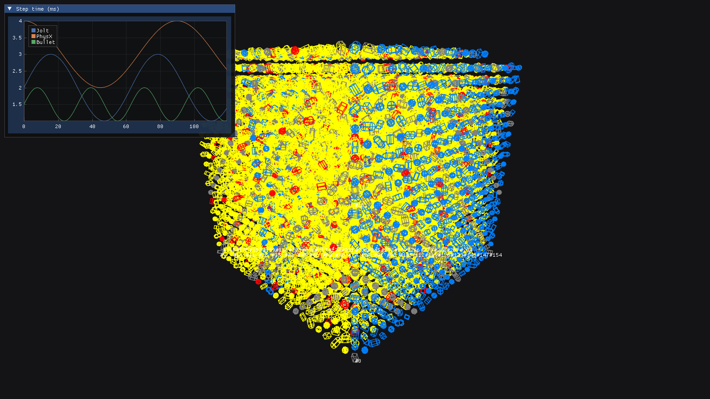

# prototypes — 타당성 검증용 프로토타입

이 폴더의 코드는 [타당성 검토](../docs/01_Feasibility.md)를 하면서 실제로 빌드하고 실행해 본 **일회성 검증 코드**입니다. 본 프로젝트의 코드가 아니며, M0(스캐폴드) 단계에서 필요한 부분만 정리해 `cmake/`, `Source/` 아래로 옮길 예정입니다. 자세한 내용은 [작업 계획](../docs/03_WorkPlan.md)을 참고하세요.

- 검증 환경: Windows 11, VS 2022 BuildTools (MSVC 14.44.35207), CMake 4.1.2, Ninja 1.13.2
- 모든 hello 테스트는 Y-up, SI 단위, dt = 1/60로 돌렸습니다. 본 프로젝트의 규약(UE 단위 cm, Z-up)과는 다릅니다.

| 폴더 | 내용 | 검증 결과 |
|---|---|---|
| `hello_jolt/` | `cmake/Jolt.cmake`: Jolt v5.6.0을 FetchContent로 가져오고 함정 옵션을 정리한 모듈. `main.cpp`: 상자 낙하 hello. `seam/`: Jolt를 PRIVATE로 링크해 `/arch:AVX2`와 `JPH_*` 정의가 새지 않는지 확인하는 테스트 | 22초 빌드. y = 5.098089 m (damping 0.05 반영). 플래그 누수 없음 |
| `hello_bullet/` | `cmake/PtBullet.cmake`: Bullet 3.25 `add_subdirectory` 모듈 (`CMAKE_POLICY_VERSION_MINIMUM 3.10`, 옵션 CACHE FORCE). `src/hello_bullet.cpp`: hello + BenchmarkDemo 상자 3000개 씬 + MT world/스케줄러 비교 | 약 0.4분 빌드. y = 5.013251 m. 단일 스레드 world는 비트 단위 결정적 |
| `hello_physx/` | PhysX 5.11을 소비하는 세 가지 방식(package / manual / subdir) 비교 hello | y = 5.013251 m. CPU 전용 정적 exe는 CRT DLL에만 의존 |
| `physx_superbuild/` | `cmake/PhysXBootstrap.cmake`: PhysX를 configure 시점에 빌드 트리로 복사해 빌드하는 방식 (VS multi-config 생성기용 대안) | configuration 하나당 약 1분 |
| `render_d3d11/` | Win32 + D3D11 + ImGui + ImPlot + stb 프로토타입. Chaos 상태색, UE line batcher 테셀레이션, 두꺼운 선, reversed-Z, 오프스크린 PNG. 세 SDK를 한 Ninja 트리에서 빌드하는 CMake 포함 | 와이어 도형 3만 개를 GPU 0.83 ms(1 px) / 2.17 ms(두꺼운 선)에 그림. 통합 빌드 95초 |

*렌더러 프로토타입의 오프스크린 출력입니다. 도형 배치와 그래프 값은 렌더링 확인용 **가짜 데이터**이며 물리 결과가 아닙니다.*

## 저장소에 넣지 않은 것

- `local/` (git 무시): UE4 방식 PhysX 설정을 PhysX 5.11에 적용해 본 프로브입니다. 공개 제3자 미러에서 읽은 UE 4.18 소스 동작을 바탕으로 작성했기 때문에 로컬에만 둡니다. 본 프로젝트에서는 UE 4.27 소스로 재확인한 뒤 clean-room으로 다시 구현합니다([01_Feasibility.md §2.2](../docs/01_Feasibility.md)).
